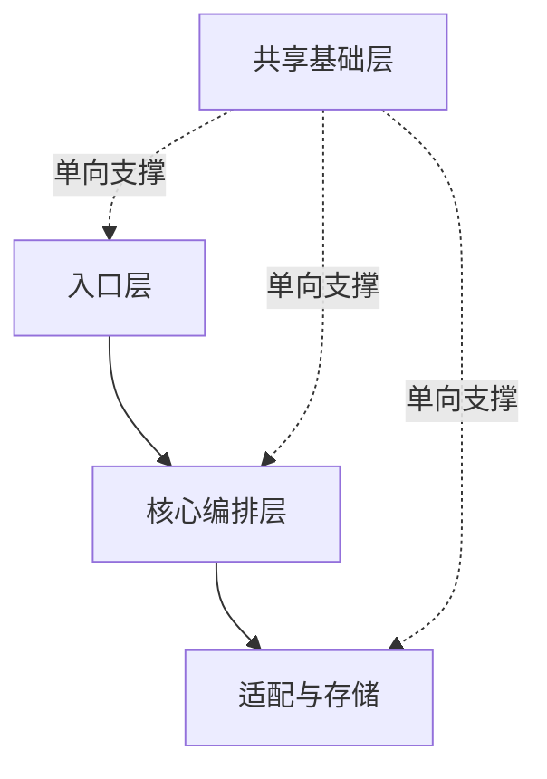
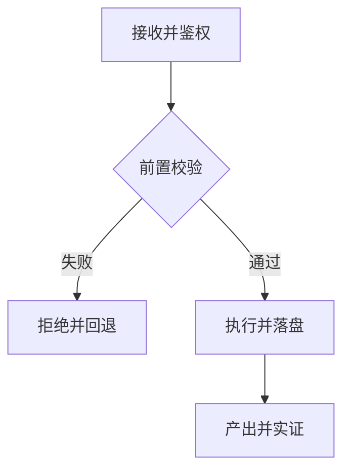
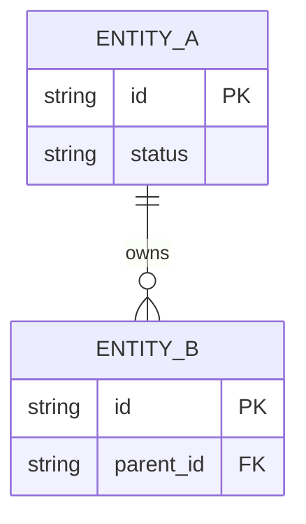
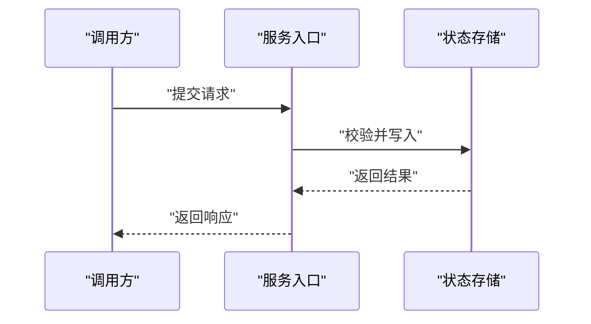

# {{PROJECT_NAME}} — 技术设计与架构契约（TDD）

<!-- 本文档是项目常青架构权威，面向人类维护者与 AI 会话。写作与校准准则：
1. 只描述系统当前真实结构、边界与不变量，不写修改履历、任务流水账或个人日记。
2. 所有文件路径、模块名、命令与接口必须来自真实代码勘察，严禁保留「<...>」「待补充」占位文本。
3. Mermaid 图只画拓扑短名（矩形/分组单行 <= 16 单位、菱形/边标签 <= 12 单位，全角计 2/半角计 1，禁 HTML 标签），详细路径写进下方表格。
4. 带 section 标记且标了 optional 的章节是可选的：按项目形态判定不适用时整节删除，不留空壳；没有该标记的是主干，任何项目都得写。
5. 完成改写或校准后，删除这些 HTML 提示注释，并同步更新「目录」链接与锚点。 -->

## 文档信息

| 项目 | 内容 |
| --- | --- |
| 文档版本 | `{{DOC_VERSION}}` |
| 编制 / 最近更新日期 | `{{TODAY}}` / `{{TODAY}}` |
| 基线依据 | {{BASIS}} |
| 运行环境与生态栈 | {{RUNTIME}} |
| 托管平台适配范围 | {{PLATFORM}} |
| 关联工程契约 | `AGENTS.md` |

## 目录

- [文档信息](#文档信息)
- [背景、非目标与术语表](#背景非目标与术语表)
- [技术栈选型](#技术栈选型)
- [系统架构全景](#系统架构全景)
- [核心流程与状态流转](#核心流程与状态流转)
- [核心不变量与安全红线](#核心不变量与安全红线)

> 章节增删后必须同步本目录，锚点对不上等于没有目录。

## 背景、非目标与术语表

- **核心定位**：{{POSITIONING}}
- **架构目标与关键取舍**：<性能、可靠性、零依赖、向后兼容或安全隔离边界，按本项目实际情况写>
- **明确非目标（Non-Goals）**：
{{NON_GOALS_LINES}}


### 术语表

| 术语 | 系统内定义 | 代码或配置中的对应载体 |
| --- | --- | --- |
| `<领域术语或核心概念 1>` | `<清晰、无歧义的语义界定>` | `<对应类型、目录或配置字段>` |
| `<领域术语或核心概念 2>` | `<状态、角色或契约对象界定>` | `<对应模块或文件位置>` |

<!-- section: stack -->
## 技术栈选型

> 取值以各子工程清单文件（`package.json` / `pom.xml` / `pyproject.toml` / `go.mod` 等）与部署目录为准，不凭记忆填。

| 层级 | 本项目采用 | 说明 |
| --- | --- | --- |
| 运行时与最低版本 | {{RUNTIME}} | 从清单文件读出 |
| 核心框架 | {{MANIFESTS}} | `<为什么选它、它承担哪一层>` |
| 工程结构 | {{STRUCTURE}} | `<源码在哪、产物在哪>` |
| 数据与状态 | {{DATA_CELL}} | {{DATA_HINT}} |
| 关键第三方依赖 | `<只列会约束架构的>` | `<版本边界与许可约束>` |
| 前端与 UI | {{FRONTEND_CELL}} | `<构建产物目录>` |

- **跨平台兼容范围**：{{PLATFORM_NOTE}}
- **变更前提**：<上移版本下限或换框架时，必须同步改哪些文件>

<!-- /section -->

<!-- section: integration optional -->
## 外部集成与依赖边界

> 只写「谁调谁、断在哪、失败了怎么办」。密钥只写键名，禁止写真实值。

| 外部系统 | 交互方式 | 失败语义 | 配置键名 |
| --- | --- | --- | --- |
| `<服务或依赖名>` | `<HTTP / SDK / 消息队列 / 子进程>` | `<超时重试、降级或 fail-closed>` | `<ENV_KEY_NAME>` |

<!-- /section -->

## 系统架构全景



### 模块与目录职责

| 模块 / 目录 | 核心职责 | 允许依赖 / 禁止反向引用 | 核心入口文件 |
| --- | --- | --- | --- |
{{MODULE_ROWS}}

### 分层禁引规则（arch-rules）

<!-- 与 AGENTS.md Dev Profile 中的 arch-rules 键保持一致；单层小型项目写 none -->

```yaml
arch-rules: <fromGlob> -> <toGlob>
```

- `<约束说明：为何禁止该方向依赖，越界应如何通过共享抽象或端口反转解耦>`

### 功能与入口地图（Feature Map）

| 功能 / 能力域 | 源码入口（文件与关键符号） | 本地验证命令（`quick-test` / `smoke-verify`） |
| --- | --- | --- |
| `<核心能力 1>` | `<入口文件路径>` | `{{QUICK_CMD}}` |
| `<核心能力 2>` | `<入口文件路径>` | `<可本地执行的单测或冒烟命令>` |

## 核心流程与状态流转



- **正常主链路**：<简述核心数据流与关键状态迁移条件>
- **失败与回退语义**：<校验失败、外部超时或部分失败时如何保障状态可恢复或零污染>
- **并发与幂等约定**：<重复执行、并发写入或重试时的锁与幂等键机制>

## 核心不变量与安全红线

1. **数据与状态一致性**：<任何场景下不能破坏的单一真相源、原子写入或事务边界>
2. **权限与访问边界**：<身份识别、鉴权最小权限、只读隔离与敏感凭据防泄露约束>
3. **输入与外部边界**：<不可信输入校验、命令注入防护或供应链执行隔离规则>
4. **高风险路径同步约定**：修改 `<核心协议、构建配置或权限边界路径>` 时，须同步校准本文与对应测试，并在同一分支接受独立审查。

<!-- section: security optional -->
### 安全与权限边界细节

| 边界 | 校验方式 | 失败时行为 |
| --- | --- | --- |
| `<入站请求 / 命令入口>` | `<鉴权、签名或白名单>` | `<拒绝并记审计，不写状态>` |
| `<凭据存放与读取>` | `<环境变量 / 密钥服务>` | `<缺失即拒绝启动>` |

<!-- /section -->

<!-- section: data optional -->
## 数据模型与持久化契约



| 存储载体 | 版本与迁移方式 | 备份与清理边界 |
| --- | --- | --- |
| `<表 / 文件 / 状态目录>` | `<迁移脚本位置与执行时机>` | `<保留策略与清理命令>` |

- **一致性边界**：<事务范围、原子写入方式、并发控制>
- **幂等键**：<重复提交时靠什么去重>

<!-- /section -->

<!-- section: api optional -->
## 对外接口与交互时序



| 接口 / 命令 / 事件 | 输入与关键参数 | 成功返回与错误 / 退出码语义 |
| --- | --- | --- |
| `<接口或命令 1>` | `<必填参数与约束>` | `<正常输出与典型阻断码>` |

<!-- /section -->

<!-- section: deploy optional -->
## 部署与环境差异

- **部署拓扑**：<单进程 / 容器 / 多副本，各自的启动方式>
- **环境变量与密钥边界**：<仅列配置键名与默认值，严禁写入真实密钥；明确禁止提交 `.env`>
- **环境差异**：<开发、测试、生产及不同操作系统间的路径、权限或构建差异>
- **健康检查与扩缩容**：<探针路径、就绪判据、扩容触发条件>

<!-- /section -->

<!-- section: perf optional -->
## 性能与容量基线

| 场景 | 当前基线 | 测量方式 | 退化警戒线 |
| --- | --- | --- | --- |
| `<关键路径或批处理>` | `<耗时 / 内存 / 吞吐实测值>` | `<benchmark 或 profiling 命令>` | `<超过多少算退化>` |

<!-- /section -->

<!-- section: frontend optional -->
## 前端与交互层

- **技术栈与构建**：<框架、构建工具、产物目录>
- **状态与数据流**：<全局状态方案、请求层、缓存策略>
- **组件与样式约定**：<组件目录约定、样式方案、设计令牌位置>
- **可访问性与浏览器支持**：<支持范围、已做的无障碍措施>

<!-- /section -->

<!-- section: build optional -->
## 构建、测试与发布链路

> 有构建步骤或发布流程的项目才有这一节；纯解释型脚本项目可以整节删掉。

| 环节 | 命令 | 产物 / 判定 | 失败时怎么办 |
| --- | --- | --- | --- |
| 本地构建 | `<build 命令>` | `<产物目录>` | `<回退方式>` |
| 单测 | `<test 命令>` | `<覆盖率或通过标准>` | `<阻断还是告警>` |
| 端到端 | `<e2e 命令>` | `<关键路径清单>` | `<阻断还是告警>` |
| 发布 | `<release 命令>` | `<版本号来源、制品去向>` | `<回滚步骤>` |

- **版本号唯一来源**：<哪个文件的哪个字段；其余地方一律引用它，不许各写一份>
- **制品与源码的对应**：<入库还是走发布页附件；二者不能混>

<!-- /section -->

<!-- section: observability optional -->
## 可观测性与运维

> 有长期运行的服务或后台任务才需要；一次性脚本整节删掉。

| 维度 | 现在怎么观测 | 出问题看哪里 |
| --- | --- | --- |
| 日志 | <格式、级别、落盘或采集方式> | <查询入口> |
| 指标 | <关键指标名与含义> | <看板位置> |
| 追踪 | <是否接入链路追踪、采样率> | <定位一次慢请求的步骤> |
| 告警 | <什么条件触发、通知到哪> | <处置手册位置> |

- **常见故障与处置**：<最可能出问题的两三种情形，以及第一步查什么>

<!-- /section -->

<!-- section: migration optional -->
## 迁移与兼容策略

> 有存量数据、旧接口或需要灰度上线的项目才有这一节。

- **数据迁移**：<脚本位置、执行时机、是否可逆、跑之前要不要备份>
- **接口兼容期**：<旧调用方还能用多久、怎么通知、什么时候删>
- **灰度与开关**：<开关名、默认值、怎么快速关掉>
- **回滚演练**：<上一次演练是什么时候、结论如何>

<!-- /section -->

<!-- section: decisions optional -->
## 关键决策记录

> 只记「当时为什么这么选」。这段最能防止下一轮把已经否掉的方案又拿出来讨论一遍。

| 决策 | 备选方案 | 为什么选它 | 什么时候该重新考虑 |
| --- | --- | --- | --- |
| `<已定的做法>` | `<还考虑过什么>` | `<决定性理由>` | `<出现什么情况说明当初判断不成立>` |

<!-- /section -->

<!-- section: glossary-only optional -->
## 已知限制与技术债

> 写清「现在明知不完美的地方」。不写不会让它消失，只会让接手的人以为是 bug。

| 限制 | 影响范围 | 为什么先这样 | 打算什么时候处理 |
| --- | --- | --- | --- |
| `<已知缺陷或妥协>` | `<谁会碰到>` | `<权衡理由>` | `<触发条件或版本>` |

<!-- /section -->

