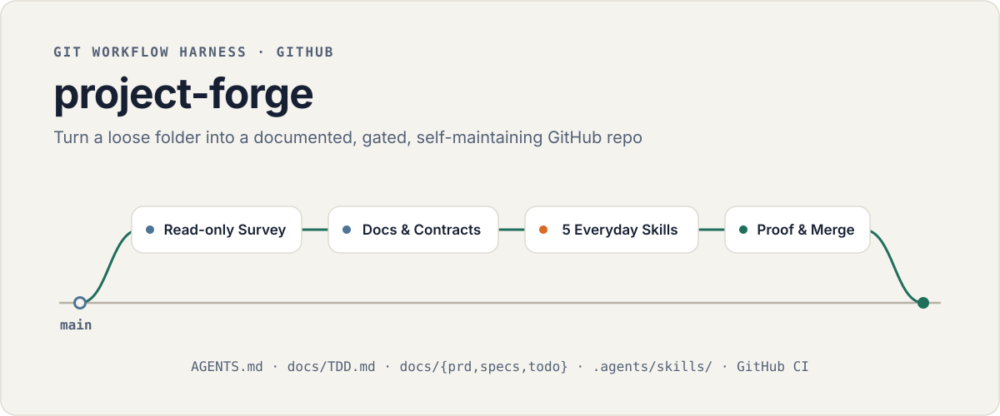
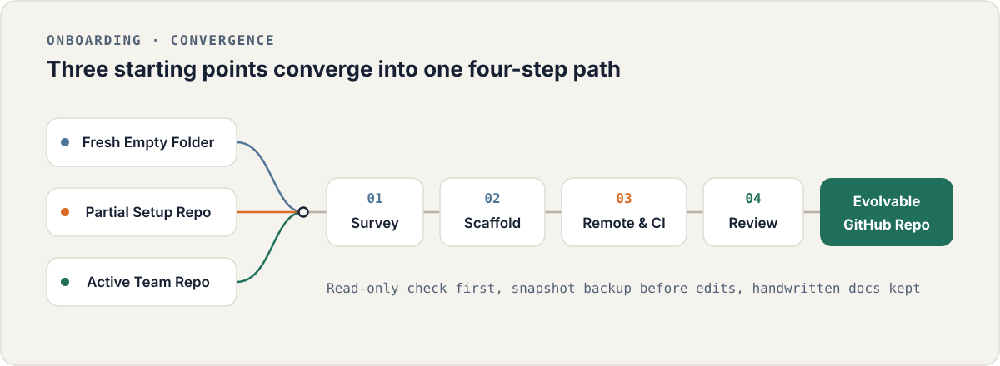
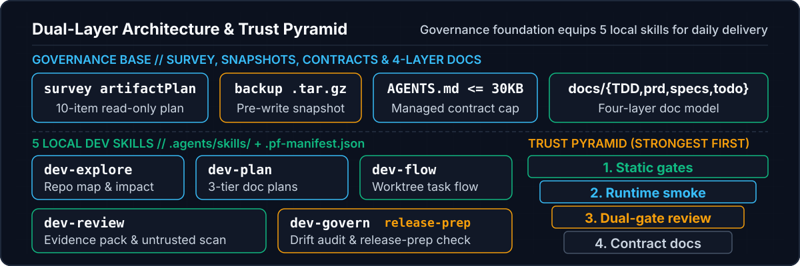

<p align="center">
  
</p>

<p align="center">
  <a href="README.md">简体中文</a> | <strong>English</strong>
</p>

<p align="center">
  <a href="RELEASING.md"></a>
  <a href="#install-and-get-started"></a>
  <a href="SKILL.md"></a>
  <a href="#using-the-5-everyday-skills"></a>
  <a href="#how-it-gets-a-repo-in-shape"></a>
  <a href="LICENSE"></a>
</p>

Starting a fresh folder or stepping into a repository that has grown over months usually stalls on surrounding engineering work rather than product code: `.gitignore` misses local secrets, design notes drift away from implementation, branches land without real test output, and edits break companion files without warning.

**project-forge** inspects your folder read-only first, then selects either a `lightweight` or `full` setup tier based on repository size and collaboration needs without overwriting handwritten content. Every script runs on `Node.js 18` or newer using only built-in `node:*` modules across `Windows`, `macOS`, and `Linux`, with zero third-party dependencies.

## Five Everyday Mistakes It Prevents

- **Existing docs and CI stay untouched**: Handwritten `README.md`, `CONTRIBUTING.md`, existing design docs, workflows, and custom local skills remain intact. Before writing managed files into a non-empty repository, an external `.tar.gz` snapshot is saved outside the repo.
- **PRDs, specs, and checklists archive together**: Docs in `docs/prd/`, `docs/specs/`, and `docs/todo/` use structured YAML frontmatter and `YYMMDD-issue<N>-<slug>-{prd,spec,todo}.md` naming, then move together into `docs/archive/` via `flow.mjs finalize` when work finishes.
- **Require real command output instead of guesswork**: Changes cannot merge into the default branch on self-reported code reading alone; they need passing static gates, real command outputs, valid Mermaid diagrams, and an independent context review.
- **Reminders when coupled files need syncing**: A dependency table inside `AGENTS.md` links source modules, templates, and companion docs so editing one side surfaces every sibling file that should be checked together.
- **Progressive two-tier setup with local exemptions**: Small or personal projects can stay on `lightweight` (a `< 14KB` contract and 3 core workflow skills) and upgrade losslessly to `full` later; deleted or locally edited managed files are recorded in `.pf-manifest.json` so upgrades never clobber your edits.

## Contents

<!-- toc:start -->

- [Five Everyday Mistakes It Prevents](#five-everyday-mistakes-it-prevents)
- [How It Gets a Repo in Shape](#how-it-gets-a-repo-in-shape)
- [Using the 5 Everyday Skills](#using-the-5-everyday-skills)
- [Install and Get Started](#install-and-get-started)
- [Guardrails](#guardrails)
- [Script Reference](#script-reference)
- [License](#license)

<!-- toc:end -->

## How It Gets a Repo in Shape

<p align="center">
  
</p>

Whether you start from an empty folder, a half-configured side project, or an active team repository, **project-forge** follows the same four steps:

1. **Read-only survey**: Scans files, manifests, Git remote topology, local auth readiness, and existing architecture docs without modifying anything. On an empty folder, three or four short questions (`node`, `python`, `go`, `rust`, `java`, or `docs`, plus package name, license, and remote preference) generate the starter project.
2. **Plan from observed facts**: Preserves handwritten READMEs, non-standard directories, and custom local skills, plans missing items through `artifactPlan`, recommends `lightweight` or `full`, and asks before making choices such as license or release strategy.
3. **Snapshot and scaffold in sequence**: Saves an external tar backup of non-empty repositories, then builds strictly in order: **Repo → docs → remote → automation**. After Git baselines and `.agents/skills/` are in place, `dev-explore` inspects real module boundaries to generate `docs/TDD.md` and `AGENTS.md`, followed by GitHub remotes and checks (unregistered remote hosts fall back to `generic-git` for full local workflow support).
4. **Verify and hand off**: Re-checks consistency and cross-links across generated files, and lists any temporary forge markers for explicit confirmation before cleaning them up.

## Using the 5 Everyday Skills

<p align="center">
  
</p>

Once installed under `.agents/skills/`, `lightweight` includes `dev-explore`, `dev-plan`, and `dev-flow`, while `full` enables all five skills. Plain requests route automatically through `AGENTS.md` without memorizing script flags:

| What you ask in plain words | Skill | What it handles |
| --- | --- | --- |
| "Map the entrypoints and module boundaries first" | `dev-explore` | Read-only scan of codebase structure, multi-package layouts, and check commands |
| "Draft a spec and task list for this change" | `dev-plan` | Writes and audits `docs/prd/`, `docs/specs/`, and `docs/todo/`, checking scope and Mermaid widths |
| "Pick up this issue, work on a branch, and open a PR" | `dev-flow` | Creates an isolated branch or worktree, mounts deps safely, runs checks, submits PRs, and archives docs |
| "Review this PR from an independent angle" | `dev-review` | Spawns an isolated review context to check criteria line by line and run failure-injection checks |
| "Audit stale docs, duplication, or slow tests" | `dev-govern` | Runs baseline-aware incremental audits, spots oversized files or weak tests, and prepares releases |

A typical change follows four steps: ask `dev-explore` for real entrypoints and test commands, ask `dev-plan` to freeze `C1`/`C2` criteria, ask `dev-flow` to implement and verify on a branch, and ask `dev-review` to verify independently before merging and cleaning up. **Static and contract checks outrank runtime smoke tests, runtime output outranks code reading, and independent review finishes before doc archiving**.

## Install and Get Started

- **Runtime**: `Node.js 18` or newer (`>= 18`) on `Windows`, `macOS`, or `Linux`.
- **Zero external dependencies**: Every script uses only Node built-in modules (`node:*`), so no `npm install` is needed.

**Direct Zip Download (Recommended)**: Download the latest archive [project-forge.zip](https://github.com/FiretrUCK666/project-forge/releases/latest/download/project-forge.zip) (see all versions on the [Releases page](https://github.com/FiretrUCK666/project-forge/releases)), unzip it, and **keep the folder name as `project-forge`** inside your host skills directory (do not append a version suffix, or the host will ignore it).

| Install Method | Update Behavior | Best For |
| --- | --- | --- |
| **Release zip** (`project-forge.zip`, no `.git`) | Auto-checks with a `1 hour` check throttle, `24 hour` replace cooldown, and `15 min` offline failure cooldown | Everyday users who want zero-maintenance updates |
| **`git clone`** (source checkout with `.git`) | Read-only notice only; update manually with `git pull` so local edits stay safe | Contributors modifying `project-forge` itself |

Zip installs silently run `node scripts/update.mjs --quiet` before surveying: network checks are throttled to once per `1 hour`, replacements wait at least `24 hours`, and offline failures enter a `15 minute` cooldown so offline sessions never hang. Updates validate inside a same-disk staging folder, update helper files first, write `SKILL.md` last, and roll back if interrupted.

```sh
# Check for a new release right now (bypasses 1h / 24h throttles; report-only)
node "<skill-dir>/scripts/update.mjs" --check

# Disable automatic update checks completely
PF_NO_UPDATE=1

# Point update checks to a fork or mirror
PF_UPDATE_SOURCE="https://github.com/<owner>/project-forge"
```

Once placed in your skills folder, open your target project directory and start with a plain request:

```text
Survey this project directory first,
and list what setup items are missing.
```

Empty folders ask three or four brief questions about stack, description, license, and remote setup; existing repositories keep handwritten docs, existing architecture folders, and working workflows untouched, and can upgrade losslessly with `--tier full` at any time.

## Guardrails

To protect published history and prevent skipped checks, actions are separated into routine branch work and human-confirmed operations:

- **Boundaries depend on whether they can be undone**: Routine work covers actions like pushing your own branch and opening or updating a PR because both can be reverted. Merging directly into the default branch outside normal review, tagging a release, publishing artifacts, or changing repository visibility cannot be undone and require explicit confirmation first.
- **Clear separation between routine merges and gate changes**: When an independent review passes with zero open failures, the reviewer merges directly; any change involving **weakening a gate**—removing tests, loosening assertions, skipping checks, or relaxing CI—always requires human confirmation.
- **Never rewrite pushed history, always verify after writes**: Force-pushing and rewriting published commits never run automatically. After pushing branches, opening PRs, or publishing releases, the scripts read back live GitHub state to verify everything landed accurately.

## Script Reference

Normal work routes through `AGENTS.md` automatically. Expand below if you want to invoke individual checks manually or wire them into CI:

<details>
<summary>Inspect underlying CLI scripts</summary>

| Script | Purpose |
| --- | --- |
| `node scripts/survey.mjs <dir>` | Read-only scan of repository layout, docs, remote topology, auth state, and tier recommendation |
| `node scripts/backup.mjs create <dir>` | Create an external tar snapshot before modifying an existing repo and pin the baseline |
| `node scripts/equip.mjs <dir> [--tier lightweight\|full]` | Install or upgrade `.agents/skills/` (supports `--check`, `--adopt-custom`, and `--restore`) |
| `node scripts/compose-agents.mjs <dir> [--tier lightweight\|full]` | Build or refresh `AGENTS.md` (`lightweight < 14KB`, `full <= 30KB`) |
| `node scripts/review.mjs <dir>` | Audit repository readiness and claim validity against project contracts |
| `node scripts/handoff.mjs <dir>` | List and remove temporary forge markers when stepping back |
| `node scripts/sync-toc.mjs README.md README.en.md` | Keep bilingual README tables of contents synchronized |
| `node scripts/update.mjs [--check]` | Check and atomically sync zip-installed toolkit updates |

</details>

## License

Released under the [MIT](LICENSE) License. See [CONTRIBUTING.md](CONTRIBUTING.md) and [RELEASING.md](RELEASING.md) for collaboration and release details.
