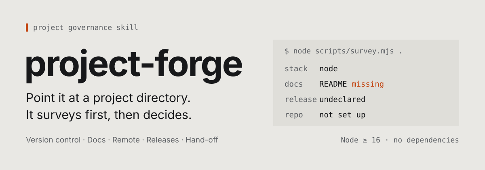
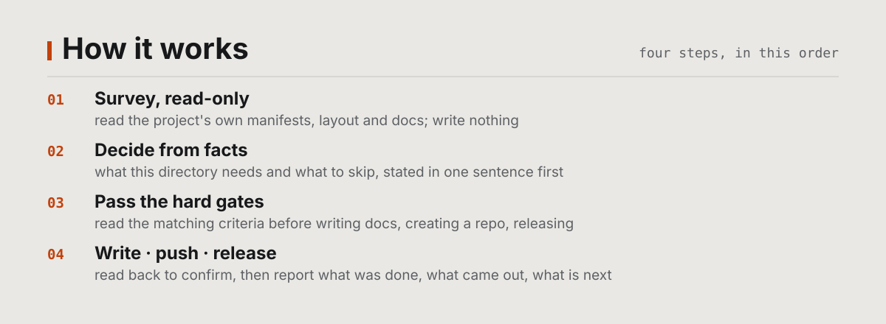
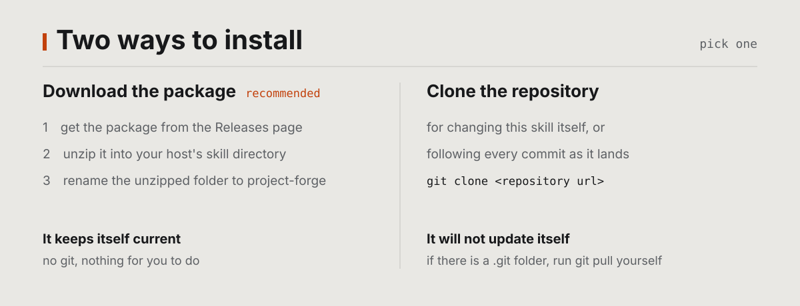
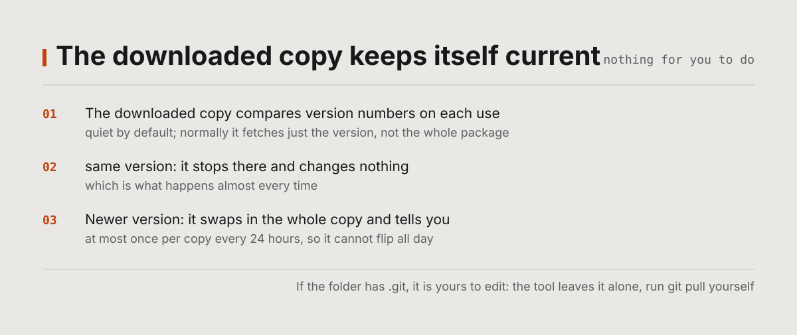

# project-forge

[中文](README.md) | English

[](https://github.com/FiretrUCK666/project-forge)
[](LICENSE)
[](README.en.md#before-you-start)
[](README.en.md#before-you-start)

<p align="center">
  
</p>

Turn any project directory into a well-formed project. Give it a directory and it surveys
read-only first, sees what the project actually is, then decides what to do this time and what
to leave alone.

It assumes no stack. Node, Python, Rust, Go, Java, a docs-only directory, a plugin project, or a
skill project: the decision always comes from the facts it surveyed.

## Contents

<!-- toc:start -->

- [What it does](#what-it-does)
- [How it works](#how-it-works)
- [Before you start](#before-you-start)
- [Install](#install)
- [Update](#update)
- [Usage](#usage)
- [What it will not do](#what-it-will-not-do)
- [What is inside](#what-is-inside)
- [Scripts](#scripts)
- [How this repository is set up](#how-this-repository-is-set-up)
- [Troubleshooting](#troubleshooting)
- [Contributing](#contributing)
- [License](#license)

<!-- toc:end -->

## What it does

Between "it runs" and "it looks like a real project" sits a pile of small, error-prone chores:
whether the ignore rules are right, whether build output belongs in the repo, whether commit
identity is set, whether the README promises things that hold, whether the release flow could
leak a secret. None of them is hard. Together they are many, and mistakes surface long after
they are made.

project-forge brings them into one flow:

- **Version control**: ignore rules, text attributes, commit identity, commit discipline, secret scan;
- **Documentation set**: `AGENTS.md`, `README`, `CONTRIBUTING`, `LICENSE` — each with its own reader, none repeating another;
- **Remote repository**: create (private by default), push, metadata, collaboration templates, CI;
- **Release channel**: whether it can ship, where to, how versions are numbered, how to ship safely;
- **Hand-off**: once the project is in shape, it asks whether you want its traces cleaned up.

It only governs. It does not create the project itself: it picks no stack and writes no source or
framework config. Governance runs after the skeleton exists.

### Hand-off: done with it, want the traces gone

Once a project has been put in shape, it still carries what this skill left behind — identifiers,
unfilled template placeholders, residue from an interrupted injection. **It always asks at the end
whether you want those cleared**, and it does not finish without asking.

When it asks, it scans the project first and tells you which parts are traces, which belong to the
project, and what to delete or keep for each — then waits for your go-ahead. **It never deletes on
its own**, and irreversible moves such as removing a remote or rewriting history need a separate,
explicit confirmation.

To see the scan yourself:

```sh
node "<skill directory>/scripts/handoff.mjs" "<project directory>" --scan
```

## How it works

<p align="center">
  
</p>

Four steps, and the order matters: survey read-only, decide from facts, pass the hard gates, then
write, push and release. When it is done it also asks whether you want the traces it left cleaned
up — that is the closing move, not a fifth step. The input is surveyed facts, not a preset
checklist, so it will not bolt a release flow onto a docs-only directory and will not recreate a
repo that already has a remote. "Not releasing" and "skipping something" are normal outcomes, not
failures.

## Before you start

**Node.js 16 or newer**, and nothing to install first. Everything you use day to day runs at that
floor (CI runs Node 22, the development machine runs Node 24; 16 through 21 has not been tested
release by release, and reports of trouble there are welcome).

The one exception is the **two release-related scripts** (`release-notes.mjs` and
`check-badges.mjs`): they use the global `fetch`, which arrived in Node 18, so running them needs
Node 18 or newer. They are only used when maintaining this skill itself.

`git` is optional. Without it the survey and everything about documentation still work, and it
reports "git unavailable" plainly. What needs git is setting up and maintaining version control,
remote repositories, pushing and releasing.

## Install

**Download the package.** No git needed:

<p align="center">
  <a href="https://github.com/FiretrUCK666/project-forge/releases/latest/download/project-forge.zip">
    <b>Download the latest version</b>
  </a>
</p>

Unzip it into your skill directory, then **rename** the `project-forge-<version>/` folder inside it
to `project-forge` — the folder name has to match the `name` field in the `SKILL.md` frontmatter,
and on case-sensitive systems a different case is a different directory.

<p align="center">
  
</p>

**To change it, or to follow every commit**, clone instead:

```sh
git clone https://github.com/FiretrUCK666/project-forge.git "<your skill directory>/project-forge"
```

The two differ in exactly one way: **a clone does not update itself**. A `.git` folder means that
copy is meant for editing, and the tool leaves it alone. How to work on it is in
[CONTRIBUTING.md](https://github.com/FiretrUCK666/project-forge/blob/main/CONTRIBUTING.md).

> **The `Source code` download works too.** It is GitHub's generated source archive: **the same set
> of files** as the package, but it has no versioned top-level folder — create a `project-forge/`
> folder and put the files in it. Both install, and both keep themselves current. The package is
> built for the purpose, so prefer it.

### Where it goes

Put it in **your host's user-level skill directory**. If you already have other skills, put it
where they live; if you have none, check that host's documentation. Keep the folder named
`project-forge` — it has to match the `name` field in the `SKILL.md` frontmatter. On
case-sensitive systems, a different case is a different directory.

Nothing to register and no restart: hosts discover skills by directory, and `SKILL.md` is the entry.

## Update

<p align="center">
  
</p>

The downloaded copy keeps itself current. You do nothing. On each use it quietly compares version
numbers: same version and it stops there changing nothing, newer version and it swaps in the whole
copy, telling you which version it moved from and to.

A copy replaces its files at most once every 24 hours, so it cannot flip several times a day. To
look at the state yourself (report only, no update):

```sh
node "<skill directory>/scripts/update.mjs" --check
```

Where it asks depends on the address that copy records for itself — it ships in the package, in the
`SKILL.md` `metadata.source` field. It recognises the hosting platform's address pattern, so it
**prefers the platform's API**: one request returns both the version and the download address,
without touching the web host. The web address is the fallback.

**When it cannot connect**: that run is skipped (it will not damage your copy or hold up the task),
and the next use retries. But if it has been more than a day without reaching the platform, it says
one line telling you which version this copy is stuck on — that is a warning that you are behind,
not an error.

To make it ask somewhere else (a self-hosted mirror, an internal release), edit `metadata.source` in
that copy's `SKILL.md`; the `PF_UPDATE_SOURCE` environment variable only stands in when the copy
records no address.

## Usage

Just describe what you want, in plain language:

- Version control: `set up version control`, `configure git`, `push to GitHub`
- Documentation: `write AGENTS.md`, `write a README`, `add a LICENSE`, `write a contributing guide`
- Release: `publish to npm`, `release it`, `add CI`
- General: `initialize this project`, `set this project up`, `standardize this repo`

```
clean up this project
set up version control and docs for D:\work\my-tool
should this project be published to npm?
```

It never starts by writing. The first step is always the survey, and then it tells you what state
the project is in, what it plans to do, and why it is skipping the rest.

## What it will not do

- Create the project itself: it picks no stack and writes no skeleton — that is a scaffolder's job;
- Touch your code logic; it handles version control, remotes, docs and releases only;
- Choose a license for you — it gives criteria and options;
- Make a repository public on its own (private by default);
- Force-push, rewrite pushed history, or delete a published release;
- Delete what it left behind without your confirmation;
- Deploy or configure servers.

## What is inside

### In the package

| Path | Contents |
| --- | --- |
| `SKILL.md` | Entry point: hard invariants, capability matrix, execution flow, hard gates |
| `references/survey.md` | Survey protocol: what to read, what each field means, how facts turn into actions |
| `references/version-control.md` | Version control: what belongs in the repo, ignore rules, identity, commit discipline, rollback tiers, secret gating |
| `references/remote-github.md` | Remote repository: channel discovery, creating, pushing, metadata, version nodes and release notes, collaboration templates, CI |
| `references/docs-set.md` | Documentation set: who reads each document, its job, how to write it, how to keep them in sync |
| `references/publish.md`, `references/publish-npm.md`, `references/publish-python.md`, `references/publish-go.md`, `references/publish-rust.md` | Release overview and per-ecosystem chapters: can it ship, where, version semantics, safe release, how to join an existing state |
| `references/plugin-project.md`, `references/skill-project.md`, `references/plugins/` | Decision protocols for plugin and skill projects, plus per-ecosystem chapters |
| `references/handoff.md` | Hand-off: how a trace is judged, what to remove and what to keep, the order of removal, how to accept the result |
| `templates/agents-project.md`, `templates/readme.md`, `templates/contributing.md` | Three drop-in document skeletons (project contract, README, contributing guide) |
| `templates/agents-kernel.md` | The operating-principles kernel (injected verbatim into `AGENTS.md`; the single source of truth) |
| `templates/ci-check.yml`, `templates/ci-release.yml` | Two CI skeletons: checks and release |
| `templates/license-mit.txt`, `templates/license-isc.txt`, `templates/license-unlicense.txt` | Full standard text of three permissive licenses (MIT, ISC, Unlicense) |
| `templates/license-bsd-2-clause.txt`, `templates/license-bsd-3-clause.txt` | Full standard text of the two BSD licenses (2-clause, 3-clause) |
| `scripts/update.mjs` | Keeps this copy current (see Update) |
| `scripts/survey.mjs` | Read-only survey producing structured facts; also holds the shared text criteria |
| `scripts/zip.mjs` | Unzips a package: self-update has to read the one it downloaded |
| `scripts/compose-agents.mjs` | Generates, refreshes or upgrades `AGENTS.md` |
| `scripts/review.mjs` | P4/P5 delivery gate: no missing items, and every pending question closed by an explicit option |
| `scripts/handoff.mjs` | Read-only scan of the traces this skill left in a project; can also judge whether it is already clean |
| `scripts/ledger.mjs` | Records which byte ranges this skill wrote in a project, so teardown removes exactly its own bytes |
| `scripts/release-notes.mjs`, `scripts/draft-release-notes.mjs` | Writes release notes from a UTF-8 file so Chinese never passes through a shell; and drafts them from the commit log |
| `scripts/check-badges.mjs` | Checks that the README badges actually render |
| `scripts/sync-toc.mjs` | Keeps a Markdown table of contents in sync with its headings |
| `README.md`, `README.en.md`, `LICENSE`, `assets/readme/` | This documentation (paired, Chinese is authoritative), the license text, and the cards used in the README |

### Only in the repo

These never enter the package. To work on this skill, start with
[CONTRIBUTING.md](https://github.com/FiretrUCK666/project-forge/blob/main/CONTRIBUTING.md).

| Path | Contents |
| --- | --- |
| `AGENTS.md` | This repository's own contract: mechanisms, invariants, build and verification, hard rules |
| `CONTRIBUTING.md` | The flow for outside contributors: how to ask, how to propose a change, the gate before committing |
| `.github/` | CI and collaboration templates (workflows, issue and pull request templates) |
| `.gitattributes`, `.gitignore` | What stays out of the package, and what stays out of the repository |
| `scripts/dev/preflight.mjs` | Structural self-check: references, kernel consistency, hard rules, package boundary |
| `scripts/dev/selftest.mjs` | Behavioural self-check: builds fixtures, runs them, asserts each decision |
| `scripts/dev/render-svg.mjs` | Renders the README cards and measures their margins; use it to accept a card change |

## Scripts

Every script uses only built-in modules: no dependencies, cross-platform.

```sh
# Keep this copy current (--check reports without updating)
node "<skill directory>/scripts/update.mjs" --quiet

# Survey a project (read-only, writes nothing)
node "<skill directory>/scripts/survey.mjs" "<project directory>" --markdown

# Generate, refresh or upgrade a project's AGENTS.md
node "<skill directory>/scripts/compose-agents.mjs" "<project directory>"
node "<skill directory>/scripts/compose-agents.mjs" "<project directory>" --status    # look, do not write
node "<skill directory>/scripts/compose-agents.mjs" "<project directory>" --upgrade   # upgrade a hand-written one

# Survey the traces this skill left in a project (read-only)
node "<skill directory>/scripts/handoff.mjs" "<project directory>" --scan     # list traces and what to do with each
node "<skill directory>/scripts/handoff.mjs" "<project directory>" --verify   # judge whether it is already clean

# Self-checks for this skill (run only when changing it)
node "<skill directory>/scripts/dev/preflight.mjs"
node "<skill directory>/scripts/dev/selftest.mjs"
```

`<skill directory>` is where this skill lives and `<project directory>` is the project you want it
to work on. They are usually not the same directory. Keep the quotes when a path contains spaces
or non-ASCII characters — that is not styling, it is whether the command runs at all.

## How this repository is set up

This skill is its own first user: its version control, documentation and CI all follow its own
standard. If what it teaches were wrong, its own repository would break first. Details are in
[AGENTS.md](https://github.com/FiretrUCK666/project-forge/blob/main/AGENTS.md).

This file is the English translation; `README.md` is authoritative. When the two disagree, the
Chinese one wins and this one gets updated.

## Troubleshooting

Open an [issue](https://github.com/FiretrUCK666/project-forge/issues). To make it findable, include:

- your OS and Node version;
- the exact command you ran;
- the full error text (the original, not a description of it);
- if it concerns a specific project, that project's stack and rough directory layout.

## Contributing

See [CONTRIBUTING.md](https://github.com/FiretrUCK666/project-forge/blob/main/CONTRIBUTING.md).

## License

[MIT](LICENSE)
