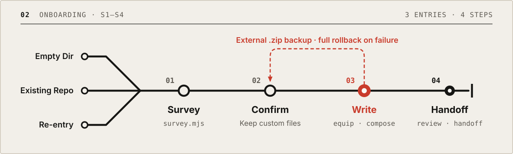
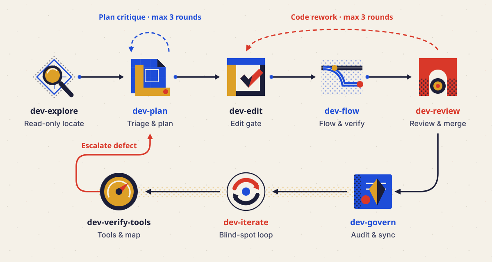
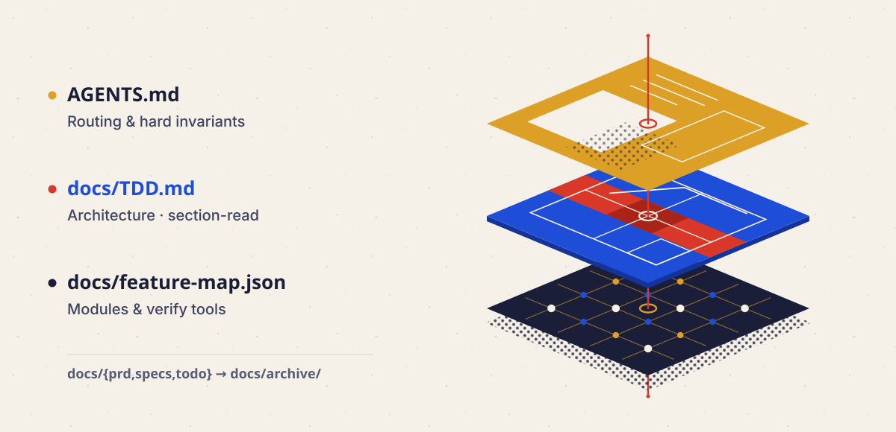

<p align="center">
  
</p>

<p align="center">
  <a href="README.md">简体中文</a> | <strong>English</strong>
</p>

<p align="center">
  <a href="RELEASING.md"></a>
  <a href="#install-and-automatic-updates"></a>
  <a href="SKILL.md"></a>
  <a href="#supported-languages"></a>
  <a href="LICENSE"></a>
</p>

As a codebase grows, friction rarely comes from business logic alone: docs drift from code, changes miss coupled files, and AI edits patch the current line while leaving workarounds on the main branch.

**project-forge** surveys a folder read-only first, then sets up version control baselines, three-layer evergreen docs, an `AGENTS.md` contract, remote-aware checks, and eight local development skills. It leaves handwritten files intact, installs zero third-party packages, and runs on Node.js 18 or newer.

## Contents

<!-- toc:start -->

- [Install and Automatic Updates](#install-and-automatic-updates)
- [Core Mechanisms: How It Protects Code and Docs](#core-mechanisms-how-it-protects-code-and-docs)
- [Workflows and Daily Usage](#workflows-and-daily-usage)
- [Eight Local Development Skills](#eight-local-development-skills)
- [Supported Languages](#supported-languages)
- [Script Reference](#script-reference)
- [License](#license)

<!-- toc:end -->

## Install and Automatic Updates

Supports Windows, macOS, and Linux with `Node.js >= 18`. Every script uses built-in Node modules only, so `npm install` is never needed.

| Option | Source | Updates | Best for |
| --- | --- | --- | --- |
| **Download archive** | [Download project-forge.zip (latest)](https://github.com/FiretrUCK666/project-forge/releases/latest/download/project-forge.zip) | Automatic updates with atomic rollback | Everyday use |
| **`git clone`** | `git clone https://github.com/FiretrUCK666/project-forge.git` | Checks and notifies only; run `git pull` manually | Modifying the tool itself |

Keep the folder named **`project-forge`** (without `-main` or version suffixes) so hosts load it reliably. Open your target repository and tell the AI:

```text
Use project-forge to standardize this repository
```

- **Start from an empty folder**: `Use project-forge to initialize this project`
- **Upgrade an existing repo**: `Use project-forge to upgrade this repo's governance config and local skills`

> It always surveys read-only first, saves a full external `.zip` snapshot before writing any file, and never overwrites handwritten docs.

<details>
<summary>Show automatic update cadence and environment flags</summary>

Only the **archive copy** checks and updates automatically. A `git clone` copy is never overwritten.

| Item | Behavior |
| --- | --- |
| **Check cadence** | Checks at most once per hour after success, waits 15 minutes after a failure (offline-safe), and skips checks for 24 hours after an update |
| **Atomic replacement** | Downloads to a same-disk staging folder, validates, and swaps `SKILL.md` last; any failure rolls back cleanly |
| **Disable or mirror** | Set `PF_NO_UPDATE=1` to disable checks, or set `PF_UPDATE_SOURCE` to point at a mirror repository |

```sh
node "<skill directory>/scripts/update.mjs" --check
PF_NO_UPDATE=1
PF_UPDATE_SOURCE="https://github.com/<owner>/project-forge"
```

</details>

## Core Mechanisms: How It Protects Code and Docs

- **Anti-slop static gates**: `dev-edit` strips comments and literals to block unjustified suppressions (`HACK`, `@ts-ignore`, `eslint-disable`, `# noqa`), dead commented code, `arch-rules` boundary violations, and files exceeding `800` lines before commit.
- **Fake-green detection and real proof**: Suspected bugs require a minimal reproduction first, bugfixes start with a failing regression test, and zero-assertion or mock-only tests are blocked. Runtime or UI edits require real command output or `--artifact` screenshot files rather than verbal claims.
- **Main-branch isolation and wave parallelism**: Repositories with commit history run work inside `.worktrees/` branches, where whoever edits the code owns the claim and PR. Independent slices run in parallel waves without stepping on each other.
- **No self-review and 6-lock convergence**: Neither plans nor code can be self-reviewed. Round 2+ requires a fresh reviewer not seen in prior rounds, capped at 3 rounds and guarded by 6 locks including same-SHA and receipt checks.
- **Promote repeated issues after 2 occurrences**: When the same class of failure happens twice, `dev-govern` promotes it into a structural check or static gate instead of adding another prose reminder.
- **Lossless adoption and human control on irreversible actions**: Existing `README.md`, design docs, CI workflows, and custom skills stay intact across GitHub, `generic-git`, and `local-only` repos. Daily actions split by **whether they can be undone**: pushing your own branch and opening PRs are undoable; merging into default branches, tagging releases, rewriting history, and weakening a gate require human sign-off, force-push is never automatic, and the reviewer merges directly once independent checks pass.

## Workflows and Daily Usage

### First-Time Setup or Upgrades: S1 to S4

<p align="center">
  
</p>

Empty folders, existing repositories, and returning upgrades all follow four steps:

| Step | What happens | Key safeguard |
| --- | --- | --- |
| **S1 Read-only Survey** | Inventories layout, languages, Git remotes, credentials, and existing docs/skills | Writes nothing; empty folders answer 3 to 4 questions first |
| **S2 Scope and Fusion** | Keeps handwritten docs, scripts, and custom skills; skips inapplicable templates | License, visibility, and release policy wait for human choice |
| **S3 Backup and Ordered Write** | Saves an external `pre-forge` `.zip` snapshot and runs baseline tests before writing | Fixed order: **Repo → docs → remote → automation** |
| **S4 Review and Handoff** | Verifies alignment and claims, then files discovered legacy debt as normal issues | Lists scaffold markers before cleaning; keeps `.pf-manifest.json` |

Across upgrades, `.agents/skills/.pf-manifest.json` records user-deleted skills as tombstones (never restored unless `--restore` is passed), merges non-script edits in three ways while preserving local `.mjs` conflicts, and rolls back from the external snapshot on any validation failure.

### Daily Conversations and Worktree Topology

<p align="center">
  
</p>

Describe what you need in plain language—or paste Issue, PR, or Milestone links—and `AGENTS.md` routes the task automatically:

| Everyday situation | What you can say | Steps actually executed |
| --- | --- | --- |
| **Typo or single-line fix (Case 1)** | "Fix this typo in the config comment" | Skips planning docs, edits directly, and runs the matching check |
| **Clear local bugfix (Case 2)** | "Login crashes on empty input, please fix it" | Writes a failing regression test first in `.worktrees/impl-*`, fixes it, passes `dev-edit`, opens a PR, and merges via independent `dev-review` |
| **New feature or cross-module change (Case 3 / 4)** | "Add a CSV export feature for reports" | `dev-explore` reads slices → `dev-plan` clarifies and runs Critique → `dev-flow` implements in isolation and passes `dev-edit` → `dev-review` merges independently → 7-step cleanup asks before deleting |
| **Periodic tests and health pass** | "Check recent changes for test gaps and audit repo health" | `dev-iterate` adds native tests, `dev-verify-tools` checks endpoint probes, and `dev-govern` audits and promotes recurring rules |

### Bounded Optimization Loop and PoC-First

<p align="center">
  
</p>

For test gaps, review suspicions, and audit warnings, one rule applies everywhere: **run a minimal reproduction (`PoC-first`) before writing any patch**. Unreproducible suspicions are dropped as false positives.

1. **Observe**: Rank hotspots from the feature map, historical signals, and recent diffs without editing source files.
2. **PoC-first**: Run one minimal command proving the failure is real.
3. **Escalate & Fix**: File an issue with reproduction proof, fix it through the standard workflow and review, then re-run the same proof command.
4. **Reflect**: Harden shared boundaries first and promote deterministic checks into static gates.

Automated loops stop with exit code `4` for human judgment on round cap (`ROUND_LIMIT_REACHED`, default 3 / hard cap 10), `2` rounds without progress (`NO_PROGRESS_STALL`), or irreversible actions (`ONE_WAY_GATE_HIT`).

### Three-Layer Evergreen Docs and On-Demand Slicing

<p align="center">
  
</p>

During daily work, `doc-locate.mjs` reads targeted `startLine..endLine` slices by heading or symbol so long files are never dumped whole into context:

| Layer | File | Role and freshness check |
| --- | --- | --- |
| **L1 Entry contract** | `AGENTS.md` | Thin session contract: intent routing, commands, collaboration, and coupled-edit map (`< 24KB` target, `<= 30KB` cap) |
| **L2 System architecture** | `docs/TDD.md` | Module boundaries, flow diagrams, and invariants checked against real paths |
| **L3 Machine index & map** | `docs/feature-map.json` + `docs/architecture-map.html` | `v1/v2` domain topology, cross-feature flows, and probe map checked via symbol/tree hashes, deterministically rendering an offline interactive architecture map (`no-architecture-html` opts out) |
| **Planning, brief & archive** | `docs/{prd,specs,todo}/` → `docs/archive/` | Freezes `C1..Cn` criteria, projects an out-of-repo Living Visual Brief for Case 3/4 planning (with host-neutral static UI prototype staging and confirmation snapshots), and pairs archived docs before PR submission |

## Eight Local Development Skills

You do not need slash commands—describe your goal in plain language, or invoke any skill on its own when needed.

### Main Chain (5 Skills): Automatic Handoff on Everyday Tasks

| Skill | What it does | How each step hands off to the next | What you can say to the AI |
| --- | --- | --- | --- |
| **`dev-explore`** | Surveys layout, entry points, reusable helpers, and exact doc/symbol line slices read-only | Gathers verified facts first; answers questions directly or hands entry points and reusable modules to `dev-plan` (or `dev-flow` for tiny fixes) | "Map the export module entry points and reusable helpers first" |
| **`dev-plan`** | Triages tasks (Case 1–5), clarifies open questions, freezes `C1..Cn`, and runs independent Critique | Takes facts from `dev-explore`; maintains `v2` multi-topic Working Brief, `OPEN`/`LOCKED` freeze guards, and lossless resume (`doc-plan.mjs next`), handing approved plans to `dev-flow` | "Add a report export feature and settle the spec before coding" |
| **`dev-flow`** | Manages `.worktrees/` slots, claims, doc archiving, proof checks, PR submission, and 7-step cleanup | Starts isolated slots from `dev-plan`; normalizes `--agent`/`--mode`/`--host-mode` and JSON `nextSteps`, supports `rework --reopen`, and hands verified PRs to `dev-review` | "Continue this task" / "Fix this crash" / "Clean up merged branches" |
| **`dev-edit`** | Checks `do-not-edit` zones and reuse before edits, then blocks suppressions, dead code, `arch-rules`, and >800-line files | Runs inside `dev-flow` before verification; `flow.mjs verify` proceeds only when static gates report zero blockers | "Run the static edit gate on my changed files" |
| **`dev-review`** | Verifies empirical proof and fault injection in `.worktrees/review-*` before unlocking diffs; runs up to 3 fresh-context rounds | Takes PRs from `dev-flow`; sends blockers back to `dev-flow` for rework, or merges directly once all gates pass | "Review this PR from an independent context" |

### Outer Loop (3 Skills): Periodic Maintenance Feeding Back into the Main Chain

| Skill | What it does | How it connects back to the main chain | What you can say to the AI |
| --- | --- | --- | --- |
| **`dev-govern`** | Audits security, dead code, test quality, and doc sync read-only; reconciles worktrees and promotes repeated bugs | Runs standalone or inside `dev-flow finalize`; files findings into `dev-plan` or turns recurring defects into static gates | "Run a full repo health audit" / "Sync evergreen and architecture docs" |
| **`dev-verify-tools`** | Maintains `docs/feature-map.json`, prototypes probes in external `scratch/`, and flags stale tools by symbol and tree hashes | Promoted probes are reused directly by `dev-flow verify` and `dev-review` so checks stay fast and reliable | "Check which verify scripts match this change or add one" |
| **`dev-iterate`** | Finds blind spots from the feature map and signals, generates native tests, and runs them concurrently without touching source code | Confirms real failures via `PoC-first`, then files evidence-backed issues into `dev-plan` → `dev-flow` to fix | "Add regression tests for auth and probe blind spots" |

## Supported Languages

**Any language works.** Language only determines how accurately commands are inferred from package manifests; it never blocks the workflow.

| Situation | How it works |
| --- | --- |
| **Recognized manifests (12)** | `Node.js`, `Python`, `Rust`, `Go`, `Java`, `Ruby`, `PHP`, `.NET`, `C/C++`, `Dart`, `Swift`, and `Elixir` yield idiomatic build, test, and install commands |
| **Any other language** | Haskell, OCaml, Zig, Nim, Crystal, Julia, or internal DSLs: reads commands the repo **already runs** in CI `run:` blocks, `Makefile`, `justfile`, or `Taskfile` |
| **Empty folder bootstrap** | `equip.mjs --bootstrap-empty` generates a universal baseline (Git baseline, three-layer docs, `docs/TDD.md`, `AGENTS.md`, and 8 skills) across 14 presets with zero toy business code |

Doc-only repositories, editor extensions, Obsidian plugins, and skill folders work the same way. When neither manifests nor CI/task files exist, the survey reports honestly instead of guessing commands.

## Script Reference

Daily workflows route through `AGENTS.md`, so you do not need to memorize commands. Expand below when debugging or wiring CI:

<details>
<summary>Show underlying scripts and responsibilities</summary>

| Script | Purpose |
| --- | --- |
| `node scripts/survey.mjs <dir>` | Read-only inventory of layout, docs, remote topology, and auth state |
| `node scripts/backup.mjs create <dir>` | Create an incremental `.zip` snapshot outside the repository (`list` / `restore`) |
| `scripts/zip.mjs` | Zero-dependency `node:zlib` zip reader/writer shared by `backup.mjs` and `update.mjs` |
| `node scripts/equip.mjs <dir>` | Install or losslessly refresh `.agents/skills/` (`--check`, `--adopt-custom`, `--restore`, `--bootstrap-empty`) |
| `node scripts/compose-agents.mjs <dir>` | Generate or refresh `AGENTS.md` (`< 24KB` target, `<= 30KB` cap) |
| `node scripts/equip-ci.mjs <dir>` | Write CI workflows from survey facts or configure branch protection |
| `node scripts/review.mjs <dir>` | Delivery check for contract completeness and claim verification |
| `node scripts/handoff.mjs <dir>` | Scan scaffold markers and temporary leftovers before handoff |
| `node scripts/sync-toc.mjs README.md README.en.md` | Keep bilingual README tables of contents in sync |
| `node scripts/update.mjs [--check]` | Check and atomically apply updates to the archive copy |

</details>

## License

This project is released under the [MIT](LICENSE) license. See [CONTRIBUTING.md](CONTRIBUTING.md) and [RELEASING.md](RELEASING.md) for details.
