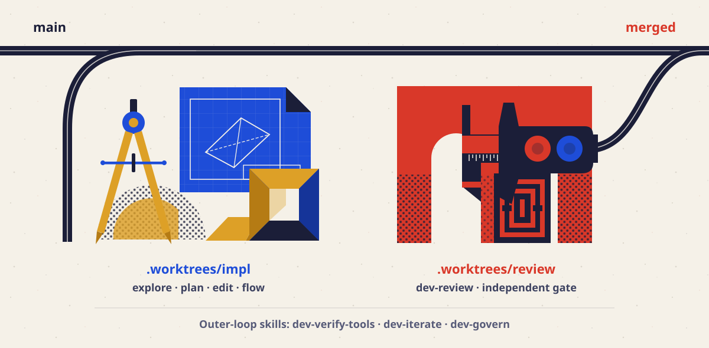

<p align="center">
  
</p>

<p align="center">
  <a href="README.md">简体中文</a> | <strong>English</strong>
</p>

<p align="center">
  <a href="RELEASING.md"></a>
  <a href="#install"></a>
  <a href="SKILL.md"></a>
  <a href="#supported-languages"></a>
  <a href="LICENSE"></a>
</p>

A brand-new folder, or a repository that has been maintained for months, usually costs the most time outside the product code itself: `.gitignore` misses local secrets, design notes drift away from the implementation, branches land without real test output, and editing one file gives no warning about the other four that must change with it.

**project-forge** surveys a folder read-only first, then fills in the Git baseline, the four-layer design docs, the `AGENTS.md` contract, GitHub check workflows, and a local development skill suite, sized to the project. It never overwrites what you wrote by hand, and it installs no third-party dependencies, so Node.js 18 or newer is all you need.

## What It Does

| Capability | What that means |
| --- | --- |
| **Your handwritten content survives** | Existing `README.md`, `CONTRIBUTING.md`, architecture docs, CI workflows, and custom skills stay exactly as they are. A `.tar.gz` snapshot is saved outside the repository before any file is written |
| **Docs travel with the branch** | `docs/prd/`, `docs/specs/`, and `docs/todo/` share one YAML frontmatter format and `YYMMDD-issue<N>-<slug>-{prd,spec,todo}.md` naming; `flow.mjs finalize` archives them together into `docs/archive/` when the work is done |
| **Nothing merges without evidence** | A change needs passing static gates, real command output, and an independent-context review. Mermaid diagram widths and document anchors are checked before every commit |
| **Editing one side warns about the other** | A dependency table inside `AGENTS.md` records which templates and docs to check when source changes, and which source entry points to verify when docs change |
| **Two tiers, lossless upgrade** | A small repository can stay on `lightweight` (a `< 14KB` contract plus three skills) and move to all five later with `--tier full`. Files you deleted or edited are recorded in `.pf-manifest.json` and never written back |

## Contents

<!-- toc:start -->

- [What It Does](#what-it-does)
- [How One Change Travels](#how-one-change-travels)
- [Supported Languages](#supported-languages)
- [Install](#install)
- [What the First Run Does](#what-the-first-run-does)
- [Automatic Updates](#automatic-updates)
- [Guardrails](#guardrails)
- [Script Reference](#script-reference)
- [License](#license)

<!-- toc:end -->

## How One Change Travels

<p align="center">
  
</p>

`lightweight` installs the first three skills; `full` installs all five. You never type commands in daily use: describe what you want and `AGENTS.md` routes it to the right skill.

Suppose you want to add an "export to CSV" feature:

| Step | What you say | Who handles it | What you get |
| --- | --- | --- | --- |
| 1 | "Where does the export module live, and which commands verify it?" | `dev-explore` | Module entry points and a verification command list. Read-only, nothing modified |
| 2 | "Write a plan for CSV export with checkable criteria" | `dev-plan` | A SPEC and a Todo, criteria numbered `C1`, `C2` |
| 3 | "Start on that plan" | `dev-flow` | An isolated branch or worktree, verification bound to this commit, pushed and opened as a PR |
| 4 | "Review this PR from an independent angle" | `dev-review` | A per-criterion verdict on `C1` and `C2`, written back to both the PR and the issue |
| 5 | "Merge if it passes, then clean up" | `dev-flow` | Merge, remove the worktree, delete the local branch, read back to confirm |

`dev-govern` is not on this chain. You run it on a maintenance schedule (health checks, technical debt, documentation drift, release notes), and its findings usually become the input to the next `dev-plan` round.

**What you can skip:**

- Fixing a typo or adjusting one line of formatting: skip steps 1 and 2, make the change, run the relevant check.
- When the requirement is unambiguous and touches one file: step 2 can go, but the independent review in step 4 cannot.
- When a change touches critical paths such as `scripts/lib/`, `templates/`, or `SKILL.md`: step 4 must run in a separate independent context. Reviewing your own work is not review.

**Why the order is what it is:** surveying before planning keeps invented paths out of the plan; freezing criteria up front gives the review a shared ruler; separating implementation and review into different contexts prevents "I remember changing that" from hiding a regression.

## Supported Languages

**Any language works.** Language only affects how precisely the tool can infer your commands; it never decides whether the workflow runs.

| Situation | What happens |
| --- | --- |
| **A recognized manifest (12)** | `Node.js` `Python` `Rust` `Go` `Java` `Ruby` `PHP` `.NET` `C/C++` `Dart` `Swift` `Elixir`. You get that language's idiomatic build, test, and install commands |
| **Any other language** | Haskell, OCaml, Zig, Nim, Crystal, Julia, or an in-house DSL are all the same: commands are read from what your project **already runs** — the `run:` blocks in CI, `Makefile`, `justfile`. Those commands were really executed, which beats any inference |
| **Starting from an empty folder** | Only six languages can generate a minimal project that passes its own smoke test: `node` `python` `go` `rust` `java` `docs`. For anything else, create the project with your own generator, then run the survey |

Documentation-only folders, editor extensions, Obsidian plugins, and capability directories are also supported.

**If there is no CI and no task file either**, the survey says plainly that no command was found and gives three places to look, rather than inventing one from a language convention. An invented command fails in CI, and that failure looks like "the code is broken".

## Install

**Requirements**: `Windows`, `macOS`, or `Linux`, with `Node.js 18` (`>= 18`) or newer. Every script uses only built-in Node modules, so there is no `npm install` step.

| Option | How | Updates | For whom |
| --- | --- | --- | --- |
| **Download the archive** | Get the latest `project-forge.zip` from the [Releases page](https://github.com/FiretrUCK666/project-forge/releases), or use this direct link:<br>`https://github.com/FiretrUCK666/project-forge/releases/latest/download/project-forge.zip` | Automatic | Everyday users |
| **`git clone`** | `git clone https://github.com/FiretrUCK666/project-forge.git` | Reports only, never overwrites; you run `git pull` | People changing the tool itself |

Either way, **keep the folder named `project-forge`**. A version suffix such as `project-forge-v6` makes the host skip loading it, because the folder name no longer matches the skill name.

Once installed, open the project folder you want to organize and say:

```text
Survey the current folder first and list what is missing and how you would organize it.
```

## What the First Run Does

<p align="center">
  
</p>

An empty folder, a half-configured side project, and an active team repository all follow the same sequence:

| Step | What happens | The part that matters |
| --- | --- | --- |
| 1. Read-only survey | Inventories structure, language ecosystems, Git remotes, local credentials, existing architecture docs | This step writes nothing |
| 2. Scope from facts | Handwritten docs and custom skills are preserved, missing items are filled in, a tier is recommended | License, visibility, and release strategy are questions for you |
| 3. Snapshot, then write | A non-empty repository gets an external snapshot first, then files are written in order | The order is **Repo → docs → remote → automation**. It is not adjustable |
| 4. Check up, hand off | A delivery check verifies links and contract consistency | If the project returns to manual maintenance, the cleanup list is shown first |

Why step 3 has a fixed order: `.gitattributes` and `.gitignore` must exist before the first commit, docs and remote addresses must be ready before the first push, and the commands CI runs must match exactly what `AGENTS.md` and `README.md` tell people to type.

If the folder is empty, it asks three or four questions first (language stack, project description, license, whether to create a remote) and then lays down the scaffold.

## Automatic Updates

Only the **archive copy** updates automatically. A `git clone` copy does not.

| Question | Answer |
| --- | --- |
| **When does it check** | At most once every **1 hour** after a successful check; waits **15 minutes** after a failure, so working offline never stalls on the network; skips checking for **24 hours** after a completed update |
| **What happens on a new version** | Download to a same-disk temp directory, unpack, validate, write supporting files first, then write `SKILL.md` atomically. An interruption rolls back; no half-updated copy is left behind |
| **How to turn it off** | Set `PF_NO_UPDATE=1` (any non-empty value). Point at a mirror with `PF_UPDATE_SOURCE` |

```sh
# Check once right now; report only, never modifies files
node "<skill directory>/scripts/update.mjs" --check

# Turn automatic checking off entirely
PF_NO_UPDATE=1

# Point at a different update source, such as an internal mirror
PF_UPDATE_SOURCE="https://github.com/<owner>/project-forge"
```

## Guardrails

Daily operations split into two groups, and whether they can be undone is the only line between them.

| Group | What is in it | Confirmation needed |
| --- | --- | --- |
| **Undoable** | Committing, pushing your own branch, opening or editing a PR, running checks | None. Revert or redo at will |
| **Not undoable** | Merging into the default branch, tagging a release, publishing a version, changing repository visibility, rewriting pushed history | Yes. The actions are listed for a person to approve first |

Two more hard rules:

- **Weakening a gate requires human sign-off**: deleting tests, relaxing assertions, adding skip markers, or loosening CI means a gate will check one less thing from then on.
- **Force-push is never automatic**: nothing here runs `git push --force` or rewrites pushed history on its own.

When an independent review passes with no open items, the person who reviewed merges directly. A reviewer is the gate, not an advisor.

## Script Reference

Daily use is routed by `AGENTS.md`, so you never need these commands. They are here for troubleshooting or wiring checks into CI.

<details>
<summary>Show the underlying scripts and their responsibilities</summary>

| Script | Purpose |
| --- | --- |
| `node scripts/survey.mjs <dir>` | Read-only inventory of structure, docs, remote topology, auth status, and recommended tier |
| `node scripts/backup.mjs create <dir>` | Create an incremental compressed snapshot outside the repository |
| `node scripts/equip.mjs <dir> [--tier lightweight\|full]` | Install or losslessly upgrade `.agents/skills/` (`--check`, `--adopt-custom`, `--restore`) |
| `node scripts/compose-agents.mjs <dir> [--tier lightweight\|full]` | Generate or losslessly refresh `AGENTS.md` (`lightweight < 14KB`, `full <= 30KB`) |
| `node scripts/review.mjs <dir>` | Delivery check: contract completeness and claim verification |
| `node scripts/handoff.mjs <dir>` | Remove scaffold markers and temporary leftovers for handoff |
| `node scripts/sync-toc.mjs README.md README.en.md` | Keep the bilingual README tables of contents in sync |
| `node scripts/update.mjs [--check]` | Check for and atomically apply updates to the archive copy |

</details>

## License

This project is released under the [MIT](LICENSE) license. See [CONTRIBUTING.md](CONTRIBUTING.md) and [RELEASING.md](RELEASING.md) for details.
