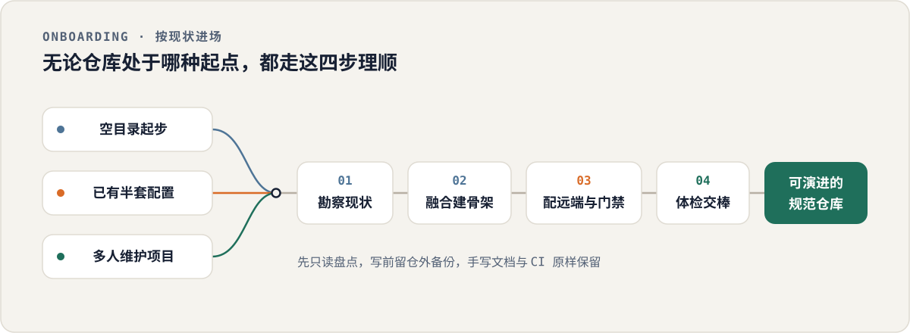
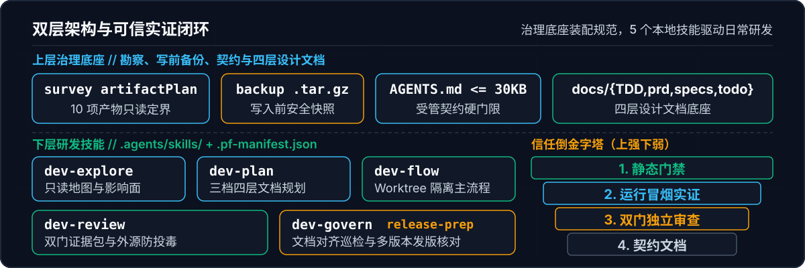

<p align="center">
  
</p>

<p align="center">
  <strong>简体中文</strong> | <a href="README.en.md">English</a>
</p>

<p align="center">
  <a href="RELEASING.md"></a>
  <a href="#安装与上手"></a>
  <a href="SKILL.md"></a>
  <a href="#配齐后的-5-个日常技能怎么用"></a>
  <a href="#它怎么把项目理顺"></a>
  <a href="LICENSE"></a>
</p>

启动一个新项目，或者接手一个已经维护了几个月的老仓库，真正消耗精力的往往不是功能代码本身，而是周边容易出岔子的工程杂事：`.gitignore` 漏掉本地密钥、文档描述与最新代码脱节、分支合入前缺乏实测证明、修改牵连邻近模块却无人提醒。

**project-forge** 用来把这类工程规范一次整理清楚。它先以只读方式盘点目录现状，再在不覆盖手写内容的前提下，按需补齐 Git 基线、设计文档、`AGENTS.md`、GitHub 检查流以及 5 个本地研发技能，让后续每次改动都有明确依据。

## 它拦住的 5 类常见失误

- **老项目接入不覆盖手写文档**：仓库里原有的手写 `README.md`、`CONTRIBUTING.md`、CI 工作流或自定义技能都会原样保留；修改任何文件之前，先在仓库外部目录打包保存完整快照，方便随时还原。
- **需求、规格与任务单跟着分支走**：`docs/prd/`、`docs/specs/` 与 `docs/todo/` 统一使用结构化 YAML frontmatter 与 `YYMMDD-issue<N>-<slug>-{prd,spec,todo}.md` 命名，分支推进到哪一步、关联哪个 Issue，对应文件同步更新。
- **用真实运行输出证明完成**：每项改动合入默认分支前，都要求拿到静态契约检查、真实功能测试以及独立上下文审查的实际输出，不凭口头判断交差。
- **关联文件改动有明确提醒**：生成在 `AGENTS.md` 里的联动对照表会把模板、库文件与文档绑定在一起，修改其中一处时直接提示需要同步检查的邻近文件。
- **测试分层与库容巡检防膨胀**：内置的 `dev-govern` 会把检查拆成快速测试、完整测试与合并门禁三层，按触发频率运行，并及时发现臃肿文档与低效慢测试。

## 目录

<!-- toc:start -->

- [它拦住的 5 类常见失误](#它拦住的-5-类常见失误)
- [它怎么把项目理顺](#它怎么把项目理顺)
- [配齐后的 5 个日常技能怎么用](#配齐后的-5-个日常技能怎么用)
- [安装与上手](#安装与上手)
- [日常安全边界](#日常安全边界)
- [脚本速查](#脚本速查)
- [许可协议](#许可协议)

<!-- toc:end -->

## 它怎么把项目理顺

<p align="center">
  
</p>

不管是刚建好的空目录、配置了一半的个人项目，还是多人协作中的活跃仓库，**project-forge** 都按同一套四步顺序推进，不直接覆盖你已经写好的内容：

1. **先只读盘点**：扫描目录结构、已有配置、Git 远端地址与当前账号权限。面对空白目录，只需确认 3 到 4 个基本问题即可生成起始设计文档。
2. **按事实确定修改清单**：已有手写文档、自有目录结构与自定义技能一律原样保留，仅针对缺失项目规划补齐动作；遇到开源协议缺失或权限不明等关键决策时，先停下来询问确认。
3. **备份后按顺序生成**：对非空仓库先在仓外目录创建快照备份，再严格按照 **版本库 → 文档 → 远端 → 自动化** 的顺序生成：先配齐 Git 基线与 5 个本地研发技能，再借助 `dev-explore` 深入理解源码结构，编写精简的 `AGENTS.md`（控制在 30KB 以内）与 `docs/TDD.md`，最后配置 GitHub 远端与自动检查流程。
4. **体检收尾并交棒**：全部生成后重新核对文件一致性与链接有效性；如果只需要一次性整理而不想长期保留辅助工具，会先列出待清理清单，获得确认后再移除。

## 配齐后的 5 个日常技能怎么用

<p align="center">
  
</p>

仓库配置好之后，这 5 个日常技能会被安装到 `.agents/skills/` 中。你不需要记住任何命令行参数：`AGENTS.md` 里的意图路由表会根据你的自然语言直接对应到相应的技能与底层脚本。

| 你平时这样说 | 对应技能 | 它负责什么 |
| --- | --- | --- |
| 「先帮我理清这个模块的入口和边界」 | `dev-explore` | 只读扫描源码结构、模块边界与校验命令，不修改工作区文件 |
| 「针对这个需求整理规格和任务拆解」 | `dev-plan` | 生成并校验 `docs/prd/`、`docs/specs/` 与 `docs/todo/`，明确影响范围与风险级别 |
| 「接手这个 Issue，在分支上完成改动并提交 PR」 | `dev-flow` | 创建独立分支或 worktree，执行本地验证、提交 PR 并同步更新关联文档 |
| 「用独立视角检查这个 PR 有没有漏掉边界」 | `dev-review` | 启动独立上下文逐条核对验收标准并实施故障注入，确保改动真正可运行 |
| 「排查一下过期文档、重复逻辑或慢测试」 | `dev-govern` | 审计契约与文档同步状态、识别过长文件或假测试，并汇总发布准备事项 |

一个常见需求的日常流转大致如下：

1. 说一句「先检查一下配置解析模块的调用路径」，`dev-explore` 会给出只读结构与测试命令，方便直接定位改动点。
2. 说一句「按这个改动整理一份任务单」，`dev-plan` 会按规则建好带 frontmatter 的文档并冻结验收条件。
3. 说一句「新建分支实现并通过全部本地测试后发起 PR」，`dev-flow` 会隔离修改、运行门禁并提交到远端分支。
4. 说一句「请独立审查当前 PR，通过后直接合并并清理分支」，`dev-review` 与 `dev-flow` 会完成独立验证、合并与分支收尾。

这里的验收顺序始终固定：**静态与契约门禁高于真实运行实证，真实运行实证高于独立标准审查，文档与归档收尾紧随其后**。每一步都要看到实际命令通过的记录。

## 安装与上手

- **运行环境**：Node.js 18 及以上版本（`>= 18`）。
- **零外部依赖**：全部脚本仅调用 Node 内置模块（`node:*`），无需额外安装依赖包。

获取或将本仓库放入你的技能目录后，打开需要整理的项目目录，直接用自然语言开始即可：

```text
请先帮我勘察当前目录现状，
列出缺失的配置与安全整理方案。
```

如果是空目录，只需回答语言栈、项目用途、开源协议等 3 到 4 个问题；如果是已有仓库，现有手写说明文档与可用工作流都会得到保留。

## 日常安全边界

为了避免误操作破坏已发布历史或绕过检查，仓库围绕三个原则划分自动动作与人工确认边界：

- **按「能不能撤回」划分日常边界**：推自己的分支和开启或更新 PR 都可以随时撤回，因此属于日常动作；合并默认分支（若需绕过常规审查）、打版本标签、正式发版或更改仓库公开状态无法撤回，执行前必须先向人展示清单并获得明确批准。
- **正常合并与人工放行分离**：当独立上下文审查全部通过且无未决问题时，由审查者直接合并；只要改动涉及**弱化门禁**（例如删减测试用例、放宽断言、增加跳过标记或调低 CI 严格度），必须由人确认后才能放行。
- **不自动改写已推送历史，写入后必做回读**：任何情况下都不自动执行强推或重写已推送的提交历史；推送分支、创建 PR 或发布版本后，都会回读远端实际信息，确认标题、正文和标签完整就位。

## 脚本速查

所有操作默认通过 `AGENTS.md` 自然语言路由触发，无需记忆命令；需要手动排查或集成 CI 时，可展开查看各入口脚本：

<details>
<summary>查看底层脚本与职责</summary>

| 脚本 | 主要用途 |
| --- | --- |
| `node scripts/survey.mjs <目录>` | 只读盘点仓库结构、文档、远端状态与缺失清单 |
| `node scripts/backup.mjs create <目录>` | 在仓库外部创建压缩快照备份，写入前保护现场 |
| `node scripts/equip.mjs <目录>` | 装配并核对 5 个本地研发技能包（`.agents/skills/`） |
| `node scripts/compose-agents.mjs <目录>` | 生成或无损刷新 `<= 30KB` 的 `AGENTS.md` 契约 |
| `node scripts/review.mjs <目录>` | 运行交付体检，检查规范齐备度与常见遗漏 |
| `node scripts/handoff.mjs <目录>` | 清理仓库内的辅助标记与临时配置以便交棒 |
| `node scripts/sync-toc.mjs README.md README.en.md` | 同步双语 README 目录锚点 |
| `node scripts/update.mjs` | 检查并同步本地工具包版本 |

</details>

## 许可协议

本项目采用 [MIT](LICENSE) 许可协议。欢迎阅读 [贡献指南](CONTRIBUTING.md) 与 [发版说明](RELEASING.md)。
