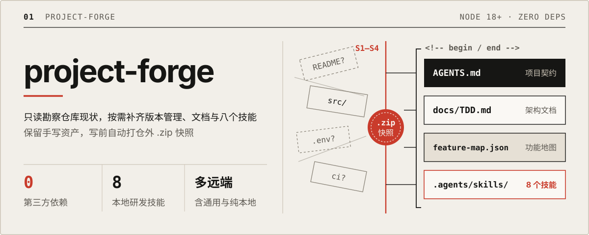
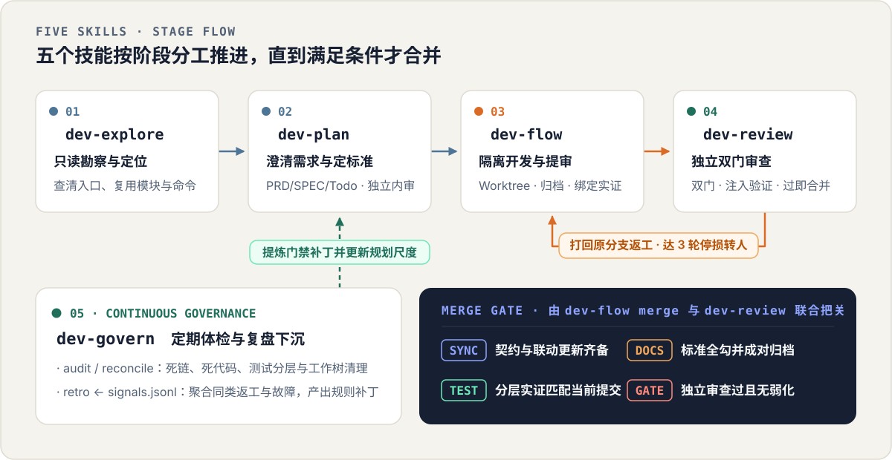

<p align="center">
  
</p>

<p align="center">
  <strong>简体中文</strong> | <a href="README.en.md">English</a>
</p>

<p align="center">
  <a href="RELEASING.md"></a>
  <a href="#安装"></a>
  <a href="SKILL.md"></a>
  <a href="#支持哪些语言"></a>
  <a href="LICENSE"></a>
</p>

一个空目录，或者一个维护了几个月的老仓库，真正耗时间的地方往往不在业务代码：`.gitignore` 漏掉本地密钥、文档描述和代码对不上、分支合入前没有实测记录、改了一处却不知道还有哪几个文件要跟着改。

**project-forge** 先只读盘点目录现状，再按项目体量补上 Git 基线、四层设计文档、契约文件 `AGENTS.md`、GitHub 检查流和一套本地研发技能。它不覆盖你手写的内容，不安装任何第三方依赖，Node.js 18 及以上就能跑。

## 它能做什么

| 能力 | 具体是什么 |
| --- | --- |
| **保住你手写的东西** | 已有的 `README.md`、`CONTRIBUTING.md`、架构文档、自定义模板、CI 工作流和自有技能全部原样保留。写任何文件前先在仓库外面存一份 `.zip` 快照（兼容恢复 `.tar.gz`） |
| **先澄清，再按八步推进** | 按需求、澄清、设计、实现、评审、实证测试、验收、合并的顺序推进。复杂需求先建议建 PRD，多轮澄清待拍板事项并经全历史换人、3 轮停损的独立 Critique 审核后再隔离开工 |
| **全 Worktree 隔离与实证** | 有提交历史默认进入 `.worktrees/` 隔离槽复用，谁改代码谁认领并负责提 PR，推分支后零跟踪文件写脏；合入前须齐备分层实证、双门独立审查、Mermaid `16/12` 与跨平台 CI 检查 |
| **本地 / 非 GitHub 自适应** | 统一 `TaskBackend` 适配 GitHub、纯本地无远端和 `generic-git`（非 GitHub 远端不越权在本地强合主干）；还支持外部 Issue+PR 互链防重、堆叠 PR 与并行波次 |
| **两档配置与复盘下沉** | 个人小仓库只装 `lightweight`（`< 14KB` 契约 + 3 个技能），随时 `--tier full` 补到 5 个。运行期间的门禁与返工信号自动记入 `signals.jsonl`，可通过 `retro` 提取规则补丁 |

## 目录

<!-- toc:start -->

- [它能做什么](#它能做什么)
- [一次改动怎么走完](#一次改动怎么走完)
- [支持哪些语言](#支持哪些语言)
- [安装](#安装)
- [第一次运行会做什么](#第一次运行会做什么)
- [自动更新](#自动更新)
- [日常安全边界](#日常安全边界)
- [脚本速查](#脚本速查)
- [许可协议](#许可协议)

<!-- toc:end -->

## 一次改动怎么走完

<p align="center">
  
</p>

日常研发按 **需求 → 澄清 → 设计 → 实现 → 评审 → 实证测试-形式验证 → 验收 → 合入** 八个阶段推进。`lightweight` 档装前三个技能，`full` 档装全部五个；直接用自然语言说明意图，或直接粘贴 Issue、PR 与 Milestone 链接，`AGENTS.md` 会路由到对应技能（多切片就绪时主会话保持薄上下文纯调度，默认并行分波派发）。

假设你要给项目加一个「导出 CSV」的功能：

| 步骤 | 你说什么 | 负责技能 | 拿到什么 |
| --- | --- | --- | --- |
| 1 | 「理清导出模块在哪、现在有哪些命令能验证」 | `dev-explore` | 模块入口、`Feature Map` 与可复用模块清单。只读，不改任何文件 |
| 2 | 「给导出 CSV 澄清需求并写方案，标准要能判定」 | `dev-plan` | 多轮澄清消解待拍板问题，按需出 PRD / SPEC / Todo（`C1`、`C2` 编号），经全历史换人、3 轮停损的独立 Critique |
| 3 | 「按方案开工」 | `dev-flow` | `.worktrees/` 隔离工作树、谁改谁认领、`1:N` 总控四态归档、分层实证绑定提交、跨后端 Milestone 与标签同步、推分支提 PR |
| 4 | 「用独立视角审这个 PR」 | `dev-review` | 外部 PR 先过供应链扫描；跑行为/结构双门实证与六锁收敛，Round 2+ 全历史换人换新独立上下文复核，达 3 轮停损触发结构化升级建单 |
| 5 | 「过了就合，然后清理」 | `dev-flow` | 独立审查通过后由审查者经临时试合合并，列出待清理清单请人点头后执行 7 步收尾 |
| 日常 / 复盘 | 「查仓库健康，或把返工教训写成规则」 | `dev-govern` | 平时随时审计死链、测试分层与 Worktree 残留；任务后用 `retro` 读 `signals.jsonl` 生成补丁供下轮规划参考 |

**哪些能跳过：**

- 改错别字、调一行格式（Case 1）：第 1、2 步不用走，直接改并过对应检查。
- 明确局部缺陷且不改契约（Case 2）：第 2 步不写文档，先补失败复现测试再修绿（Red-Green）。
- 碰到 `high-risk`、`one-way` 变更或 Case 4：第 4 步必须由另一个独立上下文做双门和故障注入审查，自己审自己不算。

**为什么是这个顺序：** 先查清现状、把待拍板问题澄清透再冻结 `C*` 标准，方案里才不会出现假路径，审查才有共同尺子；实现和审查隔离在不同上下文与独立工作树里，才不会漏看回归。

## 支持哪些语言

**任何语言都能用。** 语言只影响「这个工具能不能替你精准推断」，不影响整条流程能不能跑完。

| 情况 | 会发生什么 |
| --- | --- |
| **清单能精准识别（12 种）** | `Node.js` `Python` `Rust` `Go` `Java` `Ruby` `PHP` `.NET` `C/C++` `Dart` `Swift` `Elixir`。给出该语言惯用的构建、测试、安装命令 |
| **清单外的其他语言** | Haskell、OCaml、Zig、Nim、Crystal、Julia、自研 DSL 都一样：从你项目里**已经在跑的命令**读——CI 的 `run:` 块、`Makefile`、`justfile`、`Taskfile`。这些命令被真实执行过，比任何推断都可靠 |
| **想从空目录起步** | `equip.mjs --bootstrap-empty` 对**任意技术栈**生成通用工程基线（Git 基线、四层文档、`docs/TDD.md`、自洽 `AGENTS.md` 与 `.agents/skills/`），零示例玩具业务代码；支持 `14` 种预设栈（上述 `12` 种语言加 `universal` 与 `docs`，默认 `universal`），并与已有 `README.md` 和 `LICENSE` 共存 |

还支持纯文档目录、编辑器插件、Obsidian 插件和能力目录。

**如果连 CI 和任务文件都没有**，勘察会明确告诉你没探到命令，并给出三条查找路径，而不是按语言惯例编一个。编出来的命令会在 CI 里失败，而那条失败看起来像「代码坏了」。

## 安装

**环境要求**：`Windows`、`macOS` 或 `Linux`，`Node.js 18`（`>= 18`）及以上。全部脚本只用 Node 内置模块，不需要执行 `npm install`。

| 方式 | 怎么装 | 更新机制 | 适合谁 |
| --- | --- | --- | --- |
| **下载压缩包** | [下载 project-forge.zip（最新版）](https://github.com/FiretrUCK666/project-forge/releases/latest/download/project-forge.zip) | 自动更新 | 日常使用者 |
| **`git clone`** | `git clone https://github.com/FiretrUCK666/project-forge.git` | 只提示不覆写，你自己 `git pull` | 要改工具本身的人 |

两种方式都要**保持文件夹名是 `project-forge`**。如果加了分支或版本号后缀（比如 `project-forge-main`），宿主会因为前后名字对不上而跳过加载。

装好之后，打开要整理的项目目录，直接说：

```text
请先帮我勘察当前目录现状，列出缺失的配置和整理方案。
```

## 第一次运行会做什么

<p align="center">
  
</p>

空白目录、半配好的个人项目、多人协作中的活跃仓库，都按同一个顺序推进：

| 步骤 | 做什么 | 关键点 |
| --- | --- | --- |
| 1. 只读勘察 | 盘点目录结构、语言生态、Git 远端、本机凭据、已有架构文档 | 这一步不写任何文件 |
| 2. 按事实定范围 | 手写文档和自定义技能一律保留，缺什么补什么，按规模推荐档位 | 许可证、可见性、发版策略先问你 |
| 3. 备份后落盘 | 非空仓库先在仓库外存快照，再按顺序写入 | 顺序是 **版本库 → 文档 → 远端 → 自动化**，不能调 |
| 4. 体检与交棒 | 跑交付体检，核对文档链接与契约一致性 | 要交回人工维护时，先列待清理清单再清 |

第三步的顺序为什么不能调：`.gitattributes` 和 `.gitignore` 必须在第一次提交之前就位，文档和远端地址必须在推送之前就绪，CI 跑的命令必须和 `AGENTS.md`、`README.md` 里写的完全一致。

如果目录是空的，它先问你 3 到 4 个问题（语言栈、项目描述、许可证、要不要建远端），然后直接铺出骨架。

## 自动更新

只有**压缩包副本**自动更新。`git clone` 的副本不会。

| 问题 | 答案 |
| --- | --- |
| **什么时候查** | 距上次成功核对满 **1 小时**才再查一次；核对失败后 **15 分钟**内不重试（离线时不卡在联网上）；刚更新完的 **24 小时**内不再查 |
| **查到之后做什么** | 下载到同盘临时目录解包 → 校验 → 先写辅助文件 → 最后原子写入 `SKILL.md`。中途断电或被打断会自动回滚，不会留下半更新的残缺副本 |
| **怎么关掉** | 设 `PF_NO_UPDATE=1`（非空即生效）。想换镜像源设 `PF_UPDATE_SOURCE` |

```sh
# 立刻核对一次，只看结果不改文件
node "<技能目录>/scripts/update.mjs" --check

# 彻底关闭自动更新检查
PF_NO_UPDATE=1

# 换一个更新源（比如公司内网镜像）
PF_UPDATE_SOURCE="https://github.com/<owner>/project-forge"
```

## 日常安全边界

日常操作按**能不能撤回**分成两档，这是唯一的分界线。

| 档位 | 包含什么 | 需要确认吗 |
| --- | --- | --- |
| **能撤回** | 提交、推自己的分支、开 PR、改 PR、跑检查 | 不需要，随时可撤销重来 |
| **撤不回来** | 合并进默认分支、打版本标签、正式发版、改仓库可见性、改写已推送历史 | 需要。先把要做的动作列清单，等人点头 |

还有两条硬规则：

- **弱化门禁必须人点头**：删测试、放宽断言、加跳过标记、调松 CI 严格度，会让门禁从此少查一项，必须人工确认。
- **永不自动强推**：任何情况下都不自动 `git push --force` 或改写已推送历史。

独立审查全部通过、没有未决项时，**审查通过就由审查者合**——审查者不是顾问，他就是那一道关。

## 脚本速查

日常由 `AGENTS.md` 自动路由，不需要记这些命令。需要手动排查或接进 CI 时再看。

<details>
<summary>查看底层脚本与职责</summary>

| 脚本 | 用途 |
| --- | --- |
| `node scripts/survey.mjs <目录>` | 只读盘点结构、文档、远端拓扑、认证状态与推荐档位 |
| `node scripts/backup.mjs create <目录>` | 在仓库外部创建增量压缩快照 |
| `node scripts/equip.mjs <目录> [--tier lightweight\|full]` | 装配或无损升档 `.agents/skills/`（支持 `--check`、`--adopt-custom`、`--restore`） |
| `node scripts/compose-agents.mjs <目录> [--tier lightweight\|full]` | 生成或无损刷新 `AGENTS.md`（`lightweight < 14KB`、`full <= 30KB`） |
| `node scripts/review.mjs <目录>` | 交付体检：规范齐备度与声明回查 |
| `node scripts/handoff.mjs <目录>` | 清理引导标记与临时残留，方便交棒 |
| `node scripts/sync-toc.mjs README.md README.en.md` | 同步双语 README 的目录锚点 |
| `node scripts/update.mjs [--check]` | 检查并原子同步压缩包副本的更新 |

</details>

## 许可协议

本项目采用 [MIT](LICENSE) 许可协议。欢迎阅读 [贡献指南](CONTRIBUTING.md) 与 [发版说明](RELEASING.md)。
