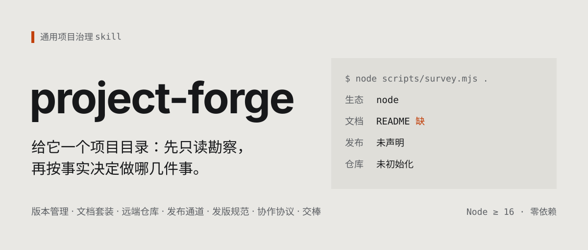
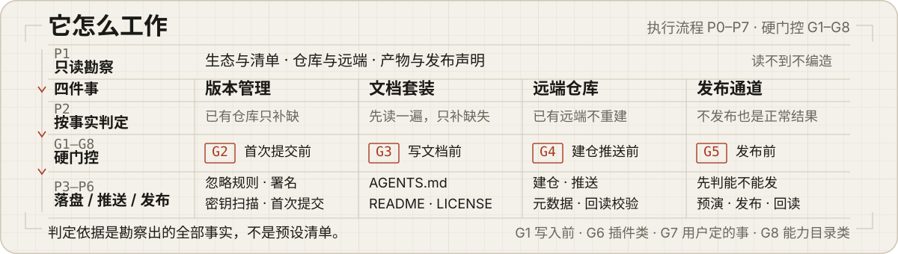
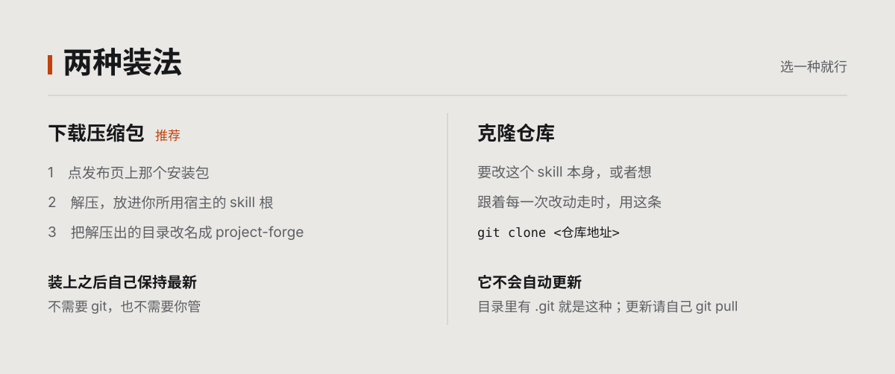

# project-forge

[English](README.en.md) | 中文

[](https://github.com/FiretrUCK666/project-forge)
[](LICENSE)
[](README.md#开始之前)
[](README.md#开始之前)

<p align="center">
  
</p>

把一个项目目录弄成规范项目。给它一个目录，它先只读勘察，看清这个项目现在是什么样，
再自己判断这次该做哪几件事、跳过哪几件事。

不预设技术栈。Node、Python、Rust、Go、Java、纯文档目录，插件类项目，以及 skill 项目，
判断依据都是勘察出来的事实。

## 目录

<!-- toc:start -->

- [它做什么](#它做什么)
- [它怎么工作](#它怎么工作)
- [开始之前](#开始之前)
- [安装](#安装)
- [更新](#更新)
- [使用](#使用)
- [它不会做的事](#它不会做的事)
- [里面有什么](#里面有什么)
- [脚本](#脚本)
- [这个仓库自己是怎么配的](#这个仓库自己是怎么配的)
- [遇到问题](#遇到问题)
- [贡献](#贡献)
- [许可](#许可)

<!-- toc:end -->

## 它做什么

一个项目从「能跑」到「像个正经项目」，中间隔着一堆琐碎但容易出错的事：忽略规则写对了没、
产物该不该入库、提交署名配了没、README 里承诺的东西能不能兑现、发布流程会不会把密钥发出去。
每件都不难，加起来很多，而且做错往往很久以后才发现。

它把这几件事收敛成一条流程：

- **版本管理**：忽略规则、文本属性、提交署名、提交纪律、密钥扫描；
- **文档套装**：`AGENTS.md`、`README`、`CONTRIBUTING`、`LICENSE`，各写各的读者，互不复述；
- **远端仓库**：建仓库（默认私有）、推送、元数据、协作模板、持续集成；
- **发布通道**：能不能发、发到哪、版本号怎么算、怎么发才安全；
- **发版规范**：给要发版的项目落一份 `RELEASING.md`——说明写在哪、分哪几节、按什么顺序发
  （说明是版本库里的一个文件，打标签前就写好；自动化把它原样贴到发布页，读不到就失败）；
- **协作协议**：配好之后每天怎么干活——改动从哪来（外部报告 / 外部提案 / 自己的日常改），
  工作记录放哪、**哪些改动必须先派独立审查**、谁能合（不可逆的那一档强制人合）、合并完怎么收尾；
- **交棒**：项目规整好之后，问你要不要把它留下的痕迹清掉。

它只做治理，不生成项目本身：不替你选技术栈，也不创建源码和框架配置。治理跑在骨架就绪之后。

### 交棒：用完了，想把痕迹清掉

项目被规整好之后，里面会留着这个 skill 留下的东西——标识符、没填完的模板占位符、
注入中断的残留。**它收尾时一定会问你要不要清掉**，不问就收工。

问的时候它先把项目扫一遍，列清楚哪些是痕迹、哪些是项目自己的东西、每个该删还是该留，
等你点头才动手。**它不会自己删**——删远端、删历史这类不可逆的动作尤其要单独确认。

想自己看一眼扫出来什么：

```sh
node "<本领目录>/scripts/handoff.mjs" "<项目目录>" --scan
```

## 它怎么工作

<p align="center">
  
</p>
四步的顺序不能反：只读勘察、按事实判定、过硬门控、落盘推送发布。跑完它还会问一句要不要把留下的
痕迹清掉——那是收尾动作，不是第五步。判定依据是勘察出来的事实，不是预设的清单，所以它不会给纯文档
目录配发布流程，也不会重建一个已经有远端的仓库。「不发布」和「跳过某件事」都是正常结果，不是失败。

**这四步是「把项目配起来」，配完之后是另一条线：每天怎么用它。** 一个改动从出现到落进主干，
要分清它从哪来（外部报告、外部提案，还是你自己的日常修改）、要不要建工作记录、谁审、谁能合、
合并完怎么收尾。这条线不走阶段编号，用得到时才读，判据在 `references/collaboration.md`。

## 开始之前

**Node.js 16 或更高**，不需要先装任何东西。日常用到的脚本都在这个下限上（持续集成跑
Node 22，开发机跑 Node 24；16 到 21 没有逐版实测，遇到问题欢迎提 Issue）。

唯一的例外是**发布与徽章两个脚本**（`release-notes.mjs` 与 `check-badges.mjs`）：
它们用的是 Node 18 才有的全局 `fetch`，跑它们需要 Node 18 或更高。它们只在维护这个
skill 本身时才用得上，平时用它治理项目碰不到。

`git` 可选：没有它，勘察与文档相关的功能照常，它会如实报告「git 不可用」；需要它的是
版本管理的建立与维护、远端仓库、推送与发布这几件事。

## 安装

**下载压缩包**，不需要 git：

<p align="center">
  <a href="https://github.com/FiretrUCK666/project-forge/releases/latest/download/project-forge.zip">
    <b>点这里下载最新版</b>
  </a>
</p>

解压到你的 skill 根，把里面的 `project-forge-<版本>/` **改名**成 `project-forge`——目录名必须与
`SKILL.md` 里 frontmatter 的 `name` 一致，区分大小写的系统上，大小写不同就是另一个目录。

<p align="center">
  
</p>

**想改它，或者想跟着每一次改动走**，就用克隆：

```sh
git clone https://github.com/FiretrUCK666/project-forge.git "<你的 skill 根>/project-forge"
```

两种装法的区别只有一条：**克隆下来的那份不会自己更新**。目录里有 `.git` 说明它是拿来改的，
工具对它只读。改法见 [CONTRIBUTING.md](https://github.com/FiretrUCK666/project-forge/blob/main/CONTRIBUTING.md)。

> **发布页上的 `Source code` 也能用。** 那是 GitHub 自动生成的源码包，与专门打包的安装包一样解压为
> `project-forge-<版本>/` 目录，区别只在包含的文件集合：安装包按 `.gitattributes` 排除了开发专属文件
> （`.github/`、`AGENTS.md`、`scripts/dev/`），而源码包包含仓库全量文件。解压后把顶层目录
> 改名成 `project-forge` 即可。两个都能装，装上都会自己保持最新；安装包专为安装打造，
> 推荐用它。

### 放在哪里

放进**你所用宿主的用户级 skill 根**。已经装过别的 skill 就放到它们所在的目录，一个都没有就查
该宿主的文档。目录名保持 `project-forge`，它必须与 `SKILL.md` 里 frontmatter 的 `name` 一致；
区分大小写的系统上，大小写不同就是另一个目录。

放好不需要注册或重启：宿主按目录发现，`SKILL.md` 就是入口。

## 更新

<p align="center">
  
</p>

下载装的那份会自己保持最新，你不用做任何事。它安静地问一次版本号：是同一版就结束、
什么都不做，有新版本就整份换成新版，并告诉你从哪一版换到了哪一版。**最多一小时问一次**
——同一个答案没必要反复去取，所以它不会每次被用都联网。

它去哪儿问新版，取决于那份副本自己记的地址（装的时候就在包里，写在 `SKILL.md` 的
`metadata.source`）。托管平台的地址规律它认得出，所以会**优先走平台的接口**——一次请求同时
拿到版本号和下载地址，不碰网页主机；网页地址是退路。

同一份副本 24 小时内最多换一次文件，不会一天变好几回。想自己看一眼状态（只报告，不更新）：

```sh
node "<本领目录>/scripts/update.mjs" --check
```

**连不上时**：这一次就跳过去（不写坏你这份，也不把任务卡住），下次再用会重试。但要是**隔了
一天以上**还没核对上新版，它会说一句，告诉你这份停在哪个版本——那是在提醒你已经落后了，
不是报错。

想让它改问别处（自建镜像、内网发布），改那份副本 `SKILL.md` 里的 `metadata.source` 就行；
环境变量 `PF_UPDATE_SOURCE` 只在副本没记地址时才顶替它。反过来，**不想让它自动检查**
（沙箱只读、离线机器、审计要求）就设环境变量 `PF_NO_UPDATE` 为非空值：它一次都不联网、
不出声，`--check` 仍然照常回答。

## 使用

直接用自然语言说需求就行：

- 版本管理：`弄版本管理`、`配 git`、`上仓库`、`推到 GitHub`
- 文档：`写 AGENTS.md`、`写 README`、`配 LICENSE`、`写贡献指南`
- 发布：`发到 npm`、`发布`、`配 CI`
- 笼统：`初始化项目`、`项目起步`、`新项目配置`、`标准化项目`、`整理项目`

```
帮我规范这个项目
给 D:\work\my-tool 配上版本管理和文档
这个项目要不要发到 npm
```

它不会一上来就动手。第一步永远是勘察，然后告诉你：这个项目现在是什么状态、准备做哪几件事、
以及为什么跳过另外几件。

### 什么都不说的时候，它默认做全套

**范围这件事只有两种**：你说了一件具体的事，它就只做那一件；你什么都没说（只丢来一个
目录，或只说「规范一下 / 整理一下 / 全部补完」），它就**把这个项目该配的全部配齐**。

「全部配齐」不等于「把清单上每条都跑一遍」：该做什么仍由勘察出的事实决定——纯文档目录
不会有发布流程，已有远端不会重建。它的意思是**该做的一件不漏**。

**已有基础的项目是默认场景，不是特殊场景**：多数项目交到手里时已经有 git、有远端、
有 README。做法是「先读、再判断、只补缺的」——已有的文件先读后合并，**永不覆盖**，
已有的结构是权威。只有你明确说「重写」时才整篇替换。

### 只想让它做一件事

老项目里常常只想补一件东西——配个 CI、补份 LICENSE。这时全套流程会因为你没有 AGENTS.md
而拦住你，那不是你的任务范围。

它自己也是这么判的：P0 阶段就记下范围，后面只做那几件。交付检查支持按切面验：
`node scripts/review.mjs <项目目录> --scope=ci` 只验 CI 那一面，
其余不查、不报缺。可用切面与用法以
`node scripts/review.mjs --help` 为准——
本文不另抄一份，抄了就会漂移。

不给 `--scope` 时仍是全量检查，用于「整体交付」那个场景。

## 它不会做的事

- 不创建项目本身：不选技术栈、不生成骨架，那是脚手架的事；
- 不改代码逻辑，只做版本管理、远端、文档、发布这几件事；
- 不替你决定许可证，只给判据和选项；
- 不擅自把仓库设为公开（默认私有）；
- 不强制推送、不改写已推送的历史、不删除已发布的版本；
- 不未经你确认就删掉自己留下的东西；
- 不做部署和服务器配置。

## 里面有什么

### 包里有什么

**不逐文件列表**：那会变成一张要人记得改的清单，漏一行的症状是「文件在包里但没人知道」。
权威答案来自 `git archive` 那次真导出，`.gitattributes` 的 `export-ignore` 决定哪几处
不进包。

四类东西：

| 路径 | 是做什么的 |
| --- | --- |
| `SKILL.md` | 入口：硬不变量、能力矩阵、执行流程、硬门控 |
| `references/` | 判据与方法，按情境读全文：勘察、版本管理、远端、文档、发布、协作、交棒 |
| `templates/` | 可直接落盘的骨架：项目契约、说明、贡献指南、发版规范、工作记录、提案与问题模板、两份流水线、几份许可证全文 |
| `scripts/` | 零依赖的工具：自更新、勘察、注入、交付门禁、交棒、发版说明发送、徽章核对、目录同步、解包，以及它们共用的 `lib/` |
| `README.md`、`README.en.md`、`LICENSE`、`assets/readme/` | 你正在看的这份说明（中英成对，中文是权威版）、许可证全文、README 里的卡片 |

**仓库自己另有哪些文件**（不进包的那些）写在
[`AGENTS.md`](https://github.com/FiretrUCK666/project-forge/blob/main/AGENTS.md) 里——
那是维护这个 skill 时才需要读的东西，不是用这个 skill 的人需要的。


## 脚本

全部脚本只用运行环境内置的模块，零依赖，跨平台。

```sh
# 让这个副本保持最新（--check 只报告不更新）
node "<本领目录>/scripts/update.mjs" --quiet

# 勘察一个项目（只读，不写任何文件）
node "<本领目录>/scripts/survey.mjs" "<项目目录>" --markdown

# 生成、刷新或升级项目的 AGENTS.md
node "<本领目录>/scripts/compose-agents.mjs" "<项目目录>"
node "<本领目录>/scripts/compose-agents.mjs" "<项目目录>" --status    # 只看现状，不写入
node "<本领目录>/scripts/compose-agents.mjs" "<项目目录>" --upgrade   # 把手写的升级成标准结构

# 勘察目标项目里这个 skill 留下的痕迹（只读）
node "<本领目录>/scripts/handoff.mjs" "<项目目录>" --scan     # 列出痕迹与处置建议
node "<本领目录>/scripts/handoff.mjs" "<项目目录>" --verify   # 判「是否已经干净」

# 自检这个 skill 自身（只在改它的时候跑）
node "<本领目录>/scripts/dev/preflight.mjs"
node "<本领目录>/scripts/dev/selftest.mjs"
```

`<本领目录>` 是这个 skill 所在的位置，`<项目目录>` 是你要处理的那个项目，两者通常不是同一个目录。
路径带空格或中文时**要留着引号**——那不是排版讲究，是命令能不能跑起来的事。

## 这个仓库自己是怎么配的

这个 skill 是自己的第一个用户：它的版本管理、文档与持续集成，都是按它自己的标准配的。
如果它教的东西是错的，它自己的仓库会先出问题。具体见
[AGENTS.md](https://github.com/FiretrUCK666/project-forge/blob/main/AGENTS.md)。

本文件是中文权威版，`README.en.md` 是英文译本，两者不一致时以本文件为准。

## 遇到问题

到 [Issues](https://github.com/FiretrUCK666/project-forge/issues) 提出。为方便定位，请附上：

- 你的操作系统与 Node 版本；
- 你运行的完整命令；
- 完整的报错原文（不是描述现象）；
- 如果与某个具体项目有关，那个项目的技术栈与大致目录结构。

## 贡献

见 [CONTRIBUTING.md](https://github.com/FiretrUCK666/project-forge/blob/main/CONTRIBUTING.md)。

## 许可

[MIT](LICENSE)