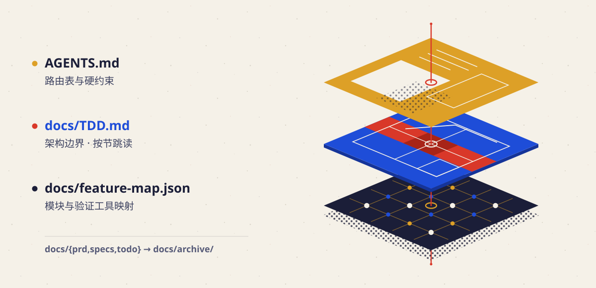

<p align="center">
  
</p>

<p align="center">
  <strong>简体中文</strong> | <a href="README.en.md">English</a>
</p>

<p align="center">
  <a href="RELEASING.md"></a>
  <a href="#安装与自动更新"></a>
  <a href="SKILL.md"></a>
  <a href="#支持的语言"></a>
  <a href="LICENSE"></a>
</p>

一个项目维护久了，常见的问题往往出在业务代码之外：代码越改越乱、文档描述和源码逐渐脱节、AI 修改代码时只顾眼前这一步而漏掉关联文件。

**project-forge** 先以只读方式盘点目录现状，再按项目体量补齐版本管理基线、三层长青文档、工程契约 `AGENTS.md`、按远端形态适配的检查流，以及 8 个本地研发技能。它保留我们既有的手写文件，不安装任何第三方依赖，在 Node.js 18 及以上环境即可直接运行。

## 目录

<!-- toc:start -->

- [安装与自动更新](#安装与自动更新)
- [它解决什么问题](#它解决什么问题)
- [流程和日常使用方式](#流程和日常使用方式)
- [八个本地研发技能](#八个本地研发技能)
- [支持的语言](#支持的语言)
- [日常安全边界](#日常安全边界)
- [常用脚本速查](#常用脚本速查)
- [许可协议](#许可协议)

<!-- toc:end -->

## 安装与自动更新

**运行环境**：支持 Windows、macOS 和 Linux，需安装 `Node.js 18`（`>= 18`）及以上版本。全部脚本只使用 Node 内置模块，不需要运行 `npm install`。

| 安装方式 | 获取命令或地址 | 更新方式 | 适合场景 |
| --- | --- | --- | --- |
| **下载压缩包** | [下载 project-forge.zip（最新版）](https://github.com/FiretrUCK666/project-forge/releases/latest/download/project-forge.zip) | 支持自动更新与原子回滚 | 日常使用 |
| **`git clone`** | `git clone https://github.com/FiretrUCK666/project-forge.git` | 只检查提醒，不覆盖本地修改，手动执行 `git pull` | 参与修改工具本身 |

无论采用哪种方式，都要**保持文件夹名称为 `project-forge`**。如果文件夹带有分支或版本后缀（例如 `project-forge-main`），宿主会因为目录名和技能名称不一致而跳过加载。

安装完成后，打开需要整理的仓库目录，我们可以直接对 AI 说：

```text
请先帮我勘察当前目录现状，列出缺失的配置和整理方案。
```

<details>
<summary>查看自动更新机制与环境变量开关</summary>

只有**压缩包副本**会自动检查并更新，通过 `git clone` 获取的副本不会被覆盖。

| 项目 | 说明 |
| --- | --- |
| **检查频率** | 距上次成功核对满 1 小时再检查；核对失败后 15 分钟内不重试（离线不阻塞）；更新完成后 24 小时内不重复检查 |
| **原子替换** | 下载到同盘临时目录解包并完成校验，先写入辅助文件，最后原子替换 `SKILL.md`；中途出错立即回滚，不留半更新副本 |
| **关闭或换源** | 设置 `PF_NO_UPDATE=1` 关闭自动检查；设置 `PF_UPDATE_SOURCE` 指向镜像仓库地址 |

```sh
# 立刻检查一次，只报告结果而不修改文件
node "<技能目录>/scripts/update.mjs" --check

# 关闭自动更新检查
PF_NO_UPDATE=1

# 指向镜像更新源
PF_UPDATE_SOURCE="https://github.com/<owner>/project-forge"
```

</details>

## 它解决什么问题

- **先只读摸底，写入前先留仓外快照**：不覆盖已有的 `README.md`、`CONTRIBUTING.md`、架构文档、自定义模板、CI 工作流和自有技能；写入任何文件前，先在仓库外部创建一份 `.zip` 快照（兼容恢复 `.tar.gz`），支持整包回滚。
- **在 `.worktrees/` 隔离工作树中修改，保持主干干净**：有提交历史的仓库统一在独立的 `.worktrees/` 工作树和分支中完成开发与审查，谁修改代码就由谁认领并提交 PR。
- **方案与代码都须经过独立审查**：复杂需求会先多轮澄清把待拍板项清零，再由独立审稿人评审方案（最多 3 轮打回，不能自己审查自己）；代码修改完成后还要经过全新上下文的独立审查，触及高风险路径必须补充故障注入测试。
- **修复问题先复现，验收只看真实产出**：遇到疑点先运行最小复现排除误报，修复缺陷前先编写会失败的回归测试再修复通过；验收需要真实产出附件或终端实测结果，涉及界面修改时不以口头确认放行；同类问题复发满 2 次自动下沉为静态规则。
- **不绑死编程语言与托管平台**：内置 12 种语言清单自动推断命令，其余语言直接读取仓库已有的构建或 CI 命令；支持 GitHub（含多远端与 SSH 别名）、非 GitHub 远端（`generic-git`）和纯本地无远端仓库（`local-only`），在非 GitHub 远端或无远端时自动跳过 GitHub Actions，在 `generic-git` 下也不会越权强行合并主干。

## 流程和日常使用方式

### 第一次接入或升级：S1 到 S4 四步推进

<p align="center">
  
</p>

无论是空目录、半配好的存量仓库，还是已有旧版配置准备升级的工程，接入与升级都按 **S1 只读勘察 → S2 确定范围与融合 → S3 备份后按序写入 → S4 体检与交棒** 四步推进：

| 步骤 | 执行内容 | 关键保护 |
| --- | --- | --- |
| **S1 只读勘察** | 盘点目录结构、语言生态、Git 远端拓扑、本机凭据、已有架构文档和自有技能 | 这一步不写入任何文件；空目录会先问 3 到 4 个问题再起步 |
| **S2 确定范围与融合** | 保留长青文档、脚本与既有 AI 约定，归档过期记录，按协作形态跳过不适用模板 | 许可证、仓库可见性与发版策略先由人确认 |
| **S3 备份后按序写入** | 非空仓库先在仓外生成 `pre-forge` `.zip` 快照，先运行既有测试建立基线再按序写入 | 写入顺序固定为 **版本库 → 文档 → 远端 → 自动化**，不能调换 |
| **S4 体检与交棒** | 执行交付体检与声明回查，将原仓遗留问题建单移交后续日常迭代 | 清理引导标记前先列清单确认，保留技能时同步保留 `.pf-manifest.json` |

第三步保持固定顺序，是因为 `.gitattributes` 和 `.gitignore` 必须在第一次提交之前就位，文档和远端地址必须在推送之前就绪，CI 运行的命令必须与 `AGENTS.md`、`README.md` 保持一致。

跨代升级既有工程时，`equip.mjs` 会通过 `.agents/skills/.pf-manifest.json` 账本记录装配状态：用户主动删除的技能或单文件会被记为墓碑，升级时不会擅自恢复（只有显式传入 `--restore` 才会找回）；登记过的手改文件通过校验，本地与上游同时修改的非脚本文件自动三方合并，`.mjs` 脚本冲突保留本地版本；升级后若语法或导出接口校验失败，立即从仓外 `.zip` 快照整包回滚。

### 日常对话与开发流转

<p align="center">
  
</p>

平时不需要记命令或流程步骤，只要用日常语言说明需求，或者直接粘贴 Issue、PR、Milestone 链接，`AGENTS.md` 会自动路由到对应技能并推进 **需求 → 澄清 → 设计 → 实现 → 评审 → 实证测试-形式验证 → 验收 → 合入** 八个阶段：

| 日常情景 | 我们可以这样说 | 自动经过的步骤与技能 |
| --- | --- | --- |
| **改错别字或单行格式（Case 1）** | 「帮我把这里错别字改掉」 | 不建规划文档，直接修改并运行对应校验 |
| **修复明确缺陷（Case 2）** | 「登录接口遇到空参数会报错，帮忙修一下」 | 在 `.worktrees/impl-*` 先编写复现失败测试，再修复通过并运行 `dev-edit` 静态门禁，提交 PR 后由 `dev-review` 独立审查合入 |
| **加新功能或跨模块改造（Case 3 / Case 4）** | 「帮我新增一个导出报表功能」 | `dev-explore` 切片读取源码 → `dev-plan` 对齐待定细节并编写方案，派独立审稿人最多 3 轮挑刺 → `dev-flow` 打开 `.worktrees/impl-*` 实施并过 `dev-edit` 门禁 → 提交 PR 后由 `dev-review` 换人独立审查并合入 → 按 7 步收尾（清理工作树和分支前会列清单请大家确认） |
| **途中追加需求或调整方案** | 「这里再加一个过滤条件，导出格式也改一下」 | 先把新增分歧对齐清楚，把变更更新进 `docs/specs/` 或拆分新单再推进，不靠聊天记忆硬扛 |
| **定期补测与代码体检** | 「排查一下近期改动的测试盲区，再做次体检」 | `dev-iterate` 补充原生回归或集成测试，`dev-verify-tools` 校验与刷新接口验证脚本，`dev-govern` 做只读体检并把高频问题沉淀为静态规则 |

### 有界优化循环与先复现

<p align="center">
  
</p>

在排查测试盲区、审查问题或做代码体检时，`dev-iterate`、`dev-review` 和 `dev-govern` 共用一条规则：**先跑通最小运行复现（`PoC-first`），确认问题真实存在后再进入修复流程**；无法复现的疑点直接判定为误报，不编写无效补丁。

1. **Observe（发现盲区）**：对比功能地图、历史信号与近期变更，排出待验证热点，只读不改源码。
2. **PoC-first（最小复现）**：执行一条最小可复现命令确认问题真实存在。
3. **Escalate & Fix（正流修复）**：携带复现命令和证据建单，进入标准实现与独立审查流程，修复后附带实证重新运行同一条复现命令。
4. **Reflect（整类加固）**：评估是否属于同类模式缺失，优先重构共享边界，并将能确定的规则下沉为静态门禁。

执行自动优化循环时，只要触及以下任一上限就会以退出码 `4` 停机并交由人来裁决：达到轮次上限（`ROUND_LIMIT_REACHED`，默认 3 轮、硬上限 10 轮）、连续 2 轮没有新进展（`NO_PROGRESS_STALL`），或者遇到不可逆/高风险操作（`ONE_WAY_GATE_HIT`）。

### 三层长青文档与按需切片

<p align="center">
  
</p>

项目文档拆成三层长青文档和四层规划目录，日常由 `doc-locate.mjs` 按标题或符号只读取需要的行号切片，避免把长篇文档整份放进对话上下文：

| 层级 | 文件位置 | 作用与维护方式 |
| --- | --- | --- |
| **L1 入口契约** | `AGENTS.md` | 每次会话自动读取的薄契约：意图路由、工程原则、命令配置、协作规则、高风险路径与联动文件表（建议 `< 24KB`，上限 `30KB`） |
| **L2 系统架构** | `docs/TDD.md` | 记录真实模块边界、业务主流程、图表与关键不变量，由静态检查校验结构与路径同步 |
| **L3 机读索引** | `docs/feature-map.json` | 唯一机读功能、模块、业务流与验证工具映射表，通过导出符号指纹和 Git 树哈希自动判旧 |
| **规划与归档** | `docs/{prd,specs,todo}/` → `docs/archive/` | 规划单据冻结 `C1..Cn` 验收标准；提交 PR 前核对全勾选后通过 `git mv` 成对归档 |

## 八个本地研发技能

**这 8 个技能既会在日常流程中自动串联运行，也可以随时单独使用；我们不用背斜杠命令，直接用日常语言向 AI 说明目标，或者直接运行对应的命令行脚本即可。**

| 技能 | 它是干什么的 | 什么时候单独使用 | 平时可以对 AI 说什么原话 | 会做什么操作与脚本入口 |
| --- | --- | --- | --- | --- |
| **`dev-explore`** | 只读梳理目录结构、入口、可复用模块，并按需定位文档与源码行号切片 | 刚接手陌生仓库，或准备修改某个模块前想先摸清调用链 | 「帮我梳理一下导出模块的入口和已有可复用工具」 | **全程只读**，不修改任何文件、不切换分支（`doc-locate.mjs`、`repo-map.mjs`） |
| **`dev-plan`** | 需求分流（Case 1–5）、多轮澄清待定项、编写方案与拆分验收标准，并触发独立 Critique 评审 | 准备做一个跨模块功能、需要先把方案和边界对齐拍板再动手 | 「帮我澄清一下这个需求并写一份方案，先别改代码」 | 编写规划单至 `docs/{prd,specs,todo}/`，不改业务源码（`doc-plan.mjs`） |
| **`dev-edit`** | 修改前核对禁改区与可复用模块；修改后剥离注释和字面量检查压制标记、死代码、架构越界、单测反作弊与 800 行文件上限 | 本地刚修改完几处代码，提交前想先做一次静态门禁自检 | 「帮我检查一下刚才改的代码有没有触发静态门禁」 | **只做检查并报错拦截**，不自动修改源码（`edit-gate.mjs`） |
| **`dev-flow`** | 管理 `.worktrees/` 隔离工作树、认领任务、归档规划单、校验实证附件、提交 PR、独立合并与 7 步收尾 | 想单独创建隔离开发分支、同步主干、运行合并门禁或安全清理已合并的工作树 | 「帮我为这个任务建一个隔离工作树并准备提交 PR」 | 创建或清理 `.worktrees/` 与分支、移动归档文件、执行验证与提交操作（`flow.mjs`） |
| **`dev-verify-tools`** | 维护机读功能地图 `docs/feature-map.json`，在仓外 `scratch/` 试制验证脚本，并按符号与树哈希自动判定验证工具是否过时 | 改了接口但不确定该运行哪条端到端验证，或需要新增一份接口验证脚本 | 「查一下这次改动对应哪些验证工具，缺的话补一个」 | 写入仓外 `scratch/` 探针、经检查后沉淀脚本并更新 `docs/feature-map.json`（`verify-tools.mjs`） |
| **`dev-review`** | 生成上下文隔离的审查包，对外部 PR 先做安全扫描，强制先核验实证结果再解锁 diff，支持最多 3 轮换人复审与直接合并 | 需要以独立视角严格审查自己或外部提交的 PR | 「换一个独立视角帮我全面审查这个 PR」 | 在 `.worktrees/review-*` 只读或运行验证，全部通过后执行合入（`review-pack.mjs`） |
| **`dev-iterate`** | 交叉对比功能地图、历史信号与近期变更找出测试盲区，生成原生测试并并发运行，抓住真故障后附带复现证据建单 | 觉得某个模块测试覆盖不够，或想做一轮有界盲区压测和回归补测 | 「围绕权限校验模块补充回归测试，顺便跑一轮盲区排查」 | 在项目原生测试目录生成测试并并发运行，不直接修改业务源码（`iterate.mjs`） |
| **`dev-govern`** | 做只读静态审计（安全、死代码、测试质量、文档同步等）、工作树巡检、历史信号聚类与复盘规则下沉 | 想全面体检仓库健康度、清理陈旧工作树，或把反复出现的问题固化成规则 | 「帮我做一次全仓代码体检，看看哪些常见问题该固化成规则」 | 默认只读输出报告；复盘固化时更新检查规则或发起治理任务（`govern-audit.mjs`） |

## 支持的语言

**任何语言都能使用。** 语言只决定工具能否从包清单里自动推断构建与测试命令，不会阻断整个工程流程。

| 仓库情况 | 处理方式 |
| --- | --- |
| **清单精准识别（12 种）** | `Node.js`、`Python`、`Rust`、`Go`、`Java`、`Ruby`、`PHP`、`.NET`、`C/C++`、`Dart`、`Swift`、`Elixir`，直接识别常用构建、测试与安装命令 |
| **清单之外的其他语言** | Haskell、OCaml、Zig、Nim、Crystal、Julia 或自研 DSL：直接从项目里**已经在运行的命令**读取，例如 CI 的 `run:` 块、`Makefile`、`justfile`、`Taskfile` |
| **从空白目录起步** | 运行 `equip.mjs --bootstrap-empty` 生成通用工程基线（Git 基线、三层文档、`docs/TDD.md`、自洽 `AGENTS.md` 与 8 个技能），不写玩具业务代码；支持 14 种预设栈（上述 12 种语言加 `universal` 与 `docs`，默认 `universal`），并与已有 `README.md`、`LICENSE` 共存 |

纯文档目录、编辑器扩展、Obsidian 插件和能力目录也同样支持。如果目录里既没有包清单也没有 CI 或任务文件，勘察会如实说明未探测到命令并给出查找位置，不会凭猜测编造命令。

## 日常安全边界

日常操作按**能不能撤回**分成两档：

| 档位 | 包含操作 | 是否需要人确认 |
| --- | --- | --- |
| **能撤回** | 本地提交、推自己的分支、发起 PR、修改 PR、运行检查 | 不需要，随时可以撤销重来 |
| **撤不回来** | 合并进默认分支、打版本标签、正式发版、修改仓库可见性、改写已推送历史 | 需要先列出清单并由人批准 |

另有两条底线规则始终生效：

- **弱化门禁必须人点头**：删除测试、放宽断言、添加跳过标记或调松 CI 检查会让门禁少检查一项，必须经过人确认。
- **永不自动强推**：任何情况下都不会自动执行 `git push --force` 或改写已经推送的历史。

当独立审查全部通过且没有未决问题时，**审查通过即由审查者直接合入**。

## 常用脚本速查

日常使用由 `AGENTS.md` 自动路由，不需要手工记忆这些命令；需要排查问题或接入 CI 时可以参考下方清单。

<details>
<summary>查看底层脚本与用途</summary>

| 脚本 | 用途 |
| --- | --- |
| `node scripts/survey.mjs <目录>` | 只读盘点结构、文档、远端拓扑与鉴权状态 |
| `node scripts/backup.mjs create <目录>` | 在仓库外部创建增量 `.zip` 快照（支持 `list` / `restore`） |
| `scripts/zip.mjs` | 纯内置 `node:zlib` zip 读写库（供 `backup.mjs` 与 `update.mjs` 复用） |
| `node scripts/equip.mjs <目录>` | 统一装配或无损刷新 `.agents/skills/`（支持 `--check`、`--adopt-custom`、`--restore`、`--bootstrap-empty`） |
| `node scripts/compose-agents.mjs <目录>` | 生成或无损刷新 `AGENTS.md`（建议 `< 24KB`，上限 `<= 30KB`） |
| `node scripts/equip-ci.mjs <目录>` | 按勘察事实生成 CI 工作流或配置分支保护 |
| `node scripts/review.mjs <目录>` | 交付体检：规范齐备度与声明真实性回查 |
| `node scripts/handoff.mjs <目录>` | 扫描引导标记与临时残留，辅助交棒清理 |
| `node scripts/sync-toc.mjs README.md README.en.md` | 同步双语 README 的目录锚点 |
| `node scripts/update.mjs [--check]` | 检查并原子更新压缩包副本 |

</details>

## 许可协议

本项目采用 [MIT](LICENSE) 许可协议。欢迎阅读 [贡献指南](CONTRIBUTING.md) 与 [发版说明](RELEASING.md)。
