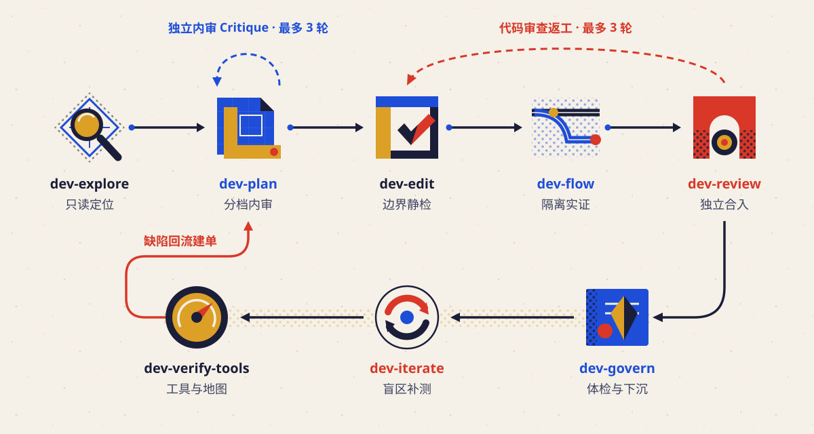

<p align="center">
  
</p>

<p align="center">
  <strong>简体中文</strong> | <a href="README.en.md">English</a>
</p>

<p align="center">
  <a href="RELEASING.md"></a>
  <a href="#安装与自动更新"></a>
  <a href="SKILL.md"></a>
  <a href="#支持的语言"></a>
  <a href="LICENSE"></a>
</p>

代码写得越久，拖慢节奏的往往是代码之外的事：文档和实现脱节、改一处漏掉关联模块、AI 只盯当前行把临时补丁写进主干。

**project-forge** 先只读摸底，再按仓库现状补齐版本管理、三层长青文档、`AGENTS.md` 工程契约、检查流水线和 8 个本地研发技能。它保留原有手写文件，零第三方依赖，只要有 Node.js 18+ 就能直接运行。

## 目录

<!-- toc:start -->

- [安装与自动更新](#安装与自动更新)
- [核心机制：它靠什么守住代码和文档质量](#核心机制它靠什么守住代码和文档质量)
- [流程和日常怎么用](#流程和日常怎么用)
- [八个本地研发技能](#八个本地研发技能)
- [支持的语言](#支持的语言)
- [常用脚本速查](#常用脚本速查)
- [许可协议](#许可协议)

<!-- toc:end -->

## 安装与自动更新

支持 Windows、macOS 和 Linux，需安装 `Node.js >= 18`。全部脚本仅用 Node 内置模块，不需要 `npm install`。

| 安装方式 | 获取来源 | 更新方式 | 适合场景 |
| --- | --- | --- | --- |
| **下载压缩包** | [下载 project-forge.zip（最新版）](https://github.com/FiretrUCK666/project-forge/releases/latest/download/project-forge.zip) | 自动检查更新，失败整包回滚 | 日常使用 |
| **`git clone`** | `git clone https://github.com/FiretrUCK666/project-forge.git` | 只提醒不覆盖，手动 `git pull` | 参与修改工具本身 |

注意保持文件夹名为 **`project-forge`**（不要带 `-main` 或版本号后缀），否则宿主会跳过加载。装好后在目标项目里直接对 AI 说：

```text
用 project-forge 帮我规范这个项目
```

- **空目录起步**：`用 project-forge 初始化这个项目`
- **老项目升级**：`用 project-forge 升级本项目的规范配置和本地技能`

> 默认先只读摸底、动文件前先在仓外留整包 `.zip` 快照，绝不覆盖手写文档。

<details>
<summary>查看自动更新频率与环境变量开关</summary>

只有**压缩包副本**会自动检查并更新，`git clone` 副本不会被覆盖。

| 项目 | 说明 |
| --- | --- |
| **检查频率** | 成功核对后 1 小时内不重查；失败后 15 分钟内不重试（离线不阻塞）；更新后 24 小时内跳过 |
| **原子替换** | 下载到同盘临时目录解包校验，最后再替换 `SKILL.md`，出错立即回滚 |
| **关闭或换源** | 设置 `PF_NO_UPDATE=1` 关闭自动检查；设置 `PF_UPDATE_SOURCE` 指向镜像仓库 |

```sh
node "<技能目录>/scripts/update.mjs" --check
PF_NO_UPDATE=1
PF_UPDATE_SOURCE="https://github.com/<owner>/project-forge"
```

</details>

## 核心机制：它靠什么守住代码和文档质量

- **防垃圾代码**：`dev-edit` 会剥离注释与字面量，直接拦截无故压制标记（`HACK`、`@ts-ignore`、`eslint-disable`、`# noqa`）、死代码块、跨层越界导入，以及超过 `800` 行的单文件膨胀。
- **假绿检测与真实截图实证**：修缺陷前先跑通最小复现并先写会失败的回归测试，拦截零断言和纯 Mock 自证；改动运行态或界面时，必须附上真实命令输出或截图附件，不凭口头确认放行。
- **主干隔离与有序并行**：有提交历史的仓库一律在 `.worktrees/` 隔离工作树开发，谁改代码谁认领并提交 PR；多个无冲突切片按依赖分波并行，互不踩踏。
- **禁止自审与 6 锁防死循环**：方案评审与代码审查均禁止自己审查自己；第 2 轮起全历史换人，最多 3 轮硬停损，并由同 SHA 防空转、回执绑定等 6 把锁收敛。
- **复发 2 次下沉成规则**：同一类问题出现第 2 次，不再只靠文档提醒，由 `dev-govern` 自动复盘并下沉为结构约束或静态检查。
- **老仓无损接入与人握不可逆开关**：保留原有 `README.md`、架构文档、CI 与自有技能。日常操作按**能不能撤回**分档：推自己的分支、开 PR 随时可撤；合并默认分支、发版、改历史与**弱化门禁**必须人点头，永不自动强推；独立审查全部通过后由审查者直接合入。

## 流程和日常怎么用

### 第一次接入或升级：S1 到 S4 四步推进

<p align="center">
  
</p>

无论空目录、老项目接入还是跨月升级，都按这 4 步走：

| 步骤 | 做什么 | 关键保护 |
| --- | --- | --- |
| **S1 只读勘察** | 盘点目录结构、语言、Git 远端拓扑、凭据与既有文档/技能 | 零写入；空目录先问 3–4 个问题再起步 |
| **S2 定范围与融合** | 保留手写文档、脚本与自有技能，按远端形态跳过不适用模板 | 许可证、仓库可见性与发版策略由人拍板 |
| **S3 备份后按序写入** | 先在仓外打 `pre-forge` `.zip` 快照并跑既有测试建基线，再写入 | 固定顺序：**版本库 → 文档 → 远端 → 自动化** |
| **S4 体检与交棒** | 运行交付体检与声明核验，把原仓遗留债建单移交日常迭代 | 删标记前先列清单确认；保留 `.pf-manifest.json` |

升级既有工程时，`.agents/skills/.pf-manifest.json` 会记住被你删除的技能（墓碑，除非加 `--restore` 不擅自恢复），非脚本改动能三方合并，脚本冲突保留本地版本，异常立即从仓外快照整包回滚。

### 日常对话与开发流转

<p align="center">
  
</p>

平时不需要背命令，直接把需求或 Issue / PR 链接发给 AI，`AGENTS.md` 会自动分档推进：

| 日常情景 | 你可以直接这么说 | 实际走哪几步 |
| --- | --- | --- |
| **改错别字或单行格式（Case 1）** | 「把这段注释的错别字改一下」 | 不写多余文档，直接改完运行对应校验 |
| **修明确缺陷（Case 2）** | 「登录接口空参数报错，修一下」 | 在 `.worktrees/impl-*` 先写失败测试再修绿，过 `dev-edit` 后开 PR 由 `dev-review` 独立审查合入 |
| **加功能或跨模块改造（Case 3 / 4）** | 「加一个报表导出功能」 | `dev-explore` 切片读源码 → `dev-plan` 澄清并独立 Critique → `dev-flow` 隔离实施并过 `dev-edit` → `dev-review` 换人审查合入 → 列清单确认后 7 步清理 |
| **定期补测与体检** | 「查一下近期改动的盲区，再做次体检」 | `dev-iterate` 补原生测试，`dev-verify-tools` 校验接口工具，`dev-govern` 审计并把高频问题沉淀为静态规则 |

### 先复现与有界优化循环

<p align="center">
  
</p>

排查疑点、测试盲区或体检告警时，统一遵循 **先最小复现（`PoC-first`）**——复现不了就判定为误报，不写无用补丁：

1. **Observe**：结合功能地图、历史信号与近期改动排出热点（只读）。
2. **PoC-first**：运行一条最小复现命令确认问题真实存在。
3. **Escalate & Fix**：带着复现证据建单走标准实现与独立审查修复，修完复跑同一条复现命令。
4. **Reflect**：评估是否属于同类模式缺失，优先加固共享边界或下沉成静态规则。

自动循环触及轮次上限（`ROUND_LIMIT_REACHED`，默认 3 / 硬上限 10）、连续 2 轮无进展（`NO_PROGRESS_STALL`）或不可逆操作（`ONE_WAY_GATE_HIT`）时以退出码 `4` 停机交人裁决。

### 三层长青文档与按需切片

<p align="center">
  
</p>

日常由 `doc-locate.mjs` 按标题或符号读取精确行号切片，不把长文档整份灌进对话：

| 层级 | 文件 | 职责与保鲜方式 |
| --- | --- | --- |
| **L1 入口契约** | `AGENTS.md` | 每次会话自动读的薄契约：意图路由、命令、协作与联动表（建议 `< 24KB`，上限 `30KB`） |
| **L2 系统架构** | `docs/TDD.md` | 模块边界、主流程图表与关键不变量，静态检查校对真实路径 |
| **L3 机读索引** | `docs/feature-map.json` | 功能、模块、业务流与验证工具映射，按导出符号和树哈希自动判旧 |
| **规划与归档** | `docs/{prd,specs,todo}/` → `docs/archive/` | 冻结 `C1..Cn` 验收标准，提交 PR 前核对全勾选后 `git mv` 成对归档 |

## 八个本地研发技能

不需要背命令，用日常中文就能自动触发；也可以按需要单独点名使用。

### 主链 5 个技能：平时提需求会自动一路串联

| 技能 | 它是干什么的 | 上一步怎么流转到下一步 | 你平时直接对 AI 说什么原话 |
| --- | --- | --- | --- |
| **`dev-explore`** | 只读摸清目录结构、模块入口、可复用工具与文档/符号行号切片 | 先侦察事实；纯问答直接作答，要动手则把入口和复用清单交给 `dev-plan`（小修直接进 `dev-flow`） | 「先看看导出模块是怎么跑的，有哪些能复用的工具」 |
| **`dev-plan`** | 判断改动档位（Case 1–5）、澄清待定项、写方案与冻结 `C1..Cn`，并走独立 Critique | 接收 `dev-explore` 事实；支持 `v2` 多主题记忆、`OPEN`/`LOCKED` 冻结保护与无损续接（`doc-plan.mjs next`），过审批准后交给 `dev-flow` 开工 | 「帮我加个报表导出功能，先把方案和边界写清楚」 |
| **`dev-flow`** | 创建 `.worktrees/` 隔离工作树、认领任务、归档规划单、跑实证、提 PR 与收尾清理 | 接收 `dev-plan` 过审单开工作位；统一 `--agent`/`--mode`/`--host-mode` 与 `--json` `nextSteps`，支持 `rework --reopen` 解锁返工，全通过后把 PR 交给 `dev-review` | 「接着做这个任务」/「修一下空参数报错」/「清理已合并分支」 |
| **`dev-edit`** | 改前核对禁改区与复用，改后剥离注释/字面量拦截压制标记、死代码、越界与 `>800` 行文件 | 嵌入在 `dev-flow` 改码与验证环节；静态门禁全绿才放行给 `dev-flow verify` | 「检查一下刚才改的代码有没有触发静态门禁」 |
| **`dev-review`** | 在隔离审查位先验运行实证与故障注入再看 diff，支持最多 3 轮换人复审并合入 | 接收 `dev-flow` 提交的 PR；有阻断打回 `dev-flow` 返工，全通过后直接合入主干并通知收尾 | 「换个独立视角审一下这个 PR」 |

### 外环 3 个技能：定期维护、按需调用并回流主链

| 技能 | 它是干什么的 | 怎么接入和回流主链 | 你平时直接对 AI 说什么原话 |
| --- | --- | --- | --- |
| **`dev-govern`** | 只读审计安全、死代码、测试质量与长青文档同步，巡检工作树并复盘下沉高频规则 | 随时巡检或接入 `dev-flow finalize`；发现问题可生成规划单回流 `dev-plan`，或把高频规则直接沉成静态检查 | 「做一次全仓代码体检」/「更新长青文档和架构文档」 |
| **`dev-verify-tools`** | 维护 `docs/feature-map.json`，在仓外 `scratch/` 试制验证脚本，按符号和树哈希自动判旧 | 沉淀好的验证工具直接给 `dev-flow` 实证与 `dev-review` 复核调用，消除每次手工重测 | 「查一下这次改动对应哪些验证脚本，缺的话补一个」 |
| **`dev-iterate`** | 对比功能地图与历史信号找测试盲区、生成原生测试并发运行（只写测试不改业务码） | 抓到真故障先最小复现，再带着复现命令和证据自动建单回流 `dev-plan` → `dev-flow` 修复 | 「给权限模块补一批回归测试，顺便排查测试盲区」 |

## 支持的语言

**任何语言都能用。** 语言只决定工具能不能从包清单自动猜出构建和测试命令，不会卡住流程。

| 仓库情况 | 处理方式 |
| --- | --- |
| **清单精准识别（12 种）** | `Node.js`、`Python`、`Rust`、`Go`、`Java`、`Ruby`、`PHP`、`.NET`、`C/C++`、`Dart`、`Swift`、`Elixir`，自动识别安装、构建与测试命令 |
| **其他任何语言** | Haskell、OCaml、Zig、Nim、Crystal、Julia 或自研 DSL：直接从 CI 的 `run:` 块、`Makefile`、`justfile`、`Taskfile` 读取已经在运行的命令 |
| **空白目录起步** | 运行 `equip.mjs --bootstrap-empty` 生成通用基线（Git 基线、三层文档、`docs/TDD.md`、`AGENTS.md` 与 8 个技能），支持 14 种预设栈，不写玩具业务代码 |

纯文档仓库、编辑器扩展、Obsidian 插件和技能目录也同样适用。既没有清单也没有 CI/任务文件时，勘察会如实说明并给出查找位置，绝不编造命令。

## 常用脚本速查

日常直接用自然语言通过 `AGENTS.md` 触发即可；排查问题或接入 CI 时可展开查看底层脚本：

<details>
<summary>查看底层脚本与用途</summary>

| 脚本 | 用途 |
| --- | --- |
| `node scripts/survey.mjs <目录>` | 只读盘点结构、文档、远端拓扑与鉴权状态 |
| `node scripts/backup.mjs create <目录>` | 在仓外创建增量 `.zip` 快照（支持 `list` / `restore`） |
| `scripts/zip.mjs` | 纯内置 `node:zlib` zip 读写库 |
| `node scripts/equip.mjs <目录>` | 统一装配或无损刷新 `.agents/skills/`（支持 `--check`、`--adopt-custom`、`--restore`、`--bootstrap-empty`） |
| `node scripts/compose-agents.mjs <目录>` | 生成或无损刷新 `AGENTS.md`（建议 `< 24KB`，上限 `<= 30KB`） |
| `node scripts/equip-ci.mjs <目录>` | 按勘察事实生成 CI 工作流或配置分支保护 |
| `node scripts/review.mjs <目录>` | 交付体检：规范齐备度与声明真实性回查 |
| `node scripts/handoff.mjs <目录>` | 扫描引导标记与临时残留，辅助交棒清理 |
| `node scripts/sync-toc.mjs README.md README.en.md` | 同步双语 README 的目录锚点 |
| `node scripts/update.mjs [--check]` | 检查并原子更新压缩包副本 |

</details>

## 许可协议

本项目采用 [MIT](LICENSE) 许可协议。欢迎阅读 [贡献指南](CONTRIBUTING.md) 与 [发版说明](RELEASING.md)。
