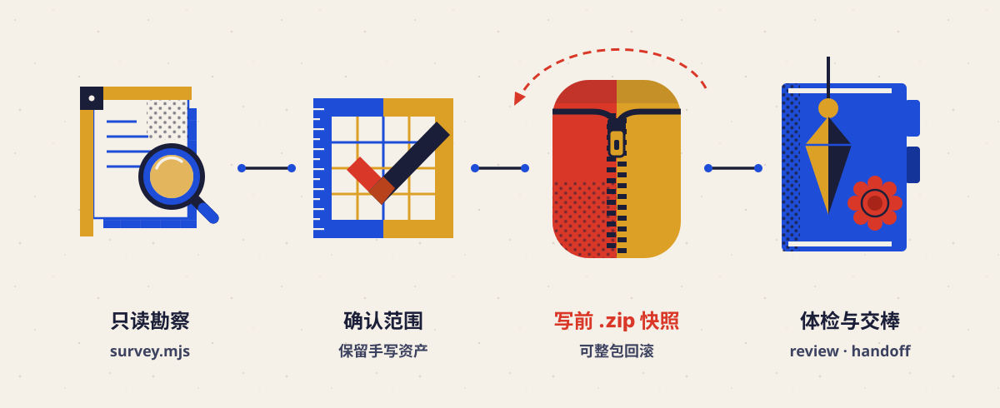

<p align="center">
  
</p>

<p align="center">
  <strong>简体中文</strong> | <a href="README.en.md">English</a>
</p>

<p align="center">
  <a href="RELEASING.md"></a>
  <a href="#安装"></a>
  <a href="SKILL.md"></a>
  <a href="#五个日常技能"></a>
  <a href="LICENSE"></a>
</p>

一个空目录，或者一个维护了几个月的老仓库，真正耗时间的地方往往不在业务代码：`.gitignore` 漏掉本地密钥、文档描述和代码对不上、分支合入前没有实测记录、改了一处却不知道还有哪几个文件要跟着改。

**project-forge** 先只读盘点目录现状，再按项目体量补上 Git 基线、四层设计文档、契约文件 `AGENTS.md`、GitHub 检查流和 5 个本地研发技能。它不会覆盖你手写的内容，也不安装任何第三方依赖，Node.js 18 及以上就能跑。

## 它能做什么

- **老仓库接入不覆盖手写内容**：已有的 `README.md`、`CONTRIBUTING.md`、架构文档、CI 工作流、自定义技能全部原样保留。写任何文件之前，先在仓库外面存一份 `.tar.gz` 快照。
- **需求、规格和任务单跟着分支一起走**：`docs/prd/`、`docs/specs/`、`docs/todo/` 三处文档使用统一的 YAML 头信息与 `YYMMDD-issue<N>-<slug>-{prd,spec,todo}.md` 命名，做完之后由 `flow.mjs finalize` 一起归档到 `docs/archive/`。
- **合入前要有实测输出**：静态门禁、真实命令的运行结果、独立上下文审查记录，三样齐了才合并。Mermaid 图表宽度和文档锚点在提交前自动检查。
- **改一侧会提醒另一侧**：`AGENTS.md` 里有一张关联表，写明动源码要同步看哪些模板和文档、动文档要核对哪些源码入口。
- **两档配置，随时无损升档**：个人小仓库可以只装 `lightweight` 档（`< 14KB` 契约加 3 个核心技能），以后随时用 `--tier full` 补到 5 个。你删掉或手改过的托管文件会记在 `.pf-manifest.json` 里，升级时不会强行写回。

## 目录

<!-- toc:start -->

- [它能做什么](#它能做什么)
- [一次真实改动长什么样](#一次真实改动长什么样)
- [五个日常技能](#五个日常技能)
- [支持哪些语言](#支持哪些语言)
- [安装](#安装)
- [第一次运行会做什么](#第一次运行会做什么)
- [自动更新](#自动更新)
- [日常安全边界](#日常安全边界)
- [脚本速查](#脚本速查)
- [许可协议](#许可协议)

<!-- toc:end -->

## 一次真实改动长什么样

<p align="center">
  
</p>

配好之后，日常最常走的是这一条链。假设你要给项目加一个「导出 CSV」的功能：

| 步骤 | 你说什么 | 走哪个技能 | 产出 |
| --- | --- | --- | --- |
| 1 | 「先帮我理清导出模块在哪、现在有哪些命令能验证」 | `dev-explore` | 模块入口、验证命令清单。只读，不改任何文件 |
| 2 | 「给导出 CSV 写个方案，标准要能判定」 | `dev-plan` | 一份 SPEC 和一份 Todo，验收标准写成 `C1`、`C2` 这样的编号 |
| 3 | 「按方案开工」 | `dev-flow` | 独立分支或工作树、验证结果绑定到本次提交、推送并开 PR |
| 4 | 「用独立视角审这个 PR」 | `dev-review` | 逐条核对 `C1`、`C2`，给出通过或退回，退回项写进 PR 和 Issue |
| 5 | 「过了就合，然后清理」 | `dev-flow` | 合并、卸工作树、删本地分支、回读确认 |

**哪些环节可以跳过：**

- 改一个错别字、调一行格式，第 1、2 步都不用走，直接改、跑一遍相关检查就行。
- 需求已经很明确、只影响一个文件时，第 2 步可以省掉，但第 4 步的独立审查不能省。
- 改动碰到 `scripts/lib/`、`templates/`、`SKILL.md` 这类关键路径时，第 4 步必须由另一个独立上下文来做，不能自己审自己。

**为什么顺序是这样：** 先查清现状再写方案，方案里才不会出现假路径；标准写死在前面，审查才有一个共同的尺子；审查和实现在不同的上下文中完成，才不会因为「我记得我改过」而漏看。

## 五个日常技能

`lightweight` 档装前三个，`full` 档装全部五个。日常不需要记命令，直接用自然语言说，`AGENTS.md` 会把你路由到对应技能。

| 技能 | 什么时候用 | 它做什么 |
| --- | --- | --- |
| `dev-explore` | 不熟悉这个仓库，或者要确认某个模块的入口和验证命令 | 只读扫描源码结构、多子包入口、测试与构建命令，完全不修改文件 |
| `dev-plan` | 要写方案、拆任务，或者不确定这件事该走多重的流程 | 先判定这是小修补还是跨模块改动，再按需生成 `docs/prd/`、`docs/specs/`、`docs/todo/`，并检查图表宽度和死链 |
| `dev-flow` | 要动手改代码、接 Issue、提交、开 PR、合并、清理工作树 | 建独立分支或工作树、认领 Issue、跑验证、推送开 PR、返工、合并收尾 |
| `dev-review` | 要找人独立审一遍，或者收到别人提的外部 PR | 用独立上下文按冻结的标准逐条核查，对外部 PR 先做供应链高危扫描 |
| `dev-govern` | 例行体检、清技术债、查文档漂移、准备发版说明 | 审计死代码、过期文档、弱测试和超时测试，采集跨版本发版清单 |

**它们怎么串起来：** `dev-explore` 查清事实 → `dev-plan` 把事实变成可判定的标准 → `dev-flow` 在隔离环境里实施并验证 → `dev-review` 用另一双眼睛判过不过 → 回到 `dev-flow` 收尾。`dev-govern` 不在主链上，它是定期维护时单独跑的，跑出来的结论常常会变成下一轮 `dev-plan` 的输入。

## 支持哪些语言

这里有两件不同的事，能力范围不一样，分开说清楚：

**能识别的语言（12 种）**。放进一个已有项目，勘察会认出它是哪一类，给出对应的构建、测试、安装命令，并据此生成 `docs/TDD.md` 和 `AGENTS.md`：

`Node.js`、`Python`、`Rust`、`Go`、`Java`、`Ruby`、`PHP`、`.NET`、`C/C++`、`Dart`、`Swift`、`Elixir`

另外还支持纯文档目录、编辑器插件、Obsidian 插件和能力目录。

**能生成起步骨架的语言（6 种）**。目录完全空白时，`--bootstrap-empty --lang` 可以直接铺出一套能跑通冒烟测试的最小工程，附带初始 `docs/TDD.md`：

`node`、`python`、`go`、`rust`、`java`、`docs`

不在上面 6 种里的语言，先用你自己的脚手架把项目建起来，再来跑勘察即可，后续流程完全一样。

## 安装

**环境要求**：`Windows`、`macOS` 或 `Linux`，`Node.js 18`（`>= 18`）及以上。全部脚本只用 Node 内置模块，不需要执行 `npm install`。

**方式一：下载压缩包（推荐给日常使用者）**

从 [Releases 页面](https://github.com/FiretrUCK666/project-forge/releases) 下载最新的 `project-forge.zip`，也可以直接点这个链接：

```text
https://github.com/FiretrUCK666/project-forge/releases/latest/download/project-forge.zip
```

解压后**保持文件夹名是 `project-forge`**，整个放进你的宿主技能目录。

文件夹名不能加版本号后缀（比如 `project-forge-v6`），否则宿主会因为前后名字对不上而跳过加载。

**方式二：`git clone`（推荐给要改工具本身的人）**

```sh
git clone https://github.com/FiretrUCK666/project-forge.git
```

这样拿到的是源码副本，带 `.git` 目录。它不会自动更新，需要你自己 `git pull`。

**装好之后**，打开你要整理的项目目录，直接说：

```text
请先帮我勘察当前目录现状，列出缺失的配置和整理方案。
```

如果目录是空的，它会问你 3 到 4 个问题（语言栈、项目描述、许可证、要不要建远端），然后直接铺出骨架。如果目录里已经有东西，它会先只读盘点，把手写文档和非标准目录都标成「保留」，再告诉你要补哪些。

## 第一次运行会做什么

不管是空白目录、半配好的个人项目，还是多人协作中的活跃仓库，都按同一个顺序推进：

1. **只读勘察**：盘点目录结构、语言生态、Git 远端、本机凭据和已有架构文档。这一步不写任何文件。
2. **按事实定范围**：手写文档和自定义技能一律保留，缺什么补什么，并根据代码规模推荐 `lightweight` 或 `full` 档。许可证、仓库可见性、发版策略这几项会先问你。
3. **备份后落盘**：非空仓库先在仓库外存一份快照，再按 **版本库 → 文档 → 远端 → 自动化** 的顺序写入。这个顺序不能调：`.gitattributes` 和 `.gitignore` 必须在第一次提交之前就位，文档和远端地址必须在推送之前就绪，CI 里跑的命令必须和 `AGENTS.md`、`README.md` 里写的完全一致。
4. **体检与交棒**：跑一遍交付体检，核对文档链接与契约一致性；要交回人工维护的话，先列出待清理的引导标记清单，确认后再清理。

## 自动更新

只有**压缩包副本**会自动更新。`git clone` 的副本不会，脚本只会提示你有新版本，由你自己 `git pull`。

压缩包副本在每次进入流程前，会在后台悄悄核对一次有没有新版本。下面说清楚它什么时候查、查到之后做什么、怎么关掉。

**什么时候查**

- 距上一次成功核对满 **1 小时**才会再查一次。短时间内反复使用不会反复联网。
- 网络不通或核对失败时，**15 分钟**内不再重试，避免离线时每次都卡在联网上。
- 刚更新完的 **24 小时**内不再查，避免紧接着又更新一遍。

**查到新版本之后做什么**

先下载到同一个磁盘的临时目录里解包，校验通过后才开始替换。替换时先写辅助文件，最后才原子写入 `SKILL.md`。中途断电或被打断，会自动回滚到更新前的状态，不会留下半更新的残缺副本。

**怎么控制**

```sh
# 立刻核对一次，只看结果不改文件
node "<技能目录>/scripts/update.mjs" --check

# 彻底关掉自动更新检查
PF_NO_UPDATE=1

# 换一个更新源（比如公司内网镜像）
PF_UPDATE_SOURCE="https://github.com/<owner>/project-forge"
```

## 日常安全边界

日常操作按「能不能撤回」分成两档，这是整条协作流程里唯一的分界线。

- **能撤回的，属于日常**：提交、推自己的分支、开 PR、改 PR、跑检查。这些随时可以撤销或重来，不需要额外确认。
- **撤不回来的，要先给人看清单**：合并进默认分支、打版本标签、正式发版、改仓库可见性、改写已推送的历史。这些做完就没有回头路，所以执行前必须把要做的动作列出来，等人点头。
- **审查通过就由审查者合**：独立审查全部通过、没有未决项时，由做审查的那个人直接合并，不再转手一次。审查者不是提建议的顾问，他就是那一道关。

除此之外还有两条硬规则：

- **弱化门禁必须人点头**：删测试用例、放宽断言、加跳过标记、调松 CI 严格度，这一类改动会让门禁从此少查一项，必须由人确认。
- **永不自动强推**：任何情况下都不自动执行 `git push --force` 或改写已推送的提交历史。

## 脚本速查

正常使用由 `AGENTS.md` 自动路由，不需要记这些命令。需要手动排查或接进 CI 时再看。

<details>
<summary>查看底层脚本与职责</summary>

| 脚本 | 用途 |
| --- | --- |
| `node scripts/survey.mjs <目录>` | 只读盘点仓库结构、文档、远端拓扑、认证状态与推荐档位 |
| `node scripts/backup.mjs create <目录>` | 在仓库外部创建增量压缩快照，写前保护并保留初始基线 |
| `node scripts/equip.mjs <目录> [--tier lightweight\|full]` | 装配或无损升档 `.agents/skills/`（支持 `--check`、`--adopt-custom` 与 `--restore`） |
| `node scripts/compose-agents.mjs <目录> [--tier lightweight\|full]` | 生成或无损刷新 `AGENTS.md`（`lightweight < 14KB`、`full <= 30KB`） |
| `node scripts/review.mjs <目录>` | 交付体检，检查规范齐备度与声明回查 |
| `node scripts/handoff.mjs <目录>` | 清理仓库内的引导标记与临时残留，方便交棒 |
| `node scripts/sync-toc.mjs README.md README.en.md` | 同步双语 README 的目录锚点 |
| `node scripts/update.mjs [--check]` | 检查并原子同步压缩包副本的工具更新 |

</details>

## 许可协议

本项目采用 [MIT](LICENSE) 许可协议。欢迎阅读 [贡献指南](CONTRIBUTING.md) 与 [发版说明](RELEASING.md)。
