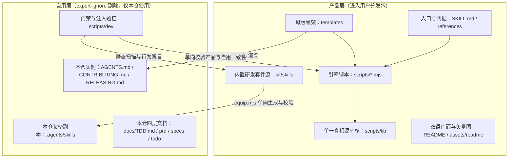
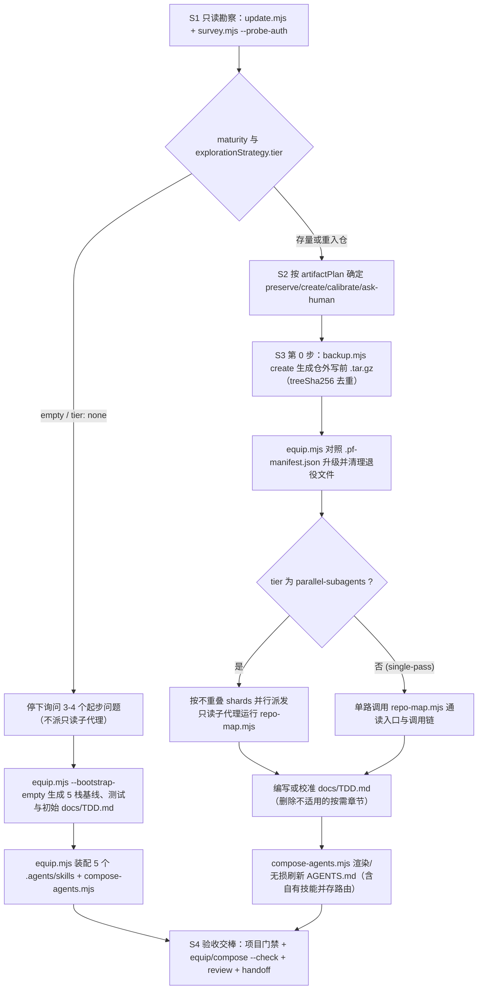
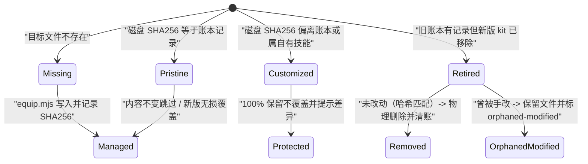
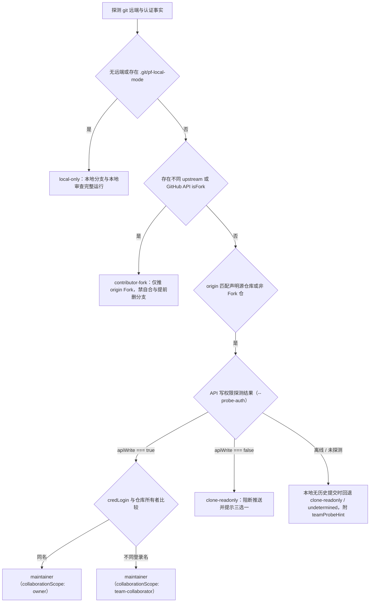
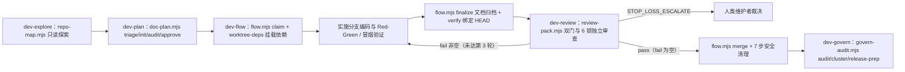

# project-forge 技术设计与架构契约（TDD）

本文档是 `project-forge` 仓库的常青技术设计与架构权威，面向维护者与 AI 会话。内容只陈述当前真实结构、数据流向、模块边界与核心不变量，不记录历史变更流水；代码结构或对外契约改动时随同一提交同步更新。

## 目录

- [1. 背景、非目标与术语表](#1-背景非目标与术语表)
- [2. 系统架构全景（双平面与自举拓扑）](#2-系统架构全景双平面与自举拓扑)
- [3. 项目锻造与重入流水线（S1-S4 与三态账本）](#3-项目锻造与重入流水线s1-s4-与三态账本)
- [4. 双轴五态身份、多人团队协作与 GitHub 双轨通道](#4-双轴五态身份多人团队协作与-github-双轨通道)
- [5. 内置研发工作流套件（五套 Skill 日常流转）](#5-内置研发工作流套件五套-skill-日常流转)
- [6. 文档四层体系与上下文护栏](#6-文档四层体系与上下文护栏)
- [7. 安全防线与核心不变量](#7-安全防线与核心不变量)
- [8. 门禁矩阵与故障注入自证](#8-门禁矩阵与故障注入自证)

## 1. 背景、非目标与术语表

`project-forge` 是运行在 Node 18+（仅使用 `node:*` 内置模块，零第三方运行时依赖）的工程治理与 AI 研发协作工具包。它既面向任意外部仓库提供只读勘察、写前备份、无损文档生成、GitHub 远端配置与本地研发技能装配，又以自身仓库作为这套规范的首个真实使用方完成自举验证。

### 核心目标、非目标与运行边界

- **核心目标**：用可机读、可回归验证的脚本替代人工口述规则；在任何写入前完成只读勘察与增量快照，对存量异构目录执行无损融合与重入校准。
- **跨平台运行约束**：统一在 Windows（PowerShell）、macOS 与 Linux 运行；路径比较通过 `posixPath` 归一 `/` 分隔符，纯 UTF-8 无 BOM 文本读写，跨平台中文正文一律走临时 UTF-8 文件传递而不依赖命令行引号转义。
- **明确非目标（Non-Goals）**：
  - 不生成业务应用逻辑，不替项目选定技术栈或开源许可证。
  - 不执行服务器运维部署、云资源开通或包管理器依赖安装决策。
  - 不支持非 GitHub 代码托管平台或旧式集中版本库，不绑定特定 AI 宿主名称、私有路径或私有环境变量。
  - 严禁覆盖既有手写规范、双许可声明、非标准目录布局或项目自有扩展技能。

### 术语表

| 术语 | 系统内语义 | 对应代码与数据载体 |
| --- | --- | --- |
| 产品层与自用层 | 分发给用户的通用工具文件集合与仅限本仓内部开发自用的门禁/治理文件集合 | `.gitattributes`、`scripts/lib/protocol.mjs`（`isRepoOnlyPath`） |
| 双轴五态身份 | 结合「远端拓扑」与「认证写权限」判定的工作区协作角色，另有外部 PR 审校轨 | `scripts/lib/platform/github.mjs`、`kit/skills/lib/shared.mjs` |
| 三态账本 | 记录托管套件文件 SHA256 与受管契约区间基线哈希的本地清单 | `.agents/skills/.pf-manifest.json` |
| 写前增量快照 | 写入或升级前在仓库外目录创建的 `.tar.gz` 备份包，按 `treeSha256` 去重 | `scripts/backup.mjs` |
| 探索分级策略 | `survey` 根据代码规模、多包布局与重入漂移输出的三档读码策略（`none`/`single-pass`/`parallel-subagents`） | `scripts/survey.mjs`（`computeExplorationStrategy`） |
| 确定性制品计划 | `survey` 对 10 项治理产物逐条输出处置动作（`preserve`/`create`/`calibrate`/`equip`/`upgrade`/`ask-human`/`skip`） | `scripts/survey.mjs`（`computeArtifactPlan`） |
| 双门与六锁收口 | 独立审查的运行实证门、结构 hygiene 门以及防死循环停损机制 | `kit/skills/dev-review/scripts/review-pack.mjs` |

## 2. 系统架构全景（双平面与自举拓扑）

仓库严格划分为**产品层**与**自用层**两个平面，通过 `.gitattributes`（`export-ignore`）与 `scripts/lib/protocol.mjs`（`REPO_ONLY_DIRS`、`REPO_ONLY_FILES`）双端对齐，确保打包导出时完整剔除内部测试与治理留痕，同时在本仓通过 `scripts/equip.mjs` 与 `scripts/compose-agents.mjs` 实现「工具即样板」同构自举。



### 主模块与脚本职责

| 模块 / 目录 | 层级 | 核心职责与导出接口 |
| --- | --- | --- |
| `SKILL.md`、`references/`、`templates/` | 产品层 | 调度总纲、分域权威判据与无条件残留渲染母版（含 `templates/docs-tdd.md` 自适应骨架） |
| `scripts/survey.mjs` | 产品层 | 只读勘察引擎（`survey`、`computeExplorationStrategy`、`computeArtifactPlan`、`judgeRole`、`detectReentry`） |
| `scripts/equip.mjs` | 产品层 | 五套技能三态账本装配（`equip`、`checkEquip`）与五栈空目录起步（`starterTemplates`、`bootstrapEmpty`） |
| `scripts/backup.mjs` | 产品层 | 纯内置 `node:zlib` tar.gz 写前快照（`createBackup`、`ensurePreWriteBackup`、`listBackups`、`restoreBackup`） |
| `scripts/compose-agents.mjs` | 产品层 | 受管 `AGENTS.md` 渲染、增量刷新、`agentsRegions` 防覆盖、`has-custom-skills` 路由注入与 30KB 校验 |
| `scripts/review.mjs`、`scripts/handoff.mjs` | 产品层 | 交付体检（`reviewProject`、`readDecisions`）与交棒扫描（`scan`、`toText`、`VERIFY_EXIT` 0/1/3/4） |
| `scripts/update.mjs`、`scripts/zip.mjs`、`scripts/sync-toc.mjs` | 产品层 | 包副本热更新、只读 zip 解包检验（`readZip`、`stripCommonPrefix`）与双语 README 目录同步 |
| `scripts/lib` | 产品层 | 9 个无环纯内核与 GitHub 平台探针模块（详情见下文内核分工表） |
| `kit/skills/dev-explore` | 产品层 | 只读分级探索（`kit/skills/dev-explore/scripts/repo-map.mjs` 扫描入口、CI 步骤、复用基建与 `Feature Map`） |
| `kit/skills/dev-plan` | 产品层 | 五档分流、门型判定、四层文档创建与内审锁（`kit/skills/dev-plan/scripts/doc-plan.mjs`） |
| `kit/skills/dev-flow` | 产品层 | 分支/Worktree 隔离、共享依赖挂载与全流程状态机（`kit/skills/dev-flow/scripts/flow.mjs`、`worktree-deps.mjs`） |
| `kit/skills/dev-review` | 产品层 | 外部 PR 安全扫描、双门评估与六锁审查（`kit/skills/dev-review/scripts/review-pack.mjs`） |
| `kit/skills/dev-govern` | 产品层 | 8 维治理审计、规则下沉与人类可读发版采集（`kit/skills/dev-govern/scripts/govern-audit.mjs`、`release-prep-lib.mjs`） |
| `kit/skills/lib` | 产品层 | `kit/skills/lib/shared.mjs` 独立无外部依赖运行内核，随套件完整复制进目标项目 |
| `assets/readme/hero.svg`、`assets/readme/workflow.svg`、`assets/readme/architecture.svg` | 产品层 | 中英双语门面静态架构图（与 `-en.svg` 成对存放，由 `isProductLayerPath` 白名单放行进用户包） |
| `scripts/dev/preflight.mjs`、`gap-coverage.mjs`、`fixtures.mjs`、`verify-injections.mjs`、`bench.mjs`、`evidence.mjs` | 自用层 | 仓库自检、缺口覆盖对齐、双向行为夹具、故障注入自证、3 秒性能预算与发版证据清点 |

### 共享内核模块职责（`scripts/lib`）

| 内核文件 | 单一真相源边界 | 核心导出与设计约束 |
| --- | --- | --- |
| `scripts/lib/protocol.mjs` | 标记语法、预算常数、平台禁词、包过滤名单 | `parseMarkers`、`markerRegions`、`AGENTS_MAX_BYTES`（30720）、`AGENTS_WARN_BYTES`（24576）、`KIT_SKILL_MAX_LINES`（180）、`FULL_READ_REFS`、`TEMPLATE_CONDITIONS`、`TEMPLATE_VARS`、`isRepoOnlyPath` |
| `scripts/lib/template.mjs` | 模板条件求值与变量替换 | `evaluateConditions`、`renderVars`、`renderTemplate`、`residualConditionMarkers`，保证渲染产物零残留 |
| `scripts/lib/render.mjs` | 勘察 Markdown 排版与动作导航 | `humanBytes`、`toMarkdown`、`computeNavigation`（渲染 `artifactPlan` 10 项表与团队探测提示） |
| `scripts/lib/claims.mjs` | 生成文档的真实存在性回查 | `claimsOf`、`verifyClaims`、`CLAIM_IDS`（核查 `claim.branch`、`claim.path`、`claim.script`） |
| `scripts/lib/markdown.mjs` | 围栏感知 Markdown 结构扫描 | `scanLines`、`fencedSpans`、`markerPositions`、`splitSections`，防止代码块内示例被误判为真实标记 |
| `scripts/lib/text.mjs` | 严格 UTF-8 读取与仓库标识归一 | `readUtf8Strict`、`isMainModule`、`skillVersion`、`skillSource`、`githubRepoPath`、`repoRelation` |
| `scripts/lib/fs-atomic.mjs` | 进程安全临时文件与原子写回 | `tempPathFor`、`clearStaleTemps`、`writeAtomic`（先写同目录临时文件并原子替换，清理残留临时文件） |
| `scripts/lib/platform/github.mjs` | GitHub 传输探测、五态身份判定与 API 封装 | `probeGitHubEnv`、`classifyWorkspaceIdentity`、`resolveWorkspaceIdentity`、`createGitHubClient`、`buildOneClickPrUrl` |
| `scripts/lib/platform/index.mjs` | 平台适配器出口聚合 | 统一向上层 `survey.mjs` 与测试套件暴露 GitHub 适配能力 |

- **双语门面与视觉资产边界**：`README.md` 与 `README.en.md` 引用的 6 张矢量图位于 `assets/readme/`，严禁包含 `<script>`、`javascript:`、`on*=` 事件处理器或外部 `href` 链接，同时禁止出现本仓自用路径。

### 模块分层与禁引规则（`arch-rules`）

```yaml
arch-rules: kit/** -> scripts/dev/**, scripts/*.mjs -> scripts/dev/**, scripts/lib/** -> scripts/dev/**
```

- **单向依赖边界**：`kit/skills/` 只允许引用 `kit/skills/lib/shared.mjs` 与 `node:*`；顶层 `scripts/*.mjs` 只允许依赖 `scripts/lib/` 与同级运行时模块（如 `scripts/backup.mjs`）；`scripts/lib/` 保持无环纯函数与 GitHub 探针职责；只有 `scripts/dev/` 允许跨平面读取产品层进行验证，反向依赖一概阻断。

### 功能与入口地图（Feature Map）

| 功能 / 能力域 | 入口文件 | 验证命令 |
| --- | --- | --- |
| 只读勘察与双轨鉴权 | `scripts/survey.mjs` | `node scripts/survey.mjs . --json` |
| 套件装配与空仓起步 | `scripts/equip.mjs` | `node scripts/equip.mjs . --check` |
| 写前增量快照与回滚 | `scripts/backup.mjs` | `node scripts/backup.mjs list .` |
| 契约生成与预算门禁 | `scripts/compose-agents.mjs` | `node scripts/compose-agents.mjs . --check` |
| 交付体检与交棒净度 | `scripts/review.mjs` | `node scripts/review.mjs .` |
| 只读资产探索套件 | `kit/skills/dev-explore/scripts/repo-map.mjs` | `node .agents/skills/dev-explore/scripts/repo-map.mjs . --json` |
| 规划分流与内审套件 | `kit/skills/dev-plan/scripts/doc-plan.mjs` | `node .agents/skills/dev-plan/scripts/doc-plan.mjs list` |
| 流转与 Worktree 隔离套件 | `kit/skills/dev-flow/scripts/flow.mjs` | `node .agents/skills/dev-flow/scripts/flow.mjs inspect --json` |
| 双门独立审查套件 | `kit/skills/dev-review/scripts/review-pack.mjs` | node `scripts/dev/fixtures.mjs` |
| 代码体检与发版筹备套件 | `kit/skills/dev-govern/scripts/govern-audit.mjs` | `node .agents/skills/dev-govern/scripts/govern-audit.mjs audit .` |
| 全仓门禁与故障注入自证 | `scripts/dev/preflight.mjs` | node `scripts/dev/preflight.mjs` |

## 3. 项目锻造与重入流水线（S1-S4 与三态账本）

项目从空白起步、存量接入到跨月重入均汇入同一条幂等流水线（S1–S4），写操作前始终完成只读定界与增量备份。



### 三场景调度与 `computeArtifactPlan` 十项定界

1. **空白目录（`maturity: 'empty'`）**：`computeExplorationStrategy` 直接输出 `tier: 'none'`，跳过探索子代理开销，经 `bootstrapEmpty` 为 `node`、`python`、`go`、`rust` 或 `docs` 五类项目写入 `.gitattributes`、`.gitignore`、`README.md`、可运行起点代码与测试以及填实 `Feature Map` 的 `docs/TDD.md`（存在即跳过不覆盖）。
2. **存量项目接入**：当代码文件数 `> 80`、存在多包/多子目录/多生态布局，或重入存在漂移/未登记模块/既有 AI 约定时，`computeExplorationStrategy` 升级为 `parallel-subagents` 并输出互不重叠的 `shards`（`architecture-boundaries`、`verification-runtime`、按需 `conventions-and-skills` 与 `polyglot-or-packages`）；S3 先装配 `.agents/skills/` 再按分片调用 `repo-map.mjs` 汇总事实，再编写 `docs/TDD.md` 与 `AGENTS.md`。
3. **跨月重入校准**：`detectReentry` 检测 `staleTddPaths`、`staleAgentPaths`、`staleAgentScripts`、`unregisteredTopDirs` 与 `drifted` 状态，仅定点替换失效路径与脚本并补充新增顶层目录，完整保留手写架构决策、「## 取舍」节与 `.agents/skills/<custom>/`。

| `artifactPlan` 项 | 覆盖对象 | 关键判定与不覆写边界 |
| --- | --- | --- |
| `pre-backup` | 写前仓外快照 | 非空目录写前必先 `snapshot`（空目录 `skip`），由 `treeSha256` 阻止重复包 |
| `git-baseline` | `.git`、`.gitattributes`、`.gitignore` | 识别裸仓与非根子目录（`ask-human`），补齐忽略项并保留已有历史 |
| `kit-skills` | `.agents/skills/` 与自有技能 | 三态升级受管 5 技能；`.agents/skills/<custom>/` 原样保留并注入并存路由 |
| `docs-tdd` | `docs/TDD.md` | 纯文档或 0 源码未起步 `skip`；缺则 `create`；漂移则 `calibrate`；合规 `preserve` |
| `agents-contract` | `AGENTS.md` | 吸收既有 AI 约定，检测失效引用与 30KB 超限；空目录起步前暂 `skip` |
| `readme` | `README.md` 与多语版本 | 已有 `README` 严格 `preserve`，严禁拿 `templates/readme.md` 全篇重写 |
| `contributing` | `CONTRIBUTING.md` | 仅维护者有远端时提示可选，纯本地或 Fork 贡献仓自动 `skip` |
| `license` | `LICENSE`（含双许可） | 已有许可一律 `preserve`；缺失时归类 `ask-human`，AI 不擅自代选 |
| `releasing` | `RELEASING.md` 与发版说明 | 仅可发布包、已有标签或已有发布流时 `create`，不强改既有 `CHANGELOG` |
| `ci-workflows` | `.github/workflows/` | 仅 GitHub 远端且有可执行命令时补齐；扫描并提示 `pull_request_target` 高危组合 |

### `.pf-manifest.json` 三态账本与写前备份状态机



- **受管契约区间防覆盖**：`compose-agents.mjs` 在刷新 `AGENTS.md` 时同时比对 `.agents/skills/.pf-manifest.json` 中的 `agentsRegions` 基线哈希与 `fill` 标记——若人工改写过区间内容且未触发覆盖条件，刷新跳过保护并由 `--check` 明确指出漂移。
- **零冗余写前快照**：`scripts/backup.mjs` 按优先顺序解析仓外备份根路径（`PF_BACKUP_DIR/<slug>-<hash8>` -> `<gitCommonDir>/project-forge-backups/` -> `~/.project-forge/backups/<slug>-<hash8>`），跳过 `.git`、`.worktrees`、`node_modules`、构建产物与超过 `MAX_BACKUP_FILE_BYTES`（20MB）的文件；若与最近快照 `treeSha256` 一致则跳过打包并返回 `skippedReason: 'unchanged-since-latest'`，保留窗口 `DEFAULT_MAX_KEEP = 5`，`restoreBackup` 还会清理快照之后新增的无主文件。

## 4. 双轴五态身份、多人团队协作与 GitHub 双轨通道

`classifyWorkspaceIdentity` 与 `resolveWorkspaceIdentity`（在 `scripts/lib/platform/github.mjs` 与 `kit/skills/lib/shared.mjs` 保持同一判定语义）沿着「远端拓扑」与「API 写权限/作者身份」两条正交轴共同裁定角色，消除把他人公开仓库误判成维护者的隐患。



### 五态权限边界表

| 身份与范围 | 推送分支与 PR 轨道 | 合并与清理约束 |
| --- | --- | --- |
| `local-only` | 仅本地分支提交与高风险审查 | 跳过平台接口调用；全量运行 5 套 `.agents/skills/` |
| `maintainer`（`owner`） | 同源独立特性分支 -> 推 `origin` -> 开 PR | 独立审查通过后由审查者合并；禁直推主干与私自发版 |
| `maintainer`（`team-collaborator`） | 公开/私有仓均走同源独立分支开 PR（非 Fork） | 零历史新成员先 `--probe-auth`；`claim` + 接管双写；遵循 `CODEOWNERS` / Merge Queue；`reviewerId !== implementerId` |
| `contributor-fork` | 仅推个人 `origin` Fork 分支 -> 向 `upstream` 开 PR | 硬禁止 `merge`；上游 PR `OPEN` 时硬禁止删 Fork 分支；标签 403 自动降级 |
| `clone-readonly` / `undetermined` | 先由人三选一（建 Fork / 新建仓 / `.git/pf-local-mode`） | 阻断推送与合并；同源离线场景输出 `teamProbeHint` 引导验权 |
| `inbound-external-pr` | 只读审查工作树隔离检出 `FETCH_HEAD` | 必先过 `--untrusted-scan` 再经人类放行跑测试 |

### GitHub 双轨四级传输与 API 通道

- **Track A（Git 传输探测）**：所有子进程注入 `GIT_TERMINAL_PROMPT=0`、`GCM_INTERACTIVE=never` 与 `BatchMode=yes` 杜绝挂起与弹窗；并发检查 SSH（22 端口优先，失败回退 `ssh.github.com:443`）与 HTTPS 凭据助手，当 remote URL 协议与可用通路错配时直接给出精确的 `remediationCmd`。
- **Track B（GitHub API 四级降级）**：

| 降级层级 | 触发条件与认证来源 | 行为与交互卫生 |
| --- | --- | --- |
| `gh-cli` | 本机已安装并登录 `gh` CLI | 含非 ASCII 正文先写系统临时 UTF-8 文件，按 `--body-file` 提交并清理临时文件 |
| `node-https-token` | 内存读取 `GH_TOKEN`/`GITHUB_TOKEN` 或 `git credential fill` 凭据 | 直接调用 GitHub REST/GraphQL；令牌零落盘、零返回值、零日志泄露；Fork 403 降级跳过 |
| `mcp-delegate` | 无 CLI 与可用令牌，但宿主可代理平台调用 | 生成结构化任务载荷（含 `<!-- pf-state:... -->`）移交宿主外部代理执行 |
| `half-duplex` / `offline` | 仅有 SSH 推送能力或完全断网 | 输出一键创建 PR 链接（`buildOneClickPrUrl`）或仅在本地完成分支与审查记录 |

## 5. 内置研发工作流套件（五套 Skill 日常流转）

日常改动通过 `AGENTS.md` 顶部的静默自然语言路由直接调度 `.agents/skills/` 内的 5 套自包含工作流，每套脚本仅依赖 `kit/skills/lib/shared.mjs` 与 `node:*`。



- **`dev-explore`（只读探索）**：按 `quick` / `medium` / `thorough` / `none` 选档；输出 `reusableModules`、CI `run` 步骤、`Dev Profile`、真实 `featureMap` 与热点文件，并只在治理初始化或路径漂移校准时向 `docs/TDD.md` 写入侧提供事实依据。
- **`dev-plan`（五档分流与内审）**：`doc-plan.mjs triage` 判定 Case 1–5 与 `doorType`（`two-way` / `one-way`）：

| 档位 | 适用特征 | 产出与内审动作 |
| --- | --- | --- |
| `Case 1` | 纯问答、错别字或单行格式微调 | 零文档直接响应（`critiqueTier: none`） |
| `Case 2` | 边界清晰的局部缺陷，不改对外契约 | 零设计文档，强制先写复现失败测试再修复（Red-Green） |
| `Case 3` | 不改外部契约的中等增量功能 | 建 `docs/todo/` 冻结 `C1/C2...`，运行 `doc-plan.mjs audit` 自修直通 |
| `Case 4` | 跨模块改造、改契约或 `one-way` 高风险 | 建 `docs/specs/` + `docs/todo/`，先 `audit` 再经独立 `critique-pass`（SHA256 锁定）后 `approve` |
| `Case 5` | 与 `docs/TDD.md` 或生效 `SPEC` 冲突 | 输出 `BLOCKED_CASE_5_TDD_CONFLICT` 硬阻断实现，先升级常青架构并获拍板 |
- **`dev-flow`（隔离、依赖零拷贝与提交门锁）**：
  - 任务账本存于 `.worktrees/.state/tasks/<taskId>.json`（经 `createDefaultLedger` / `writeTaskLedger` 维护），串起 `claim` -> `finalize` -> `verify` -> `submit` -> `merge` -> `cleanup` 不可跳过迁移：`finalizedHead` 须与当前提交同步，`verifiedHead === HEAD`。
  - `worktree-deps.mjs` 比对主仓与工作树锁文件 SHA256，一致时在 Windows 创建 Directory Junction、在 POSIX 创建 Symlink 零拷贝复用依赖；卸载时先显式调用 `fs.unlinkSync` 摘除挂载入口再执行 `git worktree remove`，严禁直接递归删除未解绑目录。
  - `submit` 前强校验工作区干净（`BLOCKED_DIRTY_WORKTREE`）、`finalize` 已完成且归档（Case 3/4 Todo 全勾 `[x]` 并 `git mv` 入 `docs/archive/todo/`，`SPEC` 标 `implemented`）以及 `verifiedHead === HEAD`（`BLOCKED_STALE_VERIFICATION`）。
  - `merge` 检测到删减断言、新增 `.skip`/`.only`、`continue-on-error: true`、`|| true` 或改松 CI 权限时以退出码 `4`（`BLOCKED_GATE_WEAKENING`）阻断；`contributor-fork` 硬禁止执行合并（`BLOCKED_FORK_CANNOT_MERGE`）。
  - `cleanup` 未传 `--confirm` 时返回待删清单并拒删（`BLOCKED_CONFIRMATION_REQUIRED`）；Fork 上游 PR 仍 `OPEN`（`BLOCKED_OPEN_FORK_PR`）或存在下游堆叠 PR（`BLOCKED_STACKED_PR`）时拒绝删除分支。
- **`dev-review`（供应链防线与六锁收口）**：`review-pack.mjs --untrusted-scan` 扫描 `.github/workflows/`、生命周期钩子、构建脚本、`.husky/`、`.agents/skills/`、`.gitattributes` 与锁文件变动，命中即报错 `BLOCKED_UNTRUSTED_HAZARD`（需 `--human-approved-exec` 放行）；输出 `behavioralGate` 与 `structuralGate`，强校验 `reviewerId !== implementerId`，第 2 轮锁定未改动旧块仅审增量与 `rebuts`，第 3 轮未收敛或同指纹连续出现 2 轮触发 `STOP_LOSS_ESCALATE`。
- **`dev-govern`（8 维审计、规则下沉与发版筹备）**：`govern-audit.mjs` 检查安全（凭据与 `pull_request_target`）、死代码/注释坏味（墓碑履历、未解释借口或压制注释）、测试覆盖、文档漂移与围栏感知死链（`docs.tdd-module-drift`、`docs.tdd-stale-path`、`docs.dead-link`）、Worktree 四态（`git cherry` / `git patch-id` 识别 `merged`、`squash_or_rebase_merged`、`no_own_commits`、`unmerged`）、`arch-rules`、`> 800` 行文件与性能风险；支持 `record`（写 `<gitCommonDir>/project-forge-govern/signals.jsonl` 零工作区污染）、`cluster`（同类纠偏满 2 次下沉检查）与 `sample`（回滚率与 48h 返工热点抽检）；`release-prep-lib.mjs`（`handleReleasePrep`）采集上个标签至 `HEAD` 的全部用户可见改动，支持跳版本、环境阈值变化探测与 `unaccountedPublicFiles` 交叉防漏。

## 6. 文档四层体系与上下文护栏

| 层级 | 路径或母版载体 | 定位与生命周期控制 |
| --- | --- | --- |
| 入口契约层 | `AGENTS.md`、`templates/agents-project.md` | 仅放当前机制、总纲、7 键 `Dev Profile`、上下文护栏与静默路由；受 `AGENTS_MAX_BYTES = 30720` 与 `AGENTS_WARN_BYTES = 24576` 约束 |
| 常青架构层 | `docs/TDD.md`、`templates/docs-tdd.md` | 当前系统全景、模块职责、`arch-rules`、`Feature Map` 与安全不变量；按需章节不适用即整节删除 |
| 需求基线层 | `templates/docs-prd.md`、`docs/prd/` | 跨周期需求范围、In/Non-Goals、复用评估与 `- Plan Critique: pending` 审批链 |
| 规格与任务单层 | `templates/docs-spec.md`、`docs/specs/`、`templates/docs-todo.md`、`docs/todo/` | `SPEC` 合入后标 `implemented` 长留作边界参考；`Todo` 随 PR 在同一分支全勾并 `git mv` 至 `docs/archive/todo/` |

### `Dev Profile` 7 键机读契约与全局索引约定

- **7 键共享解析**：`templates/agents-project.md`、`kit/skills/lib/shared.mjs`（`parseAgentsProfile`）、`kit/skills/dev-review/scripts/review-pack.mjs` 与 `kit/skills/dev-govern/scripts/govern-audit.mjs` 统一读取 `quick-test`、`full-test`、`smoke-verify`、`merge-gate`、`arch-rules`、`high-risk` 与 `do-not-edit` 七个键值（无对应项写 `none`，严禁伪造命令）；人工在「## 取舍」中写 `merge-authority: human` 时收回人工合流确认。
- **全局只读索引机制**：系统禁止在仓库根目录维护手写需求总表（避免多人并行 PR 冲突），所有活跃 PRD、规格、Todo 与已完成归档由 `doc-plan.mjs list` 现场解析头部字段动态汇总。
- **预算与渲染单源**：入口与参考文档预算统一定义在 `scripts/lib/protocol.mjs`（`SKILL_MAX_LINES = 200`、`SKILL_MAX_BYTES = 16384`、`REFS_MAX_LINES = 2400`、`FULL_READ_MAX_LINES = 1000`、`KIT_SKILL_MAX_LINES = 180`）；所有条件块（`TEMPLATE_CONDITIONS`）与占位变量（`TEMPLATE_VARS`）经 `scripts/lib/template.mjs` 一次性求值完毕，产物层严禁残留 `{{VAR}}` 或 `if/endif`。

## 7. 安全防线与核心不变量

1. **零第三方运行时依赖**：`scripts/` 与 `kit/` 所有 `.mjs` 模块只能引用 `node:*` 与包内相对路径，确保复制进任意断网或受限环境即刻可用。
2. **只读勘察先行与凭据零落盘**：`survey.mjs` 与 `dev-explore` 全程不修改目标目录；所有 GitHub 令牌只在内存短暂使用，绝不进入返回值、错误栈、日志、stdout 或磁盘快照。
3. **非交互进程隔离与跨平台安全编码**：Git 与网络探针强制关闭交互提示；所有跨平台含非 ASCII 正文先落系统临时文件再经 `--body-file` 或 API JSON 提交并清理临时文件。
4. **不可逆边界与弱化门禁人审**：推送分档依据「是否可撤回」而非「是否对外」——推个人分支与开 PR 属日常可逆操作，合并主干、发版、改可见性与强推不可逆；任何弱化测试/断言/CI 门禁的操作必须获得人工确认。
5. **文本清洁与指路稳定**：全仓严禁 Emoji 与非 GitHub 平台词；文档互指一律使用完整章节标题名而非易因重排失效的「第几节」指针；所有脚本写入一律使用 `scripts/lib/fs-atomic.mjs` 或 `writeJsonAtomic` 保证异常中断不损坏原文件。

## 8. 门禁矩阵与故障注入自证

| 验证脚本 | 检查覆盖面 | 触发时机与预期标准 |
| --- | --- | --- |
| `scripts/dev/preflight.mjs` | 入口预算、引用不断链、模板零残留、7 步收尾/4 字段对拍、自有实例同构、平台锁定、包自包含与端到端冒烟（26 项读数） | 每次提交前；退出码 `0`，`0` 项失败 |
| `scripts/dev/gap-coverage.mjs` | `survey` 全部 `GAP_RULE_IDS` 在 `review.mjs` 与文档指引中的配对覆盖率 | 每次改动勘察/体检规则后；`0` 条遗漏或悬空 |
| `scripts/dev/fixtures.mjs` | 身份判定、Track A/B 降级、空目录 5 栈起步、`reentry`、`backup`、`dev-flow`、`dev-review`、`dev-govern` 与 `release-prep` 双向正反断言 | 每次改动判定或工作流后；`0` 项失败 |
| `scripts/compose-agents.mjs` | 本仓 `AGENTS.md` 与 `templates/agents-project.md` 同步度及 `<= 30KB` 预算（`--check`） | 修改契约或模板后；退出码 `0` |
| `scripts/equip.mjs` | `.agents/skills/` 与 `kit/skills/` 及 `.pf-manifest.json` 字节级一致（`--check`） | 修改 `kit/skills/` 后；退出码 `0` |
| `scripts/review.mjs` | 交付成熟度体检、`claims.mjs` 真实路径/脚本回查与 `staleTddPaths` 检测 | 交付验收与合流前；`0` 个「缺」 |
| `scripts/sync-toc.mjs` | 双语门面目录标题与 GitHub 锚点双向一致性（`README.md README.en.md --check`） | 修改 README 结构后；退出码 `0` |
| `scripts/dev/verify-injections.mjs` | 在临时隔离副本上逐条注入 43 类人为退化故障（削弱门禁、破坏指针、删去关键路径检测），验证对应检查必红且还原后全绿 | 合流与发版前；全部故障可捕获且还原后全绿 |
| `scripts/dev/bench.mjs` | 300 文件基准仓库下 `survey.mjs` 耗时低于 `BUDGET_MS`（3000ms） | 修改扫描逻辑后；防止线性退化 |
| `scripts/dev/evidence.mjs` | 清点当前导出包 `skillVersion`、`skillSource`、条目列表与文件哈希（只读） | 发版前核对制品证据 |

### 交棒退出码契约（`VERIFY_EXIT`）与回滚验证

| 状态码 / 常量 | `handoff.mjs --verify` 语义 | 处理约定 |
| --- | --- | --- |
| `clean`（`0`） | 扫描完整且无任何受管标记或旧版残留 | 允许进入纯手动维护状态 |
| `dirty`（`1`） | 发现受管标记、待填 `fill` 或旧版路径残留 | 仅在维护者确认清场后剥除标记（不删业务内容与 `.agents/skills/`） |
| `truncated`（`3`） | 扫描文件数达到上限导致未扫全 | 禁止视为干净，必须显式扩大范围或核查剩余目录 |
| `notApplicable`（`4`） | 当前目标是 `project-forge` 自身仓库 | 本仓需要保留受管标记与校验链路，跳过剥除动作 |

- **写前快照与回滚实证**：若改造中途需要回退，调用 `scripts/backup.mjs`（`listBackups` 与 `restoreBackup`）从最近一次写前 `.tar.gz` 快照按 `treeSha256` 恢复原始文件，并自动清理快照后新增的无主文件。

### 跨文件对拍与发版边界（`preflight` 核验项）

| 同步链 | 对拍对象 | 防漏目标 |
| --- | --- | --- |
| 推送分档判据 | `SKILL.md`、`AGENTS.md`、`templates/agents-project.md`、`references/collaboration.md`、`README.md`、`README.en.md`、`CONTRIBUTING.md`、`templates/contributing.md`、`templates/pull-request-template.md` | 确保分支推送属日常可逆操作、审查者合并、仅弱化门禁须人工点头 |
| 收尾七步命令链 | `templates/agents-project.md`、`AGENTS.md`、`references/collaboration.md`、`kit/skills/dev-flow/scripts/flow.mjs` | 确保删前先询问确认、先卸 Worktree 再删分支，以及删远端前检查下游堆叠 PR 与 Fork 上游状态 |
| 四字段审查与验收 | `templates/pull-request-template.md`、`references/collaboration.md`、`templates/docs-todo.md`、`templates/docs-spec.md` | 保证 `审查来源`/`逐条标准状态`/`故障注入记录`/`止损记录`、`C1`/`C2` 编号与「合并前写完」契约逐字对齐 |
| 发版与包产物分离 | `RELEASING.md`、`docs/release-notes/`、`git archive` 清单 | 禁止仅发版说明引用自用脚本；禁止将未交付产物或自用目录漏进分发包 |

### 高风险路径复核约定

触碰 `AGENTS.md` `Dev Profile` 中标记为 `high-risk` 的目录或文件（`scripts/lib/`、`scripts/dev/preflight.mjs`、`templates/`、`kit/`、`SKILL.md`、`AGENTS.md`、`.github/workflows/`、`.gitattributes`）时，故障不会表现为立刻报错，而是会悄悄放过一类缺陷；因此必须由独立上下文审查并补齐对应正反夹具与故障注入用例后再行合入。
