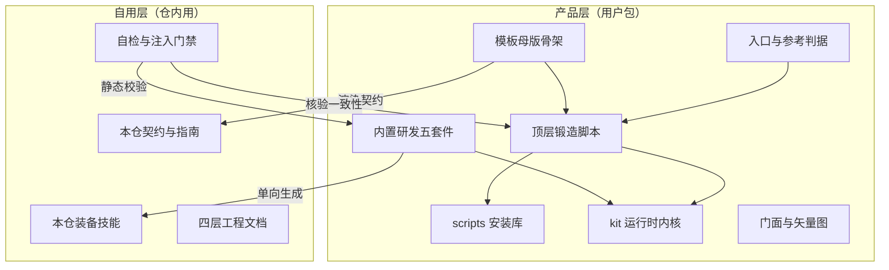
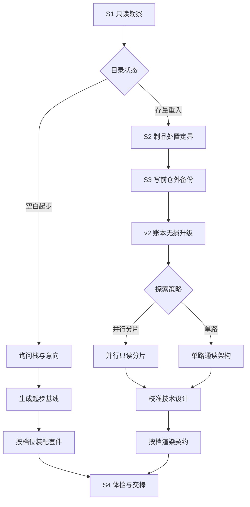
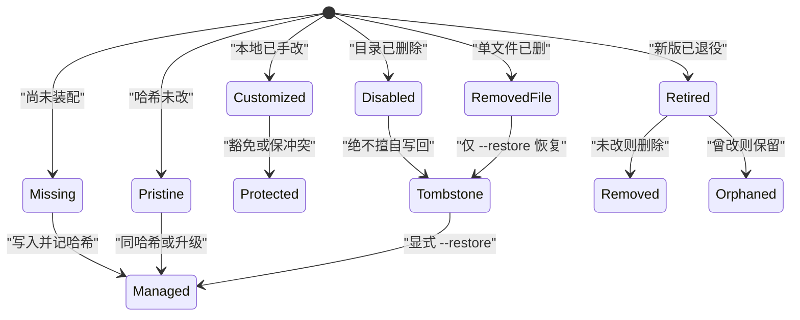
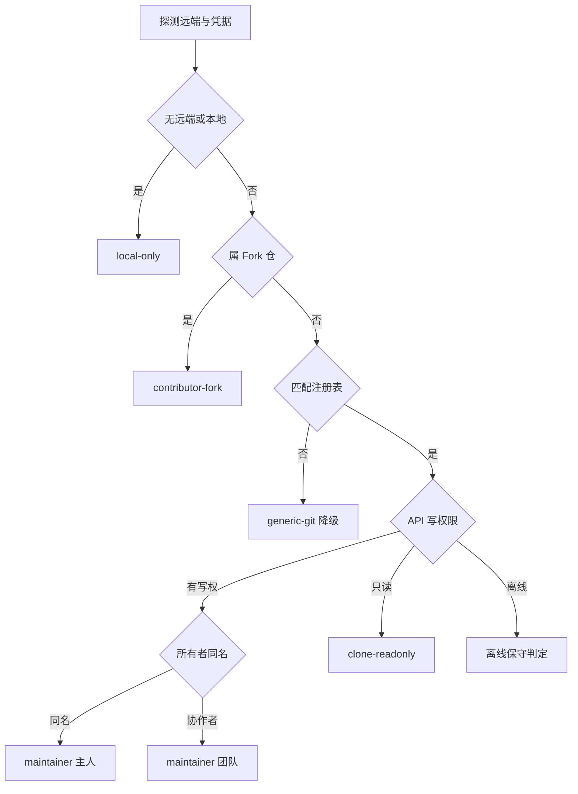
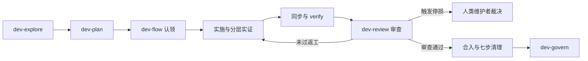

# project-forge 技术设计与架构契约（TDD）

本文档是 `project-forge` 仓库的常青技术设计与架构权威，面向维护者与 AI 会话。内容只陈述当前真实结构、数据流向、模块边界与核心不变量，不记录历史变更流水；**对正在推进中的 v7 架构演进目标均以 `[v7 规划 M1–M5]` 明确标注（对应总控需求见 `docs/prd/261115-v7-workflow-architecture-prd.md`）**，各切片代码落地时同步去掉规划标签并写入真实文件路径。

## 文档信息

| 项目 | 内容 |
| --- | --- |
| 文档版本 | `v6.3.0`（已实装 M1–M3：共享内核/`.zip` 备份、L3 状态机/全 Worktree/六锁、统一 `TaskBackend`/外部图谱与堆叠 PR/`batch` 并行队列/通用初始化与三层嗅探；含 `[v7 规划 M4–M5]`） |
| 编制 / 最近更新日期 | `2026-11-15` / `2026-11-16` |
| 基线依据 | 仓库源码与 v7 总控 PRD `docs/prd/261115-v7-workflow-architecture-prd.md` |
| 运行环境与生态栈 | `Node.js 18+`（仅使用 `node:*` 内置模块，零第三方依赖） |
| 跨平台基线 | `Windows`（PowerShell）、`macOS`（APFS / BSD 工具链）、`Linux` |
| 托管平台适配范围 | 产品层注册表当前仅注册 `github`；未匹配托管远端退化为 `generic-git`，统一由 `TaskBackend` 抹平三态差异 |
| 关联工程契约 | `AGENTS.md`、`SKILL.md` |

## 目录

- [文档信息](#文档信息)
- [1. 背景、非目标与术语表](#1-背景非目标与术语表)
- [2. 系统架构全景（双平面、四层正交与自举拓扑）](#2-系统架构全景双平面四层正交与自举拓扑)
- [3. 项目锻造与重入流水线（S1-S4 与 v2 账本）](#3-项目锻造与重入流水线s1-s4-与-v2-账本)
- [4. 双轴五态身份、平台抽象与双轨通道](#4-双轴五态身份平台抽象与双轨通道)
- [5. 内置研发工作流套件（五套 Skill 日常流转与 v7 演进）](#5-内置研发工作流套件五套-skill-日常流转与-v7-演进)
- [6. 文档四层体系、成对归档与图表规范](#6-文档四层体系成对归档与图表规范)
- [7. 安全防线与核心不变量](#7-安全防线与核心不变量)
- [8. 门禁矩阵与三位一体自证](#8-门禁矩阵与三位一体自证)

## 1. 背景、非目标与术语表

`project-forge` 面向任意外部项目提供只读勘察、写前备份、分档契约生成、远端/纯本地协同配置与本地研发技能装配，同时以自身仓库作为规范的第一个使用方完成自举校验。

### 技术基线与运行约束

| 维度 | 真实约束与实现载体 | 变更前提 |
| --- | --- | --- |
| 运行时下限 | `Node.js 18+`（纯 ESM `.mjs`，零第三方 npm 依赖） | 下限只上移不动；上移须同步修改清单与 `README` |
| 路径与编码 | `canonicalPath` / `samePath` 处理 Win32 大小写、macOS `/private/var` 与 APFS NFC 归一；无 BOM UTF-8 | 跨平台正文一律先落系统临时文件再经 `--body-file` 传入 |
| macOS 与杂项过滤 | `isMacOsMetadata` 与单源 `COMMON_SKIP_DIRS`（定义于 `kit/skills/lib/git.mjs` 并经 `shared.mjs`/`protocol.mjs` 导出）统一全链路跳过清单 | 全仓扫描、备份、打包与 `handoff` 共用同一过滤名单 |
| 宿主与平台边界 | 产品层严禁出现特定 AI 宿主、IDE 或具体团队工具名；`HostingProvider` 保持协议中立，当前仅注册 `github` 并在未匹配主机降级 `generic-git` | 新增平台接口不破坏核心零依赖与协议中立约束 |

### 明确非目标（Non-Goals）

- 不生成业务应用逻辑，废除空白起步硬编码业务玩具源码，不替项目选定技术栈、版本号或开源许可证。
- 不执行服务器运维部署、云资源开通或依赖包安装决策。
- 不绑定特定 AI 宿主名称、私有环境变量或私有路径；不覆盖既有手写规范、双许可声明与项目自有扩展技能。
- 不为压缩体积而删除 `AGENTS.md` 中的高信号协作防呆守则（始终保留自动路由、工程原则、协作全链路、双写、七步收尾与防乱码规范）。

### 术语表

| 术语 | 系统内语义 | 对应代码与数据载体 |
| --- | --- | --- |
| 产品层与自用层 | 分发给用户的工具包文件与仅限本仓内部开发自用的门禁/治理文件 | `.gitattributes`、`scripts/lib/protocol.mjs`（`isRepoOnlyPath`） |
| 共享运行时 vs 安装器边界 | `kit/skills/lib/` 仅承载被治理项目日常流转与顶层脚本共用的运行时原语；`scripts/lib/` 保留首次锻造/升级/交棒专用逻辑，防止将安装器内部代码打入目标仓 | `kit/skills/lib/shared.mjs`、`scripts/lib/protocol.mjs` |
| 两档渐进装配 | `lightweight`（`< 14KB` 契约 + 3 核心技能）与 `full`（`<= 30KB` 契约 + 全套 5 技能与协作骨架）；保护项目自有规则与 `--adopt-custom` / `--allow-custom-oversize` 并存 | `scripts/equip.mjs`、`scripts/compose-agents.mjs` |
| v2 账本与墓碑 | 记录托管文件哈希、档位、`disabledSkills`、`removedFiles`、`customizedFiles` 与区间基线（`--adopt-custom` 解锁与 `--check` 冲突及二次改写重采用） | `.agents/skills/.pf-manifest.json` |
| `HostingProvider` 与 `TaskBackend` | 平台抽象注册契约与 13 方法统一 `TaskBackend`（`GitHubBackend` / `GenericRemoteBackend` / `LocalOnlyBackend`） | `scripts/lib/platform/registry.mjs`、`kit/skills/lib/task-backend.mjs` |
| 双轴五态身份与外部图谱 | 结合「远端拓扑」与「认证写权限」判定的协作角色，统一解析单 Issue / 外部 PR 扫码阻断 / Issue+PR 互链防重 / 外部阻塞依赖与堆叠 PR | `kit/skills/lib/platform.mjs`、`kit/skills/lib/task-graph.mjs` |
| 写前增量快照 | 写前在仓外创建的纯 JS `.zip` 备份包（支持 `--format tar.gz` 并向下兼容恢复历史 `.tar.gz`），按 `treeSha256` 去重并钉住 `pre-forge` 基线 | `scripts/backup.mjs`、`scripts/zip.mjs` |
| 成对归档与 1:N PRD | 需求完结后将关联 `PRD`/`SPEC`/`Todo` 一并 `git mv` 至归档目录（`docs.mjs` `isSharedMasterPrd` 保护共享总控 PRD 维持 `active` 直至子切片全部完结） | `kit/skills/lib/docs.mjs`、`kit/skills/dev-flow/scripts/flow.mjs` |
| 双门与六锁收口 | 独立审查的运行实证门、结构 hygiene 门以及防无限审查六锁（`review-locks.mjs` 历史停损、同 `HEAD` 拒审、Round 2+ 增量及 `sync` `range-diff` 视野硬锁、指纹匹配） | `kit/skills/dev-review/scripts/review-pack.mjs`、`kit/skills/dev-review/scripts/review-locks.mjs`、`kit/skills/dev-review/scripts/review-ledger.mjs` |

## 2. 系统架构全景（双平面、四层正交与自举拓扑）

仓库严格划分为**产品层**与**自用层**两个平面，通过 `.gitattributes`（`export-ignore`）与 `scripts/lib/protocol.mjs`（`REPO_ONLY_DIRS`、`REPO_ONLY_FILES`）双端对齐。在产品层内部，按以下四层正交边界收敛演进：

1. **L1 基础原语层（`kit/skills/lib/exec.mjs`、`git.mjs`、`git-fast.mjs`、`scripts/zip.mjs`、`backup.mjs`）**：跨平台无弹窗命令与 Windows `.cmd`/`.bat` 解析、Worktree 共享路径、`withFileLock`（`O_EXCL`）、`computeWorktreeEnv`、`.git/*.lock` 指数退避重试、零子进程配置/ref 快速解析与纯 JS `.zip` 读写。
2. **L2 环境与拓扑抽象层（`kit/skills/lib/platform-probe.mjs`、`platform.mjs`、`github-client.mjs`、`task-backend.mjs`、`task-graph.mjs`、`profile-sniffer.mjs`、`profile.mjs`、`docs.mjs`）**：双端单源惰性平台探测、统一 13 方法 `TaskBackend`、外部互链/堆叠图谱与单源三层优先级命令嗅探。
3. **L3 纯策略与状态机引擎层（`kit/skills/lib/workflow-policy.mjs`、`static-gates.mjs`、`ledger.mjs`）**：无副作用纯函数确定性计算三正交风险策略、分层 `evidence.json` 防旁路校验、无 CI 低风险静态必检与 `next` 单入口状态路由（含 `merge-queue` 冲突退回再路由）。
4. **L4 薄 CLI 入口层与安装器层（`kit/skills/*/scripts/` 与 `scripts/*.mjs`）**：调用 L3 决策与 L1/L2 副作用，含 `flow-sync.mjs`、`flow-batch.mjs`、`flow-cleanup.mjs`；首次锻造专用逻辑留驻 `scripts/lib/` 绝不反向进入 `kit/skills/lib/`。



### 主模块与脚本职责

| 模块 / 目录 | 层级 | 核心职责与入口文件 |
| --- | --- | --- |
| `SKILL.md`、`references/`、`templates/` | 产品层 | 调度总纲、分域权威判据与无条件残留渲染母版 |
| `scripts/survey.mjs` | 产品层 | 只读勘察入口（`survey`、`computeArtifactPlan`、`judgeRole`） |
| `scripts/equip.mjs` | 产品层 | 两档五技能 v2 账本装配、墓碑保护与空仓起步（`equip`、`checkEquip`） |
| `scripts/backup.mjs`、`scripts/zip.mjs` | 产品层 | 纯内置 `node:zlib` 仓外 `.zip` 快照主格式（支持 `--format tar.gz` 并兼容恢复 `.tar.gz`） |
| `scripts/compose-agents.mjs` | 产品层 | 受管 `AGENTS.md` 按档渲染、增量刷新、`removedAgentsRegions` 尊重与预算校验 |
| `scripts/review.mjs`、`scripts/handoff.mjs` | 产品层 | 交付体检（`reviewProject`、`readDecisions`）与交棒扫描（`VERIFY_EXIT` 0/1/3/4） |
| `scripts/update.mjs`、`scripts/sync-toc.mjs` | 产品层 | 同盘 staging 全目录核验原子自更新（支持代理/`GH_TOKEN`/回滚）与双语 README 目录同步 |
| `scripts/lib/` | 产品层 | 首次锻造/升级/交棒专用库（含安装期模板与渲染、`scripts/lib/platform/` 薄适配层） |
| `kit/skills/lib/` | 产品层 | 自包含正交运行内核（`shared.mjs` 汇总导出 `cli.mjs`、`exec.mjs`、`git.mjs`、`git-fast.mjs`、`profile.mjs`、`profile-sniffer.mjs`、`static-gates.mjs`、`workflow-policy.mjs`、`ledger.mjs`、`docs.mjs`、`doc-templates.mjs`、`platform-probe.mjs`、`platform.mjs`、`github-client.mjs`、`task-backend.mjs`、`task-graph.mjs`） |
| `kit/skills/dev-explore/` | 产品层 | 只读多生态扫描（`kit/skills/dev-explore/scripts/repo-map.mjs`：`git ls-files -z` + 4KB NUL 探测） |
| `kit/skills/dev-plan/` | 产品层 | 五档分流、规划生成与内审（`doc-plan.mjs` 导出 `triageTask` / `auditDoc` / `listDocs`，配合 `doc-audit.mjs`） |
| `kit/skills/dev-flow/` | 产品层 | 隔离流转、并行调度与堆叠同步（`flow.mjs`、`flow-next.mjs`、`flow-inspect.mjs`、`flow-lifecycle.mjs`、`flow-merge.mjs`、`flow-cleanup.mjs`、`flow-sync.mjs`、`flow-batch.mjs`、`flow-trial-merge.mjs`、`worktree-deps.mjs`） |
| `kit/skills/dev-review/` | 产品层 | 外部 PR 安全扫描、审查槽同步、六锁硬拦截与双门双写（`review-pack.mjs`、`review-diff.mjs`、`review-gates.mjs`、`review-locks.mjs`、`review-ledger.mjs`） |
| `kit/skills/dev-govern/` | 产品层 | 基线增量审计、测试分层与跨版本采集（`govern-audit.mjs`、`govern-checks.mjs`、`govern-docs.mjs`、`govern-state.mjs`、`govern-tests.mjs`、`release-prep-lib.mjs`） |
| `assets/readme/` | 产品层 | 6 张中英双语浅深色安全矢量图（`hero*.svg`、`workflow*.svg`、`architecture*.svg`） |
| `scripts/dev/` | 自用层 | `preflight.mjs`、`gap-coverage.mjs`、`fixtures.mjs`、`fixtures-m2.mjs`、`fixtures-m3.mjs`、`verify-injections.mjs`、`injections-data.mjs`、`bench.mjs`、`evidence.mjs` |

### 共享内核模块职责（`scripts/lib/` 与 `kit/skills/lib/`）

| 内核模块 | 单一真相源边界 | 核心职责与关键约束 |
| --- | --- | --- |
| `scripts/lib/protocol.mjs` | 标记语法、预算常数、平台禁词、包边界 | `parseMarkers`、`markerRegions`、`AGENTS_MAX_BYTES`（30720）、`PF_MANIFEST_SCHEMA_VERSION`（2）、`EQUIP_TIERS`、`TEMPLATE_CONDITIONS`、`TEMPLATE_VARS`、`isMacOsMetadata` |
| `scripts/lib/template.mjs` | 模板条件求值与变量替换 | `evaluateConditions`、`renderVars`、`renderTemplate`、`residualConditionMarkers` |
| `scripts/lib/render.mjs` | 勘察 Markdown 排版与动作导航 | `toMarkdown`、`computeNavigation`、无远端 3 路决策与缺凭据 3 路线向导 |
| `scripts/lib/claims.mjs` | 契约真实性回查与联动解析 | `claimsOf`、`verifyClaims`（核查 `claim.branch`、`claim.path`、`claim.script`） |
| `scripts/lib/markdown.mjs` | 围栏感知 Markdown 结构扫描 | `scanLines`、`fencedSpans`、`markerPositions`、`splitSections` |
| `scripts/lib/text.mjs` | UTF-8 严读、路径归一与 SSH 别名 | `readUtf8Strict`、`canonicalPath`、`samePath`、`parseSshConfigHostMap`、`githubRepoPath` |
| `scripts/lib/fs-atomic.mjs` | 进程安全临时文件与原子写回 | `tempPathFor`、`clearStaleTemps`、`writeAtomic` |
| `scripts/lib/update-ops.mjs` | 原子更新暂存校验与冷却状态 | 同盘 `stageAndValidatePackage`、写前备份与原地回滚、全深度退役清理、`FAILURE_COOLDOWN_MS`（15 分钟） |
| `scripts/lib/equip-bootstrap.mjs` / `starter-templates.mjs` | 通用空白工程基线与初始自洽契约 | `BOOTSTRAP_STACKS`、`bootstrapEmpty`、`starterTemplates`、`generateInitialBootstrappedAgents`（兼容已有 `README`/`LICENSE`） |
| `scripts/lib/agents-sections.mjs` | `AGENTS.md` 区间刷新与 v2 兼容检查 | `filterIntentRouting`、`refreshRegions`、`driftRegions`、`maskVolatile`、`inspectKitManifestForReview` |
| `scripts/lib/survey-ecosystem.mjs` | 生态、命令、工作区与制品探测 | 委托 `profile-sniffer.mjs` 统一探测多包清单、2/4 空格中立 CI 与 `Taskfile`/`Makefile`/`justfile` |
| `scripts/lib/survey-workspace.mjs` | 工作区遍历、Git 事态、文档与凭据扫描 | `walkWorkspace`、`detectGit`、`detectDocs`、`detectConventions` |
| `scripts/lib/survey-reentry.mjs` | 套件现状、自有技能与重入漂移检测 | `isReentryProject`、`detectKit`、`detectLocalSkills`、`detectTddStalePaths`、`detectStaleAgentScripts` |
| `scripts/lib/survey-plan.mjs` | 探索分片策略与装配档位推荐 | `computeExplorationStrategy`、`computeRecommendedTier` |
| `scripts/lib/survey-gap-rules.mjs` | 勘察的缺口判据表 | `GAP_RULES`；由 `survey.mjs` 的 `judgeGaps` 展开，`gap-coverage.mjs` 核对覆盖 |
| `scripts/lib/platform/registry.mjs` | 平台抽象注册表与多远端拓扑模型 | `registerHostingProvider`、`resolveRemotesTopology`、`GENERIC_GIT_PROVIDER`、`classifyTopologyIdentity` |
| `scripts/lib/platform/github.mjs` | GitHub 适配器入口 | `GITHUB_PROVIDER`、`probeGitHubEnv`、`resolveWorkspaceIdentity`、`createGitHubClient` |
| `kit/skills/lib/shared.mjs` | 套件统一兼容导出出口 | 汇总导出 `cli.mjs`、`exec.mjs`、`git.mjs`、`git-fast.mjs`、`profile.mjs`、`profile-sniffer.mjs`、`static-gates.mjs`、`workflow-policy.mjs`、`ledger.mjs`、`docs.mjs`、`doc-templates.mjs`、`platform-probe.mjs`、`platform.mjs`、`github-client.mjs`、`task-backend.mjs`、`task-graph.mjs` |

### 模块分层与禁引规则（`arch-rules`）

```yaml
arch-rules: kit/** -> scripts/dev/**, kit/** -> scripts/lib/**, scripts/*.mjs -> scripts/dev/**, scripts/lib/** -> scripts/dev/**
```

- **单向依赖边界**：`kit/skills/` 只允许引用 `kit/skills/lib/` 与 `node:*`（由 `preflight-suite.mjs` 强制禁止 `kit/** -> scripts/dev/**` 与 `kit/** -> scripts/lib/**`）；顶层 `scripts/*.mjs` 只允许依赖 `scripts/lib/`、`kit/skills/lib/` 与同级运行时模块；`scripts/dev/` 允许跨平面读取产品层进行验证。

### 功能与入口地图（Feature Map）

| 功能 / 能力域 | 入口文件 | 验证命令 |
| --- | --- | --- |
| 只读勘察与双轨鉴权 | `scripts/survey.mjs` | `node scripts/survey.mjs . --json` |
| 套件装配与空仓起步 | `scripts/equip.mjs` | `node scripts/equip.mjs . --check` |
| 写前增量快照与回滚 | `scripts/backup.mjs` | `node scripts/backup.mjs list .` |
| 契约生成与预算门禁 | `scripts/compose-agents.mjs` | `node scripts/compose-agents.mjs . --check` |
| 交付体检与声明回查 | `scripts/review.mjs` | `node scripts/review.mjs .` |
| 交棒扫描与净度验证 | `scripts/handoff.mjs` | `node scripts/handoff.mjs . --json` |
| 包副本原子更新 | `scripts/update.mjs` | `node scripts/update.mjs --help` |
| 只读资产探索套件 | `kit/skills/dev-explore/scripts/repo-map.mjs` | `node .agents/skills/dev-explore/scripts/repo-map.mjs . --json` |
| 规划分流与文档审计套件 | `kit/skills/dev-plan/scripts/doc-plan.mjs` | `node .agents/skills/dev-plan/scripts/doc-plan.mjs list` |
| 流转与 Worktree 隔离套件 | `kit/skills/dev-flow/scripts/flow.mjs` | `node .agents/skills/dev-flow/scripts/flow.mjs inspect --json` |
| 双门独立审查套件 | `kit/skills/dev-review/scripts/review-pack.mjs` | `node scripts/dev/fixtures.mjs` |
| 代码体检与发版筹备套件 | `kit/skills/dev-govern/scripts/govern-audit.mjs` | `node .agents/skills/dev-govern/scripts/govern-audit.mjs audit .` |
| 全仓门禁与故障注入自证 | `scripts/dev/preflight.mjs` | `node scripts/dev/preflight.mjs` |

## 3. 项目锻造与重入流水线（S1-S4 与 v2 账本）

项目从空白起步、存量接入到跨月重入均汇入同一条幂等流水线（S1–S4），写操作前始终完成只读定界与增量备份。



### 三场景调度与 `computeArtifactPlan` 十一项定界

1. **空白目录（`maturity: 'empty'`）**：`computeExplorationStrategy` 输出 `tier: 'none'`，跳过探索子代理；通过 `bootstrapEmpty`（`scripts/lib/equip-bootstrap.mjs`）生成零玩具源码通用治理基线（放行已有 `README`/`LICENSE`/`.github`/`.agents`）、初始 `docs/TDD.md`、`git init`、`.agents/skills/` 与无未填占位自洽 `AGENTS.md`，初装即过 `--check` 与 `review.mjs`。
2. **存量项目接入与两档推荐**：`computeRecommendedTier` 按有效文件数、多包布局与协作信号推荐 `lightweight` 或 `full`；当代码文件数 `> 80`、多生态多子包或重入存在漂移时，升级为 `parallel-subagents` 并输出 `shards`；由 `kit/skills/lib/profile-sniffer.mjs` 统一执行三层优先级命令嗅探。
3. **跨月重入校准与仓外备份解析**：仅当存在 `.pf-manifest.json`、受管标记或既定四层契约时判为重入。`scripts/backup.mjs` 按优先顺序解析仓外备份根路径：`PF_BACKUP_DIR/<slug>-<hash8>` -> `<gitCommonDir>/project-forge-backups/` -> `~/.project-forge/backups/<slug>-<hash8>`，滚动清理时永久钉住最新一份 `pre-forge` 基线。

### `.pf-manifest.json` v2 账本状态机与仓外备份



| `artifactPlan` 项 | 覆盖对象 | 关键判定与不覆写边界 |
| --- | --- | --- |
| `pre-backup` | 写前仓外快照 | 非空目录写前必先 `snapshot`（空目录 `skip`），由 `treeSha256` 阻止重复包 |
| `git-baseline` | `.git`、`.gitattributes`、`.gitignore` | 识别裸仓与非根子目录（`ask-human`），补齐忽略项并保留已有历史 |
| `kit-skills` | `.agents/skills/` 与自有技能 | 按 `recommendedTier` 与 v2 墓碑/定制状态升级，原样保留自有扩展技能与 `--tier lightweight` 降档下完好的高阶技能 |
| `docs-tdd` | `docs/TDD.md` | 纯文档或 0 源码 `skip`；已有存量设计文档 `preserve`；缺则 `create`；漂移 `calibrate` |
| `agents-contract` | `AGENTS.md` | 完整保留全部会话必注高信号防呆守则；吸收既有 AI 约定（支持 `--adopt-custom` 与 `--allow-custom-oversize`） |
| `readme` | `README.md` 与多语版本 | 已有 `README` 严格 `preserve`，严禁拿模板全篇重写 |
| `contributing` | `CONTRIBUTING.md` | 仅维护者有远端时提示可选，纯本地或 Fork 贡献仓自动 `skip` |
| `license` | `LICENSE`（含双许可） | 已有许可一律 `preserve`；缺失时归类 `ask-human`，AI 不擅自代选 |
| `releasing` | `RELEASING.md` 与发版说明 | 仅可发布包、已有标签或已有发布流时 `create`，不强改既有 `CHANGELOG` |
| `ci-check` | 检查工作流 | 仅 GitHub 远端且有可执行命令时补齐；`contributor-fork` 与 `generic-git` 跳过；拦截高危 `pull_request_target` |
| `ci-release` | 发布工作流 | 识别既有工具链 `preserve`，否则走 5 选 1 发版策略（默认零额外 Secret） |

## 4. 双轴五态身份、平台抽象与双轨通道

`scripts/lib/platform/registry.mjs` 定义标准 `HostingProvider` 契约与多远端 `remotes[]` 拓扑模型（当前产品层仅注册 `github`），`kit/skills/lib/platform.mjs` 与之保持相同判定语义；未匹配已注册主机的远端退化为 `GENERIC_GIT_PROVIDER`（`generic-git`）。



### 五态权限边界与关键锁

- `maintainer`（`owner` / `team-collaborator`）：同源独立分支开 PR，禁直推主干；零历史成员先 `--probe-auth`，`claim` + `--takeover` 双写，遵守 `CODEOWNERS` 与 Merge Queue；若 `AGENTS.md`「## 取舍」写 `merge-authority: human` 则全部 PR 合并收回人工。
- `contributor-fork`：只推个人 `origin` Fork 分支向 `upstream` 开 PR；硬禁止 `merge` 与上游 PR 仍 `OPEN` 时删 Fork 分支；写标签遇 403 自动降级。
- `clone-readonly` / `undetermined`：停下由人选 `--clone-choice fork|standalone|local`；`inbound-external-pr` 必先过 `--untrusted-scan` 再经人类确认运行测试。
- `local-only` / `generic-git`：`local-only` 走本地分支、独立审查与 `.worktrees/.tmp-merge-*` 临时 `--detach` 试合推进主干；`generic-git` 有远端时不越权本地强合并，须在远端完成 MR 后带 `--remote-merged`（或 `--human-approved`）收尾。

### 双轨四级传输与 API 通道

- **Track A（Git 传输与惰性鉴权）**：所有子进程经 `kit/skills/lib/exec.mjs` 注入无弹窗环境变量、`5000ms` 硬超时、Windows `.cmd`/`.bat` 解析且不写 `~/.ssh/known_hosts`，读取 `~/.ssh/config` `HostName` 与 `IdentityFile` 映射；`kit/skills/lib/platform-probe.mjs` 严格执行惰性探测，未传 `--probe-auth`（或设 `PF_NO_REAL_AUTH_PROBE=1`）时零外网/凭据子进程。
- **Track B（GitHub API 四级降级）**：`gh-cli` -> `node-https-token`（令牌锁在 `WeakMap` 内存）-> `mcp-delegate`（仅当 `PF_MCP_GITHUB=1` / `mcpAvailable` 为真）-> `half-duplex` / `offline` / `none`。

## 5. 内置研发工作流套件（五套 Skill 日常流转与 v7 演进）

日常改动通过 `AGENTS.md` 顶部的静默自然语言路由直接调度 `.agents/skills/` 内已装配的技能（`lightweight` 档装配前 3 套，`full` 档装配全套 5 套；不绑定任何特定宿主或工具名）。

### 当前实现基线与 `[v7 规划 M2–M4]` 演进方向



- **Worktree 隔离与成对复用**：`flow-inspect.mjs` 在 `commits > 0` 时全量强制 `.worktrees/impl-*` 隔离（仅 0 提交仓且非 `--parallel` 允许原地分支），并按任务跨轮复用至多 1 个 `impl` + 1 个 `review`（推进前自动 `unmountSharedDeps` -> 同步 -> 重挂载依赖，提供 `--reset-review-slot`）；`flow-trial-merge.mjs` 先在干净 `mainRoot` 建 `.worktrees/.tmp-merge-*` `--detach` 试合复测再 `ff-only` / CAS `update-ref` 推进主干。Case 2/3/4 单任务在隔离 `impl` 位派发 `impl` 子代理。
- **单入口路由与三正交策略**：`flow-next.mjs` 承载 `flow.mjs next [--probe-auth]` 并从远端 `pf-state` 惰性水合状态；`workflow-policy.mjs` 在 `verify`/`submit`/`merge` 现场依完整 `baseSha..HEAD` 判定 `low`/`medium`/`high` 三正交策略与严格分层 `<gitCommonDir>/project-forge-flow/tasks/<taskId>/evidence.json`（拦截 `quick --target` 旁路、要求无 CI 低风险通过 `runLowRiskDocStaticCheck`、`submit` 推后零跟踪文件变脏、OPEN PR 防重与 PR 模板填充）。
- **六锁硬拦截与外部图谱/并行队列**：`review-locks.mjs` 落实历史停损防 Round 4 `pass` 绕过、同 `HEAD` 复审拒审、Round 2+ 增量视野及 `flow sync` 后 `range-diff` 视野硬锁、`stillOpen`/`repeatedItems` 跨文件防误判、`findingsBlocker`、`--pre-existing` 去重与 `--disposition` 统计；Round 2+ 永远新建独立 `review` 子代理。`task-graph.mjs`、`flow-sync.mjs` 与 `flow-batch.mjs` 提供外部 Issue–PR 互链防重、堆叠 PR 增量与 `sync`（`roundBaseSha` / `updatePrBase`）、以及宿主无关并行波次规划、`withFileLock`/`computeWorktreeEnv` 与 FIFO 合并队列。
- **治理与死检测修复**：`[v7 规划 M4]` 修复 `static-gates.mjs` + `govern-tests.mjs` 中因 `ASSERTION_RE` 误匹配导致失效的零断言与纯 Mock 检测，打通 `signals.jsonl` 自动沉淀与建议补丁闭环。

## 6. 文档四层体系、成对归档与图表规范

| 层级 | 路径或母版载体 | 定位与生命周期控制 |
| --- | --- | --- |
| 入口契约层 | `AGENTS.md`、`templates/agents-project.md` | 完整保留自动意图路由、总纲、7 键 `Dev Profile`、高风险/联动表与日常协作全套防呆细则（`lightweight < 14KB`，`full <= 30KB`） |
| 常青架构层 | `docs/TDD.md`、`templates/docs-tdd.md` | 顶部 `## 文档信息` 表、技术基线、模块表、`arch-rules`、`Feature Map` 与短名 Mermaid 图 |
| 需求基线层 | `templates/docs-prd.md`、`docs/prd/` | YAML Frontmatter + 顶部元信息表 + 冻结 `C1/C2`；`docs.mjs` `isSharedMasterPrd` 保护 `1:N` 总控 PRD 维持 `active` 直至子 SPEC 全部完结才归档 |
| 规格与任务单层 | `templates/docs-spec.md`、`docs/specs/`、`templates/docs-todo.md`、`docs/todo/` | YAML Frontmatter + 顶部元信息表；`doc-templates.mjs` 统一 `prd`/`spec`/`todo` 结构（含 Todo `## 断点与遗留决策` 非尖括号默认值），随 `finalize` / `archive` 成对归档 |

- **Mermaid 纯字符显示宽度硬上限**：普通矩形与分组标题单行 `<= 16` 单位，菱形与边标签 `<= 12` 单位，严禁 HTML 标签；校验集中于 `kit/skills/lib/doc-templates.mjs`（经 `docs.mjs` 与 `shared.mjs` 导出 `checkMermaidLabelWidth`；`[v7 规划 M4]` 扩展至 `sequenceDiagram`/`stateDiagram`/`erDiagram`）。

## 7. 安全防线与核心不变量

1. **零第三方运行时依赖**：`scripts/` 与 `kit/` 所有 `.mjs` 模块仅用 `node:*` 内置模块。
2. **只读勘察先行与凭据零落盘**：`survey.mjs` 与 `dev-explore` 全程不修改业务源码；令牌锁在 `WeakMap` 内存绝不落盘。
3. **原子更新与异常回滚**：`scripts/update.mjs` 在同盘 staging 校验后原子替换并在事务内执行全目录 `verifyInstalled`，任何异常或缺失即全量原地回滚（含恢复已删退役文件），同时支持代理环境变量与 `--check` 纯只读。
4. **不可逆边界与弱化门禁人审**：推送分档依据是否可撤回；任何弱化测试/断言/CI 门禁的操作强制人类确认（退出码 `4`）；删除工作树或分支前必须展示清单并经人类 `--confirm`。
5. **文本清洁与三位一体优先级**：全仓严禁 Emoji 与非 GitHub 平台词（以及特定宿主耦合词）；坚持**形式验证与实证验证优先于纯静态读代码挑刺**；通过 `review-locks.mjs` 在代码层落实防无限审查硬锁与停损保护。

## 8. 门禁矩阵与三位一体自证

贯彻「**形式验证（静态不变量/规则图谱/故障注入必红） + 实证验证（真实运行与打包产物 E2E/跨平台 CI/性能基准） + 对抗性独立上下文审查（收敛硬锁下验证结构与边界）**」三位一体检验：

| 验证脚本 | 检查覆盖面 | 触发时机与预期标准 |
| --- | --- | --- |
| `scripts/dev/preflight.mjs` | 入口预算、引用不断链、模板零残留、`Dev Profile` 单源、传递可达性、Mermaid 宽度、套件行数与端到端冒烟 | 每次提交前；退出码 `0` |
| `scripts/dev/gap-coverage.mjs` | `survey` 全部 `GAP_RULE_IDS` 在 `review.mjs` 与文档指引中的配对覆盖率 | 每次改动勘察/体检规则后；`0` 项遗漏 |
| `scripts/dev/fixtures.mjs` | 身份判定、两档装配、v2 墓碑/定制、`HostingProvider` 降级、工作流状态机与增量审计正反断言 | 每次改动判定或工作流后；`0` 项失败 |
| `scripts/compose-agents.mjs` | 本仓 `AGENTS.md` 与 `templates/agents-project.md` 同步度及字节预算校验（`--check`） | 修改契约或模板后；退出码 `0` |
| `scripts/equip.mjs` | `.agents/skills/` 与 `kit/skills/` 及 `.pf-manifest.json` 字节级一致（`--check`） | 修改 `kit/skills/` 后；退出码 `0` |
| `scripts/review.mjs` | 交付成熟度体检、`claims.mjs` 真实路径/脚本回查与 `staleTddPaths` 检测 | 交付验收与合流前；`0` 个「缺」 |
| `scripts/sync-toc.mjs` | 双语 README 目录标题与 GitHub 锚点双向一致性 | 修改 README 结构后；退出码 `0` |
| `scripts/dev/verify-injections.mjs` | 在整树隔离副本上逐条注入退化故障验证对应检查必红 | 合流与发版前；全部故障可捕获 |
| `scripts/dev/bench.mjs` | 300 文件 `survey`、本仓 `flow inspect`/`survey`/`review`/`preflight` 与 1,000 文件 `.zip` 快照热态中位数预算校验 | 修改扫描、流转或备份逻辑后；防止性能退化 |
| `scripts/dev/evidence.mjs` | 清点当前导出包 `skillVersion`、`skillSource`、条目列表与文件哈希（只读） | 发版前核对制品证据 |

### 交棒退出码契约（`VERIFY_EXIT`）与跨文件对拍约定

- `handoff.mjs --verify` 返回四档退出码：`0`（`clean`）、`1`（`dirty`）、`3`（`truncated`）、`4`（`notApplicable` 本仓源码不适用）。
- `scripts/dev/preflight-contracts.mjs` 与 `scripts/dev/verify-injections.mjs` 持续对拍推送分档判据、收尾七步命令链、四字段审查记录与发版包产物分离。
- 触碰 `AGENTS.md` `Dev Profile` 中标记为 `high-risk` 的目录或文件时，必须经独立上下文审查并补齐正反夹具与故障注入用例后再行合入。
