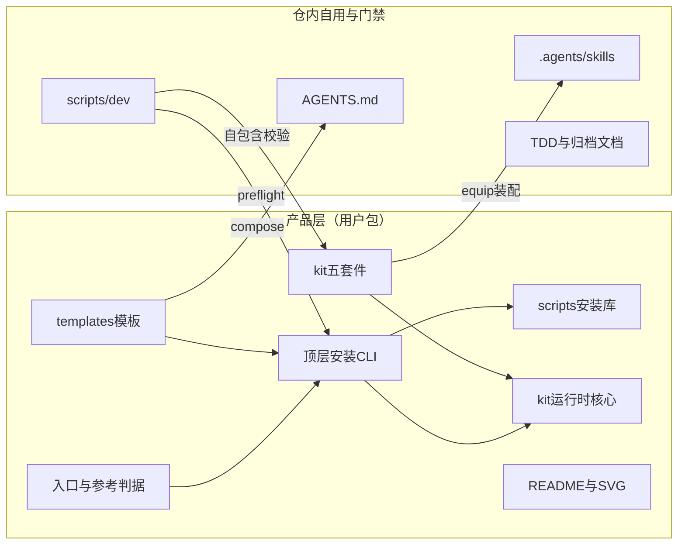
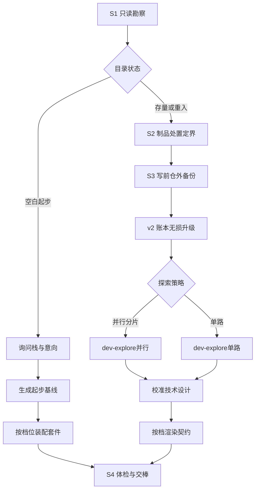
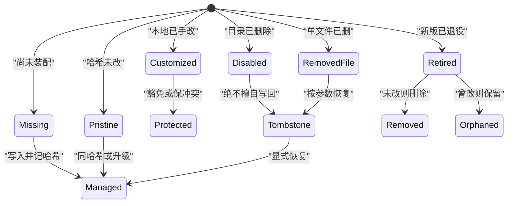
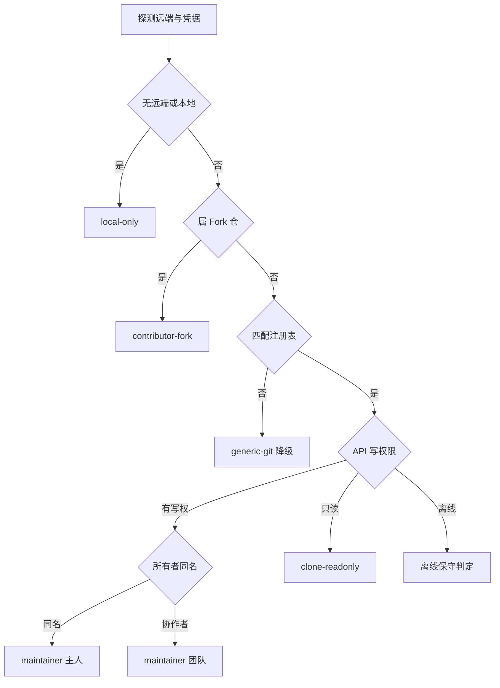
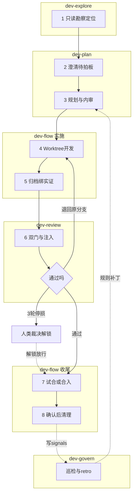
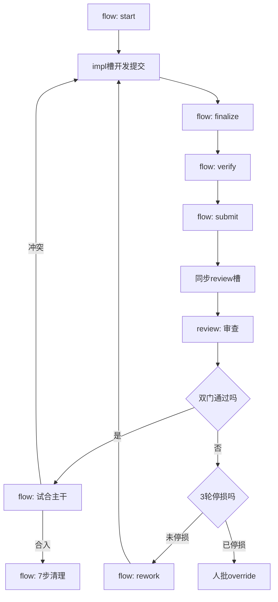

# project-forge 技术设计与架构契约（TDD）

本文档说明 `project-forge` 仓库当前的技术设计、模块边界、数据流向与约束规则，面向维护者和 AI 会话。全文只描述当前已落地的结构，不记录版本发布历史或研发阶段流水。

## 文档信息

| 项目 | 内容 |
| --- | --- |
| 适用基线 | 以仓库当前源码与 [SKILL.md](../SKILL.md) 当前 `metadata.version` 为准 |
| 最近更新日期 | `2026-11-19` |
| 运行环境与生态栈 | `Node.js 18+`（仅使用 `node:*` 内置模块，零第三方依赖） |
| 跨平台基线 | `Windows`（PowerShell）、`macOS`（APFS / BSD 工具链）、`Linux` |
| 托管平台适配范围 | 产品层注册表当前仅注册 `github`；未匹配托管远端降级为 `generic-git`，由 `TaskBackend` 统一对外操作 |
| 关联工程契约 | `AGENTS.md`、`SKILL.md` |

## 目录

- [文档信息](#文档信息)
- [1. 背景、非目标与术语表](#1-背景非目标与术语表)
- [2. 系统架构全景（双平面、四层正交与自举拓扑）](#2-系统架构全景双平面四层正交与自举拓扑)
- [3. 项目锻造与重入流水线（S1-S4 与 v2 账本）](#3-项目锻造与重入流水线s1-s4-与-v2-账本)
- [4. 双轴五态身份、平台抽象与双轨通道](#4-双轴五态身份平台抽象与双轨通道)
- [5. 内置研发工作流套件（五个 Skill 职责分工与流转）](#5-内置研发工作流套件五个-skill-职责分工与流转)
- [6. 文档四层体系、成对归档与图表规范](#6-文档四层体系成对归档与图表规范)
- [7. 安全防线与核心不变量](#7-安全防线与核心不变量)
- [8. 门禁矩阵与三位一体自证](#8-门禁矩阵与三位一体自证)

## 1. 背景、非目标与术语表

`project-forge` 面向任意外部项目提供只读勘察、写前备份、分档契约生成、远端或纯本地协同配置以及日常研发技能装配，同时以自身仓库作为规范的第一个使用方跑通校验。

### 技术基线与运行约束

| 维度 | 真实约束与实现载体 | 变更前提 |
| --- | --- | --- |
| 运行时下限 | `Node.js 18+`（纯 ESM `.mjs`，零第三方 npm 依赖） | 下限只上移不动；上移须同步修改清单与 `README` |
| 路径与编码 | `canonicalPath` / `samePath` 处理 Win32 大小写、macOS `/private/var` 与 APFS NFC 归一；无 BOM UTF-8 | 跨平台正文一律先落系统临时文件再经 `--body-file` 传入 |
| macOS 与杂项过滤 | `isMacOsMetadata` 与单源 `COMMON_SKIP_DIRS`（定义于 `kit/skills/lib/git.mjs` 并经 `shared.mjs`/`protocol.mjs` 导出）统一全链路跳过清单 | 全仓扫描、备份、打包与 `handoff` 共用同一过滤名单 |
| 宿主与平台边界 | 产品层严禁出现特定 AI 宿主、IDE 或具体团队工具名；`HostingProvider` 保持协议中立，当前仅注册 `github` 并在未匹配主机降级 `generic-git` | 新增平台接口不破坏核心零依赖与协议中立约束 |

### 明确非目标（Non-Goals）

- 不生成业务应用代码，不在空白起步时生成业务示例源码，也不替项目选定技术栈、版本号或开源许可证。
- 不执行服务器运维部署、云资源开通或依赖包安装。
- 不绑定特定 AI 宿主名称、私有环境变量或私有路径；不覆盖既有手写规范、双许可声明与项目自有扩展技能。
- 不为压缩体积而删除 `AGENTS.md` 中的协作与防呆守则（保留意图路由、工程原则、协作全链路、双写、七步收尾与防乱码规范）。

### 术语表

| 术语 | 系统内语义 | 对应代码与数据载体 |
| --- | --- | --- |
| 产品层与自用层 | 分发给用户的工具包文件与仅限本仓内部开发自用的门禁/治理文件 | `.gitattributes`、`scripts/lib/protocol.mjs`（`isRepoOnlyPath`） |
| 共享运行时 vs 安装器边界 | `kit/skills/lib/` 只放目标项目日常流转与顶层脚本共用的运行时模块；`scripts/lib/` 放首次配置/升级/交棒专用逻辑，防止安装包内部代码混入目标仓 | `kit/skills/lib/shared.mjs`、`scripts/lib/protocol.mjs` |
| 两档渐进装配 | `lightweight`（`< 14KB` 契约 + 3 个核心技能）与 `full`（`<= 30KB` 契约 + 全套 5 技能与协作骨架）；保护自有规则与 `--adopt-custom` / `--allow-custom-oversize` 并存 | `scripts/equip.mjs`、`scripts/compose-agents.mjs` |
| v2 账本与墓碑 | 记录托管文件哈希、档位、`disabledSkills`、`removedFiles`、`customizedFiles` 与区间基线（`--adopt-custom` 解锁与 `--check` 冲突及二次改写重采用） | `.agents/skills/.pf-manifest.json` |
| `HostingProvider` 与 `TaskBackend` | 平台抽象注册契约与 13 方法统一 `TaskBackend`（`GitHubBackend` / `GenericRemoteBackend` / `LocalOnlyBackend`） | `scripts/lib/platform/registry.mjs`、`kit/skills/lib/task-backend.mjs` |
| 双轴五态身份与外部图谱 | 结合「远端拓扑」与「认证写权限」判定的协作角色，统一解析单 Issue / 外部 PR 扫码阻断 / Issue+PR 互链防重 / 外部阻塞依赖与堆叠 PR | `kit/skills/lib/platform.mjs`、`kit/skills/lib/task-graph.mjs` |
| 写前增量快照 | 写前在仓外创建的纯 JS `.zip` 备份包（支持 `--format tar.gz` 并兼容恢复历史 `.tar.gz`），按 `treeSha256` 去重并钉住 `pre-forge` 基线 | `scripts/backup.mjs`、`scripts/zip.mjs` |
| 成对归档与 1:N PRD | 需求完结后将关联 `PRD`/`SPEC`/`Todo` 一并 `git mv` 至归档目录（`docs.mjs` `isSharedMasterPrd` 保护共享总控 PRD 维持 `active` 直至子切片全部完结） | `kit/skills/lib/docs.mjs`、`kit/skills/dev-flow/scripts/flow.mjs` |
| 双门与六锁收口 | 独立审查的运行实证门、结构卫生门以及防无限审查六锁（`review-locks.mjs` 历史停损、同 `HEAD` 拒审、Round 2+ 增量及 `sync` `range-diff` 视野硬锁、指纹匹配） | `kit/skills/dev-review/scripts/review-pack.mjs`、`kit/skills/dev-review/scripts/review-locks.mjs`、`kit/skills/dev-review/scripts/review-ledger.mjs` |

## 2. 系统架构全景（双平面、四层正交与自举拓扑）

仓库划分为**产品层**（随分发包给外部项目）与**自用层**（只在开发本仓库时使用），由 `.gitattributes`（`export-ignore`）与 `scripts/lib/protocol.mjs`（`REPO_ONLY_DIRS`、`REPO_ONLY_FILES`）保持同步。产品层按四层单向依赖组织：

1. **L1 基础原语层（`kit/skills/lib/exec.mjs`、`git.mjs`、`git-fast.mjs`、`git-status-fast.mjs`、`scripts/zip.mjs`、`backup.mjs`）**：跨平台无弹窗命令与 Windows `.cmd`/`.bat` 解析、Worktree 共享路径、`withFileLock`（`O_EXCL`）、`computeWorktreeEnv`、`.git/*.lock` 指数退避重试、零子进程配置/ref/洁净状态解析与纯 JS `.zip` 读写。
2. **L2 环境与拓扑抽象层（`kit/skills/lib/platform-probe.mjs`、`platform.mjs`、`github-parse.mjs`、`github-client.mjs`、`local-issues.mjs`、`task-backend.mjs`、`task-graph.mjs`、`profile-sniffer.mjs`、`profile.mjs`、`docs.mjs`、`doc-templates.mjs`）**：惰性平台探测、HTTP 指数退避幂等客户端、`<effectiveGitDir>/project-forge-flow/issues/` 原子本地工单库、统一 16 方法 `TaskBackend`、外部互链/堆叠图谱、三层命令嗅探与结构化文档/评论模板。
3. **L3 纯策略与状态机引擎层（`kit/skills/lib/workflow-policy.mjs`、`static-gates.mjs`、`static-gates-lexer.mjs`、`ledger.mjs`）**：无副作用纯函数判定三正交风险策略、分层 `evidence.json` 防旁路校验、静态检查与 `next` 单入口状态路由。
4. **L4 CLI 入口与安装器层（`kit/skills/*/scripts/` 与 `scripts/*.mjs`）**：调用 L3 决策与 L1/L2 副作用，含 `flow-sync.mjs`、`flow-batch.mjs`、`flow-cleanup.mjs`；首次配置专用逻辑留在 `scripts/lib/`，不反向进入 `kit/skills/lib/`。



### 主模块与脚本职责

| 模块 / 目录 | 层级 | 核心职责与入口文件 |
| --- | --- | --- |
| `SKILL.md`、`references/`、`templates/` | 产品层 | 调度总纲、分域权威判据与无条件残留渲染母版（含跨宿主推送护栏模板 `templates/githooks-pre-push.sh`） |
| `scripts/survey.mjs` | 产品层 | 只读勘察入口（`survey`、`computeArtifactPlan`、`judgeRole`、`summarizeRemoteCapabilities`） |
| `scripts/equip.mjs` | 产品层 | 两档五技能 v2 账本装配、墓碑保护、空仓起步与局部 `.githooks/pre-push` 安装（`equip`、`checkEquip`、`--with-hooks`） |
| `scripts/backup.mjs`、`scripts/zip.mjs`、`scripts/lib/tar.mjs` | 产品层 | 纯内置 `node:zlib` 仓外 `.zip` 快照主格式（支持 `--format tar.gz` 并兼容恢复 `.tar.gz`） |
| `scripts/compose-agents.mjs` | 产品层 | 受管 `AGENTS.md` 按档渲染、增量刷新、`removedAgentsRegions` 尊重与预算校验 |
| `scripts/review.mjs`、`scripts/handoff.mjs` | 产品层 | 交付体检（`reviewProject`、`readDecisions`）与交棒扫描（`VERIFY_EXIT` 0/1/3/4） |
| `kit/skills/templates/` | 产品层 | 四层工程文档母版（TDD 与 prd/spec/todo），生成器直接读它们且只有这一份 |
| `scripts/equip-ci.mjs` | 产品层 | 按勘察事实把 `templates/ci-check.yml` / `ci-release.yml` 落盘，并支持开关 A 默认分支保护（`--protect-branch`；403 或非 GitHub 仓安全降级退出 `0`） |
| `scripts/update.mjs`、`scripts/lib/update-net.mjs`、`scripts/sync-toc.mjs` | 产品层 | 同盘 staging 全目录核验原子自更新（支持代理/`GH_TOKEN`/回滚）与双语 README 目录同步 |
| `scripts/lib/` | 产品层 | 首次配置/升级/交棒专用库（含 `scripts/lib/survey-questions.mjs`、`scripts/lib/survey-git-fast.mjs`、`scripts/lib/survey-docs.mjs`、`scripts/lib/review-helpers.mjs`、`scripts/lib/artifact-executors.mjs`、`scripts/lib/starter-templates.mjs`、`scripts/lib/update-net.mjs`、`scripts/lib/tar.mjs` 与平台适配层 `scripts/lib/platform/index.mjs`、`scripts/lib/platform/registry.mjs`、`scripts/lib/platform/github.mjs`、`scripts/lib/platform/github-probe.mjs`、`scripts/lib/platform/github-client.mjs`） |
| `kit/skills/lib/` | 产品层 | 自包含正交运行内核（含 `kit/skills/lib/doc-requirements.mjs`、`kit/skills/lib/doc-template-render.mjs`、`kit/skills/lib/doc-shape.mjs`、`kit/skills/lib/doc-substantive.mjs`、`kit/skills/lib/doc-frontmatter.mjs`、`kit/skills/lib/doc-comments.mjs`、`kit/skills/lib/doc-verify.mjs`、`kit/skills/lib/doc-facts.mjs`、`kit/skills/lib/doc-renumber.mjs`、`kit/skills/lib/doc-toc.mjs`、`kit/skills/lib/doc-templates.mjs`、`kit/skills/lib/docs.mjs`、`kit/skills/lib/tdd-shape.mjs`、`kit/skills/lib/tdd-facts.mjs`、`kit/skills/lib/tdd-structure.mjs`、`kit/skills/lib/tdd-scaffold.mjs`、`kit/skills/lib/tdd-parity.mjs`、`kit/skills/lib/criteria-lock.mjs`、`kit/skills/lib/critique-rounds.mjs`、`kit/skills/lib/escalation.mjs`、`kit/skills/lib/workflow-helpers.mjs`、`kit/skills/lib/workflow-policy.mjs`、`kit/skills/lib/handoff-package.mjs`、`kit/skills/lib/git-status-fast.mjs`、`kit/skills/lib/git-fast.mjs`、`kit/skills/lib/git.mjs`、`kit/skills/lib/shared.mjs`、`kit/skills/lib/cli.mjs`、`kit/skills/lib/exec.mjs`、`kit/skills/lib/profile.mjs`、`kit/skills/lib/profile-sniffer.mjs`、`kit/skills/lib/skill-discovery.mjs`、`kit/skills/lib/static-gates-lexer.mjs`、`kit/skills/lib/static-gates.mjs`、`kit/skills/lib/no-changelog-voice.mjs`、`kit/skills/lib/pending-decisions.mjs`、`kit/skills/lib/session-orient.mjs`、`kit/skills/lib/ledger.mjs`、`kit/skills/lib/signals.mjs`、`kit/skills/lib/verdict.mjs`、`kit/skills/lib/platform-probe.mjs`、`kit/skills/lib/platform.mjs`、`kit/skills/lib/github-parse.mjs`、`kit/skills/lib/github-client.mjs`、`kit/skills/lib/local-issues.mjs`、`kit/skills/lib/task-backend.mjs`、`kit/skills/lib/task-graph.mjs`、`kit/skills/lib/command-lex.mjs`、`kit/skills/lib/tool-owned.mjs`、`kit/skills/lib/symbol-index.mjs`） |
| `kit/skills/dev-explore/` | 产品层 | 只读多生态扫描（`kit/skills/dev-explore/scripts/repo-map.mjs`：`git ls-files -z` + 4KB NUL 探测与可选探索记账） |
| `kit/skills/dev-plan/` | 产品层 | 五档分流、规划生成与内审（`kit/skills/dev-plan/scripts/doc-plan.mjs` 导出 `triageTask` / `auditDoc` / `listDocs` 并支持 `clarify`/`critique-scope`/`critique-pass`/`critique-reject`/`critique-override`/`--no-prune`/`--prd`/`--milestone`，配合 `kit/skills/dev-plan/scripts/doc-plan-ops.mjs`、`kit/skills/dev-plan/scripts/doc-audit.mjs`、`kit/skills/dev-plan/scripts/doc-audit-helpers.mjs`、`kit/skills/dev-plan/scripts/doc-audit-repo.mjs` 与 `kit/skills/dev-plan/scripts/triage-rules.mjs`） |
| `kit/skills/dev-flow/` | 产品层 | 隔离流转、并行调度与堆叠同步（`kit/skills/dev-flow/scripts/flow.mjs`、`kit/skills/dev-flow/scripts/flow-next.mjs`、`kit/skills/dev-flow/scripts/flow-inspect.mjs`、`kit/skills/dev-flow/scripts/flow-issues.mjs`、`kit/skills/dev-flow/scripts/flow-context.mjs`、`kit/skills/dev-flow/scripts/flow-explore.mjs`、`kit/skills/dev-flow/scripts/flow-lifecycle.mjs`、`kit/skills/dev-flow/scripts/flow-lifecycle-helpers.mjs`、`kit/skills/dev-flow/scripts/flow-merge.mjs`、`kit/skills/dev-flow/scripts/flow-cleanup.mjs`、`kit/skills/dev-flow/scripts/flow-sync.mjs`、`kit/skills/dev-flow/scripts/flow-batch.mjs`、`kit/skills/dev-flow/scripts/flow-trial-merge.mjs`、`kit/skills/dev-flow/scripts/worktree-deps.mjs`） |
| `kit/skills/dev-review/` | 产品层 | 外部 PR 安全扫描、审查槽同步、先实证后读 diff 门禁（`check-empirical` / `check-fault` 护航 `--include-diff`）、六锁硬拦截与双门双写（`kit/skills/dev-review/scripts/review-pack.mjs`、`kit/skills/dev-review/scripts/review-pr.mjs`、`kit/skills/dev-review/scripts/review-empirical.mjs`、`kit/skills/dev-review/scripts/review-empirical-state.mjs`、`kit/skills/dev-review/scripts/review-diff.mjs`、`kit/skills/dev-review/scripts/review-gates.mjs`、`kit/skills/dev-review/scripts/review-locks.mjs`、`kit/skills/dev-review/scripts/review-ledger.mjs`、`kit/skills/dev-review/scripts/review-sync.mjs`） |
| `kit/skills/dev-govern/` | 产品层 | 基线增量审计、测试分层、跨版本采集与复盘补丁（`kit/skills/dev-govern/scripts/govern-audit.mjs`、`kit/skills/dev-govern/scripts/govern-checks.mjs`、`kit/skills/dev-govern/scripts/govern-docs.mjs`、`kit/skills/dev-govern/scripts/govern-state.mjs`、`kit/skills/dev-govern/scripts/govern-tests.mjs`、`kit/skills/dev-govern/scripts/govern-retro.mjs`、`kit/skills/dev-govern/scripts/release-prep-lib.mjs`） |
| `assets/readme/` | 产品层 | 6 张中英双语浅深色安全矢量图（`hero*.svg`、`workflow*.svg`、`architecture*.svg`） |
| `scripts/dev/` | 自用层 | 门禁与夹具矩阵：`scripts/dev/preflight.mjs`、`scripts/dev/preflight-contracts.mjs`、`scripts/dev/preflight-suite.mjs`、`scripts/dev/preflight-suite-checks.mjs`、`scripts/dev/preflight-e2e.mjs`、`scripts/dev/write-probe-audit.mjs`（`collectKitWriteProbeTargets`、`scanKitWriteProbeViolations`）、`scripts/dev/gap-coverage.mjs`、`scripts/dev/fixtures.mjs`（调度 `scripts/dev/fixtures-claims.mjs`、`scripts/dev/fixtures-contracts.mjs`、`scripts/dev/fixtures-core.mjs`、`scripts/dev/fixtures-docs.mjs`、`scripts/dev/fixtures-doc-depth.mjs`、`scripts/dev/fixtures-doc-fill.mjs`、`scripts/dev/fixtures-doc-rules.mjs`、`scripts/dev/fixtures-doc-shapes.mjs`、`scripts/dev/fixtures-doc-triage.mjs`、`scripts/dev/fixtures-equip.mjs`、`scripts/dev/fixtures-explore.mjs`、`scripts/dev/fixtures-flow.mjs`、`scripts/dev/fixtures-flow-cleanup.mjs`、`scripts/dev/fixtures-flow-docs.mjs`、`scripts/dev/fixtures-flow-parallel.mjs`、`scripts/dev/fixtures-flow-state.mjs`、`scripts/dev/fixtures-git-fast.mjs`、`scripts/dev/fixtures-govern.mjs`、`scripts/dev/fixtures-handoff-review.mjs`、`scripts/dev/fixtures-helpers.mjs`、`scripts/dev/fixtures-issue50.mjs`、`scripts/dev/fixtures-issue52.mjs`、`scripts/dev/fixtures-lifecycle.mjs`、`scripts/dev/fixtures-onboarding.mjs`、`scripts/dev/fixtures-platform.mjs`、`scripts/dev/fixtures-review-contracts.mjs`、`scripts/dev/fixtures-review-empirical.mjs`、`scripts/dev/fixtures-review-govern.mjs`、`scripts/dev/fixtures-review.mjs`、`scripts/dev/fixtures-stageb-onboarding.mjs`、`scripts/dev/fixtures-stageb-onboarding-b4a.mjs`、`scripts/dev/fixtures-stageb-loop.mjs`、`scripts/dev/fixtures-stageb-loop-b4b.mjs`、`scripts/dev/fixtures-survey.mjs`）、`scripts/dev/verify-injections.mjs`、`scripts/dev/injections-data.mjs`、`scripts/dev/injections-data-core.mjs`、`scripts/dev/injections-data-workflow.mjs`、`scripts/dev/injections-data-gates.mjs`、`scripts/dev/injections-data-stageb.mjs`、`scripts/dev/bench.mjs`、`scripts/dev/evidence.mjs`、`scripts/dev/e2e-zip-harness.mjs` |

### 共享内核模块职责（`scripts/lib/` 与 `kit/skills/lib/`）

| 内核模块 | 单一真相源边界 | 核心职责与关键约束 |
| --- | --- | --- |
| `scripts/lib/protocol.mjs` | 标记语法、预算常数、平台禁词、包边界 | `parseMarkers`、`markerRegions`、`AGENTS_MAX_BYTES`（30720）、`PF_MANIFEST_SCHEMA_VERSION`（2）、`EQUIP_TIERS`、`TEMPLATE_CONDITIONS`、`TEMPLATE_VARS`、`isMacOsMetadata` |
| `scripts/lib/template.mjs` | 模板条件求值与变量替换 | `evaluateConditions`、`renderVars`、`renderTemplate`、`residualConditionMarkers` |
| `scripts/lib/render.mjs` | 勘察 Markdown 排版与动作导航 | `toMarkdown`、`computeNavigation`、通用 SSH/HTTP(S) 与 GitHub 建仓/认证向导、S3 `[NEXT STEP]` 推荐 |
| `scripts/lib/claims.mjs` | 契约真实性回查与联动解析 | `claimsOf`、`verifyClaims`（核查 `claim.branch`、`claim.path`、`claim.script`） |
| `scripts/lib/markdown.mjs` | 围栏感知 Markdown 结构扫描 | `scanLines`、`fencedSpans`、`markerPositions`、`splitSections` |
| `scripts/lib/text.mjs` | UTF-8 严读、路径归一与 SSH 别名 | `readUtf8Strict`、`canonicalPath`、`samePath`、`parseSshConfigHostMap`、`githubRepoPath` |
| `scripts/lib/fs-atomic.mjs` | 进程安全临时文件与原子写回 | `tempPathFor`、`clearStaleTemps`、`writeAtomic` |
| `scripts/lib/update-ops.mjs` | 原子更新暂存校验与冷却状态 | 同盘 `stageAndValidatePackage`、写前备份与原地回滚、全深度退役清理、`FAILURE_COOLDOWN_MS`（15 分钟） |
| `scripts/lib/update-net.mjs` | 升级下载与代理传输 | `routesFor`、`apiEndpoint`、`probeApi`、`probeWeb`、`fetchPackage`、`download`、`resolveProxyFor` |
| `scripts/lib/tar.mjs` | 纯内置 TAR/PAX 归档读写 | `packTar`、`unpackTar`、`truncateUtf8Bytes`、`assertSafeRelPath`（支持长中文 PAX 扩展头与路径遍历拦截） |
| `scripts/lib/equip-bootstrap.mjs` / `scripts/lib/starter-templates.mjs` | 通用空白工程基线与初始自洽契约 | `BOOTSTRAP_STACKS`、`bootstrapEmpty`、`starterTemplates`、`generateInitialBootstrappedAgents`、`installGitHooks`（冲突时 `preserve`） |
| `scripts/lib/agents-defaults.mjs` | 模板变量计算与 `Dev Profile` 自动预填 | `buildDevProfileVars`、`buildVars`、`commandsBlock`、`explorationStrategyBlock`、`commitStyleHint`、`conventionsHint`、`customSkillsBlock` |
| `scripts/lib/agents-sections.mjs` | `AGENTS.md` 区间刷新与 v2 兼容检查 | `filterIntentRouting`、`refreshRegions`、`driftRegions`（含已校准 `Dev Profile` 免漂移保护）、`maskVolatile`、`inspectKitManifestForReview` |
| `scripts/lib/survey-ecosystem.mjs` | 生态、命令、工作区与制品探测 | 委托 `kit/skills/lib/profile-sniffer.mjs` 统一探测多包清单、2/4 空格中立 CI 与 `Taskfile`/`Makefile`/`justfile` |
| `scripts/lib/survey-workspace.mjs` | 工作区遍历与 Git 事态扫描 | `walkWorkspace`、`detectGit`（汇总工作区源码/测试统计及远端分支事态） |
| `scripts/lib/survey-git-fast.mjs` | 勘察只读 Git 快速探测 | `hasGitHistory`、`hasOriginRemote`、`isTreeDirty`、`currentBranchName`、`gitDefaultBranch`、`isGitRepo` |
| `scripts/lib/survey-docs.mjs` | 勘察文档、非标结构与角色/CLI 封装 | `detectDocs`、`detectConventions`、`detectGitHooksState`、`summarizeTddAndSymbolCoverage`、`judgeRole`、`runSurveyCli`（覆盖中性 CI、非 `.md`/双语文档、非标设计目录与 `.githooks/`） |
| `scripts/lib/survey-reentry.mjs` | 套件现状、自有技能与重入漂移检测 | `isReentryProject`、`detectKit`、`detectLocalSkills`、`detectTddStalePaths`、`detectStaleAgentScripts` |
| `scripts/lib/survey-plan.mjs` | 探索分片策略与装配档位推荐 | `computeExplorationStrategy`、`computeRecommendedTier` |
| `scripts/lib/survey-gap-rules.mjs` | 勘察的缺口判据表 | `GAP_RULES`；由 `survey.mjs` 的 `judgeGaps` 展开，`gap-coverage.mjs` 核对覆盖 |
| `scripts/lib/artifact-executors.mjs` | `artifactPlan` 执行者对照表 | `ARTIFACT_EXECUTORS`、`NON_CREATE_ARTIFACT_ACTIONS`、`findUnexecutableArtifacts`（覆盖 13 项产物执行入口，跳过 `optional`/`upgrade` 等非新建动作） |
| `scripts/lib/survey-questions.mjs` | 勘察问句规则、`needsHuman` 与成熟度判定 | `QUESTION_RULES`（含 `q.branch-protection`）、`computeS3NextStep`、`judgeMaturity`、`judgeGaps`、`summarizeNeedsHuman`、`hasDecision`、`decisionValue`（与 `computeArtifactPlan` 共同读取 `AGENTS.md` `## 取舍` 并输出 `NEEDS_HUMAN`） |
| `scripts/lib/review-helpers.mjs` | 体检 CLI 解析、辅助汇总、报告渲染与治理 PRD 核查 | `inspectContract`、`renderReviewReport`、`runReviewCli`、`parseReviewCliArgs`、`summarizeReviewResults`（输出 `git.capabilities`）、`checkGovernancePrdCoverage` |
| `scripts/lib/platform/index.mjs` | 安装期平台探测统一门面 | 汇总导出 `probePlatformEnv`、`normalizeGitHubRepo`、`listHostingProviders`、`classifyWorkspaceIdentity` 等适配接口 |
| `scripts/lib/platform/registry.mjs` | 平台抽象注册表与多远端拓扑模型 | `registerHostingProvider`、`resolveRemotesTopology`、`GENERIC_GIT_PROVIDER`、`classifyTopologyIdentity` |
| `scripts/lib/platform/github.mjs` | GitHub 适配器入口 | `GITHUB_PROVIDER`、`probeGitHubEnv`、`resolveWorkspaceIdentity`、`createGitHubClient` |
| `scripts/lib/platform/github-probe.mjs` / `scripts/lib/platform/github-client.mjs` | 安装期探针与 REST 客户端薄适配 | 单源复用 `kit/skills/lib/platform-probe.mjs`；REST 含 `429`/`5xx`/TLS 指数退避重试、`redirect: 'manual'` 与开关 A 分支保护（`getBranchProtection` / `applyBranchProtectionSwitchA`） |
| `kit/skills/lib/shared.mjs` | 套件统一兼容导出出口 | 汇总导出 `cli.mjs`（含 `hasSkillSupport`）、`exec.mjs`、`git.mjs`、`git-fast.mjs`、`profile.mjs`、`profile-sniffer.mjs`、`static-gates-lexer.mjs`、`static-gates.mjs`、`command-lex.mjs`、`tool-owned.mjs`、`symbol-index.mjs`、`workflow-policy.mjs`（含 `buildSubmitNextSteps`/`buildInspectNextSteps`）、`ledger.mjs`、`docs.mjs`、`doc-templates.mjs`、`doc-shape.mjs`、`doc-substantive.mjs`、`tdd-parity.mjs`、`signals.mjs`、`platform-probe.mjs`、`platform.mjs`（含 `probeForWrite`）、`github-client.mjs`、`task-backend.mjs`、`task-graph.mjs` |
| `kit/skills/lib/doc-shape.mjs` | 工作区形态探测与可复核跳过校 | `probeWorkspaceDocShape`、`detectDocShapesSync`、`resolveDocShapePolicy`、`formatDocShapeSkippedBlock`、`parseDocShapeSkippedComment`、`validateSkippedSections` |
| `kit/skills/lib/doc-substantive.mjs` | 核心实质性校验与跨轮防退化 | `isStubValue`、`extractTechAnchors`、`checkCoreSubstantiveness`、`extractDocSnapshot`、`parseCritiqueAnchors`、`checkDocRegression`、`readGitHeadFileSync`、`resolveBaselineSnapshotSync`、`collectMasterPrdSpecTexts` |
| `kit/skills/lib/doc-frontmatter.mjs` | Frontmatter 零依赖解析、受管判定与原子更新 | `parseDocFrontmatter`、`serializeDocFrontmatter`、`updateDocFrontmatter`、`isManagedPlanDoc`（由 `docs.mjs` 统一重导出） |
| `kit/skills/lib/doc-comments.mjs` | PR / Issue 协同结构化评论渲染 | `buildReviewComments`、`buildSubmitComments`、`buildMergeComments`（由 `doc-templates.mjs` 与 `docs.mjs` 统一重导出） |
| `kit/skills/lib/command-lex.mjs` | 命令词法：切段、命令位置与动作词 | `splitCommandSegments`、`commandHeadOf`、`commandVerbOf`、`classifyByCommandPosition`、`classifyCommandText`、`COMMAND_DISPLAY_MAX_BYTES`；动作词只在**命令位置**匹配，路径只留最后一段，`--opt=` 取值与 `.属性名` 不是动作 |
| `kit/skills/lib/tool-owned.mjs` | 工具产物归属声明 | `TOOL_OWNED_PREFIXES`、`isToolOwnedPath`、`TOOL_SKELETON_FILES`、`hasRealContent`；规模、可复用模块与契约失效路径三类判据一律先过它 |
| `kit/skills/lib/symbol-index.mjs` | 定义符号抽取与语言覆盖三态 | `extractSymbols`（先剥注释再匹配定义形状）、`isSymbolRuleSupported`、`languageOf`、`summarizeSymbolCoverage`；没有规则的语言返回 `unsupported` 而非空数组 |

### 模块分层与禁引规则（`arch-rules`）

```yaml
arch-rules: kit/** -> scripts/dev/**, kit/** -> scripts/lib/**, scripts/*.mjs -> scripts/dev/**, scripts/lib/** -> scripts/dev/**
```

- **单向依赖边界**：`kit/skills/` 只允许引用 `kit/skills/lib/` 与 `node:*`（由 `preflight-suite.mjs` 禁止 `kit/** -> scripts/dev/**` 与 `kit/** -> scripts/lib/**`）；顶层 `scripts/*.mjs` 只允许依赖 `scripts/lib/`、`kit/skills/lib/` 与同级运行时模块；`scripts/dev/` 允许跨平面读取产品层进行验证。

### 功能与入口地图（Feature Map）

| 功能 / 能力域 | 入口文件 | 验证命令 |
| --- | --- | --- |
| 只读勘察与双轨鉴权 | `scripts/survey.mjs` | `node scripts/survey.mjs . --json` |
| 套件装配与空仓起步 | `scripts/equip.mjs` | `node scripts/equip.mjs . --check` |
| 写前增量快照与回滚 | `scripts/backup.mjs` | `node scripts/backup.mjs list .` |
| 契约生成与预算门禁 | `scripts/compose-agents.mjs` | `node scripts/compose-agents.mjs . --check` |
| 交付体检与声明回查 | `scripts/review.mjs` | `node scripts/review.mjs .` |
| 交棒扫描与净度验证 | `scripts/handoff.mjs` | `node scripts/handoff.mjs . --json` |
| 包副本原子更新 | `scripts/update.mjs` | `node scripts/update.mjs --help` |
| 只读资产探索套件 | `kit/skills/dev-explore/scripts/repo-map.mjs` | `node .agents/skills/dev-explore/scripts/repo-map.mjs . --json` |
| 规划分流与文档审计套件 | `kit/skills/dev-plan/scripts/doc-plan.mjs` | `node .agents/skills/dev-plan/scripts/doc-plan.mjs list` |
| 流转与 Worktree 隔离套件 | `kit/skills/dev-flow/scripts/flow.mjs` | `node .agents/skills/dev-flow/scripts/flow.mjs inspect --json` |
| 双门独立审查套件 | `kit/skills/dev-review/scripts/review-pack.mjs` | `node scripts/dev/fixtures.mjs` |
| 代码体检与发版筹备套件 | `kit/skills/dev-govern/scripts/govern-audit.mjs` | `node .agents/skills/dev-govern/scripts/govern-audit.mjs audit .` |
| 全仓门禁与故障注入自证 | `scripts/dev/preflight.mjs` | `node scripts/dev/preflight.mjs` |

## 3. 项目锻造与重入流水线（S1-S4 与 v2 账本）

项目从空白起步、存量接入到后续重入升级均走同一条幂等流水线（S1–S4），写操作前始终完成只读定界与增量备份。



### 三场景调度与 `computeArtifactPlan` 十一项定界

1. **空白目录（`maturity: 'empty'`）**：`computeExplorationStrategy` 输出 `tier: 'none'`，跳过探索子代理；通过 `bootstrapEmpty`（`scripts/lib/equip-bootstrap.mjs`）生成零业务玩具代码的通用治理基线（兼容已有 `README`/`LICENSE`/`.github`/`.agents`）、初始 `docs/TDD.md`、`git init`、`.agents/skills/` 与无未填占位自洽 `AGENTS.md`，初装即过 `--check` 与 `review.mjs`。
2. **存量项目接入与两档推荐**：`computeRecommendedTier` 按有效文件数、多包布局与协作信号推荐 `lightweight` 或 `full`；当代码文件数 `> 80`、多生态多子包或重入存在漂移时，升级为 `parallel-subagents` 并输出 `shards`；由 `kit/skills/lib/profile-sniffer.mjs` 统一执行三层优先级命令嗅探。
3. **重入校准与仓外备份解析**：仅当存在 `.pf-manifest.json`、受管标记或既定四层契约时判为重入。`scripts/backup.mjs` 按优先顺序解析仓外备份根路径：`PF_BACKUP_DIR` 下的「项目名加八位哈希」子目录 -> Git 公共目录下的 `project-forge-backups` -> 用户主目录下的 `project-forge/backups` 同名子目录，滚动清理时永久钉住最新一份 `pre-forge` 基线。

### `.pf-manifest.json` v2 账本状态机与仓外备份



| `artifactPlan` 项 | 覆盖对象 | 关键判定与不覆写边界 |
| --- | --- | --- |
| `pre-backup` | 写前仓外快照 | 非空目录写前必先 `snapshot`（空目录 `skip`），由 `treeSha256` 阻止重复包 |
| `git-baseline` | `.git`、`.gitattributes`、`.gitignore` | 识别裸仓与非根子目录（`ask-human`），补齐忽略项并保留已有历史 |
| `kit-skills` | `.agents/skills/` 与自有技能 | 按 `recommendedTier` 与 v2 墓碑/定制状态升级，原样保留自有扩展技能与 `--tier lightweight` 降档下完好的高阶技能 |
| `docs-tdd` | `docs/TDD.md` | 纯文档或 0 源码 `skip`；已有存量设计文档 `preserve`；缺则 `create`；漂移 `calibrate` |
| `agents-contract` | `AGENTS.md` | 完整保留全部会话必注协作与安全守则；吸收既有 AI 约定（支持 `--adopt-custom` 与 `--allow-custom-oversize`） |
| `readme` | `README.md` 与多语版本 | 已有 `README` 严格 `preserve`，严禁拿模板全篇重写 |
| `contributing` | `CONTRIBUTING.md` | 仅维护者有远端时提示可选，纯本地或 Fork 贡献仓自动 `skip` |
| `license` | `LICENSE`（含双许可） | 已有许可一律 `preserve`；缺失时归类 `ask-human`，AI 不擅自代选 |
| `releasing` | `RELEASING.md` 与发版说明 | 仅可发布包、已有标签或已有发布流时 `create`，不强改既有 `CHANGELOG` |
| `ci-check` | 检查工作流 | 仅 GitHub 远端且有可执行命令时补齐；`contributor-fork` 与 `generic-git` 跳过；拦截高危 `pull_request_target` |
| `ci-release` | 发布工作流 | 识别既有工具链 `preserve`，否则走 5 选 1 发版策略（默认零额外 Secret） |

## 4. 双轴五态身份、平台抽象与双轨通道

`scripts/lib/platform/registry.mjs` 定义标准 `HostingProvider` 契约与多远端 `remotes[]` 拓扑模型（当前产品层仅注册 `github`），`kit/skills/lib/platform.mjs` 与之保持相同判定语义；未匹配已注册主机的远端退化为 `GENERIC_GIT_PROVIDER`（`generic-git`）。



### 五态权限边界与关键锁

- `maintainer`（`owner` / `team-collaborator`）：同源独立分支开 PR，禁直推主干；零历史成员先 `--probe-auth`，`claim` + `--takeover` 双写，遵守 `CODEOWNERS` 与 Merge Queue；若 `AGENTS.md`「## 取舍」写 `merge-authority: human` 则全部 PR 合并收回人工。
- `contributor-fork`：只推个人 `origin` Fork 分支向 `upstream` 开 PR；硬禁止 `merge` 与上游 PR 仍 `OPEN` 时删 Fork 分支；写标签遇 403 自动降级。
- `clone-readonly` / `undetermined`：停下由人选 `--clone-choice fork|standalone|local`；`inbound-external-pr` 必先过 `--untrusted-scan` 再经人类确认运行测试。
- `local-only` / `generic-git`：`local-only` 走本地分支、独立审查与 `.worktrees/.tmp-merge-*` 临时 `--detach` 试合推进主干；`generic-git` 有远端时不越权本地强合并，须在远端完成 MR 后带 `--remote-merged`（或 `--human-approved`）收尾。

### 双轨四级传输与 API 通道

- **Track A（Git 传输与惰性鉴权）**：所有子进程经 `kit/skills/lib/exec.mjs` 注入无弹窗环境变量、`5000ms` 硬超时、Windows `.cmd`/`.bat` 解析且不写 `~/.ssh/known_hosts`，读取 `~/.ssh/config` `HostName` 与 `IdentityFile` 映射；`kit/skills/lib/platform-probe.mjs` 严格执行惰性探测，未传 `--probe-auth`（或设 `PF_NO_REAL_AUTH_PROBE=1`）时零外网/凭据子进程。所有写操作及有 PR/父 PR 的远端同步入口必须调用 `probeForWrite`（显式 `probeNetwork: true`），并由 `scripts/dev/write-probe-audit.mjs` 在 `preflight-suite.mjs` 与行为夹具双端全量阻断裸 `probeGitHubEnv` 写路径回流。
- **Track B（GitHub API 四级降级）**：`gh-cli` -> `node-https-token`（令牌锁在 `WeakMap` 内存）-> `mcp-delegate`（仅当 `PF_MCP_GITHUB=1` / `mcpAvailable` 为真）-> `half-duplex` / `offline` / `none`。

## 5. 内置研发工作流套件（五个 Skill 职责分工与流转）

日常改动通过 `AGENTS.md` 顶部的意图路由规则自动调取 `.agents/skills/` 中的本地技能（`lightweight` 档装前 3 个、`full` 档装全套 5 个，不绑定任何特定宿主或工具名），按 **需求 → 澄清 → 设计 → 实现 → 评审 → 实证测试-形式验证 → 验收 → 合入** 八个阶段推进。

### 五个 Skill 的阶段分工表

| 技能 | 负责阶段 | 核心脚本 | 权限边界与关键产出 |
| --- | --- | --- | --- |
| `dev-explore` | 1. 需求侦察与定位 | `repo-map.mjs` | **只读，不写业务代码**。识别语言、验证命令、可复用模块与 `Feature Map`；可向账本写入 `explored` 探索证据 |
| `dev-plan` | 2–3. 澄清、定档与方案内审 | `doc-plan.mjs`、`doc-plan-ops.mjs`、`doc-audit.mjs`、`doc-audit-helpers.mjs`、`doc-audit-repo.mjs` | 多轮澄清待拍板项；按 Case 1–5 建 PRD/SPEC/Todo（`C1..Cn`），支持 `--milestone`，`critique-scope`/`critique-pass`/`critique-reject`/`critique-override` 强制不可自审、全历史换人、未改稿拦截与 3 轮硬停损 |
| `dev-flow` | 4–5 与 7–8. 隔离开发、实证、合并与清理 | `flow.mjs`、`flow-explore.mjs`、`flow-lifecycle-helpers.mjs`、`flow-batch.mjs`、`worktree-deps.mjs` | 建 `.worktrees/impl-*`（谁改谁认领并提 PR），`explore` 记探索证据、`finalize` 强阻断未同步 TDD 并归档、`verify` 记实证、试合推进主干与 7 步清理 |
| `dev-review` | 6. 独立双门审查与停损 | `review-pack.mjs` | 外部 PR 先扫投毒；用独立 `review-*` 槽跑行为/结构双门与故障注入，Round 2+ 换新上下文并受六锁约束 |
| `dev-govern` | 巡检与事后复盘（独立于单次流转，反哺规划） | `govern-audit.mjs` | 运行期信号自动记入 `signals.jsonl`；平时随时审计死链/死代码/假测试/过期 Worktree，`retro` 输出规则补丁 |

### 图 5.1：五个 Skill 在开发周期中的分工与交接



### 图 5.2：Worktree 隔离、六锁拦截与返工状态流



- **澄清机制与规划边界**：`dev-plan` 支持一次解析多个 Issue/PR/Milestone 链接，需求跨多模块或复杂度较高时主动建议先建总控 PRD，经多轮提问消解全部待拍板事项后再冻结 `C*` 并创建文档；尊重目标仓自有的文档模板（`docs/templates/` 或 `.github/*-template.md`）；`critique-rounds.mjs` 与 `doc-plan.mjs` 强制不可自审（`SELF_CRITIQUE_REJECTED`）、全历史换人（`BLOCKED_CRITIQUE_SAME_REVIEWER`）、`A4` 基线防空转（`BLOCKED_CRITIQUE_SAME_SHA`）及 3 轮硬停损（`STOP_LOSS_ESCALATE`，仅人类 `critique-override` 解锁）；若 `impl` 工作树已创建则直接落盘其中。
- **Worktree 隔离、权责归属与槽复用**：`flow-inspect.mjs` 在仓库有提交历史时统一创建 `.worktrees/impl-<taskId>`（仅 0 提交且非并行的仓原地开分支），同一任务跨轮最多复用 1 个 `impl` 槽与 1 个 `review` 槽；`start`/`sync`/`submit`/`review-diff` 推进时以 `{ mode: 'deps' }` 调用 `unmountSharedDeps` 先解绑再同步并重挂载，同时通过 `recordMountedDepsInLedger` 把实际挂载路径写入账本 `mountedDeps` 与 `mountedDepsByWorktree`。`worktree-deps.mjs` 默认走 `mode: 'cleanup'` 删穿保护（`scanOutboundLinks` 全深度 `lstat().isSymbolicLink()` 遍历，越界 `depth > 24` fail-closed 报 `scan-truncated`），`flow-cleanup.mjs`（含 `cleanup` 与 `abort`）删前校验 `git worktree list` 注册状态、自动放行账本 `mountedDeps`（回执逐条列出 `{ path, target, source }` 并标明「工具挂载，自动解绑」）、对未登记/悬空（`unresolved-target`）/截断链接与被跟踪外链以 `EXIT_POLICY_BLOCK` 阻断（支持 `--allow-outbound` 逐条放行）并在删除前先解绑内部 junction；**谁改代码谁认领并负责 `finalize`/`verify`/`submit` 及 PR/Issue 评论**（`BLOCKED_SUBMIT_OWNERSHIP_MISMATCH` 阻止协调者代提 PR）；本地合并通过 `flow-trial-merge.mjs` 在 `.worktrees/.tmp-merge-*` 临时试合（冲突时在 `--abort` 前抽取每文件 `<= 4`、总计 `<= 8` 块有界冲突与恢复包，`cleanupTrialWorktree` 先 `mode: 'deps'` 解绑且禁止吞错强删）确认全绿后再 `ff-only` / CAS 更新主干。Case 2/3/4 单任务在隔离 `impl` 位派发 `impl` 子代理实施。
- **单入口路由、统一前缀/标签/里程碑与四态总控归档**：`flow-next.mjs`（`flow.mjs next [--probe-auth]`）统一判断下一合法动作及执行角色（`ownerRole`），在 `idle`/`ambiguous` 态扫描未 `start` 的就绪 `docs/specs/*.md` 并按依赖写域在 `Wave 1 >= 2` 时输出 `parallelDispatch: true`（仅输出单一 `[NEXT STEP]`）及 `excludedReviewers`；`escalation.mjs` 统一前缀（`Case 1 -> docs:`/`Case 2 -> fix:`/`Case >= 3 -> feat:`）与分级建单（`govern-state`/`review-ledger` 共用）；`task-backend.mjs` 单表同步四态语义标签（`in-progress`/`in-review`/`changes-requested`/`reviewed`，支持 `no-labels` 与 403/`generic-git` 降级）并按需提供 `capabilities.milestones`（`flow.mjs milestone`、`issue migrate` 带出、`submit` 继承）；`doc-substantive.mjs`（`evaluateMasterPrdClosureState`）驱动 `flow-lifecycle` 完成 `1:N` 总控 PRD 四态闭环（手控/活跃/未覆盖保持 `active`，全覆盖全 `[x]` 自动同分支归档，全覆盖留 `[ ]` 则 `finalize`/`verify` 均拦 `BLOCKED_LAST_SLICE_MASTER_PRD_UNCLOSED`）。
- **六锁硬拦截与多任务协同**：`review-locks.mjs` 代码级强制执行历史停损锁定、全历史换人（`BLOCKED_SAME_REVIEWER_REREVIEW`）、同 `HEAD` 复审与 `A4` 差异基线（`BLOCKED_NO_REWORK_CHANGES`）、Round 2+ 增量 hunk（及 `flow sync` 非交互变基后 `git range-diff`）视野限制、跨文件指纹比对、共享 3 轮停损规则（输出 `stopLossPacket`）与未清门禁阻断伪 `pass`；`review-gates.mjs` 按当前切片隔离提取 `C*`、`review-empirical.mjs` `check-fault --phase restore` 自动回填 `faultRecord`、`low` 风险 PR 可选运行 `review-pack record`；`task-graph.mjs`、`flow-sync.mjs` 与 `flow-batch.mjs` 提供外部阻塞图谱、堆叠分支同步、并行切片互斥规划与 FIFO 合并队列（`assertPreMergeGates` 失败安全退回队头）。
- **治理扫描、文档死链与规则下沉**：`static-gates-lexer.mjs` 与 `static-gates.mjs` 执行多语言词法剥离并检测断言缺失、纯 Mock 自证及 CI 删步退化；`govern-docs.mjs` 在 `docs/archive/` 中跳过历史归档链接，持续拦截活跃文档死链；`tdd-parity.mjs` 检查模块、导出或 CLI 变更是否漏改架构文档；`flow verify`/`review-pack record`/`flow rework` 自动向 `<gitCommonDir>/project-forge-govern/signals.jsonl` 记账，由 `govern-audit.mjs retro` 生成可落盘的规则补丁。

### CLI 入口速查表

| 入口脚本 | 核心职责 | 典型子命令 / 标志 |
| --- | --- | --- |
| `scripts/survey.mjs` | 只读勘察仓库与双轨凭据 | `--markdown --probe-auth --json` |
| `scripts/backup.mjs` | 仓外 `.zip` 增量备份与 `.tar.gz` 兼容恢复 | `create \| list \| restore --label pre-forge` |
| `scripts/equip.mjs` | 两档技能装配、v2 墓碑与空白起步 | `--tier lightweight\|full --bootstrap-empty --check` |
| `scripts/compose-agents.mjs` | 契约渲染、区间刷新与自定义采纳 | `--tier ... --adopt-custom --check --clean` |
| `scripts/review.mjs` / `handoff.mjs` | 交付成熟度体检与交棒净度扫描 | `review.mjs .` / `handoff.mjs . --verify` |
| `scripts/update.mjs` / `sync-toc.mjs` | 压缩包原子自更新与双语目录同步 | `update.mjs --check` / `sync-toc.mjs --check` |
| `.agents/skills/dev-explore/scripts/repo-map.mjs` | 全深度源码拓扑与 `Feature Map` 扫描 | `[dir] [--focus <subDir>] [--json]` |
| `.agents/skills/dev-plan/scripts/doc-plan.mjs` | 五档分流、模板生成、审计与归档 | `triage \| init \| audit \| critique-scope \| critique-pass \| critique-reject \| critique-override \| approve \| archive --include-master-prd` |
| `.agents/skills/dev-flow/scripts/flow.mjs` | 全生命周期隔离流转与并行状态机 | `next \| inspect \| start \| issue \| milestone \| claim \| explore \| finalize --include-master-prd \| verify \| submit \| rework \| sync \| merge \| cleanup \| batch` |
| `.agents/skills/dev-review/scripts/review-pack.mjs` | 审查打包、供应链扫描、双门六锁记账 | `--task \| --pr --untrusted-scan \| --local \| record \| override` |
| `.agents/skills/dev-govern/scripts/govern-audit.mjs` | 静态体检、Worktree 巡检、复盘与发版筹备 | `audit \| reconcile \| plan \| record \| cluster \| sample \| retro \| release-prep` |

## 6. 文档四层体系、成对归档与图表规范

| 层级 | 路径或母版载体 | 定位与生命周期控制 |
| --- | --- | --- |
| 入口契约层 | `AGENTS.md`、`templates/agents-project.md` | 保留意图路由、总纲、7 键 `Dev Profile`、高风险/联动表与协作防呆细则（`lightweight < 14KB`，`full <= 30KB`） |
| 常青架构层 | `docs/TDD.md`、`kit/skills/templates/docs-tdd.md` | 顶部 `## 文档信息` 表、技术基线、模块表、`arch-rules`、`Feature Map` 与短名 Mermaid 图；支持目标仓通过 TDD 模板声明按 `omit_sections`/`required_sections` 裁剪扩展并锁定定位、架构边界、构建验证三大不可豁免核心 |
| 需求基线层 | `kit/skills/templates/docs-prd.md`、`docs/prd/` | YAML Frontmatter + 顶部元信息表 + 冻结 `C1/C2`；`docs.mjs` `isSharedMasterPrd` 保护 `1:N` 总控 PRD 维持 `active` 直至子 SPEC 全部完结才归档 |
| 规格与任务单层 | `kit/skills/templates/docs-spec.md`、`docs/specs/`、`kit/skills/templates/docs-todo.md`、`docs/todo/` | YAML Frontmatter + 顶部元信息表；`doc-templates.mjs` 统一 `prd`/`spec`/`todo` 结构，`docs.mjs` `isCompatibleActiveSibling` 区分同 `slug` 不同任务文档，随 `finalize` / `archive` 成对归档 |

- **Mermaid 纯字符显示宽度硬上限**：普通矩形与分组标题单行 `<= 16` 单位，菱形与边标签 `<= 12` 单位，严禁 HTML 标签；校验集中于 `kit/skills/lib/doc-templates.mjs`（经 `docs.mjs` 与 `shared.mjs` 导出 `checkMermaidLabelWidth`，按图表类型分流覆盖 `flowchart`/`graph`、`sequenceDiagram`、`stateDiagram`/`stateDiagram-v2` 与 `erDiagram`）。

## 7. 安全防线与核心不变量

1. **零第三方运行时依赖**：`scripts/` 与 `kit/` 所有 `.mjs` 模块仅用 `node:*` 内置模块。
2. **只读勘察先行与凭据零落盘**：`survey.mjs` 与 `dev-explore` 全程不修改业务源码；令牌锁在 `WeakMap` 内存绝不落盘。
3. **原子更新与异常回滚**：`scripts/update.mjs` 在同盘 staging 校验后原子替换并在事务内执行全目录 `verifyInstalled`，任何异常或缺失即全量原地回滚（含恢复已删退役文件），同时支持代理环境变量与 `--check` 纯只读。
4. **不可逆边界与弱化门禁人审**：推送分档依据是否可撤回；任何弱化测试/断言/CI 门禁的操作强制人类确认（退出码 `4`）；删除工作树或分支前必须展示清单并经人类 `--confirm`。
5. **文本清洁与三位一体优先级**：全仓严禁 Emoji 与非 GitHub 平台词（以及特定宿主耦合词）；坚持**形式验证与实证验证优先于纯静态读代码挑刺**；通过 `review-locks.mjs` 在代码层落实防无限审查硬锁与停损保护。

## 8. 门禁矩阵与三位一体自证

贯彻「**形式验证（静态不变量/规则图谱/故障注入必红） + 实证验证（真实运行与打包产物 E2E/跨平台 CI/性能基准） + 对抗性独立上下文审查（收敛硬锁下验证结构与边界）**」三位一体检验：

| 验证脚本 | 检查覆盖面 | 触发时机与预期标准 |
| --- | --- | --- |
| `scripts/dev/preflight.mjs` | 入口预算、引用不断链、模板零残留、`Dev Profile` 单源、传递可达性、Mermaid 宽度、套件行数与端到端冒烟 | 每次提交前；退出码 `0` |
| `scripts/dev/gap-coverage.mjs` | `survey` 全部 `GAP_RULE_IDS` 在 `review.mjs` 与文档指引中的配对覆盖率 | 每次改动勘察/体检规则后；`0` 项遗漏 |
| `scripts/dev/fixtures.mjs` | 身份判定、两档装配、v2 墓碑/定制、`HostingProvider` 降级、工作流状态机、接管与两档五态矩阵（`scripts/dev/fixtures-onboarding.mjs`）与增量审计正反断言 | 每次改动判定或工作流后；`0` 项失败 |
| `scripts/compose-agents.mjs` | 本仓 `AGENTS.md` 与 `templates/agents-project.md` 同步度及字节预算校验（`--check`） | 修改契约或模板后；退出码 `0` |
| `scripts/equip.mjs` | `.agents/skills/` 与 `kit/skills/` 及 `.pf-manifest.json` 字节级一致（`--check`） | 修改 `kit/skills/` 后；退出码 `0` |
| `scripts/review.mjs` | 交付成熟度体检、`claims.mjs` 真实路径/脚本回查与 `staleTddPaths` 检测 | 交付验收与合流前；`0` 个「缺」 |
| `scripts/sync-toc.mjs` | 双语 README 目录标题与 GitHub 锚点双向一致性 | 修改 README 结构后；退出码 `0` |
| `scripts/dev/verify-injections.mjs` | 在整树隔离副本上逐条注入退化故障验证对应检查必红 | 合流与发版前；全部故障可捕获 |
| `scripts/dev/bench.mjs` | 300 文件 `survey`、本仓 `flow inspect`/`survey`/`review`/`preflight` 与 1,000 文件 `.zip` 快照热态中位数预算校验 | 修改扫描、流转或备份逻辑后；防止性能退化 |
| `scripts/dev/e2e-zip-harness.mjs` | 基于真实 `git archive --format=zip HEAD` + `readZip` 解压包，驱动 Fake-Agent 验证 7 大场景、跨会话接管与关键防绕过 | CI 矩阵与发版前；退出码 `0` |
| `scripts/dev/evidence.mjs` | 清点当前导出包 `skillVersion`、`skillSource`、条目列表与文件哈希（只读） | 发版前核对制品证据 |

### 交棒退出码契约（`VERIFY_EXIT`）与跨文件对拍约定

- `handoff.mjs --verify` 返回四档退出码：`0`（`clean`）、`1`（`dirty`）、`3`（`truncated`）、`4`（`notApplicable` 本仓源码不适用）。
- `scripts/dev/preflight-contracts.mjs` 与 `scripts/dev/verify-injections.mjs` 持续对拍推送分档判据、收尾七步命令链、四字段审查记录与发版包产物分离。
- 触碰 `AGENTS.md` `Dev Profile` 中标记为 `high-risk` 的目录或文件时，必须经独立上下文审查并补齐正反夹具与故障注入用例后再行合入。
