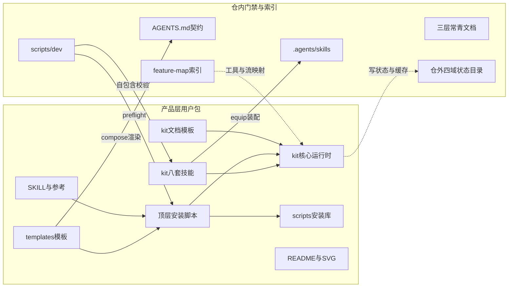
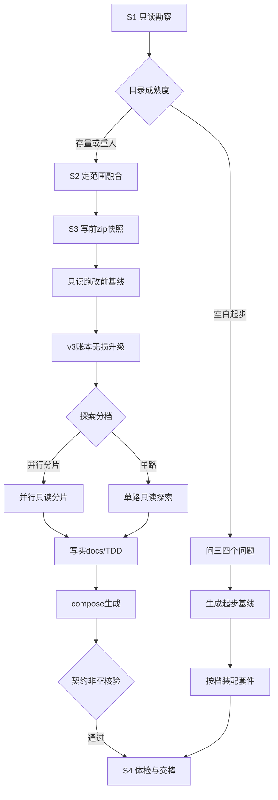
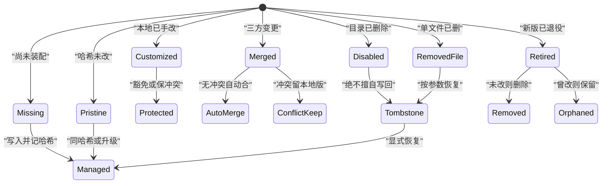
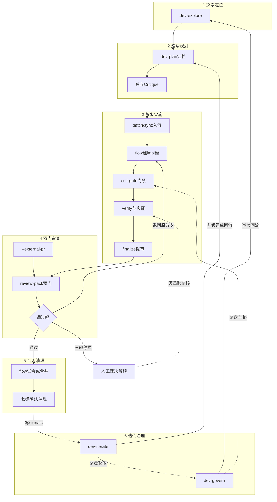
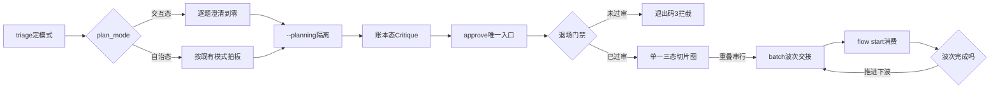
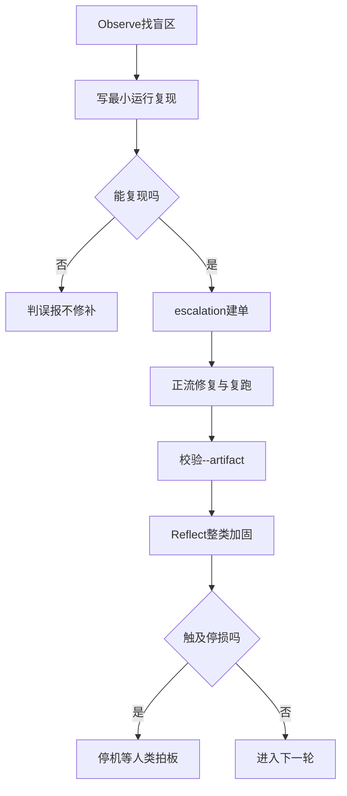

# project-forge 技术设计与架构说明

本文档说明 `project-forge` 仓库当前的技术设计、模块边界、核心流程与约束规则，供维护者和 AI 会话阅读。全文只陈述当前真实结构，不记录版本发布流水或历史施工阶段。

## 文档信息

| 项目 | 内容 |
| --- | --- |
| 适用基线 | 以仓库当前源码与 `SKILL.md` 当前 `metadata.version`（`6.0.0`）为准 |
| 最近更新日期 | `2026-11-23` |
| 运行环境与生态栈 | `Node.js 18+`（仅使用 `node:*` 内置模块，零第三方依赖） |
| 跨平台基线 | `Windows`（PowerShell）、`macOS`（APFS / BSD 工具链）、`Linux` |
| 托管平台适配范围 | 产品层注册表当前注册 `github`；未匹配远端降级为 `generic-git`，无远端按 `local-only` 运行 |
| 关联工程契约 | `AGENTS.md`、`SKILL.md`、`docs/feature-map.json` |

## 目录

- [文档信息](#文档信息)
- [1. 背景、定位与非目标](#1-背景定位与非目标)
- [2. 系统架构全景与模块边界](#2-系统架构全景与模块边界)
- [3. 外部项目治理与跨代升级（S1-S4）](#3-外部项目治理与跨代升级s1-s4)
- [4. 身份判定、平台注册表与传输通道](#4-身份判定平台注册表与传输通道)
- [5. 八个内置技能与日常研发流转](#5-八个内置技能与日常研发流转)
- [6. 四大工程支柱与调度机制](#6-四大工程支柱与调度机制)
- [7. 三层常青文档与工作区安全](#7-三层常青文档与工作区安全)
- [8. 核心不变量、安全红线与门禁体系](#8-核心不变量安全红线与门禁体系)

## 1. 背景、定位与非目标

`project-forge` 面向两类使用场景：一是对外部项目目录做只读勘察、写前备份、工程契约装配与远端协同配置；二是给已装配项目提供一套覆盖需求到合入的 8 个本地研发技能，同时用本仓库作为这套规范的第一个使用方。

### 解决的核心问题

- **接管外部项目时容易误判和覆盖**：直接套模板会覆盖项目原有的架构文档、双许可声明、自定义技能或未忽略产物，也可能把只读克隆误判成可推送的维护者仓库。系统通过只读勘察先收集事实，再按条目生成处置计划。
- **日常多技能协作容易上下文膨胀或流转脱节**：规划、改码、实证、审查和治理如果各写一套状态和接口，就会出现文档和代码脱节、主观审查卡死循环、或者靠人肉代测放行等问题。系统用单任务账本、工作树隔离和确定性阻断码把 8 个技能串在同一条状态机上。

### 明确非目标

- 不生成业务应用代码，不在空白目录起步时创建示例业务源码，也不替项目选定技术栈、版本号或开源许可证。
- 不执行服务器部署、云资源开通或外部依赖包安装。
- 不绑定任何特定 AI 宿主名称、私有环境变量或私有路径，也不在产品层硬编码特定浏览器自动化工具、测试运行器或商业扫描器。
- 不在 `docs/TDD.md` 里手工维护第二份验证工具清单，所有验证工具条目统一存放在唯一机读索引 `docs/feature-map.json`。

### 技术基线与运行约束

| 维度 | 真实约束与实现载体 | 变更前提 |
| --- | --- | --- |
| 运行时下限 | `Node.js 18+`（纯 ESM `.mjs`，零第三方依赖） | 下限只上移不动；上移须同步修改发布清单与 `README` |
| 路径与编码 | `canonicalPath` / `samePath` 处理 Windows 大小写、macOS `/private/var` 与 APFS NFC 归一；无 BOM UTF-8 | 跨平台含非 ASCII 正文一律先写系统临时文件再经 `--body-file` 提交 |
| 系统杂项过滤 | `isMacOsJunkPath`（`kit/skills/lib/git-core.mjs`）与单源 `COMMON_SKIP_DIRS`（`kit/skills/lib/git.mjs`）统一跳过列表 | 扫描、备份、打包与交棒共用同一份跳过列表 |
| 宿主与平台中立 | 产品层严禁出现特定宿主或第三方工具硬绑定；`HostingProvider` 注册表目前仅注册 `github`，未匹配远端降级为 `generic-git` | 新增平台适配器须通过注册表方法契约校验 |

## 2. 系统架构全景与模块边界

仓库严格划分为**产品层**（随用户分发包导出）和**仓内自用层**（仅服务本仓库自身开发与门禁），两者的边界由 `.gitattributes` 中的 `export-ignore` 与 `scripts/lib/protocol.mjs` 中的 `REPO_ONLY_DIRS`、`REPO_ONLY_FILES` 共同维持，并由 `preflight.mjs` 在每次自检时核对一致。



产品层内部按四层单向依赖组织，共享底层原语统一收敛在 `kit/skills/lib/` 作为唯一真源，`scripts/lib/` 仅在安装期复用或做薄重导出，禁止反向被 `kit/` 引用：

1. **L1 基础原语层**：`kit/skills/lib/exec.mjs`、`kit/skills/lib/git-core.mjs`、`kit/skills/lib/git-worktree-env.mjs`、`kit/skills/lib/git.mjs`、`kit/skills/lib/git-index-fast.mjs`、`kit/skills/lib/git-fast-objects.mjs`、`kit/skills/lib/git-fast.mjs`、`kit/skills/lib/git-status-fast.mjs`、`kit/skills/lib/markdown-scan.mjs`、`kit/skills/lib/command-lex.mjs`、`kit/skills/lib/symbol-index.mjs`、`kit/skills/lib/no-changelog-voice.mjs`、`kit/skills/lib/credential-scan.mjs`、`kit/skills/lib/cli.mjs`、`kit/skills/lib/subcommand-meta.mjs`、以及顶层 `scripts/zip.mjs`、`scripts/backup.mjs`。提供跨平台无弹窗命令执行、Worktree 共享环境计算、`withFileLock` 并发文件锁、零子进程 Git 对象与状态解析、命令分词、单源子命令注册表、AST/正则符号索引、履历体检测、凭据/`.npmrc` 内容扫描、围栏感知 Markdown 扫描及纯内置 `node:zlib` 的 `.zip` 快照读写。
2. **L2 环境、文档与拓扑抽象层**：
   - **平台、拓扑与能力抽象**：`kit/skills/lib/platform-probe.mjs`、`kit/skills/lib/platform-registry.mjs`、`kit/skills/lib/platform.mjs`、`kit/skills/lib/github-parse.mjs`、`kit/skills/lib/github-labels.mjs`、`kit/skills/lib/github-client.mjs`、`kit/skills/lib/local-issues.mjs`、`kit/skills/lib/task-backend.mjs`、`kit/skills/lib/task-backend-local.mjs`、`kit/skills/lib/issue-template-hydrate.mjs`、`kit/skills/lib/pr-template-hydrate.mjs`、`kit/skills/lib/task-graph.mjs`、`kit/skills/lib/intake-triage.mjs`、`kit/skills/lib/profile-sniffer.mjs`、`kit/skills/lib/profile.mjs`、`kit/skills/lib/skill-discovery.mjs`、`kit/skills/lib/tool-owned.mjs`、`kit/skills/lib/test-inventory.mjs`、`kit/skills/lib/doc-locator.mjs`、`kit/skills/lib/session-orient.mjs`、`kit/skills/lib/signals.mjs`。
   - **文档、TDD 与模板原语**：`kit/skills/lib/docs.mjs`、`kit/skills/lib/doc-frontmatter.mjs`、`kit/skills/lib/doc-templates.mjs`、`kit/skills/lib/doc-template-render.mjs`、`kit/skills/lib/doc-facts.mjs`、`kit/skills/lib/doc-facts-commands.mjs`、`kit/skills/lib/doc-renumber.mjs`、`kit/skills/lib/doc-requirements.mjs`、`kit/skills/lib/doc-shape.mjs`、`kit/skills/lib/doc-substantive.mjs`、`kit/skills/lib/doc-toc.mjs`、`kit/skills/lib/doc-verify.mjs`、`kit/skills/lib/doc-comments.mjs`、`kit/skills/lib/tdd-facts.mjs`、`kit/skills/lib/tdd-shape.mjs`、`kit/skills/lib/tdd-scaffold.mjs`。
3. **L3 纯策略、状态机与 Harness 门禁层**：
   - **规划、审批与架构同步**：`kit/skills/lib/doc-approval.mjs`、`kit/skills/lib/plan-sync.mjs`、`kit/skills/lib/plan-next.mjs`、`kit/skills/lib/plan-exit-gate.mjs`、`kit/skills/lib/doc-slice-graph.mjs`、`kit/skills/lib/pending-decisions.mjs`、`kit/skills/lib/criteria-lock.mjs`、`kit/skills/lib/critique-rounds.mjs`、`kit/skills/lib/critique-store.mjs`、`kit/skills/lib/tdd-structure.mjs`、`kit/skills/lib/tdd-parity.mjs`。
   - **流转、实证与工具校验**：`kit/skills/lib/workflow-policy.mjs`、`kit/skills/lib/workflow-policy-next.mjs`、`kit/skills/lib/workflow-helpers.mjs`、`kit/skills/lib/context-brief.mjs`、`kit/skills/lib/handoff-package.mjs`、`kit/skills/lib/ledger.mjs`、`kit/skills/lib/exit-codes.mjs`、`kit/skills/lib/gate-truth.mjs`、`kit/skills/lib/evidence-substance.mjs`、`kit/skills/lib/empirical-artifacts.mjs`、`kit/skills/lib/escalation.mjs`、`kit/skills/lib/verdict.mjs`、`kit/skills/lib/review-comment-render.mjs`、`kit/skills/lib/feature-map.mjs`、`kit/skills/lib/verify-state.mjs`。
   - **词法门禁、Harness 内核与扩展**：`kit/skills/lib/static-gates.mjs`、`kit/skills/lib/static-gates-lexer.mjs`、`kit/skills/lib/static-gates-comment-hygiene.mjs`、`kit/skills/lib/harness-context.mjs`、`kit/skills/lib/session-state.mjs`、`kit/skills/lib/gate-enforcement.mjs`、`kit/skills/lib/overlay.mjs`、`kit/skills/lib/shared.mjs`。提供三正交风险判定、单入口下一跳路由、`Actor / HostMode / Slot` 边界锁、`S1-S4` 会话账本与防降档指纹、零降级预览与安全删分支门禁、规划退场白名单、单一三态切片依赖图、实证附件与视觉检查、瘦身交接包及词法静态门禁。
4. **L4 CLI 入口与安装器层**：`kit/skills/*/scripts/*.mjs` 与顶层 `scripts/*.mjs`。负责参数解析、调用 L3 决策与执行 L1/L2 副作用；首次配置、模板渲染与跨版本升级逻辑放在 `scripts/lib/`，保持 `.agents/skills/` 被复制到任意外部仓库后 100% 自包含可运行。

### 模块与目录职责

| 模块或目录 | 所属平面 | 核心职责与主要入口文件 |
| --- | --- | --- |
| `SKILL.md`、`references/`、`templates/` | 产品层 | 总入口调度与红线、分域权威判据、无条件残留渲染母版与推送护栏模板 `templates/githooks-pre-push.sh` |
| `scripts/survey.mjs` | 产品层 | 只读勘察入口，输出工作区事实、`explorationStrategy`、`artifactPlan`、`reentry` 信号与导航清单 |
| `scripts/equip.mjs`、`scripts/equip-ci.mjs` | 产品层 | `v3` 账本技能装配、三方无冲突融合、ABI 回滚、空白仓起步、`--with-hooks` 局部钩子及按 `artifactPlan` 落盘 CI 与分支保护 |
| `scripts/backup.mjs`、`scripts/zip.mjs`、`scripts/lib/tar.mjs` | 产品层 | 仓外 `.zip` 写前增量快照与回滚（支持 `--format tar.gz` 并兼容恢复历史 `.tar.gz`） |
| `scripts/compose-agents.mjs` | 产品层 | 渲染和刷新 `AGENTS.md` 受管区间，保留手写段落与定制 `Dev Profile`，强制 `<= 30720 B` 且建议 `< 24576 B` |
| `scripts/review.mjs`、`scripts/handoff.mjs` | 产品层 | 交付体检（含 `claims.mjs` 路径与脚本真实性回查）与交棒四档退出码净度扫描 |
| `scripts/update.mjs`、`scripts/sync-toc.mjs` | 产品层 | 同盘 staging 校验原子自更新（含 `15` 分钟失败冷却与回滚）与双语 README 目录锚点同步 |
| `scripts/lib/` | 产品层 | 安装期与升级专用库：含 `protocol.mjs`、`template.mjs`、`render.mjs`、`claims.mjs`、`merge3.mjs`、`equip-bootstrap.mjs`、`equip-upgrade.mjs`、`equip-integrity.mjs`、`artifact-executors.mjs`、`starter-templates.mjs`、`agents-defaults.mjs`、`agents-sections.mjs`、`review-helpers.mjs`、`navigation.mjs`、`markdown.mjs`、`fs-atomic.mjs`、`text.mjs`、`update-net.mjs`、`update-ops.mjs`、`survey-*.mjs` 及 `platform/` 下适配器模块 |
| `kit/skills/lib/` | 产品层 | 内置技能共享的零依赖运行内核（单职责模块，含 `shared.mjs` 统一重导出、`context-brief.mjs` 五入口统一常青/切片简报、`plan-next.mjs` 规划续接状态机、`subcommand-meta.mjs`、`doc-facts-commands.mjs`、`credential-scan.mjs`、`harness-context.mjs`、`session-state.mjs`、`gate-enforcement.mjs`、`platform-registry.mjs` 与 `overlay.mjs`） |
| `kit/skills/templates/` | 产品层 | 四层规划与架构模板单源：`docs-prd.md`、`docs-spec.md`、`docs-todo.md`、`docs-tdd.md` |
| `kit/skills/dev-explore/` | 产品层 | 只读探索与零写入按需定位（`kit/skills/dev-explore/scripts/repo-map.mjs`、`kit/skills/dev-explore/scripts/repo-map-helpers.mjs`、`kit/skills/dev-explore/scripts/doc-locate.mjs`） |
| `kit/skills/dev-plan/` | 产品层 | 五档分流、模板初始化、多轮澄清、状态机续接、账本态 Critique 与切片依赖审计（`doc-plan.mjs`、`doc-plan-ops.mjs`、`doc-audit.mjs`、`doc-audit-helpers.mjs`、`doc-audit-repo.mjs`、`triage-rules.mjs`） |
| `kit/skills/dev-edit/` | 产品层 | 改前边界核对、复用查找与词法静态门禁（`edit-gate.mjs`） |
| `kit/skills/dev-flow/` | 产品层 | 身份探测、业务分诊、Worktree 隔离流转、实证记录、波次调度与安全清理（`kit/skills/dev-flow/scripts/flow.mjs`、`kit/skills/dev-flow/scripts/flow-lifecycle-finalize.mjs`、`kit/skills/dev-flow/scripts/flow-merge-claim.mjs`、`kit/skills/dev-flow/scripts/flow-start-helpers.mjs`、`kit/skills/dev-flow/scripts/flow-start-provenance.mjs` 等 `flow-*.mjs` 子模块） |
| `kit/skills/dev-verify-tools/` | 产品层 | 验证工具生命期、仓外 `scratch/` 试制与 `docs/feature-map.json` 免手工日期过时校验（`verify-tools.mjs`、`verify-tools-audit.mjs`） |
| `kit/skills/dev-review/` | 产品层 | 外部 PR 扫雷、先实证与故障注入再看 diff、双门六锁审查与实时双写（`review-pack.mjs` 及 `review-*.mjs` 子模块） |
| `kit/skills/dev-govern/` | 产品层 | 只读静态体检、三层常青文档与工作树巡检、信号聚类、倒金字塔复盘与发版筹备（`kit/skills/dev-govern/scripts/govern-audit.mjs`、`kit/skills/dev-govern/scripts/govern-retro.mjs`、`kit/skills/dev-govern/scripts/govern-checks-hygiene.mjs` 等子模块） |
| `kit/skills/dev-iterate/` | 产品层 | 盲区与热点识别、原生测试扩展（过 `edit-gate`）、并发压测、缺陷升级建单与有界优化循环（`iterate.mjs`、`iterate-cycle.mjs`） |
| `assets/readme/` | 产品层 | 双语 README 浅深色自适应 SVG 图解（`hero`/`architecture`/`docs-layers`/`skills-cycle`/`workflow` 及 `-en` 副本） |
| `scripts/dev/` | 自用层 | 全仓结构门禁、正反双向行为夹具、故障注入矩阵、性能基准台、打包 E2E 与盲测台（含 `scripts/dev/subcommand-parity.mjs`、`scripts/dev/fixtures-w4-harness.mjs`、`scripts/dev/injections-data-w4-harness.mjs`、`scripts/dev/fixtures-trace-sync.mjs`、`scripts/dev/injections-data-trace-sync.mjs`、`scripts/dev/fixtures-w5-blind-fixes.mjs`、`scripts/dev/injections-data-w5-blind-fixes.mjs`、`scripts/dev/fixtures-w6b-kit-hygiene.mjs`、`scripts/dev/injections-data-w6b.mjs`、`scripts/dev/fixtures-w6c-harness-gates.mjs`、`scripts/dev/fixtures-w6c-context-brief.mjs`、`scripts/dev/injections-data-w6c.mjs`、`scripts/dev/fixtures-gates-retro-routing.mjs`、`scripts/dev/fixtures-r5-plan-flow.mjs` 等） |
| `<gitCommonDir>/project-forge-{flow,govern,verify,iterate}/` | 仓外运行时 | 四域仓外持久化目录：分别存放任务账本/`session-state.json`/`planning-provenance.json`、`signals.jsonl` 与基线、`slots/<slotKey>/cache.json` 与 `scratch/`、迭代循环历史状态，严禁污染工作区 |

### 模块分层与禁引规则

```yaml
arch-rules: kit/** -> scripts/dev/**, kit/** -> scripts/lib/**, scripts/*.mjs -> scripts/dev/**, scripts/lib/** -> scripts/dev/**
```

- `kit/skills/` 内部模块只能导入 `kit/skills/lib/` 和 `node:*` 内置模块，确保目标仓库装配 `.agents/skills/` 后不依赖本仓源码即可独立运行。
- 顶层 `scripts/*.mjs` 可以调用 `scripts/lib/` 和 `kit/skills/lib/`，但产品层脚本与库文件严禁引用 `scripts/dev/`；只有 `scripts/dev/` 允许跨层调用以执行验证。

### 功能与入口地图（Feature Map）

项目全部功能域、入口脚本、业务流（`businessFlows`）、验证工具及测试引用统一登记在机读文件 `docs/feature-map.json` 中，由 `dev-explore`、`dev-verify-tools`、`dev-review`、`dev-iterate` 与 `dev-govern` 共同读取和增量维护。核心能力入口摘要如下：

| 功能 / 能力域 | 入口文件 | 验证命令 |
| --- | --- | --- |
| 只读勘察与双轴鉴权 | `scripts/survey.mjs` | `node scripts/survey.mjs . --json` |
| 套件装配与空仓起步 | `scripts/equip.mjs` | `node scripts/equip.mjs . --check` |
| 写前增量快照与回滚 | `scripts/backup.mjs` | `node scripts/backup.mjs list .` |
| 契约生成与预算门禁 | `scripts/compose-agents.mjs` | `node scripts/compose-agents.mjs . --check` |
| 交付体检与声明回查 | `scripts/review.mjs` | `node scripts/review.mjs .` |
| 交棒扫描与净度验证 | `scripts/handoff.mjs` | `node scripts/handoff.mjs . --json` |
| 包副本原子更新 | `scripts/update.mjs` | `node scripts/update.mjs --help` |
| 只读资产探索与按需定位 | `kit/skills/dev-explore/scripts/repo-map.mjs` | `node .agents/skills/dev-explore/scripts/repo-map.mjs . --json` |
| 五档分流与规划内审 | `kit/skills/dev-plan/scripts/doc-plan.mjs` | `node .agents/skills/dev-plan/scripts/doc-plan.mjs audit .` |
| 改码边界与词法静态门禁 | `kit/skills/dev-edit/scripts/edit-gate.mjs` | `node .agents/skills/dev-edit/scripts/edit-gate.mjs --changed --json` |
| 隔离流转与 Worktree 调度 | `kit/skills/dev-flow/scripts/flow.mjs` | `node .agents/skills/dev-flow/scripts/flow.mjs inspect --json` |
| 验证工具生命期与过时校验 | `kit/skills/dev-verify-tools/scripts/verify-tools.mjs` | `node .agents/skills/dev-verify-tools/scripts/verify-tools.mjs audit .` |
| 先实证后 Diff 双门审查 | `kit/skills/dev-review/scripts/review-pack.mjs` | `node scripts/dev/fixtures.mjs --domain review-empirical` |
| 静态体检与倒金字塔复盘 | `kit/skills/dev-govern/scripts/govern-audit.mjs` | `node .agents/skills/dev-govern/scripts/govern-audit.mjs audit .` |
| 正向测试扩展与有界循环 | `kit/skills/dev-iterate/scripts/iterate.mjs` | `node .agents/skills/dev-iterate/scripts/iterate.mjs plan --json` |
| 全仓门禁与故障注入自证 | `scripts/dev/preflight.mjs` | `node scripts/dev/preflight.mjs` |

## 3. 外部项目治理与跨代升级（S1-S4）

为外部项目接入规范治理时，无论面对空白目录、既有代码仓还是跨月重入仓，都走同一条 `S1-S4` 幂等流水线：写操作之前必须完成只读定界，并在非空目录下创建仓外快照；`kit/skills/lib/session-state.mjs` 将每一步状态持久化至 `<gitCommonDir>/project-forge-flow/session-state.json`（非 Git 回退 `<mainRoot>/.worktrees/.state/session-state.json`），支持断点恢复与非空核验。



### 三场景调度与四类存量资产融合

1. **空白目录起步（`maturity: 'empty'`）**：`explorationStrategy.tier` 为 `none`，**明确禁止派发探索子代理**。向用户确认项目定位与栈倾向、包名、许可证意向与远端意向后，执行 `scripts/equip.mjs <目标目录> --bootstrap-empty --stack <技术栈> --name <包名>`，一次生成 `git init`、`.gitignore`、`.gitattributes`、缺失时的 `README.md`、合法空 `docs/feature-map.json`、初始 `docs/TDD.md`、`.agents/skills/` 与自洽 `AGENTS.md`，不生成任何玩具业务源码。
2. **存量仓库接入（`single-pass` / `parallel-subagents`）**：在 `S3` 写入任何文件前，先通过 `scripts/backup.mjs` 创建 `pre-forge` 仓外 `.zip` 快照，再以**只读方式**实跑对方既有测试与主入口，记录 `preForgeBaseline`。`survey`、`backup`、`equip`、`compose-agents` 与 `review` 均通过 `recordStepStateSafe` 向 `session-state.json` 写入 `S1..S4` 完成凭证；当代码文件较多、含多生态子包或重入存在漂移时，按互不重叠的 `shards` 分片并发派发只读 `dev-explore` 子代理，收集真实入口、`businessFlows` 与差异后写入 `docs/TDD.md`，并在 `S2/S3` 落实四类真融合：
   - **长青文档**：识别已有 `ARCHITECTURE.md`、`DESIGN.md`、`docs/adr/` 等，按 `preserve` 保留并通过 `evergreen-docs:` 纳管，避免另起一套冲突文档；
   - **非长青或过期文档**：引导归档至 `docs/archive/` 或确认清理残片，避免干扰检索；
   - **既有脚本、数据模型与 CI**：融入 `Dev Profile`、`docs/feature-map.json` 与 `docs/TDD.md`，自动跳过 `vendor/**`、`third_party/**` 等嵌入第三方子包，子包超限时按目录簇聚合摘要；
   - **既有 AI 约定**：对 `CLAUDE.md`、`.cursorrules`、自有技能 `.agents/skills/<custom>/` 做语义去重与无损保留，发现的原仓遗留问题统一通过 `TaskBackend` 建单进入日常流修复。
3. **跨月重入校准**：仅当目录已存在 `.pf-manifest.json`、受管标记或既定四层契约时判定为重入，不误判纯手写 `AGENTS.md`。重入时依 `reentry` 信号（`staleAgentPaths`、`staleAgentScripts`、`staleTddPaths`、`unregisteredTopDirs`）做局部校准，保留人工写的 `取舍` 与定制规则。

### `v3` 账本三方融合、ABI 回滚与跨代自更新

`scripts/equip.mjs` 通过 `.agents/skills/.pf-manifest.json`（`schemaVersion: 3`，兼容历史 `v1`/`v2`）实现幂等装配、墓碑保护与跨代升级融合：



| 本地文件状态 | `equip.mjs` 执行动作 | 安全与融合边界 |
| --- | --- | --- |
| 尚未安装且不在墓碑中 | 写入托管文件并记录 SHA256 | 文本统一按 LF 写入，校验兼容 CRLF/LF |
| 用户已删除技能或单文件 | 记入 `disabledSkills` / `removedFiles` 墓碑并跳过 | 绝不擅自恢复，仅 `--restore` 找回 |
| 磁盘哈希等于基线哈希 | 无损升级至新版并更新哈希 | 同哈希跳过保幂等 |
| 本地与上游同时修改 | `scripts/lib/equip-upgrade.mjs` 三层基线自动回溯 + `scripts/lib/merge3.mjs` 三方合并 | 无冲突自动融合；冲突留本地版并将 `.upstream`/`.pf-conflict` 迁至仓外冲突目录（`.agents/skills/` 零残留） |
| 已通过 `--adopt-custom` 豁免 | 记入 `customizedFiles`，上游未改时 `--check` 返回 `0` | 上游改版时先按 `upstreamSha256` 尝试三方融合（相等即清理豁免），无法合并则入 `pendingConflicts` |
| 新版已移除的退役托管文件 | 未改则物理删除；曾改则保留并标 `orphaned-modified` | 绝不误删用户改过的资产 |
| 升级后 ESM 语法或导出校验失败 | `scripts/lib/equip-integrity.mjs` 触发整包回滚 | 从写前仓外 `.zip` 快照瞬时恢复 |

`scripts/update.mjs` 负责 `project-forge` 自身目录的跨代升级：在同盘 staging 目录下载校验全部文件、按 `15` 分钟失败冷却保护网络重试，确认完整后先打备份再原子替换，最后做全目录校验，任何缺失立即原地回滚（含恢复被退役删除的文件），最后才原子替换入口 `SKILL.md`。写前快照统一存放在 `PF_BACKUP_DIR`、`<gitCommonDir>/project-forge-backups/` 或用户主目录备份目录下，滚动清理时永久钉住最新一份 `pre-forge` 基线。

## 4. 身份判定、平台注册表与传输通道

### 双轴五态身份判定

所有写入或协作流转前，由 `survey.mjs`、`flow.mjs inspect` 与 `kit/skills/lib/platform.mjs` 结合「远端拓扑」和「认证写权限」判定当前身份：

- **`maintainer`（`owner` / `team-collaborator`）**：`origin` 与声明源仓库一致且经探测拥有写权限。在独立特性分支开发并通过 PR 合入，禁止直推受保护主干；团队协作时支持新成员 `--probe-auth` 验权、`flow.mjs claim` 认领防撞车、`--takeover --reason` 双写接管评论、遵循 `CODEOWNERS` 与 Merge Queue，并在需要时由 `AGENTS.md`「## 取舍」写 `merge-authority: human` 收回人工合并。
- **`contributor-fork`**：本地存在不同的 `upstream` 或 `origin` 指向个人 Fork。只允许推往 `origin` 并向 `upstream` 开 PR；硬禁止本地自合或在 PR 仍 `OPEN` 时删分支；写标签遇 HTTP 403 自动降级为评论；若上游仓未启用 `docs/` 体系，私有规划草案自动隔离至 `.worktrees/.state/private-docs/` 防止污染 PR diff。
- **`clone-readonly` / `undetermined`**：克隆他人仓库且无写权限，或离线缺权限依据。绝不伪装成维护者，要求人三选一（转 Fork、独立建仓或写入 `.git/pf-local-mode` 转纯本地）。
- **`local-only` / `generic-git`**：无远端或 `.git/pf-local-mode` 走纯本地流程；未匹配平台注册表的自建远端（如 GitLab/Gitea/企业内网 Git）自动降级为 `generic-git`，本地分支、三档隔离与门禁照常放行，但在 `flow.mjs merge` 现场必须先 `fetch` 远端并按 `inspectBranchMergeState` 四态合流核验，核不到即阻断，仅 `--human-approved --reason` 可放行。
- **`inbound-external-pr`**：维护者仓库审查外部贡献者 PR。强制拉入 `.worktrees/review-pr-<M>` 并先执行 `--untrusted-scan` 供应链静态扫描，命中工作流、安装脚本或锁文件等高危项时以 `BLOCKED_UNTRUSTED_HAZARD` 硬阻断，直到人类显式传入 `--human-approved-exec` 才允许执行。

### 平台注册表、`TaskBackend` 与模板水合

`scripts/lib/platform/registry.mjs` 与 `kit/skills/lib/platform.mjs` 对齐同一套 `HostingProvider` 注册契约，注册阶段即校验必备方法（缺方法直接失败）。`kit/skills/lib/task-backend.mjs` 中的 `createTaskBackend()` 不再写死 `if/else` 分支，而是直接查注册表分发到 `GitHubBackend`，或回落到 `kit/skills/lib/task-backend-local.mjs` 提供的 `GenericRemoteBackend` / `LocalOnlyBackend`（数据原子持久化在 `<effectiveGitDir>/project-forge-flow/issues|prs|intake/`），同时统一管理四态语义标签（`in-progress`、`in-review`、`changes-requested`、`reviewed`）、`updateIssueBody` 非破坏正文维护与跨后端里程碑；`flow.mjs close` 与 `flow.mjs issue close` 统一经 `doc-comments.mjs` 的 `buildIssueCloseComment` 输出含 `pf-state` 锚点的结构化关单/归并评论。

四条建单入口（`flow issue create`、`flow start --create-issue`、`escalation.mjs` 升级建单、`govern-audit.mjs issues`）统一调用 `kit/skills/lib/issue-template-hydrate.mjs` 的 `hydrateIssueBody`，优先读取目标仓库 `.github/ISSUE_TEMPLATE/` 保留用户模板结构并回填复现步骤与验收标准；PR 提交统一调用 `kit/skills/lib/pr-template-hydrate.mjs` 的 `hydratePrTemplateBody` 回填 `.github/pull_request_template.md` 与结构化实证表。同轮非返工二次推送经 `buildSubmitComments`（`isHeadUpdate`）渲染 `提交更新` 并双写 PR 与关联 Issue；`kit/skills/lib/plan-sync.mjs` 全量同步 `init`/`clarify`/`critique-*`/`supersede`/`plan-backfill` 并通过 `mergeManagedPlanSummary` 非破坏维护 Issue 正文托管摘要块；双层身份归属经 `doc-comments.mjs` 渲染：仅当平台声明 `capabilities.mention === true` 且账号登录名经过实测验证时输出 `@handle`，其余平台、本地用户名和代理代号一律加反引号且绝不捏造 `@maintainer`。

### 双轨四级传输与写路径探测守卫

- **Track A（Git 传输与惰性探测）**：子进程统一通过 `kit/skills/lib/exec.mjs` 注入 `GIT_TERMINAL_PROMPT=0`、`GCM_INTERACTIVE=never`、`SSH_ASKPASS_REQUIRE=never`、`GH_PROMPT_DISABLED=1` 与 `5000ms` 硬超时；SSH 默认 `StrictHostKeyChecking=yes` 绝不擅改 `known_hosts`，22 端口不通自动回退 `ssh.github.com:443`，并解析 `~/.ssh/config` 支持多账号别名。默认只读探测不发起外部鉴权子进程；所有写操作入口必须经 `probeForWrite` 显式探测，由 `scripts/dev/write-probe-audit.mjs` 全仓拦截裸探针回流。
- **Track B（GitHub API 四级降级）**：依次尝试 `gh-cli` -> `node-https-token`（令牌仅保存在 `WeakMap` 内存，绝不落盘或进日志，REST 客户端禁止跟随重定向并对 `429`/`5xx` 做指数退避） -> `mcp-delegate`（宿主具备 MCP 能力时输出委托载荷） -> `half-duplex` / `offline` / `none`。

## 5. 八个内置技能与日常研发流转

日常研发坚持保持 8 个内置技能边界不新增，由 `AGENTS.md` 顶部意图路由触发，围绕 `flow.mjs next` 单入口状态机贯通 **需求 → 澄清 → 设计 → 实现 → 评审 → 实证测试-形式验证 → 验收 → 合入** 八个阶段，并经 `harness-context.mjs`、`session-state.mjs` 与 `gate-enforcement.mjs` 强制锁住身份、槽位与零降级门禁。



### 八个技能分工与确定性阻断点

| 技能 | 阶段与核心职责 | 关键命令 | 确定性拦截与交接边界 |
| --- | --- | --- | --- |
| `dev-explore` | 需求前只读侦察、多生态盘点与按需切片定位 | `repo-map.mjs`、`doc-locate.mjs` | 严禁写任何文件；输出 `reusableModules`、`businessFlows` 与 `startLine..endLine` 切片；`flow explore` 将真实 `explored` 证据写入账本 |
| `dev-plan` | 五档分流（Case 1–5）、多轮澄清、切片依赖审计、状态机续接与独立 Critique | `doc-plan.mjs`（`triage` / `init` / `clarify` / `audit` / `next` / `critique-*` / `approve`） | `session-state.mjs` 按任务隔离 `triage` 消费（`markTriageConsumed`）并锁防同任务静默降档（`BLOCKED_TRIAGE_DOWNGRADE`）；禁 `owner: null`（`INVALID_OWNER`）、禁自审（`SELF_CRITIQUE_REJECTED`）、全历史换人（`BLOCKED_CRITIQUE_SAME_REVIEWER`）、未改稿拒审（`BLOCKED_CRITIQUE_SAME_SHA`）、3 轮停损（`STOP_LOSS_ESCALATE`）、依赖环（`BLOCKED_SLICE_CYCLE`） |
| `dev-edit` | 改前禁改区/复用检查与改后词法去噪静态门禁 | `edit-gate.mjs`（`pre-edit` / `verify` / `standalone`） | 拦截 `do-not-edit`（`verify --final` 永不降级）、过程编号文件名、无锚点压制标记、履历墓碑、死代码块、`arch-rules` 越界、单测反作弊与 `>800` 行膨胀 |
| `dev-flow` | 身份探测、业务分诊、Worktree 隔离、实证绑定、波次调度与收尾清理 | `flow.mjs`（`next` / `inspect` / `intake` / `start` / `explore` / `claim` / `finalize` / `verify` / `submit` / `sync` / `merge` / `cleanup` / `batch`） | 禁 `Case >= 2` 脏主仓与原地开工（`BLOCKED_DIRTY_MAIN` / `BLOCKED_MAIN_SLOT_VIOLATION`）、作者与实施者同人（`BLOCKED_AUTHOR_IS_IMPLEMENTER`）、规划未就绪退场（`BLOCKED_PLAN_NOT_READY`）、未同步主 PRD（`BLOCKED_LAST_SLICE_MASTER_PRD_UNCLOSED`）、空执行者或协调者代提（`BLOCKED_MISSING_ACTOR` / `BLOCKED_SUBMIT_OWNERSHIP_MISMATCH`）、停损/未合删分支/预览漂移（`BLOCKED_UNMERGED_BRANCH_DELETE` / `BLOCKED_CLEANUP_PREVIEW_MISMATCH`） |
| `dev-verify-tools` | 验证工具生命期、仓外 `scratch` 试制与唯一地图 `docs/feature-map.json` | `verify-tools.mjs`（`sync` / `create` / `run` / `audit` / `clean`） | 按 `(slotKey, moduleTreeHash, symbolHash)` 隔离每槽位缓存；免日期过时校验：低风险告警、中风险降级引导 E2E、高风险硬阻断（`BLOCKED_STALE_HIGH_RISK_TOOL`） |
| `dev-review` | 外部 PR 扫雷、先实证后 diff、双门六锁审查与实时双写 | `review-pack.mjs`（`check-empirical` / `check-fault` / `--include-diff` / `record` / `override`） | 默认 `DEFAULT_ENFORCE_GATES = true`；强制先实证（`BLOCKED_EMPIRICAL_FIRST`）、禁水话观察与空代码故障注入、`low` 纯文档免收集 Dev Profile 运行时命令并按 diff hunk 变更行执行 `runLowRiskDocStaticCheck` 且在 `--include-diff` 与 `record --verdict pass` 间对齐 `staticDocCheckRequired`、Round 2+ 未闭合阻塞禁 `pass`、UI 必具 `--artifact` 或 `--visual-blocked-reason`、全历史换人与六锁硬拦 |
| `dev-iterate` | 盲区与热点识别、原生测试扩展、并发压测、PoC 升级建单与有界循环 | `iterate.mjs`（`plan` / `generate` / `run` / `cycle`） | 有状态记录轮次历史；生成测试必过 `edit-gate` 反作弊且不污染 `quick-test`；抓到真缺陷不直接改源码，经 `escalation.mjs` 建单回正流 |
| `dev-govern` | 静态体检、常青文档与 Worktree 巡检、三层倒金字塔复盘与发版筹备 | `govern-audit.mjs`（`audit` / `reconcile` / `plan` / `retro` / `release-prep`） | `reconcile` 全覆盖 `kit/`、校验 `docAnchors`/`verificationTools`/`testRefs`；`flow` 关键节点默认启用轻量治理；`retro` 默认不越权自动改写 `AGENTS.md`，同类指纹复发 `>= 2` 次强制升格 Tier 1 重构或 Tier 2 静态门禁 |

## 6. 四大工程支柱与调度机制

### 支柱一：宿主无关双态规划门禁与波次并行调度

为了不绑定任何 AI 宿主特定斜杠命令，系统通过文档 Frontmatter 的 `plan_mode: interactive | autonomous`、`pendingDecisions` 计数与通用能力枚举 `hostMode: multi-agent | single-session`（`harness-context.mjs` 读取 `--host-mode` / `--single-session` 或 `PF_HOST_MODE`）控制规划与协作节奏：
- **`interactive`**：适用于单向门、Case 4、L3 改造与总控 PRD。每个待拍板问题必须逐轮向人确认并写入文档，直到 `pendingDecisions === 0`。
- **`autonomous`**：适用于可逆的常规任务。按仓内既有模式自行决策，只在遇到单向门、Case 5 冲突或真实语义歧义时停下提问。
- **`hostMode` 分流**：默认 `multi-agent`（严格分离规划作者、实施代理与独立审查者）；单会话宿主显式声明 `single-session` 后，方可在人类确认（`--human-approved`）下走单人降级通道，避免被迫伪造子代理 ID。



- **规划隔离与账本态内审**：支持 `flow.mjs start --planning` 或 `doc-plan.mjs init --worktree` 在独立 worktree 中起草规划，过审后运行 `flow.mjs start` 原地平滑转入实施而无需迁移文档。多轮 Critique 记录全部存入单任务账本 `ledger.planCritique`，Frontmatter 只留单行 `plan_critique` 印记，同时去掉了单调膨胀的锚点计数棘轮，只保留核心章节非空、C 编号锁定与实质性防退化护栏。
- **退场白名单与单一三态图**：`plan-exit-gate.mjs` 在 `flow.mjs start --case 3|4` 前置强校验，仅放行 SHA 一致的 `passed`、带理由的 `human-override` 或带实质理由的 `skipped`，否则以退出码 `3` 报 `BLOCKED_PLAN_NOT_READY`。切片规划统一收口到 `doc-slice-graph.mjs`，显式区分逻辑 `depends_on`、未完成阻断与 `serial-by-overlap`（无逻辑依赖但 `scope_files` 相交时自动排入先后子波次，不再误报冲突）。
- **并流调度与统一上下文简报**：`flow.mjs next` 在空闲态扫描就绪规格并在 `Wave 1 >= 2` 时返回 `parallelDispatch: true`；`kit/skills/lib/context-brief.mjs` 为 `handoff-package.mjs`、`doc-plan.mjs`（`triage`/`init`）、`flow-merge-claim.mjs`（`claim`）、`review-context.mjs`/`review-gates.mjs` 与 `flow-explore.mjs`（`explore`）提供单一只读简报装配（优先展开最多 `4` 份全类常青文档目录与 `doc-locate` 命令、保留其余列表不截断、附带 Top-3 切片与 `feature-map` 业务流/概览）；`flow.mjs batch plan --handoff` 调用 `handoff-package.mjs` 按波次生成瘦身子代理交接包，防止详报与日志撑爆主调度上下文；`flow.mjs status --all` 提供全仓活跃任务与波次的统一只读总览。

### 支柱二：工具无关结构化实证与界面防敷衍

`kit/skills/lib/empirical-artifacts.mjs` 把「真实产出」和「使用什么外部工具」彻底拆开：
- **通用 `--artifact <path>` 附件校验**：`flow.mjs verify` 支持重复传入 `--artifact`，校验每个路径必须真实存在、为常规文件、非 `0` 字节且不超过 `50 MB`，计算 SHA256 前缀并写入仓外 `evidence.json`，不修改任何 Git 跟踪文件；`submit` 阶段自动在 PR 正文生成结构化实证附件清单。
- **界面变更禁用布尔开关自证**：只要变更文件命中 `UI_VISUAL_EXT_RE`（`.tsx` / `.jsx` / `.vue` / `.svelte` / `.html` / `.css` / `.scss` / `.svg` 等），单独传入 `--visual-checked` 会被 `BLOCKED_VISUAL_EVIDENCE_REQUIRED`（或命中旧式硬编码串报 `BLOCKED_VISUAL_EVIDENCE_PLACEHOLDER`）以退出码 `3` 拦截，必须至少满足一项：附真实非空 `--artifact`、写下包含界面与观察结果的实质摘要、或在确无渲染节点时显式声明 `--visual-blocked-reason`。

### 支柱三：先最小运行复现（`PoC-first`）与整类根治（Tier 1 / Tier 2）

静态告警、审查疑点或推测缺陷在拿到运行证据前只算「可疑」。`escalation.mjs`、`dev-iterate` 与 `dev-govern` 共用四步处置原则：
1. **最小运行复现消误报**：先编写并运行一条最小可复现 PoC 命令；复现不出来即按误报处理，不写补丁、不建单。
2. **复跑证伪与回归防护**：修复后用同一条命令复跑确认变绿，并把正反双向断言写入回归测试。
3. **评估整类加固（Tier 1 / Tier 2）**：同类缺陷复发 `>= 2` 次时，严禁停留在 Tier 3（仅写口头文档提醒），必须按倒金字塔正序收敛：**Tier 1** 将规则沉入共享边界原语（如 `kit/skills/lib/`）或架构重构消除分叉；**Tier 2** 将检测沉入确定性静态门禁或原生规则（如 `edit-gate.mjs` / `govern-audit.mjs`），且 `retro` 默认不越权自动修改 `AGENTS.md`。
4. **结构化建单证据**：`escalation.mjs` 支持有界长度（`<= 1200` 字符）的 `reproEvidence` 与 `pocCommand` 字段，把可重放命令直接带入工单正文。

### 支柱四：有界优化循环与「只锁客观输出边界」

`kit/skills/dev-iterate/scripts/iterate-cycle.mjs` 为 `iterate.mjs cycle` 提供只读四阶段编排与硬停损裁判，绝不自主改写源码或绕过正流：



- **三条硬停损**：达到轮次上限（`ROUND_LIMIT_REACHED`，默认 `3` 轮、硬上限 `10` 轮）、连续两轮零进展（`NO_PROGRESS_STALL`）、或遇到单向门与高风险待批项（`ONE_WAY_GATE_HIT`）时立即停止，并以退出码 `4` 交回人类裁决。
- **只锁客观输出边界**：无论在 `AGENTS.md` 行事总纲还是各技能验收判据中，门禁只校验可观察的产物、接口 Schema、退出码与正反断言，不对内部私有实现步骤做脆弱的过程锁定。

## 7. 三层常青文档与工作区安全

### 三层常青文档与四层规划单据

| 层级 | 文件载体 | 核心定位与保鲜机制 |
| --- | --- | --- |
| 入口导航层 | `AGENTS.md`（母版 `templates/agents-project.md`） | 会话自动读取的薄契约：意图路由、行事总纲、`Dev Profile`、协作流转、高风险路径与 `改哪看哪`（建议 `< 24KB`，上限 `30KB`） |
| 系统架构层 | `docs/TDD.md`（母版 `kit/skills/templates/docs-tdd.md`） | 讲透系统整体设计、模块边界、核心流程与不变量；`tdd-structure.mjs` 与 `tdd-parity.mjs` 校验结构与路径同步 |
| 机读索引层 | `docs/feature-map.json` | 唯一机读功能、模块、业务流与验证工具映射；由 `verify-tools.mjs` 通过导出符号指纹与 Git 树哈希免手工日期判旧，并由 `govern-audit.mjs reconcile` 校验 `kit/` 全映射与 `docAnchors` / `verificationTools` / `testRefs` 覆盖 |

除三层常青文档外，具体需求按档位落盘在 `docs/prd/`、`docs/specs/` 与 `docs/todo/`，全部由 `doc-plan.mjs` 与 `kit/skills/templates/` 统一样式生成（支持仓库自有 `docs/templates/` 覆写）。需求完结后由 `flow.mjs finalize` 检查全勾 `[x]` 与 `docs/TDD.md` 同步，再成对 `git mv` 归档进 `docs/archive/{prd,specs,todo}/`；对 `1:N` 总控 PRD 由 `evaluateMasterPrdClosureState` 执行四态收口判定，确保所有子切片 100% 覆盖并全勾 `[x]` 时同分支原子归档，若有未勾项则以 `BLOCKED_LAST_SLICE_MASTER_PRD_UNCLOSED` 阻断；`govern-docs.mjs` 的 `checkDocChurnStaleness` 仅由权威常青文档提交重置滞后计数，新增规划草案不再掩盖常青文档滞后。

所有活跃文档的 Mermaid 图表统一经过 `checkMermaidLabelWidth` 校验：矩形节点与分组标题单行显示宽度 `<= 16` 单位（全角字符计 `2`，ASCII 计 `1`），菱形节点与边标签 `<= 12` 单位，且严禁在节点或边标签中使用 HTML 标签。

### Worktree 隔离、Per-Slot 状态隔离与七步收尾

- **全量隔离与槽复用**：有提交历史（`commits > 0`）且 `Case >= 2` 的任务一律在 `.worktrees/impl-<taskId>/` 实施，并在 `.worktrees/review-<taskId>/` 独立审查（`Case 1` 可在主仓原地微调）；`enforceSlotBoundary` 硬拦截脏主仓（`BLOCKED_DIRTY_MAIN`）与 `Case >= 2` 主仓原地实施（`BLOCKED_MAIN_SLOT_VIOLATION`）。同一任务跨轮返工复用同一对槽位，同步代码前先解绑共享依赖再重置 `HEAD`。
- **Per-Slot 验证缓存与会话指针隔离**：`verify-state.mjs` 在 `<gitCommonDir>/project-forge-verify/cache.json` 中按 `slots[slotKey]`（由 `resolveVerifySlotKey` 派生 `main` 或 `.worktrees/impl-<taskId>`）隔离存储每个工作槽位的 `(symbolHash, moduleTreeHash, verifiedSha)` 基线，避免并行 worktree 相互覆盖或污染 `main` 基线；任务清理时由 `flow-cleanup.mjs` 调用 `reclaimVerifySlotCache` 回收对应槽位缓存。治理流水线与分流指纹由 `session-state.mjs` 持久化在 `<gitCommonDir>/project-forge-flow/session-state.json`，任务账本与探索证据保存在 `<gitCommonDir>/project-forge-flow/ledgers/`，均独立于 Git 跟踪文件。
- **防毒化共享与安全删分支清理**：`worktree-deps.mjs` 按子包根目录比对锁文件 SHA256 后挂载依赖，若检测到 Monorepo Workspace 本地包软链或 Python 可编辑 `.venv` 指回主仓即自动拒绝共享并切换局部隔离。拆卸前通过 `git cherry` 与 `git patch-id` 区分 `merged`、`squash_or_rebase_merged`、`no_own_commits` 与 `unmerged` 四态，校验 `samePath` 并阻断未登记外链与悬空链接；`gate-enforcement.mjs` 通过 `computeCleanupPreviewHash` 校验 `--preview-hash` 防止预览后换目标删除，并由 `isSafeBranchDelete` 验证分支确已合入方允许删分支（拒绝未合分支被 `-D` 误删），**必须先对挂载链接执行 `unlinkSync` 解绑并由人确认清单（`--confirm --preview-hash <hash>`），再执行 `git worktree remove`**，严格按固定七步完成合入后清理。

## 8. 核心不变量、安全红线与门禁体系

### 关键不变量

1. **零第三方依赖与目录自包含**：`scripts/` 与 `kit/` 全部 `.mjs` 文件只使用 `node:*` 内置模块，且 `kit/` 严禁导入外部相对路径。
2. **只读勘察先行与凭据零落盘**：勘察、探索、规划审计与交棒检查在校验通过前不改写目标文件；鉴权令牌仅存于 `WeakMap` 内存，含中文平台交互正文一律走临时 UTF-8 文件与 `--body-file`。
3. **「没做 / 没查到 / 不认识」不折成通过**：这是全仓跨模块共守的真实性铁律——跨仓不可判引用只报不折成同仓、验证工具零匹配或门禁失败不返回成功、合入后回复以写接口 `ok === true` 为准、未装套件降级提示保留可执行动作类别、循环解析告警进 `warnings` 不吞错。
4. **退出码单点四档分层（`kit/skills/lib/exit-codes.mjs`）**：所有脚本共用同一套退出码常量：`0` 通过、`1` 有待办项、`2` 用法参数错误、`3` 前提事实不成立阻断、`4` 需人类拍板解锁（如弱化门禁或停损熔断）；在册阻断码的显式返回档位由 `scripts/dev/exit-code-parity.mjs` 对拍一致。
5. **合入门禁四档互斥（`kit/skills/lib/gate-truth.mjs`）**：由 CI 结构谓词单源派生验证步骤并逐块执行，结论严格互斥输出 `passed`、`failed`、`unverified`、`not-applicable`，绝不把 `not-applicable` 折叠成通过。
6. **实证实质性共用判据（`kit/skills/lib/evidence-substance.mjs`）**：提审观察、视觉核验与人工放行理由共用同一套实质判据，拒收占位词与旧式合成确认串；放行理由加严要求写明绕过对象与理由。
7. **不可逆边界与弱化门禁人审**：日常推分支与开 PR 可撤回；合入默认分支由独立审查者在三方 `headSha`、干净工作区、远端检查与实证通过后收尾（声明 `merge-authority: human` 除外）；任何弱化测试/门禁动作必退 `4` 等人类点头；发版必须等人类明确下令并按 `RELEASING.md` 执行。

### 全链路自证与门禁矩阵

| 验证脚本 | 检查覆盖面 | 触发时机与预期标准 |
| --- | --- | --- |
| `scripts/dev/preflight.mjs` | 入口预算、引用可达性、模板零残留、7 键单源、`arch-rules`、套件行数、参数与退出码对拍、写路径联网守卫、Mermaid `16/12`、自举与端到端冒烟（支持 `--changed`） | 每次提交前；退出码 `0` |
| `scripts/dev/gap-coverage.mjs` | `survey` 全部缺口规则在 `review.mjs` 与参考文档中的配对覆盖 | 改动勘察或体检规则后；`0` 遗漏 |
| `scripts/dev/fixtures.mjs` | 全功能域正反双向行为断言（含身份、装配、v3 三方融合、平台注册表、工作流、规划波次、实证循环、治理演进、`fixtures-w4-harness.mjs`、`scripts/dev/fixtures-trace-sync.mjs` 与 `scripts/dev/fixtures-w5-blind-fixes.mjs`） | 每次改动判定或工作流后；`0` 失败 |
| `scripts/dev/verify-injections.mjs` | 在整树隔离副本上逐条注入退化故障（含 `injections-data-w4-harness.mjs`、`scripts/dev/injections-data-trace-sync.mjs` 与 `scripts/dev/injections-data-w5-blind-fixes.mjs`），验证对应检查必红、还原后全绿 | 高风险改动与发版前；全部故障可捕获 |
| `scripts/dev/merge-gate.mjs` | 从 `.github/workflows/check.yml` 单源派生全链路静态与重型校验，并行只读池 + 串行重锁步骤 | 合入前实跑；四档互斥全过 |
| `scripts/dev/bench.mjs` | 同轮校准单位负载 `unitMs` 校验（默认模式）与 `--strict-budget` `1x` 绝对上限（如 `survey(self) <= 250ms`、`backup.zip(1000 files) <= 250ms`），无环境变量倍率开关 | 改动扫描、流转或备份逻辑后；零超时 |
| `scripts/dev/e2e-zip-harness.mjs` | 基于真实 `git archive --format=zip HEAD` 解压包，多进程隔离驱动本地 HTTP/bare 远端跑通生命周期与演进场景 | CI 矩阵与发版前；退出码 `0` |
| `scripts/dev/blind-run-harness.mjs` | 沙盒多生态（Node/Python/Go/Rust + 自有技能）零提示盲测与先实证后 diff 防线核验 | 回归与发布前；退出码 `0` |
| `scripts/dev/cli-parity.mjs`、`scripts/dev/subcommand-parity.mjs`、`scripts/dev/exit-code-parity.mjs` | 参数/子命令注册表与帮助/读取点对拍、在册阻断码四档退出码对拍 | 参数、子命令或阻断码变更后；零不一致 |
| `scripts/dev/evidence.mjs` | 只读清点当前导出包 `skillVersion`、`skillSource`、条目清单与文件哈希 | 发版前核对制品证据 |
| `scripts/compose-agents.mjs . --check` | `AGENTS.md` 标记成对、无未填占位且字节数 `<= 30720`（建议 `< 24576`） | 修改契约或模板后；退出码 `0` |
| `scripts/equip.mjs . --check` | `.agents/skills/` 与 `kit/skills/` 及 `.pf-manifest.json` 字节级一致 | 修改 `kit/skills/` 后；退出码 `0` |
| `scripts/review.mjs .` | 交付成熟度体检、`claims.mjs` 真实路径/脚本回查与 `staleTddPaths` 检测 | 交付验收与合流前；`0` 个「缺」 |
| `scripts/sync-toc.mjs` | `README.md` 与 `README.en.md` 目录及锚点双向同步 | 修改 README 后；退出码 `0` |
| `.agents/skills/dev-plan/scripts/doc-plan.mjs audit .` | 活跃文档 Frontmatter、互链、实质性、Mermaid 宽度与 TDD 结构校验 | 规划与文档改动后；退出码 `0` |
| `.agents/skills/dev-govern/scripts/govern-audit.mjs audit . --strict` | 静态安全、死代码、测试分层与文档漂移严格体检 | 收尾与巡检时；退出码 `0` |
| `.agents/skills/dev-verify-tools/scripts/verify-tools.mjs audit .` | `docs/feature-map.json` Schema、僵尸引用、盲区与过时基线审计 | 改动功能地图或模块后；退出码 `0` |
