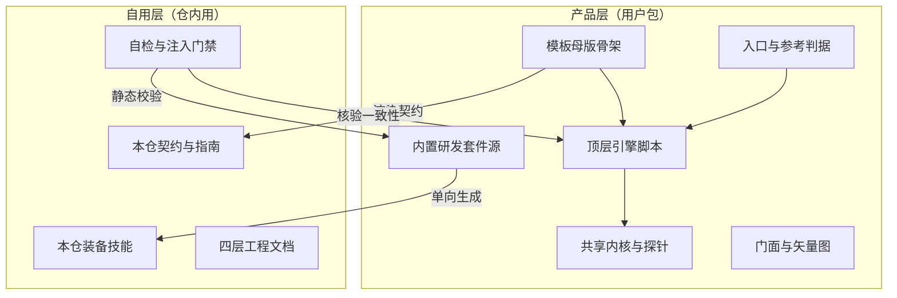
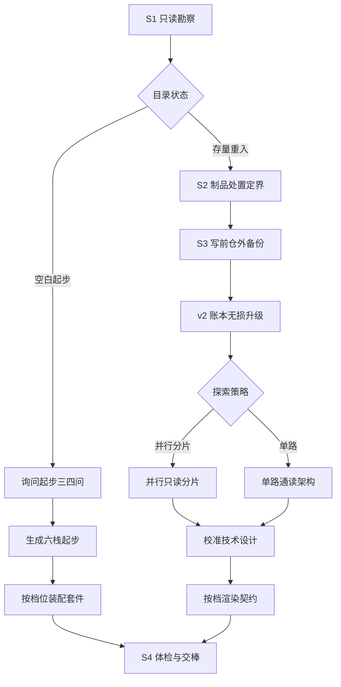
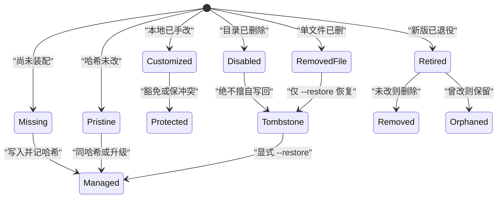
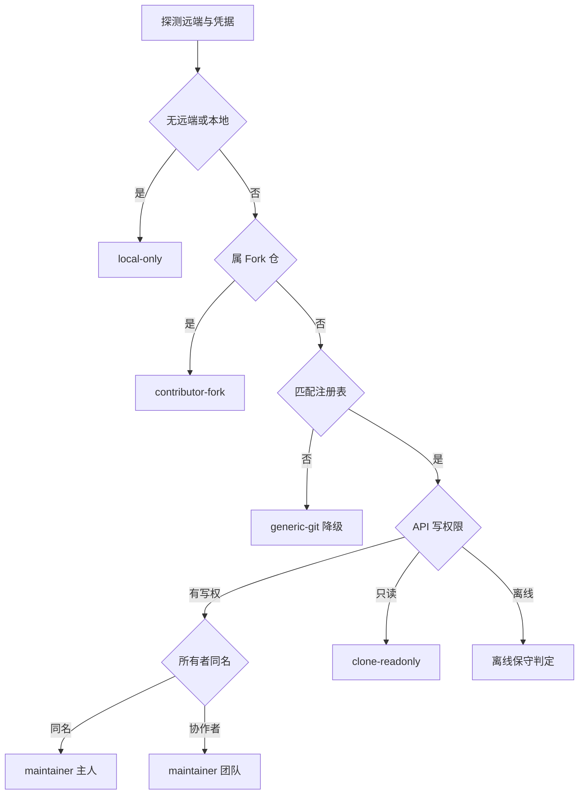
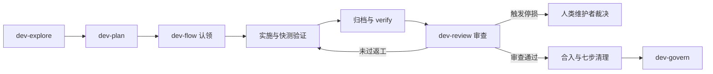

# project-forge 技术设计与架构契约（TDD）

本文档是 `project-forge` 仓库的常青技术设计与架构权威，面向维护者与 AI 会话。内容只陈述当前真实结构、数据流向、模块边界与核心不变量，不记录历史变更流水；代码结构或对外契约改动时随同一提交同步更新。

## 文档信息

| 项目 | 内容 |
| --- | --- |
| 文档版本 | `v6.0.0` |
| 编制 / 最近更新日期 | `2026-11-15` / `2026-11-15` |
| 基线依据 | 仓库源码与 `scripts/`、`kit/skills/`、`templates/`、`references/` 当前实现 |
| 运行环境与生态栈 | `Node.js 18+`（仅使用 `node:*` 内置模块，零第三方依赖） |
| 跨平台基线 | `Windows`（PowerShell）、`macOS`（APFS / BSD 工具链）、`Linux` |
| 托管平台适配范围 | 产品层注册表仅注册 `github`；未匹配托管远端退化为 `generic-git` 本地全流程 |
| 关联工程契约 | `AGENTS.md`、`SKILL.md` |

## 目录

- [文档信息](#文档信息)
- [1. 背景、非目标与术语表](#1-背景非目标与术语表)
- [2. 系统架构全景（双平面与自举拓扑）](#2-系统架构全景双平面与自举拓扑)
- [3. 项目锻造与重入流水线（S1-S4 与 v2 账本）](#3-项目锻造与重入流水线s1-s4-与-v2-账本)
- [4. 双轴五态身份、平台抽象与双轨通道](#4-双轴五态身份平台抽象与双轨通道)
- [5. 内置研发工作流套件（五套 Skill 日常流转）](#5-内置研发工作流套件五套-skill-日常流转)
- [6. 文档四层体系、成对归档与图表规范](#6-文档四层体系成对归档与图表规范)
- [7. 安全防线与核心不变量](#7-安全防线与核心不变量)
- [8. 门禁矩阵与故障注入自证](#8-门禁矩阵与故障注入自证)

## 1. 背景、非目标与术语表

`project-forge` 面向任意外部项目提供只读勘察、写前备份、分档契约生成、GitHub 远端配置与本地研发技能装配，同时以自身仓库作为规范的第一个使用方完成自举校验。

### 技术基线与运行约束

| 维度 | 真实约束与实现载体 | 变更前提 |
| --- | --- | --- |
| 运行时下限 | `Node.js 18+`（纯 ESM `.mjs`，零第三方 npm 依赖） | 下限只上移不动；上移须同步修改清单与 `README` |
| 路径与编码 | `canonicalPath` / `samePath` 处理 Win32 大小写、macOS `/private/var` 与 APFS NFC 归一；无 BOM UTF-8 | 跨平台正文一律先落系统临时文件再经 `--body-file` 传入 |
| macOS 与杂项过滤 | `isMacOsMetadata` 过滤 `.DS_Store`、`._*`、`__MACOSX`、`.Spotlight-V100` 等条目 | 全仓扫描、备份、打包与 `handoff` 共用同一过滤名单 |
| 平台边界 | `HostingProvider` 注册表产品层仅注册 `github`，未匹配远端降级 `generic-git` | 产品层严禁出现非 GitHub 托管平台名称与专属接口 |

### 明确非目标（Non-Goals）

- 不生成业务应用逻辑，不替项目选定技术栈、版本号或开源许可证。
- 不执行服务器运维部署、云资源开通或依赖包安装决策。
- 不绑定特定 AI 宿主名称、私有环境变量或私有路径；不覆盖既有手写规范、双许可声明与项目自有扩展技能。

### 术语表

| 术语 | 系统内语义 | 对应代码与数据载体 |
| --- | --- | --- |
| 产品层与自用层 | 分发给用户的工具包文件与仅限本仓内部开发自用的门禁/治理文件 | `.gitattributes`、`scripts/lib/protocol.mjs`（`isRepoOnlyPath`） |
| 两档渐进装配 | `lightweight`（`< 14KB` 契约 + 3 核心技能）与 `full`（全套 5 技能 + 协作/发版骨架） | `scripts/equip.mjs`、`scripts/compose-agents.mjs` |
| v2 账本与墓碑 | 记录托管文件哈希、档位、`disabledSkills`、`removedFiles`、`customizedFiles` 与区间基线 | `.agents/skills/.pf-manifest.json` |
| `HostingProvider` | 平台抽象注册契约与多远端 `remotes[]` 拓扑模型，未匹配主机退化为 `generic-git` | `scripts/lib/platform/registry.mjs`、`kit/skills/lib/platform.mjs` |
| 双轴五态身份 | 结合「远端拓扑」与「认证写权限」判定的工作区协作角色，另有外部 PR 审校轨 | `scripts/lib/platform/github.mjs`、`kit/skills/lib/platform.mjs` |
| 写前增量快照 | 写前在仓外创建的 `.tar.gz` 备份包，按 `treeSha256` 去重并保留初始 `pre-forge` 基线 | `scripts/backup.mjs` |
| 成对归档 | 需求完结后将关联 `PRD`、`SPEC`、`Todo` 一并 `git mv` 至归档目录并重算 `related_*` 互链 | `kit/skills/lib/docs.mjs`、`kit/skills/dev-flow/scripts/flow.mjs` |
| 双门与六锁收口 | 独立审查的运行实证门、结构 hygiene 门以及防死循环停损机制 | `kit/skills/dev-review/scripts/review-pack.mjs` |

## 2. 系统架构全景（双平面与自举拓扑）

仓库严格划分为**产品层**与**自用层**两个平面，通过 `.gitattributes`（`export-ignore`）与 `scripts/lib/protocol.mjs`（`REPO_ONLY_DIRS`、`REPO_ONLY_FILES`）双端对齐，确保打包导出时完整剔除内部门禁与治理记录，同时在本仓通过 `scripts/equip.mjs` 与 `scripts/compose-agents.mjs` 完成同构自举。



### 主模块与脚本职责

| 模块 / 目录 | 层级 | 核心职责与入口文件 |
| --- | --- | --- |
| `SKILL.md`、`references/`、`templates/` | 产品层 | 调度总纲、分域权威判据与无条件残留渲染母版 |
| `scripts/survey.mjs` | 产品层 | 只读勘察入口（`survey`、`computeArtifactPlan`、`judgeRole`、`detectReentry`） |
| `scripts/equip.mjs` | 产品层 | 两档五技能 v2 账本装配、墓碑保护与六栈空目录起步（`equip`、`checkEquip`） |
| `scripts/backup.mjs` | 产品层 | 纯内置 `node:zlib` tar.gz 写前快照与还原，钉住首份 `pre-forge` 基线 |
| `scripts/compose-agents.mjs` | 产品层 | 受管 `AGENTS.md` 按档渲染、增量刷新、`removedAgentsRegions` 尊重与 30KB 校验 |
| `scripts/review.mjs`、`scripts/handoff.mjs` | 产品层 | 交付体检（`reviewProject`、`readDecisions`）与交棒扫描（`VERIFY_EXIT` 0/1/3/4） |
| `scripts/update.mjs`、`scripts/zip.mjs`、`scripts/sync-toc.mjs` | 产品层 | 同盘 staging 原子自更新、zip 只读解包检验与双语 README 目录同步 |
| `scripts/lib/` | 产品层 | 14 个核心子模块与 `scripts/lib/platform/` 平台探针层（见下表） |
| `kit/skills/lib/` | 产品层 | 自包含正交运行内核（`shared.mjs` 汇总导出 `cli.mjs`、`git.mjs`、`profile.mjs`、`static-gates.mjs`、`ledger.mjs`、`docs.mjs`、`doc-templates.mjs`、`platform.mjs`、`github-client.mjs`），随套件复制进目标项目 |
| `kit/skills/dev-explore/` | 产品层 | 只读多生态扫描（`kit/skills/dev-explore/scripts/repo-map.mjs`：`git ls-files -z` + 4KB NUL 探测） |
| `kit/skills/dev-plan/` | 产品层 | 五档分流、规划生成与内审（`doc-plan.mjs`、`doc-audit.mjs`、`checkMermaidLabelWidth`） |
| `kit/skills/dev-flow/` | 产品层 | 隔离流转与实时认领（`flow.mjs`、`flow-inspect.mjs`、`flow-lifecycle.mjs`、`flow-merge.mjs`、`worktree-deps.mjs`） |
| `kit/skills/dev-review/` | 产品层 | 外部 PR 安全扫描、审查槽同步与双门双写（`review-pack.mjs`、`review-diff.mjs`、`review-gates.mjs`、`review-ledger.mjs`） |
| `kit/skills/dev-govern/` | 产品层 | 基线增量审计、测试分层与跨版本采集（`govern-audit.mjs`、`govern-checks.mjs`、`govern-docs.mjs`、`govern-state.mjs`、`govern-tests.mjs`、`release-prep-lib.mjs`） |
| `assets/readme/` | 产品层 | 6 张中英双语浅深色安全矢量图（`hero*.svg`、`workflow*.svg`、`architecture*.svg`） |
| `scripts/dev/` | 自用层 | `preflight.mjs`（含 `contracts`/`suite`/`e2e` 子模块）、`gap-coverage.mjs`、`fixtures.mjs`（含 9 个领域夹具模块）、`verify-injections.mjs`、`bench.mjs`、`evidence.mjs` |

### 共享内核模块职责（`scripts/lib/` 与 `kit/skills/lib/`）

| 内核模块 | 单一真相源边界 | 核心职责与关键约束 |
| --- | --- | --- |
| `scripts/lib/protocol.mjs` | 标记语法、预算常数、平台禁词、包边界 | `parseMarkers`、`markerRegions`、`AGENTS_MAX_BYTES`（30720）、`PF_MANIFEST_SCHEMA_VERSION`（2）、`EQUIP_TIERS`、`TEMPLATE_CONDITIONS`、`TEMPLATE_VARS`、`isMacOsMetadata` |
| `scripts/lib/template.mjs` | 模板条件求值与变量替换 | `evaluateConditions`、`renderVars`、`renderTemplate`、`residualConditionMarkers` |
| `scripts/lib/render.mjs` | 勘察 Markdown 排版与动作导航 | `toMarkdown`、`computeNavigation`、无远端 3 路决策与缺凭据 3 路线向导 |
| `scripts/lib/claims.mjs` | 契约真实性回查与联动解析 | `claimsOf`、`verifyClaims`（核查 `claim.branch`、`claim.path`、`claim.script`） |
| `scripts/lib/markdown.mjs` | 围栏感知 Markdown 结构扫描 | `scanLines`、`fencedSpans`、`markerPositions`、`splitSections` |
| `scripts/lib/text.mjs` | UTF-8 严读、路径归一与 SSH 别名 | `readUtf8Strict`、`canonicalPath`、`samePath`、`parseSshConfigHostMap`、`githubRepoPath` |
| `scripts/lib/fs-atomic.mjs` | 进程安全临时文件与原子写回 | `tempPathFor`、`clearStaleTemps`、`writeAtomic` |
| `scripts/lib/update-ops.mjs` | 原子更新暂存校验与冷却状态 | 同盘 `stageAndValidatePackage`、写前备份与原地回滚、全深度退役清理、`FAILURE_COOLDOWN_MS`（15 分钟） |
| `scripts/lib/starter-templates.mjs` | 空白目录六栈起步与初始 TDD | 支持 `node`、`python`、`go`、`rust`、`java`、`docs` 起步骨架及标准化 `starterTdd` |
| `scripts/lib/agents-sections.mjs` | `AGENTS.md` 区间刷新与 v2 兼容检查 | `filterIntentRouting`、`refreshRegions`、`driftRegions`、`inspectKitManifestForReview` |
| `scripts/lib/survey-ecosystem.mjs` | 生态、命令、工作区与制品探测 | 多包清单与任务入口提取、运行环境要求探测 |
| `scripts/lib/survey-workspace.mjs` | 工作区遍历、Git 事态、文档与凭据扫描 | `walkWorkspace`、`detectGit`、`detectDocs`、`detectConventions` |
| `scripts/lib/survey-reentry.mjs` | 套件现状、自有技能与重入漂移检测 | `isReentryProject`、`detectKit`、`detectLocalSkills`、`detectTddStalePaths`、`detectStaleAgentScripts` |
| `scripts/lib/survey-plan.mjs` | 探索分片策略与装配档位推荐 | `computeExplorationStrategy`、`computeRecommendedTier` |
| `scripts/lib/platform/registry.mjs` | 平台抽象注册表与多远端拓扑模型 | `registerHostingProvider`、`resolveRemotesTopology`、`GENERIC_GIT_PROVIDER`、`classifyTopologyIdentity` |
| `scripts/lib/platform/github.mjs` | GitHub 适配器入口（配合 `github-client.mjs`、`github-probe.mjs`、`index.mjs`） | `GITHUB_PROVIDER`、`probeGitHubEnv`、`resolveWorkspaceIdentity`、`createGitHubClient` |
| `kit/skills/lib/shared.mjs` | 套件统一兼容导出出口 | 汇总导出 `cli.mjs`、`git.mjs`、`profile.mjs`、`static-gates.mjs`、`ledger.mjs`、`docs.mjs`、`doc-templates.mjs`、`platform.mjs`、`github-client.mjs` |

### 模块分层与禁引规则（`arch-rules`）

```yaml
arch-rules: kit/** -> scripts/dev/**, scripts/*.mjs -> scripts/dev/**, scripts/lib/** -> scripts/dev/**
```

- **单向依赖边界**：`kit/skills/` 只允许引用 `kit/skills/lib/` 与 `node:*`；顶层 `scripts/*.mjs` 只允许依赖 `scripts/lib/` 与同级运行时模块（如 `scripts/backup.mjs`）；`scripts/lib/` 保持无环纯函数与平台探针职责；只有 `scripts/dev/` 允许跨平面读取产品层进行验证，反向依赖一概阻断。

### 功能与入口地图（Feature Map）

| 功能 / 能力域 | 入口文件 | 验证命令 |
| --- | --- | --- |
| 只读勘察与双轨鉴权 | `scripts/survey.mjs` | `node scripts/survey.mjs . --json` |
| 套件装配与空仓起步 | `scripts/equip.mjs` | `node scripts/equip.mjs . --check` |
| 写前增量快照与回滚 | `scripts/backup.mjs` | `node scripts/backup.mjs list .` |
| 契约生成与预算门禁 | `scripts/compose-agents.mjs` | `node scripts/compose-agents.mjs . --check` |
| 交付体检与声明回查 | `scripts/review.mjs` | `node scripts/review.mjs .` |
| 交棒扫描与净度验证 | `scripts/handoff.mjs` | `node scripts/handoff.mjs . --json` |
| 包副本原子更新 | `scripts/update.mjs` | `node scripts/update.mjs --help` |
| 只读资产探索套件 | `kit/skills/dev-explore/scripts/repo-map.mjs` | `node .agents/skills/dev-explore/scripts/repo-map.mjs . --json` |
| 规划分流与文档审计套件 | `kit/skills/dev-plan/scripts/doc-plan.mjs` | `node .agents/skills/dev-plan/scripts/doc-plan.mjs list` |
| 流转与 Worktree 隔离套件 | `kit/skills/dev-flow/scripts/flow.mjs` | `node .agents/skills/dev-flow/scripts/flow.mjs inspect --json` |
| 双门独立审查套件 | `kit/skills/dev-review/scripts/review-pack.mjs` | `node scripts/dev/fixtures.mjs` |
| 代码体检与发版筹备套件 | `kit/skills/dev-govern/scripts/govern-audit.mjs` | `node .agents/skills/dev-govern/scripts/govern-audit.mjs audit .` |
| 全仓门禁与故障注入自证 | `scripts/dev/preflight.mjs` | `node scripts/dev/preflight.mjs` |

## 3. 项目锻造与重入流水线（S1-S4 与 v2 账本）

项目从空白起步、存量接入到跨月重入均汇入同一条幂等流水线（S1–S4），写操作前始终完成只读定界与增量备份。



### 三场景调度与 `computeArtifactPlan` 十一项定界

1. **空白目录（`maturity: 'empty'`）**：`computeExplorationStrategy` 输出 `tier: 'none'`，跳过探索子代理开销，经 `bootstrapEmpty` 为 `node`、`python`、`go`、`rust`、`java` 或 `docs` 六类项目写入 `.gitattributes`、`.gitignore`、`README.md`、可运行起点代码与测试、初始 `docs/TDD.md` 及 `docs/{prd,specs,todo}/.gitkeep`。
2. **存量项目接入与两档推荐**：`computeRecommendedTier` 按有效文件数、多包布局与协作信号推荐 `lightweight` 或 `full`；当代码文件数 `> 80`、多生态多子包或重入存在漂移时，`computeExplorationStrategy` 升级为 `parallel-subagents` 并输出互不重叠的 `shards` 供 S3 并行只读探索；若已有 `ARCHITECTURE.md`、`*-TDD.md`、`docs/{design,architecture,adr}/` 等存量架构文档，`artifactPlan` 对 `docs-tdd` 输出 `preserve` 防双轨冲突。
3. **跨月重入校准**：仅当存在 `.pf-manifest.json`、受管标记或既定四层契约时判为重入（不误判存量手写 `AGENTS.md`）；`detectReentry` 检测 `staleTddPaths`、`staleAgentPaths`、按 `commandsByEcosystem` 逐栈校验的 `staleAgentScripts` 与 `unregisteredTopDirs`，仅定点校准失效引用与新增模块。

| `artifactPlan` 项 | 覆盖对象 | 关键判定与不覆写边界 |
| --- | --- | --- |
| `pre-backup` | 写前仓外快照 | 非空目录写前必先 `snapshot`（空目录 `skip`），由 `treeSha256` 阻止重复包 |
| `git-baseline` | `.git`、`.gitattributes`、`.gitignore` | 识别裸仓与非根子目录（`ask-human`），补齐忽略项并保留已有历史 |
| `kit-skills` | `.agents/skills/` 与自有技能 | 按 `recommendedTier` 与 v2 墓碑/定制状态升级，原样保留自有扩展技能 |
| `docs-tdd` | `docs/TDD.md` | 纯文档或 0 源码 `skip`；已有存量设计文档 `preserve`；缺则 `create`；漂移 `calibrate` |
| `agents-contract` | `AGENTS.md` | 吸收既有 AI 约定，检测失效引用与 30KB 上限；按档生成或无损刷新 |
| `readme` | `README.md` 与多语版本 | 已有 `README` 严格 `preserve`，严禁拿模板全篇重写 |
| `contributing` | `CONTRIBUTING.md` | 仅维护者有远端时提示可选，纯本地或 Fork 贡献仓自动 `skip` |
| `license` | `LICENSE`（含双许可） | 已有许可一律 `preserve`；缺失时归类 `ask-human`，AI 不擅自代选 |
| `releasing` | `RELEASING.md` 与发版说明 | 仅可发布包、已有标签或已有发布流时 `create`，不强改既有 `CHANGELOG` |
| `ci-check` | `.github/workflows/check.yml` | 仅 GitHub 远端且有可执行命令时补齐；`contributor-fork` 与 `generic-git` 跳过；拦截高危 `pull_request_target` |
| `ci-release` | `.github/workflows/release.yml` | 识别既有工具链 `preserve`，否则走 5 选 1 发版策略（默认零额外 Secret） |

### `.pf-manifest.json` v2 账本状态机与写前备份



- **跨平台文本归一与无损升档**：`equip.mjs` 写入文本文件统一采用 LF，比对 SHA256 时对 CRLF/LF 做归一等价以消除跨系统误报漂移；`diskHash === src.sha256` 自动收敛新基线；随时可运行 `--tier full` 无损补齐缺项；`--adopt-custom` 将手改文件登记至 `customizedFiles` 使 `--check` 返回 0 并提示上游变化。
- **仓外备份基线钉住**：`scripts/backup.mjs` 按优先顺序解析仓外备份根路径（`PF_BACKUP_DIR/<slug>-<hash8>` -> `<gitCommonDir>/project-forge-backups/` -> `~/.project-forge/backups/<slug>-<hash8>`），滚动清理时永久钉住最新一份 `pre-forge` 基线快照不被挤出。

## 4. 双轴五态身份、平台抽象与双轨通道

`scripts/lib/platform/registry.mjs` 定义标准 `HostingProvider` 契约与多远端 `remotes[]` 拓扑模型（产品层注册表仅注册 `github`），`kit/skills/lib/platform.mjs` 与之保持相同判定语义；未匹配已注册主机的远端退化为 `GENERIC_GIT_PROVIDER`（`generic-git`），放行本地分支、Worktree 隔离与独立审查全流程，不因未识别托管域名而误判 `undetermined` 阻断工作流。



### 五态权限边界表

| 身份与范围 | 推送分支与 PR 轨道 | 合并与清理约束 |
| --- | --- | --- |
| `local-only` / `generic-git` | 本地分支提交、三档隔离与测试审查 | 跳过平台接口调用；`generic-git` 允许正常推远端并由人工自建 MR |
| `maintainer`（`owner`） | 同源独立特性分支 -> 推 `origin` -> 开 PR | 独立审查通过后由审查者合并；禁直推主干与私自发版 |
| `maintainer`（`team-collaborator`） | 公开/私有仓均走同源独立分支开 PR（非 Fork） | 零历史新成员先 `--probe-auth`；`claim` + 接管双写；遵守 `CODEOWNERS` / Merge Queue；`reviewerId !== implementerId` |
| `contributor-fork` | 仅推个人 `origin` Fork 分支 -> 向 `upstream` 开 PR | 硬禁止 `merge`；上游 PR `OPEN` 时硬禁止删 Fork 分支；标签 403 自动降级 |
| `clone-readonly` / `undetermined` | 先由人三选一（建 Fork / 新建仓 / `.git/pf-local-mode`） | 阻断推送与合并；同源离线场景输出 `teamProbeHint` 引导验权 |
| `inbound-external-pr` | 只读审查工作树隔离检出 `FETCH_HEAD` | 必先过 `--untrusted-scan` 再经人类放行运行测试 |

### 双轨四级传输与 API 通道

- **Track A（Git 传输与无远端探测）**：所有子进程注入 `GIT_TERMINAL_PROMPT=0`、`GIT_ASKPASS=echo`、`SSH_ASKPASS=''`、`SSH_ASKPASS_REQUIRE=never`、`GCM_INTERACTIVE=never` 与 `GH_PROMPT_DISABLED=1`，`git credential fill` 设 `5000ms` 硬超时；SSH 探测使用 `StrictHostKeyChecking=yes`（不自动写 `~/.ssh/known_hosts`）并解析 `~/.ssh/config` `Host -> HostName` 别名；传入 `--probe-auth` 时无远端目录同样只读探测本机可用凭据以引导建仓。
- **Track B（GitHub API 四级降级）**：`gh-cli` -> `node-https-token`（令牌锁在 `WeakMap` 内存，可选 `GET /user` 轻量验活淘汰过期凭据）-> `mcp-delegate`（仅当 `mcpAvailable` 为真时委托宿主）-> `half-duplex` / `offline`（生成一键开 PR 链接或写本地账本）。

## 5. 内置研发工作流套件（五套 Skill 日常流转）

日常改动通过 `AGENTS.md` 顶部的静默自然语言路由直接调度 `.agents/skills/` 内已装配的技能（`lightweight` 档装配前 3 套，`full` 档装配全套 5 套；`[NEXT STEP]` 现场探测磁盘已安装技能动态调整输出）。五套脚本共用 `kit/skills/lib/` 正交模块与标准 CLI 解析器（`parseStandardCli`），支持位置目录 / `--dir` / `--k=v`、未知参数拦截与零记忆自动推断 `--task` / `--round`。



- **`dev-explore`（`repo-map.mjs`）**：Git 仓库采用 `git ls-files -z` 与前 4KB NUL 字节探测（无深度限制，完整覆盖深层包目录与前后端分离仓库），提取带 `working-directory` 的多行 CI 验证步骤与多生态包清单，输出 `reusableModules`、`featureMap` 与热点文件。
- **`dev-plan`（`doc-plan.mjs`、`doc-audit.mjs`）**：判定 Case 1–5 与 `doorType`（`two-way` / `one-way`），统一调用 `renderStandardDocTemplate`（`docs.mjs` / `doc-templates.mjs`）生成含 YAML Frontmatter 与顶部可见元信息表的工程文档；`auditDoc` 执行两遍 `(new)` 路径收集、`checkMermaidLabelWidth`（`16/12` 与禁用 HTML）、`VAGUE_CRITERION` 及 `coupledSyncWarnings` 核对；支持 `archive` 与 `supersede` 成对归档与替代状态管理。
- **`dev-flow`（`flow.mjs`、`flow-inspect.mjs`、`flow-lifecycle.mjs`、`flow-merge.mjs`、`worktree-deps.mjs`）**：
  - 统一通过 `ledger.mjs`（`resolveTaskContext`）从当前 worktree、分支或唯一活跃任务自动推断 `--task`，支持 `status`、`abort`、`release` 及 `start --create-issue` 自动建单联动重命名文档；自动检测 `MERGE_HEAD`/`REBASE_HEAD`/`CHERRY_PICK_HEAD` 冲突态与 unborn HEAD。
  - `claim` 在远端模式先调用 `listComments` 检查 `pf-state` 认领互斥（未传 `--takeover --reason` 时阻断防撞车；带接管参数时双写 Issue 与关联 PR）；`release` 在放弃认领时写释放评论并卸除 `in-progress` 标签。
  - `start` 保留并迁入 `doc-plan` 匹配文档；`submit` 与 `review-pack` 自动通过 `syncDetachedWorktree` 将干净 `.worktrees/review-<taskId>/` 推进到待审分支最新 `HEAD` 并挂载依赖，彻底消除 `baseSha...baseSha` 空 Diff 断链。
  - `worktree-deps.mjs` 按子包独立比对锁文件 SHA256，探测到 Workspace 本地包软链或 Python editable `.venv` 指回主仓时自动隔离；清理前检验 `samePath(mainAbs, wtAbs)` 并对链接执行 `unlinkSync` 解绑；`cleanup` 复用 `git cherry` + `git patch-id` 四态判定兼容 Squash/Rebase 合入分支。
  - `finalize` 执行 `archiveCompletedDocsGroup` 成对归档并检查源码模块边界变动时权威架构文档（`resolveAuthoritativeTddPath`）是否同步更新日期；`verify` 严格尊重 `Dev Profile` 中的显式 `none` 禁用态；`merge` 强制核对 `reviewPassed === true && reviewPassedHead === currentHead && lastReview?.headSha === currentHead && !lastReview?.stopLossTriggered` 且 `implRoot` 干净，支持触发 `STOP_LOSS_ESCALATE` 后经人类明确批准放行，检测到弱化门禁仍以退出码 `4` 阻断。
- **`dev-review`（`kit/skills/dev-review/`）**：`review-pack.mjs` 与同级子模块（`review-diff.mjs`、`review-gates.mjs`、`review-ledger.mjs`）共用 `static-gates.mjs` 词法剥离器（消除 C 宏与 Rust 生命周期误报），修复 `--untrusted-scan` 死代码与双斜杠 `do-not-edit` 匹配，`--json` 默认输出 diff 摘要（传 `--include-diff` 可选全文），`record` 记入 `rebutted`/`resolved` 状态与 `--visual-checked`、在关联 PR/Issue 且非离线时自动拼装四字段审查评论实时双写 PR 与 Issue 并贴 `changes-requested` / `reviewed` 标签（403 自动降级，离线静默写本地账本不阻塞），支持人工解锁停损并接入 `checkMermaidLabelWidth`。
- **`dev-govern`（`kit/skills/dev-govern/`）**：`govern-audit.mjs` 与同级子模块、`release-prep-lib.mjs` 支持纯子命令与向下兼容 flag，基于 `<mainRoot>/.worktrees/.state/govern-baseline.json` 与 `--changed` 实现存量零噪音增量审计；通过 `resolveAuthoritativeTddPath` 识别异构权威架构文档、将 `Dev Profile`/CI 实测命令计入 `testInventory`、区分 TDD CLI 命令串与裸文件路径；修复 worktree 状态根写回、跳过 macOS 元数据、`it.skip`/`it.only` 统计与 `--write-todo` 标准格式对齐，并接入 `checkMermaidLabelWidth`。

## 6. 文档四层体系、成对归档与图表规范

| 层级 | 路径或母版载体 | 定位与生命周期控制 |
| --- | --- | --- |
| 入口契约层 | `AGENTS.md`、`templates/agents-project.md` | 仅放当前机制、总纲、7 键 `Dev Profile`、`改哪看哪` 联动表与静默路由；`lightweight` 目标 `< 14KB`，`full` 上限 `30720`（`24576` 预警） |
| 常青架构层 | `docs/TDD.md`、`templates/docs-tdd.md` | 顶部 `## 文档信息` 表、技术基线、模块表、`arch-rules`、`Feature Map` 与短名 Mermaid 图；按需章节不用整节删除 |
| 需求基线层 | `templates/docs-prd.md`、`docs/prd/` | YAML Frontmatter + 顶部元信息表 + 冻结 `C1/C2`；与关联文档成对归档至 `docs/archive/prd/` |
| 规格与任务单层 | `templates/docs-spec.md`、`docs/specs/`、`templates/docs-todo.md`、`docs/todo/` | YAML Frontmatter + 顶部元信息表（`SPEC` 含短名 Mermaid 图与模块变更对照表）；认领或关联 Issue 自动同步 `-issue<N>-` 与 `related_*`；随 `finalize` / `archive` 成对 `git mv` 归档至 `docs/archive/specs/` 与 `docs/archive/todo/` |

### Mermaid 防截断规范与预算单一真相源

- **Mermaid 纯字符显示宽度硬上限**（全角/汉字计 `2` 单位、半角 ASCII 计 `1` 单位）：普通矩形节点与分组标题单行 `<= 16` 单位，菱形判断节点与边标签 `<= 12` 单位，严禁在节点或边标签内使用 `<br/>` 等 HTML 标签；详细路径与职责一律放在图表下方对照表。校验逻辑集中于 `kit/skills/lib/doc-templates.mjs`（经 `docs.mjs` 导出 `checkMermaidLabelWidth`）。
- **预算与渲染单源**：入口与参考文档预算定义在 `scripts/lib/protocol.mjs`（`SKILL_MAX_LINES = 200`、`SKILL_MAX_BYTES = 16384`、`REFS_MAX_LINES = 2400`、`FULL_READ_MAX_LINES = 1000`、`KIT_SKILL_MAX_LINES = 180`）；条件块（`TEMPLATE_CONDITIONS` 含 `is-lightweight` / `is-full`）与占位变量（`TEMPLATE_VARS`）经 `scripts/lib/template.mjs` 一次性求值。

## 7. 安全防线与核心不变量

1. **零第三方运行时依赖**：`scripts/` 与 `kit/` 所有 `.mjs` 模块仅用 `node:*` 内置模块与包内相对路径。
2. **只读勘察先行与凭据零落盘**：`survey.mjs` 与 `dev-explore` 全程不修改目标目录；所有 GitHub 令牌锁在 `WeakMap` 内存，绝不落盘或进入日志、stdout 与返回值。
3. **原子更新与异常回滚**：`scripts/update.mjs` 在同盘 staging 校验整包结构与版本号后，先备份并更新业务文件、最后原子写入 `SKILL.md`；任何写入失败原地恢复旧版且不留下半新半旧损坏态。
4. **不可逆边界与弱化门禁人审**：推送分档依据「是否可撤回」而非「是否对外」——推自己分支与开 PR 属日常可逆操作，合并默认分支、发版、改可见性与强推不可逆；任何弱化测试/断言/CI 门禁的操作必须人工确认。
5. **文本清洁与指路稳定**：全仓严禁 Emoji 与非 GitHub 平台词；文档遵循 `oil-tone` 朴实直白文风；互指一律使用完整章节标题名而非易因重排失效的「第几节」指针；写入一律走 `writeAtomic` / `writeJsonAtomic`。
6. **形式验证与实证验证优先于对抗式读代码**：确定性静态门禁与真实运行/UI 渲染交互及浅深色截图实证优先于静态读代码挑刺；主观未经实证的读代码意见不构成 `Must Fix` 阻塞项。

## 8. 门禁矩阵与故障注入自证

| 验证脚本 | 检查覆盖面 | 触发时机与预期标准 |
| --- | --- | --- |
| `scripts/dev/preflight.mjs` | 入口预算、引用不断链、模板零残留、`Dev Profile` 单源、孤儿脚本传递可达性、平台语义对齐、7 步/4 字段对拍、Mermaid `16/12`、套件 `<= 800` 行与端到端冒烟 | 每次提交前；退出码 `0`，`0` 项失败 |
| `scripts/dev/gap-coverage.mjs` | `survey` 全部 `GAP_RULE_IDS` 在 `review.mjs` 与文档指引中的配对覆盖率 | 每次改动勘察/体检规则后；`0` 条遗漏或悬空 |
| `scripts/dev/fixtures.mjs` | 身份判定、两档装配、v2 墓碑/定制、`HostingProvider` 降级、六栈起步、工作流状态机与增量审计正反断言 | 每次改动判定或工作流后；`0` 项失败 |
| `scripts/compose-agents.mjs` | 本仓 `AGENTS.md` 与 `templates/agents-project.md` 同步度及字节预算校验（`--check`） | 修改契约或模板后；退出码 `0` |
| `scripts/equip.mjs` | `.agents/skills/` 与 `kit/skills/` 及 `.pf-manifest.json` 字节级一致（`--check`） | 修改 `kit/skills/` 后；退出码 `0` |
| `scripts/review.mjs` | 交付成熟度体检、`claims.mjs` 真实路径/脚本回查与 `staleTddPaths` 检测 | 交付验收与合流前；`0` 个「缺」 |
| `scripts/sync-toc.mjs` | 双语 README 目录标题与 GitHub 锚点双向一致性（`README.md README.en.md --check`） | 修改 README 结构后；退出码 `0` |
| `scripts/dev/verify-injections.mjs` | 在临时隔离副本上逐条注入退化故障（削弱门禁、破坏指针、删去关键检测），验证对应检查必红且还原后全绿 | 合流与发版前；全部故障可捕获且还原后全绿 |
| `scripts/dev/bench.mjs` | 300 文件基准仓库下 `survey.mjs` 耗时低于 `BUDGET_MS`（3000ms） | 修改扫描逻辑后；防止线性退化 |
| `scripts/dev/evidence.mjs` | 清点当前导出包 `skillVersion`、`skillSource`、条目列表与文件哈希（只读） | 发版前核对制品证据 |

### 交棒退出码契约（`VERIFY_EXIT`）与回滚验证

| 状态码 / 常量 | `handoff.mjs --verify` 语义 | 处理约定 |
| --- | --- | --- |
| `clean`（`0`） | 扫描完整且无任何受管标记或旧版残留 | 允许进入纯手动维护状态（保留 `.agents/skills/` 时保留 `.pf-manifest.json`） |
| `dirty`（`1`） | 发现受管标记、待填 `fill` 或旧版路径残留 | 仅在维护者确认清场后剥除标记（不删业务内容与 `.agents/skills/`） |
| `truncated`（`3`） | 扫描文件数或符号链接导致未扫全 | 禁止视为干净，必须核查剩余目录（已自动跳过 `.worktrees/` 与合法依赖链接） |
| `notApplicable`（`4`） | 当前目标是 `project-forge` 自身仓库 | 本仓需要保留受管标记与校验链路，跳过剥除动作 |

### 跨文件对拍与高风险路径复核约定

| 同步链 | 对拍对象 | 防漏目标 |
| --- | --- | --- |
| 推送分档判据 | `SKILL.md`、`AGENTS.md`、`templates/agents-project.md`、`references/collaboration.md`、`README.md`、`README.en.md`、`CONTRIBUTING.md`、`templates/contributing.md`、`templates/pull-request-template.md` | 确保分支推送属日常可逆操作、审查者合并、仅弱化门禁须人工点头 |
| 收尾七步命令链 | `templates/agents-project.md`、`AGENTS.md`、`references/collaboration.md`、`kit/skills/dev-flow/scripts/flow.mjs` | 确保删前先询问确认、先卸 Worktree 再删分支，以及删远端前检查下游堆叠 PR 与 Fork 上游状态 |
| 四字段审查与验收 | `templates/pull-request-template.md`、`references/collaboration.md`、`templates/docs-todo.md`、`templates/docs-spec.md` | 保证 `审查来源`/`逐条标准状态`/`故障注入记录`/`止损记录`、`C1`/`C2` 编号与「合并前写完」契约逐字对齐 |
| 发版与包产物分离 | `RELEASING.md`、`docs/release-notes/`、`.github/workflows/release.yml`、`git archive` 清单 | 禁止发版说明引用自用脚本；固定压缩包根目录 `project-forge/`；兼容 `## [v1.2.3]` 与 `## [1.2.3]` |

触碰 `AGENTS.md` `Dev Profile` 中标记为 `high-risk` 的目录或文件（`scripts/lib/`、`scripts/dev/preflight.mjs`、`templates/`、`kit/`、`SKILL.md`、`AGENTS.md`、`.github/workflows/`、`.gitattributes`）时，故障往往静默放过一类缺陷，因此必须由独立上下文审查并补齐正反夹具与故障注入用例后再行合入。
