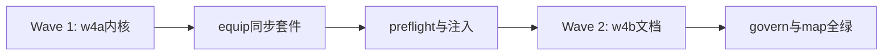

# Wave 4 Harness 内核加固与长青文档更新总控 — 产品需求说明（PRD）

> **基线**：`main` @ `b6ea3f6`（已含 PR #129 与 PR #130）。
> **下辖分波切片**：Wave 1 `w4a-harness-core`（Harness 共享内核与多技能门禁收口） -> Wave 2 `w4b-govern-evergreen`（基于升级工具的长青文档系统刷新，`depends_on: [w4a-harness-core]`）。

## 文档信息

| 项目 | 内容 |
| --- | --- |
| 当前状态 | `draft`（枚举：`draft \| active \| in_review \| done \| superseded \| dropped`） |
| 创建 / 更新 | `2026-11-22` / `2026-11-22` |
| 关联 Issue / PR | 未关联 / 未关联 |
| 提出方 / 负责人 | `@coordinator` (#519) / `plan-harness` |
| 规划态 | `interactive`（架构拆分、门型与两波依赖边界已由 #519 指令逐项拍板清零） |
| 关联设计 / 任务单 | [Wave 1 SPEC](../archive/specs/261122-issue132-w4a-harness-core-spec.md) · [Wave 2 SPEC](../specs/261122-issue134-w4b-govern-evergreen-spec.md) |

- **目标读者**：Wave 1 / Wave 2 实施者、独立 Critique / Code Reviewer 与项目维护者

## 一、要解决的问题

<!-- section: goal -->
### 1.1 现状与痛点

基于基线 `b6ea3f6` 的两份源码审计与现场只读探查，系统存在三类结构性缺口，导致能力较弱的模型极易偷懒、跳步、伪造实证并造成长青文档漂移：

1. **角色、会话与槽位边界依赖口头纪律**：`doc-plan.mjs init` 默认写入 `owner: null` 使 `SELF_CRITIQUE_REJECTED` 与 `SELF_AUTHORED_ACCEPTANCE` 失效；`flow-inspect.mjs` 升格分支跳过作者校验；`flow-lifecycle-hooks.mjs` 在未传 `--agent` 时放行 `submit`；`checkLifecyclePreconditions` 在未认领时仅发告警；`Case 1` 在 `collaboration.md` 与 `flow-inspect.mjs` 间存在工作区定义冲突；`verify`/`submit`/`merge` 未硬拦截主工作区脏态。
2. **探索、规划与执行门禁存在旁路与可伪造通道**：`flow start` 通过 `autoPopulateExplored` 自动写满 `ledger.explored`；`plan-exit-gate.mjs` 在 `bound.length === 0` 时仅告警放行；`doc-plan init --kind prd` 不写 `multi_spec: true` 且 `doc-slice-graph.mjs` 硬依赖该字段；`doc-plan-ops.mjs` 允许无 `--human-approved` 的 `--skip-critique-reason`；`pending-decisions.mjs` 命中首个标题即提前返回；`doc-substantive.mjs` 仅命中关键词才查技术锚点；`doc-audit-helpers.mjs` 行内裸路径正则遗漏 Go/Rust 前缀（`cmd` 与 `internal`）；`flow-next.mjs` 在有活跃任务时屏蔽 `draft` 规划；`S1–S4` 治理无步骤账本；`review-locks.mjs` 默认 `enforceGates: false` 且 `review-gates.mjs` 命令模板漏传；`review-ledger.mjs` Round 2+ 未提及上轮阻塞项仍允许 `pass`；`empirical-artifacts.mjs` 允许 UI 变更仅凭纯文本观察放行；`edit-gate.mjs` 在 `verify --task` 降级 `do-not-edit` 且 `flow-lifecycle-hooks.mjs` 未传 `--final`；`review-empirical.mjs` `--cmd` 覆盖而非追加必跑命令；`flow-merge.mjs` 停损解锁后跳过 `headSha` 对齐且打印 `--confirm`；`flow-cleanup.mjs` 缺少预览令牌且盲用 `git branch -D`；`iterate-cycle.mjs` 无状态且 `runLifecycleGovernHook` 依赖 opt-in 静默跳过。
3. **跨 Worktree 缓存污染与长青文档漂移**：`verify-state.mjs` 将 `cache.json` 置于全仓共用目录，并行 worktree 会污染 `main` 基线；`govern-audit.mjs` `reconcile` 漏扫 `kit/`；`govern-docs.mjs` `checkDocChurnStaleness` 被新增 `docs/specs/` 误清零；`docs/TDD.md` L83–100 与 Mermaid 图 1/4/5 仍漏记模块与回流闭环；`docs/feature-map.json` 22 个功能域 `docAnchor` 全为空，`skill` 无 `verificationTools`，`check`/`release` 无 `testRefs`，`AGENTS.md` 缺 CI `verify-injections.mjs` 与打包检查命令。

### 1.2 产品目标

- **目标 1（4 个共享内核原语收敛 20 条缺口）**：在 `kit/skills/lib/` 收敛 `harness-context.mjs` (new)、`session-state.mjs` (new)、`gate-enforcement.mjs` (new) 与 per-slot `verify-state.mjs` 缓存及 `dev-govern` 漂移引擎，使 `doc-plan` / `flow` / `edit-gate` / `review-pack` / `iterate` / `verify-tools` / `govern-audit` 以薄接线共享同一套确定性硬门禁，彻底消除弱模型跳步与伪造实证通道。
- **目标 2（Strict 两波依赖升级长青文档）**：Wave 1 落地并同步 `.agents/skills/` 且通过全量正反夹具与故障注入后，Wave 2 使用升级后的 `dev-govern`、`dev-explore` 与 `verify-tools` 刷新 `docs/TDD.md`、`docs/feature-map.json` 与 `AGENTS.md`，使 `verify-tools audit .` 达到 `Status: OK | StaleTools: 0`、`govern-audit.mjs reconcile .` 零漂移、`scripts/review.mjs .` 消除验证命令脱节提醒。
<!-- section: goal-end -->

## 二、范围与非目标

### 本次要做（In Scope）

- **Wave 1 (`w4a-harness-core`)**：落地 4 个共享内核原语与 8 技能/顶层治理脚本薄接线，重跑 `node scripts/equip.mjs .` 与 `node scripts/compose-agents.mjs .`，新增 `scripts/dev/fixtures-w4-harness.mjs` (new) 与 `scripts/dev/injections-data-w4-harness.mjs` (new) 完成正反双向断言与故障注入复验。
- **Wave 2 (`w4b-govern-evergreen`)**：在 `w4a-harness-core` 合入 `main` 后，刷新 `docs/TDD.md`（完整 L1–L4 模块清单、更新后 Mermaid 架构图与机制流转图）、`docs/feature-map.json`（补齐 `docAnchor`、`skill` 工具映射、`check`/`release` 测试引用与新增模块）及 `AGENTS.md`（同步 CI 验证指令）。

### 明确不做（Non-Goals）

<!-- section: non-goals -->
- 不新增第 9 个技能，不引入任何第三方 npm 依赖，不绑定特定 AI 宿主名称、私有环境变量或私有斜杠命令（`hostMode` 仅使用通用能力枚举 `multi-agent | single-session`）。
- 不改动 `README.md`、`README.en.md` 与 `assets/readme/*.svg`，不修改 `docs/archive/` 历史归档。
- 严禁 Wave 1 提前改写 `docs/TDD.md` 全景章节或 `docs/feature-map.json` 全量锚点（留给 `depends_on: [w4a-harness-core]` 的 Wave 2 在真实落盘代码上执行）。
- 严格遵守单文件 `.mjs <= 800` 行、`AGENTS.md < 24576B`（上限 `30720B`）、`SKILL.md <= 200L / 16384B`、`kit/skills/*/SKILL.md <= 180L`、`bench.mjs --strict-budget` 全绿与 `arch-rules` 单向依赖边界。
<!-- section: non-goals-end -->

## 三、切片编排与依赖

<!-- section: design -->

| 波次 | 切片 `task_id` | 认领验收条款 | `depends_on` | 独占写域摘要 |
| --- | --- | --- | --- | --- |
| Wave 1 | `w4a-harness-core` | `C1`、`C2`、`C3`、`C4`、`C5` | `[]` | `kit/skills/**`、`.agents/skills/**`、`scripts/{survey,backup,equip,compose-agents,review}.mjs`、`templates/agents-project.md`、`AGENTS.md`、`references/collaboration.md`、`scripts/dev/*` |
| Wave 2 | `w4b-govern-evergreen` | `C6`、`C7` | `[w4a-harness-core]` | `docs/TDD.md`、`docs/feature-map.json`、`AGENTS.md`（与 `templates/agents-project.md` CI 校验行对齐） |

### 关键设计原则（不打补丁、只收敛原语）

1. **宿主能力显式分流（`hostMode: multi-agent | single-session`）**：默认 `multi-agent`；单会话宿主通过显式声明走「人类确认 + 显式 `--human-approved`」降级通道，而不是被迫伪造子代理 ID 绕过检查。
2. **所有门禁默认启用硬锁，取消静默降级**：`enforceGates` 默认 `true`、`edit-gate --final` 禁跳过且 `do-not-edit` 永不降级为 warning、`dev-govern` 轻检默认启用、Round 2+ 遗留阻塞项未显式处置禁止 `pass`、UI 变更必须有真实非空 `--artifact` 或 `--visual-blocked-reason`、`plan-exit-gate` 对 `caseType >= 3` 无绑定规划硬阻断。
3. **零增量膨胀契约**：全部新增状态机与验证规则沉淀在 `kit/skills/lib/` 与脚本 CLI 提示中；`templates/agents-project.md` 仅增 1 句紧凑「话题锚点」原则，确保 `AGENTS.md` 稳定保持在 `< 24KB` 以内。
<!-- section: design-end -->

## 四、复用既有模块

- `kit/skills/lib/exit-codes.mjs`（四档退出码 `EXIT` 与 `BLOCK_CODE_TIERS` 单源注册表）
- `kit/skills/lib/ledger.mjs`（任务账本读写与 `collectImplementerHistory`）
- `kit/skills/lib/evidence-substance.mjs`（`evaluateTextSubstance` 与 `evaluateReleaseReason`）
- `kit/skills/lib/handoff-package.mjs`（5 行 `RECEIPT_LINES` 与 `ROLE_BOUNDARY`）
- `kit/skills/lib/static-gates.mjs`、`kit/skills/lib/profile.mjs`、`kit/skills/lib/tdd-structure.mjs`、`kit/skills/lib/tdd-parity.mjs`
- `scripts/dev/cli-parity.mjs`、`scripts/dev/exit-code-parity.mjs`、`scripts/dev/preflight-kernel-parity.mjs`

## 五、门型评估与风险边界

- **门型**：`one-way`（涉及高风险路径 `kit/`、`scripts/dev/preflight.mjs`、`templates/`、`AGENTS.md` 且修改多处门禁通过口径，合并后须通过单提交 `git revert` 回滚，严禁强推改写历史）。
- **兼容底线**：既有合法任务账本缺失新字段时向后兼容读取；原有合法测试夹具若涉及历史松门禁行为需在 SPEC 中显式区分「合法旧态兼容」与「刻意阻断漏洞」。

## 六、验收标准

<!-- section: acceptance -->
<!-- criteria:start -->
- [x] C1: 统一 `Actor / HostMode / Slot` 边界锁（`kit/skills/lib/harness-context.mjs` (new)）：消除 `owner: null`、`flow start` 升格漏检、`submit` 省略 `--agent` 放行、未认领提审、`Case 1` 工作区口径冲突与 `mainRoot` 脏态漏拦，同时支持 `single-session` 显式人类确认通道。
- [x] C2: 统一会话状态指针与探索/规划就绪态闭环机（`kit/skills/lib/session-state.mjs` (new)）：持久化 `S1–S4` 治理步与 `triage` 指纹，移除 `autoPopulateExplored` 伪造，封堵 `bound.length === 0` 放行、PRD 漏 `multi_spec`、`--skip-critique-reason` 无授权跳过、待拍板漏节、无关键字空话、`cmd` 与 `internal` 前缀漏匹配及压缩后 `draft` 盲视。
- [x] C3: 统一零降级实证与双门六锁核心（`kit/skills/lib/gate-enforcement.mjs` (new)）：默认启用 `enforceGates`、Round 2+ 禁漏未闭合阻塞项 `pass`、UI 变更禁用纯文本绕过 `--artifact`、`verify` 启用 `edit-gate --final` 且硬拦 `do-not-edit`、`check-empirical --cmd` 追加而非覆盖、有意义 `check-fault`、停损解锁仍校 `headSha`、`cleanup` 消费 `previewHash` 且依 `isMergedBranch()` 安全删分支、默认启用轻量治理与有状态 `iterate-cycle`。
- [x] C4: Per-Worktree `verify-tools` 缓存与 `dev-govern` 长青漂移引擎（`kit/skills/lib/verify-state.mjs`、`kit/skills/dev-govern/`）：按 `(slotKey, treeHash)` 隔离验证缓存消除跨 worktree 污染；`govern-audit.mjs reconcile` 补扫 `kit/`、校验 `docAnchor` 与工具/测试覆盖；`govern-docs.mjs checkDocChurnStaleness` 仅由权威长青文档重置滞后计数。
- [x] C5: Wave 1 全量接线、套件同步与双向证伪实证：8 技能与顶层脚本完成薄接线并运行 `node scripts/equip.mjs .` 与 `node scripts/compose-agents.mjs .`，全部 `.mjs <= 800` 行、`AGENTS.md < 24576B`、`SKILL.md <= 200L`，补齐 `scripts/dev/fixtures-w4-harness.mjs` (new) 与 `scripts/dev/injections-data-w4-harness.mjs` (new)（`I398+`），全仓 `preflight` / `fixtures` / `bench --strict-budget` / `verify-injections` / `cli-parity` / `exit-code-parity` 全绿。
- [x] C6: Wave 2 全景更新 `docs/TDD.md`：在 `w4a-harness-core` 合入后运行升级版 `dev-govern` 与 `dev-explore`，补全 L1–L4 全部 `kit/skills/lib/*.mjs` 与新增模块清单，升级 Mermaid 架构全景（图 1）、8 技能流转（图 4，补 `iterate` 正流回流与 `govern` 出边）与双态波次闭环（图 5），补充 Harness 四原语与 Per-Worktree 状态隔离说明，`tdd-structure` 与 `tdd-parity` 全绿。
- [x] C7: Wave 2 全量刷新 `docs/feature-map.json` 与 `AGENTS.md` 校验命令：补齐全部功能域 `docAnchor`、`skill` 验证工具、`check`/`release` 测试引用与 PR #128/#129/`w4a` 新增模块，对齐 `AGENTS.md` 与 `.github/workflows/check.yml` 命令清单，达到 `verify-tools audit .` `Status: OK | StaleTools: 0`、`govern-audit.mjs reconcile .` 零漂移与 `scripts/review.mjs .` 零命令脱节。
<!-- criteria:end -->
<!-- section: acceptance-end -->

## 七、待拍板问题

- 待确认：无

## 八、澄清与补充记录

- 已确认（2026-11-22 · user）：Wave 4 分为 `w4a-harness-core`（Wave 1）与 `w4b-govern-evergreen`（Wave 2，`depends_on: [w4a-harness-core]`）两波推进；保持 8 技能、零第三方依赖、`.mjs <= 800L` 与 `AGENTS.md < 24KB`。

## 九、成功度量

| 度量 | 现状基线 | 目标 | 怎么采集 | 什么时候看 |
| --- | --- | --- | --- | --- |
| Harness 漏洞拦截率 | 20 条漏口中多处靠告警或自由字符串 | 20 条全部代码硬阻断并配正反断言与故障注入 | `fixtures-w4-harness.mjs` + `verify-injections.mjs` | Wave 1 审查与合入前 |
| `verify-tools audit .` | 基线曾受跨 worktree `cache.json` 污染、22 个 `docAnchor` 全空 | `Status: OK | StaleTools: 0`，`docAnchor` 0 缺失 | `node .agents/skills/dev-verify-tools/scripts/verify-tools.mjs audit .` | Wave 2 收尾验收 |
| `govern-audit reconcile` | 漏扫 `kit/`、误清零滞后计数 | `reconcile` 全覆盖 `kit/` 且零漂移 | `node .agents/skills/dev-govern/scripts/govern-audit.mjs reconcile . --json` | Wave 1 & Wave 2 |
