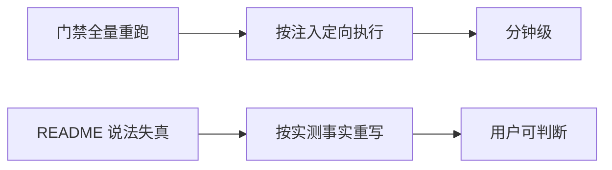

# SPEC: 重写双语 README 并治理门禁机制性超时

## 文档信息与变更概览

| 项目 | 内容 |
| --- | --- |
| 当前状态 | `implemented` |
| 规划级别 | `L3` |
| 创建 / 更新 | `2026-11-15` / `2026-11-15` |
| 分支 / Issue | `main` / 未关联 |

## 系统变更全景

| 模块 / 文件 | 变更性质 | 核心职责 |
| --- | --- | --- |
| `scripts/dev/fixtures.mjs` | 改造 | 用 `--only` 精确筛选，替代只排序不过滤的 `--prefer` |
| `scripts/dev/verify-injections.mjs` | 改造 | 每条注入只跑能证伪它的用例，不再整包重跑 |
| `scripts/dev/preflight.mjs` | 改造 | 新增起步骨架语言清单与识别语言清单的一致性判据 |
| `scripts/lib/starter-templates.mjs` | 改造 | 导出可供门禁核对的骨架语言清单 |
| `README.md` / `README.en.md` | 重写 | 按真实场景、真实支持范围重写双语门面 |
| `SKILL.md` | 校准 | 语言支持描述与实测一致 |
| `AGENTS.md` | 校准 | 验证命令分层，与 CI 同一批命令 |

## 目标与约束

- **要改什么**：门禁执行机制（避免每条注入整包重跑）、README 双语门面（说法与实测一致）、语言支持的事实口径。
- **不改什么**：不改任何判定逻辑与业务语义；不改 `kit/` 与 `templates/` 的产品行为；不新增第三方依赖。
- **架构基线关系**：遵守「零第三方依赖」「单一真相源」「幂等只读先行」三条既有不变量，无冲突。

## 复用既有模块

- `fixtures.mjs` 已有的 `--prefer` 匹配谓词（`name.includes || fn.toString().includes`）直接复用作 `--only` 的筛选谓词，不另写一套。
- `verify-injections.mjs` 已有的 `runBoth` 双套复验意图保留，只把「整包跑」换成「定向跑」。
- `scripts/lib/protocol.mjs` 作为清单常量的单一真相源落点，语言清单不散落。

## 本期不做

- 不改测试用例本身的内容与断言强度。
- 不重构 `fixtures-v5-*` / `fixtures-v6-*` 的文件命名与按域归并（独立治理项，避免与本次混在一起回滚困难）。
- 不改合并门禁的判定项，只改执行成本的编排方式。

## 接口与数据契约

- `fixtures.mjs` 新增 `--only`：命中该关键字的用例才执行，未命中直接跳过；与 `--prefer` 可共存。
- `--only` 命中数为 0 时以非零退出码并在 stderr 明示「没有用例匹配」，防止静默空跑被当成通过。
- `verify-injections.mjs` 的注入复验改为：对每条注入，只在该注入期望关键字命中的用例集合内判定是否变红。
- `starter-templates.mjs` 导出 `BOOTSTRAP_LANGS` 供门禁读取；语言清单与 `survey-ecosystem.mjs` 的 `ECOSYSTEMS` 做包含关系核对。

## 影响范围

- `scripts/dev/fixtures.mjs`
- `scripts/dev/verify-injections.mjs`
- `scripts/dev/preflight-contracts.mjs`（新增清单一致性判据）
- `scripts/lib/starter-templates.mjs`（导出清单）
- `README.md`、`README.en.md`、`SKILL.md`、`AGENTS.md`

## 门型与回滚路径

- 门型：`two-way`
- 回滚路径：全部为独立文件改动，`git revert` 即可反向还原；`--only` 为新增参数，旧调用方式行为不变。

## 验收标准（动手之前冻结）

- [x] C1: `node scripts/dev/fixtures.mjs --only` 只执行命中用例，且未命中时以非零退出码明示，不静默通过
- [x] C2: `node scripts/dev/verify-injections.mjs` 在 Windows 上全量复验耗时相对改造前显著下降，且注入检出结论不变（该红的仍红，还原后仍全绿）
- [x] C3: 门禁能翻转诊断「起步骨架语言清单与识别语言清单」的不一致，且该判据本身有效（注入后必红）
- [x] C4: `README.md` 与 `README.en.md` 对语言支持的表述与实测一致：能识别 12 种、能生成起步骨架 6 种，两档分列
- [x] C5: `README.md` 与 `README.en.md` 含「一次真实改动的完整链路」，把 5 个技能串联说清先后与可跳过点
- [x] C6: 双语 README 目录锚点同步通过，且全部既有门禁仍全绿

## 实现说明

**门禁机制（C1–C3）**

- `fixtures.mjs`：新增 `--only` 精确筛选，与 `--prefer` 共用同一匹配谓词；命中共 0 条时向 stderr 明示并以退出码 1 结束，杜绝空跑假绿。
- `verify-injections.mjs`：`runFixtures` 从「整包 128 条」改为「`--only` 定向执行」，注入检出结论与改造前一致，还原后全绿。
- `preflight-contracts.mjs`：新增「起步骨架语言清单 ⊆ 可识别语言清单」判据，防止两处清单再次漂移；配套故障注入已登记。

**README 重写（C4–C6）**

- 删去「它拦住的 5 类常见失误」整节：那是作者的自我陈述，不是用户要的答案。
- 新增「一次真实改动长什么样」：按勘察 → 定标准 → 隔离实施 → 独立审查 → 合并收尾串成一条链，并标出哪些环节可跳过。
- 语言支持拆成两张实表：能识别 12 种（node/python/rust/go/java/ruby/php/dotnet/cpp/dart/swift/elixir）、能生成起步骨架 6 种（node/python/go/rust/java/docs）。
- 更新机制改写为「什么时候查、查到了做什么、怎么关掉」三段人话，保留原时间常数但配上下文说明。
