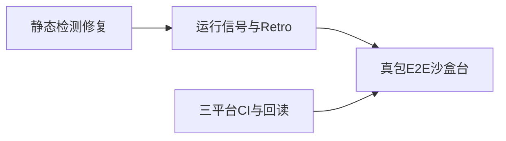

# SPEC: v7 M4 静态门禁修复、signals/retro 闭环、三平台 CI 与真 .zip E2E 测试台

## 文档信息与变更概览

| 项目 | 内容 |
| --- | --- |
| 当前状态 | `draft`（`draft \| approved \| implementing \| in_review \| implemented \| superseded`） |
| 规划级别 | `L3` |
| 创建 / 更新 | `2026-11-16` / `2026-11-16` |
| 分支 / Issue | `main` / #41（归属于总控 PRD `docs/prd/261115-v7-workflow-architecture-prd.md` `C10/C11/C12`） |
| 负责人 | `FiretrUCK666` |

## 系统变更全景

| 模块 / 文件 | 变更性质 | 核心职责与行数预算（全部 `<= 785` 行） |
| --- | --- | --- |
| `kit/skills/lib/static-gates-lexer.mjs` (new) | 新增 | 抽离多行词法状态（含 Python `py-dq`/`py-sq` 三引号、JS/TS/Rust/HTML）与注释剥离，使 `static-gates.mjs` 降至 ~620 行 |
| `kit/skills/lib/static-gates.mjs` | 改造 | 拆分纯净 `ASSERTION_RE`（`REQUIRE` 等大小写敏感，保留 `GATE_ASSERTION_RE` 兼容导出）与 `deleted-ci-step` 校验（剥离 YAML 注释对比完整增删步骤） |
| `kit/skills/dev-govern/scripts/govern-tests.mjs` | 改造 | 救活 `tests.zero-assertion` 与 `tests.mock-tautology` 检测（包在 `it()`/`test()`/`def test_` 块内同样精准检出） |
| `kit/skills/lib/doc-templates.mjs` | 改造 | 按图表类型分流扩展 `checkMermaidLabelWidth` 至 `sequenceDiagram`、`stateDiagram`/`stateDiagram-v2` 与 `erDiagram`（去外层引号，禁对 `erDiagram` 错套 flowchart 正则） |
| `kit/skills/lib/tdd-parity.mjs` (new) | 新增 | 从 `flow-lifecycle.mjs` 抽出 `checkTddSyncParity`（过滤 `TEST_FILE_RE` 与 `no-tdd` 空值豁免，核对源码模块路径、导出与 CLI 子命令与权威 TDD 一致） |
| `kit/skills/lib/signals.mjs` (new) | 新增 | 统一加 `withFileLock` 保护 `<gitCommonDir>/project-forge-govern/signals.jsonl` 读写原语 `appendGovernSignal` / `readSignalsJsonl` |
| `kit/skills/dev-govern/scripts/govern-retro.mjs` (new) | 新增 | 实现 `govern-audit.mjs retro`：聚合 `signals.jsonl` 与账本统计，生成 rule/gate/fixture 建议补丁（仅 `--apply-patches` 写入非受管位置或 `docs/todo/`） |
| `kit/skills/dev-govern/scripts/govern-audit.mjs` / `govern-state.mjs` | 改造 | 在 `parseStandardCli` 注册 `retro`、`apply-patches`、`task`；复用 `signals.mjs` 并保持 `govern-state.mjs <= 740` 行 |
| `kit/skills/dev-flow/scripts/flow-lifecycle.mjs` / `kit/skills/dev-review/scripts/review-ledger.mjs` | 改造 | 在 `verify`、`record`、`rework` 自动写 `signals.jsonl`；改调 `tdd-parity.mjs` 确保 `flow-lifecycle.mjs <= 780` 行 |
| `kit/skills/lib/profile-sniffer.mjs` / `kit/skills/dev-flow/scripts/flow-batch.mjs` / `kit/skills/lib/shared.mjs` | 改造 | 导出 `signals`/`tdd-parity`/`static-gates-lexer`；并入 `profile-sniffer.mjs` 去重三元分支；`flow-batch.mjs` 合前调 `probeGitHubEnv` 与 `getCommitChecks`（CI 未绿阻断不误改 `rework`） |
| `.github/workflows/check.yml` / `.github/workflows/release.yml` / `templates/ci-release.yml` / `scripts/dev/bench.mjs` / `scripts/dev/preflight-contracts.mjs` | 改造 | `check.yml` 覆盖 `ubuntu`/`windows`/`macos`（`shell: bash`、`runner.temp` 防脏）并含 `bench`/`verify-injections`/`e2e-zip-harness`；`release.yml` 与 `templates/ci-release.yml` 分别落实回读验证与对拍 |
| `references/plugin-ecosystems.md` / `references/skill-project.md` / `scripts/lib/survey-ecosystem.mjs` / `docs/TDD.md` | 改造 | 清理残留私人宿主耦合描述（保留 `Obsidian`/`VS Code` 与 `*-plugin` 后缀），同步缩窄 `docs/TDD.md` 第 218–219 行状态机边标签宽度至 `<= 12` |
| `scripts/dev/e2e-zip-harness.mjs` (new) / `scripts/dev/fixtures-m4.mjs` (new) / `scripts/dev/fixtures.mjs` / `injections-data.mjs` | 新增 / 改造 | `e2e-zip-harness.mjs` 独立执行 `git archive --format=zip HEAD` + `readZip` 7 场景全包 E2E；`fixtures-m4.mjs` 跑无 `.git` 依赖正反断言与轻量 `writeZip`/`readZip` 保持 `fixtures.mjs < 30s`；补 `I70..I75` |

## 一、背景与边界声明

- **要改什么**：完整交付总控 PRD `docs/prd/261115-v7-workflow-architecture-prd.md` 的 **M4 切片（`C10`、`C11`、`C12`）** 并顺手收敛 M3 独立审校两项非阻塞建议：救活 `tests.zero-assertion` 与 `tests.mock-tautology`；拆出 `static-gates-lexer.mjs` 补全 Python 三引号词法与 CI `deleted-ci-step`；扩展 Mermaid `16/12` 检查至 `sequenceDiagram`/`stateDiagram`/`erDiagram` 并修正 `docs/TDD.md` 既有超宽标签；抽出 `tdd-parity.mjs` 结构化比对；打通 `signals.jsonl` 自动沉淀与 `govern-audit.mjs retro`；升级三平台 CI、发布 `.zip` 上传回读校验与清理私人宿主描述；建成基于 `git archive` 真 `.zip` 的 Fake-Agent E2E 测试台。
- **不改什么**：严格零第三方依赖（仅 `node:*` 内置模块）；保持 `kit/** -> scripts/{dev,lib}/**` 与 `FORBIDDEN_PLATFORM_RE` 单向禁引；不提前改动 M5 `SKILL.md` 全盘重组与总控 PRD 归档；全量 `.mjs` 严格控制 `<= 785` 行。
- **本期不做**：不重塑 M5 五套 `SKILL.md` 跨文档编排或双语 `README` / SVG；不触发发版打标签。
- **复用既有模块**：复用 `scripts/zip.mjs`（`readZip`/`writeZip`）、`kit/skills/lib/exec.mjs`（`withFileLock`）、`static-gates.mjs`、`doc-templates.mjs`、`govern-state.mjs`、`flow-lifecycle.mjs`、`flow-batch.mjs`、`review-ledger.mjs`、`scripts/dev/preflight-contracts.mjs`。
- **架构基线关系**：遵守 `docs/TDD.md` L1–L4 正交边界；所有跨套件共享模块落于 `kit/skills/lib/` 并经 `shared.mjs` 导出。

## 二、设计方案与契约变更

### 1. 词法拆分、纯断言 `ASSERTION_RE` 修复与扩展静态门禁（C10）

- **词法独立模块 `kit/skills/lib/static-gates-lexer.mjs` (new)**：
  - 承接 `extractLineCommentInfo`、`stripCodeCommentsLines`、`isRustLifetimeAt` 与行级常量（`static-gates.mjs` 重导出全部公开符号，保障既有导入零破坏，且两份文件均控制在 `<= 650` 行）：
  - 在 `extractLineCommentInfo` 新增 Python `"""` / `'''` 多行块状态（`inBlock = 'py-dq' | 'py-sq'` 当 `ext === 'py'`，兼容 `r"""`/`f"""`/`b"""` 前缀）：三引号内容统一视为字符串字面量，既**不进 `codeText`**（防假 `assert`/`skip`），也**不进 `commentText`**（防多行 SQL/示例里的 `TEMP`/`hack` 误报）；同行闭合 `"""` 之后若跟随 `# comment` 仍准确剥离并提取注释。
- **纯断言 `ASSERTION_RE` 分离与 `detectGateWeakeningInEntry` 强化（`kit/skills/lib/static-gates.mjs` & `govern-tests.mjs`）**：
  - 将原混合了 `it(`/`test(`/`def test_` 与 `require()` 大小写不敏感误匹配的正则拆分澄清：
    - `ASSERTION_RE` 仅匹配**真正断言原语**：`\b(?:assert(?:\.\w+)?|expect|should|pytest\.raises|t\.(?:Error|Errorf|Fatal|Fatalf|Fail)|assert_(?:eq|ne|matches)?!|assert(?:Equals|NotEquals|True|False|Throws|Null|NotNull|That)|strictEqual|deepStrictEqual|equal|notEqual|throws|rejects|match)\b\s*(?:\(|!|\.)|\bassert\s+`（大小写不敏感），以及**严格大写断言宏** `(?:\b(?:EXPECT_[A-Z0-9_]+|ASSERT_[A-Z0-9_]+|REQUIRE|CHECK)\s*(?:\(|!))`（区分大小写，绝不误匹配 CommonJS `require('...')`！）；
    - 保留 `GATE_ASSERTION_RE` 导出兼容 `shared.mjs`（指向纯净断言检查），而在 `static-gates.mjs` `detectGateWeakeningInEntry` 统计删减测试行时显式按 `ASSERTION_RE.test(info.codeText) || TEST_CASE_RE.test(info.codeText)` 判定，保证整块删除空 `test(...)` 仍报 `deleted-assertion`，同时让 `govern-tests.mjs` 的 `tests.zero-assertion` 与 `tests.mock-tautology` 对 `it()`/`test()`/`def test_` 包裹的空测/纯 Mock 稳定生效！
  - 在 `detectGateWeakeningInEntry`（`isWorkflow === true`）增加 **`deleted-ci-step`** 检测：先剔除 `removed` 与 `added` 中的纯 YAML `#` 注释与空行，提取 `removed` 中被删除的验证命令（含 `run:`/`script:` 行中的测试/检查命令或带命令的检查步骤名），若核心验证命令未出现在 `added` 迁移步骤中，则输出 `{ type: 'deleted-ci-step', severity: 'deterministic', ... }`，避免仅调整步骤 `- name:` 标题却保留 `run:` 时误报。
- **按图表类型分流的全图表 Mermaid `16/12` 校验（`kit/skills/lib/doc-templates.mjs` & `docs/TDD.md`）**：
  - 在 `checkMermaidLabelWidth` 记录当前 Mermaid 块头类型（`flowchart`/`graph`、`sequenceDiagram`、`stateDiagram`/`stateDiagram-v2`、`erDiagram`）：
    - **禁止**对 `erDiagram`/`sequenceDiagram`/`stateDiagram` 错套 flowchart 的 `|...|`、`{...}`、`[...]` 正则（防止 `||--o{` 关系符与 `{ string id }` 实体属性块误触发）；
    - 对 `sequenceDiagram` 解析 `participant`/`actor ... as <label>`（`16`）、`loop`/`alt`/`else`/`opt`/`par`/`and`（`16`）与消息线 `->`/`->>`/`-->`/`-->>` 冒号后正文及 `Note ...:` 正文（`12`）；
    - 对 `stateDiagram`/`stateDiagram-v2` 解析 `state "label" as id`（`16`）与 `A --> B: label` 冒号后边标签（`12`）；
    - 对 `erDiagram` 解析实体块名/别名（`16`）与关系标签 `A ||--o{ B : "label"`（`12`）；
    - 上述全部标签在测宽前统一剥离成对双引号并均强制过 `MERMAID_HTML_TAG_RE`；同步将 `docs/TDD.md:218-219` 原 17 单位 / 14 单位超宽边标签收敛为 `"按参数恢复"`（10 单位）与 `"显式恢复"`（8 单位）。

### 2. 结构化 `tdd-parity.mjs` 与 `signals.jsonl` -> `retro` 自进化（C10）

- **结构级 `kit/skills/lib/tdd-parity.mjs` (new)**：
  - 导出 `checkTddSyncParity(implRoot, changed, ledger)`（由 `shared.mjs` 导出，替代 `flow-lifecycle.mjs` 原实现并将 `flow-lifecycle.mjs` 减负至 ~770 行）。
  - 若 `resolveAuthoritativeTddPath` 返回 `null`（例如项目在「取舍」声明了 `no-tdd`），立即安全返回无告警空结构 `{ docParityReminder: false, tddDateStale: false, authoritativeTddPath: null, missingModulesInTdd: [], staleModulesInTdd: [], changedExportsOrCli: [], tddSyncWarning: null }`。
  - 对非测试源码文件（显式排除 `TEST_FILE_RE`）与 `package.json` 等核心清单，核对：① `baseSha..HEAD` 新增/删除的源码模块路径是否已在权威 TDD 提及；② 增量 hunk 中新增/删除的导出声明（`export (?:async )?function|const|class`）与 CLI `SUBCOMMANDS` 条目变化时权威 TDD 是否随同更新；完整保留既有返回字段供 `flow-lifecycle.mjs` 消费。
- **统一信号总线 `kit/skills/lib/signals.mjs` (new) + `kit/skills/dev-govern/scripts/govern-retro.mjs` (new)**：
  - `signals.mjs` 在 Git 仓定位 `<gitCommonDir>/project-forge-govern/signals.jsonl`（非 Git 仓回退 `tmpdir` 哈希目录），通过 `withFileLock` 安全追加与读取 JSONL 事件，字段严格兼容 `cluster` 消费（`ts`, `category`, `module`, `pattern`, `severity`, `source`, `file`, `message`, `taskId` 等）。
  - 在 `flow-lifecycle.mjs`（`handleVerify` 全部退出分支 + `handleRework`）与 `review-ledger.mjs`（`handleRecord` 每轮 record）接入 `appendGovernSignal`，静默记账绝不因锁或 I/O 异常阻断主流程。
  - 在 `govern-audit.mjs` 的 `SUBCOMMANDS` 注册 `'retro'`，`booleanFlags` 注册 `'apply-patches'`，`valueFlags` 注册 `'task'`；由 `govern-retro.mjs` 读取 `signals.jsonl`（可按 `--task` 过滤）与任务账本（`rounds`/`dispositions`/`queueConflict`），聚合输出重复失败门禁（`>= 2`）、高误报审查处置比例（`rebutted-wrong`/`intentional`）及热点文件返工模式，生成结构化 `patches[]`（`targetKind`: `rule|gate|fixture|profile`、`targetFile`、`reason`、`patchPreview`）；`--apply-patches` 仅幂等写入**`docs/todo/` 建议治理草稿或 `AGENTS.md` 受管区间之外的规则节**，绝不篡改受管区间以破坏 `compose-agents.mjs --check`。

### 3. 三平台 CI、发布 `.zip` 上传回读、宿主清理与 M3 小修并入（C11）

- **`.github/workflows/check.yml`**：
  - 全局配置 `defaults: run: shell: bash`（Windows Git Bash + macOS + Linux 行为统一），`gates` 扩展至 `matrix: os: [ubuntu-latest, windows-latest, macos-latest], node: ['18', '22']`；
  - 将 `package-list.txt` 写至 `"${{ runner.temp }}/package-list.txt"`，防止工作区脏文件污染后续步骤；
  - 纳入 `node scripts/dev/bench.mjs`（配合 `bench.mjs` 对 `process.env.CI === 'true'` 默认启用 `2.5x` 共享 Runner 容差，同时本机直跑 `node scripts/dev/bench.mjs` 及带 `--strict-budget` 仍执行 `1x` C1 硬预算）、`node scripts/dev/verify-injections.mjs --jobs 4` 与 `node scripts/dev/e2e-zip-harness.mjs`；
  - 严格保留顶层 `permissions:\n  contents: read` 与 `  check:\n    needs: gates\n    if: always()` + `needs.gates.result` 检查（护住 `preflight-contracts.mjs` 与 `I49`）。
- **`.github/workflows/release.yml` & `templates/ci-release.yml` & `scripts/dev/preflight-contracts.mjs`**：
  - `.github/workflows/release.yml` 在 `gh release upload "$TAG" "$ASSET"` 之后新增回读步骤（继承 `env: GH_TOKEN: ${{ secrets.RELEASE_TOKEN || github.token }}` 且传 `--repo "$REPO"`）：校验 `gh release view "$TAG" --json assets` 存在非空 `$ASSET` -> `gh release download "$TAG" -p "$ASSET"` 到临时 `readback.zip` -> 校验与本地 `"$ASSET"` 字节数/SHA256 一致，并调 `scripts/zip.mjs` `readZip` 完成全条目 CRC32 完整性验证后删除临时文件。
  - `templates/ci-release.yml` `TODO(3)` 补充通用的 Release 附件上传与 `gh release view` / `gh release download` + 系统标准归档校验模板注释（**不引用本仓独有的 `scripts/zip.mjs`**，确保落盘外部仓可用）；同步更新 `scripts/dev/preflight-contracts.mjs`（保持 `<= 795` 行）分别核对模板注释指导与本仓实例真实 `.zip` 回读步骤。
- **清理残留私人宿主耦合**：
  - `references/plugin-ecosystems.md`：保留 `## Obsidian 插件` 与 `## VS Code 扩展` 标题不变（维持 `review.mjs:550` 与 `fixtures-review.mjs` 对拍），将私有扩展小节通用化为 `## 配置驱动与补丁式插件`，删除具体私人工具与配置名。
  - `references/skill-project.md`：将第 87 行私有隐藏目录示例替换为通用 `.custom/skills/`。
  - `scripts/lib/survey-ecosystem.mjs`：将 `dsh-plugin` 泛化为保留 `-plugin` 后缀的通用标记 `config-patch-plugin`（维持 `scripts/lib/render.mjs:398` 插件导航触发），移除具体私人宿主字段。
- **并入 M3 独立审校两项非阻塞建议**：
  - `kit/skills/lib/profile-sniffer.mjs`：清理第 434 行相同分支的三元表达式；
  - `kit/skills/dev-flow/scripts/flow-batch.mjs`：当需使用远程合并时比照 `flow-merge.mjs` 先调用 `probeGitHubEnv` 构造已鉴权 `TaskBackend` 并在非 `--human-approved` 时严格核验 `backend.getCommitChecks`；遇到 CI `fail`/`pending`/`none`（`ciRequired`）直接返回 `EXIT_POLICY_BLOCK` 中止该项出队，**绝不误将 `ledger.status` 改写为 `rework`/`queueConflict`**。

### 4. 真 `git archive` `.zip` 安装包 Fake-Agent E2E 沙盒台与 `< 30s` 边界隔离（C12）

- **`scripts/dev/e2e-zip-harness.mjs` (new)**：
  - 从本仓 `HEAD`（或已提交工作树）运行真实 `git archive --format=zip --prefix=project-forge/` 打包并经 `scripts/zip.mjs` `readZip` 解压至独立 `tmpdir()`（断言零包含 `scripts/dev/`、`docs/`、`.agents/` 私有目录），完全不依赖源仓路径以 Fake-Agent 顺序驱动验证 **7 大真实场景 + 跨会话 `--takeover` + 全部关键防绕过负面断言**（退出码 0 仅在全场景及防绕过全部成立时返回）。
- **`scripts/dev/fixtures-m4.mjs` (new) + `scripts/dev/fixtures.mjs` + `scripts/dev/injections-data.mjs`**：
  - `fixtures-m4.mjs` **严禁调用依赖 `.git/HEAD` 的 `git archive`**（避免 `verify-injections.mjs` 无 `.git` 复制沙盒必炸与 8 worker 重复解压拖慢 `< 30s`），专门负责在独立临时项目中对 M4 新增能力做正反双向验证：`zero-assertion`/`mock-tautology`、Python 三引号词法、`deleted-ci-step`、全图表 Mermaid `16/12`、`tdd-parity`（含 `TEST_FILE_RE` 与 `no-tdd` 豁免）、`signals.jsonl` 自动写回 + `retro --task --apply-patches`、`flow-batch` CI 阻断保护、轻量 `writeZip`/`readZip` 安装隔离验证，保障全量 `fixtures.mjs` 并发实测维持 `< 30,000 ms`。
  - 在 `scripts/dev/injections-data.mjs` 补充 M4 故障注入 `I70..I75`。

## 三、冻结的验收标准

- [x] C1: `govern-tests.mjs` 死检查彻底修复——`static-gates.mjs` 纯净 `ASSERTION_RE` 不再匹配 `it()`/`test()`/`def test_` 与小写 `require()`，完整保留 `GATE_ASSERTION_RE` 兼容导出；`fixtures-m4.mjs` (new) 实证 `tests.zero-assertion` 与 `tests.mock-tautology` 对包裹在用例函数内的空测/纯 Mock 稳定检出且无误报；`static-gates-lexer.mjs` (new) Python 三引号多行词法与 `deleted-ci-step` 检测全绿。
- [x] C2: Mermaid 与 `tdd-parity` 全覆盖——`checkMermaidLabelWidth` 按图种分流校验 `sequenceDiagram`、`stateDiagram`/`stateDiagram-v2` 与 `erDiagram` 宽度 `16/12` 与禁 HTML 且不误伤 `||--o{`；`docs/TDD.md` 既有状态图标签收敛 `<= 12`；`tdd-parity.mjs` (new) 精确识别新增模块、导出符号与 CLI 入口漂移（排除 `TEST_FILE_RE` 并豁免 `no-tdd`）。
- [x] C3: `signals.jsonl` 自动沉淀与 `retro` 闭环——`flow verify`、`review-pack record`、`flow rework` 实跑均通过 `signals.mjs` (new) 并发安全追加 `.gitCommonDir` `signals.jsonl`；`govern-audit.mjs retro --task`（`govern-retro.mjs` (new)）产出结构化 `patches` 且 `--apply-patches` 严守不写坏 `AGENTS.md` 受管区间。
- [x] C4: 三平台 CI、发布 `.zip` 回读、宿主清理与 M3 收尾——`.github/workflows/check.yml`（`shell: bash` + `runner.temp`）覆盖 `ubuntu`/`windows`/`macos` 并接入 `bench.mjs`（CI 2.5x / 本机 1x）、`verify-injections.mjs` 与 `e2e-zip-harness.mjs`；`release.yml` 上传后使用 `GH_TOKEN` 下载并以 `readZip` CRC32 回读核验（`templates/ci-release.yml` 与 `preflight-contracts.mjs` 对拍一致）；清理 `references/plugin-ecosystems.md`、`skill-project.md` 与 `survey-ecosystem.mjs` 私人宿主词；并入 `profile-sniffer.mjs` 与 `flow-batch.mjs` `getCommitChecks` 修复。
- [x] C5: 真 `.zip` 安装包 Fake-Agent E2E 测试台——`node scripts/dev/e2e-zip-harness.mjs` (new) 从真实 `git archive --format=zip HEAD` 解压安装包并实证跑通 7 大场景、跨会话接管与全部防绕过负面断言，退出码 0。
- [x] C6: 行数、性能、注入与全门禁全绿——`fixtures.mjs` 默认并发 `< 30,000 ms`（100% 通过），`bench.mjs` 6/6 全过，`verify-injections.mjs`（含 `I70..I75`）全部拦截生效，全量 `kit/skills/**/*.mjs` 与 `scripts/dev/*.mjs` `<= 800` 行，完整 `merge-gate` 与 `--package` 全项退出码为 0。

## 四、高风险点、门型与回滚路径

- **门型与回滚路径**：`one-way`（涉及静态门禁 `ASSERTION_RE` 语义修正、Mermaid 全图扩展、CI 工作流三平台矩阵与发布回读、以及共享运行库 `signals.mjs`/`tdd-parity.mjs`/`static-gates-lexer.mjs` 拆分；于独立分支与隔离工作树实施，合入前可随时丢弃，合入后按 `git revert` 安全回退并重跑全套门禁）。
- **故障注入预演**：在 `scripts/dev/injections-data.mjs` 新增 6 条 M4 级注入（`I70..I75`：在 `ASSERTION_RE` 重混入 `test(` 或小写 `require(` 使死检查回退失效、跳过 `checkMermaidLabelWidth` 对 `sequenceDiagram` 检查、关闭 `deleted-ci-step` 拦截、架空 `checkTddSyncParity` 结构模块漂移检测、跳过 `signals.mjs` 自动写入、移除 `release.yml` 上传后 `.zip` 回读校验），独立审查时再补充手工现场注入 RED -> GREEN 实证。

## 实现说明

- 已拆出 `kit/skills/lib/static-gates-lexer.mjs`（229 行）承载多语言注释与 Python `"""`/`'''` 三引号块剥离，`static-gates.mjs`（684 行）净化 `ASSERTION_RE`（保留 `GATE_ASSERTION_RE` 兼容导出，移除 `it(`/`test(`/`def test_` 与小写 `require()` 误匹配）并新增 `deleted-ci-step` 校验，救活 `govern-tests.mjs` 零断言与纯 Mock 检测。
- `kit/skills/lib/doc-templates.mjs`（567 行）按图表类型分流 `checkMermaidLabelWidth` 至 `sequenceDiagram`/`stateDiagram`/`erDiagram`，并同步收敛 `docs/TDD.md` 第 218–219 行状态图边标签与 M4 新增模块表；`kit/skills/lib/tdd-parity.mjs`（192 行）落地结构级 TDD 同步校验并保持 `flow-lifecycle.mjs` 771 行。
- 已新增 `kit/skills/lib/signals.mjs`（114 行）与 `kit/skills/dev-govern/scripts/govern-retro.mjs`（273 行），在 `flow verify`、`review-pack record`、`flow rework` 并发安全自动写回 `signals.jsonl` 并接入 `govern-audit.mjs retro`（含 `--task` 与受管区间外 `--apply-patches`）。
- 已升级 `.github/workflows/check.yml` 至三平台 x 双 Node 矩阵（`shell: bash` + `runner.temp` + `bench`/`e2e-zip-harness`/`verify-injections`），在 `.github/workflows/release.yml` 与 `templates/ci-release.yml`/`preflight-contracts.mjs` 落地附件下载与 SHA256/`readZip` CRC32 回读校验，清理残留私人宿主命名，并完成 `profile-sniffer.mjs` 与 `flow-batch.mjs` `getCommitChecks` 修复。
- 已建成 `scripts/dev/e2e-zip-harness.mjs`（407 行）与 `scripts/dev/fixtures-m4.mjs`（385 行）及 `injections-data.mjs` `I70..I75`，同步完成 `.agents/skills/` 装备校验；全仓 `.mjs` 均控制在 `<= 773` 行。
