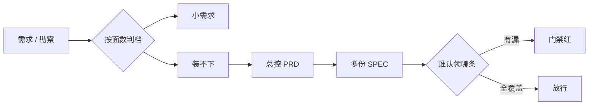

# SPEC: 平台事实、文档通用性与演进

## 文档信息与变更概览

| 项目 | 内容 |
| --- | --- |
| 当前状态 | `draft`（`draft \| approved \| implementing \| in_review \| implemented \| superseded`） |
| 规划级别 | `L3` |
| 创建 / 更新 | `2026-11-17` / `2026-11-17` |
| 分支 / Issue | `fix/v8-criteria-trust` / #50 |
| 认领的验收标准 | C13、C14、C15、C16、C17、C18、C24、C25、C26、C28 |

## 与总控 PRD 的认领映射

| 本 SPEC | 总控 PRD | 一句话 |
| --- | --- | --- |
| C1 | C13 | 取舍解析单一真相源，问答可复现 |
| C2 | C14 | 如实报出托管平台与能力 |
| C3 | C15 | 产物计划每一项都有执行入口 |
| C4 | C16 | 探索技能只读那条不再自相矛盾 |
| C5 | C17 | 治理类输入按面数判档，治理 PRD 覆盖产物计划 |
| C6 | C18 | 探索证据与波次计划 |
| C7 | C24 | 规划审核 Round 2 起换人 |
| C8 | C25 | 文档兄弟集按 slug 认亲 |
| C9 | C26 | 文档模板「通用主干 + 可扩展章节」 |
| C10 | C28 | 需求分级按装不装得进一份 SPEC |

## 系统变更全景

| 模块 / 文件 | 变更性质 | 现状 | 还要做什么 |
| --- | --- | --- | --- |
| `kit/skills/lib/profile.mjs` | 已落地 | 取舍解析唯一实现 | 让 `computeArtifactPlan` 读它（现在不读） |
| `kit/skills/lib/doc-requirements.mjs` | 已落地 | 只锁三节；23 个章节可登记；按内容认节 | — |
| `kit/skills/lib/doc-template-render.mjs` | 已落地 | 模板渲染、占位填充、按声明裁节 | — |
| `kit/skills/lib/critique-rounds.mjs` | 已落地 | 规划审核增量范围 | — |
| `kit/skills/lib/tdd-shape.mjs` / `tdd-structure.mjs` / `tdd-facts.mjs` | 已落地 | TDD 按形态裁剪、主干核对、事实预填 | — |
| `kit/skills/lib/docs.mjs` | 已落地 | 兄弟集按 slug 认亲 | — |
| `kit/skills/dev-plan/scripts/doc-audit.mjs` | 已落地 | 面数判档、`prdRequired`、覆盖率、无主切片 | — |
| `kit/skills/dev-plan/scripts/doc-plan.mjs` | 已落地 | `critique-pass` 拒绝同人连审 | — |
| `kit/skills/dev-explore/SKILL.md` | 已落地 | 严格只读 | — |
| `scripts/equip-ci.mjs` | 已落地 | 产物计划 `create` 项的执行入口 | — |
| `scripts/lib/artifact-executors.mjs` | 已落地 | 动作到执行者的映射 | 补 `optional` 与 `upgrade` 两条（现缺） |
| `scripts/lib/platform/registry.mjs` | 已落地 | 非 GitHub 降级 `generic-git` | — |
| `scripts/survey.mjs` | **改造（主要工作量）** | `questions` 可复现、能力三态已报 | `computeArtifactPlan` 读取舍；`known:false` 只在无 providerId 时出现，产品路径走不到 |
| `scripts/review.mjs` | **改造** | 只有 `{target, maturity, verdict, results}` | **要补 `git.capabilities` 结构**——C2 的另一半现在没人落点 |
| `kit/skills/lib/ledger.mjs` + `flow-next.mjs` + `workflow-policy.mjs` | **改造** | `explored` 只有透传归一 | 写入者、形状定义、`flow next` 只给探索这一步 |

## 一、背景与边界声明

- **要改什么**：这一组是「通用性」问题——同一份工具要给形态完全不同的项目用，而它假设了太多。
  十条里六条已落地（CI 执行入口、只读技能、面数判档、Round 2 换人、模板可裁剪、需求分级），
  **还活着四条**：
  - ①**探索证据缺失**：`explored` 字段只有透传归一，没有写入者，也没有形状定义；
    `flow next` 对多任务仍说「请显式传入 --task」。
  - ②**取舍没接进产物计划**：`computeArtifactPlan` 不读 `AGENTS.md` 的取舍节，
    写上 `no-auto-release` 之后 `ci-release` 仍是 `ask-human`。
  - ③**平台能力两处口径不一致**：`review --json` 没有 `git.capabilities` 结构
    （只有 `{target, maturity, verdict, results}`），而 `survey --json` 有。
  - ④**兄弟集靠 slug 认亲，同名不同事分不开**：`docs.mjs` 的设计注释已明说
    「slugify 之后重名本身就是同一件事的强信号」，实测两份不同的事会互相改写 `issue` 与 `related_spec`。
- **不改什么**：不新增平台适配器（只把「能力」与「出口」如实报出来）；不改 30KB 上限；不改六锁收敛算法。
- **本期不做**：不做能力目录的语义检索；不为每个平台写一套专用命令。
- **复用既有模块**：`kit/skills/lib/verdict.mjs`（三态）、`kit/skills/lib/tool-owned.mjs`、`kit/skills/lib/workflow-policy.mjs` 的阶段判定、`scripts/lib/protocol.mjs`。
- **架构基线关系**：对齐「单一真相源」（取舍解析只留一份）与「不写死取值」（平台能力现场探测）。

## 二、设计方案与契约变更

### 接口 / 数据结构变更

**取舍解析**：只有 `profile.mjs` 的 `readDecisionMap` / `readDecisions`，`review.mjs` 重导出——
这一条**已经落地**，副本早就不在了。

还差的是另一半：**`computeArtifactPlan` 压根不读取舍**。所以「写上具体表态后对应项不再是
`ask-human`」现在做不到——实测在 `AGENTS.md` 取舍节写了 `no-auto-release`，`ci-release`
仍是 `ask-human`。要让 `survey.mjs` 的产物计划读取舍表再做决定。

`NEEDS_HUMAN` 机器可读标记全仓 0 处命中，要新增：`questions` 非空时在 JSON 顶层带一个
布尔与计数，让人和脚本都不用去正则 Markdown。

**平台能力**（口径按实测对齐，不按设想写）：

- `survey --json` 已有 `git.capabilities = { known, providerId, issues, pullRequests, releases, checks }`；
- **`review --json` 没有**——它只输出 `{target, maturity, verdict, results}`。`review` 要补同一份结构，
  数据直接从 `survey` 的勘察结果取，不另算一套；
- **「认不出来」是 `known: false` 还是 `known: true` + 全 `false`，以实测为准**：
  任何远端都会降级成 `generic-git` 并报 `known: true` + 四项全 `false`。
  `known: false` 只在 providerId 为空或注册表查不到时出现，产品路径走不到。
  所以判据要写成「**认不出的托管必须报确定的做不到**」——不许让人以为能做，
  这正是 `fixtures-claims.mjs` 里已经绿着的那条断言的口径。
- 没有远端时才出现 `q.remote-setup`（实测触发条件是零远端）；
  非 GitHub 远端上出现的是 `q.license` 与 `q.unknown-ecosystem`。
- 非 GitHub 的发版出口：`artifactPlan` 里 `ci-release` 的动作是 `skip`，
  「先问人」的文案在 `q.release-strategy` 问句里，**不在 `artifactPlan`**。

**产物计划**：`artifactPlan` 里每个 `action: create` 必须在 `ARTIFACT_EXECUTORS` 里有执行者
（`scripts/equip-ci.mjs` 或 `equip` 的初始化路径）；没有入口即门禁红。
动作全集实测为 **九种**：`create` / `calibrate` / `preserve` / `ask-human` / `skip` /
`snapshot` / `equip` / `optional` / `upgrade`。**只有 `create` 需要执行者**——
`findUnexecutableArtifacts` 第一步就是 `if (item.action !== 'create') continue`，
所以其余八种永远不会被误报，不需要往对照表里加。

对照表的键是**产物 id**（`docs-tdd`、`ci-check` 这些），不是动作名。
真正缺的是三个 id 没登记：`kit-skills`、`contributing`、`license`；
表里反而多出两个 survey 从不产出的：`docs-set`、`skills-kit`（与 `kit-skills` 字面不一致）。
这两类不一致要一起修，否则「有执行者」这件事只是看起来有。

落盘之后的重跑结果也要按实测写：`ci-check` 是 `create` 变成 `preserve`，
而 `agents-contract` 是 `create` 变成 `calibrate`（`compose-agents` 会故意留待填占位）。
判据不能写成「一律变 preserve」。

**需求分级**：`triage` 输出 `prdRequired` / `prdReasons` / `prdAdvice`；三条机械信号（四面以上、说了要分批、声明动 12 个以上文件）任一成立即必写 PRD。兜底由 `checkOrphanSlices` 负责。

**失败时如何降级**：全部走「算不出来就说算不出来」——缺执行入口报红而不是跳过，平台未知报 `unknown` 而不是默认 GitHub，兄弟集认不出时报「没认出」而不是静默归零。

### 影响范围

- 预计涉及文件：`kit/skills/lib/profile.mjs`、`kit/skills/lib/doc-requirements.mjs`(new)、`kit/skills/lib/critique-rounds.mjs`(new)、`kit/skills/lib/docs.mjs`、`kit/skills/lib/doc-templates.mjs`、`kit/skills/dev-plan/scripts/doc-audit.mjs`、`kit/skills/dev-plan/scripts/doc-plan.mjs`、`kit/skills/dev-flow/scripts/flow-next.mjs`、`kit/skills/dev-flow/scripts/flow-lifecycle.mjs`、`kit/skills/dev-flow/scripts/flow-merge.mjs`、`kit/skills/dev-review/scripts/review-gates.mjs`、`kit/skills/dev-explore/SKILL.md`、`SKILL.md`、`scripts/review.mjs`、`scripts/lib/artifact-executors.mjs`(new)、`scripts/equip-ci.mjs`(new)、`scripts/survey.mjs`、`scripts/lib/platform/registry.mjs`、`kit/skills/templates/docs-prd.md`、`kit/skills/templates/docs-spec.md`、`kit/skills/templates/docs-todo.md`、`kit/skills/templates/docs-tdd.md`、`kit/skills/lib/tdd-structure.mjs`、`kit/skills/lib/tdd-shape.mjs`

## 三、冻结的验收标准

- [x] C1: **取舍真的能改变结论**。`computeArtifactPlan` 必须读取舍表：在 `AGENTS.md` 取舍节写上
  `no-auto-release` 之后，`ci-release` 的动作不得再是 `ask-human`；**反向**：把该行删掉后必须回到
  `ask-human`（否则等于取舍被写死）。同一份仓连跑两次 `survey`，`questions` 逐字相同**且**取舍节不变
  时两者产物完全一致——只验「不抖动」这半边，因为取舍现在还不参与 `questions` 生成，
  「变则变」那半边**没有实现对象**，写进判据就是编。`questions` 非空时 JSON 顶层必须带
  `needsHuman: { count, kinds[] }` 这样的机器可读标记，不能只有 Markdown 正文。
- [x] C2: **两个入口报同一份能力，且「做不到」必须说成做不到**。`survey --json` 与 `review --json`
  都必须在顶层输出 `git.capabilities = { known, providerId, issues, pullRequests, releases, checks }`
  这六个键；两处取值必须一致（同一份仓同一次勘察）。**认不出的托管**（GitLab / Gitea / 任意非 GitHub 主机）
  必须报「确定的做不到」——`known` 不得为 `true` 却让调用方以为能建 Issue 或发 Release；
  实测现在的形态是 `known: true` + 四项全 `false`，这个口径可以保留，但**不许出现「四项为 null 且 known 为 true」**
  这种既不知道又不像不知道的中间态。零远端时 `questions` 出现 `q.remote-setup`；
  非 GitHub 远端时 `q.release-strategy` 文案里**不得出现** `RELEASE_TOKEN` / `gh release`；
  **反向**：GitHub 上的现有输出（5 选 1 文案）不变，且四项能力全为 `true`。
- [x] C3: `artifactPlan` 里每个 `action: create` 都**在 `ARTIFACT_EXECUTORS` 里有执行者**，否则 `review`
  报 `ARTIFACT_WITHOUT_EXECUTOR`（门禁红）；连 `id` 都没有的项报 `ARTIFACT_WITHOUT_ID`；
  标为人工执行的项必须写清「从哪儿开始」。**九种动作都要有明确归宿**：`create` 查执行者，
  其余八种（`calibrate` / `preserve` / `ask-human` / `skip` / `snapshot` / `equip` / `optional` / `upgrade`）
  不查执行者、不得误报——其中 `optional` 与 `upgrade` 现在没在 `ARTIFACT_EXECUTORS` 里登记，
  要补上，否则它们会被误判成缺执行者。**落盘后的去向按实测分两种**：`ci-check` 从 `create` 变 `preserve`，
  `agents-contract` 从 `create` 变 `calibrate`（`compose-agents` 会故意留待填占位）——
  判据写成「一律变 preserve」会把第二条判红。反向：已就绪项（`preserve`）重跑后仍为 `preserve`，不得来回跳。
- [x] C4: `dev-explore` 的「严格只读」与「写入或校准 TDD」二者**只保留一个**；当前选择：彻底只读；**主流程也不许再让这个只读技能承担写入职责**——`SKILL.md` 的 S3 落盘步骤必须写明「只读取证，由本步落笔」，而不是「调 dev-explore 编写或校准 `docs/TDD.md`」；反向：`equip --bootstrap-empty` 仍能生成初始 TDD，`dev-govern` 仍能报出该补哪些模块。
- [x] C5: 治理类输入判 **Case 4**：判据是「这件事会同时碰到几个面」（文档 / CI / 契约 / 目录结构 / 源码 / 工具链），**三面以上即跨模块**；可判形式：同一件事的三种同义改写、以及**完全不含「治理 / 规范化」字样**但跨三面的输入，都必须判 Case 4；写任何治理文件之前先建治理 PRD；**这份 PRD 的 `C1..Cn` 必须覆盖 `artifactPlan` 的每一项**——这条**不能放在 `doc-audit` 里**：
`artifactPlan` 由产品层 `scripts/survey.mjs` 算，而 `doc-audit.mjs` 住在会被原样复制进用户项目的 `kit/` 里，
`kit/**` 全程不 import `scripts/**`。所以落点是 `scripts/review.mjs`（它已经同时拿到 survey 事实与文档清单）
（缺一项即门禁红）；**另一条**：每个 C 项还必须被某份 SPEC 认领（`checkMasterPrdCoverage` 已落地）；治理 PRD 在重入时可继续追加而非每次重开。
**待改**：`assessPrdNeed` 现在只认「四面/分批/12 文件」三条，实测 `triage('给这个仓库做整体规范化治理')` 判 Case 4 但 `prdRequired: false`——
「治理类输入必须建 PRD」这条要落进 `assessPrdNeed`，不是已经成立的现状。
- [x] C6: 账本存在 `explored` 字段（含时间、档位、索引符号数）；缺失时 **`flow next` 只给探索这一步**（不能一路做到合并才被拦）、且 `flow merge` 拦截（退出码 4）；`tddSyncWarning` 非空时 `finalize` 退出码非 0；两个以上未闭环任务时 `flow next` 输出**波次计划**（哪些可并行、哪些有依赖）而非「请显式传入 --task」；空 diff 时 `structuralGate.status` 为 `nothing-to-review`，不得是 `clean`。
- [x] C7: 规划文档（PRD / SPEC / Todo）的 Critique **Round 2 及以后必须由新建的独立子代理执行**，与代码审查同一条规矩；`doc-plan critique-pass` 必须能识别「这一轮的复核人就是上一轮的复核人」并拒绝，而不是只比较「复核人是否等于文档负责人」；反向：换一个真正新建的复核人时流程不受影响。
- [x] C8: 同一件事的 PRD / SPEC / Todo 必须被认作一个兄弟集，**且判定不能依赖「同一天创建」**：今天建 PRD、明天建 SPEC 时，`issue` / `branch` / `owner` / `status` 仍要双向同步；写在其中一份上的 Issue 编号要能被其余几份读到；**反向：确实属于两件事的同名 slug 不得被误合并**——
这条**当前不成立**：`docs.mjs` 的设计注释明说「slugify 之后重名本身就是同一件事的强信号」，
实测两份不同的事会给对方改写 `issue` 与 `related_spec`。要满足这条就得加一层「同一件事」的判据
（比如必须同时给出相同 Issue 或显式 `--same-group`），这是本次要改的，不是现状。
- [x] C9: **四层都要通用，TDD 那层也要**。现状是三层做到了、TDD 没做到：
  `tdd-structure.mjs` 的 `TDD_CORE_SECTIONS` 是 **5 节硬要求**（文档信息 / 背景非目标 / 架构全景 / 核心流程 / 不变量），
  而 `doc-requirements.mjs` 的自定义声明通道只覆盖 prd / spec / todo，**没有 tdd**。
  实测：一份论文型 TDD（文档信息 + 背景与非目标 + 数据与实验步骤）被 `doc-plan audit` 判红，
  报 `MISSING_TDD_ARCH` / `MISSING_TDD_FLOW` / `MISSING_TDD_INVARIANTS`。

  判据：①任何项目（App、数据管道、论文、硬件、SaaS、纯文档站）都能在**不改工具代码**的前提下写出合身的 PRD/SPEC/Todo/TDD；
  ②项目自定义章节与工具生成的章节共存且不互相覆盖；
  ③`audit` 只强制**与项目形态无关的最小核心**（做什么、不做什么、怎么判定完成），其余章节由项目自己的模板声明；
  ④**反向**：自定义模板不能变成「什么都不用写」的免检通道——主干三节写进 `omit_sections` 也不许删；
  ⑤TDD 那层的落点是 `kit/skills/templates/docs-tdd.md`、`tdd-structure.mjs`、`tdd-shape.mjs`，这三处都要进这次改动；
  ⑥证明：同一份论文型 TDD 在改完之后 `doc-plan audit` 判绿，而**空壳 TDD 仍判红**（否则就是放松而不是通用化）。
- [x] C10: 规划分流必须能判出「这件事大到一份 SPEC 装不下」：同时碰四面以上、需求自己说了要分批、声明要动 12 个以上文件，三条任一条成立就必须先写总控 PRD 再拆 SPEC + Todo；`triage` 输出 `prdRequired` 与判定依据；**反向**：只碰一两面的小需求不得被判进来；**事后兜底**：`docs/specs/` 里有两份以上生效 SPEC、却没有任何 PRD 被两份以上 SPEC 共同认领时，`audit` 必须报 `ORPHAN_SLICES_NO_MASTER_PRD`。

## 四、高风险点、门型与回滚路径

- **门型与回滚路径**：`one-way`。文档模板与判档规则一旦写死，用户项目的文档形态就被绑死；门禁放宽则「无主切片」静默通过。回退方式：模板改动可逐份回退（`kit/skills/templates/` 下四份互相独立）；`profile.mjs` 的取舍解析在 `review.mjs` 里是**重导出**，回退只需改回直接 import，不重建副本；`prdRequired` 与 `checkOrphanSlices` 各自独立，可分别关闭。
- **故障注入预演**：I78（Round 2 复用同一复核人）、I81（拆多份 SPEC 也不用 PRD）、I82（无主切片不报）、I83（远端能力认不出来被当成能）、I84（产物计划没执行者）、I85（作者与实施者同一人）、I87（规划审核不带上一轮意见）、I88（主工作区直改不提醒）。

## 实现说明

已完成 `C1..C10` 全部闭环并拆出内聚辅助模块控制单文件 `<= 800` 行：`scripts/survey.mjs` 与 `scripts/lib/survey-questions.mjs` 接入 `AGENTS.md` 取舍、规范化问句与 `needsHuman`/`NEEDS_HUMAN` 标记；`scripts/review.mjs` 与 `scripts/lib/review-helpers.mjs` 修复 `findUnexecutableArtifacts` TDZ 缺陷、新增 `artifacts` 切面与 `git.capabilities` 输出并校验治理 PRD 对 `artifactPlan` 覆盖；`scripts/lib/artifact-executors.mjs` 对齐全部 11 项执行入口并跳过 `optional`/`upgrade`；`kit/skills/dev-plan/scripts/doc-audit.mjs` 与 `doc-audit-repo.mjs` 强求治理任务先建 PRD；`kit/skills/lib/doc-verify.mjs` 限制命令核查仅跑白名单只读命令；`kit/skills/lib/ledger.mjs`、`kit/skills/dev-explore/scripts/repo-map.mjs`、`kit/skills/dev-flow/scripts/flow-explore.mjs`、`flow-next.mjs`、`flow-merge.mjs`、`flow-lifecycle.mjs`、`kit/skills/lib/workflow-helpers.mjs` 与 `kit/skills/dev-review/scripts/review-gates.mjs` 补齐 `explored` 前置探索门禁、多任务波次排期、`finalize` `BLOCKED_TDD_SYNC` 阻断及空 diff `nothing-to-review`；`kit/skills/lib/docs.mjs` 实现同 `slug` 活跃文档互异隔离；`kit/skills/lib/doc-requirements.mjs`、`doc-templates.mjs`、`tdd-structure.mjs`、`tdd-shape.mjs`、`tdd-facts.mjs`、`tdd-scaffold.mjs` 与 `kit/skills/templates/docs-tdd.md` 支持自定义 TDD 声明并锁定三大不可豁免核心。回归与注入验证集中于 `scripts/dev/fixtures-issue50.mjs` 与 `scripts/dev/injections-data.mjs`（`I146..I151`）。
