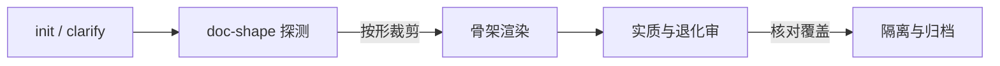

# 修复规划文档骨架裁光、形态探测、审计退化与归档隔离 — 功能设计规范（SPEC）

## 文档信息与变更概览

| 项目 | 内容 |
| --- | --- |
| 当前状态 | `draft`（`draft \| approved \| implementing \| in_review \| implemented \| superseded`） |
| 规划级别 | `L3`（跨模块修改规划文档生成、形态探测、审计阻断与归档隔离契约；未 `approved` 前不编码） |
| 创建 / 更新 | `2026-11-18` / `2026-11-18` |
| 分支 / Issue / PR | `feat/doc-shape-depth` / #56 / 未关联 |
| 负责人 / 内审状态 | planner-56 / `pending` |
| 关联 PRD / Todo | `docs/prd/261117-v8-criteria-trust-prd.md` / `docs/archive/todo/261118-issue56-doc-shape-depth-todo.md` |

- **与总控 PRD 的关系**：挂载于 `docs/prd/261117-v8-criteria-trust-prd.md`（V8 判据可信化补充切片），承接 Issue #56 全部技术验收标准 `C1..C5`，同时补全 `checkMasterPrdCoverage` 对已归档切片 SPEC 的认领扫描，确保 `#49` / `#55` / `#57` 归档后全仓文档审计恢复通过。
- **变更一句话**：把规划文档从「初始化即裁光可选节、默认模板自相矛盾、只验形状不验实质、归档扫入历史同 slug 文件」改造为「仓库形态驱动裁剪 + 可复核跳过说明 + 核心实质性与结构锚点防退化 + 互链继承与 `clarify` 落盘 + 历史归档物理隔离与覆盖率识别」。

## 系统变更全景

| 模块 / 文件 | 变更性质 | 核心职责 |
| --- | --- | --- |
| `kit/skills/lib/doc-shape.mjs` (new) | 新增 | 基于真实工作区证据探测 `prd` / `spec` / `todo` 形态开关、合并模板声明与生成可读跳过说明 |
| `kit/skills/lib/doc-substantive.mjs` (new) | 新增 | 校验核心节非空话非占位（零字数门槛）、抽取技术锚点并执行跨轮退化阻断与增量统计 |
| `kit/skills/lib/doc-frontmatter.mjs` (new) | 新增 | 承载 YAML Frontmatter 解析、序列化与原子更新，释放 `kit/skills/lib/docs.mjs` 行数预算 |
| `kit/skills/lib/doc-comments.mjs` (new) | 新增 | 承接 PR / Issue 结构化评论渲染函数，使 `kit/skills/lib/doc-templates.mjs` 保持 `<= 800` 行 |
| `kit/skills/lib/doc-template-render.mjs` | 改造 | 登记 `DOC_TEMPLATE_VARS.spec` 中的 `TDD_REF`，支持跳过说明注入并保持 `pruneUnfilled = true` 兼容 |
| `kit/skills/lib/doc-templates.mjs` | 改造 | 修复 `spec` 缺失 `NON_GOALS` / `REUSABLE`、表格 `MODULES` 语法与 `TDD_REF`；接入 `doc-shape` 裁剪与 `pruneUnfilled` 透传 |
| `kit/skills/lib/doc-requirements.mjs` | 改造 | 修复 `INLINE_FORMS` 接受 `待补齐` / `暂无` / 纯 `无` 的漏洞，登记 `clarifications` 章节定义 |
| `kit/skills/lib/docs.mjs` | 改造 | 阻止 `collectSiblingSet` / `syncDocsLifecycle` / `archiveCompletedDocsGroup` 按裸 `slug` 扫入并覆写 `docs/archive/` 历史文档 |
| `kit/skills/lib/shared.mjs` | 改造 | 导出新增共享函数与既有兼容出口 |
| `kit/skills/templates/docs-prd.md`、`kit/skills/templates/docs-spec.md`、`kit/skills/templates/docs-todo.md` | 改造 | `docs-spec.md` 改为条件占位 `{{TDD_REF}}`；三份模板增加 `clarifications` 可选澄清落盘节 |
| `kit/skills/dev-plan/scripts/doc-plan.mjs` | 改造 | `init` 默认 `pruneUnfilled: false`、支持 `--no-prune` / `--prd` 与 `--spec` 继承同步；新增 `clarify`；`critique-pass` 记录锚点快照 |
| `kit/skills/dev-plan/scripts/doc-audit.mjs` | 改造 | 接入核心实质性与跨轮退化检查及增量 `delta`；`checkMasterPrdCoverage` 同步扫描归档关联切片 SPEC |
| `kit/skills/dev-plan/SKILL.md` | 改造 | 补充 `--no-prune`、`--prd`、`clarify` 用法说明（`<= 180` 行） |
| `scripts/dev/fixtures-doc-depth.mjs` (new) | 新增 | 覆盖 `C1..C4` 全量正反双向断言（注册为 `--domain doc-depth`） |
| `scripts/dev/fixtures.mjs`、`scripts/dev/fixtures-docs.mjs`、`scripts/dev/fixtures-flow-state.mjs` | 改造 | 注册 `doc-depth` 域并清理既有夹具中 `## 本期不做` 仅写 `- 无` 的旧占位样本 |
| `scripts/dev/injections-data.mjs` | 改造 | 接续预留序号追加 `I139..I142` 故障注入用例 |
| `docs/TDD.md` | 改造 | 同步登记新增内核与夹具模块边界 |

## 一、背景与边界声明

- **要改什么**：解决规划文档链路的五类实测缺陷：① `doc-plan init` 阶段因未传 `pruneUnfilled: false` 把可选章节全数剪光，且 `spec` 模板存在 `待补齐`、破损 `MODULES` 表格及无 TDD 仓库必报 `HALLUCINATED_PATH` 的自矛盾；② `prd` / `spec` / `todo` 缺少基于工作区事实的项目形态探测与可人工复核的跳过原因记录；③ `INLINE_FORMS` 与 `doc-audit.mjs` 允许 `待补齐` / `暂无` / 纯 `无` 与纯套话过审，且缺少跨轮技术锚点退化拦截；④ 单文档 `init --kind todo --spec` 不继承 `related_prd` 也不回写父链，缺不触发 `BLOCKED_PENDING_DECISIONS` 的澄清落盘入口，且 `archiveCompletedDocsGroup` 按裸 `slug` 扫入并篡改历史归档文档；⑤ `checkMasterPrdCoverage` 未扫描已归档但仍指向活跃 `1:N` 总控 PRD 的切片 SPEC，导致归档切片后全仓审计报错。
- **不改什么**：与 Issue #50 已落地能力保持零重叠——不修改 #50 C5（治理类输入 `assessPrdNeed` 与 `scripts/review.mjs` 治理 PRD 覆盖）、不破坏 #50 C8（`docs/prd/`、`docs/specs/`、`docs/todo/` 活跃兄弟集跨日按 `slug` 互认）、不修改 #50 C9（`kit/skills/templates/docs-tdd.md`、`kit/skills/lib/tdd-shape.mjs`、`kit/skills/lib/tdd-structure.mjs`、`kit/skills/lib/tdd-facts.mjs`）、不修改 #50 C10（`checkOrphanSlices`）；不改动 `kit/skills/dev-plan/scripts/triage-rules.mjs`（#55）与 `kit/skills/dev-review/`（#57）。
- **本期不做**：不引入字数/字符数门槛来伪装实质性判断；不接入外部 NLP/LLM 语义打分；不写死任何仓库名或语言样本白名单；不引入第三方 npm 依赖（严格 Node 18+ `node:*` 内置模块）。
- **复用既有模块**：复用 `kit/skills/lib/tdd-shape.mjs`（形态开关模式参照）、`kit/skills/lib/tool-owned.mjs`（`isToolOwnedPath` 排除工具产物目录）、`kit/skills/lib/git.mjs`（`gitLsFilesTextAndCode`、`writeAtomic`、`posixPath`）、`kit/skills/lib/profile.mjs`（`parseAgentsProfile`、`resolveAuthoritativeTddPath`）、`kit/skills/lib/pending-decisions.mjs`（`analyzePendingDecisions` 统计待拍板解决数）、`kit/skills/lib/criteria-lock.mjs`（`extractCriteria`）及 `kit/skills/lib/doc-template-render.mjs`（`applySectionPolicy` / `renderDocTemplate`）。
- **架构基线关系**：严守 `docs/TDD.md` 的 `kit/**` 单文件 `<= 800` 行上限、`arch-rules` 单向依赖边界（`kit/**` 禁引 `scripts/lib/**` 与 `scripts/dev/**`）以及 `AGENTS.md` 信任倒金字塔与双向证伪铁律；由于 `docs.mjs`（781 行）、`doc-templates.mjs`（773 行）和 `doc-audit.mjs`（770 行）均贴近上限，本方案显式拆分出 `doc-shape.mjs` (new)、`doc-substantive.mjs` (new)、`doc-frontmatter.mjs` (new) 与 `doc-comments.mjs` (new)。
- **替代方案与否决理由**：见「三、备选方案与否决理由」对照表，核心否决「固定字符数下限」与「仅靠 `issue` 编号过滤归档碰撞」（前者易被套话绕过且误伤精简文档，后者在 `issue: null` 场景下仍会撞毁同 `slug` 历史归档）。

## 二、设计方案与契约变更

### 1. 裁剪时机分离与开箱可用骨架（C1）

1. **`pruneUnfilled` 与 `--no-prune` 分层控制**：
   - `kit/skills/lib/doc-template-render.mjs` 的 `renderDocTemplate(kind, { vars, dropSections, pruneUnfilled = true })` 与 `kit/skills/lib/doc-templates.mjs` 的 `buildStandardDocContent(..., { pruneUnfilled = true, noPrune = false })` 保持默认 `pruneUnfilled = true`，确保 `kit/skills/dev-govern/scripts/govern-docs.mjs`（`buildPlan` 自动化生成 Todo）及所有既有直接调用 `renderDocTemplate` 的代码行为不变。
   - `kit/skills/dev-plan/scripts/doc-plan.mjs` 的 `initDoc` 显式传入 `pruneUnfilled: false` 与 `noPrune: Boolean(opts['no-prune'])`：交互式 `doc-plan.mjs init --kind prd|spec|todo|pair|all` 保留当前仓库形态适用的全部可选章节框架（即使占位尚未填写）；传入 `--no-prune` 时跳过形态裁剪，全量保留模板内所有可选章节。
2. **修复 `spec` 模板生成三处自相矛盾与默认提示词冲突**：
   - 在 `kit/skills/lib/doc-templates.mjs` 渲染 `kind === 'spec'` 时，将计算出的 `nonGoalText` 写入 `vars.NON_GOALS`，将 `reuseList` 写入 `vars.REUSABLE`，杜绝输出 `待补齐`。
   - 将 `MODULES` 默认值改为合法 Markdown 表格数据行：`| \`{真实文件路径，新建文件标 (new)}\` | 改造 / 新增 | {受影响的模块、协议或对外契约} |`（不再以 `- ` 开头破坏表结构）。
   - 在 `kit/skills/lib/doc-template-render.mjs` 的 `DOC_TEMPLATE_VARS.spec` 登记 `TDD_REF`，并在 `kit/skills/templates/docs-spec.md` 原先硬编码 `docs/TDD.md` 的两处位置改为 `{{TDD_REF}}`：`buildStandardDocContent` 通过 `resolveAuthoritativeTddPath(repoRoot)` 解析真实权威架构文档路径——存在时渲染为对应反引号路径（如 `docs/TDD.md`），不存在时渲染为不含伪路径的无反引号描述（`项目架构基线（当前仓库暂无独立 TDD 文件，新建时须标注 (new)）`），消除无 TDD 仓库在 `init --kind spec` 后立即报 `HALLUCINATED_PATH` 的假错。
   - 修复 `FAULT_INJECTION` 错用复用模块文案的问题，并将 `doc-templates.mjs` 默认提示中会命中 `PLACEHOLDER_TEXT_RE` 的提示词替换为「需核实」，避免原始初始化骨架触发多余 `UNRESOLVED_PLACEHOLDER` 双重告警（保留尖括号提示待作者填完后通过 `audit`）。

### 2. 项目形态实时探测与可复核跳过说明（C2）

1. **新增 `kit/skills/lib/doc-shape.mjs` (new)（与 `tdd-shape.mjs` 同构）**：
   - 通过 `gitLsFilesTextAndCode(repoRoot)`（过滤 `isToolOwnedPath` 与依赖构建产物目录）、`parseAgentsProfile(repoRoot)` 与项目包清单/配置探测六类实证信号（零硬编码仓库名）：
     - `authRoles`：权限/鉴权目录或文件（`auth`、`rbac`、`acl`、`permissions`、`login`、`session`、`jwt` 等）或团队多协作者权限配置；控制 `prd` 的 `users` 节。
     - `stateRules`：状态机、迁移、工作流策略或持久化模型（`migrations`、`schema`、`prisma`、`alembic`、`state`、`workflow-policy`、`fsm` 等）；控制 `prd` 的 `rules` 节。
     - `uiFrontend`：前端工程/界面文件（`tsx`、`jsx`、`vue`、`svelte`、`html`、`vite.config` 等）；增强 `flow`、`nfr`、`metrics`、`rollout` 相关性。
     - `ciRollout`：发布与部署流（`.github/workflows/`、`Dockerfile`、`compose`、`k8s`、`deploy`、`RELEASING.md`、迁移/发布脚本）；控制 `prd`/`spec` 的 `rollout` 与配合 `risk`/`rollback` 判定。
     - `cliEntry`：命令行/工具入口（`cmd` 与 `bin` 目录、`cli.*`、Go `main.go`/`flag`/`cobra`、Node `bin` 等）；开启 `flow`（交互/调用路径）、`design`/`alternatives`/`breakdown`（SPEC 方案与影响面）、`steps`/`risk`/`rollback`/`breakpoint`（Todo 执行保障）。
     - `multiCollab`：多模块目录、远端协作者信号（`CODEOWNERS`、`CONTRIBUTING.md`、多维护者或 `arch-rules`）；开启 `coordination`、`dependencies`、`reuse`、`door`、`pending`、`nfr`。
   - 对代码项目（存在任意代码清单或源码文件），`spec` 默认开启 `design`、`alternatives`、`breakdown`、`door`、`implementation`、`clarifications`；`todo` 默认开启 `steps`、`risk`、`rollback`、`breakpoint`、`clarifications`；`prd` 默认开启 `flow`、`reuse`、`pending`、`door`、`clarifications`。仅在形态探针未命中对应证据时才将不适用可选节加入 `shapeDrop`（如 3 文件纯 Go CLI 仓库：保留 `design`/`alternatives`/`breakdown`/`door`/`risk`/`rollback`/`steps`/`breakpoint`/`flow`/`reuse`/`pending`/`clarifications`，精准跳过无证据支撑的 `users`（对应角色权限，注释同时标明 `users/roles` 便于检索）、`rules`、`rollout`、`coordination`、`metrics`、`nfr`、`dependencies`、`risks`）。
2. **硬保护与可人工复核跳过说明**：
   - 合并 `resolveDocRequirements(repoRoot, kind)`：最终 `dropSections = noPrune ? new Set() : (shapeDrop ∪ decl.omit) \ (FORM_INDEPENDENT_CORE[kind] ∪ decl.required)`，**绝不裁剪主干三节或项目自定义模板 `required_sections` 声明章节**。
   - 当存在被形态裁掉的可选节时，渲染器写入机器可解析且不引入占位符/幻觉路径的注释与摘要：
     `<!-- doc-shape-skipped: users(roles), rules, rollout | ... -->` 及精简人类可读摘要行 `> 形态裁剪说明（doc-shape）：已跳过 ...（依据：...）`。
   - `doc-audit.mjs` 解析 `<!-- doc-shape-skipped: ... -->`（返回 `skippedSections` 字段）并放行合法跳过摘要；若发现注释声明跳过了 `FORM_INDEPENDENT_CORE` 或项目 `required_sections` 章节，立即阻断并报 `DOC_SKIP_INVALID_SECTION`。

### 3. 核心章节实质性校验与非字数型防退化（C3）

1. **新增 `kit/skills/lib/doc-substantive.mjs` (new) 与修正 `doc-requirements.mjs`**：
   - **修复 `INLINE_FORMS` 漏洞**：`kit/skills/lib/doc-requirements.mjs` 中的 `INLINE_FORMS['non-goals']` 与 `INLINE_FORMS['goal']` 先剥离空白、HTML 注释与尖括号提示，并调用 `isStubValue` 拒绝 `待补齐`、命中 `PLACEHOLDER_TEXT_RE` 的占位词、`暂无`、`暂缺`、纯 `无` / `none` / `n/a`，使 `- **本期不做**：待补齐` 不再满足 `'non-goals'`。
   - **零字数门槛的实质性校验（`checkCoreSubstantiveness`）**：
     - 检查对象：`goal`、`non-goals`（含主干节与行内条目），以及文档中存在的 `design`（`设计方案`）、`alternatives`（`备选方案`）与 `reuse`（`复用既有模块`）。
     - **占位桩拦截（`DOC_STUB_PLACEHOLDER`）**：上述章节若仅包含占位词（`待补齐`、`PLACEHOLDER_TEXT_RE` 占位词、`暂无`、`暂缺`）或裸 `无`/`- 无`/`none`/`n/a`（注意不影响 `## 待拍板问题` 中的 `无`、`## 澄清与补充记录` 初始基线、`## 四、改动清单与影响面` 中的 `- **对外可见的变化**：无` 以及 `## 完成后的记录` 中的 `- **遗留问题**：无`），直接拦截。
     - **纯套话拦截（`DOC_VAGUE_CORE_SECTION`）**：抽取技术锚点（反引号代码/路径/符号/命令、带扩展名路径、标识符、`--flag`、数字+单位/比较式、C 编号、退出码及带具体排除对象的否定短语如 `不改 xxx`/`不动 xxx`）；当核心/方案节命中套话模式（`VAGUE_FLUFF_RE` 扩展覆盖 `提升体验`/`优化功能`/`提高质量`/`完善功能`/`增强体验`/`确保稳定`/`改善性能`/`合理设计`/`按需处理` 等）且**技术锚点与具体对象计数为 0**时，拦截报错；**反向保证**：即使只有十余字的简明内容（如 `- **本期不做**：不动 \`scripts/survey.mjs\`` 或 `待机功耗 <= 5uA`），只要无占位桩且包含真实技术锚点或明确排除对象即通过，不设任何最小字数或字符数下限。
2. **结构化技术锚点快照与跨轮防退化（`DOC_REGRESSION_*`）**：
   - `extractDocSnapshot(rawText)` 提取每个实质性章节的锚点集合（`anchors`）、非空实质核心节列表（`coreSections`）、已解决待拍板数（`pendingResolved`）与验收条目数（`criteriaCount`）。
   - `critique-pass` 在 frontmatter 写入单行快照 `critique_anchors`（同步加入 `stripCritiqueMeta` 的 `volatileLineRe`，避免与 `BLOCKED_CRITIQUE_STALE` 冲突）。
   - `auditDoc({ repoRoot, file, baselineText = null })` 按优先级取基线：① 显式 `baselineText`（供测试与调用方传入）；② frontmatter 中的 `critique_anchors`；③ Git 仓库下读取 `HEAD` 同路径旧提交内容（经 `show HEAD:{relDoc}` 读取，仅当文件已存在于 `HEAD` 时启用，新建未提交文档无基线不误拦）。
   - 调用 `checkDocRegression` 比对基线与当前快照：
     - 已填核心/方案节被删空或退回占位/纯套话 -> 报错 `DOC_REGRESSION_CORE_EMPTIED` / `DOC_REGRESSION_CORE_DEGRADED`；
     - 技术锚点被静默删减（基线存在而当前丢失，且该节未替换为等价新锚点导致锚点数净减少或关键锚点消失）-> 报错 `DOC_REGRESSION_ANCHOR_LOST`；
     - `auditDoc` 始终输出结构化增量指标 `delta: { hasBaseline, baselineSource, anchorsBefore, anchorsAfter, anchorsAdded, anchorsRemoved, pendingResolved, coreSectionsLost }`。

### 4. 兄弟链接继承、澄清落盘、归档隔离与总控 PRD 归档覆盖率（C4）

1. **`init` 互链继承与父链接回写**：
   - `kit/skills/dev-plan/scripts/doc-plan.mjs` 增加 `--prd` 值参数。
   - `doc-plan.mjs init --kind todo --spec {specPath}` 自动解析 `{specPath}` 的 `related_prd`（若未显式传 `--prd`），为新生成的 Todo 写入 `related_prd` 与 `related_spec`；单文档生成后若指定了 `--spec` 或 `--prd`（不仅限于 `planned.length > 1`），调用受共享保护的互链回写逻辑更新父 SPEC 的 `related_todo`（若父 PRD 非 `isSharedMasterPrd` 1:N 总控 PRD，才更新父 PRD 的 `related_spec`/`related_todo`；若为 `1:N` 总控 PRD，严守原元信息不覆写）。
2. **`## 澄清与补充记录` 与 `doc-plan clarify`**：
   - 在 `docs-prd.md`、`docs-spec.md`、`docs-todo.md` 模板新增 `<!-- section: clarifications optional -->` 章节 `## 澄清与补充记录`，默认正文写为不含占位禁词的非阻断说明（如 `- （本轮无额外澄清补充；用户拍板确认的新增要求可通过 \`doc-plan.mjs clarify\` 写入「已确认：…」）`）。
   - `doc-plan.mjs` 新增子命令 `clarify --file {docPath} [--question "{问题}"] --decision "{已确认结论}" [--by "{确认方}"] [--criterion "{补充验收摘要}"] [--json]`：若文档尚无 `## 澄清与补充记录` 则在 `## 实现说明`/`## 完成后的记录` 前（或末尾）插入该节，追加 `- **已确认**（YYYY-MM-DD[ · by]）：...` 记录并原子更新 `updated`（可选追加未批准草稿的补充说明），且 `## 澄清与补充记录` **不匹配** `pending-decisions.mjs` 的 `PENDING_WORDS`，不触发 `BLOCKED_PENDING_DECISIONS`。
3. **历史归档隔离（`docs.mjs` 与 `doc-frontmatter.mjs` (new)）**：
   - 将 YAML Frontmatter 读写拆分进 `kit/skills/lib/doc-frontmatter.mjs` (new) 并由 `docs.mjs` 重导出，保证 `docs.mjs` 留足改造空间且远低于 `800` 行；`isSharedMasterPrd` 保留在 `docs.mjs` 原位，维持 `I58` 锚点稳定。
   - 修复 `collectSiblingSet`、`syncDocsLifecycle` 与 `archiveCompletedDocsGroup`：
     - 保持活跃目录（`docs/prd/`、`docs/specs/`、`docs/todo/`）的跨日同 `slug` 互认不变（不碰 #50 C8）。
     - **严禁仅凭裸 `fn.slug === targetSlug` 将 `docs/archive/**` 下的任何已归档文件拉入 `siblingSet` 或 `byKind`**：已归档文件仅在以下三种情况才可进入当前操作集合：① 它本身就是调用方显式传入的 `seedRel` / `prdFile` / `specFile` / `todoFile`；② 它被活跃组中某个成员的 `related_*` 显式相对路径指向，且其 `issue` 与当前任务不冲突；③ 返工幂等重归档时与当前活跃组同 `issue`（非 `null`）且同 `basename` 前缀。
     - 对于不属于本次操作集合的其他历史归档文件（含其他 `issue`、其他日期或 `issue: null` 的同 `slug` 历史归档），`archiveCompletedDocsGroup` 绝不调用写入，保证字节级（byte-for-byte）不变，且 `byKind` 返回本次归档生成的新文件路径而非历史旧路径。
4. **`checkMasterPrdCoverage` 扫描已归档关联切片 SPEC**：
   - 修复 `kit/skills/dev-plan/scripts/doc-audit.mjs` 的 `checkMasterPrdCoverage(repoRoot, { prdRel })`：
     - 对每份待检活跃总控 PRD `rel`，收集两类非废弃（`status` 不为 `superseded`/`dropped`）SPEC 正文参与 `C*` 认领匹配：① `docs/specs/` 中未指向其他 PRD 的生效 SPEC（若 SPEC 显式声明 `related_prd`，要求解析后等于当前 PRD `rel`）；② `docs/archive/specs/` 中 Frontmatter `related_prd` 解析后**精确等于**当前 PRD `rel`（或 PRD 自身 `related_spec` 指向它）的已归档切片 SPEC。
     - **反向保护**：`docs/archive/specs/` 中 `related_prd` 为空或指向其他历史 PRD 的旧归档 SPEC 绝不计入当前活跃 PRD 的覆盖率，防止历史文档里的 `C1..Cn` 制造假绿。

### 5. 文件规模与跨模块合规边界（C5）

- 控制所有 `kit/` 脚本与 `scripts/dev/fixtures-*.mjs` 均 `<= 800` 行，新增独立模块：`kit/skills/lib/doc-shape.mjs` (new)、`kit/skills/lib/doc-substantive.mjs` (new)、`kit/skills/lib/doc-frontmatter.mjs` (new)、`kit/skills/lib/doc-comments.mjs` (new)、`scripts/dev/fixtures-doc-depth.mjs` (new)。
- 严守 `arch-rules`：`kit/skills/**` 仅导入 `node:*` 与 `kit/skills/**`；所有新增/改动在 `kit/skills/` 后同步 `node scripts/equip.mjs .`，并在 `docs/TDD.md` 登记新增模块。

## 三、备选方案与否决理由

| 方案 | 怎么做的 | 为什么没选 | 什么情况下该改回它 |
| --- | --- | --- | --- |
| 工作区探针 + 非字数实质性 + 锚点快照 + 归档仅显式链入 | 新建 `doc-shape.mjs` (new) 与 `doc-substantive.mjs` (new)，拆分 `doc-frontmatter.mjs` (new) / `doc-comments.mjs` (new)，全面修复模板、澄清与归档隔离 | （已选）零字数凑字漏洞、各模块均远低于 800 行且与 #50/#55/#57 零写域冲突 | 若未来 `docs/` 全量迁移为结构化数据库存储，可替换快照与互链解析层 |
| 用最低字数门槛（如 >= 100 字）校验核心章节 | 按字符数或行数直接卡掉短内容 | 被一段 100 字纯套话轻松绕过，同时误杀简明扼要且含精确路径/命令的短文档 | 不考虑改回（与实质性判据背道而驰） |
| 归档隔离仅靠 `fn.issue === targetIssue` | 只在两端都有 `issue` 且不等时才排除 | 当历史归档或当前临时文档为 `issue: null` 时仍会因裸 `slug` 相同而误改历史文件 | 不考虑改回 |
| `checkMasterPrdCoverage` 无条件扫描全部 `docs/archive/specs/` | 直接把 `docs/archive/specs/` 全文件文本并入 `specTexts` | 仓库历史版本已归档 SPEC 里的 `C1..Cn` 会假覆盖新立项的总控 PRD | 不考虑改回 |

## 四、改动清单与影响面

| 文件 / 目录 | 改动性质 | 改什么 | 谁会被影响 |
| --- | --- | --- | --- |
| `kit/skills/lib/doc-shape.mjs` (new) | 新增 | 工作区形态信号探测（鉴权/状态机/UI/CI发布/CLI/多协作者）、章节裁剪集合与人类可复核跳过说明生成/解析 | `doc-templates.mjs`、`doc-audit.mjs`、`doc-plan.mjs` |
| `kit/skills/lib/doc-substantive.mjs` (new) | 新增 | 核心节占位桩与纯套话（零字数门槛）校验、技术锚点抽取、跨轮退化比对（`DOC_REGRESSION_*`）与 `delta` 计算 | `doc-requirements.mjs`、`doc-audit.mjs`、`doc-plan.mjs` |
| `kit/skills/lib/doc-frontmatter.mjs` (new) | 新增 | 从 `docs.mjs` 抽离 YAML Frontmatter 解析/序列化/原子更新 | `docs.mjs`（内部拆出并重导出） |
| `kit/skills/lib/doc-comments.mjs` (new) | 新增 | 从 `doc-templates.mjs` 抽离 PR/Issue 评论模板构造函数 | `doc-templates.mjs`（内部拆出并重导出） |
| `kit/skills/lib/doc-template-render.mjs` | 修改 | `DOC_TEMPLATE_VARS.spec` 新增 `TDD_REF`，支持形裁跳过说明插入，保持 `pruneUnfilled = true` 默认兼容 | `doc-templates.mjs`、`preflight-suite.mjs` |
| `kit/skills/lib/doc-templates.mjs` | 修改 | 修复 `spec` 的 `NON_GOALS`/`REUSABLE`/表格 `MODULES`/`{{TDD_REF}}`/`FAULT_INJECTION`，接入 `doc-shape` 裁剪与 `pruneUnfilled` 控制 | `doc-plan.mjs init`、`govern-docs.mjs` |
| `kit/skills/lib/doc-requirements.mjs` | 修改 | 阻止 `INLINE_FORMS` 放行占位/空值，补充 `clarifications` 章节定义 | `doc-audit.mjs` |
| `kit/skills/lib/docs.mjs` | 修改 | 修复 `collectSiblingSet`/`syncDocsLifecycle`/`archiveCompletedDocsGroup` 历史归档隔离，重导出 Frontmatter 与评论接口 | `flow-lifecycle.mjs`、`doc-plan.mjs` |
| `kit/skills/lib/shared.mjs` | 修改 | 重导出 `doc-shape.mjs` (new) 与 `doc-substantive.mjs` (new) 等公开接口 | 全部研发套件脚本与夹具 |
| `kit/skills/templates/docs-prd.md`、`kit/skills/templates/docs-spec.md`、`kit/skills/templates/docs-todo.md` | 修改 | `docs-spec.md` 使用 `{{TDD_REF}}`；三份模板增加 `## 澄清与补充记录` 可选节 | `doc-plan.mjs init`、`preflight-suite.mjs` |
| `kit/skills/dev-plan/scripts/doc-plan.mjs` | 修改 | `init` 传 `pruneUnfilled: false`、支持 `--no-prune` / `--prd` 与 `--spec` 互链继承同步；新增 `clarify`；`critique-pass` 记快照 | `dev-plan` 用户与 CI |
| `kit/skills/dev-plan/scripts/doc-audit.mjs` | 修改 | 接入实质性校验与退化检测，输出 `delta`/`skippedSections`；`checkMasterPrdCoverage` 同步扫归档关联切片 SPEC | `doc-plan.mjs audit`、`approve`、`critique-pass` |
| `kit/skills/dev-plan/SKILL.md` | 修改 | 补充 `--no-prune`、`--prd`、`clarify` 命令参考（`<= 180` 行） | AI 会话与 `preflight` |
| `scripts/dev/fixtures-doc-depth.mjs` (new) | 新增 | C1–C4 全量正反双向行为夹具（`--domain doc-depth`） | `scripts/dev/fixtures.mjs` |
| `scripts/dev/fixtures.mjs`、`scripts/dev/fixtures-docs.mjs`、`scripts/dev/fixtures-flow-state.mjs` | 修改 | 注册 `doc-depth` 域；将 `fixtures-docs.mjs` 与 `fixtures-flow-state.mjs` 中 `## 本期不做\n- 无` 占位写法替换为明确排除项 | 全量 `fixtures.mjs` |
| `scripts/dev/injections-data.mjs` | 修改 | 追加 `I139..I142` 故障注入条目 | `scripts/dev/verify-injections.mjs` |
| `docs/TDD.md` | 修改 | 登记 `doc-shape.mjs` (new)、`doc-substantive.mjs` (new)、`doc-frontmatter.mjs` (new)、`doc-comments.mjs` (new)、`fixtures-doc-depth.mjs` (new) 与 `clarify` | 仓内自用与 `tdd-parity` |

- **对外可见的变化**：`doc-plan.mjs` 的 `init` 支持 `--no-prune` 与 `--prd`，新增 `clarify` 子命令；`audit --json` 新增 `delta` 与 `skippedSections` 字段及 `DOC_STUB_PLACEHOLDER`、`DOC_VAGUE_CORE_SECTION`、`DOC_REGRESSION_CORE_EMPTIED`、`DOC_REGRESSION_ANCHOR_LOST`、`DOC_SKIP_INVALID_SECTION` 错误码；`doc-plan.mjs audit .` 在切片归档后仍正确认领 `1:N` 总控 PRD。
- **需要同步改的地方**：修改 `kit/skills/` 后必须运行 `node scripts/equip.mjs .` 使 `.agents/skills/` 与清单保持字节一致，并同步更新 `docs/TDD.md` 模块清单表。

## 五、冻结的验收标准

> 动手改代码前冻结；实现期间不顺手删减或放宽标准。每条必须能由一条命令或断言实证。

- [x] C1: （`init` 骨架保留与开箱自洽）在 3 文件 Go CLI 临时仓及多生态仓执行 `doc-plan.mjs init --kind prd|spec|todo|pair|all` 时，默认 `pruneUnfilled: false` 保留当前形态适用的可选节（`spec` 含 `design`/`alternatives`/`breakdown`/`door`/`implementation`/`clarifications`、`todo` 含 `steps`/`risk`/`rollback`/`breakpoint`/`clarifications`、`prd` 含 `flow`/`reuse`/`pending`/`door`/`clarifications`），传入 `--no-prune` 时保留模板全部可选节；`spec` 正确渲染 `NON_GOALS`、`REUSABLE`、合法 Markdown 表格 `MODULES`（`| ... |`）及条件化 `{{TDD_REF}}`（无 `docs/TDD.md` 时零 `HALLUCINATED_PATH`、零 `待补齐` 残余，有 `docs/TDD.md` 时保留有效路径）；`govern-docs.mjs --write-todo` 与直接调用 `renderDocTemplate(kind, { vars })` 仍保持 `pruneUnfilled: true` 向后兼容。
- [x] C2: （工作区形态探测与可复核跳过说明）`kit/skills/lib/doc-shape.mjs` (new) 基于实时工作区证据探测 `authRoles`/`stateRules`/`uiFrontend`/`ciRollout`/`cliEntry`/`multiCollab`（零硬编码仓库名，严守 `kit/**` 架构边界）：3 文件 Go CLI 仓跳过不适用的 `users`（`roles`）/`rules`/`rollout`/`coordination` 并写入 `<!-- doc-shape-skipped: ... -->` 与人类可复核摘要且被 `doc-audit` 放行；含鉴权/状态机/前端/CI 发布文件的仓则自动保留对应可选节；`FORM_INDEPENDENT_CORE` 与自定义模板 `required_sections` 永不被跳过（强行写入跳过注释时 `doc-audit` 报 `DOC_SKIP_INVALID_SECTION` 阻断）。
- [x] C3: （核心实质性与非字数型跨轮防退化）`kit/skills/lib/doc-substantive.mjs` (new) + `doc-requirements.mjs` + `doc-audit.mjs` 拦截核心/设计节中的 `待补齐`、`PLACEHOLDER_TEXT_RE` 占位词、`暂无`、`暂缺`、裸 `无`（包含 `- **本期不做**：待补齐`）以及无技术锚点或明确排除对象的纯套话（如「提升体验、优化功能、确保稳定」），**不使用最小字数或字符数下限**（含真实路径/命令/符号/排除依据的短文本如 `- **本期不做**：不动 \`scripts/survey.mjs\`` 通过）；跨轮编辑对比 `HEAD:{relDoc}` / `critique_anchors` / `baselineText` 时，把已填核心节改回空话/清空或静默删减技术锚点必报 `DOC_REGRESSION_CORE_EMPTIED` / `DOC_REGRESSION_ANCHOR_LOST`，并在 `auditDoc` 返回结构化 `delta`（`anchorsAdded`、`anchorsRemoved`、`pendingResolved`）。
- [x] C4: （互链继承、澄清落盘、归档隔离与总控 PRD 归档覆盖）`doc-plan.mjs init --kind todo --spec {specPath}` 自动继承 `related_prd` 并回写父 `related_todo`（同时支持 `--prd` 且不覆写 `1:N` 共享总控 PRD 元信息）；`doc-plan.mjs clarify` 向 `## 澄清与补充记录` 写入已确认需求后 `doc-audit` 退出 `0` 且不触发 `BLOCKED_PENDING_DECISIONS`；`collectSiblingSet` / `syncDocsLifecycle` / `archiveCompletedDocsGroup` 在存在同 `slug` 其他 `issue`/任务（含 `issue: null`）的历史归档文档时，使其保持字节级不变且 `byKind` 返回当前归档路径（同时保持活跃组跨日同 `slug` 互认）；`checkMasterPrdCoverage` 同步扫描 `docs/specs/` 与指向当前总控 PRD 的 `docs/archive/specs/`（排除非关联历史归档 SPEC），使已归档 `#49`/`#55`/`#57` 切片后仓内执行 `doc-plan.mjs audit .` 退出 `0`。
- [x] C5: （双向夹具、故障注入 `I139..I142` 与全量门禁）在 `scripts/dev/fixtures-doc-depth.mjs` (new) 补齐 `C1..C4` 正反双向用例（与 `#50` C5/C8/C9/C10 零重叠）并在 `scripts/dev/fixtures.mjs` 注册 `--domain doc-depth`；在 `scripts/dev/injections-data.mjs` 追加 `I139..I142` 验证全红；全部新增及修改的 `kit/skills/**/*.mjs` 与 `scripts/dev/fixtures-*.mjs` 单文件不超过 `800` 行、`kit/skills/dev-plan/SKILL.md` 不超过 `180` 行；同步 `docs/TDD.md` 与 `node scripts/equip.mjs . --check` 并全量通过 `node scripts/dev/preflight.mjs`、`node scripts/dev/gap-coverage.mjs`、`node scripts/dev/fixtures.mjs`、`node scripts/compose-agents.mjs . --check`、`node scripts/review.mjs .`、`node scripts/sync-toc.mjs README.md README.en.md --check` 与 `node scripts/dev/verify-injections.mjs`。

## 六、高风险点、门型与回滚路径

- **门型判定**：`one-way`（改动 `kit/skills/templates/`、`kit/skills/lib/` 与 `doc-audit` / `doc-plan` 门禁语义，触及多处 `high-risk` 路径，须经独立 Critique 审批、实证验证、独立代码审查与故障注入）。
- **高风险路径**：`kit/skills/lib/docs.mjs`、`kit/skills/lib/doc-templates.mjs`、`kit/skills/lib/doc-requirements.mjs`、`kit/skills/lib/doc-template-render.mjs`、`kit/skills/lib/doc-shape.mjs` (new)、`kit/skills/lib/doc-substantive.mjs` (new)、`kit/skills/lib/doc-frontmatter.mjs` (new)、`kit/skills/lib/doc-comments.mjs` (new)、`kit/skills/dev-plan/scripts/doc-audit.mjs`、`kit/skills/dev-plan/scripts/doc-plan.mjs`、`kit/skills/templates/docs-prd.md`、`kit/skills/templates/docs-spec.md`、`kit/skills/templates/docs-todo.md`、`kit/skills/dev-plan/SKILL.md`。
- **回滚路径**：所有修改集中在独立分支 `feat/doc-shape-depth`；合入前可直接丢弃分支或执行 git revert；合入后若需紧急回退某一项检查（如退化快照比对或形态跳过），可通过反向提交回退对应新增模块调用而不影响既有 `docs/archive/` 数据。
- **故障注入预演**：在 `scripts/dev/injections-data.mjs` 追加 `I139..I142`：① `I139` 在 `doc-plan.mjs` 的 `initDoc` 强制恢复 `pruneUnfilled: true`（验证 3 文件 Go CLI 仓 `init --kind spec` 可选节被裁光且 `doc-depth` 夹具失败）；② `I140` 在 `doc-substantive.mjs` (new) 放行占位桩/绕过 `DOC_REGRESSION_ANCHOR_LOST`（验证空话与删锚点退化拦截测试失败）；③ `I141` 在 `docs.mjs` 的 `collectSiblingSet` 恢复按裸 `slug` 扫入 `docs/archive/**`（验证历史同 `slug` 归档文档防篡改断言失败）；④ `I142` 在 `doc-audit.mjs` 的 `checkMasterPrdCoverage` 移除对 `docs/archive/specs/` 的扫描（验证已归档切片 SPEC 覆盖率用例失败）。

## 七、待拍板问题

1. **核心章节实质性校验对历史夹具中 `- 无` 写法的影响**：禁止在核心/非目标节写裸 `无` 后，`scripts/dev/fixtures-docs.mjs` 与 `scripts/dev/fixtures-flow-state.mjs` 中两处旧夹具的 `## 本期不做\n- 无` 会按新规被拒。
   - **已定：** 严格在 `doc-substantive.mjs` (new) 与 `doc-requirements.mjs` 拦截核心/非目标节的裸 `无` 占位，并同步将上述两处测试夹具改为具体排除表述（如 `- 不修改独立单仓接口`），不为了迁就旧测试偷懒写法而削弱生产门禁。
2. **故障注入编号预留与并合兼容**：当前分支基线 `main` 末尾为 `I133`，同波待合入 PR #63 占用 `I134..I138`。
   - **已定：** 本单在 `scripts/dev/injections-data.mjs` 统一预留并追加 `I139..I142`，避免与并发 PR 合并产生 ID 冲突。

## 实现说明

- **实际落地摘要**：拆出 `kit/skills/lib/doc-frontmatter.mjs`（210 行）、`kit/skills/lib/doc-comments.mjs`（203 行）、`kit/skills/lib/doc-shape.mjs`（340 行）与 `kit/skills/lib/doc-substantive.mjs`（539 行）；`doc-plan.mjs`（766 行）`init` 默认 `pruneUnfilled: false`、支持 `--no-prune`/`--prd` 与 `--spec` 互链继承、新增 `clarify`、`critique-pass` 落盘 `critique_anchors`；`doc-audit.mjs`（787 行）接入形态裁剪校验、核心实质性校验与跨轮防退化比对并扫描关联已归档 SPEC 覆盖总控 PRD；`docs.mjs`（639 行）隔离 `docs/archive/**` 历史同 slug 文档。
- **与草案的差异**：为保持 `doc-audit.mjs` 不超过 800 行，将 `readGitHeadFileSync`、`resolveBaselineSnapshotSync` 与 `collectMasterPrdSpecTexts` 放在 `kit/skills/lib/doc-substantive.mjs`，`doc-audit.mjs` 保持 787 行并保留全部原有规则锚点。
- **关联同步文件**：`kit/skills/dev-plan/SKILL.md`（75 行）、`docs/TDD.md`、`.agents/skills/`（经 `scripts/equip.mjs .` 全量同步）、`scripts/dev/fixtures-doc-depth.mjs`（536 行）、`scripts/dev/fixtures-docs.mjs`、`scripts/dev/fixtures-flow-state.mjs`、`scripts/dev/injections-data.mjs`（追加 `I139..I142`）。
