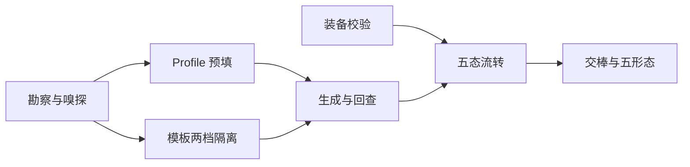

# SPEC: 修复外部项目装备断点、仓根命令嗅探与两档五态交叉兼容性

## 文档信息与变更概览

| 项目 | 内容 |
| --- | --- |
| 当前状态 | `draft`（`draft \| approved \| implementing \| in_review \| implemented \| superseded`） |
| 规划级别 | `L3` |
| 创建 / 更新 | `2026-11-18` / `2026-11-18` |
| 分支 / Issue | `feat/onboarding-matrix` / #58 |
| 关联总控 | [261117-v8-criteria-trust-prd.md](../../prd/261117-v8-criteria-trust-prd.md) |
| 变更一句话 | 打通外部项目从勘察、两档装备、`Dev Profile` 预填与交付体检到 `lightweight`/`full` × 5 身份 `dev-flow` 流转的全链路断点，并补齐 5 形态端到端与 `2×5` 矩阵断言。 |

## 系统变更全景

| 模块 / 文件 | 变更性质 | 核心职责 |
| --- | --- | --- |
| `kit/skills/lib/profile-sniffer.mjs` | 改造 | 修复仓根目录 `wrapDir` 丢失包管理器前缀的问题，覆盖 `npm`/`pnpm`/`yarn`/`bun` 根/子目录及多生态与零清单纯文档仓 |
| `scripts/lib/agents-defaults.mjs`(new) | 新增 | 承接变量与 `Dev Profile` 7 键默认值预填与拆分辅助逻辑，避免 `compose-agents.mjs` 超过 800 行 |
| `scripts/compose-agents.mjs` | 改造 | 拆出变量拼装逻辑至 `scripts/lib/agents-defaults.mjs`(new) 将体积收敛到 800 行以内，接入 `Dev Profile` 预填与条件提示 |
| `scripts/lib/protocol.mjs` | 改造 | 注册 `Dev Profile` 相关模板变量与约定常量 |
| `templates/agents-project.md` | 改造 | 保持 `Dev Profile` 7 键单代码块与契约关键词不变量，补 `{{PROFILE_*}}` 与 `is-lightweight`/`is-full` 洁净隔离 |
| `scripts/lib/agents-sections.mjs` | 改造 | 将已由用户或初始化校准的 `Dev Profile` 区间设为免漂移与保护同步 |
| `scripts/lib/claims.mjs` | 改造 | 豁免尚未产生归档时的 `docs/archive` 基础设施目录及含 `<...>` 占位的模板示例行，维持真实失约路径拦截 |
| `scripts/equip.mjs` | 改造 | 强化 `--check`：核对档位必选核心技能、跨目录相对 `lib/*.mjs` 导入可达性与 `SKILL.md` frontmatter 合法性 |
| `scripts/handoff.mjs` | 改造 | `stripInlineCode` 保留多反引号元示例豁免并恢复单反引号 `SKILL_INTERNAL_RE` 扫描，围栏示例代码除外 |
| `kit/skills/lib/cli.mjs` | 改造 | 拟新增 `hasSkillSupport`（结合 `resolveAvailableSkills` 的 `hasSkillsDir` 区分「已装配轻量仓」与「未装配默认兼容仓」）供流程与策略层复用 |
| `kit/skills/lib/workflow-policy.mjs` | 改造 | 按 `hasDevReview` 与全部 6 类 `riskTier === 'high'` 触发源判定策略，拟新增 `buildSubmitNextSteps`/`buildInspectNextSteps` 与 `BLOCKED_REQUIRES_DEV_REVIEW`（拟新增状态码），并调整 `contributor-fork` 顺序先于 `needs-review` |
| `kit/skills/lib/task-graph.mjs` | 改造 | 在 `checkUntrustedPrGate` 增加 `hasDevReview === false` 时对 `inbound-external-pr` 的 `BLOCKED_REQUIRES_DEV_REVIEW` 阻断 |
| `kit/skills/dev-flow/scripts/flow.mjs` | 改造 | `inspect` 输出分支接入 `buildInspectNextSteps`，缺 `dev-review` 的外部 PR 不打印缺失 `review-pack.mjs` |
| `kit/skills/dev-flow/scripts/flow-inspect.mjs` | 改造 | `handleStart` 探测 `hasSkillSupport`，已装配且缺 `dev-review` 的外部 PR 入口阻断提示升级而非打印 `review-pack.mjs` |
| `kit/skills/dev-flow/scripts/flow-next.mjs` | 改造 | 将 `hasDevReview` 注入 `determineWorkflowPolicy` 与状态输出 |
| `kit/skills/dev-flow/scripts/flow-lifecycle.mjs` | 改造 | `handleVerify` 传 `hasDevReview` 至 `checkUntrustedPrGate`、`handleSubmit` 改调 `buildSubmitNextSteps` 以精简并控制文件总行数 `<= 800` |
| `kit/skills/dev-flow/scripts/flow-merge.mjs` | 改造 | 在 `lightweight` 无 `dev-review` 时免卡普通 `Case 2`/`Case 3`，全部 6 类 `riskTier === 'high'` 须带 `--reason` 且退出码 `4`，`full`/未装配兼容仓保持既有门禁与 `fixtures-flow` 兼容 |
| `scripts/dev/fixtures-onboarding.mjs`(new) | 新增 | 覆盖 `wrapDir`、5 类外部项目端到端、`backup`/`handoff`、`equip --check`、`claims` 与 `2×5` 交叉矩阵双向断言 |
| `scripts/dev/fixtures.mjs` | 改造 | 注册 `onboarding` 测试域并维持 `preflight` / `fixtures` 全链路绿色 |
| `scripts/dev/injections-data.mjs` | 改造 | 将基线既有 `I121`/`I125` 的 `file` 字段随函数拆分同步迁至 `scripts/lib/agents-defaults.mjs`(new)，并登记本单新增注入 `I134..I138` |

## 一、背景与边界声明

- **要改什么**：外部新项目接管后存在 6 类系统断点：① `kit/skills/lib/profile-sniffer.mjs` 的 `wrapDir` 在仓根目录省略 `${pm}`，导致根包产物变成无效裸 "test" / "run check"；② `templates/agents-project.md` 的 `Dev Profile` 全是静态占位且 `意图路由` 与 `is-lightweight` 流程文段未隔离 `dev-review` / `dev-govern`；③ `scripts/lib/claims.mjs` 把未首次归档前的 `docs/archive` 与模板示例行当成失踪路径；④ `kit/skills/lib/workflow-policy.mjs`、`flow-inspect.mjs`、`flow-lifecycle.mjs` 与 `flow-merge.mjs` 未感知 `dev-review` 是否安装，导致 `lightweight` 下 `local-only` / `maintainer` / `generic-git` 在缺失 `review-pack.mjs` 处死锁、`contributor-fork` 顺序被 `needs-review` 抢占、`inbound-external-pr` 打印不存在命令；⑤ `scripts/equip.mjs --check` 仅核字节一致，放过禁用核心技能、跨文件断 import 与无效 `SKILL.md` frontmatter；⑥ `scripts/handoff.mjs` 的 `stripInlineCode` 吞掉反引号包裹的本 skill 内部指针导致 `--scan` 假绿。
- **不改什么**：不改变 `lightweight` / `full` 分档技能集合定义（`LIGHTWEIGHT_KIT_SKILLS` 仍为 `dev-explore`、`dev-plan`、`dev-flow`）；不弱化 `full` 档下 `reviewerId !== implementerId` 独立审查硬门禁、`lightweight` 档 `high-risk` / `Case >= 4` / 门禁弱化 `one-way` 人类确认（退出码 `4`）以及 `preflight-contracts.mjs` 契约不变量。
- **本期不做**：不重写 `dev-govern` 存量审计规则或大文件统一拆分（仅将本次涉及且已超限的 `scripts/compose-agents.mjs` 拆出 `scripts/lib/agents-defaults.mjs`(new)，以及控制 `kit/skills/dev-flow/scripts/flow-lifecycle.mjs` 不超过 800 行）；不改写 `docs/specs/261117-issue50-platform-and-docs-spec.md` 与 `docs/specs/261117-issue52-review-independence-spec.md` 已冻结范围。
- **与邻近 SPEC 的边界与波次协调**：
  - `docs/specs/261117-issue50-platform-and-docs-spec.md` 负责 `decisions` 驱动 `artifactPlan`、`capabilities`、`dev-explore` 只读边界、`explored`、`assessPrdNeed` 与 `tdd-shape`；本 SPEC 零重叠、不触碰这些字段语义。
  - `docs/specs/261117-issue52-review-independence-spec.md` C4 负责 `compose-agents` 校验 `意图路由` 中的 `SKILL.md` 死链及装配档位与生成档位不一致告警；本 SPEC 不重复实现这两项检查，而是负责模板级 `is-lightweight` / `is-full` 洁净生成、`Dev Profile` 预填与豁免、`equip --check` 结构完整度以及 `lightweight` 无 `dev-review` 时的 `dev-flow` 运行时闭环。
  - **波次顺序**：本单（#58）在 **Wave 1 率先执行并先于 #50、#51、#52 合入主干**；#50 与 #52 待 #58 落地后再从更新后的 `main` 同步共享文件（`scripts/compose-agents.mjs`、`scripts/lib/agents-sections.mjs`、`kit/skills/lib/workflow-policy.mjs`、`kit/skills/dev-flow/scripts/flow-inspect.mjs`、`kit/skills/dev-flow/scripts/flow-next.mjs` 与 `scripts/dev/injections-data.mjs`）继续实施，各单写域与新增故障注入编号（#55 用 `I128..I130`，#57 用 `I131..I133`，#58 用 `I134..I138`）严格错开不冲突。
- **复用既有模块**：复用 `scripts/survey.mjs` 的 `commands` / `ecosystem` / `docs` 事实、`scripts/lib/equip-bootstrap.mjs` 的 `hydrateInitialAgentsDefaults`、`kit/skills/lib/cli.mjs` 的 `resolveAvailableSkills`、`kit/skills/lib/profile.mjs` 的 `parseAgentsProfile` 与 `isProfileExplicitNone`、`kit/skills/lib/workflow-policy.mjs` 的 `determineWorkflowPolicy` 与 `evaluateNextState`，以及 `scripts/backup.mjs` 的仓外快照恢复能力。

## 二、设计方案与契约变更

### 1. 仓根命令嗅探（`kit/skills/lib/profile-sniffer.mjs`）

- 将包管理命令拼接函数统一为 `(subCmd) => \`${pm}${prefixArg} ${subCmd}\``：当 `dirRel` 为空串时 `prefixArg` 为空，生成 "npm test" / "pnpm test" / "yarn test" / "bun test"、"npm run check" / "pnpm check" 等合法命令；当 `dirRel` 非空时保留 `npm --prefix <dir>` / `pnpm --dir <dir>` / `yarn --cwd <dir>` / `bun --cwd <dir>`。
- `scripts.test` 若匹配 `/no test specified/i` 继续忽略，避免 npm 默认初始化模板（"no test specified"）误当真实测试命令；Python（`pyproject.toml`）、Rust（`Cargo.toml`）、Go（`go.mod`）、Java（`pom.xml`）及零清单纯文档仓（如仅含 `README.md`）由 `sniffLayeredCommands` 正常返回且不编造命令。

### 2. `Dev Profile` 自动预填、模板两档隔离与模块拆分

- **新增 `scripts/lib/agents-defaults.mjs`(new)**：承载 `buildVars`、`commandsBlock`、`commandsOmittedNote`、`explorationStrategyBlock`、`commitStyleHint`、`conventionsHint`、`customSkillsBlock` 以及拟新增的 `buildDevProfileVars(facts, targetRoot)`，使 `scripts/compose-agents.mjs` 从 927 行降至 800 行以内；因基线 `scripts/dev/injections-data.mjs` 中已存在的 `I121`（命令长度截断）与 `I125`（探索策略同步）原匹配 `scripts/compose-agents.mjs` 内的 `commandsBlock` / `explorationStrategyBlock`，随拆分同步更新这两条既有条目的 `file` 为 `scripts/lib/agents-defaults.mjs`（不更改既有 ID 与注入语义）。
- **7 键预填策略（`buildDevProfileVars`）**：
  - 按 `facts.commands`（`test` -> `quick-test`；`check`/`verify`/`test` 优先链 -> `full-test`；`smoke` -> `smoke-verify`；`verify`/`ci`/`lint`+`test` 组合或按 `scripts` 生成 -> `merge-gate`）自动回填具体命令；未检出时写明带尖括号的可读提示（供 `profile.mjs` 的 `isAnglePlaceholder` 识别为未校准）。
  - 若仓库仅含文档而没有任何生态清单与命令（`!hasCommands` 且无代码清单），拟新增模板变量 `PROFILE_QUICK_TEST` / `PROFILE_FULL_TEST` / `PROFILE_SMOKE_VERIFY` / `PROFILE_MERGE_GATE` / `PROFILE_ARCH_RULES` 默认输出 `none`，`PROFILE_HIGH_RISK` 默认 `AGENTS.md`（若检测到 `.github` 则附 `.github/workflows/`），`PROFILE_DO_NOT_EDIT` 默认 `docs/archive/`。
  - 上述 7 个键值及 `PROFILE_FILL_HINT`（全部为拟新增模板变量）在 `scripts/lib/protocol.mjs` 与 `scripts/lib/agents-defaults.mjs`(new) 统一登记；仅当任一键仍包含尖括号占位符时输出 `Dev Profile` 的待填注释标记行，全部预填为非占位真值或 `none` 时 `PROFILE_FILL_HINT` 为空串（`hydrateInitialAgentsDefaults` 与现有正则仍兼容该标记行出现或省略两种情况）。
- **保持模板契约与测试校验兼容**：
  - `templates/agents-project.md` 保留单个完整 `Dev Profile` YAML 代码块与全部 7 个键顺序，确保 `scripts/dev/preflight-suite.mjs` 的 `checkDevProfileParity` 与 `scripts/dev/preflight-e2e.mjs` 的占位符零残留检查全绿。
  - `意图路由` 中 `dev-review`（含无远端分支）与 `dev-govern` 行用 `<!-- project-forge: if is-full --> ... <!-- project-forge: endif -->` 包裹，并在 `<!-- project-forge: if is-lightweight -->` 下给出对应 `dev-flow` 与原生检查入口；`版本与发布`、`日常协作：改动怎么落地` 中 `is-lightweight` 段去掉 `dev-review` / `dev-govern` / `review-pack.mjs` / `govern-audit.mjs` 及强制 `独立审查` / `故障注入` 描述（改为标注普通改动走门禁与测试验证、高风险或外部 PR 需人类确认或升级 `full` 档）；同时将 `## 高风险路径` 标题区（`templates/agents-project.md` L334）改为按 `is-full`（保留原「触碰须独立审查 + 故障注入」）与 `is-lightweight`（「触碰须人类确认」）条件渲染，保持 `^##\s+高风险路径` 前缀不破坏 `profile.mjs` 与 `claims.mjs` 解析。
  - `is-full` 段原样保留，确保 `scripts/dev/preflight-contracts.mjs` 对原始模板的 `PUSH_TIER_RULE`、`FINISH_SITES` 与 `REVIEW_FIELDS` 检查继续通过；未装备且未指定 `--tier` 时 `resolveEffectiveTier` 默认返回 `'full'`。
- **用户校准免漂移（`scripts/lib/agents-sections.mjs`）**：
  - 识别 `Dev Profile` 为可由维护者或 `--bootstrap-empty` 就地校准的受管区间：当磁盘 `Dev Profile` 区间正文不再含 `fill` 标记且 7 键均无尖括号占位符时，`driftRegions` 跳过漂移比对，`refreshRegions` 将其归入 `protectedRegions` 予以保留，使本仓 `AGENTS.md` 与 `bootstrap-empty` 项目均可通过 `compose-agents --check` 且刷新不覆盖用户校准值。

### 3. `claims.mjs`、`equip.mjs --check` 与 `handoff.mjs --scan`

- **`scripts/lib/claims.mjs`**：
  - 将 `docs/archive` 纳入 `OPTIONAL_INFRA_DIRS`（与 `.github`、`.github/workflows`、`.worktrees`、`.git` 同列），避免刚配置 `do-not-edit: docs/archive/` 却尚未完成首轮归档的新项目被 `claim.path` 误报路径缺失。
  - 从 `AGENTS.md` 行内代码抽路径时，若所在 Markdown 表格行或清单项包含尖括号模板占位符（例如模板未替掉的示例整行），不把该示例行内的 `docs/TDD.md` 当成强约束文件报错；而对于不带占位的真实正文路径（且未标注 `（若存在）` 等可选后缀），仍严格执行存在性核验。
- **`scripts/equip.mjs`（`--check`）**：
  - 在既有清单版本与字节哈希比对之外新增三项确定性一致性校验：
    1. 核心技能缺失：按有效档位（`lightweight` -> `LIGHTWEIGHT_KIT_SKILLS`，`full` -> `KIT_SKILLS`），若任一核心技能在 `disabledSkills` 中、或该技能的 `SKILL.md` 被写入 `removedFiles` 墓碑或缺失且不在有效定制中，记入异常并使 `--check` 返回 `ok: false`（退出码 `1`）。
    2. 跨目录相对导入断链：扫描已安装的 `.agents/skills/**/*.mjs` 静态 `import`/`export ... from` 相对路径，核对其指向的 `../lib/*.mjs` 或 `../../lib/*.mjs` 在目标目录中真实存在，断链则报失败。
    3. `SKILL.md` frontmatter 完整度：校验各已启用技能的 `SKILL.md` 均以标准 YAML frontmatter 开头且包含非空 `name` 与 `description`。
- **`scripts/handoff.mjs`（`scan`）**：
  - 将 `stripInlineCode` 收敛为仅剥除多反引号嵌套元示例（例如连续两个及以上反引号包起的示例如 `scripts/dev/fixtures-contracts.mjs` 第 190 行的双反引号元示例写法），保留非代码块围栏行内单反引号正文给 `SKILL_INTERNAL_RE` 扫描；对 `references/*.md` 等命中仍执行 `existsSync(join(root, target))` 核验——目标项目自有同名文件不误报，单反引号或纯正文里指向本 skill 内部文档与管理脚本的残留指针全部检出为 `danglingPointers`（既通过 C8，又完全不破坏 `scripts/dev/fixtures-contracts.mjs` 第 188–208 行既有契约）。

### 4. 两档五态（`2 tiers × 5 roles`）无死锁兼容

- **能力感知与未装配基线兼容（`kit/skills/lib/cli.mjs`）**：
  - 拟新增 `hasSkillSupport(repoRoot, skillName = 'dev-review')`，包装 `resolveAvailableSkills(repoRoot)`：当 `skillsInfo.hasSkillsDir === false`（仓库未运行 `equip` 安装 `.agents/skills/`，例如 `scripts/dev/fixtures-flow.mjs` 第 535–540 行等未装配夹具仓）时，对齐 `compose-agents.mjs` `resolveEffectiveTier` 的默认 `'full'` 基线返回 `true`（保持全功能与强门禁兼容，不令未装配高风险流意外降级）；仅当 `skillsInfo.hasSkillsDir === true`（已显式装配 `.agents/skills/`）时才按实际 `skillsInfo.has(skillName)` 判定，`lightweight` 仓因未安装 `dev-review` 返回 `false`。
- **全量高风险兜底与状态顺序修正（`kit/skills/lib/workflow-policy.mjs`）**：
  - `determineWorkflowPolicy` 增加 `hasDevReview = true` 参数（默认兼容直接调用方）：
    - 当 `hasDevReview === false`（已装配 `lightweight` 档）且非 `inbound-external-pr` 时，若 `riskTier !== 'high'`（普通 `Case 2`/`Case 3`），设 `independentReviewRequired = false` 与拟新增字段 `humanApprovalRequired = false`；
    - 若 `riskTier === 'high'`——完整覆盖 `workflow-policy.mjs` 全部 6 类高风险触发源（`highRiskHits`、`gateWeakeningHits`、`caseType >= 4`、`effectiveVisual`、`oneWayBoundaryHits` 与 `nonExemptDoNotEdit`），设 `independentReviewRequired = false` 且 `humanApprovalRequired = true`，要求合并环节必须由人类显式确认（`EXIT_ACTION_REQUIRED` = 退出码 `4`，附 `--human-approved --reason "..."`），不再强指不存在的 `review-pack.mjs`。
  - `evaluateNextState` 调整状态分支顺序与 `hasDevReview` 感知：
    1. `t.role === 'inbound-external-pr'` 在 `hasDevReview === false` 时直接返回 `phase = 'blocked'`、`blockingReasons = ['BLOCKED_REQUIRES_DEV_REVIEW']`，给出升级 `equip --tier full` 指令（绝不再输出 `review-pack.mjs`）；
    2. `t.role === 'contributor-fork'` 在完成 `submit` 后优先进入 `phase = 'awaiting-upstream-merge'`（置于 `needs-review` 之前），修复 `lightweight` 与 `full` 下 Fork 提 PR 后被误留在 `needs-review` 的问题；
    3. `t.role === 'generic-git'` 与 `local-only` / `maintainer` 在 `hasDevReview === false` 时，`submit` 后进入 `awaiting-remote-mr` 或 `ready-to-merge`（若 `policy.humanApprovalRequired === true` 则在命令与提示中要求 `--human-approved --reason "..."`，否则直接指向 `flow merge`）。
  - 拟新增纯函数 `buildSubmitNextSteps` 与 `buildInspectNextSteps`（置于 `kit/skills/lib/workflow-policy.mjs`），分别替换 `flow-lifecycle.mjs`（L630、L656、L753）对 `{ skill: 'dev-review', ... }` 的硬编码与 `kit/skills/dev-flow/scripts/flow.mjs`（L102–119）的 `inspect` 提示拼装：当 `!policy.independentReviewRequired`（`lightweight`）时直接推荐 `flow.mjs merge`（含按需 `--human-approved --reason` / `--remote-merged` 或上游等待提示），绝不落入 `kit/skills/lib/cli.mjs` 第 206 行的 `DEFAULT_SKILL_FALLBACKS['dev-review']` 误导输出。
- **入口、门禁对齐与 800 行红线控制（`task-graph.mjs`、`flow.mjs`、`flow-inspect.mjs`、`flow-lifecycle.mjs`、`flow-merge.mjs`）**：
  - `kit/skills/lib/task-graph.mjs`（`checkUntrustedPrGate`）接收 `hasDevReview = true`：当 `ledger.role === 'inbound-external-pr'` 且 `hasDevReview === false` 时立即阻断并返回 `BLOCKED_REQUIRES_DEV_REVIEW`（退出码 `3`）；`flow-lifecycle.mjs` 的 `handleVerify` 传入 `hasSkillSupport(roots.mainRoot, 'dev-review')`。
  - `flow-inspect.mjs`（`handleStart`）与 `kit/skills/dev-flow/scripts/flow.mjs`（`inspect`）对 `inbound-external-pr` 且 `!hasSkillSupport(mainRoot, 'dev-review')` 阻断/提示升级为 `full` 档（不中断 `!hasSkillsDir` 的未装配仓夹具）。
  - `flow-merge.mjs`（`assertPreMergeGates`）按 `hasDevReview = hasSkillSupport(mainRoot, 'dev-review')` 分流：
    - `hasDevReview === false`（已装配 `lightweight`）：普通任务放行合并（`local-only` 含 `--detach` 试合、`generic-git` 须带 `--remote-merged`）；触及全部 6 类高风险触发源之一（`policy.riskTier === 'high'`）时，必须同时传入 `--human-approved` 与非空 `--reason`，缺任一即返回退出码 `4`（`EXIT_ACTION_REQUIRED`）；
    - `hasDevReview === true`（`full` 档或 `!hasSkillsDir` 未装配兼容仓）：保留既有 `BLOCKED_REQUIRES_INDEPENDENT_REVIEW` / `BLOCKED_REVIEW_NOT_PASSED` 硬阻断，且既有 `gateFindings` 审批分支保持向后兼容不强加 `--reason`（确保 `scripts/dev/fixtures-flow.mjs` 第 68 行现有用例继续退出 `0`）。
  - `flow-lifecycle.mjs` 当前 795 行（接近 `checkKitSuite` 800 行硬限）：通过把 `handleSubmit` 重复的下一步提示数组收拢调用 `buildSubmitNextSteps` 并复用 `hasSkillSupport`，实施后使 `flow-lifecycle.mjs` 保持 `<= 795` 行（绝对不突破 800 行上限）。

## 三、改动清单与影响面

| 文件路径 | 预期改动类型 | 约束与影响面 |
| --- | --- | --- |
| `kit/skills/lib/profile-sniffer.mjs` | 修改 | 修复 `wrapDir`；零外部依赖；`<= 800` 行 |
| `scripts/lib/agents-defaults.mjs`(new) | 新增 | 承接 `compose-agents.mjs` 默认变量生成与 `Dev Profile` 预填；`<= 800` 行 |
| `scripts/compose-agents.mjs` | 修改 | 拆出变量拼装并接线 `agents-defaults.mjs`(new)；缩减至 `<= 800` 行 |
| `scripts/lib/protocol.mjs` | 修改 | 注册 `Dev Profile` 相关模板变量常量 |
| `templates/agents-project.md` | 修改 | `Dev Profile` 使用变量占位；`意图路由` 与流程正文隔离 `is-lightweight` / `is-full` |
| `scripts/lib/agents-sections.mjs` | 修改 | 校准态 `Dev Profile` 跳过漂移与保护刷新；`<= 800` 行 |
| `scripts/lib/claims.mjs` | 修改 | `docs/archive` 进 `OPTIONAL_INFRA_DIRS`，含尖括号占位示例行不误报 `claim.path` |
| `scripts/equip.mjs` | 修改 | `checkEquip` 补充核心技能/导入断链/frontmatter 三项校验 |
| `scripts/handoff.mjs` | 修改 | `stripInlineCode` 保留多反引号元示例豁免并扫描单反引号内 `SKILL_INTERNAL_RE` |
| `kit/skills/lib/cli.mjs` | 修改 | 拟新增 `hasSkillSupport`（兼容 `!hasSkillsDir` 未装配基线） |
| `kit/skills/lib/workflow-policy.mjs` | 修改 | 感知 `hasDevReview` 与 6 类高风险兜底、调整状态顺序并承载 `buildSubmitNextSteps`/`buildInspectNextSteps` |
| `kit/skills/lib/task-graph.mjs` | 修改 | `checkUntrustedPrGate` 在 `!hasDevReview` 时对 `inbound-external-pr` 返回 `BLOCKED_REQUIRES_DEV_REVIEW` |
| `kit/skills/dev-flow/scripts/flow.mjs` | 修改 | `inspect` 分支接入 `buildInspectNextSteps` |
| `kit/skills/dev-flow/scripts/flow-inspect.mjs` | 修改 | `handleStart` 依据 `hasSkillSupport` 阻断 `lightweight` 外部 PR；保持 `<= 800` 行 |
| `kit/skills/dev-flow/scripts/flow-next.mjs` | 修改 | 向策略引擎传入 `hasDevReview` 现场判定 |
| `kit/skills/dev-flow/scripts/flow-lifecycle.mjs` | 修改 | `handleVerify` 传 `hasDevReview`、`handleSubmit` 复用 `buildSubmitNextSteps`；确保 `<= 800` 行 |
| `kit/skills/dev-flow/scripts/flow-merge.mjs` | 修改 | `lightweight` 普通改动放行、全部 6 类高风险退出码 `4` 须 `--human-approved --reason`、`full`/未装配保持兼容；保持 `<= 800` 行 |
| `.agents/skills/**` | 同步产物 | 改完 `kit/skills/` 后必须运行 `node scripts/equip.mjs .` 保持字节一致 |
| `AGENTS.md` | 同步产物 | 改完模板与协议后运行 `node scripts/compose-agents.mjs .` 保持受管区同步 |
| `scripts/dev/fixtures-onboarding.mjs`(new) | 新增 | C1-C9 全套正反双向用例、5 形态与 `2×5` 矩阵断言 |
| `scripts/dev/fixtures.mjs` | 修改 | 引入并注册 `onboarding` 域夹具 |
| `scripts/dev/injections-data.mjs` | 修改 | 将基线既有 `I121`/`I125` 的 `file` 迁至 `scripts/lib/agents-defaults.mjs`(new)，并新增本单独占编号 `I134..I138` |

## 四、备选方案与否决理由

- **方案 A（否决）：要求用户在 `lightweight` 档为所有 `Case 2`/`Case 3` 手工调用额外的本地审查记录命令才能过 `flow merge`**：`lightweight` 档明确不安装 `dev-review`，强加人工审查仪式会阻塞轻量单人或本地改动，并与 `lightweight` 定位冲突。
- **方案 B（否决）：硬删 `templates/agents-project.md` 的 `Dev Profile` fill 标记而不改 `agents-sections.mjs`，或在 `lightweight` 直接跳过高风险人类确认**：前者会让本仓 `AGENTS.md` 与 `bootstrap-empty` 在 `compose-agents --check` 立即漂移失败，后者会削弱高风险与 `Case >= 4` 的 `one-way` 门禁。
- **采用方案（本文）**：在 `lightweight` 对无 `high-risk`/`Case >= 4`/门禁弱化的普通修改放行至 `ready-to-merge`、对高风险/`Case >= 4`/门禁弱化以退出码 `4` 要求 `--human-approved`、对外来 PR 返回 `BLOCKED_REQUIRES_DEV_REVIEW` 阻断升级，同时修复 `contributor-fork` 状态顺序与 `Dev Profile` 校准免漂移。

## 五、冻结的验收标准

- [x] C1: 修复 `kit/skills/lib/profile-sniffer.mjs` 的 `wrapDir` 在仓根目录省略包管理器前缀的缺陷；正向验证根仓与子包在 `npm`/`pnpm`/`yarn`/`bun` 下生成的 `quickTest`/`fullTest`/`lint`/`build` 均携带对应包管理器（根仓输出 `"npm test"`、`"pnpm check"` 等而非裸 `"test"`），且 Python（`pyproject.toml`）、Rust（`Cargo.toml`）、Go（`go.mod`）、Java（`pom.xml`）及零清单纯文档仓均可正常完成 `sniffLayeredCommands` 而不报错；反向验证 `package.json` 仅含默认无效 `no test specified` 时不得生成 `quickTest`，子目录包命令保留 `--prefix`/`--dir`/`--cwd` 目录参数且不含子 shell 切换。
- [x] C2: 拆分 `scripts/lib/agents-defaults.mjs`(new) 并使 `scripts/compose-agents.mjs` 行数降至 800 行以下；在 `scripts/lib/protocol.mjs` 与 `templates/agents-project.md` 接入 7 键 `Dev Profile` 自动预填（从 `survey` 命令集合注入真实 `quick-test`/`full-test`/`merge-gate`，无构建清单的纯文档仓命令与 `arch-rules` 默认输出 `none`，未检出项保留尖括号提示），并在 `scripts/lib/agents-sections.mjs` 对已校准且无占位符的 `Dev Profile` 免报漂移且刷新时保护；验证有命令 Node 仓自动预填真实命令、`bootstrap-empty` 与本仓运行 `compose-agents --check` 及 `review.mjs` 均退出 `0`，且 `templates/agents-project.md` 仍通过 `preflight-suite` 的 7 键一致性与 `resolveEffectiveTier` 默认 `full` 断言。
- [x] C3: 修复 `scripts/lib/claims.mjs` 将 `docs/archive` 纳入 `OPTIONAL_INFRA_DIRS` 并跳过含尖括号占位的未填模板示例表格行（如包含未替换占位单元格的 `docs/TDD.md` 示例行），同时继续保留 `（若存在）` 可选路径说明；反向验证当 `AGENTS.md` 正文真实引用不存在的仓内脚本文件路径且未带可选限定时，`verifyClaims` 仍判定 `claim.path` 为失败（`ok: false`）并使 `review.mjs` 返回退出码 `1`。
- [x] C4: 重构 `templates/agents-project.md` 模板条件块隔离：用 `is-full` 包裹 `意图路由` 中的 `dev-review` / `dev-govern` 行，清理 `is-lightweight` 文段对 `dev-review` / `dev-govern` / `review-pack.mjs` / `govern-audit.mjs` 及强制 `独立审查` / `故障注入` 的表述，并将 `## 高风险路径` 标题区（`templates/agents-project.md` L334）拆为 `is-full`（保留原「触碰须独立审查 + 故障注入」）与 `is-lightweight`（「触碰须人类确认」，保留 `^##\s+高风险路径` 前缀）；正向验证对外部仓运行 `compose-agents --tier lightweight` 产出的 `AGENTS.md` 小于 14KB 且零包含上述未安装技能或强制审查/故障注入条文；反向验证 `--tier full` 与未装配默认 `full` 渲染保留完整 `独立审查` 与 `审查者直接合` 规则，且原始模板继续通过 `preflight-contracts` 与 `preflight-suite` 校验。
- [x] C5: 打通 `lightweight` 下 `local-only` 与 `maintainer` 运行时无死锁闭环（扩展 `kit/skills/lib/cli.mjs` `hasSkillSupport`、`workflow-policy.mjs`、`task-graph.mjs`、`flow.mjs`、`flow-next.mjs` 与 `flow-merge.mjs`，并将 `flow-lifecycle.mjs` 收拢至 `buildSubmitNextSteps` 以严守 `<= 800` 行）：`lightweight`（`hasSkillsDir && !dev-review`）下普通 `Case 2`/`Case 3` 走通 `flow start` -> 提交 -> `finalize` -> `verify --mode full` -> `submit`（`nextStep` 不再触发 `cli.mjs:206` 的 `dev-review` 兜底文案）-> `flow next`（`phase=ready-to-merge`）-> `flow merge`（`local-only` 含 `--detach` 试合推进主干）退出码 `0`；触及全部 6 类高风险触发源之一（`highRiskHits`、`gateWeakeningHits`、`caseType >= 4`、视觉文件、`oneWayBoundaryHits`、`do-not-edit`）时 `merge` 返回退出码 `4` 并强制 `--human-approved --reason "..."` 后放行；反向验证未装配仓（`!hasSkillsDir` 如 `fixtures-flow`）与 `full` 档维持原有门禁与 `gateFindings` 审批兼容（不要求破坏既有夹具的 `--reason`），未通过 `dev-review` 独立审查 PASS 时 `merge` 仍阻断为 `BLOCKED_REQUIRES_INDEPENDENT_REVIEW`。
- [x] C6: 在 `scripts/dev/fixtures-onboarding.mjs`(new) 实现并注册 `2` 档位（`lightweight`、`full`）× `5` 角色（`local-only`、`maintainer`、`contributor-fork`、`generic-git`、`inbound-external-pr`）共 10 种组合的自动化可重复矩阵测试（远端与平台 API 使用可控桩对象）：验证 `contributor-fork` 在 `lightweight` 与 `full` 均于 `submit` 后直接到达 `awaiting-upstream-merge` 且保持 Fork 远端锁定；`generic-git` 在 `lightweight` 于 `submit` 后到达 `awaiting-remote-mr` 并经 `flow merge --remote-merged` 收尾（高风险仍须 `--human-approved`）；`lightweight` 下 `inbound-external-pr` 在 `flow start --external-pr` / `flow next` / `flow verify` 给出明确缺 `dev-review` 提示并阻断为 `BLOCKED_REQUIRES_DEV_REVIEW`（不输出 `review-pack.mjs`）；`full` 档 5 角色全链维持既有审查隔离机制。
- [x] C7: 强化 `scripts/equip.mjs --check` 深度一致性校验（与 `#52` C4 的 `compose-agents` 检查互补）：任一当前档位必需核心技能出现在 `disabledSkills` 或其 `SKILL.md` 被 `removedFiles` 删缺、已安装脚本出现指向缺失 `lib/*.mjs` 的相对导入断链、或 `SKILL.md` 缺少合法 YAML frontmatter `name`/`description` 时，`checkEquip` 必须返回 `ok: false` 且命令行退出码为 `1`；反向验证完好装配的两档仓库与合法登记 `--adopt-custom` 定制修改的仓库仍退出 `0`。
- [x] C8: 修复 `scripts/handoff.mjs` 的 `stripInlineCode` 仅剥除多反引号嵌套元示例（保留 `scripts/dev/fixtures-contracts.mjs` 的双反引号举例免误报契约），并在目标项目非代码块围栏正文里对单反引号包裹的 `references/*.md` 或本 skill 脚本路径执行 `SKILL_INTERNAL_RE` 扫描与 `danglingPointers` 检出；正向验证目标仓 `AGENTS.md` 若遗留单反引号包裹的 `references/collaboration.md` 或 `scripts/survey.mjs`（且目标仓自身没有对应本地文件），`handoff --scan --json` 报告 `clean: false` 并列出悬空指针；反向验证双反引号嵌套元示例、目标仓真实自建的本地对应路径、围栏代码块内或洁净交棒后 `handoff --verify` 必须返回退出码 `0`。
- [x] C9: 在 `scripts/dev/fixtures-onboarding.mjs`(new) 构建 5 类典型项目形态（`frontend`、`backend`、`pure-lib`、`pure-docs`、`ci-enabled`）临时仓完成端到端接管验证：依次通过 `survey` -> `equip` -> `compose-agents` -> `compose-agents --check` -> 补齐占位与取舍后 `review.mjs` -> `backup` 创建与改写后 `--restore` 还原校验 -> `compose-agents --clean` 与 `handoff` 剥离并 `--scan` 返回 `clean: true` -> 交棒后项目自身测试/命令及独立 `dev-flow` 脚本执行正常；合并前运行 `equip.mjs . --check`、`compose-agents.mjs . --check`、`preflight.mjs` 与 `fixtures.mjs` 全绿。

## 六、高风险点、门型与回滚路径

- **门型**：`one-way` 边界与高风险路径叠加（触及 `templates/agents-project.md`、`scripts/lib/protocol.mjs`、`scripts/lib/claims.mjs`、`kit/skills/lib/workflow-policy.mjs`、`kit/skills/dev-flow/scripts/flow-merge.mjs`），须经独立上下文 `review` + 故障注入预演。
- **故障注入预演（在 `scripts/dev/injections-data.mjs` 登记并观测变红，本单预留 `I134..I138`，与 #55 `I128..I130`、#57 `I131..I133` 不重叠；`I121`/`I125` 为基线既有条目仅随函数拆分迁改 `file` 路径）**：
  - `I134`（打 C1）：`kit/skills/lib/profile-sniffer.mjs` 的 `wrapDir` 退回仓根省略 `${pm}`，验证 C1 与 `local-only` 根仓 `flow verify` 立即失败；
  - `I135`（打 C5/C6）：`flow-merge.mjs` 在 `full` 档未校验 `hasDevReview` 条件直接跳过独立审查，或在 `lightweight` 对 `high-risk` 直接退出 `0`，验证 C5/C6 立即拦截；
  - `I136`（打 C3）：`claims.mjs` 对缺失路径整体静默放行（忽略占位行过滤之外的真缺失），验证 C3 反向不存在路径断言变红；
  - `I137`（打 C7）：`scripts/equip.mjs` 的 `--check` 忽略缺失 `lib/*.mjs` 导入或禁用核心技能，验证 C7 立即退出 `1`；
  - `I138`（打 C8）：`scripts/handoff.mjs` 的 `scan` 恢复在 `SKILL_INTERNAL_RE` 扫描前执行 `stripInlineCode` 剥除行内反引号，验证 C8 反引号残留扫描立即失败。
- **回滚路径**：全部分解为纯函数与模块内扩展，对本单提交执行反向提交即可无损退回；新增 `scripts/lib/agents-defaults.mjs`(new) 与 `scripts/dev/fixtures-onboarding.mjs`(new) 均为独立文件，回退时连带移除并重跑 `node scripts/equip.mjs .` 与 `node scripts/compose-agents.mjs .` 即可恢复字节一致。

## 七、待拍板问题

- **已定：** `lightweight` 档无 `dev-review` 时，普通 `Case 2`/`Case 3`（非高风险、非门禁弱化）在 `submit` 后直达 `ready-to-merge` / `awaiting-upstream-merge` / `awaiting-remote-mr`；触及 `high-risk`、`Case >= 4` 或门禁弱化时以退出码 `4` 要求 `--human-approved --reason "..."`；外来 PR（`inbound-external-pr`）显式阻断为 `BLOCKED_REQUIRES_DEV_REVIEW` 引导升级 `full` 档；`full` 档保持完整独立审查硬锁。
- **已定：** `scripts/compose-agents.mjs` 通过拆出 `scripts/lib/agents-defaults.mjs`(new) 将体积降至 800 行以内，并维持 `kit/skills/dev-flow/scripts/flow-lifecycle.mjs` 与 `flow-inspect.mjs` 不超过 800 行。
- **已定：** `templates/agents-project.md` 对已校准 `Dev Profile` 的免漂移保护放进 `scripts/lib/agents-sections.mjs`，保留原始模板 7 键 YAML 块与 `is-full` 契约正文，确保 `preflight-contracts`、`preflight-suite`、`bootstrap-empty` 与本仓自举全部兼容。

## 实现说明

- 变更摘要：修复 `kit/skills/lib/profile-sniffer.mjs` 仓根 `wrapDir`；新增 `scripts/lib/agents-defaults.mjs` 承接变量计算与 7 键 `Dev Profile` 自动预填（`compose-agents.mjs` 控至 676 行），同步更新 `scripts/lib/protocol.mjs`、`templates/agents-project.md` 两档隔离与 `docs/TDD.md`（若存在）可选标记，并在 `scripts/lib/agents-sections.mjs` 为已校准 `Dev Profile` 免漂移与刷新保护；扩展 `scripts/lib/claims.mjs`、`scripts/equip.mjs --check` 与 `scripts/handoff.mjs` `stripInlineCode`；在 `kit/skills/lib/{cli,shared,workflow-policy,task-graph,doc-templates,profile}.mjs` 与 `dev-flow/scripts/{flow,flow-inspect,flow-next,flow-lifecycle,flow-merge}.mjs` 打通 `2×5` 全组合闭环；同步 `.agents/skills/`、`AGENTS.md` 与 `docs/TDD.md`，并在 `scripts/dev/fixtures-onboarding.mjs`（780 行）与 `injections-data.mjs`（`I121`/`I125` 迁径 + `I134..I138`）落盘验证。
- 实测与校验输出：已运行 `node scripts/dev/preflight.mjs`（33 项 0 失败）、`node scripts/dev/fixtures.mjs`（232 项通过，含 `--domain onboarding` 7 项）、`node scripts/dev/e2e-zip-harness.mjs`（7 场景全通）、`node scripts/dev/verify-injections.mjs --only I121/I125/I134..I138` 全部命中变红，以及 `govern-audit.mjs audit . --changed --strict`（exit 0）；收尾 `finalize` 后再绑定最终提交 `HEAD` 运行全套 `verify --mode gate`。
