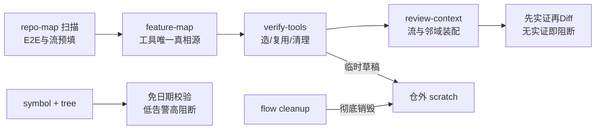

# 变更设计说明书：v10 第七技能 dev-verify-tools、docs/feature-map.json 与先实证后 Diff 审查（Stage C-3）

## 文档信息与变更概览

- **所属总控 PRD**：[Stage C 总控 PRD](../../prd/261119-v10-stagec-unified-architecture-prd.md)（承接验收标准 `C9–C12`，对应 `SC9–SC12`）
- **所属波次与并行约束**：Wave C-2 左翼，与 [Stage C-4 设计规范](../specs/261119-issue93-v10-stagec-c4-dev-iterate-evolution-e2e-spec.md) 并行开发、写域严格零交叠；在 Wave C-1（`C1` + `C2`）全部合入 `main` 后启动
- **关联待办**：[Stage C-3 Todo](../todo/261119-issue92-v10-stagec-c3-dev-verify-tools-review-todo.md)
- Issue: #92
- **拟新建目录声明**：`kit/skills/dev-verify-tools/` (new)、`kit/skills/dev-verify-tools/scripts/` (new)

## 系统变更全景

| 主题域 | 改动目标 | 关键载体 |
| --- | --- | --- |
| 第 7 技能与功能地图 | 建立 `dev-verify-tools` 与 `docs/feature-map.json` 单一真相源，草稿锁仓外 | `kit/skills/dev-verify-tools/` (new)、`kit/skills/lib/feature-map.mjs` (new)、`docs/feature-map.json` (new) |
| 免手工日期过时校验 | 基于 `symbol-index` 与 Git tree 基线对比及风险分级处置 | `kit/skills/lib/feature-map.mjs` (new)、`kit/skills/lib/symbol-index.mjs` |
| 审查先实证再 Diff | 无论地图有无工具均先注入 `businessFlows` + 邻域跑实证再开 `--include-diff` | `kit/skills/dev-review/scripts/review-context.mjs` (new)、`review-pack.mjs`、`review-empirical.mjs` |
| 三大场景与清理闭环 | 创造、自动复用、体检清理完整跑通，清理时销毁仓外草稿 | `kit/skills/dev-verify-tools/scripts/verify-tools.mjs` (new)、`kit/skills/dev-flow/scripts/flow-cleanup.mjs` |

## 一、背景与边界声明

1. **当前架构痛点**：
   - 现有 `docs/TDD.md` 中的表格侧重静态架构说明，缺少一个可被脚本机读、直接关联 `modules -> businessFlows -> verificationTool -> baseline` 的单一真相源，导致验证入口散落且与文档重复维护。
   - 审查工具与辅助测试草稿容易临时写入仓库工作区产生脏提交或无人清理；而靠人工标注「工具更新时间」极易遗忘与腐败。
   - 在没有注册预设验证工具的新功能或改造上，`dev-review` 容易退化成先扫源码 diff 再凭感觉出结论，忽略上下文关联业务流与相邻模块的真实运行回归测试。
2. **明确边界**：
   - `docs/feature-map.json` (new) 专注「功能流、业务入口与验证工具索引」，**不向 `docs/TDD.md` 复制工具清单**且**不往受跟踪的 JSON 内写入易变局部哈希**；`docs/TDD.md` 仍专注架构、边界与设计约束。
   - `dev-verify-tools` 管**验证工具资产**的发现、仓外试制、沉淀、过时检查与体检清理；把大量业务场景自动化回归测试正式写进目标仓原生测试目录的任务专归 Wave C-2 右翼 `C4` 的 `dev-iterate/` (new)。
   - 本切片不改动 `kit/skills/dev-flow/scripts/flow-lifecycle.mjs`、`flow-lifecycle-hooks.mjs` (new)、`templates/`、`govern-tests.mjs` 与 `govern-checks.mjs`，保持与 `C4` 写域零交叠；因新增第 7 技能 `dev-verify-tools/` (new)，`C3` 须在本 PR 内执行 `node scripts/equip.mjs . && node scripts/compose-agents.mjs .` 同步刷新 `.agents/skills/` 与 `AGENTS.md` `意图路由`（绝不手改 `templates/agents-project.md`）。

## 二、设计方案与契约变更

### 1. 第 7 技能 `dev-verify-tools/`、`docs/feature-map.json` 与仓外 `scratch/`（对应 C9 / SC9）
- **技能定义与装配目录**：
  - 创建目录 `kit/skills/dev-verify-tools/` (new) 与 `kit/skills/dev-verify-tools/scripts/` (new)。
  - 新增 `kit/skills/dev-verify-tools/SKILL.md` (new)（`order: 48`），定义触发条件、三种常见自然语言/斜杠工作流、仓外试错规则以及与 `dev-review` 的交接接口。
- **唯一真相源 Schema 与自动预填（`kit/skills/lib/feature-map.mjs` (new)）**：
  - 结构：`{ version: 1, features: [{ id, name, entrypoints, modules, businessFlows, verificationTools: [{ id, kind, command, scriptPath, riskLevel, triggerHints }], testRefs }] }`。
  - **禁止在 `docs/TDD.md` 维护重复副本**：由 `kit/skills/dev-explore/scripts/repo-map.mjs` 在勘察或映射刷新时读取仓库现有 E2E 入口、`scripts/` 验证脚本、`package.json`/Makefile 测试指令与已声明 `businessFlows`，增量预填并更新 `docs/feature-map.json` (new)（保留用户已完善的工具与业务流映射不被覆盖）。
  - 自举交付本仓库自身的 `docs/feature-map.json` (new)，覆盖 `survey`、`equip`、`doc-plan`、`flow`、`review`、`govern`、`edit-gate` 等真实业务流及其现有校验工具链。
- **仓外 `scratch/` 沙箱强约束与清理销毁**：
  - 所有一次性探针、原型或验证草稿文件必须落盘于 `{gitCommonDir}/project-forge-verify/scratch/{taskId}/`，严禁写到仓库树或 `.worktrees/impl-*` 内部。
  - 在 `kit/skills/dev-flow/scripts/flow-cleanup.mjs` 的 `cleanup` 与 `abort` 执行末尾确定性删除该任务对应的 `{gitCommonDir}/project-forge-verify/scratch/{taskId}/` 目录并回收空锁状态。

### 2. 免手工日期的确定性过时校验与风险分级处置（对应 C10 / SC10）
- **指纹与基线存储（零时间戳依赖）**：
  - 缓存文件位于仓外 `{gitCommonDir}/project-forge-verify/cache.json`，以 `{ toolId }` 为键保存最近一次成功通过实证时的基线快照：`{ symbolHash, moduleTreeHash, verifiedSha, passedAtCommit }`。
  - 实时校验时，调用 `kit/skills/lib/symbol-index.mjs` 对该特征关联的全部 `modules` 和 `entrypoints` 提取当前导出符号与 CLI 入口摘要，并计算对应 Git tree/blob 哈希；**只要符号签名或模块树哈希与基线任一不一致，即自动判为 `stale`**，不看任何手工填写的日期或本地时钟年龄。
- **三级风险分级处置**：
  - `low` 风险工具过期：发出 `STALE_WARN` 提示变更的具体模块与新增/缺失导出符号，允许带警告执行或自动刷新基线。
  - `medium` 风险工具过期：阻断无提醒直接复用，优先自动路由至该功能关联的正式 `testRefs`/E2E 入口或引导先在 `scratch/` 验证核心路径再刷新工具基线。
  - `high` 风险工具过期（涵盖数据写入、门禁规则、锁、外部发布、核心业务流）：**硬阻断直接复用**（退出码非零），强制先升级更新工具并重新执行基线采集（或通过等效的强制实时端到端实证替代），确保过时假绿无法蒙混过关。

### 3. 无论功能地图有无工具均强制 `dev-review` 先实证再 `--include-diff`（对应 C11 / SC11）
- **抽出上下文装载模块（`kit/skills/dev-review/scripts/review-context.mjs` (new)）**：
  - 将上下文拼装、邻域图构建与 `feature-map` 查询从 `review-pack.mjs` 抽入 `review-context.mjs` (new)，把 `review-pack.mjs` 压缩至 `<= 660L`。
  - 根据本次 `git diff` 变动文件，查询 `docs/feature-map.json` (new) 及 `repo-map` 依赖逆邻域，无条件装入：受波及的全部 `businessFlows`、直接调用/被调用的相邻模块接口契约、可用运行时验证环境、以及命中的验证工具或缺口提示。
- **审查先实证后 Diff 强顺序（`review-pack.mjs`、`review-gates.mjs`、`review-empirical.mjs`、`kit/skills/dev-review/SKILL.md`）**：
  - 当评审任务要求输出 `--include-diff`（源码修改对比）时，前置门控检查本次审查会话是否已登记针对受影响 `businessFlows` 与相邻模块的真实运行实证证据：
    - 若功能地图存在健康工具 -> 强制优先调运行结果入证；
    - 若功能地图工具过期（`medium`/`high`）或**压根未注册任何预设工具** -> 绝不允许以「无工具」为借口跳过运行而直接看 diff！系统在首轮审查包直接下发可执行实证任务单，指示借助现有 E2E、模块测试命令或仓外 `scratch/{taskId}/` 临时验证脚本跑通实际受波及功能与相邻模块边界；
  - 未收到对应真实实证记录（且非协议允许的非代码纯文档白名单）时，`review-pack --include-diff` 直接阻断并指明缺失哪个业务流的运行时实证；实证落盘后再放行 `--include-diff` 做代码质量与细节复核。

### 4. 三大自然语言/斜杠核心场景全流贯通（对应 C12 / SC12）
- **`kit/skills/dev-verify-tools/scripts/verify-tools.mjs` (new) 子命令与路由**：
  - **场景 1（创造 — `create`）**：识别「缺校验工具 / 帮我建一个验证流」意图 -> 先在仓外 `scratch/{taskId}/` 创建并打磨探针脚本、经 `edit-gate` 规则无坏味及真实通过校验后，询问并正式沉淀为仓库持久化脚本且原子登记至 `docs/feature-map.json` (new) 与基线 `cache.json`。
  - **场景 2（自动复用 — `run`）**：开发或 `dev-review` 触发「跑该模块验证工具 / 自动匹配复核」 -> 反查受影响文件的 `features` 集合 -> 执行免日期过时检查与风险分派 -> 透传 `--task` 等参数运行并回写结构化实证 JSON 与最新基线哈希。
  - **场景 3（体检清理 — `audit` / `clean`）**：响应「体检验证工具库 / 清理僵尸工具与盲区」 -> 检查所有 `docs/feature-map.json` (new) 条目对应的脚本与模块路径是否存在、长期未校验/符号漂移状态、重复功能流，同时识别 `repo-map` 核心模块中的工具空白盲区，安全清理已废弃引用与过期 `scratch/` 残留。

## 三、备选方案与否决理由

1. **否决「在 `docs/feature-map.json` 写入 `lastVerifiedDate` 并按 14 天到期自动判过时」**：真实软件里稳定模块半年不改也不应过期，而热点接口改一次签名哪怕只过了 1 小时工具也已失效；采用 `symbol-index` + Git tree 哈希基线精准对应代码真实改动，零日期假阳性/假阴性。
2. **否决「把临时草稿写进 `.worktrees/.tmp-verify/` 等相对仓库内部子目录」**：容易被未加规则的 `git add -A` 或全量文件扫描工具误卷入；全部统一托管到 `{gitCommonDir}/project-forge-verify/scratch/{taskId}/` 仓外安全空间并绑死 `flow cleanup` 销毁。
3. **否决「仅在 `docs/feature-map.json` 匹配到工具时才要求 `dev-review` 先运行实证，没配工具则直接放行看 diff」**：这会变相激励绕过实证（「只要没建工具就能免实证看 diff」）；无论有无预设工具一律先过功能流/邻域实证才能解锁 `--include-diff`。

## 四、改动清单与影响面

1. **新增第 7 技能与功能地图共享引擎**：
   - `kit/skills/dev-verify-tools/` (new)、`kit/skills/dev-verify-tools/scripts/` (new)
   - `kit/skills/dev-verify-tools/SKILL.md` (new)
   - `kit/skills/dev-verify-tools/scripts/verify-tools.mjs` (new)
   - `kit/skills/lib/feature-map.mjs` (new)
   - `docs/feature-map.json` (new)
2. **勘察预填与清理销毁联动**：
   - `kit/skills/dev-explore/scripts/repo-map.mjs`
   - `kit/skills/dev-flow/scripts/flow-cleanup.mjs`
3. **审查前置实证门控强化**：
   - `kit/skills/dev-review/SKILL.md`
   - `kit/skills/dev-review/scripts/review-context.mjs` (new)
   - `kit/skills/dev-review/scripts/review-pack.mjs`
   - `kit/skills/dev-review/scripts/review-gates.mjs`
   - `kit/skills/dev-review/scripts/review-empirical.mjs`
4. **独立双向夹具与派生装配同步**：
   - `scripts/dev/fixtures-stagec-c3.mjs` (new)
   - `scripts/dev/injections-data-stagec-c3.mjs` (new)
   - 在本 PR 内运行 `node scripts/equip.mjs . && node scripts/compose-agents.mjs .` 同步派生 `.agents/skills/` 与 `AGENTS.md` `意图路由`。

## 五、冻结的验收标准

<!-- criteria:start -->
- [x] C9: （SC9）新增第 7 技能 `dev-verify-tools/` (new) 与唯一机读功能地图 `docs/feature-map.json` (new)（`verificationTools[]` + `testRefs`，无局部哈希且无冗余复写入 `docs/TDD.md`）；由 `repo-map.mjs` 自动从 E2E/脚本/`businessFlows` 预填并完成本仓自举；临时验证草稿锁入仓外 `{gitCommonDir}/project-forge-verify/scratch/{taskId}/` 并在 `flow cleanup`/`abort` 时确定性彻底销毁。
- [x] C10: （SC10）落地不依赖手工时间戳/日期的工具过时校验：通过 `symbol-index.mjs` 导出符号与 Git tree 基线对比仓外 `{gitCommonDir}/project-forge-verify/cache.json` 自动判 `stale`，并按低/中/高风险执行告警提示、E2E 兜底或硬阻断策略。
- [x] C11: （SC11）重构 `dev-review`（拆出 `review-context.mjs` (new)），无论 `docs/feature-map.json` (new) 是否存在预设工具，均强制注入 `businessFlows`、相邻模块与运行时能力并在输出 `--include-diff` 前强制完成真实运行或端到端实证校验。
- [x] C12: （SC12）完整跑通 `dev-verify-tools` 三大自然语言/斜杠核心场景——创造新工具（仓外草稿成熟后沉淀注册入 `docs/feature-map.json` (new)）、自动复用已有工具（含过时分级处置）及工具体检清理（消除僵尸引用与高风险盲区）。
<!-- criteria:end -->

## 六、高风险点、门型与回滚路径

1. **门型判定**：`one-way`（高风险）。改动 `dev-review` 放行门控核心（`review-pack`/`review-gates`/`review-empirical`）及工作树销毁链，一旦放松则先实证形同虚设，合入前须独立双门审查及强注入验证。
2. **紧文件拆分布局与行数控制**：
   - `kit/skills/dev-review/scripts/review-pack.mjs`（拆出 `review-context.mjs` (new)，主文件控制在 `<= 660L`）
   - `kit/skills/dev-review/scripts/review-gates.mjs`（控制在 `<= 730L`）
   - `kit/skills/dev-review/scripts/review-empirical.mjs`（现 695L，控制 `<= 740L`）
   - `kit/skills/lib/feature-map.mjs` (new)（`<= 600L`）、`kit/skills/dev-verify-tools/scripts/verify-tools.mjs` (new)（`<= 650L`）。
3. **关键故障点与回滚**：
   - **纯文案改动被误卡实证**：继续对齐协议 `LOW_RISK_NON_EXEC_EXTS` 纯非可执行文档白名单，保证改错别字或 Markdown 文档不触发不必要运行实证阻断。
   - **仓外路径误删**：`flow-cleanup.mjs` 严格先校验路径前缀必落于 `{gitCommonDir}/project-forge-verify/scratch/{taskId}` 才执行删除。
   - **回滚路径**：所有修改独立位于 `C3` 分支，随时可经单提交 `git revert` 安全退出。

## 七、上线与兼容策略

- **无 `docs/feature-map.json` 存量仓兼容**：老仓库首次运行 `review-pack` 或 `repo-map` 时自动触发轻量化预填并容错执行；缺失文件时既不崩盘，也不允许降级免除 `businessFlows` 先实证要求。
- **Wave C-2 并行协同**：与 `C4` 全程 0 核心源/模板文件交叠；各自 PR 内均运行 `node scripts/equip.mjs . && node scripts/compose-agents.mjs .` 刷新 `.agents/skills/` 与派生路由，波次内后合并者 rebase 后重跑该双指令并跑全量 `merge-gate`。

## 澄清与补充记录

- `2026-11-19`：确认 `C3` 所有 `scratch/` 路径校验严守仓库外独立命名空间并在 `flow-cleanup.mjs` 单点销毁。

## 实现说明

- 分支：`feat/v10-stagec-c3`（关联 Issue `#92`，任务 `stagec-c3`）
- 新增第 7 技能 `kit/skills/dev-verify-tools/`（`SKILL.md` `61L` `order: 48`、`verify-tools.mjs`、`verify-tools-audit.mjs`）及共享内核 `kit/skills/lib/feature-map.mjs`、`kit/skills/lib/verify-state.mjs`（含纯切片查询 `matchFeatureMapForPaths` 与 Fail-Soft/Fail-Closed 边界）。
- 完成本仓 `docs/feature-map.json` 自举（12 项功能流、12 项验证工具、0 僵尸、0 盲区、0 局部哈希），对接 `repo-map.mjs` 增量预填与 `flow-cleanup.mjs` 仓外 `scratch/{taskId}/` 路径前缀校验销毁 + 跨 `>= 2` PR `verify.scratch-used` 固化提示。
- 拆出 `kit/skills/dev-review/scripts/review-context.mjs`，升级 `review-pack.mjs`、`review-gates.mjs`、`review-empirical.mjs`、`review-empirical-state.mjs`、`kit/skills/dev-review/SKILL.md` 与 `workflow-policy.mjs`/`flow-lifecycle-helpers.mjs`，实现无论有无预设工具均强制业务流实证与防敷衍 `--e2e-evidence` 拦截。
- 新增功能域夹具 `scripts/dev/fixtures-verify-tools.mjs` 与故障注入 `scripts/dev/injections-data-verify-tools.mjs`（`I197–I206`），同步运行 `equip.mjs .` 与 `compose-agents.mjs .`。
