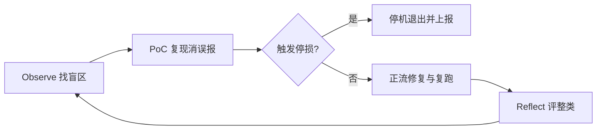

# 工具无关结构化实证附件、PoC 先行原则与有界优化循环（Issue `#102`）

> 所属总控 PRD：[v10.1 总控 PRD](../../prd/261120-v10-1-hardening-pillars-docs-prd.md)　｜　配对 Todo：[w2b-empirical-poc-cycle Todo](../todo/261120-issue102-w2b-empirical-poc-cycle-todo.md)
>
> 总控 PRD 认领范围：覆盖总控 `C9..C12`（总控 `C9` -> 本切片 `C1`；总控 `C10` -> 本切片 `C2`；总控 `C11` -> 本切片 `C3`；总控 `C12` -> 本切片 `C4`）。

## 一、目标、Wave 2 并行边界与非目标

<!-- section: goal -->
### 1.1 目标

吸收通用实证与迭代收敛工程原则，在不引入第 9 个技能且不绑定任何外部工具的前提下，强化三道确定性能力：

1. **工具无关的结构化实证 `--artifact` 与 UI 裸传拦截**：校验实证附件真实存在且非空并记入账本 `evidence.json`/审查回执，防止更改界面资源时仅靠 `--visual-checked` 布尔开关敷衍放行；
2. **先最小运行复现消误报，再评 Tier 1/2 整类加固**：将通用 `PoC-first` 复现消误报、复跑证伪+回归验证与整类根治准则写入缺陷升级与治理契约，支持可选 `reproEvidence` / `pocCommand` 字段；
3. **`iterate.mjs cycle` 有界持续优化循环与输出边界原则**：提供轻量只读四阶段编排子命令及硬停损门控，并在 `templates/agents-project.md` 与本仓 `AGENTS.md` 固化「只锁客观输出边界」准则，保持 `AGENTS.md < 24576 B`。

### 1.2 Wave 2 文件互斥边界（与 `#101` 零碰撞）

- `flow.mjs verify` 的 `--artifact`（`multiFlags`）与 `--visual-blocked-reason`（`valueFlags`）参数接收、移除裸 `--visual-checked` 伪造观察串并向 `workflow-policy.mjs` 透传 `{ artifacts, visualBlockedReason, visualCheckedRaw }` 的契约由并行切片 `#101`（`kit/skills/dev-flow/**`）预落地；
- 本切片独占改动 `kit/skills/lib/empirical-artifacts.mjs` (new)、`kit/skills/lib/workflow-policy.mjs`、`kit/skills/lib/workflow-helpers.mjs`、`kit/skills/dev-review/**`、`kit/skills/dev-iterate/**`、`kit/skills/dev-govern/**`、`kit/skills/lib/escalation.mjs` 与 `templates/agents-project.md` / `AGENTS.md`，与 `#101` 保持 `0` 源码文件交集；
- **800 行防越界拆分**：实测 `kit/skills/lib/workflow-helpers.mjs` 已达 `797` 行、`kit/skills/lib/workflow-policy.mjs` 已达 `783` 行；全部新增实证附件校验、UI 阻断判定与附件清单格式化逻辑须抽入独立模块 `kit/skills/lib/empirical-artifacts.mjs` (new)（同步至 `.agents/skills/lib/empirical-artifacts.mjs` (new)），既有两文件只加薄委托与导出，严保每个 `.mjs <= 800` 行；
- **派生清单规则**：`.agents/skills/.pf-manifest.json` 为 `equip.mjs .` / `compose-agents.mjs .` 派生清单；若 `#101` 先合入，本切片 rebase `main` 后重跑 `equip.mjs .` 与 `compose-agents.mjs .` 重建后再合。

### 1.3 非目标（Explicit Non-Goals）

<!-- section: non-goals -->
- 严禁修改 `kit/skills/dev-flow/**`、`kit/skills/dev-plan/**`、`kit/skills/lib/pending-decisions.mjs`、`kit/skills/lib/handoff-package.mjs`。
- 严禁在代码、规则或校验中写死任何具体浏览器引擎、截图工具、云端沙箱或特定静态扫描器品牌名。
- `iterate.mjs cycle` 不自动修改源码或跳过 `dev-plan -> dev-edit -> dev-review` 正流（保持只读编排定位）。
<!-- section: non-goals-end -->
<!-- section: goal-end -->

## 二、技术设计与接口契约（`C1..C4`）

<!-- section: design -->

### 2.1 `C1` 工具无关 `--artifact` 实证采集与 PR 验证表渲染

- **校验规则与模块化拆分（`kit/skills/lib/empirical-artifacts.mjs` (new) + `kit/skills/lib/workflow-policy.mjs`、`kit/skills/lib/workflow-helpers.mjs`、`kit/skills/dev-review/scripts/review-pack.mjs`、`review-empirical.mjs`、`review-empirical-state.mjs`）**：
  - 在 `kit/skills/lib/empirical-artifacts.mjs` (new) 实现 `validateArtifactsAndVisual`、`normalizeArtifactRecords` 与 `formatArtifactEvidenceLines`；`workflow-policy.mjs`（提供 `validateVerifyPrecheck` 供 `flow verify` 透传入口调用，并同步加固 `validateVerificationEvidence`）与 `review-pack.mjs check-empirical` 薄委托调用，接收可选多值参数 `artifacts`；
  - 对每个声明的附件路径校验：文件必须真实存在、为常规文件且 `size > 0`（缺失、目录或空文件立即报结构化错误阻断，并提示不得把临时大二进制或敏感快照遗留脏工作区）；
  - 计算并登记标准化元数据 `{ relPath, bytes, sha256Prefix, capturedAt }` 到 `.pf-state` 中的 `evidence.json` 及独立审查实证回执，不额外修改 Git 跟踪文件；
  - `kit/skills/lib/pr-template-hydrate.mjs` 中 `buildVerificationEvidenceSection`（由同文件 `hydratePrTemplateBody` 调用、经 `kit/skills/lib/workflow-helpers.mjs` 重导出）薄委托调用 `empirical-artifacts.mjs` (new) 渲染结构化实证摘要与附件清单（文件相对路径、字节数与校验指纹前缀），保持 `workflow-helpers.mjs <= 800` 行。

### 2.2 `C2` 触及 `UI_VISUAL_EXT_RE` 禁止裸传 `--visual-checked`

- **强拦截点（`kit/skills/lib/empirical-artifacts.mjs` (new) -> `kit/skills/lib/workflow-policy.mjs` + `kit/skills/dev-review/scripts/review-empirical.mjs`）**：
  - 当变更文件集合命中 `UI_VISUAL_EXT_RE` 时，对透传的 `visualCheckedRaw` / `observationSummary` / `artifacts` / `visualBlockedReason` 做校验：若仅传递裸布尔开关 `--visual-checked` 而**既未提供至少 1 个合法非空 `--artifact`，也未提供实质性视觉渲染观察摘要（不含敷衍占位短语或旧式硬编码串）**，在 `verify` 阶段与 `submit` 阶段直接阻断放行；
  - 若当前运行环境确实不具备图形/渲染观察条件，不允许用 `--visual-checked` 假通过，必须显式传入 `--visual-blocked-reason "{reason}"`，诚实记为「环境阻塞待人工或带界面节点核验」并在审查输出与 PR 证据表显式披露。

### 2.3 `C3` `PoC-first` 复现消误报与 Tier 1/2 整类加固

- **建单载体与文档准则（`kit/skills/lib/escalation.mjs`、`kit/skills/dev-iterate/SKILL.md`、`kit/skills/dev-govern/SKILL.md`）**：
  - `escalation.mjs` 中 `buildEscalationIssuePayload` 及对应校验函数新增可选字段 `reproEvidence`（最小失败复现描述或退出码/日志摘要）与 `pocCommand`（可独立重放的通用复现命令字符串），严禁限定或识别具体扫描器工具名；
  - 在 `kit/skills/dev-iterate/SKILL.md` 与 `kit/skills/dev-govern/SKILL.md` 固化通用工程四步准则：① **最小运行复现消误报**：静态告警优先以最小可执行 PoC 证明真实可达性；② **复跑证伪 + 回归防护**：修完后用同条 PoC 复跑变绿并纳入正反断言库；③ **评估整类加固（Tier 1/2）**：确认单点缺陷是否折射同模式共性（Tier 1 静态门禁/类型/Linter 下沉，Tier 2 共享边界原语重构）；④ **只锁客观边界**。

### 2.4 `C4` `iterate.mjs cycle` 有界优化循环与契约同步

- **子命令入口（`kit/skills/dev-iterate/scripts/iterate.mjs`）**：
  - 新增只读编排子命令 `cycle --goal "{goal}" [--max-rounds 3] [--progress-history "{json}"] [--pending-gates "{json}"] [--json]`（默认 `maxRounds = 3`，硬上限 `<= 10`）；
  - 输出结构化四阶段推进状态机：`Observe -> PoC/Escalate (autonomous) -> Fix/Verify -> Reflect`，内置三条硬停损闸门：`ROUND_LIMIT_REACHED`（达到轮次上限）、`NO_PROGRESS_STALL`（连续两轮增量观察/通过数零进展）、`ONE_WAY_GATE_HIT`（涉及 `one-way` 或高风险边界待人工拍板）；
  - 当停损条件触发时明确给出 `stopped: true` 与 `stopReason`，不得无限自旋。
- **工程契约与生成物同步**：
  - 在 `templates/agents-project.md` 精简补入「只锁客观输出边界（锁产物/接口/断言，不锁私有过程）」原则，执行 `node scripts/equip.mjs .` 与 `node scripts/compose-agents.mjs .`，严格确认 `AGENTS.md` 体积 `< 24576 B`（实测达标写入验证记录）；
  - 在 `scripts/dev/fixtures-empirical-cycle.mjs` (new) 与 `scripts/dev/injections-data-empirical-cycle.mjs` (new)（号段 `I260–I269`）覆写正反断言与故障注入。

### 2.5 可复用模块与取舍

<!-- section: reuse -->
- `kit/skills/lib/workflow-policy.mjs` 与 `kit/skills/lib/workflow-helpers.mjs`（统一实证校验与 PR 渲染单源）
- `kit/skills/dev-review/scripts/review-empirical.mjs`、`review-empirical-state.mjs`（独立审查实证状态机）
- `kit/skills/lib/escalation.mjs`（既有结构化问题上报荷载生成器）
- `kit/skills/dev-iterate/scripts/iterate.mjs`（既有迭代发现入口，复用同一 CLI 解析层）
<!-- section: reuse-end -->

<!-- section: alternatives -->
- **实证附件验证形态**：曾考虑只接受特定截图文件名或测试报告 XML（否定，违背工具无关红线且把前端与服务端割裂）；最终统一采用通用 `--artifact {path}` 校验存在性 + 非空字节 + 哈希记录，兼容任意文本/图像/JSON 实证。
- **`cycle` 编排权限**：曾考虑让 `iterate.mjs cycle` 直接改源码并循环提交（否定，破坏 `dev-plan -> dev-edit -> dev-review` 正流与独立上下文审查原则）；锁定为轻量只读编排与硬停损裁判。
<!-- section: alternatives-end -->
<!-- section: design-end -->

## 三、门型评估、正反双向验收与故障注入矩阵

<!-- section: gates -->
- **门型**：`one-way` 级别实证门禁变更且涉及 `templates/agents-project.md`、`AGENTS.md`、`kit/` 高风险路径，须通过独立审查与 `I260–I269` 故障注入实证。
- **验证命令**：
  - `node scripts/dev/fixtures.mjs --domain empirical-cycle`
  - 逐条校验注入（如 `node scripts/dev/verify-injections.mjs --only I260` 至 `I263`）或全量 `node scripts/dev/verify-injections.mjs`
  - `node scripts/compose-agents.mjs . --check && node scripts/equip.mjs . --check && node scripts/dev/preflight.mjs`
<!-- section: gates-end -->

<!-- section: acceptance -->
### 验收标准（对应 Issue `#102` 与总控 `C9..C12`）

<!-- criteria:start -->
- [x] C1: 拆出 `kit/skills/lib/empirical-artifacts.mjs` (new) 保全 `workflow-helpers.mjs` 与 `workflow-policy.mjs` 严格 `<= 800` 行；`review-pack.mjs check-empirical`、`workflow-policy.mjs`（含与 `flow.mjs verify` 透传对接）及 `buildVerificationEvidenceSection` 支持 `--artifact {path}`：真实非空文件校验通过并记入 `evidence.json`/审查回执（零脏工作区），并在 PR 验证表自动渲染结构化实证摘要与附件清单；反例为不存在或 0 字节文件阻断。
- [x] C2: 触及 `UI_VISUAL_EXT_RE` 文件时禁止裸传 `--visual-checked` 敷衍放行，必须附带非空 `--artifact` 或实质视觉观察，无渲染环境须显式传 `--visual-blocked-reason` 诚实报阻。
- [x] C3: 在 `escalation.mjs`、`kit/skills/dev-iterate/SKILL.md`、`kit/skills/dev-govern/SKILL.md` 融入「最小运行复现消误报 -> 复跑证伪与回归 -> 评估 Tier 1/2 整类加固」原则及可选 `reproEvidence`/`pocCommand` 字段（零具体工具硬编码）。
- [x] C4: 在 `kit/skills/dev-iterate/scripts/iterate.mjs` 新增只读编排子命令 `cycle --goal "{goal}" [--max-rounds 3] [--json]`（串联四阶段与轮次/零进展/单向门硬停损），在 `templates/agents-project.md` 固化「只锁客观输出边界」底线，刷新 `equip.mjs .` / `compose-agents.mjs .`（`AGENTS.md < 24576 B`）并补齐 `scripts/dev/fixtures-empirical-cycle.mjs` (new) 与 `scripts/dev/injections-data-empirical-cycle.mjs` (new)（`I260–I269`）。
<!-- criteria:end -->
<!-- section: acceptance-end -->

## 四、待拍板问题

<!-- section: pending -->
- 已定：实证附件字段、UI 阻断契约、PoC 字段名与 `cycle` 停损阈值均已拍板定稿，无未决事项。
<!-- section: pending-end -->

## 实现说明

- 实现提交基线: dcf84c57c72833eecb6515497ac78816644eb454
- 关联任务: w2b-empirical-poc-cycle
