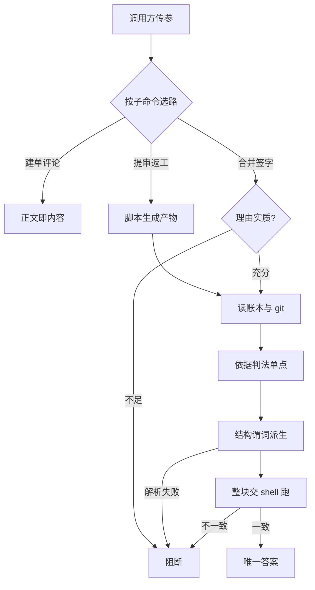

# 流程真相收口：批准闭合、生成物单生产者、门禁单源派生、退出码单点分层（Issue `#113`）

> 配对 Todo：[flow-truth Todo](../todo/261120-issue113-flow-truth-todo.md)
>
> **基线**：全部行号与计数在 `a0fe4df` 上实测。前置切片 `w2a-plan-wave-gate` 已合入、关闭并归档；此依赖无副作用（切片图实跑 `ok: true`、同波次写域交叉 0）。

本切片覆盖立项单 `#113` 的三类缺陷、全域普查 `F1..F18`、第 19 批 `F19..F27`，以及第 2 轮内审追加的 `F28..F36`。对应关系见 1.3。

## 一、目标、红线与非目标

<!-- section: goal -->
### 1.1 目标

1. **批准闭合**：批准只由唯一入口写入；「批准」与「依据」不允许自相矛盾。**这条判断只能有一处实现**，退场门禁与文档审计都调它，不允许两处对同一份事实给出相反结论。
2. **生成物单生产者**：由脚本确定性生成的产物不提供整段替换入口，也**不允许存在第二处派生兜底**——删掉派生本身，不是换措辞躲开黑名单。
3. **状态由事实推导**：轮次、远端合并结果、观察证据一律从账本、实证记录与 git 事实读出，**且复用仓库既有判定**，不写第二份。
4. **同一份真相只写一处，检查必须可证伪**：门禁清单由流水线**结构谓词**圈定后单源派生；退出码档位、远端检查判定、层级映射各自单点；检查用「已知输入产出已知输出」的定点用例证明，不用恒真等式，也不用「按文件整段放行」这种软通道。
<!-- section: goal-end -->

### 1.2 非目标（Explicit Non-Goals）

<!-- section: non-goals -->
- 不新增第 9 个技能，不引入任何第三方运行时依赖。
- 不删除人类签字通道（`--human-approved`、`--human-approved-exec`、`--takeover`）：保守仓需要它，本切片只收紧契约。
- 不改建单、评论、里程碑的正文参数：那里正文是内容本身。
- 不改发版链路本身，不碰 `docs/archive/`（`do-not-edit` 禁改区，本切片所有全仓检索一律排除它）。
- 不改远端流水线的平台版本矩阵与运行环境配置。
- 不允许任何补丁式收口：不加「再多一个判断挡住它」的分支，不加关掉问题的开关，不靠重试掩盖永不成立的判定，不留「跑不了就放过」「按文件名整段跳过」的软通道。
- **不允许为通过检查而添加豁免条目**：任何豁免都必须能说出「为什么这段结构上不可判」，说不出来就说明判据本身要改。
<!-- section: non-goals-end -->

### 1.3 普查项到判据的对应

| 判据 | 覆盖的普查项 | 一句话 |
| --- | --- | --- |
| `C1` | `F11`、`F19`、`F20`、`F28`、`F29`、`F30` | 批准闭合；依据判法单点且与退场门禁同源；回退清标记；负责人变更留痕 |
| `C2` | `F1`、`F2`、`F16`、`F21`、`F22` | 生成物单生产者；兜底分节标题同源；删参数同批清掉教学点 |
| `C3` | `F4`、`F5`、`F6` | 轮次与合并结果由账本与 git 事实推导，复用既有合流判定 |
| `C4` | `F3`、`F17`、`F23`、`F34` | 实证文本唯一判据；**现存两处派生写点全部删除** |
| `C5` | `F7`、`F8`、`F9`、`F24` | 放行类开关理由必填且必须实质；删除兜底串 |
| `C6` | `F12`、`F13`、`F14`、`F32` | 门禁单源派生；**结构谓词圈定流水线**；失败即阻断；未核验独立成态 |
| `C7` | `F15`、`F33` | 注册表、帮助、读取点三重对拍；**含间接读取形态**；只认定义位置 |
| `C8` | `F10` | 分诊只读真相，补充输入留源 |
| `C9` | `F18`、`F25`、`F26`、`F27`、`F31`、`F35`、`F36` | 退出码四档单点化；驳回不得返回 0；**19 处断言同步迁移** |

第 2 轮内审追加的九项：

| 编号 | 事实 |
| --- | --- |
| `F28` | `C1` 判据落点应写进 `doc-audit.mjs:299` 的 `auditDoc`；`doc-plan.mjs` 只是调用方 |
| `F29` | 新判据若另立一条规则，会与 `plan-exit-gate.mjs:169-172`「缺字段即判通过」相反，把两份正在生效的 Todo 判红 |
| `F30` | `doc-audit.mjs:39-43` 的枚举里 `prd`/`spec`/`todo` 本就有 `in_review`，自造新词会被非法状态打红 |
| `F31` | 自审判定不在 `review-locks.mjs`；真实三处在 `review-ledger.mjs:123-137`、`critique-rounds.mjs:327-355`、`doc-requirements.mjs:626-643` |
| `F32` | 按文件名整段排除发版流水线是软通道；应改用三条结构谓词圈定 |
| `F33` | 帮助文本里句中提及的 `--body-file`/`--ignore-scripts` 不是参数声明；`opts[CONST]` 是活参数的合法读取形态 |
| `F34` | `review-ledger.mjs:455-459` 是第三处同字段派生写入；换措辞不解决，必须删除派生 |
| `F35` | 会因改档变红的断言共 20 处（A 类 15 + B 类 4），分布 7 个文件；`fixtures-e2e-gate.mjs`、`blind-run-harness.mjs` 未进写域 |
| `F36` | 全仓检索类验收必须排除 `docs/archive/`（`do-not-edit` 禁改区），否则永不可能通过 |

## 二、技术设计与接口契约

<!-- section: design -->

### 2.1 `C1` 批准闭合：判法单点，落点在审计模块

- **落点**：判据写进 **`kit/skills/dev-plan/scripts/doc-audit.mjs` 的 `auditDoc`（`:299`）**。`doc-plan.mjs` 只是调用方，改它不生效。
- **影响文件**：`kit/skills/dev-plan/scripts/doc-audit.mjs`、`kit/skills/lib/plan-exit-gate.mjs`、`kit/skills/lib/docs.mjs`、`kit/skills/lib/intake-triage.mjs`、`kit/skills/lib/doc-requirements.mjs`、`kit/skills/lib/critique-rounds.mjs`、`kit/skills/dev-review/scripts/review-ledger.mjs`、`kit/skills/dev-plan/scripts/doc-plan-ops.mjs`。

**（一）先解决「两处判法打架」——这是本切片要治的病，不能在修法里复发**

实测冲突：`plan-exit-gate.mjs:169-172` 对「没有 `plan_critique` 字段」判**通过**（`basis: 'passed'`）。若审计另立一条独立规则要求「批准为真但依据缺失即报错」，两者会对同一份文档给出相反结论：两份正在生效的 Todo 当场变红，`audit .` 返回 `ok: false`，而 Todo 自己的验收又要求它 `ok: true`。

药方不是给判据加个 `if`，而是**把「有没有依据」这件事收敛成一处实现**：

- 在 `kit/skills/lib/plan-exit-gate.mjs` 扩出一个导出函数（该文件已是「规划能否退场」的唯一判定处，`resolveCritiqueReadiness` 在 `:153` 已导出）：输入文档类型、`approved`、`plan_critique`、人类 override，输出 `{ applicable, hasBasis, basis }`。
- **适用性由文档类型决定，且理由必须写死在这里**：`todo` 档不适用——`Case 3` 的规矩是「建 Todo 冻结验收标准、跑审计直通」，流程里没有 Critique 也没有批准动作，拿依据去卡它会把整档卡死；卡死的门禁只会被人加豁免，然后连该拦的一起放过。这个理由今天写在 `plan-exit-gate.mjs` 的注释里（`READY_STATUS` 与 `APPROVAL_REQUIRED` 上方），本切片把它升级为代码里的显式返回值。
- `spec` 与 `prd` 适用：批准为真时，依据必须是 `passed` 或带理由的 `skipped`；缺失即报错。依据这条路径的合法性来自 `approve` 的实现——它只会写这两种之一，所以「批准为真 + 依据缺失」在合法路径下不可能出现。
- **`auditDoc` 与退场门禁都调这一个函数**，谁也不许自己再判一遍。

**（二）批准入口与状态一致性**

- **生命周期同步不得写入批准**：`link` 的 `--status` 只允许非批准档位与同名修正；任何把状态写成已批准或把批准标记置真的入参按用法错误拒绝，报错串点名唯一入口 `approve`。
- **回退必须清标记**：实测 `docs.mjs:514` 的 `--status` 分支只改状态，`docs.mjs:519` 的 `approved` 是独立入参，两者不联动——于是「回退到草稿、批准标记仍为真」，而分诊豁免（`intake-triage.mjs:152`）只读那个标记，回退之后文档继续享受豁免。改为任何非批准档位写入时同批把批准标记置假。
- **驳回不得静默成功**：评审驳回分支当前返回 `0`（`critique-rounds.mjs:537` 取 `stopLoss ? 4 : 0`），使「评审未通过」在退出码上完全消失。改为返回非零，档位见 `C9`。

**（三）负责人变更与自审锁**

- **落点**：自审判定**不在** `review-locks.mjs`（实测该文件里 `owner` 出现 0 次、`implementer` 判定 0 处）。真实的三处是：`review-ledger.mjs:123-137`（代码自审）、`critique-rounds.mjs:327-355`（规划自审）、`doc-requirements.mjs:626-643`（作者即实施者）。
- 实测 `docs.mjs:513` 的负责人可被独占参数直接改写，随后原负责人以复核人身份执行评审仍被放行。改为：负责人变更需理由、入账，并保留历史负责人集合；三处自审判定一律按「历史负责人集合 ∪ 当前负责人」比对，不只看当前字段。

**（四）合法中间态：复用既有取值，不新增枚举**

- 实测 `doc-audit.mjs:39-43` 的 `VALID_STATUS_BY_TYPE` 里，**`prd`、`spec`、`todo` 三种类型本来都有 `in_review`**。自造一个新词只会被非法状态打红。
- 因此本切片**复用既有 `in_review`，不改枚举**；`doc-audit.mjs:39-43` 的枚举不做改动（它仍在本切片写域内，但只因为同文件的 `auditDoc` 要改）。

### 2.2 `C2` 生成物单生产者，且不留教学点

- **影响文件**：`kit/skills/dev-flow/scripts/flow.mjs`、`flow-lifecycle.mjs`、`flow-lifecycle-helpers.mjs`、`kit/skills/lib/pr-template-hydrate.mjs`、`kit/skills/lib/cli.mjs`、`kit/skills/lib/workflow-policy.mjs`、`kit/skills/lib/review-comment-render.mjs`、`kit/skills/dev-flow/SKILL.md`。
- **契约细节**：
  - 参数注册改为按子命令声明；提审与返工分支不接收正文参数，传入即按用法错误拒绝，错误串写明正文由账本与模板生成。
  - `flow-lifecycle.mjs` 中「有传参就用传参、否则调生成器」的短路改为无条件调用生成器。
  - 建单、评论、里程碑分支保留正文参数，并补进帮助输出。
  - **标题**保留人类改名通道，但账本记来源（人工 `caller` / 派生 `derived`）。
  - **兜底分节标题**从真实模板同一份常量派生。
  - **删参数必须同批清掉指引**：返工开关删除后，`flow-lifecycle-helpers.mjs:115`、`review-comment-render.mjs:101`、`workflow-policy.mjs:677` 三处仍在输出旧参数指引，`workflow-policy.mjs:707` 还在拼接该参数，必须一并改掉。

### 2.3 `C3` 轮次与合并结果由事实推导，复用既有判定

- **影响文件**：`flow-lifecycle.mjs`、`flow-merge.mjs`、`flow-batch.mjs`、`flow-cleanup.mjs`、`kit/skills/lib/task-backend.mjs`、`task-graph.mjs`、`workflow-policy.mjs`、`kit/skills/dev-flow/SKILL.md`、`templates/agents-project.md`、`docs/TDD.md`、`references/collaboration.md`。
- **契约细节**：
  - **删除返工开关**：返工由账本判定（末轮结论为退回且该轮审查令牌已消费）；返工评论轮次取推导值；账本无该轮不得渲染返工标题；删掉该开关顺带跳过的「同分支已有 OPEN 提案」防重查找。
  - **删除声明式合并开关，复用 `kit/skills/lib/git.mjs:303` 的 `inspectBranchMergeState`**（`git cherry` + `patch-id --stable` 四态，`flow-cleanup.mjs:199`、`task-graph.mjs:339`、`govern-checks.mjs:432` 已在用），不写第二份判法。
  - **判定前先取回远端**；取回后仍核不到才如实报未核验并阻断，交给签字通道。
  - `task-backend.mjs` 删掉「凭布尔量返回合并成功」的分支。
  - **删参数同批清文案**：`templates/agents-project.md:173`、`:196`、`docs/TDD.md:282`、`references/collaboration.md:13`、`kit/skills/dev-flow/SKILL.md:49` 与 `:79`。其中模板会分发给每一个被治理项目。

### 2.4 `C4` 删掉派生兜底，不换措辞

- **影响文件**：`flow-lifecycle.mjs`、`kit/skills/dev-review/scripts/review-ledger.mjs`、`kit/skills/lib/evidence-substance.mjs` (new)、`kit/skills/lib/empirical-artifacts.mjs`、`kit/skills/lib/verify-state.mjs`、`kit/skills/dev-review/scripts/review-empirical-state.mjs`、`kit/skills/lib/workflow-helpers.mjs`。
- **契约细节**：
  - 实测 `flow-lifecycle.mjs:480-481` 当前写入的固定串**通过**两道判据（`evaluateObservationSubstance` 与 `validateE2eEvidenceText` 均 `ok: true`）。换措辞只是躲开黑名单，缺陷性质不变——**必须删掉派生本身**。
  - **现存两处派生写点，全部删除**：
    1. `flow-lifecycle.mjs:480-481`：核验通过时把证据字段写成「入参 / 开关派生的固定串 / 既有值」三选一。
    2. `review-ledger.mjs:455-459`：把证据字段写成「入参 / 附件路径 / 阻塞说明派生的固定串 / 既有值」四选一。
  - 新规则：**该字段只接受入参或既有真实记录，两者都没有就不写这个字段**。它不得由任何开关、任何阻塞说明派生。
  - 「这段文本算不算实证」收敛为一处：把两个判据的共用部分抽到 `kit/skills/lib/evidence-substance.mjs` (new)，提审侧、审查回执侧、放行理由侧（见 `C5`）三处都调它。
  - 界面类改动在无附件、无观察、无阻塞说明时按既有语义阻断；关掉渲染环境时走阻塞说明如实报阻。
- **反例边界**：不得为了过关把新串加进黑名单——黑名单只会逼出下一个措辞。

### 2.5 `C5` 放行类开关：理由必须实质且入账

- **影响文件**：`flow-merge.mjs`、`flow-lifecycle-hooks.mjs`、`flow-next.mjs`、`kit/skills/dev-review/scripts/review-pack.mjs`、`review-ledger.mjs`、`kit/skills/dev-edit/scripts/edit-gate.mjs`、`kit/skills/dev-govern/scripts/govern-state.mjs`、`kit/skills/dev-plan/scripts/doc-plan-ops.mjs`、`kit/skills/lib/critique-rounds.mjs`、`kit/skills/lib/doc-comments.mjs`、`kit/skills/lib/evidence-substance.mjs`。
- **契约细节**：
  - **全部放行点统一要求理由**，无理由即拒。实测十六处分三档：五处已强制非空理由；三处**校验点要求、调用点却自动填兜底串**（跳过改码门禁、跳过治理巡检、合并侧停损解锁），等于校验被绕过；其余八处完全不要求。
  - **三处兜底串必须删除**（`flow-merge.mjs:150`、`flow-lifecycle-hooks.mjs:215`、`:301`）。它们都能通过实质判据，新的契约会被原样洗白。
  - **收口最直接的一条后门**：`doc-plan-ops.mjs:64` 的「跳过规划内审」只校验非空，实测传占位词即可产出「已批准 + 跳过评审」。纳入同一标准。
  - **理由必须实质**，判据复用 `C4` 的 `evidence-substance.mjs`，不另造口径。
  - **被绕过项逐条入账**；结构化评论带理由与被绕过项摘要，不再出现「门禁检查通过」这种与事实相反的结论行。
  - **删除合并分支的强制参数**（未列在帮助里，用途是跳过未解析依赖）；统一「跳过治理巡检」两侧要求。

### 2.6 `C6` 门禁清单单源派生：结构谓词圈定，整块经 shell 执行

- **影响文件**：`kit/skills/lib/gate-truth.mjs` (new)、`scripts/dev/merge-gate.mjs` (new)、`kit/skills/lib/profile-sniffer.mjs`、`flow-merge.mjs`、`flow-batch.mjs`、`kit/skills/lib/workflow-policy.mjs`、`kit/skills/lib/profile.mjs`、`scripts/dev/preflight-contracts.mjs`、`scripts/dev/preflight-suite.mjs`、`AGENTS.md`、`.github/workflows/check.yml`。
- **（一）流水线用结构谓词圈定，不按文件名放行**

「只采纳校验类流水线、发版流水线整体排除」是按文件整段跳过，正是 §1.2 自己禁掉的软通道，还会连带丢掉发版流水线里两条本地跑得通的检查：标签与版本号同号（`:66-85`）、真包导出加包清单核对（`:132-135`）。

改为**三个可从文件机械读出的结构谓词**，必须同时成立：

1. **触发形态**是 `pull_request` 或推送到默认分支（`check.yml:11-17` 就是这样；`release.yml` 是推标签，不满足）。
2. **无写权限**：权限声明里没有任何写作用域（`check.yml:21-22` 是只读；`release.yml:35` 有写作用域，不满足）。
3. **步骤本身不需要远端上下文**（不依赖远端 API、不发版、不推送）。

三条都是结构事实，不依赖「认得出发版流水线」这种语义判断。`release.yml` 会因为 1、2 两条不成立而被排除，而不是因为「它是发版流水线」。

- **（二）派生粒度与执行方式**
  - **一条执行块算一步**（多行整体执行）。实测现有扫描把多行块拆成每行一条，在本仓产出 **140 条**（`check.yml` 21 条 + `release.yml` 119 条），而 `check.yml` 真实执行块只有 **14** 个、其中真正的检查命令 **10 条**；病态条目含孤立右括号、`exit 1`、被截断的 `|| {`、错误提示行、纯导出命令。
  - **编排脚本必须经过 shell 执行整块**。理由写死在这里：`check.yml:90-93` 那个块里是两条命令（导出包清单 + 按清单核对），算一步就只能整块交给 shell 串行跑；如果编排脚本自己 `execFile` 拆词，这个块就跑不成。
  
- **（三）失败路径与三态**
  - 解析失败、找不到流水线、派生结果为空，三者一律阻断并报原因，**不得降级为空清单**（空清单等于门禁退化为假绿）。
  - 三种结果严格互斥：**通过 / 失败 / 未核验**。未核验是独立第三态，带标记与理由，逐条进报告；**不得等价于通过**，也不得以任何形式折成通过。
  - 豁免只能写在同一个流水线文件里（步骤级标记），理由进报告，真相源仍只有一处。

- **（四）检查要可证伪**
  - 「派生清单等于流水线步骤」在无豁免时恒真，起不到检查作用。真正的检查是**定点用例**：给定一份流水线输入，派生出期望清单；输入改一条，输出必须变一条。用例落在 `scripts/dev/fixtures-flow-truth.mjs` (new)。
  - `preflight` 侧只保留两条结构检查：每个豁免都带标记、每个标记都确实指向需环境上下文的步骤。

- **（五）其余单点化**
  - **远端检查判定合并为一处**：合并入口与批量队列各写一份状态分桶且已漂移（一处四类桶加未知态，另一处只三类），改为单点函数、两处薄调用。
  - **层级到 Dev Profile 键的映射合并为一处**：同一套映射写了三遍，收敛到解析模块导出的一份。
  - **说准与既有先例的关系**：既有两组对拍都是「两处手写、必须一致」的**双写对拍**；本切片是**单源 + 运行时派生**，形状不同，只借用「机械对拍放在 `preflight` 里」这一位置。
  - 平台无关：判据只写「远端 CI 的必过检查」与「流水线文件的执行步骤」，不写死任何托管平台、账号或版本号。
- **顺带修掉一个只有远端才知道的环境条件**：性能基准在远端环境下按放大后的预算判定，该条件今天只在流水线文件里；派生执行时按流水线自身口径设置环境。

### 2.7 `C7` 注册表、帮助、读取点三重对拍

- **影响文件**：`scripts/dev/preflight-suite.mjs`、`kit/skills/lib/cli.mjs`、`flow.mjs`、`doc-plan.mjs`、`govern-audit.mjs`、`review-pack.mjs`、`scripts/handoff.mjs`。

- **判据零：只认「定义位置」**

把帮助文本里出现的每一处 `--xxx` 都当成参数声明会让反向差集严重失真——里面有 `--body-file`（说明文字里讲的是另一个命令的参数，`govern-audit.mjs:66`）、`--ignore-scripts`（讲的是包管理器的参数，`review-pack.mjs:65` 与 `:429`）、以及 `--case`/`--todo`/`--create-issue`（提示语里讲的是另一个脚本的参数）。这些都不是本脚本的参数。

规则改为：**帮助函数体按花括号配对截出，声明位置只认两种形态**——行首缩进后的第一个记号，或用法行方括号分组里的参数。句中、注释里、另一条命令的示例里提及的一律不算。三条判据都建立在这个口径上。

- **判据一：注册的必须出现在帮助里**（同口径反向也成立）

把帮助函数体按花括号配对截出（不是截到下一个 `function`），再按「行首声明 + 用法行方括号分组」收集声明位置，实测五个入口的已注册但无声明位置的参数共 **45 个**：

| 入口 | 注册数 | 声明数 | 暗参数 | 名单 |
| --- | --- | --- | --- | --- |
| 流程入口 | 89 | 73 | 17 | `action`、`actor`、`branch`、`comment`、`due-on`、`fork-url`、`human-approved-exec`、`implementer`、`issues`、`pr-ref`、`prd`、`run-govern-hook`、`slot`、`spec`、`strict-lifecycle`、`todo`、`visual-evidence` |
| 规划入口 | 39 | 30 | 10 | `decision`、`finding`、`force`、`human-approved`、`implemented`、`kind`、`reason`、`slug`、`title`、`type` |
| 治理入口 | 38 | 30 | 10 | `apply-patches`、`audit-only`、`escalate`、`issues`、`message`、`note`、`plan-only`、`reconcile`、`rule`、`title` |
| 审查入口 | 40 | 34 | 8 | `agent`、`criteria-status`、`escalate`、`external-pr`、`issue`、`review-token`、`reviewer-id`、`verdict` |
| 改码入口 | 9 | 11 | 0 | （无） |

- **判据二：帮助里声明的必须已注册，全局参数走单一白名单**

实测在这套口径下，五个入口的反向差集**全部为 0**——把句中提及的 `--body-file`、`--ignore-scripts`、`--case`、`--todo`、`--create-issue` 排除之后，就没有「帮助里有、代码里没有」的参数了。剩下一类需要白名单的只有**全局参数**：`dir`（在治理、审查、改码三处被写进帮助）、`help` 与 `json`，三者都由 `kit/skills/lib/cli.mjs:46-47` 统一注入。

白名单**按注册来源判定**，只在 `cli.mjs:46-47` 一处声明，不得在各脚本里逐个写例外。

- **判据三：每个注册参数至少有一个读取点，且必须认得间接形态**

只认点号与字面量下标会把**活参数**判成死的：`allow-plan-bootstrap` 在 `flow-inspect.mjs:583` 写成 `opts[PLAN_BOOTSTRAP_FLAG]`，常量在 `plan-exit-gate.mjs:46`。误判为死参数会逼人去加豁免——豁免本身就是新暗门。

规则：读取点识别必须解析导入常量与本地常量字符串（`opts[CONST]` 形态计入读取），并对 `--x-y` 到 `camelCase` 的点号形态做归一。

- **判据零的补充：不用统一解析器的入口也必须可判**

`scripts/handoff.mjs` 不走 `cli.mjs`（实测 `:439` 手工判 `arg === '--scan'`），三条判据读不到它的参数表。**不给它开豁免**，而是要求它补一份最小声明表（三个参数：扫描 / 校验 / JSON 输出），纳入同一检查。理由：让它游离在检查之外，等于承认「自己写解析器」可以成为绕过对拍的办法。

- 三条任一不成立即 `preflight` 失败。判据三同时是「死参数为 0」这一验收的唯一机械依据。
- 实测确认的死参数只有 `slot` 一个：`'slot'` 只出现在 `flow.mjs:69` 的注册表，全部流程脚本里 `opts.slot` / `opts['slot']` 读取点为 0。

### 2.8 `C8` 分诊只读平台真相

- **影响文件**：`flow-intake.mjs`、`kit/skills/lib/intake-triage.mjs`。
- **契约细节**：
  - 分诊的关联关系与豁免判定只读平台侧事实，不允许调用方用标题正文覆盖后再据此判定。
  - 平台读取失败时的补充输入保留，但必须与其来源一起记录：账本记明「本字段来自调用方补充」与失败原因，结论旁附标注。判据从「禁止覆盖」细化为「覆盖必须留源」。
  - 批准豁免的读取改为「标记为真且依据自洽」（见 `C1` 的单点判法）。
- **反例边界**：不得让平台读取失败的分诊直接失败。

### 2.9 `C9` 退出码四档单点化

- **影响文件**：`kit/skills/lib/exit-codes.mjs` (new)、`kit/skills/lib/cli.mjs`、`kit/skills/lib/critique-rounds.mjs`、`flow-inspect.mjs`、`review-locks.mjs`、`review-ledger.mjs`、`review-diff.mjs`、`doc-plan-ops.mjs`、`edit-gate.mjs`、`verify-tools.mjs`、`verify-tools-audit.mjs`、`kit/skills/dev-plan/SKILL.md`、`scripts/handoff.mjs`、`scripts/dev/preflight-suite.mjs`。
- **四档语义**：`0` 通过；`1` 有事要处理但可继续；`2` 用法问题（改命令即可）；`3` 前提事实不成立（命令没错，得去把事做出来）；`4` 只能由人类拍板。
- **现状实测：6 处各自定义的退出码常量**，三种成员形状：
  - `review-diff.mjs:29-35`：`0/1/2/3/4` 五个成员（最全的一张，且把「用法」与「策略」焊成一个名字）；
  - `edit-gate.mjs:33` 与 `verify-tools.mjs:35`：`0/2/3` 与 `0/1/2/3`；
  - `verify-tools-audit.mjs:19` 与 `handoff.mjs:411`：只有 `0/3` 与 `0/1/3/4` 两种零散组合；
  - `flow-inspect.mjs:45-46`：一对裸导出常量（策略阻断 / 需人处理）。
- **实测口径**：全仓 `exitCode: 2` 的不同阻断码共 **20 个**，其中**用法类 8 个**、**前提事实不成立类 12 个**；登记表另收 8 个本来就以非零返回、此前未进这张表的阻断码（Critique 未就绪/过期、令牌已消费/轮次不符/未知、自审拒绝、停损升级），共 **25 条**：

  | 阻断码 | 现档位 | 目标档位 | 类别 |
  | --- | --- | --- | --- |
  | `BLOCKED_ACK_MISSING_REASON` | 2 | 2 | 用法 |
  | `BLOCKED_ACK_REQUIRES_TASK` | 2 | 2 | 用法 |
  | `BLOCKED_MISSING_IMPLEMENTER` | 2 | 2 | 用法 |
  | `BLOCKED_MISSING_REVIEW_EVIDENCE` | 2 | 2 | 用法 |
  | `INVALID_DISPOSITION` | 2 | 2 | 用法 |
  | `MISSING_REVIEWER` | 2 | 2 | 用法 |
  | `MISSING_HUMAN_APPROVAL` | 2 | 2 | 用法 |
  | `MISSING_OVERRIDE_REASON` | 2 | 2 | 用法 |
  | `BLOCKED_REVIEW_TOKEN` | 2 | 3 | 事实 |
  | `BLOCKED_SAME_HEAD_REREVIEW` | 2 | 3 | 事实 |
  | `BLOCKED_SAME_REVIEWER_REREVIEW` | 2 | 3 | 事实 |
  | `BLOCKED_CRITIQUE_SAME_REVIEWER` | 2 | 3 | 事实 |
  | `BLOCKED_CRITIQUE_SAME_SHA` | 2 | 3 | 事实 |
  | `BLOCKED_NO_REWORK_CHANGES` | 2 | 3 | 事实 |
  | `BLOCKED_OUT_OF_SCOPE_MUST_FIX` | 2 | 3 | 事实 |
  | `BLOCKED_PASS_WITH_OPEN_BLOCKERS` | 2 | 3 | 事实 |
  | `SELF_CRITIQUE_REJECTED` | 2 | 3 | 事实 |
  | `SELF_REVIEW_REJECTED` | 2 | 3 | 事实 |
  | `BLOCKED_CRITIQUE_REQUIRED` | 2 | 3 | 事实 |
  | `BLOCKED_CRITIQUE_STALE` | 2 | 3 | 事实 |
  | `CRITIQUE_REJECTED`（评审驳回） | 0 | 3 | 事实 |

- **不存在「规划内审未通过」这个阻断码**：实测驳回分支返回状态「已驳回」而退出码为 `0`。这是幽灵项——驳回在退出码上完全不可见。改为驳回一律返回中间档，不得返回 `0`。
- **通则而非清单**：判据写成「凡前提事实不成立一律归中间档」，上表为首轮落地结果；新增阻断码未在单点模块登记档位即失败。
- **另一套词汇并列声明**：交棒清理的「干净 / 有痕迹 / 没扫全 / 不适用」与门禁四档不是同一根轴，收进同一模块并列声明。
- **机械判据**：所有产出退出码的位置必须引用单点模块常量，不得写字面量。
- **断言同步迁移：20 处，分布在 7 个文件**：

  **A 类（硬断言 `exit === 2`，绑改档码）15 处**

  | 文件:行 | 绑定码 |
  | --- | --- |
  | `fixtures-review-token.mjs:100` | `BLOCKED_REVIEW_TOKEN` |
  | `fixtures-review-token.mjs:107` | `UNKNOWN_REVIEW_TOKEN`（令牌族） |
  | `fixtures-review-token.mjs:114` | `REVIEW_TOKEN_ROUND_MISMATCH`（令牌族） |
  | `fixtures-review-token.mjs:122` | `SELF_REVIEW_REJECTED` |
  | `fixtures-review-token.mjs:157` | `REVIEW_TOKEN_ALREADY_CONSUMED`（令牌族） |
  | `fixtures-attribution-routing.mjs:471` | `SELF_REVIEW_REJECTED` |
  | `fixtures-escalation-stoploss.mjs:230` | `BLOCKED_SAME_REVIEWER_REREVIEW` |
  | `fixtures-escalation-stoploss.mjs:263` | `BLOCKED_SAME_REVIEWER_REREVIEW` |
  | `fixtures-escalation-stoploss.mjs:344` | `SELF_CRITIQUE_REJECTED` |
  | `fixtures-escalation-stoploss.mjs:353` | `BLOCKED_CRITIQUE_SAME_SHA` |
  | `fixtures-escalation-stoploss.mjs:360` | `BLOCKED_CRITIQUE_SAME_REVIEWER` |
  | `fixtures-flow-state.mjs:469` | `BLOCKED_SAME_HEAD_REREVIEW` |
  | `fixtures-flow-state.mjs:509` | `BLOCKED_PASS_WITH_OPEN_BLOCKERS` |
  | `fixtures-e2e-gate.mjs:179` | `BLOCKED_PASS_WITH_OPEN_BLOCKERS` |
  | `blind-run-harness.mjs:347` | `BLOCKED_PASS_WITH_OPEN_BLOCKERS` |

  **B 类（断言评审驳回成功，会因 `C1` 改非零而红）4 处**：`e2e-scenarios-lifecycle.mjs:481`、`:484`、`fixtures-escalation-stoploss.mjs:349`（对应 `:348` 的调用）、`:366`（对应 `:365` 的调用）。

  **`fixtures-e2e-gate.mjs` 与 `blind-run-harness.mjs` 已进 `scope_files`**，改档时必须同批迁移。
- **为什么要动**：弱模型分辨不出「该改代码」还是「该找人签字」时，最省事的动作就是重试与换参数。

### 2.10 行数与拆分

- 单文件 `<= 800` 行是硬约束。实测临界：`workflow-policy.mjs` **798 行**、`flow-lifecycle.mjs` **755 行**、`doc-audit.mjs` 675、`doc-requirements.mjs` 644、`review-ledger.mjs` 635。
- 本切片新增四个小模块：`exit-codes.mjs`、`gate-truth.mjs`、`evidence-substance.mjs`、`scripts/dev/merge-gate.mjs`。策略模块**只许减不许增**（距上限 1 行）；`doc-audit.mjs` 的新判据以「调用单点函数」的形式加入，不内联逻辑。
- 生成物镜像仍需 `node scripts/equip.mjs .` 刷新。
<!-- section: design-end -->

## 三、门型评估与验收标准

<!-- section: gates -->
- **门型**：`one-way`。批准入口、门禁清单来源、轮次来源、退出码档位任何一处变动，都会改变「什么算通过」，历史上所有结论要按新口径重算。回滚路径为反向提交；不改写已推送历史。
- **风险等级**：`high`（命中 `kit/`、`scripts/dev/`、`.github/workflows/` 三条高风险路径）。
- **故障注入**：新增 `scripts/dev/injections-data-flow-truth.mjs` (new)，号段接在现有最大号之后。
- **验证命令**：`node scripts/dev/fixtures.mjs --domain flow-truth`、`node scripts/dev/merge-gate.mjs`、`node scripts/dev/verify-injections.mjs`、`node scripts/dev/preflight.mjs && node scripts/equip.mjs . --check && node scripts/dev/gap-coverage.mjs`
<!-- section: gates-end -->

<!-- section: acceptance -->
<!-- criteria:start -->
- [x] C1: 判据落在 `doc-audit.mjs` 的 `auditDoc`；「有没有依据」只有一处实现，退场门禁与审计都调它；对 `spec`/`prd`，批准为真而依据缺失即报错，`todo` 档按类型不适用（不是靠豁免）；回退到非批准档位时批准标记同批置假；负责人变更需理由并入账，三处自审判定按历史集合比对；驳回返回非零；中间态复用既有 `in_review` 而不新增枚举值。反例（易误判）：只加限定却让门禁与审计各判一遍，两份现有 Todo 立刻变红；或为了不红把判据改成「永远不适用」，等于没检查。
- [x] C2: 提审传正文参数以用法错误被拒；建单与评论的正文参数仍正常写入；兜底分节标题与真实模板逐字相同；**排除 `docs/archive/` 后**全仓搜不到已删除的参数名（提示语、模板、TDD、协作判据、技能文档一并查）。反例：把正文参数从全命令一并删掉；或开关删了但三处提示语仍引用旧参数；或把 `docs/archive/` 也算进检索范围导致验收永不可能通过。
- [x] C3: 账本无退回轮次时不渲染返工标题；合并结果复用 `inspectBranchMergeState` 四态判定，判定前先取回远端，取回后仍核不到才报未核验；不再接受声明式合并参数；任务后端不再凭布尔量返回合并成功。反例：另写一份合流判定；或把「核不到」当「已合并」；或不做取回就阻断，把通用 Git 身份逼进签字通道。
- [x] C4: 证据字段不再由任何开关或阻塞说明派生（现存两处派生写点全部删除）；只传视觉核验布尔开关不产出能被判据接受的文本；同一段文本在提审、审查回执、放行理由三处得到同一结论。反例：把新措辞加进黑名单就算解决——黑名单只会逼出下一个措辞；或只删一处，`review-ledger.mjs:455-459` 那条继续写假证据。
- [x] C5: 全部放行点缺理由一律拒；占位词一律拒；三处兜底串在账本里不再出现；跳过规划内审同样要求实质理由；结构化评论带理由与被绕过项，不再出现「门禁检查通过」。反例：只做非空检查；或把跳过规划内审留在实质判据之外。
- [x] C6: 流水线由三条结构谓词圈定（触发形态、无写权限、不需远端上下文），不按文件名排除；一条执行块算一步且**整块经 shell 执行**；解析失败或有流水线文件却派生为空时阻断且不降级为空清单，仓库无任何可识别流水线文件时按 C10 记 `not-applicable`；结论四档互斥，未核验与不适用都不等于通过；定点用例存在且改一条输入即变一条输出。反例：按文件名整段跳过发版流水线（软通道，还会丢掉其中本地可跑的检查）；或把派生清单与流水线步骤做等式对拍（无豁免时恒真）；或用「非零退出码或豁免行」这种带「或」的描述留永久豁免通道。
- [x] C7: 帮助函数体按花括号配对截出，声明位置只认「行首声明」与「用法行方括号分组」两种形态；五个入口的暗参数清零（流程 17、规划 10、治理 10、审查 8、改码 0），反向差集为 0（只剩 `dir`/`help`/`json` 三个全局参数走白名单）；每个注册参数至少一个读取点，**含 `opts[CONST]` 间接形态**；全局白名单按注册来源判定且只在 `cli.mjs:46-47` 一处声明；`handoff.mjs` 补最小声明表纳入同一检查而非豁免；死参数为 0。反例：把句中提及的 `--body-file`/`--ignore-scripts`/`--case` 当成参数声明（反向差集失真、上线即误报）；或只认点号形态，把 `opts[PLAN_BOOTSTRAP_FLAG]` 这个活参数判死并逼出豁免；或用「截到下一个 function」的粗糙切片把帮助函数后面的代码也算进来。
- [x] C8: 分诊结论不受调用方传入的标题正文影响；平台读取失败时补充输入可用但留源；批准豁免读取同时要求依据自洽。反例：硬禁一切补充输入，让离线后端的分诊直接失败。
- [x] C9: 12 个前提事实不成立的阻断返回中间档、8 个用法类保持用法档、人类裁决保持最高档；驳回不再返回 `0`；全仓不再出现手写退出码字面量；**19 处断言（15 处 A 类 + 4 处 B 类，分布 7 个文件）全部迁移到位**。反例：只合并常量表却仍允许传字面量；或改了档位没同步 `blind-run-harness.mjs:347` 与 `fixtures-e2e-gate.mjs:179`，门禁直接红。
- [x] C10: 合入门禁结论为四档且互相严格互斥：`passed` / `failed` / `unverified` / `not-applicable`。仓库不存在任何可识别的流水线文件，或存在但三条结构谓词全部不成立时，结论为 `not-applicable`，带原因入报告，**不阻断**；`not-applicable` 不得被折成通过，必须在输出里显式列出。原「解析失败、找不到、派生为空一律阻断」收紧为：解析失败（找到文件但读不懂）阻断、无任何流水线文件记 `not-applicable`、有文件但派生为空阻断。反例：把「没有流水线」判成阻断——`kit/` 属于用户安装包，判据隐含「必须有某种形状的流水线」会让非该类 CI 的项目装完即不可用；或反过来把 `not-applicable` 折成通过，等于换个地方放弃检查。
<!-- criteria:end -->
<!-- section: acceptance-end -->

## 四、可复用基础设施与备选方案

<!-- section: reuse -->
- `kit/skills/lib/cli.mjs:46-47`：参数解析与全局参数注入已是全仓单点，本切片在其上加「按子命令声明」与白名单，并按注册来源判白名单。
- `kit/skills/lib/plan-exit-gate.mjs:153` `resolveCritiqueReadiness`：既有「内审是否未过」判定，已导出；`C1` 的单点判法是把它扩成「依据是否成立」并让审计复用。
- `kit/skills/lib/git.mjs:303` `inspectBranchMergeState`：四态合流判定，三处在用，`C3` 直接复用。
- `kit/skills/lib/profile-sniffer.mjs`：已有流水线识别与执行块扫描，新派生器复用它「找哪个文件、哪一行」，只重写「怎么切块、怎么筛」。
- `kit/skills/lib/empirical-artifacts.mjs` 与 `verify-state.mjs`：两个既有实质判据，`C4` 抽其共用部分为 `evidence-substance.mjs`，供三处调用。
- `kit/skills/lib/ledger.mjs`：已有轮次推导与令牌消费记录，`C3` 只把开关换成已有字段。
- `scripts/compose-agents.mjs`：既有「受管区间 vs 手写定制区」边界，本切片不改它；门禁行仍是人写的一条命令。
- `scripts/dev/preflight-suite.mjs` 与 `preflight-contracts.mjs`：既有对拍机制落点。
<!-- section: reuse-end -->

<!-- section: alternatives -->
- **生成物参数：删自由度还是加校验？** 曾评估「保留正文参数但比对模板结构」，否定：校验只拦格式不拦替换，还要维护标题白名单，变成与模板同源的第二份真相。
- **返工判定：删开关还是加前置校验？** 否定加校验：等于把用不上的参数留着，弱模型仍会先传参数再换路试；真实返工本来就能从账本读出。
- **远端合并：删声明参数还是校验声明？** 否定：读了远端就该直接用结果，让调用方复述一遍等于给谎话留接口。
- **门禁清单·方案一（否决）：脚本回填 `AGENTS.md`。** `Dev Profile` 在手写定制区，回填等于把受管区间变成生成物，削弱既有边界。
- **门禁清单·方案二（否决）：只加对拍不派生。** 仍依赖人改两处，对拍只告诉你「不一致」，不告诉你「应该是什么」。
- **门禁清单·方案三（采纳）：门禁行变成一条引用。** 门禁值固定为「跑编排脚本」，运行时派生并逐条实跑。它不是既有两组对拍的同类形状（那两组是双写对拍），检查方式因此换成定点用例。
- **门禁清单·备选（否决）：按文件整段排除发版流水线。** 这是软通道，且会丢掉发版流水线里两条本地可跑的检查；改用三条结构谓词圈定。
- **批准依据：给审计加一条独立规则，还是收敛成一处？** 独立规则会与退场门禁对同一事实给出相反结论，把两份正在生效的 Todo 判红。选收敛：一处实现，按文档类型给适用性，理由写进代码。
- **合成证据：换措辞还是删派生？** 换措辞实测照样通过两道判据。选删除派生本身——黑名单只会逼出下一个措辞。
- **签字通道：删掉还是收紧？** 不删。缺的是理由与留痕，所以选「理由必填 + 实质校验 + 逐条入账 + 并入结论正文」。
- **退出码：维持现状还是统一？** 否定现状：实现是 6 处互不相同的定义、三种成员形状，且 20 个用法档里 12 个其实是前提事实不成立。
<!-- section: alternatives-end -->

## 五、待拍板问题

<!-- section: pending -->
- 已定：批准依据的判法只有一处实现，`auditDoc` 与退场门禁都调它；`todo` 档不适用并按类型给出适用性，不靠豁免。
- 已定：中间态复用既有 `in_review`，不新增枚举值，`doc-audit.mjs` 的状态枚举不做改动。
- 已定：批准状态只保留一个入口；回退必须同批清掉批准标记；驳回返回非零。
- 已定：负责人变更需理由并保留历史负责人集合；三处自审判定（`review-ledger.mjs`、`critique-rounds.mjs`、`doc-requirements.mjs`）按历史集合生效。
- 已定：提审与返工分支不接收正文参数，建单与评论分支保留；`--rework` 与 `--remote-merged` 直接删除，同批清掉全部教学点与模板文案。
- 已定：合并结果复用 `inspectBranchMergeState`，判定前先取回远端；取回后仍核不到才阻断并交签字通道。
- 已定：证据字段的**派生兜底一律删除**（现存两处），只接受入参或既有真实记录；不靠扩充黑名单。
- 已定：放行类开关理由必填且必须实质（复用同一处判据），三处兜底串与「跳过规划内审」一并纳入。
- 已定：门禁值改为一条引用命令；流水线由三条结构谓词圈定，不按文件名排除；一条执行块算一步且整块经 shell 执行；结论四档（`passed`/`failed`/`unverified`/`not-applicable`）严格互斥，未核验与不适用都不是通过；解析失败或存在流水线文件却派生为空时阻断，仓库没有任何可识别流水线文件时记 `not-applicable` 且不阻断。
- 已定：豁免只能写在同一个流水线文件里并带标记；检查用定点用例，不用恒等式对拍；不为通过检查添加任何豁免条目。
- 已定：参数对拍只认定义位置；全局白名单按注册来源判定且只在统一解析器一处声明；读取点识别必须支持导入常量下标形态；`handoff.mjs` 补最小声明表纳入检查。
- 已定：退出码统一为四档语义，12 个改判中间档、8 个保持用法档、驳回不得返回 0；19 处断言（7 个文件）同步迁移并全部进写域。
- 已定：全仓检索类验收一律排除 `docs/archive/`（`do-not-edit` 禁改区）。
- 已定：新增 `exit-codes`、`gate-truth`、`evidence-substance`、`merge-gate` 四个小模块承接档位、派生、判据与编排；`workflow-policy.mjs` 只许减不许增。
- 已定：前置切片已合入关闭并归档；若实施时并行切片已先改同一处，只做核对与补测，不重复实现，也不保留两套做法。
<!-- section: pending-end -->

## 澄清与补充记录

- 已确认（2026-11-21 · user）：合入门禁补第四档「不适用」：仓库不存在任何可识别流水线文件、或存在但三条结构谓词全部不成立时，结论为 not-applicable，带原因入报告，与 passed/failed 严格互斥且不阻断；原「解析失败、找不到、派生为空一律阻断」收紧为「解析失败阻断、无流水线文件记不适用、有文件却派生为空阻断」。理由是 kit/ 属于用户安装包，判据若隐含必须有 GitHub 形状流水线，会让非该类 CI 的用户项目装完即不可用。

## 实现说明

- 实现提交基线: 46b785d205de6a3ff98b96eff35bea87cbf5e8c0
- 关联任务: flow-truth
