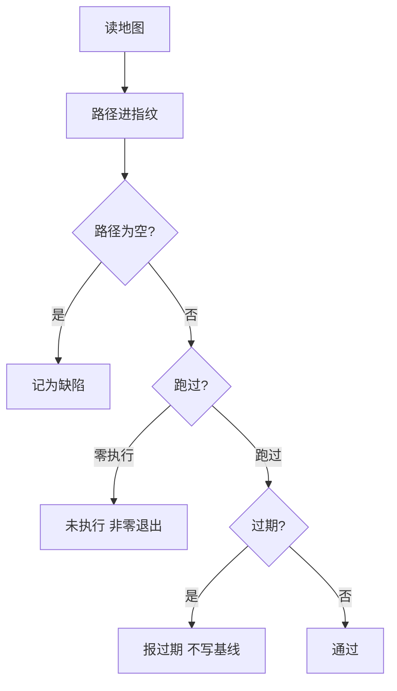

# 功能地图与验证工具自校（Issue `#117`）

> 配对 Todo：[verify-map Todo](../todo/261120-issue117-w25-verify-map-todo.md)
>
> **基线**：`a0fe4df`。本切片认领总控 PRD `261120-w25-hardening-prd.md` 的 `C4`。前置：`w25-kernel-dedup`（要用合并后的内核，否则新工具第二天就得重采基线）。

## 一、目标、红线与非目标

<!-- section: goal -->
### 1.1 目标

功能地图存在的意义是「改到某个文件时，能反查该跑哪个验证工具」。它今天做不到这件事，原因是**校对的对象没进指纹**：

1. **脚本路径进指纹并参与校验**：十三条工具记录的脚本路径字段全部为空，于是「这个工具判过的脚本有没有被改」这件事无从判断。实测：把它判过的脚本掏空成一行打印，审计报「零条过期」、运行报通过。改为脚本路径进指纹，且为空本身是一条缺陷。
2. **零执行不得报通过**：无选择器时一条都没跑，退出码是 0，输出「通过」。改为「未执行」是独立结论，退出码非零。
3. **过期不自动吸收**：低风险工具跑通过就自动重写基线，于是「跑一次」等于「抹掉过时证据」，回头审计报零过期。改为：跑通过不写基线；刷新基线必须显式请求并进报告。
4. **命令里的路径逐条核对**：登记一个不存在的脚本，审计报零僵尸。改为命令中的路径逐条判存在性。
5. **盲区检查覆盖全量源码与模板**：今天只遍历入口清单、还滤掉非代码文件，因此报零盲区；真实零覆盖包括协议模块、报告排版、模板目录（十六份）、入口文件、契约文件与流水线文件。
6. **地图自检工具**：新增一条验证工具，验地图自身完整性——这是唯一能防止「地图越来越像真的」的机制。

### 1.2 非目标（Explicit Non-Goals）

<!-- section: non-goals -->
- **不改依赖合并后的共享内核实现**。本切片只调用它们；内核实现归 `w25-kernel-dedup`。
- **不改风险分级阈值与分级语义**（低 / 中 / 高）。
- **不删任何现有工具记录**。十三条记录里有一条被自己堵死（它的基线落后于它自己新增的符号），处理方式是显式刷新基线并写入报告，不是删记录。
- **不改「未采基线」的时间语义**：基线仍然记录采基线的提交，本切片只让这个状态被看见，不改它的定义。
- **不加「跳过审计」的开关**。
- **不动 `.worktrees/` 的临时目录结构**。
- **不把三十四个夹具写进地图**：夹具按功能域自动发现，地图只登记功能与验证工具，不登记文件枚举。
<!-- section: non-goals-end -->

### 1.3 六项缺陷到判据的对应

| 判据 | 覆盖 | 一句话 |
| --- | --- | --- |
| `C1` | 脚本路径为空、路径不校验 | 路径进指纹；为空即缺陷；命令内路径逐条判存在 |
| `C2` | 零执行退 0 | 未执行独立成结论，非零退出 |
| `C3` | 过期自动吸收 | 跑通过不写基线；刷新必须显式 |
| `C4` | 盲区近似空转 | 覆盖源码与模板全量，零覆盖逐条列出 |
| `C5` | 新能力零登记 | 三个模块与两个开关进地图 |
| `C6` | 一条被自己堵死 | 显式刷新并写明理由，不删记录 |
<!-- section: goal-end -->

## 二、技术设计与接口契约

<!-- section: design -->

### 2.1 `C1` 脚本路径进指纹，为空即缺陷

- **影响文件**：`kit/skills/lib/feature-map.mjs`、`kit/skills/dev-verify-tools/scripts/verify-tools-audit.mjs`、`docs/feature-map.json`。
- **现状**：指纹只算模块树与符号，不算被验证的脚本；审计只检查「有值的路径是否存在」，十三处都为空于是零命中。
- **改法**：
  1. 指纹计算把工具的脚本路径纳入；路径为空时指纹无法计算，这本身记为一条缺陷（`UNBASELINED_NO_SCRIPT`）。
  2. 审计对每条工具记录逐条判断：路径为空 → 报缺陷；路径非空但不存在 → 报僵尸。
  3. 工具命令字符串里的路径（`node 某脚本 --flag` 这种形态）逐条提取并判存在性，提取不到的路径（例如带变量的）明确标注「未校验」而不是静默放过。
- **反例边界**：某些工具的命令是「跑一段夹具」而非「跑一个脚本」，没有单一路径。这类记录允许脚本路径为空，但必须在记录里显式声明「无单一脚本，指纹以模块树为准」——空与「已声明无单一脚本」是两件事。

### 2.2 `C2` 零执行独立成结论

- **影响文件**：`kit/skills/dev-verify-tools/scripts/verify-tools.mjs`。
- **现状**：无选择器、未匹配到任何工具时返回 `matched: false`、`results: []`、退出码 0。
- **改法**：新增「未执行」结论态：输出明确写「本次一条都没执行」，退出码非零，且不进通过计数。选中器匹配到工具但全部因前置条件被跳过时，同样算未执行。
- **为什么不是只改提示**：退出码是唯一跨进程的结论。提示改了而退出码不变，脚本调用方仍然拿到「通过」。

### 2.3 `C3` 过期不自动吸收

- **影响文件**：`kit/skills/dev-verify-tools/scripts/verify-tools.mjs`、`kit/skills/lib/verify-state.mjs`。
- **现状**：判定「跑通过且过期」时直接重写基线，于是「跑一次」就抹掉了过时证据。
- **改法**：写基线的条件收窄为两条——从未采过基线，或调用方显式请求刷新。第三种情况（跑通过但已过期）只报，不写。显式刷新必须进报告并写明刷新前的基线提交与刷新理由。
- **反例边界**：首次采基线不能也变成「必须显式」——那会让每次第一次跑都变成一次交互。首次采集是安全的（它没有「抹掉什么」的问题）。

### 2.4 `C4` 盲区覆盖全量

- **影响文件**：`kit/skills/dev-verify-tools/scripts/verify-tools-audit.mjs`。
- **现状**：只遍历入口清单、还滤掉非代码文件，全仓返回二十余项后仅剩十余项，全部命中，于是报零盲区。
- **改法**：盲区判据改为「源码层与模板层的全部文件，逐个判是否被任一功能登记在入口或模块里」；不依赖入口清单的返回规模。模板层按目录整体判（十六份模板属于同一个功能面，逐份报会淹没真信号），但报告里给出份数。零覆盖项逐条列出，不再只给一个总数。
- **反例边界**：不把夹具、注入项、测试文件算进盲区，它们是被验证物而不是被覆盖物。

### 2.5 `C5` 新能力进地图

- **影响文件**：`docs/feature-map.json`。
- **要做**：把三个零登记模块（经验制品、交接包装配、优化循环）与两个零提及的开关登记进对应功能；一个零引用的夹具登记为对应功能的测试引用。登记时按「这个能力属于哪个业务流」归位，不新开空壳功能。

### 2.6 `C6` 被自己堵死的那一条

- **影响文件**：`docs/feature-map.json`、报告输出。
- **现状**：一条高风险工具的基线落后于它自己新增的十四个导出符号——那十四个符号正是上一个切片加的能力。审计因此长期报阻断，而唯一的「解法」是刷新基线，刷新又等于吸收漂移。
- **改法**：显式刷新该项基线，并在报告里写明「刷新原因：符号新增来自切片 `w2a-plan-wave-gate`，属预期变更」。这不是绕过门禁，是把门禁的输出写清楚——**这一条要的是可追溯，不是解除阻断**。

### 2.7 行数与拆分

- `kit/skills/dev-verify-tools/scripts/verify-tools.mjs` 与 `verify-tools-audit.mjs` 都在数百行量级。本切片会加判据，逐文件核对 `.mjs <= 800`；`verify-tools-audit.mjs` 超限时把「盲区计算」与「僵尸检测」各下沉为同目录独立模块。
- 新增夹具独立成文件，遵守 `scripts/dev/fixtures-*.mjs` 单文件单域约定。
<!-- section: design-end -->

## 三、门型评估与验收标准

<!-- section: gates -->
- **门型**：`one-way`。零执行从「通过」变成「未执行非零退出」会改变调用方的判定，历史上依赖空集即通过的自动化必须按新口径重算。
- **风险等级**：`medium`。命中 `kit/` 与 `docs/feature-map.json`，但地图是登记数据不是可执行契约；判据改动集中在验证工具自身。
- **故障注入**：把脚本路径从指纹里去掉，掏空脚本的用例必须变红；把过期判定改成恒「不过期」，过时用例必须变红。
- **验证命令**：
  - `node .agents/skills/dev-verify-tools/scripts/verify-tools.mjs audit .`
  - `node .agents/skills/dev-verify-tools/scripts/verify-tools.mjs run --json`（无选择器，应非零退出）
  - `node scripts/dev/fixtures.mjs --domain verify-map`
<!-- section: gates-end -->

<!-- section: acceptance -->
### 验收标准（正例 / 反例双向可判定）

<!-- criteria:start -->
- [ ] C1: 把任一已登记工具的脚本内容改一行，审计必须报该工具过期；把脚本路径字段清空，审计必须报缺陷而不是零问题；命令里写一个不存在的路径，审计必须报僵尸。反例：路径进指纹但为空时直接跳过——那正是今天的状态，十三处全空等于全部不校验。
- [ ] C2: 无选择器运行 `run --json` 时输出含 `matched: false` 且退出码非零，结论态为「未执行」；匹配到工具但全部被前置条件跳过时同样非零并标未执行。反例：只把输出文案改成「未执行」而退出码仍是 0。
- [ ] C3: 低风险工具在「已采基线 → 改源码 → 跑通过」之后，基线不被重写，审计仍报过期；显式请求刷新后基线更新且报告写明刷新前基线提交与理由；首次采基线不需显式请求。反例：把「首次采基线」也改成必须显式，于是每个新工具第一次跑都变成交互。
- [ ] C4: 盲区检查遍历源码层与模板层全部文件；当前仓库跑出的零覆盖项非空且逐条列出（至少含协议模块、报告排版、模板目录、入口文件、契约文件、流水线文件）；把某个零覆盖文件登记进任一功能后该项消失。反例：只扩大入口清单的返回规模而不改判据，盲区仍然为零。
- [ ] C5: 三个零登记模块与两个零提及开关在地图里有对应条目，且每条都归位到既有功能的入口或模块清单；零引用夹具登记为测试引用。反例：为它们新建三个空壳功能，于是「功能」数量涨了而业务流没变。
- [ ] C6: 被自己堵死的那条工具基线已刷新，报告输出含刷新原因且原因引用真实切片标识；刷新后审计对该项为零阻断。反例：直接删掉该条工具记录——工具还在、地图变干净，等于把证据删了。
- [ ] C7: 地图自检工具存在，且对三种缺陷各有一条断言会红：脚本路径为空、命令路径不存在、模块登记指向不存在文件。反例：自检工具只检查「地图是合法 JSON」——格式正确的地图可以完全错误。
<!-- criteria:end -->
<!-- section: acceptance-end -->

## 四、可复用基础设施与备选方案

<!-- section: reuse -->
- `kit/skills/lib/verify-state.mjs` 已有过时判定的三态（未采基线 / 过期 / 新鲜）与基线读写，本切片只收紧写基线的条件，不新造状态。
- `kit/skills/lib/feature-map.mjs` 已有指纹计算与地图结构校验，路径进指纹是在既有指纹上加一项。
- `kit/skills/dev-verify-tools/scripts/verify-tools-audit.mjs` 已有僵尸、过期、盲区、重复流四类输出的骨架，新判据接进同一报告。
- `scripts/dev/verify-injections.mjs` 按功能域自动发现注入项，新增注入无需登记。
<!-- section: reuse-end -->

<!-- section: alternatives -->
- **方案一（否决）：只把十三处脚本路径填上。** 填上之后仍是「不参与指纹」的空壳，明年有人改脚本，审计照样报零过期。填值不等于进判据。
- **方案二（否决）：零执行时打印警告但保持退出 0。** 退出码是唯一跨进程的结论；警告会被读成「可忽略」。
- **方案三（否决）：过期就自动重写基线，但在报告里注明「曾经过期」。** 证据被抹掉之后，下一次审计看不到「这个工具曾经落后过」；追溯信息应该在基线上留，而不是在一份会被覆盖的报告里。
- **方案四（否决）：盲区检查改成「地图登记的文件都真实存在」。** 那查的是登记是否指向真实文件（已由僵尸检测覆盖），不是「真实文件有没有被覆盖」。两件事不能互换。
- **方案五（采纳）：路径进指纹 + 零执行独立成结论 + 过期只报不写 + 盲区全量 + 地图自检工具。** 每一处都让「不知道」不再等于「好」，并留一条持续守住的检查。
<!-- section: alternatives-end -->

## 五、待拍板问题

<!-- section: pending -->
- 已定：脚本路径进指纹；为空即缺陷；「无单一脚本」必须在记录里显式声明，与「忘了填」区分。
- 已定：命令里能提取的路径逐条判存在，提取不到的标注「未校验」，不静默放过。
- 已定：零执行是独立结论态，退出码非零，不进通过计数；匹配到但全被跳过同样算未执行。
- 已定：写基线只在「首次」与「显式刷新」两种情况下发生；「跑通过但过期」只报不写。
- 已定：盲区判据改为源码层与模板层全量覆盖，模板层按目录整体判但报告给出份数；夹具与注入项不计入。
- 已定：三个零登记模块与两个零提及开关归位到既有功能，不新开空壳功能。
- 已定：被自己堵死的那条工具基线显式刷新并写明原因；不删记录、不加豁免开关。
- 已定：新增地图自检工具，作为一条已登记验证工具存在，不走旁路。
- 已定：本切片前置 `w25-kernel-dedup`；若该片尚未合入，先不建新工具——工具校对的对象正是合并后的内核，先建再改等于让工具第二天就过期。
<!-- section: pending-end -->
