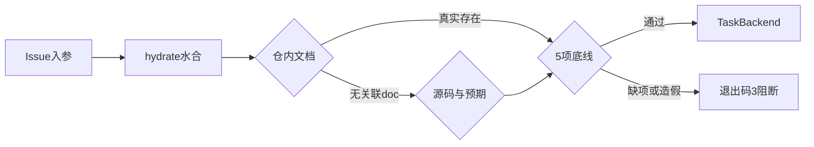

# 单一平台中性 Issue 质量契约与门禁 — 功能设计规范（SPEC）

## 文档信息与变更概览

| 项目 | 内容 |
| --- | --- |
| 当前状态 | `implemented`（`draft \| approved \| implementing \| in_review \| implemented \| superseded`） |
| 规划级别 | `L3`（跨模块重构、接口/契约变更或高风险改造；未 `approved` 前不编码） |
| 创建 / 更新 | `2026-11-24` / `2026-11-24` |
| 分支 / Issue / PR | `feat/issue-quality-contract` / 未关联 / 未关联 |
| 负责人 / 内审状态 | plan-issue-contract / `passed` |
| 规划态 | `autonomous`（默认推进，仅单向门、Case 5 或真业务歧义才停） |
| 关联 PRD / Todo | 无（单 SPEC 可覆盖） / `docs/archive/todo/261124-issue-quality-contract-todo.md` |

- **变更一句话**：建立全托管建单入口唯一共用的 `hydrateIssueBody -> validateIssueBodyQuality -> TaskBackend.createIssue` 平台中性质量契约（5 项结构底线 + 自动查盘依据判定 + 富证据建单 + `BLOCKED_ISSUE_QUALITY_INCOMPLETE` 阻断），并修复 `verify-tools.mjs run --stale` 自检排序使单条命令一次全绿。

## 系统变更全景

| 模块 / 文件 | 变更性质 | 核心职责 |
| --- | --- | --- |
| `kit/skills/lib/issue-quality.mjs` (new) | 新增 | 单一 `validateIssueBodyQuality` 5 项结构底线校验与 `plan-index.mjs` 自动查盘判定 |
| `kit/skills/lib/issue-template-hydrate.mjs` | 改造 | 移除空洞套话填充与静默删节，保留结构化字段合成且绝不留空白占位 |
| `kit/skills/lib/exit-codes.mjs` | 改造 | 在 `FACT_CODES` 注册 `BLOCKED_ISSUE_QUALITY_INCOMPLETE`（退出码 `3`） |
| `kit/skills/lib/escalation.mjs` | 改造 | 升级 `buildIssues` / `buildEscalationIssuePayload` 富证据负载并在 `escalateToBackend` / `applyIssuesToBackend` 强制校验 |
| `kit/skills/dev-flow/scripts/flow-issues.mjs` | 改造 | 在 `handleIssue`（`create`）与 `createIssueForStart` 接入统一校验门禁与 `--spec`/`--todo`/`--prd` 查盘绑定 |
| `kit/skills/dev-flow/scripts/flow.mjs` | 改造 | 在 `printHelp()` 补齐 `issue` 子命令 `--spec`/`--todo`/`--prd`/`--case` 声明，保持 `cli-parity.mjs` 0 漂移 |
| `kit/skills/dev-govern/scripts/govern-audit.mjs` | 改造 | `issues --apply-issues` 经统一校验门禁建单，透传结构化阻断原因与退出码 |
| `kit/skills/dev-verify-tools/scripts/verify-tools.mjs` | 改造 | `handleRun` 在 `--stale` 批量执行中将自检工具（如 `verify-tools-self-audit`）排在最后刷新 |
| `templates/issue-*.md` & `.github/ISSUE_TEMPLATE/*.md` | 改造 | 对齐 5 项结构底线（Bug 补 `## 影响面与严重度`，Feature 补 `## 不在本次范围`） |
| `docs/TDD.md`、`docs/feature-map.json`、`references/`、`SKILL.md` | 同步 | 同步平台中性质量门禁架构说明、映射与命令文档，执行 `equip.mjs .` 与 `compose-agents.mjs .` |
| `scripts/dev/fixtures-issue-quality.mjs` (new) & `injections-data-issue-quality.mjs` (new) | 新增 | 覆盖 C1–C5 双向断言、故障注入及现有 `fixtures*.mjs` 建单夹具合规升级 |

## 一、背景与边界声明

- **要改什么**：新增 `kit/skills/lib/issue-quality.mjs` (new) 与 `BLOCKED_ISSUE_QUALITY_INCOMPLETE`，改造 `kit/skills/lib/issue-template-hydrate.mjs`、`kit/skills/lib/escalation.mjs`、`kit/skills/dev-flow/scripts/flow-issues.mjs`、`kit/skills/dev-flow/scripts/flow.mjs`、`kit/skills/dev-govern/scripts/govern-audit.mjs`、`kit/skills/dev-verify-tools/scripts/verify-tools.mjs`、Issue 模板及文档/测试夹具。
- **不改什么**：绝不新增第二套校验模式或 `--mode standalone|linked` 开关；不设字数/字节死线；不改 `kit/skills/lib/local-issues.mjs` / `kit/skills/lib/task-backend-local.mjs` 底层存储签名，不增删 `kit/skills/lib/subcommand-meta.mjs` 子命令，不引入第三方依赖/emoji/宿主绑定。
- **本期不做**：不在 `TaskBackend.createIssue` 底层适配器内部拦截单元测试桩（如 `ghClient.createIssue` / `localBk.createIssue`），门禁收口在全部托管建单入口；不追溯修改历史已建/已关工单或改变 `issue migrate` 对既有本地工单的搬迁语义。
- **复用既有模块**：`kit/skills/lib/pr-template-hydrate.mjs`（HTML 注释剥离与节替换）、`kit/skills/lib/markdown-scan.mjs`（Markdown 结构扫描）、`kit/skills/lib/doc-substantive.mjs`（套话与技术锚点判定）、`kit/skills/lib/plan-index.mjs`（`indexPlanDocs` 规划文档查盘）、`kit/skills/lib/exit-codes.mjs`、`kit/skills/lib/subcommand-meta.mjs` 与 `scripts/dev/cli-parity.mjs`。
- **架构基线关系**：严格对齐 `docs/TDD.md` L1–L4 单向依赖与 `AGENTS.md` `arch-rules`（`kit/**` 绝不引用 `scripts/dev/**` 或 `scripts/lib/**`；`issue-quality.mjs` 仅依赖同层 L1/L2 原语，避免与 `pr-template-hydrate.mjs` / `escalation.mjs` 形成环形求值风险）。（依据：`docs/TDD.md`）

## 二、设计方案与契约变更

### 接口 / 数据结构变更

1. **新增模块 `kit/skills/lib/issue-quality.mjs` (new)**：
   - 导出 `ISSUE_QUALITY_RULES` 与 `validateIssueBodyQuality(body, opts = {})`：
     * 入参 `opts`：`{ repoRoot = null, mainRoot = repoRoot, title = '', docRefs = [], spec = null, todo = null, prd = null, kind = null }`。
     * 返回值：`{ ok: boolean, code: 'BLOCKED_ISSUE_QUALITY_INCOMPLETE' | null, exitCode: 0 | 3, missing: string[], reasons: string[], hasRealLinkedPlanDoc: boolean, verifiedDocRefs: string[], invalidDocRefs: string[], checks: object }`。
   - **唯一 5 项结构底线（无字数/字节死线，复用 `markdown-scan.mjs` 与 `doc-substantive.mjs`）**：
     1. **背景/现象与基线（或已知局限）**：匹配节标题（如 `背景与现象`、`想解决什么问题`、`实际发生什么`、`问题描述`、`背景`、`现状`、`Evidence`、`Unknowns`、`Problem`、`Context`、`Summary`）或结构化非空正文；不得为空壳、不得仅含占位桩（`isStubValue` / `PLACEHOLDER_TEXT_RE`），且不得在无技术锚点时退化为纯套话（`VAGUE_FLUFF_RE`）。
     2. **影响面与严重度**：必须交代受影响模块/文件/范围及严重度或是否触及数据、API、权限、安全、兼容性之一；可来自专用章节（`影响范围`、`范围与依据`、`影响面与严重度`、`根因与影响`、`Scope`、`Impact`）或正文内的结构化要素（同时具备真实模块/路径或作用域说明 + `severity` / 严重度 / 数据·API·权限·安全·兼容性判定）。仅含 `## 现状` + `## 验收` 两段空壳时因缺此项（及 3/4/5 项）直接被拒。
     3. **客观依据（自动查盘判定，单一通道）**：
        - 提取来源：① `opts.spec` / `opts.todo` / `opts.prd` / `opts.docRefs`；② 正文非代码围栏内引用的 `docs/(?:archive/)?(?:prd|specs|todo)/[^\s`'")\]>]+?\.md` 路径。
        - 调用 `plan-index.mjs` 的 `indexPlanDocs({ repoRoot, mainRoot, includeArchive: true, includeWorktrees: true })` 与磁盘检查 `existsSync` 逐一核验：
          * 若存在任意声明或引用的 `docs/(prd|specs|todo)/*.md` 路径在仓内（含活跃目录、归档目录、`impl-*` 工作树）均不存在 -> 写入 `invalidDocRefs`，立即判定不通过（阻断造假路径）。
          * 若至少存在 1 份真实在盘的设计文档（`verifiedDocRefs.length > 0`）-> 自动满足详设依据，**免在 Issue 中重复抄写 SPEC 全文**。
          * 若仓内无真实关联设计文档（首次体检批建、Case 2 Bug、独立裸 Issue、`dev-iterate`/停损升级）-> 正文必须同时自包含：① 真实源码/命令/复现证据（至少 1 处 `file:line`、有效仓库源码路径、反引号/代码块命令、或实测退出码/报错输出，排除 `VAGUE_FLUFF_RE` 与占位符）；② 期望方案或待裁决选项（如 `期望发生什么`/`期望的用法与结果`/`备选方案`/`方案`/`Expected`/`Action`/`NextSteps`/待裁决选项）。
     4. **可判伪验收标准**：必须存在 `验收标准` / `Acceptance Criteria` 节或非空验收条目，且至少包含 1 条 `C1..Cn` 复选框（`- [ ] C1: ...` / `- [x] C1: ...`）或含真实技术锚点（命令、路径、断言、退出码、数值阈值，via `extractTechAnchors`）的可执行断言；拦截空复选框（`- [ ] C1: `）、占位词与无锚点套话（如「修复完成」「体验更好」）。
     5. **不在本次范围（`Out of Scope`）**：必须存在非空 `不在本次范围` / `Out of Scope` / `非目标` 节或显式 `Out of Scope` / `不在本次范围` 声明，且包含明确排除对象（`hasConcreteExclusion` 或 `extractTechAnchors` 非空，且非 `isStubValue` / `PLACEHOLDER_TEXT_RE`）。
   - 导出辅助函数 `extractPlanDocRefsFromText(text)` 与 `extractPlanDocContext(repoRoot, docPaths)`（只读从真实存在的 `--spec`/`--todo`/`--prd` 提取 `scope_files`/`影响路径`、`本期不做`/`Out of Scope`、`C1..Cn` 与摘要，供 `flow-issues.mjs` 在未手写 `--body` 但绑定真实规划文档时水合合规正文）。

2. **`kit/skills/lib/issue-template-hydrate.mjs` 去套话与去静默删节**：
   - 删除 `buildSectionValues` 中的硬编码空洞套话填充：
     * 移除 `'- 运行时与仓内环境见复现/验证记录。'`
     * 移除 `'- 按根因收敛方案实施，避免临时绕过。'`
     * 移除 `'- 未列入本单验收标准的无关改动。'`
     * 移除 `'- 见仓内关联设计文档。'`
     * 移除 `formatCriteriaLines` 自动捏造的 `完成「...」并补齐正反双向验证与全量门禁` 与 `expected` 默认空话 `行为与既有契约、测试门禁及工程不变量保持一致。`、`summary` 默认空话 `待补充说明。`。
   - 新增结构化字段映射：`fields.impact`、`fields.severityBasis`、`fields.baseline`、`fields.limitations`、`fields.outOfScope`、`fields.docRefs`、`fields.expected`；映射到对应模板节（`## 影响面与严重度` / `## 影响范围`、`## 不在本次范围`、`## 关联的设计产物` 等）。
   - 未提供值时：剥离模板中的空列表占位（`1.\n2.\n3.`、`- 操作系统与版本：`、`- [ ] C1: `）与无内容的可选空节（`怎么复现`、`环境`、`补充信息`、`备选方案`），不留空白未填项；对缺少的必填内容不伪造套话，交由下游 `validateIssueBodyQuality` 阻断；对仅含 HTML 注释/0 匹配的宿主模板仍保底调用 `buildFallbackIssueBody` 并完整保留用户 `rawExplicit`。
   - `buildFallbackIssueBody` 统一按实际存在字段渲染清晰结构化小节（`## 背景与现象`、`## 影响面与严重度`、`## 范围与依据`、`## 复现线索`、`## 期望与方案`、`## 验收标准`、`## 不在本次范围`、`## 关联的设计产物`、`## [NEXT STEP]`）。

3. **`kit/skills/lib/escalation.mjs` 富证据构建与统一拦截**：
   - `buildIssues(findings, opts)` 升级：
     * 按类别聚合 `actionable` findings，逐条提取 `file:line`（如 `kit/skills/lib/x.mjs:42`）、模块集合（顶层/二级目录去重）、严重度计数依据（`critical/high/medium` 分布及最高严重度归因）。
     * 生成结构化内容：`summary` + `findingsSummary`（含每条 `file:line`、`id`、`detail`/`action`）、`impact`（受波及模块与数据/API/权限/安全/兼容性触及判定）、`baseline` 与未测局限（静态审计覆盖范围与未覆盖运行时实证边界）、`expected`（根因收敛方向）、`reproEvidence`（审计规则与命中文件行号）、`pocCommand`（`node ".agents/skills/dev-govern/scripts/govern-audit.mjs" audit . --categories ${cat} --json`）、`criteria`（逐条带 `item.id` + `file:line` + 可运行验证命令断言）、`outOfScope`（明确排除 `${cat}` 之外类别与未列出的模块文件）。
   - `buildEscalationIssuePayload(item, opts)` 升级：
     * 当 `item.body` 与结构化字段同时存在（如 `review-empirical-state.mjs` 与 `flow-lifecycle-helpers.mjs` 传入的 `## Evidence` / `## Unknowns` / `## NextSteps` + `files`/`severity`/`taskId`/`reproEvidence`/`pocCommand`）时，先水合基础 `body` 再补齐缺失的结构化 `影响面与严重度`、`验收标准`、`不在本次范围` 节（或由 `escalation.mjs` 组装完整字段），确保所有内部自动升级建单默认满足 5 项底线。
   - `escalateToBackend` 与 `applyIssuesToBackend`：
     * 在调用 `activeBackend.createIssue(...)` 之前（且非 `--no-escalate` 跳过时），强制执行 `validateIssueBodyQuality(payload.body, { repoRoot, docRefs: ... })`。
     * 校验失败时返回 `{ ok: false, blocked: true, code: 'BLOCKED_ISSUE_QUALITY_INCOMPLETE', exitCode: EXIT.FACT, missing, reasons, error }`，绝不向任何后端（GitHub / GitLab / GitCode / `generic-git` / `local-only`）写入低质量工单。

4. **托管建单 CLI 收口与 `verify-tools run --stale` 排序修复**：
   - `kit/skills/dev-flow/scripts/flow-issues.mjs`：
     * `handleIssue`（`action === 'create'`）与 `createIssueForStart` 统一走 `hydrateIssueBody -> validateIssueBodyQuality -> backend.createIssue`。
     * `handleIssue`（`action === 'create'`）支持 `--spec <path>`、`--todo <path>`、`--prd <path>`、`--files <a,b>`：若传入设计文档路径，先由 `validateIssueBodyQuality` / `extractPlanDocContext` 查盘核验真实性（假路径直接以 `BLOCKED_ISSUE_QUALITY_INCOMPLETE` 退出码 `3` 阻断），真实存在则自动带出 `docRefs` 与缺失的 `files`/`criteria`/`outOfScope`/`summary` 兜底字段（若用户同时传 `--body`/`--body-file` 则保留用户正文并附带 `docRefs` 校验）。
     * `flow.mjs` `printHelp()` 同步更新 `issue` 行选项声明（`[--case <1..5>] [--spec <path>] [--todo <path>] [--prd <path>] [--files <a,b>]`），保持 `cli-parity.mjs` 0 漂移。
     * `govern-audit.mjs` `issues --apply-issues` 遇 `applyResult.error` / `BLOCKED_ISSUE_QUALITY_INCOMPLETE` 时按标准退出码（`3` 或 `1`）与 JSON 阻断字段输出。
   - `kit/skills/dev-verify-tools/scripts/verify-tools.mjs`：
     * 在 `handleRun` 中当 `staleOnly` 为真时，对 `candidateEntries` 做稳定排序：将自检工具（`tool.id === 'verify-tools-self-audit'` 或 `buildToolCommand(tool, taskId)` 命中 `verify-tools.mjs audit`）排在所有其他过时/无基线工具之后再执行，保证所有其他工具的 `cache.json` 基线在自检运行前已刷新，单条 `node .agents/skills/dev-verify-tools/scripts/verify-tools.mjs run --stale` 一次性通过 22/22。

### 数据与状态变更

- 新增退出码登记：`kit/skills/lib/exit-codes.mjs` 的 `FACT_CODES` 增加 `'BLOCKED_ISSUE_QUALITY_INCOMPLETE'`（`EXIT.FACT = 3`）。
- 模板结构同步：`templates/issue-bug-report.md` 与 `.github/ISSUE_TEMPLATE/bug_report.md` 增加 `## 影响面与严重度`；`templates/issue-feature-request.md` 与 `.github/ISSUE_TEMPLATE/feature_request.md` 增加 `## 不在本次范围` 并在 `## 影响范围` 注释补充严重度与数据/API/权限/安全/兼容性提示（`.github/ISSUE_TEMPLATE/feature_request.md` 保留 `` `kit/` `` 项，`templates/issue-feature-request.md` 不出现 `references/`）。
- 不新增持久化的磁盘文件或账本字段。

### 异常、回退与安全边界

- **跨后端一致阻断**：`validateIssueBodyQuality` 在调用 `TaskBackend.createIssue` 前于内存中完成，GitHub（`gh-cli` / `node-https-token` / `mcp-delegate`）、`generic-git` 与 `local-only` 行为 100% 一致；不因 `mcp-delegate` 或离线环境而绕过质量校验放行代理载荷。
- **UTF-8 安全与零 ASCII 控制字符**：沿用 `assertNoAsciiControlChars` 与临时 UTF-8 `--body-file` 通道，全路径零 emoji。
- **防假路径欺骗**：任何 `--spec`/`--todo`/`--prd` 或正文中出现的 `docs/(prd|specs|todo)/*.md` 均经 `plan-index.mjs` 与 `existsSync` 查盘核实（含 `.worktrees/impl-*` 与 `docs/archive/`），不存在的路径直接阻断，杜绝用虚假文档链接绕过自包含证据校验。
- **防环依赖与单文件体积**：`issue-quality.mjs` 严格只依赖 L1/L2 纯原语，所有 `.mjs` 文件严守 `<= 800` 行上限与零第三方依赖。

### 实现顺序

1. **红灯与注册基础（C1/C5 先行）**：在 `kit/skills/lib/exit-codes.mjs` 注册 `BLOCKED_ISSUE_QUALITY_INCOMPLETE`；先建立 `scripts/dev/fixtures-issue-quality.mjs` (new) 失败用例，确认 Red-Green 基线。
2. **校验内核与水合去套话（C1）**：实现 `kit/skills/lib/issue-quality.mjs` (new) 与改造 `kit/skills/lib/issue-template-hydrate.mjs`。
3. **自动建单器与托管入口收口 + 排序修复（C2/C3）**：改造 `kit/skills/lib/escalation.mjs`、`kit/skills/dev-flow/scripts/flow-issues.mjs`、`kit/skills/dev-flow/scripts/flow.mjs`、`kit/skills/dev-govern/scripts/govern-audit.mjs`、`kit/skills/dev-verify-tools/scripts/verify-tools.mjs`；核实并升级既有 `scripts/dev/fixtures*.mjs` 中调用 `flow issue create`、`start --create-issue`、`applyIssuesToBackend` 的夹具正文使其真实合规。
4. **模板、契约同步、装配与故障注入（C4/C5）**：更新模板、`.github/ISSUE_TEMPLATE/`、`docs/TDD.md`、`docs/feature-map.json`、`references/docs-set.md`、`references/collaboration.md`、`kit/skills/dev-flow/SKILL.md`、`kit/skills/dev-govern/SKILL.md`；跑 `equip.mjs .` 与 `compose-agents.mjs .`；补齐 `scripts/dev/injections-data-issue-quality.mjs` (new) 并跑通全套验证门禁。

## 三、备选方案与否决理由

| 方案 | 怎么做的 | 为什么没选 | 什么情况下该改回它 |
| --- | --- | --- | --- |
| 单一事实驱动通道（已选） | 仅保留一条 `hydrateIssueBody -> validateIssueBodyQuality -> TaskBackend.createIssue` 通道，由 `plan-index.mjs` 自动查盘判定是否关联真实设计文档 | 零模式分叉，模型与 CLI 无需猜测模式，跨 5 类后端与人工/自动建单行为完全一致 | 仅当未来某后端有强制独立字段协议时，由该后端适配器内部映射字段，仍不拆分校验通道 |
| 双模式开关 `--mode standalone\|linked`（否决） | 让调用方显式指定 `--mode standalone` 或 `--mode linked` 并维护两套校验规则 | 易被模型误选或借参数降级绕过实质校验，违反单源真相信条 | 永不采用 |
| 字符/字节长度阈值拦截（否决） | 校验 Issue 正文不少于 N 字符或 M 行 | 长篇空洞套话轻松绕过，简明精准的 `file:line` + 命令 + `C1` 反而被误杀 | 永不采用 |

## 四、改动清单与影响面

| 文件 / 目录 | 改动性质 | 改什么 | 谁会被影响 |
| --- | --- | --- | --- |
| `kit/skills/lib/issue-quality.mjs` (new) | 新增 | `validateIssueBodyQuality`、`extractPlanDocRefsFromText`、`extractPlanDocContext` | 全部托管建单入口与测试夹具 |
| `kit/skills/lib/issue-template-hydrate.mjs` | 修改 | 移除空洞套话填充与静默删节，支持 5 项底线结构化字段水合 | `flow-issues.mjs`、`escalation.mjs`、相关 fixtures |
| `kit/skills/lib/exit-codes.mjs` | 修改 | `FACT_CODES` 注册 `BLOCKED_ISSUE_QUALITY_INCOMPLETE` | `flow-issues.mjs`、`escalation.mjs`、`fixtures-flow-truth.mjs` |
| `kit/skills/lib/escalation.mjs` | 修改 | `buildIssues` / `buildEscalationIssuePayload` 富证据化，`escalateToBackend` / `applyIssuesToBackend` 强制校验 | `govern-audit.mjs`、`govern-retro.mjs`、`review-ledger.mjs`、`iterate.mjs` |
| `kit/skills/dev-flow/scripts/flow-issues.mjs` & `flow.mjs` | 修改 | `handleIssue`（`create`）与 `createIssueForStart` 强制校验并支持 `--spec`/`--todo`/`--prd`，同步 `printHelp()` | `dev-flow` CLI 用户与测试夹具 |
| `kit/skills/dev-govern/scripts/govern-audit.mjs` | 修改 | `issues --apply-issues` 遇质量阻断按 `applyResult.exitCode` 阻断并透传错误 | `govern-audit issues` 调用方 |
| `kit/skills/dev-verify-tools/scripts/verify-tools.mjs` | 修改 | `handleRun` `--stale` 排序将 `verify-tools-self-audit` 置后执行 | `verify-tools run --stale` 全量刷基线 |
| `templates/issue-*.md` & `.github/ISSUE_TEMPLATE/*.md` | 修改 | Bug 模板补 `## 影响面与严重度`，Feature 模板补 `## 不在本次范围` | `preflight` 同构校验与新建 Issue 表单 |
| `docs/TDD.md`、`docs/feature-map.json`、`references/`、`kit/skills/dev-flow/SKILL.md`、`kit/skills/dev-govern/SKILL.md` | 修改 | 同步架构、特征映射、文档规范与技能命令声明；执行 `equip.mjs .` 与 `compose-agents.mjs .` | 技能装配检查与 `cli-parity.mjs` |
| `scripts/dev/fixtures-issue-quality.mjs` (new)、`scripts/dev/injections-data-issue-quality.mjs` (new) 及受影响 `fixtures-*.mjs` | 新增/修改 | 新增双向用例与故障注入，升级旧夹具低质量建单正文（`fixtures-trace-sync.mjs`、`fixtures-local-backend.mjs`、`fixtures-escalation-stoploss.mjs`、`fixtures-handoff-review.mjs`、`fixtures-flow.mjs`、`fixtures-repo-alignment.mjs`） | `fixtures.mjs`、`verify-injections.mjs`、`preflight.mjs` |

- **对外可见的变化**：
  1. `flow.mjs issue create` 新增可选 `--spec <path>`、`--todo <path>`、`--prd <path>`、`--files <a,b>`，且所有托管建单入口对缺失 5 项结构底线、空洞套话、未填占位或虚假文档路径统一返回 `BLOCKED_ISSUE_QUALITY_INCOMPLETE`（退出码 `3`）。
  2. `govern-audit.mjs issues` 产出的治理工单自动包含具体 `file:line`、模块影响面、严重度依据、已核实基线与未测局限、`C1..Cn` 可判伪标准与 `Out of Scope`。
  3. `verify-tools.mjs run --stale` 单次执行自动后置自检并刷新全量 22/22 基线。
- **需要同步改的地方**：`.agents/skills/`（经 `node scripts/equip.mjs .` 同步）、`AGENTS.md`（经 `node scripts/compose-agents.mjs .` 刷新）、`docs/feature-map.json`、`docs/TDD.md`、既有 `fixtures*.mjs` 中不合规的建单夹具。

## 五、冻结的验收标准

- [x] C1: 单一事实驱动 Issue 质量校验生效：`kit/skills/lib/issue-quality.mjs` (new) 实现 `validateIssueBodyQuality`（5 项底线 + `plan-index.mjs` 查盘），`kit/skills/lib/exit-codes.mjs` 注册 `BLOCKED_ISSUE_QUALITY_INCOMPLETE`（退出码 `3`），`kit/skills/lib/issue-template-hydrate.mjs` 移除空洞套话与静默删节且不留空白占位，无任何 `--mode` 双轨分支。
- [x] C2: 富证据自动建单器生效：`kit/skills/lib/escalation.mjs` 的 `buildIssues` 与 `buildEscalationIssuePayload` 自动带出 `file:line`、模块影响面、严重度依据、已核实基线与未测局限、`C1..Cn` 可判伪标准与明确 `Out of Scope`，兼容全部 `TaskBackend` 后端，UTF-8 安全且零 emoji。
- [x] C3: 单一入口收口与 `verify-tools run --stale` 排序修复生效：`flow.mjs issue create`（支持 `--spec`/`--todo`/`--prd`）、`createIssueForStart`、`escalateToBackend`、`applyIssuesToBackend`、`govern-audit.mjs issues --apply-issues` 全部强制经过 `hydrateIssueBody -> validateIssueBodyQuality -> createIssue`；`cli-parity.mjs` 0 漂移；既有夹具建单正文全部合规；`node .agents/skills/dev-verify-tools/scripts/verify-tools.mjs run --stale` 单条命令一次性全绿。
- [x] C4: 模板、档案与契约同步完成：`templates/issue-bug-report.md`、`templates/issue-feature-request.md`、`.github/ISSUE_TEMPLATE/bug_report.md`、`.github/ISSUE_TEMPLATE/feature_request.md`、`docs/TDD.md`、`docs/feature-map.json`、`references/docs-set.md`、`references/collaboration.md`、`kit/skills/dev-flow/SKILL.md`、`kit/skills/dev-govern/SKILL.md` 完成同步，并经 `node scripts/equip.mjs .` 与 `node scripts/compose-agents.mjs .` 校验一致。
- [x] C5: 双向断言、故障注入与全仓门禁通过：新增 `scripts/dev/fixtures-issue-quality.mjs` (new) 与 `scripts/dev/injections-data-issue-quality.mjs` (new) 覆盖 2 段空壳、空洞套话、空白占位、真实自包含详单、绑定真实 SPEC/Todo 免抄全文、伪造 SPEC 路径、`govern-audit issues` 富证据、纯 HTML 注释模板保底、`verify-tools run --stale` 自检后置；且 `preflight.mjs`、`fixtures.mjs`、`verify-injections.mjs`、`gap-coverage.mjs`、`govern-audit.mjs audit .`、`verify-tools.mjs audit` 全部退出码 `0`。

## 六、高风险点、门型与回滚路径

- **门型与回滚路径**：`two-way`；全部校验逻辑与模板改动均为纯源码/文本变更，无不可逆数据迁移，可通过 `git revert` 整笔或按文件回退。
- **高风险路径**：触碰 `kit/`、`templates/`、`AGENTS.md`；任何校验漏口会导致低质量/空壳 Issue 流入平台，或误伤合规自动建单流程。
- **故障注入预演**：在 `scripts/dev/injections-data-issue-quality.mjs` (new) 设计至少 5 条故障注入（均含 `alsoDropIn` 覆盖 `.agents/skills/`）：
  1. 绕过 `validateIssueBodyQuality` 中 2 段空壳/缺 5 项拦截 -> `fixtures-issue-quality.mjs` 空壳拦截用例必须变红；
  2. 绕过 `plan-index.mjs` 真实文件查盘（把不存在 `docs/specs/fake-spec.md` 当真）-> 伪造 SPEC 路径拦截用例必须变红；
  3. 恢复 `issue-template-hydrate.mjs` 空洞套话填充（如重新填入 `按根因收敛方案实施`）-> 空洞套话与去套话断言必须变红；
  4. 绕过 `escalateToBackend` / `applyIssuesToBackend` 或 `flow-issues.mjs` 中的 `validateIssueBodyQuality` 拦截 -> 托管入口门禁断言必须变红；
  5. 取消 `verify-tools.mjs` `handleRun` `--stale` 自检后置排序 -> `verify-tools run --stale` 一次性全绿断言必须变红。

## 澄清与补充记录

- 本规划依据 `main @ 35917ac` 现场源码勘察与任务契约生成，采用单一通道零双模式方案，无未决待拍板项。

## 实现说明

> 代码合入前补齐，随功能 PR 一同提交并标记 `implemented`；若常青架构已同步进 `docs/TDD.md`，随关联 `PRD`/`Todo` 成对归档至 `docs/archive/specs/`。

- **实际落地摘要**：新增 `kit/skills/lib/issue-quality.mjs`（`validateIssueBodyQuality`、`ISSUE_QUALITY_RULES`、`extractPlanDocRefsFromText`、`extractPlanDocContext`）与 `BLOCKED_ISSUE_QUALITY_INCOMPLETE`（`EXIT.FACT=3`），重构 `kit/skills/lib/issue-template-hydrate.mjs` 移除默认空洞套话并剥离空节与空白占位；升级 `kit/skills/lib/escalation.mjs`、`kit/skills/dev-flow/scripts/flow-issues.mjs`、`kit/skills/dev-flow/scripts/flow.mjs` 与 `kit/skills/dev-govern/scripts/govern-audit.mjs` 收口至单一 `hydrateIssueBody -> validateIssueBodyQuality -> TaskBackend.createIssue` 通道并支持 `--spec`/`--todo`/`--prd` 查盘提取；修复 `kit/skills/dev-verify-tools/scripts/verify-tools.mjs` 与 `verify-tools-audit.mjs` 中 `run --stale` 自检工具后置刷新逻辑。
- **与草案的差异**：除规划列表外，在 `kit/skills/dev-iterate/scripts/iterate.mjs` 周期停损升级建单补充 `reproEvidence` 与 `pocCommand` 实证字段，并在 `scripts/dev/fixtures-parallel-dispatch.mjs`（C7b）同步升级对应测试夹具以满足统一 5 项底线；`verify-tools-audit.mjs` 配合 `PF_VERIFY_SELF_REFRESH_TOOL_ID` 仅在 `run --stale` 刷新自检基线当次跳过自检条目的自指陈旧判定，随后由 `handleRun` 立即写入最新基线，独立 `audit` 仍全量严检。
- **关联同步文件**：`kit/skills/lib/shared.mjs`、`.agents/skills/**`（经 `equip.mjs .` 装配）、`AGENTS.md`（经 `compose-agents.mjs .` 校验）、`templates/issue-*.md`、`.github/ISSUE_TEMPLATE/*.md`、`docs/TDD.md`、`docs/feature-map.json`、`references/docs-set.md`、`references/collaboration.md`、`scripts/dev/fixtures-issue-quality.mjs`、`scripts/dev/injections-data-issue-quality.mjs` 及受影响既有夹具。
