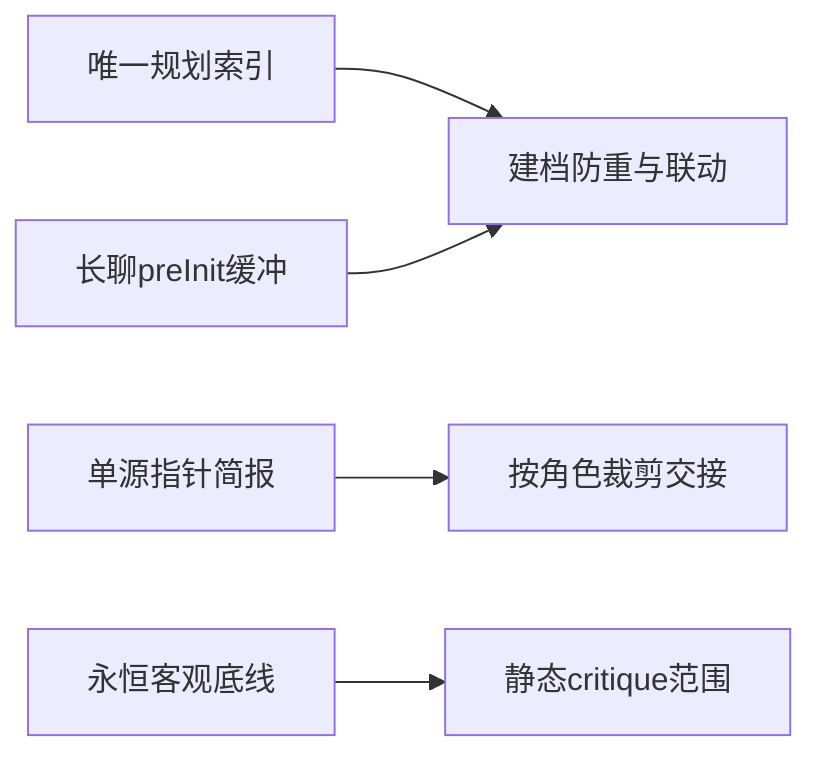

# 单源规划索引防重、双向正文投影与 Critique 防注水 — 功能设计规范（SPEC）

## 文档信息与变更概览

| 项目 | 内容 |
| --- | --- |
| 当前状态 | `implemented`（`draft \| approved \| implementing \| in_review \| implemented \| superseded`） |
| 规划级别 | `L3`（跨模块重构、接口/契约变更或高风险改造；未 `approved` 前不编码） |
| 创建 / 更新 | `2026-11-24` / `2026-11-24` |
| 分支 / Issue / PR | `feat/r6b-plan-index-antiblue` / 未关联 / 未关联 |
| 负责人 / 内审状态 | plan-r6-arch / `passed` |
| 规划态 | `interactive`（逐题问到零拍板）/ `autonomous`（默认推进，仅单向门、Case 5 或真业务歧义才停） |
| 关联 PRD / Todo | `docs/prd/261124-r6-arch-hardening-prd.md` / `docs/archive/todo/261124-r6b-plan-index-antiblue-todo.md` |

- **变更一句话**：新建唯一 `kit/skills/lib/plan-index.mjs` (new) 直接替换 3 套旧扫描器与消除 `kit/skills/lib/` 反向依赖、实现 `syncPlanDocBodyMeta`（含切换 `flow-lifecycle-finalize.mjs`）与 `approveSpec` 原子联动 Todo、落地单源指针简报协议与 `critique-scope` 静态毫秒响应、打通 `session-state.json` `preInit` 长聊抗压缩缓冲并回归永恒客观防退化底线（认领总控 PRD `C5`、`C6`、`C7`、`C8`）。

## 系统变更全景

| 模块 / 文件 | 变更性质 | 核心职责 |
| --- | --- | --- |
| `kit/skills/lib/plan-index.mjs` (new) | 新增 | 唯一规划索引，直接替换 `collectPlanDocs`、`collectCandidateDocs`、`listDocs` |
| `kit/skills/lib/doc-slice-graph.mjs` / `plan-next.mjs` / `doc-audit-repo.mjs` / `session-orient.mjs` / `intake-triage.mjs` | 改造 | 切齐单源 `plan-index.mjs`，断绝 `kit/skills/lib/` 反向导入 `doc-audit.mjs`；统一已批准状态集 |
| `kit/skills/lib/docs.mjs` / `kit/skills/dev-flow/scripts/flow-lifecycle-finalize.mjs` / `doc-plan-ops.mjs` | 改造 | `syncPlanDocBodyMeta` 双向投影、同 `slug`/`issue` 防重 `BLOCKED_DUPLICATE_PLAN_DOC`、`approveSpec` 联动 Todo `active` |
| `kit/skills/lib/context-brief.mjs` / `handoff-package.mjs` / `repo-map.mjs` / `critique-rounds.mjs` / `doc-verify.mjs` | 改造 | 单源指针简报协议、按角色裁剪（含 Fork 私有文档）、`repo-map` 去 `featureMapIndex`、`critique-scope` 静态校验与 `findings` 原生回显 |
| `kit/skills/lib/session-state.mjs` / `doc-substantive.mjs` / `doc-plan.mjs` / `doc-audit.mjs` | 改造 | 有界 `preInit` 缓冲与 `doc-plan.mjs note`、`plan-critique-state.json` 基线、去掉魔数比率回归永恒客观底线、A1 对齐 |
| `scripts/dev/fixtures-r6b-plan.mjs` (new) / `scripts/dev/injections-data-r6b.mjs` (new) | 新增 | 正反双向夹具与故障注入 |

## 一、背景与边界声明

- **要改什么**：用唯一 `plan-index.mjs` (new) 取代 3 套旧扫描器；统一 `docs.mjs` + `flow-lifecycle-finalize.mjs` 的双向正文投影与 `approveSpec` 原子联动；落地单源指针简报协议、长聊 `preInit` 缓冲、`critique-scope` 毫秒静态校验及客观防退化底线（无魔数比率）。
- **不改什么**：不修改 `doc-plan-ops.mjs:297` 的 `['main','master']` 分支判断（留待 Wave 2 `r6d` 统一切换 `isDefaultBranch` 以保 Wave 1 零依赖），不修改 `kit/skills/lib/plan-exit-gate.mjs`（归 `r6a`），不修改 `iterate*` / `edit-gate*` / `review-*` / `govern-*`（归 `r6c`）及 `SKILL.md` / `docs/TDD.md`（归 `r6d`）。
- **本期不做**：不设任何魔数比率（`0.05`/`0.12`/`25`/`40`/`380`）或固定简报行数上限。
- **复用既有模块**：`kit/skills/lib/doc-frontmatter.mjs`、`kit/skills/lib/critique-store.mjs`、`kit/skills/lib/pending-decisions.mjs`、`kit/skills/lib/doc-locator.mjs`。
- **架构基线关系**：消除 `session-orient.mjs` 反向依赖与 3 套重复扫描器，严格遵守 `docs/TDD.md`（依据：`docs/TDD.md`）。

## 二、设计方案与契约变更

### 接口 / 数据结构变更

1. **唯一规划索引 `plan-index.mjs`（替换 3 套旧扫描器）（`C5`）**：
   - 新建 `kit/skills/lib/plan-index.mjs` (new)，一次性索引活跃 `docs/{prd,specs,todo}`、`docs/archive/**` 与 `.worktrees/impl-*` 中的受管规划文档，并**直接替换** `doc-slice-graph.mjs:106` (`collectPlanDocs`)、`plan-next.mjs:91` (`collectCandidateDocs`) 与 `doc-audit-repo.mjs:44` (`listDocs`) 的各自扫描实现，绝不四套并存。
   - `session-orient.mjs` 改为消费 `plan-index.mjs` 与 `doc-frontmatter.mjs`，彻底消除 `kit/skills/lib/` 静态导入 `kit/skills/dev-plan/scripts/doc-audit.mjs`，并统一已批准状态集合（SPEC：`approved`/`implementing`/`in_review`/`implemented`/`done`/`archived`；PRD：`active`/`in_review`/`done`；Todo：`active`/`in_review`/`done`/`archived`）。
   - `doc-plan-ops.mjs` `initDoc` 与 `intake-triage.mjs` 统一调用 `plan-index.mjs`：按 `slug` 或 `issue` 扫描全仓非惰性规划文档，命中跨天或异名重复建档时硬阻断报 `BLOCKED_DUPLICATE_PLAN_DOC`（exit 3，除非显式 `--force`）并附已有文档路径与 `flow.mjs start` 接手指令。

2. **原子批准联动与双向正文投影 `syncPlanDocBodyMeta`（`C6`）**：
   - `doc-plan-ops.mjs` `approveSpec` 在批准 `SPEC` 时，通过 `plan-index.mjs` 定位同组配套 `Todo` 并原子联动更新为 `status: active`（随 Git 提交携带，防止队友拉取主干后 `flow start` 因 Todo 仍 `draft` 卡死）。
   - 在 `kit/skills/lib/docs.mjs` 实现单源 `syncPlanDocBodyMeta(text, fmData)`，同步更新 PRD/SPEC/Todo 正文概览表与 Todo 断点状态；将其接入 `syncDocsLifecycle`、`archiveCompletedDocsGroup`、`approveSpec`，并同步切换 `kit/skills/dev-flow/scripts/flow-lifecycle-finalize.mjs` 调用该函数（移除各自残缺副本）。
   - 落实用户拍板 A1：`doc-plan.mjs` Case 3 `nextStep` 与非平凡 Todo 提示统一为「自检直通，Critique 仅建议（不强制）」。

3. **单源指针简报协议与 `critique-scope` 毫秒防卡死（`C7`）**：
   - 改造 `kit/skills/lib/context-brief.mjs`：由 `resolveAuthoritativeTddPath()` 命中的权威架构文档（如 `docs/TDD.md`）在 `evergreenToc` 中置顶豁免淘汰；`relatedSlices` 自动排除宿主已自动加载的 `AGENTS.md` 与当前任务自身文档；每个文档仅输出 1 条文档级 `doc-locate` 命令模板，去掉每条 heading 重复的 `locateCommand` 字段（不硬设 30–50 行固定上限，随仓库结构自适应）。
   - 为 `plan-next.mjs` (`buildPlanHandoff`)、`doc-plan.mjs` (`critique-scope`) 与 `session-orient.mjs` 补齐 `contextBrief` 注入；`kit/skills/dev-explore/scripts/repo-map.mjs` `--json` 移除 `featureMapIndex` 全量倾倒（立省 `35.8 KB`）。
   - 改造 `kit/skills/lib/handoff-package.mjs`：按角色裁剪（`explore`/`critic` 不注入 SPEC「设计方案」正文；`implementer`/`reviewer` 对长设计节改用 `doc-locate --file ... --section "设计方案"` 指针）；`fields` 与外层 JSON 全局仅保留 1 份 `contextBrief`；纳入 Fork 任务的 `ledger.privateTodoFile`/`privateSpecFile`/`privatePrdFile`。
   - 修复 `doc-plan.mjs:487` 与 `critique-rounds.mjs:266` 格式错配，使 `critique-scope` 原生消费 `ledgerEntry.findings`、`priorRounds`、`previousSha`（回退读 `rounds`）及 `override`/`continued`；`doc-verify.mjs` (`verifyDocClaims`) 在 `critique-scope` 默认仅执行静态路径/符号/语法核查，**绝不自动串行跑测试命令**（仅显式 `--run-commands` 时执行）。

4. **`init` 前长聊抗压缩与永恒客观防退化（`C8`）**：
   - 在 `kit/skills/lib/session-state.mjs` 新增有界 `preInit` 缓冲（`{ topic, decisions, exclusions, anchors, openQuestions }`，上限 ~8KB），并在 `doc-plan.mjs` 新增子命令 `note --decision/--exclude/--anchor/--open`（或合入 `triage`）追加写入；`plan-next.mjs` 与 `session-orient.mjs` 自动注入 `preInit`；`doc-plan-ops.mjs` `initDoc` 自动将 `preInit` 吸收进对应章节（`澄清与补充记录`、`本期不做`、`影响路径`、`待拍板问题`）并标记 `consumedByTaskId`；同时继承 `triage.planMode`，修复 Case 4 `prdRequired` 输出 `--kind all` 与 `audit` 后提示 `critique-scope`。
   - `kit/skills/lib/doc-substantive.mjs`：`resolveBaselineSnapshotSync` 增加回退读取 `plan-critique-state.json` `entry.anchors`；**彻底去除 `0.05`/`0.12`/`25`/`40`/`380` 等可被博弈的魔数比率与字词补丁**，只守永恒客观底线：`DOC_REGRESSION_CORE_EMPTIED` / `DOC_REGRESSION_CORE_DEGRADED`（已充实核心章节不清空）、`DOC_REGRESSION_CRITERIA_DROPPED`（`C*` 数量不缩水）、`verifyDocClaims`（仓内路径/符号真实存在性校验）及 `critique-scope` 逐条追踪上轮 `findings` 闭环情况。

### 数据与状态变更

- `session-state.json` 增加有界 `preInit` 节点；`plan-critique-state.json` 被 `resolveBaselineSnapshotSync` 作为基线快照源消费。

### 异常、回退与安全边界

- 同 `slug`/`issue` 重复建档以 `BLOCKED_DUPLICATE_PLAN_DOC`（exit 3）阻断；`critique-scope` 默认静态毫秒返回，不再因文档里引用重测试命令而挂起数分钟；高密度或自然语言分析长文档零误杀。

### 实现顺序

1. 新建 `kit/skills/lib/plan-index.mjs` (new)，直接替换 `doc-slice-graph.mjs`、`plan-next.mjs`、`doc-audit-repo.mjs`、`session-orient.mjs` 与 `intake-triage.mjs` 的扫描器。
2. 实现 `syncPlanDocBodyMeta`（`docs.mjs` + `flow-lifecycle-finalize.mjs`）与 `approveSpec` 联动（`doc-plan-ops.mjs`）、`BLOCKED_DUPLICATE_PLAN_DOC`、`preInit` 缓冲（`session-state.mjs` + `doc-plan.mjs`）。
3. 改造 `context-brief.mjs`、`handoff-package.mjs`、`repo-map.mjs`、`critique-rounds.mjs`、`doc-verify.mjs`、`doc-substantive.mjs` 与 `doc-audit.mjs`，补齐 `fixtures-r6b-plan.mjs` (new) 与 `injections-data-r6b.mjs` (new)。

## 三、备选方案与否决理由

| 方案 | 怎么做的 | 为什么没选 | 什么情况下该改回它 |
| --- | --- | --- | --- |
| 唯一 `plan-index.mjs` + `preInit` 有界缓冲 + 永恒客观底线 | 替换 3 套旧扫描器，复用 `session-state.json` 保长聊共识，去掉魔数比率 | 决定性采用：零第二套文档、零反向依赖、不误杀强模型 | 若未来新增非 Markdown 规划载体再扩展索引器 |
| 在 `doc-substantive.mjs` 加魔数密度比 (`0.05`/`0.12`) 并新增第 4 套扫描器 | 用字词正则与固定行数比率判注水、并保留旧扫描器 | 否决：弱模型可塞假路径绕过、强模型易吃误杀且四套扫描器持续漂移 | 任何情况下不采用魔数密度与四套并存 |

## 四、改动清单与影响面

| 文件 / 目录 | 改动性质 | 改什么 | 谁会被影响 |
| --- | --- | --- | --- |
| `kit/skills/lib/plan-index.mjs` (new) | 新增 | 唯一全仓规划索引原语 | 全部规划与定向入口 |
| `kit/skills/lib/{doc-slice-graph,plan-next,session-orient,intake-triage,docs,doc-substantive,doc-verify,critique-rounds,context-brief,handoff-package,session-state,plan-sync}.mjs` | 修改 | 切齐 `plan-index.mjs`、`syncPlanDocBodyMeta`、指针简报与按角色裁剪、`preInit`、`findings` 原生消费、永恒客观底线 | `dev-plan`、`dev-flow`、`dev-explore` |
| `kit/skills/dev-plan/scripts/*.mjs`、`kit/skills/dev-explore/scripts/repo-map.mjs`、`kit/skills/dev-flow/scripts/flow-lifecycle-finalize.mjs` | 修改 | `note` 子命令、`BLOCKED_DUPLICATE_PLAN_DOC`、`approveSpec` 联动 Todo、切换 `syncPlanDocBodyMeta`、去 `featureMapIndex`、A1 对齐 | `doc-plan`、`repo-map`、`flow finalize` |
| `scripts/dev/fixtures-r6b-plan.mjs` (new)、`scripts/dev/injections-data-r6b.mjs` (new) | 新增 | 正反双向夹具与故障注入 | `fixtures.mjs` 与 `verify-injections.mjs` |

- **对外可见的变化**：新增 `doc-plan.mjs note`；同 `slug`/`issue` 重复建档报 `BLOCKED_DUPLICATE_PLAN_DOC`；`critique-scope` 毫秒返回并回显真实历史 `findings`；`approveSpec` 同步激活 Todo；`repo-map --json` 瘦身 `35.8KB`。
- **需要同步改的地方**：Wave 2 `r6d` 切换 `doc-plan-ops.mjs:297` 至 `isDefaultBranch` 并更新 `docs/TDD.md` 与 `kit/skills/dev-plan/SKILL.md`。

## 五、冻结的验收标准

- [x] C5: `kit/skills/lib/` 零静态导入 `dev-plan/scripts/`；`collectPlanDocs` / `collectCandidateDocs` / `listDocs` 均收敛为 `plan-index.mjs` (new)；`doc-plan.mjs init --issue 999` 跨天或换 `--slug` 重复执行阻断报 `BLOCKED_DUPLICATE_PLAN_DOC`；`session-orient` 正确识别 `in_review` PRD 与 `done`/`archived` SPEC。
- [x] C6: `approveSpec` 后配套 Todo 同步变为 `status: active`；`syncDocsLifecycle` / `archiveCompletedDocsGroup` / `flow-lifecycle-finalize.mjs` 同步更新 PRD/SPEC/Todo 正文状态表；`doc-plan.mjs` Case 3 按 A1 输出自检直通指引。
- [x] C7: `evergreenToc` 置顶 `docs/TDD.md`、排除 `AGENTS.md` 并去除每 heading 重复 `locateCommand`；`plan-next --handoff` 与 `critique-scope` 带出简报；`repo-map --json` 不再含 `featureMapIndex`；`handoff-package.mjs` 对 `explore`/`critic` 省略 SPEC 设计正文且纳入 Fork 私有文档；`critique-scope` 在文档含重测试命令时默认静态毫秒完成并完整回显 `findings` 与 `previousSha`。
- [x] C8: `doc-plan.mjs note` 写入 `preInit` 后经 `next` 恢复并在 `initDoc` 自动吸收清空且继承 `triage.planMode`；`resolveBaselineSnapshotSync` 读取 `plan-critique-state.json`；`doc-substantive.mjs` 仅拦截清空核心章节、减少 `C*` 数量与虚假路径，对高密度或自然语言长文零误杀；`node scripts/dev/fixtures.mjs --domain r6b-plan` 与 `verify-injections.mjs --jobs 4` 全绿。

## 六、高风险点、门型与回滚路径

- **门型与回滚路径**：one-way；异常时 `git revert <sha>` 回退。
- **高风险路径**：`kit/skills/lib/`、`kit/skills/dev-plan/scripts/` 与 `kit/skills/dev-flow/scripts/` 须独立审查与故障注入。
- **故障注入预演**：使用 `scripts/dev/verify-injections.mjs --jobs 4` 与 `scripts/dev/injections-data-r6b.mjs` (new)，逐一破坏 `BLOCKED_DUPLICATE_PLAN_DOC`、`approveSpec` Todo 联动、`syncPlanDocBodyMeta` 与 `DOC_REGRESSION_CRITERIA_DROPPED` 确认必红。

## 澄清与补充记录

- 已确认（2026-11-24 · user）：A1: 非平凡 Case 3 Todo 的 Critique 口径 -> A1 已拍板：非平凡 Case 3 Todo 统一为「自检直通，Critique 仅建议（不强制）」，由切片 B 对齐 `doc-plan.mjs`，切片 D 同步校准 `docs/TDD.md` 与 `kit/skills/dev-plan/SKILL.md`。

## 实现说明

- **实际落地摘要**：按 SPEC 冻结范围落地单源规划索引 `kit/skills/lib/plan-index.mjs`（含 `indexPlanDocs`、`listPlanDocsSummary`、`findDuplicatePlanDocs`、`buildDuplicatePlanDocError`、`syncPlanDocBodyMeta`、`APPROVED_STATUS_BY_KIND`），消除 `session-orient.mjs` 反向导入并完成 `approveSpec` 联动激活与正文表同步；落地全角色指针简报、`handoff-package.mjs` 按角色裁剪与 Fork 私有文档注入、`repo-map --json` 去除 `featureMapIndex` 倾倒；完成 `critique-scope` 默认静态校验与原生 `findings`/`priorRounds` 回显；落地 `session-state.mjs` 有界 `preInit` 缓冲、`doc-plan.mjs note` 继承 `triage.planMode`、`doc-substantive.mjs` 永恒客观防退化底线及 `A1` Case 3 Todo 直通对齐。
- **与草案的差异**：
  - 为保持 `SUBCOMMAND_META` 对拍而不触碰属 `r6c` 域的 `kit/skills/lib/subcommand-meta.mjs`，`doc-plan.mjs` 同时支持子命令 `note` 与在 `triage` 上声明同组 `--topic`/`--decision`/`--exclude`/`--anchor`/`--open` 参数。
  - `resolveBaselineSnapshotSync` 保留 `git-head` 优先于 `plan-critique-state.json` 回退的顺序以兼容已有已提交编辑回归基线。
  - 经协调者 #732/#736 授权同步修改了三处配套文件：`kit/skills/lib/exit-codes.mjs`（登记 `BLOCKED_DUPLICATE_PLAN_DOC`）、`kit/skills/lib/doc-frontmatter.mjs`（扩展 `volatileTableRowRe` 剥离 SPEC/PRD 概览表）与 `scripts/dev/fixtures-trace-sync.mjs`（`pair-sync-v2` 显式 `--force`）。
- **关联同步文件**：`.agents/skills/`（经 `node scripts/equip.mjs .` 同步）、`scripts/dev/fixtures-r6b-plan.mjs`、`scripts/dev/injections-data-r6b.mjs`。
