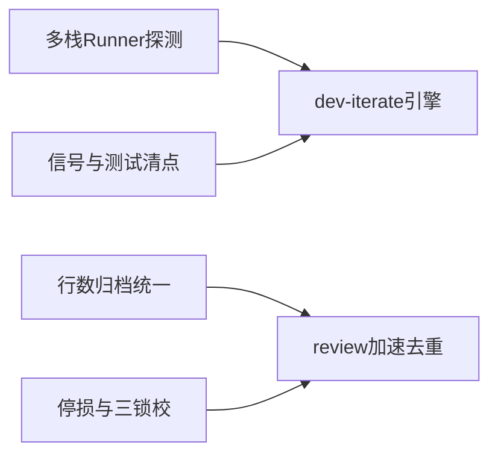

# dev-iterate 确定性重构与跨门禁单源统一 — 功能设计规范（SPEC）

## 文档信息与变更概览

| 项目 | 内容 |
| --- | --- |
| 当前状态 | `implemented`（`draft \| approved \| implementing \| in_review \| implemented \| superseded`） |
| 规划级别 | `L3`（跨模块重构、接口/契约变更或高风险改造；未 `approved` 前不编码） |
| 创建 / 更新 | `2026-11-24` / `2026-11-24` |
| 分支 / Issue / PR | `feat/r6-arch-plan` / 未关联 / 未关联 |
| 负责人 / 内审状态 | plan-r6-arch / `passed` |
| 规划态 | `interactive`（逐题问到零拍板）/ `autonomous`（默认推进，仅单向门、Case 5 或真业务歧义才停） |
| 关联 PRD / Todo | `docs/prd/261124-r6-arch-hardening-prd.md` / `docs/archive/todo/261124-r6c-iterate-unified-gates-todo.md` |

- **变更一句话**：修复 `dev-iterate` 导入崩溃、多栈运行器与 `cycle` 持久化断点，落实用户拍板 A2（`--escalate` 默认开启），统一 `edit-gate`、`review-pack`、`govern-audit` 与 `verify-tools` 的行数/豁免/归档单源口径，收敛 `check-fault` 锁到 `record --verdict pass`（保持 `check-empirical` 在 `--include-diff` 之前），并将 `review-pack` 去重提速至 `<500ms`（认领总控 PRD `C9`、`C10`、`C11`、`C12`）。

## 系统变更全景

| 模块 / 文件 | 变更性质 | 核心职责 |
| --- | --- | --- |
| `kit/skills/dev-iterate/scripts/iterate*.mjs` / `test-inventory.mjs` / `signals.mjs` / `escalation.mjs` | 改造 | 修复崩溃导入与符号抽取、泛化 `resolveTestRunner`、过滤非代码信号、落实 A2 默认升级与 `cycle` 推进 |
| `kit/skills/lib/static-gates.mjs` / `kit/skills/lib/verify-state.mjs` | 改造 | 导出共享 `isLegalArchiveMove`、扩展 `TEST_FILE_RE`；`evaluateToolStaleness` 跳过 `!baseline` 与批量预过滤提速 |
| `kit/skills/dev-edit/scripts/edit-gate.mjs` / `kit/skills/dev-verify-tools/scripts/verify-tools.mjs` | 改造 | 识别 `reviewWorktreePath` 与终态归档兄弟文档；`scratch/` 探针豁免零断言校验 |
| `kit/skills/dev-review/scripts/review-*.mjs` / `kit/skills/dev-govern/scripts/govern-*.mjs` | 改造 | 统一 `countTextLines`、`resolveOversizedExemption`、JSON 单份 `contextBrief`、保留 `check-empirical` 先行而将 `check-fault` 收敛到 `record`、识别 `configuredTestEntries`、修 Round 3 `--reason`/`rebuts`/低风险与 `generic-git` |
| `scripts/dev/fixtures-r6c-gates.mjs` (new) / `scripts/dev/injections-data-r6c.mjs` (new) | 新增 | 正反双向夹具与故障注入 |

## 一、背景与边界声明

- **要改什么**：修复 `dev-iterate` 确定性断裂与测试入口盲区；统一 `countTextLines`、`isLegalArchiveMove`、`resolveOversizedExemption` 与 brownfield 棘轮；优化 `verify-state.mjs` 与 `review-pack` JSON 去重将耗时压至 `<500ms`；修补 `review-ledger.mjs` 三锁。
- **不改什么**：不修改 `edit-gate.mjs`、`review-context.mjs`、`govern-state.mjs` 中的 `['main','master']` 默认分支切换（留给 Wave 2 `r6d` 统一调用 `isDefaultBranch`，确保 Wave 1 零依赖）；不修改切片 A/B 专属文件及 `kit/skills/dev-iterate/SKILL.md` / `docs/TDD.md`（归 `r6d`）。
- **本期不做**：不修改外部压测仓代码；不放松 `check-empirical` 实证优先于 `--include-diff` 的核心约束。
- **复用既有模块**：`kit/skills/lib/static-gates.mjs`、`kit/skills/lib/symbol-index.mjs`、`kit/skills/lib/escalation.mjs`、`kit/skills/lib/verify-state.mjs`。
- **架构基线关系**：消除跨门禁一绿一红分裂与 `review-pack` 三重序列化，严格对齐 `docs/TDD.md`（依据：`docs/TDD.md`）。

## 二、设计方案与契约变更

### 接口 / 数据结构变更

1. **`dev-iterate` 确定性重构与多栈 Runner（`C9`、`C10`）**：
   - `kit/skills/dev-iterate/scripts/iterate.mjs`：补导 `printNextStep`；修复 `--focus` 传入 `extractSymbols(txt, ext)`（取扩展名并消费返回的 `string[]`）；补传 `resolveNativeTestDir(..., files)`；修复 `kit/skills/lib/test-inventory.mjs` `slugTestToken` 正则增加 `\b` 词边界，防止把 `prd` 误变 `flow`，并修正 Python 分支左右相同条件。
   - 在 `test-inventory.mjs` 抽象单源 `resolveTestRunner(repoRoot, targetRel, { files, packageJson } = {})` 并由 `iterate.mjs` 调用：覆盖 Python（`.venv` 虚拟环境中的 `pytest`、`pytest`、`uv run pytest`、`poetry run pytest`、`unittest`）、Java（`./mvnw test` / `mvn test` / `./gradlew test` / `gradle test`）、Node/TS（`.js`/`.mjs`/`.cjs`/`.jsx`/`.ts`/`.tsx`/`.mts`/`.cts` 下识别 `vitest` / `jest` / `tap` / `mocha` / `ava` / `tsx` / `bun` / `node --test`）、Go、Rust 等，二进制缺失返回 `'missing-runner'`（不与 `'test-failure'` 混淆）；无 `--targets` 时递归扫描测试目录与 `configuredTestEntries`。
   - `signals.mjs` 与 `iterate.mjs` `plan` 按 `CODE_EXT_RE` 与 `existsSync` 过滤非代码、已删除与 `docs/archive/**` 目标（不再推荐生成 `README.en.md` 或归档 PRD 测试）。
   - `static-gates.mjs`（`TEST_FILE_RE` / `isTestOrFixtureFile`）、`test-inventory.mjs` 与 `govern-audit.mjs` / `govern-state.mjs` 共同识别 `configuredTestEntries` 与 `scripts/dev/fixtures-*.mjs`，消灭本仓 `govern-audit` 输出 `Test Files: 0` 与把门禁脚本误报为未测源码的问题。
   - `iterate.mjs generate --write` 增加默认分支与无 worktree 隔离拦截；落实 A2：`iterate.mjs run` 默认 `--escalate: true`（支持 `--no-escalate` 关闭），调用 `escalation.mjs` 精确走 `classifyEscalationTier`（去掉硬编码 `force: true` 与 `caseType: 2`）。
   - `iterate-cycle.mjs` 与 `iterate.mjs cycle` 持久化追加本轮 `history` 与 `pendingGates`，重跑递进轮次并在触发 `ROUND_LIMIT_REACHED` / `NO_PROGRESS_STALL` / `ONE_WAY_GATE_HIT` 时联动建单并退出码 `4`。

2. **跨门禁单源统一与 `review-pack` 提速去重（`C11`）**：
   - 行数口径：`review-gates.mjs` 与 `govern-checks.mjs` 统一复用 `static-gates.mjs` `countTextLines`（消灭 800 vs 801 分裂）。
   - 超大与合法归档移动豁免：在 `static-gates.mjs` 导出共享 `isLegalArchiveMove` 供 `edit-gate.mjs` 与 `review-gates.mjs` 共用；`review-gates.mjs` 传入 `gitAttributesText` 并调用 `resolveOversizedExemption`；`govern-checks.mjs` 对齐 brownfield 存量 `>800` 行净增棘轮（`<= 80` 行）。
   - `edit-gate.mjs` 识别 `l.reviewWorktreePath === wtRel` 且用 `includeTerminal: true` 查关联任务，放行同 Issue 已归档兄弟文档更新，彻底消除 `finalize` 归档后在 review 槽无 `--task` 复跑撞 `do-not-edit`。
   - **双锁精准分层**：保留 `check-empirical` 强排在 `--include-diff` 之前（坚守实证第一优先级），仅将 `check-fault` 锁收敛至最终 `review-pack.mjs record --verdict pass`（`evaluatePassBlockers` 校验故障注入记录）。
   - **JSON 去重与 `<500ms` 提速**：`review-context.mjs` 与 `review-pack.mjs` 删除重复嵌套的 `evergreenContext` / `reviewContext.contextBrief` 副本，全局 JSON 只保留 1 份 `contextBrief`；`verify-state.mjs` `evaluateToolStaleness` 在 `!baseline` 时直接跳过 `baseRef` 树计算，先跑 1 次 `git diff --name-only` 预过滤未变更工具再并发读取，将 `review-pack` 从 `6–12s` 压回 `<500ms`。
   - `verify-tools.mjs create --script` 对 `scratch/` 下探针豁免 `scanTestAntiCheat` 的 `ZERO_ASSERTION_TEST`。

3. **独立审查账本三锁与指引对齐（`C12`）**：
   - `review-ledger.mjs`：Round 3 首次触发停损时 `--human-approved` 必须校验非空 `--reason`（对齐 `review-locks.mjs` `checkHistoricalStopLoss`）；写入 `roundEntry.rebuts` 时同时继承 `baseLedger.rebuts` 与 `prevRound?.rebuts`；修复低风险免 `--review-token` 记录通道在单会话下的 `SELF_REVIEW_REJECTED` 冲突；对齐 `verdict === 'pass'` 时对 `generic-git` 输出 `awaiting-remote-mr` 指引。

### 数据与状态变更

- `iterate` 循环状态持久化记录每轮摘要、运行器状态（`missing-runner` / `passed` / `failed`）与 `pendingGates`；`review-pack` JSON 结构全局仅保留 1 份 `contextBrief`。

### 异常、回退与安全边界

- `generate --write` 非隔离状态以退出码 `3` 阻断；`--include-diff` 未完成 `check-empirical` 仍以 `BLOCKED_EMPIRICAL_FIRST` 阻断；Round 3 缺 `--reason` 一律退出码 `4` 阻断。

### 实现顺序

1. 改造 `static-gates.mjs`、`verify-state.mjs`、`test-inventory.mjs`、`signals.mjs`、`escalation.mjs` 与 `verify-tools.mjs`。
2. 修复 `iterate.mjs`、`iterate-cycle.mjs` 全部断点与 A2 默认值。
3. 统一 `edit-gate.mjs`、`review-*.mjs` 与 `govern-*.mjs`，补齐 `fixtures-r6c-gates.mjs` (new) 与 `injections-data-r6c.mjs` (new)。

## 三、备选方案与否决理由

| 方案 | 怎么做的 | 为什么没选 | 什么情况下该改回它 |
| --- | --- | --- | --- |
| 下沉单源原语 + 批量 `git diff` 预过滤 + `check-fault` 收敛至 `record` | 统一口径同时兼顾实证优先与审查流畅度 | 决定性采用：既消一绿一红分裂又把 `review-pack` 压回 `<500ms` | 新增生态运行器时仅扩 `resolveTestRunner` 表 |
| 连同 `check-empirical` 一起推迟到 `record` 阶段 | 彻底放开 `--include-diff` | 否决：破坏「先实证后 diff」核心铁律 | 任何情况下不放开无实证读 diff |

## 四、改动清单与影响面

| 文件 / 目录 | 改动性质 | 改什么 | 谁会被影响 |
| --- | --- | --- | --- |
| `kit/skills/lib/{static-gates,verify-state,test-inventory,signals,escalation}.mjs` | 修改 | 共享 `isLegalArchiveMove`、测试识别、`evaluateToolStaleness` 提速、`resolveTestRunner`、信号过滤 | `iterate`、`edit-gate`、`review`、`govern` |
| `kit/skills/dev-iterate/scripts/{iterate,iterate-cycle}.mjs`、`kit/skills/dev-verify-tools/scripts/verify-tools.mjs` | 修改 | 补导 `printNextStep`、修 `extractSymbols`、隔离拦截、A2 默认 `--escalate`、`cycle` 持久化、`scratch/` 豁免 | `dev-iterate`、`dev-verify-tools` |
| `kit/skills/dev-edit/scripts/edit-gate.mjs`、`kit/skills/dev-review/scripts/review-*.mjs`、`kit/skills/dev-govern/scripts/govern-*.mjs` | 修改 | 行数/豁免/归档对齐、单份 `contextBrief`、`check-fault` 收敛至 `record`、Round 3 `--reason` / `rebuts` / 低风险 / `generic-git` 指引 | `dev-edit`、`dev-review`、`dev-govern` |
| `scripts/dev/fixtures-r6c-gates.mjs` (new)、`scripts/dev/injections-data-r6c.mjs` (new) | 新增 | 正反双向夹具与故障注入 | `fixtures.mjs` 与 `verify-injections.mjs` |

- **对外可见的变化**：`iterate.mjs run` 默认 `--escalate: true`；`govern-audit` 识别 `configuredTestEntries`；`review-pack` 降至 `<500ms` 且全局仅存 1 份 `contextBrief`；`check-empirical` 仍在 `--include-diff` 前校验，而 `check-fault` 锁收敛至 `record --verdict pass`。
- **需要同步改的地方**：Wave 2 `r6d` 统一切换 `edit-gate`、`review-context`、`govern-state` 至 `isDefaultBranch` 并同步 `kit/skills/dev-iterate/SKILL.md` 与 `docs/TDD.md`。

## 五、冻结的验收标准

- [x] C9: `iterate.mjs run` 非 `--json` 无 `ReferenceError`，`--focus` 正确抽取符号，`.venv` `pytest`、`mvn test`、`vitest`/`tap`/`node --test` 正确分发且缺运行器返回 `missing-runner`；`slugTestToken` 保留 `prd` 不误变 `flow`。
- [x] C10: `iterate.mjs plan . --json` 过滤非代码与归档 PRD；`govern-audit.mjs audit . --json` 不再输出 `Test Files: 0`；`generate --write` 隔离拦截；`iterate.mjs run` 默认 `--escalate: true` 且支持 `--no-escalate`；`cycle` 累加轮次并按停损建单。
- [x] C11: 800 行含结尾换行与 `.gitattributes` `linguist-generated` 大文件在 `edit-gate`、`review-pack`、`govern-audit` 判定一致；`review` worktree 无 `--task` 放行合法归档；`check-empirical` 保持先于 `--include-diff` 而 `check-fault` 收敛到 `record --verdict pass`；`review-pack --json` 仅含 1 份 `contextBrief` 且耗时 `<500ms`；`verify-tools create` `scratch/` 探针豁免零断言校验。
- [x] C12: `review-ledger.mjs` Round 3 首次停损缺 `--reason` 阻断、`rebuts` 完整继承 `baseLedger.rebuts`、低风险单会话与 `generic-git` `awaiting-remote-mr` 正常；`node scripts/dev/fixtures.mjs --domain r6c-gates` 与 `verify-injections.mjs --jobs 4` 全绿。

## 六、高风险点、门型与回滚路径

- **门型与回滚路径**：one-way；异常时 `git revert <sha>` 回退。
- **高风险路径**：`kit/skills/lib/`、`kit/skills/dev-edit/scripts/`、`kit/skills/dev-review/scripts/`、`kit/skills/dev-govern/scripts/` 须独立双门审查与故障注入。
- **故障注入预演**：使用 `scripts/dev/verify-injections.mjs --jobs 4` 与 `scripts/dev/injections-data-r6c.mjs` (new)，逐一破坏 `countTextLines` 共用、`check-empirical` 先行锁、Round 3 `--reason`、`--escalate` 默认值与 `reviewWorktreePath` 识别确认测试必红。

## 澄清与补充记录

- 已确认（2026-11-24 · user）：A2: `dev-iterate run` 失败升级默认值 -> A2 已拍板：`dev-iterate run` 默认开启失败自动升级建单（`--escalate` 默认 `true`，支持 `--no-escalate` 关闭），由切片 C 实现并在切片 D 同步文档。

## 实现说明

- **实际落地摘要**：完成 C9..C12 与 A2 全部改造：`test-inventory.mjs` 统一多栈 `resolveTestRunner`（`.venv`/pytest/uv/poetry/unittest、mvnw/mvn/gradlew/gradle、vitest/jest/tap/mocha/ava/tsx/bun/node、go、cargo + `missing-runner`）、`\b` 边界 `slugTestToken` 与 `configuredTestEntries`/`fixtures-*.mjs` 盘点；`signals.mjs` 与 `iterate*.mjs` 过滤非代码热点、拦截 committed 默认分支 `generate --write`、默认 `run --escalate`（支持 `--no-escalate`）并持久化 `cycle` 累加/停损；`static-gates.mjs`、`verify-state.mjs`、`edit-gate.mjs`、`review-*.mjs`、`govern-*.mjs`、`verify-tools.mjs` 统一 `countTextLines`/`isLegalArchiveMove`/`resolveOversizedExemption`/`reviewWorktreePath`、收敛 `check-fault` 至 `record --verdict pass`、JSON 全局单份 `contextBrief`、`evaluateToolStaleness` `!baseline` 快跳与 Round 3 `--reason`/`rebuts`/低风险/`generic-git` 修复。
- **与草案的差异**：未修改 `escalation.mjs` 与 `exit-codes.mjs`（`BLOCKED_MAIN_SLOT_VIOLATION`、`BLOCKED_STOP_LOSS_REASON_REQUIRED` 等阻断码已在册且 `classifyEscalationTier` 已有行为已满足）；按协调者 `#734` 裁决保留 Node <22.6 的 `unsupported-ts-runtime` 诊断并同步调整 3 处既有用例。
- **关联同步文件**：经协调者 `#734` 授权同步更新 `scripts/dev/e2e-scenarios-evolution.mjs:209`、`scripts/dev/blind-run-matrix.mjs:143`（加测 `main` exit 3 后转隔离 worktree）及 `scripts/dev/fixtures-w6c-context-brief.mjs:181`（校验单源 `pack.contextBrief` 且无重复）。`docs/TDD.md` 同步留归 Wave 2 `r6d`。
