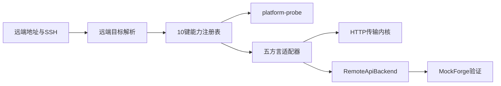

# 多远端平台统一能力内核与协议方言适配器 — 功能设计规范（SPEC）

## 文档信息与变更概览

| 项目 | 内容 |
| --- | --- |
| 当前状态 | `implemented`（`draft \| approved \| implementing \| in_review \| implemented \| superseded`） |
| 规划级别 | `L3`（跨 `kit/skills/lib/` 与 `scripts/lib/platform/` 的多平台协议抽象与契约升级；未 `approved` 前不编码） |
| 创建 / 更新 | `2026-11-27` / `2026-11-27` |
| 分支 / Issue / PR | `feat/multi-forge-platform-core` / #227 / 未关联 |
| 负责人 / 内审状态 | plan-c-master / `passed` |
| 规划态 | `interactive`（逐题问到零拍板） |
| 关联 PRD / Todo | `docs/prd/261127-issue227-multi-forge-worktree-perf-v1-prd.md` / `docs/archive/todo/261127-issue227-multi-forge-platform-core-todo.md` |

- **变更一句话**：将双端平台注册表升级为 10 键能力矩阵与 5 类协议方言适配器（`github`/`gitlab`/`gitcode`/`gitee`/`gitea`）+ `generic-git` 兜底，建成零依赖 `platform-http.mjs` (new)、`platform-providers.mjs` (new)、`resolveRemoteTarget` 与统一 `RemoteApiBackend`，同步清除 `github-labels.mjs` 硬编码并全量对齐既有平台门禁与注入锚点。

## 系统变更全景

| 模块 / 文件 | 变更性质 | 核心职责 |
| --- | --- | --- |
| `kit/skills/lib/platform-registry.mjs` | 修改 | 升级为 10 键 `NONE_CAPABILITIES`（新增 `uploadAttachment`、`checks`），内置 5 方言元数据与 `mrRefPattern` 契约 |
| `kit/skills/lib/platform-http.mjs` | 新增 | 零依赖 `node:http`+`node:https` 传输层：公网 `http://` 与 `169.254.169.254`/`fe80::` Fail-Closed 拦截、仅允许 loopback/RFC1918 局域网 `http://`、`AbortSignal.timeout`、`redirect: 'manual'` + 3xx `Location` 脱敏、全平台令牌脱敏、4 字节字符守卫、随机 boundary + filename CRLF/引号清洗 + 纯 `Buffer.concat` multipart、429 退避上限 |
| `kit/skills/lib/platform-providers.mjs` | 新增 | 5 方言 REST/Multipart 协议适配器（明确 5 方言鉴权头、GitLab/GitCode `/uploads` multipart、`refs/merge-requests/<iid>/head` 真 SHA 校验含离线/浅仓回退与 `shaSource` 标注、客户端分支二次过滤） |
| `kit/skills/lib/platform-probe.mjs` | 修改 | 按 `providerId` 分发统一 `probePlatformEnv`/`probeForWrite`（保留 `StrictHostKeyChecking=yes`、`gh --hostname` 与 `AbortSignal.timeout` 安全基线，并瘦身至 `<= 700` 行） |
| `kit/skills/lib/github-parse.mjs` | 修改 | 扩展 `isVerifiedTier` 识别统一通道层；扩展 `redactGhTokens` 为全平台脱敏（`glpat-`/`Bearer`/`PRIVATE-TOKEN`/`gh*`） |
| `kit/skills/lib/github-client.mjs` | 修改 | 底层请求复用 `platform-http.mjs`（保留 `AbortSignal.timeout` 调用契约与向后兼容导出） |
| `kit/skills/lib/github-labels.mjs` | 修改 | 消除 L110、L168、L357 处 `gh-cli`/`node-https-token` 硬编码，改用统一 `isVerifiedTier` 与能力驱动 |
| `kit/skills/lib/platform.mjs` | 修改 | 新增 `resolveRemoteTarget`（完整保留 GitLab 多级群组 `group/sub/repo` 与 LAN/离线识别）与统一能力解析 |
| `kit/skills/lib/task-backend.mjs` | 修改 | 以统一 `RemoteApiBackend` 取代 `provider.id !== 'github'` 硬退化，保留 `GitHubBackend` 兼容导出与 `I373` 注册表分发锚点 |
| `scripts/lib/platform/*` | 修改 | `registry.mjs`/`index.mjs`/`github*.mjs` 同步单源复用 `kit/skills/lib/` 10 键能力矩阵与 5 方言探测 |
| `scripts/dev/preflight-suite.mjs`、`fixtures-platform.mjs`、`fixtures-repo-alignment.mjs`、`injections-data-repo-alignment.mjs`、`injections-data-kernel-dedup.mjs`、`injections-data-platform-core.mjs` | 修改/新增 | 同步升级双端注册表与 `AbortSignal.timeout`（L383）门禁、10 键能力向量断言与 `I391`/`I393`/`I372`/`I373` 注入锚点，补齐纯 Node `node:http` Mock Forge 双向测试与故障注入 |

## 一、背景与边界声明

- **要改什么**：重建双端共享平台能力注册表、安全 HTTP/Multipart 传输层、5 方言协议层、远端目标解析、统一 `RemoteApiBackend` 与 `github-labels.mjs` 通道脱钩，并同步对齐全部既有平台对齐门禁、夹具与注入锚点。
- **不改什么**：本波次不改动 `flow-*.mjs`、`review-*.mjs`、`plan-sync.mjs`、`scripts/{survey,review,equip-ci}.mjs`、`scripts/lib/render.mjs` 等业务调用面（由 Wave 3 统一切换），也不改动任何 Wave 1A 性能脚本，确保与 Wave 1A 写域 100% 零交集。保留 `GitHubBackend`、`githubRepoFull`、`probeGitHubEnv` 兼容导出避免波次间回归。
- **本期不做**：不硬编码任何私域企业域名、账号或 Token；不改动 `docs/feature-map.json`、`docs/architecture-map.html` 或 `docs/TDD.md`（由 Wave 3 收口同步）。
- **复用既有模块**：`kit/skills/lib/platform-registry.mjs`、`kit/skills/lib/platform-probe.mjs`、`kit/skills/lib/platform.mjs`、`kit/skills/lib/github-parse.mjs`、`kit/skills/lib/github-client.mjs`、`kit/skills/lib/github-labels.mjs`、`kit/skills/lib/task-backend.mjs`、`scripts/lib/platform/registry.mjs`。
- **架构基线关系**：严格遵守 `arch-rules`（`kit/**` 仅导入 `node:*` 与 `kit/skills/lib/**`，`scripts/lib/platform/*` 单向复用 `kit/skills/lib/*`），单文件 `<= 800` 行，零第三方依赖（依据：`docs/TDD.md`）。

## 二、设计方案与契约变更

### 接口 / 数据结构变更

1. **10 键能力矩阵与 5 方言注册表（`kit/skills/lib/platform-registry.mjs` + `scripts/lib/platform/registry.mjs`）**：
   - `NONE_CAPABILITIES` 升级为 10 键：`api`, `pr`, `issues`, `releases`, `labels`, `milestones`, `branchProtection`, `mention`, `uploadAttachment`, `checks`（全 `false`）。
   - 内置 5 方言（全部零私域域名硬编码，自建企业实例通过 `AGENTS.md` `platform-provider`、环境变量 `PF_PLATFORM_PROVIDER`/`PF_PLATFORM_API_BASE`、`~/.ssh/config` 或在线探测 `/api/v4/version`・`/api/v1/version` 识别）：
     - `github`（`github.com`/`www.github.com`/`ssh.github.com`/显式配置）：`uploadAttachment: false`，`checks: true`，`mrRefPattern: 'refs/pull/{n}/head'`。
     - `gitlab`（`gitlab.com` + 显式配置或自建探测）：`uploadAttachment: true`，`checks: true`，`mrRefPattern: 'refs/merge-requests/{n}/head'`。
     - `gitcode`（`gitcode.com`/`gitcode.net` + 显式配置）：`uploadAttachment: true`，`checks: true`，`mrRefPattern: 'refs/merge-requests/{n}/head'`。
     - `gitee`（`gitee.com`）：`uploadAttachment: false`，`checks: false`，`mrRefPattern: 'refs/pull/{n}/head'`。
     - `gitea`（`codeberg.org` + 显式配置或 `/api/v1/version` 探测）：`uploadAttachment: false`，`checks: true`，`mrRefPattern: 'refs/pull/{n}/head'`。
     - `generic-git`：10 键全 `false`，覆盖局域网纯裸仓、内网 IP 无 API 与纯离线环境。
2. **`kit/skills/lib/platform-http.mjs` (new)（预计 `<= 380` 行）**：
   - **SSRF / 协议 Fail-Closed 边界**：默认仅允许 `https://`；`http://` 仅在目标主机明确属于 loopback（`127.0.0.1`、`::1`、`localhost`）或 RFC1918 私有局域网网段（`10.0.0.0/8`、`172.16.0.0/12`、`192.168.0.0/16`）且显式/局域网模式放行时允许，**公网 `http://` 一律 Fail-Closed 拒接**，且显式拦截云元数据与链路本地地址（`169.254.0.0/16` 含 `169.254.169.254`、`fe80::/10`）。
   - **重定向与脱敏**：全量强制 `redirect: 'manual'`，遇 3xx 拒跟并返回结构化错误，其中 `Location` 头与全部错误/日志文本统一经 `redactPlatformTokens` 脱敏（覆盖 `gh[pousr]_`、`github_pat_`、`glpat-`、`PRIVATE-TOKEN`、`Authorization: Bearer/token`、`access_token=`、`private_token=` 等查询参数与响应头）。
   - **二进制安全 Multipart 构建**：`buildMultipartBody({ fieldName, filename, contentType, buffer })` 使用 `crypto.randomBytes(16).toString('hex')` 生成随机 boundary，对 `filename` 严格清洗 `[\r\n"\\]` 与路径分隔符防头注入，全程采用 `Buffer.concat([headBuf, fileBuf, tailBuf])` 拼接确保 PNG/二进制零 UTF-8 损毁。
   - **超时、退避与 4 字节守卫**：每次请求显式设置 `AbortSignal.timeout(timeoutMs)`；遇 HTTP 429 / 5xx 遵循 `Retry-After` 并受 `MAX_RETRY_DELAY_MS` 与最大重试次数封顶；`sanitizeFourByteChars(text)` 安全检测并替换 `[^\u0000-\uFFFF]` 四字节字符。
3. **`kit/skills/lib/platform-providers.mjs` (new)（预计 `<= 640` 行）**：
   - 导出 `createProviderClient({ providerId, apiBaseUrl, repoSlug, token, remoteName, repoRoot, cliFallback })`，明确 5 方言鉴权头差异：
     - `github`：`Authorization: Bearer <token>` + `Accept: application/vnd.github+json` + `X-GitHub-Api-Version`；
     - `gitlab`：`PRIVATE-TOKEN: <token>`（OAuth 令牌可切 `Authorization: Bearer <token>`）；
     - `gitcode`：`PRIVATE-TOKEN: <token>`（写请求自动启用 `sanitizeFourByteChars`）；
     - `gitee`：`Authorization: Bearer <token>`（兼容 v5 query/header 规范，禁止在日志/错误中暴露）；
     - `gitea`：`Authorization: token <token>`。
   - **GitLab / GitCode 关键护栏**：`repoSlug` 完整保留多级群组并用 `encodeURIComponent(repoSlug)` 编码；`uploadAttachment` 调 `POST /api/v4/projects/:encodedSlug/uploads` 返回 `{ ok, url, markdown, alt }`；`getPr` 优先执行 `git ls-remote <remoteName> refs/merge-requests/<iid>/head` 校验真实 HEAD SHA 并返回 `shaSource: 'git-ls-remote' | 'rest-fallback'`（离线或浅仓无该 ref 时安全回退 REST `mr.sha` 并标注 `shaSource: 'rest-fallback'`）；`findOpenPrForBranch` 强制按 `headBranch` 与 `baseBranch` 执行客户端二次过滤。
4. **`kit/skills/lib/platform.mjs`、`platform-probe.mjs`、`github-labels.mjs` 与 `task-backend.mjs`**：
   - `platform.mjs` 新增 `resolveRemoteTarget(remoteUrls, { role, declaredRepo, sshHostMap, providerHint, apiBaseHint })`，返回 `{ providerId, apiBaseUrl, repoSlug, host, isLan, isLocal, pushRemote, mrRefPattern, capabilities }`；保留 `githubRepoFull` 兼容包装。
   - `platform-probe.mjs`（765 行 -> `<= 700` 行）：新增 `probePlatformEnv` 与 `probeForWrite` 按 `providerId` 分发凭据探测，保留 `StrictHostKeyChecking=yes`、`--hostname` 与 `AbortSignal.timeout` 安全契约。
   - `github-labels.mjs`（459 行）：消除 L110、L168、L357 处 `gh-cli`/`node-https-token` 硬编码，改用统一 `isVerifiedTier`。
   - `task-backend.mjs` 新增 `RemoteApiBackend`（暴露 `uploadAttachment`），取代 `provider.id !== 'github'` 硬退化，保留 `GitHubBackend` 与注册表分发路径（对齐 `I373`）。
5. **既有门禁、夹具与注入锚点同步对齐**：
   - `scripts/dev/preflight-suite.mjs`（790 行 -> `<= 795` 行）：L355-359 升级为双端 5 方言集合一致性 + 10 键契约校验；L383 将 `AbortSignal.timeout` 校验同步覆盖 `platform-http.mjs`（及 `github-client.mjs`/`platform-probe.mjs` 对其单源复用）。
   - `scripts/dev/fixtures-repo-alignment.mjs` 升级 8 键能力向量断言为 10 键；`scripts/dev/injections-data-repo-alignment.mjs`（`I391`/`I393`）与 `scripts/dev/injections-data-kernel-dedup.mjs`（`I372`/`I373`）保持全部注入有效且零弱化。

### 数据与状态变更

- 新增可选环境变量与 `AGENTS.md` 读取约定：`PF_PLATFORM_PROVIDER`、`PF_PLATFORM_API_BASE`、`PF_PLATFORM_TOKEN` 及各平台标准令牌变量（均为运行时只读读取，不落盘）。

### 异常、回退与安全边界

- 公网明文 `http://` 与 `169.254.0.0/16`、`fe80::/10` 链路本地元地址一律 Fail-Closed 拒接。
- 任何 3xx 重定向一律拒跟且对 `Location` 头脱敏，防凭证泄露。
- 局域网 IP / 无 API 裸仓 / 401/403 鉴权失败自动降级至 `generic-git` 或半双工通道，附清晰降级原因，绝不崩退。

### 实现顺序

1. 升级 `kit/skills/lib/platform-registry.mjs`、`scripts/lib/platform/registry.mjs`、`kit/skills/lib/github-parse.mjs` 与 `kit/skills/lib/github-labels.mjs`，同步更新 `preflight-suite.mjs`（L355-359 与 L383）、`fixtures-repo-alignment.mjs` 及注入锚点。
2. 实现 `kit/skills/lib/platform-http.mjs` (new) 与 `kit/skills/lib/platform-providers.mjs` (new)，并瘦身升级 `kit/skills/lib/platform-probe.mjs`、`kit/skills/lib/github-client.mjs` 与 `scripts/lib/platform/*`。
3. 升级 `kit/skills/lib/platform.mjs`（`resolveRemoteTarget`）与 `kit/skills/lib/task-backend.mjs`（`RemoteApiBackend`）。
4. 扩充 `scripts/dev/fixtures-platform.mjs` 与新增 `scripts/dev/injections-data-platform-core.mjs` (new)（本地 `node:http` Mock Forge + 正反双向断言），执行 `node scripts/equip.mjs .` 与全量验证。

## 三、备选方案与否决理由

| 方案 | 怎么做的 | 为什么没选 | 什么情况下该改回它 |
| --- | --- | --- | --- |
| 10 键能力矩阵 + 5 方言 REST 适配 + `generic-git` 兜底（已选） | 零依赖 `node:http`/`node:https` 与单一注册表驱动 | 零外部 CLI 依赖（不要求装 `glab`/`tea`）、天然覆盖局域网与离线 | 若未来需 GraphQL 批查可在对应方言内部增量叠加 |
| 用字符串拼接 multipart body | 把图片转 UTF-8 字符串拼接边界 | 二进制 PNG 经 UTF-8 编解码会永久损毁字节 | 永不采用，必须用纯 `Buffer.concat` |
| 放开任意 `http://` 明文请求 | 允许所有主机走明文 HTTP | 导致公网凭据明文泄露与云元数据 SSRF 风险 | 永不采用，仅限 loopback/RFC1918 且显式拦截 `169.254.0.0/16` 与 `fe80::/10` |

## 四、改动清单与影响面

| 文件 / 目录 | 改动性质 | 改什么 | 谁会被影响 |
| --- | --- | --- | --- |
| `kit/skills/lib/platform-registry.mjs`、`scripts/lib/platform/registry.mjs` | 修改 | 10 键能力矩阵 + 5 方言注册 + `generic-git` 兜底 | 全仓身份与平台能力判定 |
| `kit/skills/lib/platform-http.mjs` | 新增 | 安全 HTTP/HTTPS（公网/元地址 Fail-Closed）、超时、拒重定向与 `Location` 脱敏、全平台脱敏、4 字节守卫、纯 Buffer multipart | 全部远端 API 调用 |
| `kit/skills/lib/platform-providers.mjs` | 新增 | 5 方言协议客户端（鉴权头、429 退避、`/uploads`、真 SHA + `shaSource`、客户端过滤） | `task-backend.mjs` |
| `kit/skills/lib/platform-probe.mjs`、`github-parse.mjs`、`github-client.mjs`、`github-labels.mjs` | 修改 | 统一平台探测、全平台脱敏、底层 HTTP 复用与消除标签通道硬编码 | `dev-flow`、`dev-review`、`survey` |
| `kit/skills/lib/platform.mjs`、`kit/skills/lib/task-backend.mjs` | 修改 | `resolveRemoteTarget` 多级群组/LAN 识别与统一 `RemoteApiBackend` | Wave 3 全业务流切换 |
| `scripts/lib/platform/index.mjs`、`github.mjs`、`github-client.mjs`、`github-probe.mjs` | 修改 | 单源对齐新 10 键能力与多方言探测 | `survey`、`review`、`equip-ci` |
| `scripts/dev/preflight-suite.mjs`、`fixtures-platform.mjs`、`fixtures-repo-alignment.mjs`、`injections-data-repo-alignment.mjs`、`injections-data-kernel-dedup.mjs`、`injections-data-platform-core.mjs` | 修改/新增 | 双端注册表与 `AbortSignal.timeout` 门禁、10 键断言、既有锚点对齐、Mock Forge 双向测试与故障注入 | 全仓 CI 门禁 |

- **对外可见的变化**：注册表内置方言由 `['github']` 扩展为 `['github', 'gitlab', 'gitcode', 'gitee', 'gitea']`，能力对象由 8 键扩为 10 键；新增环境变量驱动的自建实例识别。
- **需要同步改的地方**：执行 `node scripts/equip.mjs .` 同步 `.agents/skills/`。

## 五、冻结的验收标准

<!-- criteria:start -->
- [x] C4: `kit/skills/lib/platform-registry.mjs` 与 `scripts/lib/platform/registry.mjs` 升级为单源 10 键能力矩阵（新增 `uploadAttachment`、`checks`）并注册 5 内置方言（`github`/`gitlab`/`gitcode`/`gitee`/`gitea`）+ `generic-git` 兜底，零私域域名硬编码；同步升级 `scripts/dev/preflight-suite.mjs`（L355-359 双端注册表对齐与 L383 `AbortSignal.timeout` 校验对齐，且保留全部 SSH 安全断言）、`scripts/dev/fixtures-platform.mjs`、`scripts/dev/fixtures-repo-alignment.mjs`、`scripts/dev/injections-data-repo-alignment.mjs`（`I391`/`I393`）与 `scripts/dev/injections-data-kernel-dedup.mjs`（`I372`/`I373`）。
- [x] C5: 新增零依赖 `kit/skills/lib/platform-http.mjs` (new)（`node:http`+`node:https`、公网 `http://` 与 `169.254.169.254`/`fe80::` Fail-Closed 拦截、仅允许 loopback/RFC1918 局域网 `http://`、`AbortSignal.timeout`、`redirect: 'manual'` + 3xx `Location` 脱敏、全平台令牌脱敏、4 字节字符守卫、随机 boundary + filename CRLF/引号清洗 + 纯 `Buffer.concat` multipart）与 `kit/skills/lib/platform-providers.mjs` (new)（5 方言鉴权头、429 退避上限、GitLab/GitCode `/uploads` multipart 上传、`refs/merge-requests/<iid>/head` 真 SHA 校验含离线/浅仓回退与 `shaSource` 标注、客户端分支二次过滤），升级 `kit/skills/lib/platform-probe.mjs`（`<= 700` 行）、`kit/skills/lib/github-parse.mjs`、`kit/skills/lib/github-client.mjs`、`kit/skills/lib/github-labels.mjs` 与 `scripts/lib/platform/*`。
- [x] C6: `kit/skills/lib/platform.mjs` 新增 `resolveRemoteTarget`（完整支持 GitLab 多级群组 `group/sub/repo` 与 LAN/离线识别），`kit/skills/lib/task-backend.mjs` 落地统一 `RemoteApiBackend` 取代 `provider.id !== 'github'` 硬退化；通过纯 Node 本地 `node:http` Mock Forge 在 `scripts/dev/fixtures-platform.mjs` 与 `scripts/dev/injections-data-platform-core.mjs` (new) 完成正反双向实证与故障注入，`node scripts/dev/preflight.mjs`、`node scripts/dev/fixtures.mjs --domain platform`、`node scripts/dev/fixtures.mjs --domain repo-alignment` 与 `node scripts/dev/merge-gate.mjs` 退出码 `0`。
<!-- criteria:end -->

## 六、高风险点、门型与回滚路径

- **门型与回滚路径**：`one-way`（改造双端平台注册表、HTTP 安全传输与 `task-backend` 公共契约）；回滚做法：反向提交本切片 PR，重跑 `node scripts/equip.mjs .` 与 `node scripts/dev/preflight.mjs`。
- **高风险路径**：`kit/`、`scripts/lib/`。
- **故障注入预演**：至少注入 7 类退化故障——公网 `http://` 未拒接、`169.254.169.254` 元地址未拦截、3xx 重定向未拒跟或 `Location` 未脱敏、明文 `glpat-` 令牌未脱敏、4 字节字符守卫失效、`findOpenPrForBranch` 缺失客户端分支二次过滤、`getPr` 忽略 `refs/merge-requests/<iid>/head` 真 SHA——全部由 `scripts/dev/injections-data-platform-core.mjs` (new) 经 `verify-injections.mjs` 捕获。

## 澄清与补充记录

- 已确认：吸收 R1 独立审查意见，纳入 `preflight-suite.mjs:383`、`fixtures-repo-alignment.mjs`、`injections-data-repo-alignment.mjs`、`injections-data-kernel-dedup.mjs` 与 `github-labels.mjs`，补全公网 `http://`/元地址 Fail-Closed、纯 Buffer multipart 与 `shaSource` 回退契约；与 Wave 1A 写域保持 100% 零交集。

## 实现说明

- **实际落地摘要**：双端注册表提供 10 键 `NONE_CAPABILITIES` 与 5 方言（`github`/`gitlab`/`gitcode`/`gitee`/`gitea`）+ `generic-git`；`kit/skills/lib/platform-http.mjs` 承载 SSRF/公网 `http://`/链路本地与云元地址拦截、`AbortSignal.timeout`、3xx 拒重定向与 `Location` 脱敏、全平台令牌脱敏、4 字节字符守卫及纯 `Buffer.concat` multipart；`kit/skills/lib/platform-providers.mjs` 实现 5 方言鉴权头、429 退避封顶、GitLab/GitCode `/uploads`、真 SHA（`git-ls-remote` / `rest-fallback`）与客户端分支二次过滤；`kit/skills/lib/platform-probe.mjs` 保持 689 行；`kit/skills/lib/task-backend.mjs` 提供统一 `RemoteApiBackend` 并保留 `GitHubBackend` 兼容子类。
- **与草案的差异**：`resolveRemoteTarget` 置于 `kit/skills/lib/platform-registry.mjs` 并经 `kit/skills/lib/platform.mjs` 与 `scripts/lib/platform/index.mjs` 单源重导出，使 `platform.mjs` 稳定保持在 740 行；`preflight-suite.mjs` `checkPlatformLock` 仅对多平台内核模块豁免旧版单平台锁定。
- **关联同步文件**：经 `node scripts/equip.mjs .` 同步 `.agents/skills/lib/*` 与 `.agents/skills/.pf-manifest.json`。
