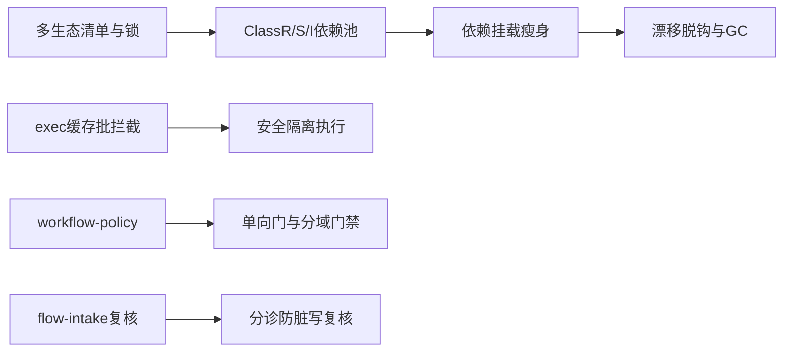

# 多 Worktree 三类并发依赖池、Windows 批处理硬化与策略单向门升级 — 功能设计规范（SPEC）

## 文档信息与变更概览

| 项目 | 内容 |
| --- | --- |
| 当前状态 | `implemented`（`draft \| approved \| implementing \| in_review \| implemented \| superseded`） |
| 规划级别 | `L3`（涉及 `kit/` 依赖池、命令安全边界、退出码注册与单向门策略；未 `approved` 前不编码） |
| 创建 / 更新 | `2026-11-27` / `2026-11-28` |
| 分支 / Issue / PR | `feat/worktree-dep-pool-policy` / #227 / 未关联 |
| 负责人 / 内审状态 | plan-c-master / `passed` |
| 规划态 | `interactive`（逐题问到零拍板） |
| 关联 PRD / Todo | `docs/prd/261127-issue227-multi-forge-worktree-perf-v1-prd.md` / `docs/archive/todo/261127-issue227-worktree-dep-pool-policy-todo.md` |

- **变更一句话**：落地 Class R / S / I 三类通用并发 Worktree 依赖引擎与仓外只读 `dep-pool`（含 Windows NTFS 递归撤只读位清理防 `EPERM`），硬化 Windows `.cmd`/`.bat` CVE-2024-27980（优先直调 `node` + 精准元字符拦截 + 维护 `execSafe` 永不抛异常契约），扩展单向门覆盖 NoSQL/API/基础设施并修复 `resolveScopedVerificationGate` 字段错位与 `intake` 写前防脏写复核。

## 系统变更全景

| 模块 / 文件 | 变更性质 | 核心职责 |
| --- | --- | --- |
| `kit/skills/lib/worktree-dep-pool.mjs` | 新增 | 三类分层判定、锁+清单依赖段指纹计算、仓外只读 `dep-pool`、`pool-refs.json` 引用计数锁与 GC、Windows NTFS 递归撤只读位（`0o777`/`0o666`）再删防 `EPERM`、`.prisma`/POSIX shebang 毒化探测、Windows junction 非递归清理兜底与 `reconcileWorktreeDeps` 钩子 |
| `kit/skills/dev-flow/scripts/worktree-deps.mjs` | 修改 | 瘦身至 `<= 600` 行，接入 `worktree-dep-pool.mjs`，新增 `detach` 与 `reconcile` 子命令，放行 `dep-pool` 为 `tool-mounted` |
| `kit/skills/lib/profile.mjs` | 修改 | `DEV_PROFILE_KEYS` 新增可选 `worktree-shared-readonly`（配置 Class S 附加只读共享目录） |
| `kit/skills/lib/exec.mjs` | 修改 | `computeWorktreeEnv` 重定向 `VITE`/`JEST`/`BABEL`/`ESLINT`/`CARGO_TARGET_DIR` 并透传 `PNPM_CONFIG_VERIFY_DEPS_BEFORE_RUN=false`；CVE-2024-27980 硬化优先解析 `npm`/`pnpm`/`npx`/`yarn` `.cmd` 底层 JS 直调 `node`，其余 `.cmd` 精准拦截命令拼接元字符并在 `execSafe` `try/catch` 内返回 `BLOCKED_UNSAFE_WIN_BATCH_ARG` |
| `kit/skills/lib/exit-codes.mjs` | 修改 | 在 `USAGE_CODES` 登记 `BLOCKED_UNSAFE_WIN_BATCH_ARG`（退出码 `2`），在 `FACT_CODES` 登记 `BLOCKED_STALE_INTAKE_CONTEXT`（退出码 `3`） |
| `kit/skills/lib/workflow-policy.mjs` | 修改 | 扩展 `isOneWayBoundaryFile` 覆盖 NoSQL/ORM/KV/向量库、API 契约与状态基础设施；双向兼容修复 `resolveScopedVerificationGate` `dirRel/ecosystems` 与 `quickTest` 读取（`<= 790` 行） |
| `kit/skills/dev-flow/scripts/flow.mjs`、`flow-intake.mjs`、`kit/skills/lib/intake-triage.mjs`、`scripts/dev/subcommand-parity.mjs` | 修改 | 主入口与分诊透传 `--context-basis <sha256>`，写前持锁复拉比对（漂移报 `BLOCKED_STALE_INTAKE_CONTEXT`），修正帮助文案 `reject \| merge-duplicate` 并保持三方参数对拍全绿 |
| `kit/skills/dev-edit/scripts/edit-gate.mjs`、`flow-lifecycle-helpers.mjs`、`flow-sync.mjs`、`flow-cleanup.mjs` | 修改 | 仅以单行/薄封装调用 `worktree-dep-pool.mjs` 的 `reconcile` 与 GC 钩子（不触碰 788 行的 `flow-lifecycle.mjs`，保持 `edit-gate.mjs <= 760` 行与 `flow-lifecycle-helpers.mjs <= 785` 行） |
| `scripts/dev/fixtures-w6c-harness-gates.mjs`、`injections-data-core.mjs`、`injections-data-gates.mjs` | 修改 | 同步对齐 Class R `pnpm` 策略与既有测试夹具/注入锚点（零弱化任何门禁断言） |
| `scripts/dev/fixtures-worktree-policy-v2.mjs`、`scripts/dev/injections-data-worktree-policy-v2.mjs` | 新增 | 三类依赖池（含 Windows 只读目录清理）、`.cmd` 注入与合法路径放行、`execSafe` 不抛异常、单向门、`dirRel/ecosystems` 与 `contextBasis` 正反双向测试与故障注入 |

## 一、背景与边界声明

- **要改什么**：根治可写直连主仓 `symlinkSync` 写穿风险、Windows 只读目录删除 `EPERM`、Windows 批处理命令注入、单向门盲区、`resolveScopedVerificationGate` 字段错位与 `intake --apply` 并发脏写风险。
- **不改什么**：不改动平台注册表/多方言 HTTP 层（Wave 1B）及 `flow-*` 的 `github` 替换与 PR/Issue 详单重构（Wave 3）；保留既有 `scanOutboundLinks` + `unmountSharedDeps` 卸载前防删穿铁律；不向已达 788 行的 `flow-lifecycle.mjs` 堆砌新代码（验证前置漂移复核收敛于既有 `flow-lifecycle-helpers.mjs` 调用面与 `worktree-dep-pool.mjs`）。
- **本期不做**：不替项目自动执行在线包下载安装（仅提供隔离环境变量与离线秒装引导）；不改动 `docs/TDD.md`、`docs/feature-map.json`、`docs/architecture-map.html`（由 Wave 3 统一收口）。
- **复用既有模块**：`kit/skills/lib/exec.mjs`（`withFileLockSync`、`computeWorktreeEnv`、`prepareExecInvocation`、`execSafe`）、`kit/skills/lib/profile-sniffer.mjs`（`discoverWorkspacePackages`）、`kit/skills/lib/profile-sniffer-packages.mjs`、`kit/skills/lib/exit-codes.mjs`、`kit/skills/lib/subcommand-meta.mjs`。
- **架构基线关系**：严守 `arch-rules` 与单文件 `<= 800` 行红线——`worktree-deps.mjs` 由 777 行瘦身至 `<= 600` 行，`workflow-policy.mjs`（770 行 -> `<= 788` 行），`edit-gate.mjs`（Wave 1A 已净减至 `<= 755` 行，本片 `<= 760` 行），`flow-lifecycle-helpers.mjs`（777 行 -> `<= 785` 行），新增阻断码全部登记于 `exit-codes.mjs` 通过 `checkExitCodeParity`（依据：`docs/TDD.md`）。

## 二、设计方案与契约变更

### 接口 / 数据结构变更

1. **三类通用重目录分层与 `kit/skills/lib/worktree-dep-pool.mjs` (new)（预计 `<= 560` 行）**：
   - **Class R（原生并发安全全局仓，永不软链 worktree 目录）**：`pnpm`/`bun`/`uv`、Go（`GOMODCACHE`/`GOCACHE`）、Rust（共享 `CARGO_HOME` + 独立 `CARGO_TARGET_DIR`）、JVM（`~/.m2`/`GRADLE_USER_HOME` + 独立 `target`/`build`）、`.NET`/`Dart`/`Swift`。输出隔离环境变量（含 `PNPM_CONFIG_VERIFY_DEPS_BEFORE_RUN=false`、`npm_config_verify_deps_before_run=false` 与 `server.fs.allow` 提示）及离线秒装命令，账本记录 `depsMode: 'class-r-global-store'` 而非可写软链主仓 `node_modules`。
   - **Class S（仓外只读 `dep-pool`）**：`npm`/`yarn` `node_modules`、pip/Poetry `.venv`（排除 editable 与含主仓绝对路径的 POSIX `.venv/bin/*` shebang）、PHP `vendor/`、Ruby `vendor/bundle`、`Pods/`、Elixir `deps/` 及 `AGENTS.md` Dev Profile 可选 `worktree-shared-readonly:` 目录。
     - 单元指纹：`fp = sha256(锁文件内容 + 清单依赖段)`，存入 `<gitCommonDir>/project-forge-flow/dep-pool/<eco>-<unitHash>-<fp16>/` 并设置只读属性。
     - **Windows NTFS 只读池安全销毁原语**：提供 `removeReadOnlyTreeSync(dirPath)`，销毁 `refcount === 0` 池条目时先自顶向下递归 `chmodSync(entry, dir ? 0o777 : 0o666)` 解除 Windows 只读位（防 NTFS `fs.rmSync` 报 `EPERM`），再执行 `rmSync(dirPath, { recursive: true, force: true })`；配套 Windows 专项夹具实测验证。
     - 毒化隔离：`detectNodeWorkspacePoisoning` 检查 `node_modules/.prisma` 等库内生成代码与 `.pnpm/` 传递 `link:`；`detectPythonEditablePoisoning` 检查 POSIX `.venv/bin/*` shebang 指向主仓绝对路径；命中即自动降级独立隔离。
     - 漂移自愈与引用计数 GC：`worktree-deps.mjs` 新增 `detach --unit <dir>` 与 `reconcile` 子命令；`edit-gate.mjs`、`flow-lifecycle-helpers.mjs`、`flow-sync.mjs` 调用单源 `reconcileWorktreeDeps` 自动原子 `unlink` 漂移链接；`pool-refs.json` 由 `withFileLockSync` 维护活跃 worktree 引用计数，`flow-cleanup.mjs` 在 `scanOutboundLinks` + `unmountSharedDeps` 后仅回收 `refcount === 0` 池条目。
     - Windows 卸载兜底与安全识别：卸载链接先 `unlinkSync`，遇 Windows junction `EPERM`/`EISDIR` 回退非递归 `rmdirSync`；`scanOutboundLinks` 同步放行 `isInsideDir(link.resolved, depPoolRoot)` 为 `tool-mounted`。
   - **Class I（严格隔离构建/数据卷，永不共享）**：`dist/`、`build/`、`target/`、`.next/`、`.dart_tool/` 及 `pg_data/`、`redis_data/`、`mongo_data/`、`volumes/`、`.qdrant/`、`.chroma/`、`*.sqlite*`，与 `PF_PORT`/`PF_SLOT`/`PF_PORT_OFFSET` 隔离。
2. **`kit/skills/lib/exec.mjs` 缓存重定向与 Windows `.cmd`/`.bat` CVE-2024-27980 精准硬化**：
   - `computeWorktreeEnv` 统一注入 `VITE_CACHE_DIR`、`JEST_CACHE_DIR`、`BABEL_CACHE_PATH`、`ESLINT_CACHE_LOCATION`、`CARGO_TARGET_DIR` 指向独立 `PF_CACHE_DIR` 子目录，并统一透传 `PNPM_CONFIG_VERIFY_DEPS_BEFORE_RUN=false`。
   - **CVE-2024-27980 两层精准防护（绝不误杀合法路径/测试垫片，绝不破坏 `execSafe` 契约）**：
     1. **第一层（直调 `node` 绕开 `cmd.exe`）**：当 Windows 命中的 `.cmd` 属于常见 Node 包管理器（`npm.cmd`、`pnpm.cmd`、`npx.cmd`、`yarn.cmd`）时，静态解析其同目录关联的官方 JS 入口脚本（如 `node_modules/npm/bin/npm-cli.js` 等），校验路径存在后直接以 `process.execPath`（`node`）+ 参数数组启动，**完全不经 `cmd.exe`**，天然免疫批处理元字符注入且兼容任意含空格/引号/模板参数（如 `--format={{...}}`）。
     2. **第二层（其余 `.cmd`/`.bat` 精准元字符拦截）**：对无法解析 JS 入口的其他 `.cmd`/`.bat`（如测试垫片 `gh.cmd` 或自定义批处理），**放行**含空格、括号（如 `C:\Program Files (x86)\...`）、等号、花括号、冒号、斜杠的正常路径与测试垫片参数，**严格拦截**批处理命令拼接/变量展开/控制字符 `[\r\n\0&|<>^%!]` 以及会闭合 `cmd` 引号的嵌入式双引号 `"`；命中则构造带 `code: 'BLOCKED_UNSAFE_WIN_BATCH_ARG'`、`exitCode: EXIT.USAGE` 的错误。
     3. **维护 `execSafe` 永不抛异常契约**：将 `exec.mjs:295` 处 `prepareExecInvocation` 纳入 `execSafe` 的 `try/catch` 内，命中 `BLOCKED_UNSAFE_WIN_BATCH_ARG` 时稳定返回 `{ ok: false, status: EXIT.USAGE, code: 'BLOCKED_UNSAFE_WIN_BATCH_ARG', stdout: '', stderr: err.message }`，不向调用方抛未捕获异常。
3. **`kit/skills/lib/workflow-policy.mjs` 单向门扩展与字段错位修复**：
   - `isOneWayBoundaryFile` 紧凑扩展覆盖 NoSQL/ORM/KV/向量库（`*.prisma`、`drizzle/**`、`firestore.rules`、`*.cql`、`*.cypher`、`redis*.conf`、`qdrant`/`milvus`/`chroma` 配置）、API 契约（`*.proto`、`*.graphql`、`*.gql`、`openapi*.ya?ml`、`swagger*.ya?ml`）与状态基础设施（`docker-compose*.ya?ml`、`compose*.ya?ml`、`k8s/**`、`helm/**`、`*.tf`、`*.tfvars`、`terraform/**`）。
   - `resolveScopedVerificationGate` 双向兼容读取 `p?.dirRel ?? p?.dir ?? ''` 与 `Array.isArray(p?.ecosystems) ? p.ecosystems : (p?.ecosystem ? [p.ecosystem] : [])`，并兼容 `profile['quick-test']` 与 `profile.quickTest`。
4. **`flow.mjs` / `flow-intake.mjs` / `intake-triage.mjs` `contextBasis` 防脏写与三方对拍**：
   - `intake-triage.mjs` 新增 `computeIntakeContextBasis({ targetType, targetNumber, state, title, body, labels, commentsDigest, headSha })` 输出确定性 SHA-256；dry-run JSON 与记录返回 `contextBasis`。
   - `flow.mjs` 主入口与帮助文案同步注册 `--context-basis <sha256>`，透传至 `flow-intake.mjs` `--apply`：落盘写回远端前持 `withFileLockSync` 复拉最新远端并比对，漂移则以 `BLOCKED_STALE_INTAKE_CONTEXT`（`EXIT.FACT`）中止写回；修正 `flow-intake.mjs:445` 帮助文案为 `reject | merge-duplicate`，并验证 `scripts/dev/subcommand-parity.mjs` 全绿。
5. **既有夹具与注入锚点零弱化同步**：
   - `scripts/dev/fixtures-w6c-harness-gates.mjs`（L402-428）：同步验证 `pnpm` 仓命中 Class R 策略（验证 `envHints.npm_config_verify_deps_before_run === 'false'`、`PNPM_CONFIG_VERIFY_DEPS_BEFORE_RUN === 'false'`、`server.fs.allow` 提示与账本记录），并同用例增补 `npm` Class S `dep-pool` 挂载验证 `mountedDepsByWorktree` 回写，零减少覆盖点；
   - `scripts/dev/injections-data-core.mjs` 与 `scripts/dev/injections-data-gates.mjs`：同步对齐重构后的锚点，保持全部既有故障注入 100% 被捕获。

### 数据与状态变更

- 新增仓外只读池根目录 `<gitCommonDir>/project-forge-flow/dep-pool/` 与引用计数索引 `<gitCommonDir>/project-forge-flow/dep-pool/pool-refs.json`。
- `kit/skills/lib/profile.mjs` 的 `DEV_PROFILE_KEYS` 新增 `worktree-shared-readonly` 可选键（向后兼容未配置的既有 `AGENTS.md`）。

### 异常、回退与安全边界

- 宿主机不支持只读位或软链/junction 创建失败时优雅降级 `isolated` 并提示离线安装命令，绝不写穿主仓。
- `pool-refs.json` 损坏或缺失时，GC 先扫描全部现存 worktree 实际指向目标后重建计数，绝不误删仍在被活跃 worktree 引用的池条目。
- 拦截 Windows `.cmd`/`.bat` 注入时在 `execSafe` 内稳定返回 `BLOCKED_UNSAFE_WIN_BATCH_ARG`（退出码 `2`），零机会执行 `cmd.exe` 二次解释。

### 实现顺序

1. 先在 `kit/skills/lib/exit-codes.mjs` 登记 `BLOCKED_UNSAFE_WIN_BATCH_ARG`（`USAGE_CODES`）与 `BLOCKED_STALE_INTAKE_CONTEXT`（`FACT_CODES`），编写失败回归测试 `scripts/dev/fixtures-worktree-policy-v2.mjs` (new)。
2. 落地 `kit/skills/lib/worktree-dep-pool.mjs` (new)（含 `removeReadOnlyTreeSync`）、瘦身升级 `worktree-deps.mjs` 与 `profile.mjs`，接入 `edit-gate`/`flow-lifecycle-helpers`/`flow-sync`/`flow-cleanup` 钩子并同步更新 `fixtures-w6c-harness-gates.mjs`。
3. 升级 `exec.mjs`、`workflow-policy.mjs`、`intake-triage.mjs`、`flow-intake.mjs`、`flow.mjs` 与 `subcommand-parity.mjs`。
4. 补齐 `scripts/dev/injections-data-worktree-policy-v2.mjs` (new) 并对齐 `injections-data-core.mjs`/`gates.mjs`，执行 `node scripts/equip.mjs .` 与全量门禁验证。

## 三、备选方案与否决理由

| 方案 | 怎么做的 | 为什么没选 | 什么情况下该改回它 |
| --- | --- | --- | --- |
| 三类分层 + 仓外只读 `dep-pool` + 撤只读位清理 + `.cmd` 直调 `node`（已选） | 区分原生全局仓/只读池/隔离卷；包管理器 `.cmd` 直调 `node`，其余 `.cmd` 精准拦拼接元字符 | 零写穿、Windows 删除零 `EPERM`、不误杀含括号路径与 `gh.cmd` 垫片，且护住 `execSafe` 契约 | 若未来 OS 全面普及原生 COW 克隆可在池写入阶段叠加 `COPYFILE_FICLONE` |
| 一刀切拦截 `()` 与所有 `.cmd` 参数 | 拒绝任何带括号的参数进入 `.cmd` | 会误杀 Windows `Program Files (x86)` 路径及现有 `gh.cmd` 测试垫片 | 永不采用 |
| 直接对只读 `dep-pool` 调用 `fs.rmSync` | 不先解除 NTFS 只读属性 | Windows 上必然抛 `EPERM` 导致 `flow cleanup` 失败残留 | 永不采用 |

## 四、改动清单与影响面

| 文件 / 目录 | 改动性质 | 改什么 | 谁会被影响 |
| --- | --- | --- | --- |
| `kit/skills/lib/worktree-dep-pool.mjs` | 新增 | 三类分层、指纹、只读 `dep-pool`、`removeReadOnlyTreeSync`、引用计数 GC、毒化检测、junction 兜底与 `reconcileWorktreeDeps` | `worktree-deps.mjs`、`flow-cleanup.mjs`、`edit-gate.mjs` |
| `kit/skills/dev-flow/scripts/worktree-deps.mjs` | 修改 | 瘦身至 `<= 600` 行，新增 `detach`/`reconcile`，放行 `dep-pool` 为 `tool-mounted` | 全部 Worktree 挂载与卸载路径 |
| `kit/skills/lib/profile.mjs` | 修改 | 新增可选 `worktree-shared-readonly:` 解析 | `AGENTS.md` Dev Profile 读取方 |
| `kit/skills/lib/exec.mjs` | 修改 | `computeWorktreeEnv` 缓存/pnpm 透传 + `.cmd` 直调 `node`/精准元字符拦截 + `execSafe` 内捕返回错误码 | 全部子进程与 Worktree 验证执行 |
| `kit/skills/lib/exit-codes.mjs` | 修改 | 登记 `BLOCKED_UNSAFE_WIN_BATCH_ARG`（`USAGE`）与 `BLOCKED_STALE_INTAKE_CONTEXT`（`FACT`） | `checkExitCodeParity` 与阻断码查询 |
| `kit/skills/lib/workflow-policy.mjs` | 修改 | 扩展 `isOneWayBoundaryFile` + 修复 `resolveScopedVerificationGate` 字段错位 | `dev-plan`、`dev-flow`、`dev-review` |
| `kit/skills/dev-flow/scripts/flow.mjs`、`flow-intake.mjs`、`kit/skills/lib/intake-triage.mjs`、`scripts/dev/subcommand-parity.mjs` | 修改 | `contextBasis` SHA-256 防脏写复核 + 主入口参数注册 + 帮助文案对齐 | 外部 Issue/PR 业务分诊与 CLI 对拍 |
| `kit/skills/dev-edit/scripts/edit-gate.mjs`、`flow-lifecycle-helpers.mjs`、`flow-sync.mjs`、`flow-cleanup.mjs` | 修改 | 漂移自动 `reconcile` 脱钩与 `dep-pool` 引用计数 GC 联动 | 改码、验证、同步与清理闭环 |
| `scripts/dev/fixtures-w6c-harness-gates.mjs`、`injections-data-core.mjs`、`injections-data-gates.mjs` | 修改 | 对齐 `pnpm` Class R 与 Class S 夹具断言及既有注入锚点 | 全量回归与注入验证 |
| `scripts/dev/fixtures-worktree-policy-v2.mjs`、`scripts/dev/injections-data-worktree-policy-v2.mjs` | 新增 | 双向测试与故障注入 | `fixtures.mjs`、`verify-injections.mjs` |

- **对外可见的变化**：`worktree-deps.mjs` 新增 `detach`、`reconcile` 子命令；`flow intake --apply` 支持 `--context-basis <sha256>`；`AGENTS.md` Dev Profile 支持可选 `worktree-shared-readonly:`；新增两个已登记阻断码 `BLOCKED_UNSAFE_WIN_BATCH_ARG` 与 `BLOCKED_STALE_INTAKE_CONTEXT`。
- **需要同步改的地方**：执行 `node scripts/equip.mjs .` 同步 `.agents/skills/` 并验证 `scripts/dev/subcommand-parity.mjs`。

## 五、冻结的验收标准

<!-- criteria:start -->
- [x] C7: 新增 `kit/skills/lib/worktree-dep-pool.mjs` (new) 并瘦身升级 `kit/skills/dev-flow/scripts/worktree-deps.mjs`（`<= 600` 行）：落地 Class R（含独立 `CARGO_TARGET_DIR`）/ Class S（仓外只读 `dep-pool` 按 `sha256(lockfiles+清单依赖段)` + `.prisma`/POSIX shebang 隔离 + `detach`/`reconcile` 漂移自动脱钩 + `pool-refs.json` 引用计数 GC + Windows NTFS 递归撤只读位 `0o777`/`0o666` 后再 `rmSync` 防 `EPERM` + Windows junction 非递归清理兜底 + `scanOutboundLinks` 放行 `dep-pool` 为 `tool-mounted`）/ Class I（构建与 DB/NoSQL 卷严格隔离），同步对齐 `kit/skills/lib/profile.mjs`（`worktree-shared-readonly:`）、`scripts/dev/fixtures-w6c-harness-gates.mjs` 与 `injections-data-core.mjs`/`gates.mjs` 锚点。
- [x] C8: 升级 `kit/skills/lib/exec.mjs`：`computeWorktreeEnv` 统一重定向 `VITE_CACHE_DIR`/`JEST_CACHE_DIR`/`BABEL_CACHE_PATH`/`ESLINT_CACHE_LOCATION`/`CARGO_TARGET_DIR` 至独立 `PF_CACHE_DIR` 并透传 `PNPM_CONFIG_VERIFY_DEPS_BEFORE_RUN=false`；CVE-2024-27980 硬化优先对 `npm`/`pnpm`/`npx`/`yarn` `.cmd` 解析底层 JS 直调 `node`，其余 `.cmd`/`.bat` 放行含空格/括号的合法路径与测试垫片正常参数并严格拦截命令拼接元字符，且在 `execSafe` `try/catch` 内捕获返回已登记于 `kit/skills/lib/exit-codes.mjs` `USAGE_CODES` 的 `BLOCKED_UNSAFE_WIN_BATCH_ARG`（维护 `execSafe` 永不抛异常契约）。
- [x] C9: 升级 `kit/skills/lib/workflow-policy.mjs`（扩展 `isOneWayBoundaryFile` 覆盖 NoSQL/ORM/KV/向量库、Proto/GraphQL/OpenAPI、Docker/K8s/Helm/Terraform；双向兼容修复 `resolveScopedVerificationGate` `dirRel/ecosystems` 字段错位与 `quickTest` 读取）与 `kit/skills/dev-flow/scripts/flow.mjs`/`flow-intake.mjs`/`kit/skills/lib/intake-triage.mjs`（`contextBasis` SHA-256 写前防脏写复核，漂移抛出登记于 `FACT_CODES` 的 `BLOCKED_STALE_INTAKE_CONTEXT`，修正帮助文案并过 `scripts/dev/subcommand-parity.mjs`），新增 `scripts/dev/fixtures-worktree-policy-v2.mjs` (new) 与 `scripts/dev/injections-data-worktree-policy-v2.mjs` (new)，`node scripts/dev/preflight.mjs`、`node scripts/dev/fixtures.mjs --domain worktree-policy-v2` 与 `node scripts/dev/merge-gate.mjs` 退出码 `0`。
<!-- criteria:end -->

## 六、高风险点、门型与回滚路径

- **门型与回滚路径**：`one-way`（涉及 `kit/` 共享执行内核、Worktree 依赖卸载安全、退出码登记表与单向门策略）；回滚做法：反向提交本切片 PR，重跑 `node scripts/equip.mjs .` 与 `node scripts/dev/preflight.mjs`。
- **高风险路径**：`kit/`。
- **故障注入预演**：至少注入 6 类退化故障——Windows `.cmd` 放行 `a"&whoami&"` 注入、`execSafe` 未在 `try/catch` 捕获导致抛未捕获异常、`removeReadOnlyTreeSync` 跳过撤只读位致 Windows 删只读池失败、`isOneWayBoundaryFile` 漏判 `*.prisma` 或 `k8s/**` 下的 YAML 清单、`resolveScopedVerificationGate` 回归只读 `p.dir`/`p.ecosystem` 致 `affectedPackages` 坍缩、`flow-intake --apply` 忽略 `contextBasis` 漂移继续写回——全部由 `scripts/dev/injections-data-worktree-policy-v2.mjs` (new) 经 `verify-injections.mjs` 捕获。

## 澄清与补充记录

- 已确认：吸收 R1 独立审查意见，补齐 Windows NTFS 递归撤只读位再删、`.cmd` 优先直调 `node` + 放行含括号合法路径 + `execSafe` 内捕返回、对齐 `fixtures-w6c-harness-gates.mjs` 与注入锚点、将 `flow.mjs` 与真实文件 `scripts/dev/subcommand-parity.mjs` 纳入 `scope_files`，并将钩子下沉 `worktree-dep-pool.mjs`/`flow-lifecycle-helpers.mjs` 避免触碰 788 行紧文件 `flow-lifecycle.mjs`。

## 实现说明

- **实际落地摘要**：
  - 新增 `kit/skills/lib/worktree-dep-pool.mjs`（795 行）并瘦身升级 `kit/skills/dev-flow/scripts/worktree-deps.mjs`（526 行，<= 600 行），落地 Class R / S / I 三类依赖隔离、仓外只读 `dep-pool`、`removeReadOnlyTreeSync`（递归 `0o777`/`0o666` 防 Windows NTFS `EPERM`）、`.prisma`/POSIX shebang 毒化隔离、`detach`/`reconcile` 漂移脱钩、`pool-refs.json` 引用计数与损坏重建 GC、Windows junction 非递归卸载兜底；`kit/skills/lib/profile.mjs` 新增可选 `worktree-shared-readonly:` 解析；钩子分别接入 `edit-gate.mjs`（740 行）、`flow-lifecycle-helpers.mjs`（780 行）、`flow-sync.mjs`（222 行）与 `flow-cleanup.mjs`（605 行），未触碰 `flow-lifecycle.mjs`（787 行）。
  - 升级 `kit/skills/lib/exec.mjs`（774 行）：`computeWorktreeEnv` 重定向 `VITE`/`JEST`/`BABEL`/`ESLINT`/`CARGO_TARGET_DIR` 并透传 `PNPM_CONFIG_VERIFY_DEPS_BEFORE_RUN=false`；CVE-2024-27980 两层硬化优先对 `npm`/`pnpm`/`npx`/`yarn` `.cmd` 解析 JS 直调 `node`，其余 `.cmd`/`.bat` 放行含括号路径与常规参数、严拦命令拼接元字符并在 `execSafe` `try/catch` 内返回 `code: EXIT.USAGE` + `blockedCode: 'BLOCKED_UNSAFE_WIN_BATCH_ARG'`。
  - 升级 `kit/skills/lib/workflow-policy.mjs`（778 行）扩展 `isOneWayBoundaryFile` 与修复 `resolveScopedVerificationGate` 字段错位；升级 `kit/skills/lib/intake-triage.mjs`（792 行）、`kit/skills/dev-flow/scripts/flow-intake.mjs`（556 行）、`kit/skills/dev-flow/scripts/flow.mjs`（260 行）实现 `contextBasis` SHA-256 写前防脏写复核（`BLOCKED_STALE_INTAKE_CONTEXT`）；新增 `scripts/dev/fixtures-worktree-policy-v2.mjs` 与 `scripts/dev/injections-data-worktree-policy-v2.mjs`（`I1121..I1126`）。
- **与草案的差异**：`profile.mjs` 将 `worktree-shared-readonly` 与 `evergreen-docs` 一并纳入 `OPTIONAL_DEV_PROFILE_KEYS` 保持既有 7 个必选 `DEV_PROFILE_KEYS` 向后兼容；同步对齐 `scripts/dev/fixtures-heterogeneous-dual-loop.mjs` Profile 2 使用 `package-lock.json` 验证 Class S 多包共享挂载；`injections-data-worktree-policy-v2.mjs` 选用无冲突编号 `I1121..I1126`。
- **关联同步文件**：已执行 `node scripts/equip.mjs .` 同步 `.agents/skills/` 与 `.agents/skills/.pf-manifest.json`，并通过 `merge-gate.mjs` 12/12 步全绿实证。
