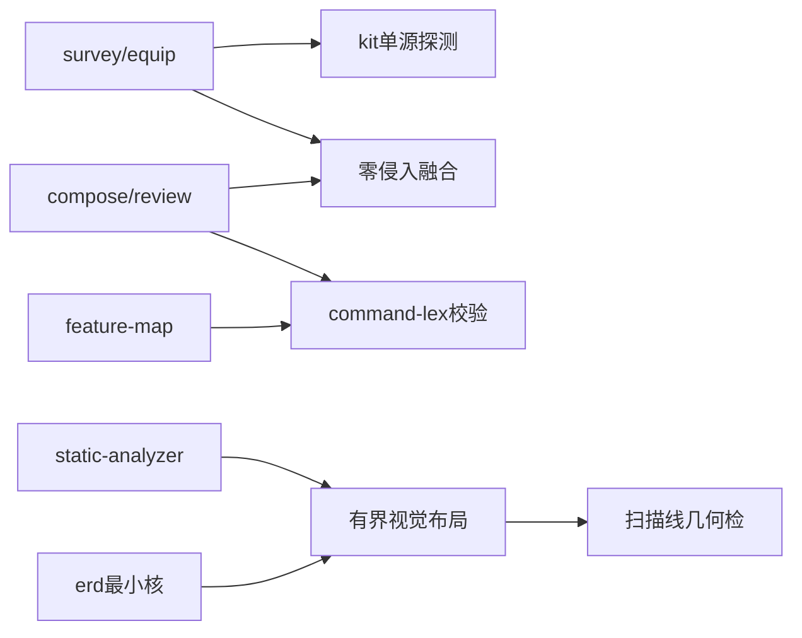

# Slice 1: 接入探测单源收敛、零侵入融合与有界规模渲染 — 功能设计规范（SPEC）

## 文档信息与变更概览

| 项目 | 内容 |
| --- | --- |
| 当前状态 | `implemented`（`draft \| approved \| implementing \| in_review \| implemented \| superseded`） |
| 规划级别 | `L3`（跨模块重构、接口与契约变更、高风险路径改造；须经独立 Critique 与 `approve` 后实施） |
| 创建 / 更新 | `2026-11-28` / `2026-11-28` |
| 分支 / Issue / PR | `feat/s1-onboard-probes-visual` / #248 / 未关联 |
| 负责人 / 内审状态 | planner-s1-spec / `passed` |
| 规划态 | `interactive`（承接已过 3 轮 Critique 审批的总控 PRD，Wave 1 切片，认领 `C1..C9`） |
| 关联 PRD / Todo | `docs/prd/261128-universal-deentropy-redesign-prd.md` / `docs/archive/todo/261128-issue248-s1-onboard-probes-visual-todo.md` |

- **变更一句话**：清除 `scripts/lib/` 与 `kit/skills/lib/` 间接入探测重复实现及两套静态 `.agents/` 配置白名单扫描，打通零侵入存量融合与分层 `AGENTS.md` 预算全链路，并将静态分析缓存与多图渲染校验收敛至严格有界复杂度与 `128 MB` 上限。

## 系统变更全景

| 模块 / 文件 | 变更性质 | 核心职责 |
| --- | --- | --- |
| `kit/skills/lib/profile-sniffer.mjs`、`kit/skills/lib/profile-sniffer-packages.mjs` | 改造 | 新增结构化单步 CI 候选原语 `extractStructuredCiSteps`，保留 `detectOptionalNativeCheckers` 的 `{ configured, hasNativeConfig }` 契约并删 `.agents/` 配置文本扫描 |
| `kit/skills/lib/profile.mjs`、`kit/skills/lib/tool-owned.mjs`、`kit/skills/lib/command-lex.mjs` | 改造 | 新增 `discoverDesignDocs`、兼容裸取舍开关与跨区 `evergreen-docs`；导出 `AGENTS_MANAGED_MAX_BYTES = 24576`；新增共享可执行命令校验纯函数 `validateExecutableCommandShape` |
| `kit/skills/lib/feature-map.mjs` | 改造 | 在 `sanitizeVerificationTool` 接入 `validateExecutableCommandShape`，拦截自然语言伪命令并安全回退 |
| `kit/skills/lib/static-analyzer.mjs`、`kit/skills/lib/import-graph.mjs`、`kit/skills/lib/static-evidence-erd.mjs` | 改造 | 从 `import-graph.mjs` 抽出单源 `expandImportCandidates`；`static-analyzer.mjs` 升 `ANALYSIS_CACHE_SCHEMA_VERSION = 2` 存紧凑 `{ specifier, line, kind }` 并对齐读写上限 `128 MB`；补齐通用 SQL `ALTER TABLE ... FOREIGN KEY`、SQLAlchemy 2.0 `mapped_column` 与通用 `@Table`/`@Entity` 最小核 |
| `kit/skills/lib/visual-layout-diagrams.mjs`、`kit/skills/lib/visual-layout-charts.mjs`、`kit/skills/lib/visual-geometry-check.mjs` | 改造 | 强制 `tree <= 120`、`erd <= 48`、`class <= 60`、`dataflow <= 60` 有界截断并输出 `meta.truncated`；重构几何校验为 X 轴扫描线 $O(N \log N)$ |
| `scripts/lib/survey-ecosystem.mjs`、`scripts/lib/survey-docs.mjs`、`scripts/lib/survey-workspace.mjs`、`scripts/lib/survey-gap-rules.mjs` | 改造 | 去重 CI/Task Runner/设计文档探测并委派 `kit/skills/lib/`；`survey-docs.mjs` 产出 `agentsManagedBytes`/`agentsCustomBytes` 与 4 条通用钩子不变量；动态 `git check-ignore -v -z` 精确回纳；`ignoredButTracked` 与 `customBytes` 超限降级非阻断 |
| `scripts/lib/agents-sections.mjs`、`scripts/lib/agents-defaults.mjs`、`scripts/lib/compose-agents-helpers.mjs`、`scripts/lib/claims.mjs`、`scripts/lib/review-helpers.mjs`、`scripts/lib/render.mjs`、`scripts/lib/protocol.mjs` | 改造 | 核心受管节禁按单词跳过并新增 `analyzeContractSections` 保持旧返回签名兼容；分层预算报告；稳定 `commitStyleHint`；`claims.mjs` 按 `/[\s,]+/` 拆词、占位过滤与双态保护 `I13`；删除 `review-helpers.mjs` 重复 `.agents/` 规则并扩展 RFC 2606/`test-*`；`protocol.mjs` 单源 `export ... from` 重导出 `AGENTS_MANAGED_MAX_BYTES` |
| `scripts/compose-agents.mjs`、`scripts/review.mjs`、`scripts/equip.mjs`、`scripts/survey.mjs` | 改造 | 打通 `agentsManagedBytes`/`agentsCustomBytes` 与 `skippedByHeading` 数据链；`review.mjs` 用字面量 `'missing'`/`'notice'` 调用 `finding()` 并消费 `claims` 的 `item.level`；动态 `check-ignore` 与清理 `.agents/` 建议消费点 |
| `scripts/dev/` 15 份验证、故障注入与夹具文件（见「改动清单与影响面」明细） | 改造 | 迁移 `I24` 与全部受 `C1..C6` 行为升级影响的既有测试/E2E 夹具，补齐 `C1..C9` 正反双向断言并校准 `gap-coverage` 配对 |

## 一、背景与边界声明

- **要改什么**：承接总控 PRD `docs/prd/261128-universal-deentropy-redesign-prd.md` Wave 1 范围（`C1..C9`），围绕「接入探测单源化、存量仓零侵入融合、大仓渲染与缓存有界化」三条主线改造 42 份核实文件（27 份产品层文件 + 15 份 `scripts/dev/` 验证与夹具文件），并重跑 `node scripts/equip.mjs .` 保持 `.agents/skills/` 字节级同步。
- **不改什么**：严禁删减 `SKILL.md`、`AGENTS.md`（仅受 `compose-agents.mjs` 校验同步）、`templates/agents-project.md` 既有详尽规范条款正文（绝不靠阉割既有条款腾挪预算）；保留 `kit/skills/lib/profile-sniffer.mjs` 的 `detectOptionalNativeCheckers` 返回 `{ configured, hasNativeConfig }` 契约以保障 `edit-gate.mjs --with-native`、`govern-retro.mjs`、`survey.mjs` 零断链；保留 `collectMissingSections` 与 `missingRegionsOf` 返回 `string[]` 既有签名；不改动 `docs/archive/`、`docs/release-notes/` 与总控 PRD `docs/prd/261128-universal-deentropy-redesign-prd.md`。
- **本期不做**：不处理 Wave 2（Slice 2 `C10..C20`）内容，包括 `kit/skills/dev-explore/scripts/repo-map-helpers.mjs` 的 3 处去重、`kit/skills/dev-govern/scripts/govern-docs.mjs` 的预算对齐、8 技能统一卫生去误杀、多会话并发隔离、5 远端评论修复、认知契约植入与本仓长青文档/双语 README 全量同步；不引入任何第三方依赖；不执行发版。
- **复用既有模块**：复用 `kit/skills/lib/profile-sniffer.mjs`（`extractYamlRunBlocks`、`scanNeutralCiSteps`、`scanDeclaredTaskRunners`、`discoverWorkspacePackages`）、`kit/skills/lib/profile-sniffer-packages.mjs`（`groupPackageManifests`、`parseYamlWorkspaceGlobs`）、`kit/skills/lib/tool-owned.mjs`（`AGENTS_MAX_BYTES`、`AGENTS_WARN_BYTES`）、`kit/skills/lib/command-lex.mjs`（`splitCommandSegments`、`commandHeadOf`）、`kit/skills/lib/markdown-scan.mjs`（`scanLines`）、`kit/skills/lib/static-analyzer.mjs`（`analyzeRepoStatic`）、`kit/skills/lib/static-evidence.mjs`（`extractMultiDiagramEvidenceSync`）、`kit/skills/lib/visual-layout.mjs`（`buildVisualModel`）、`kit/skills/lib/visual-router.mjs`（`routeEdgesOrthogonal`、`expandLayoutBounds`、`kahnTopoSort`）与 `scripts/lib/compose-agents-helpers.mjs`（`formatOversizeBreakdown`）。
- **架构基线关系**：严格遵循 `docs/TDD.md` 的四层单向依赖与 `arch-rules`（`scripts/** -> kit/skills/lib/**` 单向依赖，严禁 `kit/** -> scripts/lib/**` 或 `kit/** -> scripts/dev/**`）；`scripts/lib/protocol.mjs` 对内核常量一律采用 `export { ... } from '../../kit/skills/lib/tool-owned.mjs'` 单源重导出以通过 `preflight-kernel-parity.mjs` 门禁；全仓 `.mjs` 严守 `< 800` 行，贴线文件 `scripts/lib/survey-docs.mjs`（795 行）、`scripts/equip.mjs`（757 行）、`scripts/lib/survey-workspace.mjs`（756 行）、`scripts/review.mjs`（752 行）、`scripts/survey.mjs`（747 行）与 `kit/skills/lib/feature-map.mjs`（727 行）通过删重与下沉保持净减行或稳守 `< 800` 行。

## 二、设计方案与契约变更

### 模块级 Deletion Test 删除表（先删后建）

| 待删脆弱设计 / 重复实现 | 所在文件与符号 | 删除原因与替代方案 |
| --- | --- | --- |
| `.agents/` Linter 配置文本静态扫描（第一套） | `kit/skills/lib/profile-sniffer.mjs`（删 `mentionsAgents`、`addAdvice`、`agentIgnoreAdvice` 字段与拼装逻辑；**保留 `detectOptionalNativeCheckers` 返回 `{ configured, hasNativeConfig }`**）及 `scripts/equip.mjs`、`scripts/lib/render.mjs` 对 `agentIgnoreAdvice` 的消费 | 无法静态理解脚本作用域且永远穷举不完工具；改为接入期实跑项目真实 lint/typecheck，仅真实报错命中 `.agents/` 时处置 |
| `.agents/` Linter 配置文本静态扫描（第二套） | `scripts/lib/review-helpers.mjs`（彻底删除 `TOOLING_AGENTS_IGNORE_RULES`、`ESLINT_CONFIG_FILES`、`detectToolingAgentsIgnoreGaps`、`checkEslintAgentsIgnore`）与 `scripts/review.mjs` 调用点（`kit.eslint-agents-ignore` / `kit.tooling-agents-ignore`） | 与第一套双轨重复且误报率高；删除后同步更新 `scripts/dev/gap-coverage.mjs` 与既有夹具 |
| `scripts/lib/` 重复 CI/Task Runner 解析与跨 workflow `&&` 拼接 | `scripts/lib/survey-ecosystem.mjs`（`detectCiCommands`、`detectDeclaredTaskCommands` 重复实现及跨 workflow `&&` 拼接）与 `kit/skills/lib/profile-sniffer.mjs`（`sniffLayeredCommands` 对多条 CI `test` 盲拼 `&&`） | 产出含 `${{`、`jq` 续行片段与 51 KB 多行 bash 的非法伪命令；统一委派 `extractStructuredCiSteps` 与 `scanDeclaredTaskRunners` |
| `scripts/lib/` 第二套设计文档枚举 | `scripts/lib/survey-docs.mjs`（`detectExistingDesignDocs` 内置列表与硬编码扫描） | 在大小写不敏感 FS 上重复上报同一文件且与 `profile.mjs` 分叉；委派 `kit/skills/lib/profile.mjs` 的唯一 `discoverDesignDocs` |
| Git Hooks 工具硬编码白名单 | `scripts/lib/survey-docs.mjs`（`LEFTHOOK_FILES`、`.husky` 专名分支） | 漏检 `.vite-hooks` 等新钩子目录且难维护；改为 4 条零工具白名单的通用 Git 钩子不变量 |
| `.gitignore` 静态 6 路径硬编码与危险根锚定建议 | `scripts/lib/survey-workspace.mjs`（`buildGitignoreAnchorAdvice` 将全局规则改为根锚定的危险建议） | 根锚定全局规则可能破坏原仓子目录忽略语义；改为对实际写入受管路径跑 `git check-ignore -v -z` 并优先建议末尾追加零副作用 `!.agents/skills/` 与 `!.agents/skills/**` |

### 接口 / 数据结构与行为变更

1. **探测单源原语与结构化 CI 候选（`C1`、`C2`、`C8`）**：
   - `kit/skills/lib/profile-sniffer.mjs` 新增导出 `extractStructuredCiSteps(repoRoot, { neutralCi, maxCmdBytes = 256 })`：基于 `scanNeutralCiSteps` 逐 workflow/step 提取单步命令候选；自动过滤含 `${{`、多行控制流（`if`/`for`/`while`/`case`/heredoc 或未闭合续行 `\`）与 UTF-8 长度 `> 256` 字节的片段；返回 `{ steps, commandsByKind, ciConfigFiles, evidence }`，**严禁跨 workflow 用 `&&` 拼接**。`sniffLayeredCommands` 消费该函数并按单步优先级取候选，不再把多 workflow 测试命令拼成 `a && b`（同步迁移 `scripts/dev/fixtures-heterogeneous-survey.mjs`）。
   - `scripts/lib/survey-ecosystem.mjs` 的 `detectCiCommands` 与 `detectDeclaredTaskCommands` 薄包装委派至 `extractStructuredCiSteps` 与 `scanDeclaredTaskRunners`，`detectEcosystem` 继续复用 `discoverWorkspacePackages`。
   - `kit/skills/lib/profile.mjs` 新增导出 `discoverDesignDocs(repoRoot, files = null)`：通过 `readdirSync`（或归一化 `files`）执行 `toLowerCase()` 去重消除大小写不敏感 FS 重复条目，并按通用架构/设计后缀与目录词根（`architecture`、`design`、`tdd`、`rfc`、`adr`、`spec`）返回有序列表；`scripts/lib/survey-docs.mjs` 的 `detectExistingDesignDocs` 委派此函数。
2. **零侵入存量融合、分层预算与全链路数据贯通（`C3`、`C4`、`C5`）**：
   - **核心受管节保护与 `skippedByHeading` 向后兼容（`C3`）**：`scripts/lib/agents-sections.mjs` 定义 `CORE_PROTECTED_SECTIONS = new Set(['意图路由', 'Dev Profile', '修改守则', '日常协作与风险分流', '取舍'])`，`sectionAlreadyPresent` 对核心节禁止按宽泛英文单词（如 `collaboration`、`guidelines`）模糊跳过；**保持 `collectMissingSections` 与 `missingRegionsOf` 返回 `string[]` 向后兼容**，新增导出 `analyzeContractSections(existingText, rendered, removedRegions)` 返回 `{ missingRegions, skippedByHeading }`；`scripts/compose-agents.mjs` 的 `contractHealth()` 将 `oversize` 对齐 `managedOversize`（保障 `scripts/dev/preflight-e2e.mjs` 的 `health.oversize` 与本仓 30 KB 自举校验兼容），并额外透传 `skippedByHeading` 与 `{ bytes, managedBytes, customBytes, totalOversize, managedOversize, customOversize }`，供 `scripts/compose-agents.mjs` 与 `scripts/review.mjs` 输出诊断。
   - **分层预算全链路贯通（`C4`）**：`kit/skills/lib/tool-owned.mjs` 新增并导出 `AGENTS_MANAGED_MAX_BYTES = AGENTS_WARN_BYTES`（`24576` 字节 / `24 KB`），`scripts/lib/protocol.mjs` 采用单源 `export { AGENTS_MANAGED_MAX_BYTES } from '../../kit/skills/lib/tool-owned.mjs'` 重导出。新增共享字节分解辅助函数（计算 `managedBytes` 与 `customBytes`）并打通 5 端：
     - `scripts/lib/survey-docs.mjs` 的 `detectDocs` 在读取 `AGENTS.md` 时同时产出 `agentsBytes`、`agentsManagedBytes` 与 `agentsCustomBytes`；
     - `scripts/survey.mjs`（reentry 漂移判断）与 `scripts/lib/survey-gap-rules.mjs`（`docs.agents-oversize`）改按 `agentsManagedBytes > AGENTS_MANAGED_MAX_BYTES` 判定阻断级缺口/漂移，仅因 `agentsCustomBytes` 导致总长超 `30720` 时不报阻断级缺口；
     - `scripts/compose-agents.mjs` 与 `scripts/lib/compose-agents-helpers.mjs` 对 `managedBytes > 24576` 维持硬阻断（非 `0` 退出码），对 `managedBytes <= 24576 && bytes > 30720` 统一降级为软提示 `notice`（退出码 `0`）并输出 `managedBytes`、`customBytes` 分解与可选紧凑指针模式指引；
     - `scripts/review.mjs` 必须使用字面量 `'missing'` / `'notice'` 调用 `finding()`（满足 `scripts/dev/gap-coverage.mjs` 静态正则）：`managedOversize` 时发 `finding('missing', 'agents', 'agents.oversize', ...)`，`customOversize` 时发 `finding('notice', 'agents', 'agents.custom-oversize', ...)`；并将后续的 `else if (!oversize)` 改为 `else if (!managedOversize)`，防止仅因 `customBytes` 超 30 KB 的成熟仓跳过 `validateDevProfileRegion` 与 `agents.ready`；
     - 同步迁移 `scripts/dev/injections-data-core.mjs`（`I24` 瞄准 `managedOversize` / `managedBytes > AGENTS_MANAGED_MAX_BYTES`）、`scripts/dev/fixtures-claims.mjs`、`scripts/dev/fixtures-brownfield-onboarding.mjs` 与 `scripts/dev/fixtures-flow-parallel.mjs`。
   - **4 条零工具白名单通用 Git 钩子不变量（`C5`）**：`scripts/lib/survey-docs.mjs` 的 `detectGitHooksState` 删除工具名白名单，改为检测 4 条通用不变量（任一命中即 `hasConflict: true`、`preserve` 不覆盖，`scripts/lib/render.mjs` 不再附带 `--with-hooks`）：① `core.hooksPath` 非空且规范化后非 `.githooks`；② 扫描仓根任意隐藏目录（排除非钩子保留目录 `.git`/`.agents`/`.worktrees`/`.github`/`.vscode`/`.idea`/`.fleet`/`.cache`/`.next`/`.nuxt`/`.venv`/`.pytest_cache`/`.mypy_cache`/`.ruff_cache` 等，自然覆盖 `.husky/`、`.vite-hooks/`、`.lefthook/` 及未来任意隐藏钩子目录）与 `.git/hooks/`，发现非 `.sample` 的标准 Git 钩子文件名（`pre-commit`、`commit-msg`、`prepare-commit-msg`、`pre-push`、`post-merge`、`post-checkout`、`pre-rebase`）；③ `.githooks/` 存在不含 `FORGE_HOOK_MARKER` 的用户自定义钩子文件；④ 仓根存在常见钩子管理器配置文件（如 `*lefthook*`、`.pre-commit-config*` 或 `package.json` 含 `simple-git-hooks`/`husky`/`yorkie` 钩子字段）。同步对齐 `scripts/dev/fixtures-skills-hooks.mjs` 与 `scripts/dev/fixtures-w6a-survey-handoff.mjs`。
   - **动态 `git check-ignore -v -z` 与历史 `ignoredButTracked` 降级（`C5`）**：`scripts/lib/survey-workspace.mjs` 与 `scripts/equip.mjs` 对实际拟写入受管路径（含 `.agents/skills/` 关键文件与 `.pf-manifest.json`）执行动态 `git check-ignore -v -z --stdin`；命中 `.agents/skills/` 遮蔽时，`buildGitignoreAnchorAdvice` 优先输出零副作用精确回纳 `!.agents/skills/` 与 `!.agents/skills/**`（取消危险的全局规则根锚定建议，同步迁移 `scripts/dev/fixtures-r5-onboarding.mjs`）。`scripts/review.mjs`（字面量 `finding('notice', 'git', 'git.ignored-tracked', ...)`）将上游历史 `ignoredButTracked` 降级为 `notice`；`scripts/lib/survey-gap-rules.mjs`（`ignores.ignored-but-tracked`）与 `scripts/survey.mjs`（`artifactPlan` 的 `git-baseline`）同步识别 `## 取舍` 的 `ignore-tracked-legacy` 豁免并保持 `ignores.ignored-but-tracked -> git.ignored-tracked` 在 `gap-coverage.mjs` 的配对不变，仅本次新引入受管路径忽略冲突（`git.ignored-governance`）维持阻断。
3. **契约回查双态兼容、取舍开关、RFC 2606 与共享命令校验（`C6`、`C7`）**：
   - `scripts/lib/claims.mjs`：行内代码与围栏代码块统一按 `/[\s,]+/` 拆词，拒绝含逗号 token 与国际通用占位前缀（`path/to/*`、`foo/bar/*`、`example/*`、`your-*`）；明确双态契约——无受管标记的纯 `AGENTS.md`（保障 `scripts/dev/fixtures-claims.mjs` `I13` 与 `fixtures-govern.mjs` 100% 兼容）或位于受管区间/`Dev Profile` 内的失效路径维持 `ok: false, level: 'missing'`，**仅当**文件包含受管标记时，将受管标记之外的用户原有手写正文中的疑似旧路径标为 `ok: false, level: 'notice'`；`scripts/review.mjs` 在 `verifyClaims` 循环中使用字面量 `'ok'`/`'notice'`/`'missing'` 分支消费 `item.level`。
   - `kit/skills/lib/profile.mjs`：`readDecisionMap` 兼容无冒号裸取舍开关（如 `- no-git-hooks`、`no-architecture-html` -> `'true'`），`parseAgentsProfile` 在 `Dev Profile` 未声明 `evergreen-docs` 时跨区回读 `## 取舍` 中误写的 `evergreen-docs`。
   - `scripts/lib/review-helpers.mjs`：`placeholderIdentity` 扩展拦 RFC 2606 保留无效域（`.invalid`、`example.com`/`example.org`/`example.net`/`.example`、`.test`）与 `test-*` 占位名；同步将 `scripts/dev/e2e-zip-harness.mjs`、`scripts/dev/fixtures-onboarding.mjs`、`scripts/dev/fixtures-review.mjs`、`scripts/dev/blind-run-harness.mjs`、`scripts/dev/fixtures-brownfield-onboarding.mjs`、`scripts/dev/fixtures-r5-onboarding.mjs`（以及其余以 `reviewProject` 验真且默认期望 0 missing 的既有正例夹具）中的测试样例邮箱迁移为非保留测试域（如 `alice@acme-fixture.dev`），同时新增 RFC 2606 负面断言用例。
   - `kit/skills/lib/command-lex.mjs` 新增导出 `validateExecutableCommandShape(raw, { allowNone = true } = {})`：基于 `splitCommandSegments` 与 `commandHeadOf` 拒绝含中文自然语言句式或无可执行命令头的文本，仅放行合法可执行命令或显式 `none`；同时接入 `scripts/lib/agents-sections.mjs`（`validateDevProfileRegion`）与 `kit/skills/lib/feature-map.mjs`（`sanitizeVerificationTool` 非法时回退合法单段或 `null`）。
   - `scripts/lib/agents-defaults.mjs`：`commitStyleHint` 对 `plain` 风格统一返回稳定中性指引，消除提交数跨越 `5` 时的文案跳变自破。
4. **最小通用 ERD 核、有界视觉布局、扫描线与 `schemaVersion=2` 精简缓存（`C8`、`C9`）**：
   - `kit/skills/lib/static-evidence-erd.mjs`：补充通用 SQL `ALTER TABLE ... ADD [CONSTRAINT ...] FOREIGN KEY (...) REFERENCES ...`、SQLAlchemy 2.0 `Mapped[...]` + `mapped_column(...)` 与通用 `@Table`/`@Entity` 最小核，停止逐框架正则堆砌。
   - `kit/skills/lib/visual-layout-diagrams.mjs` 与 `kit/skills/lib/visual-layout-charts.mjs`：导出并执行硬节点上限 `MAX_TREE_NODES = 120`、`MAX_ERD_NODES = 48`、`MAX_CLASS_NODES = 60`、`MAX_DATAFLOW_NODES = 60`，超限时按确定性权重/拓扑优先级截断并裁剪悬空边，在 `meta` 输出 `{ truncated, totalBeforeTruncate, keptCount }`。
   - `kit/skills/lib/visual-geometry-check.mjs`：将节点重叠与边穿盒检测重构为 X 轴排序扫描线（Sweep-Line）与二分窗口定位，保持 `GEOMETRY_VIOLATION_CODES` 与返回结构不变，复杂度降至 $O((N + E) \log N + K)$。
   - `kit/skills/lib/import-graph.mjs` 与 `kit/skills/lib/static-analyzer.mjs`：从 `import-graph.mjs` 抽出单源纯函数 `expandImportCandidates(relFile, specifier, { goModules, kind })` 供 `extractImportsForArch` 与 `static-analyzer.mjs` 共用（杜绝 5 语言候选生成双轨重复）；`static-analyzer.mjs` 递增 `ANALYSIS_CACHE_SCHEMA_VERSION = 2`，缓存条目裁剪冗余 `imports[].candidates`，仅保存紧凑 `{ specifier, line, kind }`（仅在非默认场景如 Rust `mod` 时保留 `kind`，避免缓存命中时 Rust `mod` 与 `use` 边歧义丢失），加载命中时经 `expandImportCandidates` 按需重建候选；定义 `MAX_ANALYSIS_CACHE_BYTES = 128 * 1024 * 1024`（`128 MB`），同时将 `loadAnalysisCache` 读上限从 `16 MB` 放宽至 `128 MB` 并与写盘上限统一，超限时按确定性截断或降级跳过写盘并标注 `cacheStats.truncated`。

### 数据与状态变更

- **`analysis-cache.json`**：`ANALYSIS_CACHE_SCHEMA_VERSION` 由 `1` 升至 `2`，历史 `v1` 胖缓存加载时自动触发 `recovered: true` 无感重建为精简格式，读写统一受 `128 MB` 硬上限约束。
- **`docs/feature-map.json`**：Schema 版本不变，仅收紧 `sanitizeVerificationTool` 对 `command` 的可执行形态校验。
- **`AGENTS.md` 与 `.pf-manifest.json`**：受管区 ID 与 `v1/v2/v3` 账本结构保持 100% 兼容。

### 异常、回退与安全边界

- **纯只读外部大仓实证协议（`dify`/`outline`）**：严禁对外部目标仓运行写盘 `verify-tools.mjs render .` 或不传临时 `cacheRoot` 的 `renderArchitectureMapAsync`（避免缺失 `docs/feature-map.json` 短路或向外部仓 `.git` 目录下的 `project-forge-flow` 缓存 `analysis-cache.json` 写盘）。统一使用纯只读三原语直调节点脚本：① 实证前后对目标仓分别校验 `git status --porcelain` 零变更，并校验目标仓 `.git` 目录下 `project-forge-flow` 的 `analysis-cache.json` 未创建且 `mtime`/字节数前后完全一致；② 对 `dify`（本地存在时直测，否则用万级文件 + SQLAlchemy 2.0 合成仓）跑只读 `scripts/survey.mjs --json`，再以临时 `cacheRoot = path.join(os.tmpdir(), 'pf-s1-readonly-cache')` 连续两次执行 `analyzeRepoStatic(targetRepo, { useCache: true, cacheRoot })` -> `extractMultiDiagramEvidenceSync(targetRepo, { analysis, featureMap: {}, cacheRoot, useCache: true })` -> `buildVisualModel({ featureMap: {}, analysis, evidence })`，量化验收首次耗时可控无超时、二次缓存命中（`analysis.cacheStats.hits > 0 && analysis.cacheStats.misses === 0`）、缓存文件 `<= 128 MB`、`model.geometryReport.ok === true`、四类图节点受 `120/48/60/60` 上限约束且输出 `meta.truncated`，以及 `evidence.diagrams.erd` 检出 SQLAlchemy 2.0 `mapped_column` 字段；③ 对 `outline`（本地存在时直测，否则用等效长手写含业务标题合成仓）读取原始 `AGENTS.md` 在内存态运行 `renderAgentsTemplate`/`refreshRegions`/`checkAgentsBytes`，验证原文前缀字节级保留、5 个核心受管节 `100%` 注入且仅因 `customBytes` 超 30 KB 降级 `notice` 退出码 `0`。
- **零侵入与非 Git 退化**：无 `.git` 时钩子与 `check-ignore` 探测零子进程短路；大小写不敏感 FS 统一用 `toLowerCase()` 去重；绝不改写任何第三方 Linter 配置。

### 实现顺序

1. **先删旧双轨与白名单**：清理 `profile-sniffer.mjs` 的 `.agents/` 扫描（保留 `{ configured, hasNativeConfig }`）及 `equip.mjs`/`render.mjs` 消费点；彻底删除 `review-helpers.mjs` 重复 `.agents/` 规则与 `review.mjs` 调用点；删除 `survey-docs.mjs` 钩子工具白名单与 `survey-ecosystem.mjs` 跨 workflow 拼接。
2. **建单源探测与命令词法原语**：落地 `extractStructuredCiSteps`、`discoverDesignDocs`、`validateExecutableCommandShape` 与 `AGENTS_MANAGED_MAX_BYTES`（`protocol.mjs` 单源重导出），切入所有 `scripts/lib/` 与 `feature-map.mjs` 调用方。
3. **打通零侵入存量融合与分层预算数据链**：落地 `survey-docs.mjs` 的 `agentsManagedBytes`/`agentsCustomBytes`、`survey.mjs`/`survey-gap-rules.mjs`/`compose-agents.mjs`/`review.mjs` 分层预算（`review.mjs` 用字面量 `finding()` 并将 `!oversize` 改为 `!managedOversize`，`contractHealth().oversize` 对齐 `managedOversize`）、`analyzeContractSections` + `skippedByHeading`、4 条通用钩子不变量、动态 `check-ignore` 精确回纳、`ignoredButTracked` 降级与 `ignore-tracked-legacy` 联动、`claims.mjs` 双态保护 `I13`、裸取舍开关、RFC 2606/`test-*` 与稳定 `commitStyleHint`。
4. **落地有界视觉引擎、扫描线、单源缓存重建与最小 ERD 核**：从 `import-graph.mjs` 抽出 `expandImportCandidates`；改造 `static-evidence-erd.mjs`、`visual-layout-diagrams.mjs`、`visual-layout-charts.mjs`、`visual-geometry-check.mjs` 与 `static-analyzer.mjs`（`schemaVersion = 2` 存紧凑 `{ specifier, line, kind }` + `128 MB` 读写上限）。
5. **迁移 15 份 `scripts/dev/` 验证文件并执行纯只读外部仓实证**：迁移 `I24`、4 份旧夹具、`gap-coverage.mjs` 及 9 份受行为升级/RFC 2606 影响的既有夹具与 E2E 沙盒，补齐 `C1..C9` 正反双向用例，并按纯只读三原语直调协议实证 `dify`/`outline`（或等效合成仓）。
6. **同步内置技能与全门禁收口**：运行 `node scripts/equip.mjs .` 与全套仓内验证矩阵，确认全部退出码 `0`。

## 三、备选方案与否决理由

| 方案 | 怎么做的 | 为什么没选 / 为何选中 | 什么情况下该改回它 |
| --- | --- | --- | --- |
| 分层预算 `managedBytes <= 24576 B` + `customBytes` 超限降 `notice`（已选） | 保留既有规范条款不阉割，硬控受管区 `24 KB`，超 `30 KB` 且源于手写正文时降级 `notice` 输出分解报告 | 守住「绝不删减受保护规范条款」红线，并彻底解除成熟仓长手写 `AGENTS.md` 的假阻断 | 若宿主上下文预算显著缩水需全文件硬截断，须人类拍板新增严格模式 |
| 删减 `SKILL.md`/`templates/agents-project.md` 条款压字节（否决） | 删短受管模板既有协作与风险条款以凑出 `< 30 KB` | 违背总控 PRD 硬红线，会削弱协作门禁与边界说明 | 永不因第三方仓手写正文长而阉割受管规范 |
| 4 条通用 Git 钩子不变量（已选） | 查 `core.hooksPath` + 扫非保留隐藏目录与 `.git/hooks/` 标准钩子名 + 护自定义 `.githooks/*` + 查根级钩子配置 | 无工具名白名单，同时覆盖 `.husky/`、`.vite-hooks/`、`lefthook.yml` 与自定义 `.githooks/*` 零漏检 | 仅当 Git 自身改变钩子发现协议时同步演进 |
| `claims.mjs` 按是否含受管标记双态降级（已选） | 无受管标记或受管区内保持 `missing`，已融合仓的非受管手写正文降级 `notice` | 同时保障 `I13` 故障注入与纯手写契约校验不弱化，且不对已融合存量仓手写原文触发假阻断 | 若未来引入显式用户路径声明区，可进一步按声明区精确分层 |

## 四、改动清单与影响面

| 文件 / 目录（共 42 份：27 产品层 + 15 验证层） | 改动性质 | 改什么 | 谁会被影响 |
| --- | --- | --- | --- |
| `kit/skills/lib/profile-sniffer.mjs`、`kit/skills/lib/profile-sniffer-packages.mjs` | 修改 | 新增 `extractStructuredCiSteps` 停跨 workflow `&&` 拼接；删 `.agents/` 配置文本扫描（保留 `{ configured, hasNativeConfig }`） | `survey-ecosystem.mjs`、`equip.mjs`、`render.mjs`、`edit-gate.mjs`、`govern-retro.mjs`、Wave 2 `repo-map-helpers.mjs` |
| `kit/skills/lib/profile.mjs`、`kit/skills/lib/tool-owned.mjs`、`kit/skills/lib/command-lex.mjs` | 修改 | 新增 `discoverDesignDocs`、裸取舍开关与跨区 `evergreen-docs`；导出 `AGENTS_MANAGED_MAX_BYTES = 24576`；新增 `validateExecutableCommandShape` | `survey-docs.mjs`、`compose-agents.mjs`、`review.mjs`、`agents-sections.mjs`、`feature-map.mjs` |
| `kit/skills/lib/feature-map.mjs` | 修改 | `sanitizeVerificationTool` 接入 `validateExecutableCommandShape` | `verify-tools.mjs`、`dev-explore` |
| `kit/skills/lib/static-analyzer.mjs`、`kit/skills/lib/import-graph.mjs`、`kit/skills/lib/static-evidence-erd.mjs` | 修改 | `import-graph.mjs` 抽出单源 `expandImportCandidates`；`static-analyzer.mjs` 升 `schemaVersion = 2` 存紧凑 `{ specifier, line, kind }` 并对齐读写上限 `128 MB`；通用 SQL `ALTER TABLE ... FOREIGN KEY`、SQLAlchemy 2.0 `mapped_column`、`@Table`/`@Entity` 最小核 | `architecture-map.mjs`、`verify-tools-render.mjs`、`visual-brief.mjs`、`static-evidence.mjs` |
| `kit/skills/lib/visual-layout-diagrams.mjs`、`kit/skills/lib/visual-layout-charts.mjs`、`kit/skills/lib/visual-geometry-check.mjs` | 修改 | 四类图有界截断（`120/48/60/60`）+ `meta.truncated`；X 轴扫描线 $O(N \log N)$ 几何校验 | `verify-tools-render.mjs`、`visual-render.mjs` |
| `scripts/lib/survey-ecosystem.mjs`、`scripts/lib/survey-docs.mjs`、`scripts/lib/survey-workspace.mjs`、`scripts/lib/survey-gap-rules.mjs` | 修改 | 单源委派 CI/Task/设计文档；产出 `agentsManagedBytes`/`agentsCustomBytes`；4 条通用钩子不变量；动态 `check-ignore` 精确回纳；`ignoredButTracked` 与 `customBytes` 超限降级 | `scripts/survey.mjs`、`scripts/review.mjs`、`scripts/equip.mjs` |
| `scripts/lib/agents-sections.mjs`、`scripts/lib/agents-defaults.mjs`、`scripts/lib/compose-agents-helpers.mjs`、`scripts/lib/claims.mjs`、`scripts/lib/review-helpers.mjs`、`scripts/lib/render.mjs`、`scripts/lib/protocol.mjs` | 修改 | 核心节保护与 `analyzeContractSections`（保旧签名）；`validateDevProfileRegion` 命令校验；稳定 `commitStyleHint`；分层预算文案；`claims.mjs` 拆词/占位/双态降级；删重复 `.agents/` 规则并扩 RFC 2606/`test-*`；单源重导出 `AGENTS_MANAGED_MAX_BYTES` | `scripts/compose-agents.mjs`、`scripts/review.mjs`、`scripts/survey.mjs` |
| `scripts/compose-agents.mjs`、`scripts/review.mjs`、`scripts/equip.mjs`、`scripts/survey.mjs` | 修改 | 串联分层预算与 `skippedByHeading`；`review.mjs` 字面量 `finding()` 与 `claims` `item.level` 消费；动态 `check-ignore` 与删 `.agents/` 建议消费点 | 外部仓治理 CLI 入口与本仓自检 |
| `scripts/dev/injections-data-core.mjs`、`scripts/dev/gap-coverage.mjs`、`scripts/dev/fixtures-r7-rootfix.mjs`、`scripts/dev/fixtures-r8-bugfixes.mjs`、`scripts/dev/fixtures-w6a-survey-handoff.mjs`、`scripts/dev/fixtures-r5-onboarding.mjs` | 修改 | 迁移 `I24` 守护 `managedBytes > 24576`，校准 `gap-coverage` 配对，迁移 4 份旧夹具（删过时 `.agents/` 静态扫描与 `/lib` 锚定断言，保留原生检查器、钩子与有效门禁断言） | 故障注入矩阵与核心回归夹具 |
| `scripts/dev/fixtures-claims.mjs`、`scripts/dev/fixtures-brownfield-onboarding.mjs`、`scripts/dev/fixtures-flow-parallel.mjs`、`scripts/dev/fixtures-heterogeneous-survey.mjs`、`scripts/dev/fixtures-skills-hooks.mjs` | 修改 | 对齐 `C4`/`I24` 与 `I13`、自定义超 `30 KB` 降级 `notice` 退出 `0`、`C2` 结构化单步不拼接、`C5` 4 条通用钩子不变量 | 行为回归夹具 |
| `scripts/dev/e2e-zip-harness.mjs`、`scripts/dev/fixtures-onboarding.mjs`、`scripts/dev/fixtures-review.mjs`、`scripts/dev/blind-run-harness.mjs` | 修改 | 迁移正例测试仓中的 RFC 2606 保留域邮箱（避免被 `C6` 误拦），并补齐 RFC 2606 负面拦截断言 | 真包 E2E、盲测与体检夹具 |

- **对外可见的变化**：`compose-agents.mjs` 与 `review.mjs` 对仅因 `customBytes` 超 `30 KB` 的成熟仓降级为 `notice`（退出码 `0`）并输出字节分解；`review.mjs` 对历史 `ignoredButTracked` 与已融合仓非受管手写正文的疑似旧路径降级为 `notice`；`equip.mjs` 与 `render.mjs` 不再输出静态 `agentIgnoreAdvice` 猜测；四类视觉图新增 `meta.truncated`、`totalBeforeTruncate`、`keptCount`。
- **需要同步改的地方**：运行 `node scripts/equip.mjs .` 同步 `.agents/skills/`（与 `kit/skills/` 字节级一致），并排查其余调 `reviewProject` 且使用 `@example.com`/`@*.test` 邮箱的正例夹具，确认全量门禁零回归。

## 五、冻结的验收标准

- [x] C1: 在 `kit/skills/lib/` 确立探测单源原语（`profile-sniffer.mjs` 的 `extractStructuredCiSteps` 与 `scanDeclaredTaskRunners`、`profile-sniffer-packages.mjs` 的 `discoverWorkspacePackages`、`profile.mjs` 的 `discoverDesignDocs`），完成 `scripts/lib/` 侧全部重复实现去重（`scripts/lib/survey-ecosystem.mjs` 与 `scripts/lib/survey-docs.mjs`）；保留 `profile-sniffer.mjs` 中 `detectOptionalNativeCheckers` 的 `{ configured, hasNativeConfig }` 返回契约（保证 `edit-gate.mjs --with-native`、`govern-retro.mjs`、`survey.mjs` 零断链），仅删除其 `.agents/` 配置文本扫描（`mentionsAgents`/`addAdvice`/`agentIgnoreAdvice`）及 `scripts/equip.mjs`、`scripts/lib/render.mjs` 消费点，并彻底删除 `scripts/lib/review-helpers.mjs` 的 `TOOLING_AGENTS_IGNORE_RULES`/`detectToolingAgentsIgnoreGaps`/`checkEslintAgentsIgnore` 及 `scripts/review.mjs` 调用点，同步迁移 `scripts/dev/fixtures-r7-rootfix.mjs`、`scripts/dev/fixtures-r8-bugfixes.mjs`、`scripts/dev/fixtures-w6a-survey-handoff.mjs`、`scripts/dev/fixtures-r5-onboarding.mjs`，`node scripts/dev/preflight.mjs` 与 `node scripts/dev/gap-coverage.mjs` 退出码均为 `0`。
- [x] C2: `extractStructuredCiSteps` 永不跨 workflow 使用 `&&` 拼接命令，自动过滤含 `${{`、多行控制流与长度 `> 256` 字节的片段；在模拟含多 workflow 与 `jq` 续行的夹具仓上运行 `node scripts/survey.mjs` 与 `verify-tools.mjs sync`，输出零非法伪命令且 `verify-tools-audit.mjs` 报告 `0` 个 `missing-script` zombie。
- [x] C3: `scripts/lib/agents-sections.mjs` 禁止按宽泛英文单词跳过核心受管节（`意图路由`、`Dev Profile`、`修改守则`、`日常协作与风险分流`、`取舍`），且 `scripts/compose-agents.mjs` 与 `scripts/review.mjs` 对任意标题去重跳过均输出 `skippedByHeading` 诊断；在含业务章节标题（如 `Real-time Collaboration`、`General Guidelines`）的既有 `AGENTS.md` 夹具上运行 `scripts/compose-agents.mjs`，原文前缀字节级保留且全部核心受管节 `100%` 注入。
- [x] C4: `scripts/compose-agents.mjs`、`scripts/lib/compose-agents-helpers.mjs`、`scripts/lib/survey-gap-rules.mjs` 与 `scripts/review.mjs` 严格保护 `SKILL.md`、`AGENTS.md` 与 `templates/agents-project.md` 既有详尽条款不阉割，复用升级既有 `managedBytes`/`customBytes` 分解逻辑并实行预算分层：`AGENTS_MANAGED_MAX_BYTES = 24576`（`24 KB`，对齐 `kit/skills/lib/tool-owned.mjs` 的 `AGENTS_WARN_BYTES`）硬门禁，当 `totalBytes > 30720` 且超限源于 `customBytes` 时在 `compose-agents`/`review`/`survey-gap-rules` 统一降级为软提示 `notice`（退出码 `0`）并输出 `managedBytes`、`customBytes` 分解与可选紧凑指针模式指引；当 `managedBytes > 24576` 时仍硬阻断（非 `0` 退出码）；同步迁移 `scripts/dev/injections-data-core.mjs` 的 `I24` 守护 `managedBytes > AGENTS_MANAGED_MAX_BYTES`，且本仓 `node scripts/compose-agents.mjs . --check` 退出码为 `0`（`govern-docs.mjs` 侧同源判据在 Slice 2 `C12` 对齐）。
- [x] C5: `scripts/lib/survey-docs.mjs` 删除钩子工具白名单，改用 4 条通用 Git 钩子不变量（`core.hooksPath`、仓根非保留隐藏目录与 `.git/hooks/` 标准钩子文件、自定义 `.githooks/*` 与根级钩子配置，命中即 `preserve`，`scripts/lib/render.mjs` 不再附带 `--with-hooks`）；`scripts/lib/survey-workspace.mjs` 与 `scripts/equip.mjs` 对实际写入受管路径执行动态 `git check-ignore -v -z`，遮蔽时优先输出零副作用精确回纳 `!.agents/skills/` 与 `!.agents/skills/**`；上游历史 `ignoredButTracked` 降级为 `notice`（支持取舍豁免），仅本次新引入忽略冲突硬阻断。
- [x] C6: `scripts/lib/claims.mjs` 围栏代码块拆词统一改为 `/[\s,]+/`、拒绝含逗号 token 与国际通用占位前缀（`path/to/*`、`foo/bar/*`、`example/*`、`your-*`），并将已融合仓非受管正文中的可疑旧路径降级为 `notice`（同时保持无受管标记纯契约与 `I13` 为 `missing`）；`kit/skills/lib/profile.mjs` 的 `readDecisionMap` 兼容无冒号裸取舍开关（如 `- no-git-hooks`）并兼容读取误写在 `## 取舍` 的 `evergreen-docs`；`scripts/lib/review-helpers.mjs` 的 `placeholderIdentity` 准确拦下 RFC 2606 保留无效域（`.invalid`、`example.*`、`.test`）与 `test-*` 占位名。
- [x] C7: 在 `kit/skills/lib/command-lex.mjs`（零依赖、`arch-rules` 合规）抽出共享可执行命令形态校验纯函数（拒绝含中文自然语言句式的非 CLI 文本，仅放行合法可执行命令或显式 `none`），同时接入 `scripts/lib/agents-sections.mjs`（`validateDevProfileRegion`）与 `kit/skills/lib/feature-map.mjs`（不合法时回退合法命令或 `null`）；`scripts/lib/agents-defaults.mjs` 的 `COMMIT_STYLE_HINT` 消除随提交数跨越 `5` 跳变的自破问题，在 1 次与 6 次提交间重复运行 `scripts/compose-agents.mjs --check` 均返回退出码 `0`。
- [x] C8: `kit/skills/lib/profile.mjs` 的 `discoverDesignDocs` 通过 `readdirSync` + `toLowerCase()` 去重并按通用后缀词根识别多份设计文档（在大小写不敏感 FS 上 0 重复条目）；`kit/skills/lib/static-evidence-erd.mjs` 支持通用 SQL `ALTER TABLE ... FOREIGN KEY`、SQLAlchemy 2.0 `mapped_column` 与通用 `@Table`/`@Entity` 最小核并停止逐框架正则堆砌，正反双向夹具断言全部通过。
- [x] C9: `kit/skills/lib/visual-layout-diagrams.mjs` 与 `kit/skills/lib/visual-layout-charts.mjs` 严格执行有界节点上限（`tree <= 120`、`erd <= 48`、`class <= 60`、`dataflow <= 60`）并输出 `meta.truncated`；`kit/skills/lib/visual-geometry-check.mjs` 采用 $O(N \log N)$ 扫描线校验；`kit/skills/lib/static-analyzer.mjs` 升 `ANALYSIS_CACHE_SCHEMA_VERSION = 2` 精简缓存并受 `128 MB` 上限约束；`node scripts/dev/bench.mjs` 与大规模渲染夹具测试全部通过且无超时。

## 六、高风险点、门型与回滚路径

- **门型与回滚路径**：`two-way`；全部改动隔离于特性分支 `feat/s1-onboard-probes-visual`。合入后若发现回归，对合并提交执行 `git revert -m 1` 生成反向提交（严禁强推或改写历史），随后运行 `node scripts/equip.mjs .` 与 `node scripts/compose-agents.mjs .` 还原 `.agents/skills/` 与 `AGENTS.md`。
- **高风险路径**：涉及 `scripts/lib/` 与 `kit/` 两处高风险目录，须经独立审查与故障注入放行。
- **故障注入预演**：复用 `scripts/dev/verify-injections.mjs --jobs 4`（含迁移后的 `I24` 与受保护的 `I13`）、`scripts/dev/preflight.mjs`（含 `preflight-kernel-parity.mjs` 单源重导出校验、`arch-rules`、800 行红线与零外部依赖）、`scripts/dev/gap-coverage.mjs`、`scripts/dev/fixtures.mjs` 与 `scripts/dev/e2e-zip-harness.mjs`。

## 七、上线与兼容策略

- **向后兼容**：`detectOptionalNativeCheckers` 继续返回 `{ configured, hasNativeConfig }`；`collectMissingSections` 与 `missingRegionsOf` 保持返回 `string[]`；`compose-agents.mjs` 保留 `--allow-custom-oversize` 兼容参数；`analysis-cache.json` 通过 `ANALYSIS_CACHE_SCHEMA_VERSION = 2` 自动丢弃重建旧缓存；既有 `AGENTS.md` 原文前缀保持字节级不变（`next.startsWith(orig)`）。

## 澄清与补充记录

- 已确认（2026-11-28，吸收 Slice 1 SPEC Round 1 与 Round 2 Critique 全部 Major 与 Should-Fix）：① 纳入 `kit/skills/lib/import-graph.mjs`（全切片共 42 份文件：27 产品层 + 15 验证层），抽出单源 `expandImportCandidates` 供 `static-analyzer.mjs` v2 缓存（`{ specifier, line, kind }`）按需重建，杜绝双轨候选生成与 Rust `mod` 边丢失；② `dify` 纯只读实证改为三原语直调（`analyzeRepoStatic` -> `extractMultiDiagramEvidenceSync` -> `buildVisualModel`），零 `docs/feature-map.json` 依赖且核验目标仓 `git status --porcelain` 与 `.git` 下 `project-forge-flow` 缓存 `analysis-cache.json` 均零写入；③ `scripts/review.mjs` 用字面量 `finding()` 并将 `!oversize` 改为 `!managedOversize`，`contractHealth().oversize` 对齐 `managedOversize` 兼容 `scripts/dev/preflight-e2e.mjs`；④ `survey-gap-rules.mjs` 与 `survey.mjs` 对 `ignore-tracked-legacy` 豁免联动且维持 `gap-coverage.mjs` 映射；⑤ `C5` 4 条通用钩子不变量、`claims.mjs` 双态保护 `I13`、`protocol.mjs` 单源重导出 `AGENTS_MANAGED_MAX_BYTES` 与 15 份 `scripts/dev/` 验证文件迁移全部闭环。

## 实现说明

- **实际落地摘要**：严格按 `C1..C9` 完成全部 27 份产品层模块改造（含 `.agents/skills/` 经 `node scripts/equip.mjs .` 字节级同步）及对应 `scripts/dev/` 验证、故障注入与夹具迁移：① `kit/skills/lib/` 确立单源原语 `extractStructuredCiSteps`、`discoverDesignDocs`、`validateExecutableCommandShape`、`AGENTS_MANAGED_MAX_BYTES = 24576` 与 `expandImportCandidates`，清理 `scripts/lib/` 重复实现与 `.agents/` 静态配置扫描（保留 `detectOptionalNativeCheckers` 的 `{ configured, hasNativeConfig }` 契约）；② 打通分层预算全链路（`managedBytes > 24576` 硬阻断、`customBytes` 致总长超 `30720` 降级 `notice` 退出 `0`）、核心受管节防误跳 + `skippedByHeading` 诊断、4 条零工具白名单通用 Git 钩子不变量、动态 `git check-ignore -v -z` 精确回纳 `!.agents/skills/` 与 `!.agents/skills/**`、`git.ignored-tracked` 降级 `notice`（附 `decision: 'ignore-tracked-legacy'` 与 `survey-gap-rules`/`survey` 三端联动）、`claims.mjs` `/[\s,]+/` 拆词与双态降级（守住 `I13`）、裸取舍开关与 `evergreen-docs` 跨区兼容读、RFC 2606/`test-*` 占位身份拦截与稳定 `commitStyleHint`；③ 落地通用 SQL `ALTER TABLE ... FOREIGN KEY` / SQLAlchemy 2.0 `mapped_column` / `@Table` 最小 ERD 核、四类图有界截断（`120/48/60/60` + `meta.truncated`）、X 轴扫描线 $O(N \log N)$ 几何校验与 `analysis-cache.json` `schemaVersion = 2`（精简不含 `candidates`、保 Rust `mod` 边、统一读写 `128 MB` 上限）。
- **与草案的差异**：① 为兼顾 `C2`（默认 `<= 256 B` 严格过滤）与 `I121`（超 `500 B` 单行命令进入 `COMMANDS_OMITTED` 块外指路），`extractStructuredCiSteps` 额外收集不含 `${{` 且无多行控制流的 `omittedSteps`，由 `survey-ecosystem.mjs` 透传超 `500 B` 单行命令给 `commandsBlock` 产出块外指路而不进入可执行 `sh` 块；② `scripts/dev/fixtures-doc-depth.mjs` 对本仓活跃 `multi_spec: true` 总控 PRD 的 `hold-staged`/`hold-manual-or-active` 分波态做了精确放行，避免 Wave 1 合入总控 PRD 时阻塞 CI，同时完整保留 `I142` 合成仓验证；③ `scripts/dev/fixtures-iterate-hotspots.mjs` 同步迁移 `alice@example.com` 至 `alice@acme-fixture.dev`，`scripts/dev/injections-data-visual-layout-v2.mjs` 对齐扫描线重构后的 `I1014`/`I1015` 源码锚点。
- **关联同步文件**：经 `node scripts/equip.mjs .` 同步 `.agents/skills/` 与 `kit/skills/` 字节级一致；`docs/prd/261128-universal-deentropy-redesign-prd.md` 保持 `status: active` 随本 PR 一并提交（不归档）。
