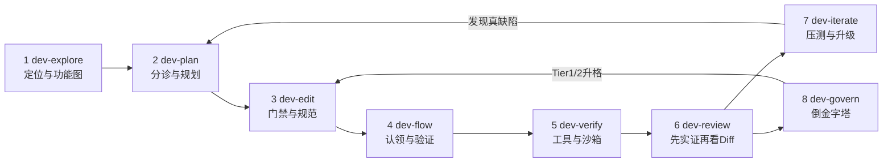

# v10 统一八技能、倒金字塔与双向演进架构（Stage C）

<!-- section: goal -->
## 一、要解决的问题

Stage B（v9 自适应架构阶段，基线 `261118`）完成多仓后端抽象、异构勘察、门控实证与自适应交付机制建设后，系统仍存在 6 类深层架构债与闭环断点，制约跨仓、跨代与双档模型下的零提示稳定交付：

1. **技能裁剪与双轨模板冗余**：`equip` 仍保留 `lightweight` 仅配 2 技能、其余配 5 技能的二分模型及 `14KB` 人为预算，`scripts/lib/agents-defaults.mjs` 第 292 行 `excludedSkillsFor` 对 `both` 误漏 `lightweight`；`templates/agents-project.md` 在 `is-lightweight` 与 `is-full` 之间重复铺陈，既浪费上下文字节，又使轻仓丢失规划、审查、治理能力。
2. **文档读取整篇搬运、定位缺失**：`dev-explore` 与 `handoff` 缺乏零写入的节区/函数边界定位器，会话起步与交棒常将整篇 Markdown 与源码灌入上下文，缺少可复用的只读 `StartLine..EndLine` 索引和 Top-3 相关切片注入。
3. **全局业务分诊与 PR 关闭能力缺口**：`flow` 仅有开发执行流程，缺少对外部/内部新提 Issue 或 PR 的业务价值、边界契约、重复度与冲突面统一分诊入口 `intake`，也缺少 `TaskBackend.closePr`、PR 标签写入回读以及评论/Issue 并行限流。
4. **状态机分裂、改码防逃逸与倒金字塔未闭环**：`flow status` 与 `flow-next` 状态判定分裂，`ledger.mjs` 并发写易竞态覆盖（另有 `doc-audit.mjs` 漏导 `readdirSync`、`flow-batch.mjs` 失败丢队、以及 `docs.mjs` 传入 worktree 路径而非 `ledgerRoot` 等待补漏洞）；所有改码入口缺少统一的编译/静态反作弊拦截门；`govern-retro.mjs` 仍默认把复发教训追加进 `AGENTS.md`（Tier 3 提示词层）而非优先升格为架构重构（Tier 1）或确定性静态检查（Tier 2）；`govern-tests.mjs` 第 38 行 `NON_UNIT_TEST_RE` 将 `(?:e2e|integration|browser|perf|benchmark|benchmarks|load|stress)` 路径段机械排除出单元测试且对小型仓库误报 `unfiltered-quick-test`；`dev-govern` 需要用户手动口令触发，未能自动嵌入日常流程。
5. **功能实证工具孤岛与先看 Diff 的形式主义审查**：仓库缺乏与 `docs/TDD.md` 互补而不重复的功能与验证工具单源地图 `docs/feature-map.json`；探索草稿脚本散落污染工作区，过时判断缺乏免手工日期的符号指纹基线；`dev-review` 在未建预设工具时容易跳过业务流真实运行实证直接切入 `--include-diff`。
6. **缺乏正向主动迭代与跨代双向升级保护**：系统仅有被动修 Bug 与静态审计，缺少围绕业务流盲区持续产出正向测试入原生测试目录、并以结构化升级推进修复的机制；旧仓升级与本地定制之间，`TOOL_OWNED_PREFIXES`、`disabledCoreSkills` 与覆写式更新存在覆盖用户扩展或因无三方合并而死锁的风险，且全链路尚缺少覆盖 Stage B+C 的端到端与零提示强弱模型盲测基线。
<!-- section: end -->

<!-- section: non-goals -->
## 二、范围与非目标

### 本次要做（In Scope）

1. **C1 切片（Wave C-1 左翼，对应规划任务 `#85`）**：统一 8 技能体系，废除 `lightweight` 技能裁剪与 `14KB` 预算并重构去重 `templates/agents-project.md`（`C1` 不向 `AGENTS.md` 写入尚未落盘技能行，由 `equip`/`compose-agents` 动态维护）；下沉 fenced-code-aware Markdown 扫描内核并抽取共享 YAML 块标量读取器（统一 `doc-frontmatter.mjs` 与 `skill-discovery.mjs`），落地零修改原文件的 `doc-locate.mjs`（支持 `--kind`/`--scope`/`--limit`/`--worktree`、无头摘要、返回绝对路径及 `~40–120ms`/`~1.5–2.2 KB` 预算）、`session-orient.mjs`（识别 `ARCHITECTURE.md`/`*/AGENTS.md`/无头文档）与 `handoff` Top-3 注入；实现 `flow.mjs intake` 业务分诊（豁免本仓已 `approve` 自研、`docs/TDD.md` 定位 + `--feature-ref`、`doc-comments.mjs` `buildIntakeDecisionComments` 三段式评论）、`TaskBackend` 17 方法扩展（含 `closePr`、`GenericRemoteBackend` `delegatedPayload`、`LocalOnlyBackend` 持久化）、`github-client.mjs` 标签拉取/自动建标/写后回读及有限并行，`write-probe-audit.mjs` 纳入 `closePr`/`closeIssue`；保留 `writeTaskLedger` 加锁兼容委托收敛至 `updateTaskLedger`、统一 `flow status` 与 `evaluateNextState`、修复 `hydrateRemotePfState`/`claimedAt`/`hasExploredEvidence`/`--agent` 及 `R1` 三项漏补（`doc-audit.mjs:7`、`flow-batch.mjs:218-223`、`docs.mjs:556`），重构 `verify-injections.mjs`/`e2e-zip-harness.mjs`/`worktree-deps.mjs`/`release-prep-lib.mjs` 性能并支持 `fixtures`/`injections-data` 模块化发现。
2. **C2 切片（Wave C-1 右翼）**：新增目录 `kit/skills/dev-edit/` (new) 与 `kit/skills/dev-edit/scripts/` (new)，落地第 6 技能及 `kit/skills/dev-edit/scripts/edit-gate.mjs` (new) 覆盖全改码入口并前置入 `flow.mjs verify`（不硬绑定任何第三方外部 linter 二进制）；扩展 `signals.jsonl` 缺陷分类/金字塔层级/指纹，修复 `review-ledger.mjs:194-199` 忽略 `labelRes` 失败漏洞并写入条级信号及迁移其 `writeTaskLedger` 调用；废除 `govern-retro.mjs` 默认回写 `AGENTS.md`，落地严格三层倒金字塔自动升格；将轻量 `govern-audit --changed` 与 `govern-retro` 自动接入 `finalize`/`verify`/`merge`/`cleanup`；清除 `govern-tests.mjs:38` `NON_UNIT_TEST_RE` 硬编码误判与小仓假阳性；同步运行 `equip.mjs . && compose-agents.mjs .` 刷新派生技能路由。
3. **C3 切片（Wave C-2 左翼）**：新增目录 `kit/skills/dev-verify-tools/` (new) 与 `kit/skills/dev-verify-tools/scripts/` (new)，落地第 7 技能、唯一功能地图 `docs/feature-map.json` (new)（`verificationTools[]` + `testRefs`）及仓外 `{gitCommonDir}/project-forge-verify/scratch/` 临时草稿与 `cache.json` 指纹基线；基于 `symbol-index.mjs` 与树指纹实现免手工日期的 `stale` 检测与风险分级处置；强制 `dev-review` 无论功能地图有无预设工具均先加载 `businessFlows` 与相邻模块完成运行时/E2E 实证再看 `--include-diff`；贯通创造、自动复用、体检清理三大场景、自动预填本仓 `docs/feature-map.json` (new) 并同步刷新派生技能路由。
4. **C4 切片（Wave C-2 右翼）**：新增目录 `kit/skills/dev-iterate/` (new)、`kit/skills/dev-iterate/scripts/` (new)、`.agents/forge-overlays/` (new) 与 `.agents/extensions/` (new)；落地第 8 技能，严分静态 `dev-govern` 边界并提取共享 `test-inventory.mjs` (new)，直接将合格测试生成入项目原生测试目录并发跑，缺陷经 Stage B 基线 `escalation.mjs` (new) 推入正式修复闭环；建立 `.agents/forge-overlays/` (new)、`.agents/forge-hooks.json` (new)（挂载至 `flow-lifecycle-hooks.mjs` (new)）、目标仓本地钩子 `pre-push.local`、嵌套技能发现、供应链扫描、解除 `disabledCoreSkills` 死锁与条件三方合并 `merge3.mjs` (new)（`.mjs` 冲突写旁路 `.upstream` + `.pf-conflict` 并在 `manifest` 记 `pendingConflict`，禁写源码冲突标记，强制 `node --check` 与 ESM ABI 检验）；完成 Stage B+C `Scenarios H–L`、本仓自举、本地模拟远端与 `$TMPDIR`（含 `LoopForge-main`）多生态 Zero-Hint（含 5 类核心盲测场景）强弱模型对照盲测（扩展 Stage B 基线 `scripts/dev/blind-run-harness.mjs` (new)）。

### 明确不做（Non-Goals）

- **不重做或覆写 Stage B 规划与基线**：不改动任何 `261118-*` 阶段 B 规划文档或篡改 Stage B 契约字段；Stage C 在 `B5` 合入 `main` 后的基线上按 Wave C-1 与 Wave C-2 增量交付。
- **不引入第三方运行期依赖与特定宿主绑定**：`scripts/` 与 `kit/` 严格保持 Node 18+ `node:*` 原生模块零外部包约束；不接入具体 AI 宿主私有目录、私有环境变量或特定商业平台专有格式，同时保持源码与文档零 emoji。
- **不改变既有 3 份基础运行契约语义**：不废除已有仓库的 `docs/TDD.md`、四层文档归档同步锁及双轴五态身份边界；废除的仅是技能双档裁剪与 `14KB` 硬限。
- **不向生产运行态引入常驻后台守护进程**：`dev-iterate`、`dev-govern` 与 `dev-verify-tools` 均为按钩子或按需调用的有限退出命令，不常驻耗费资源。
<!-- section: end -->

## 三、用户身份与权限

Stage C 沿用双轴五态身份矩阵并补全协作者防碰撞与外部提交保护：

| 身份与阶段 | `doc-locate` / 勘察 | `flow intake` 分诊 | `dev-edit` / `dev-verify-tools` / `dev-iterate` | `dev-govern` / 跨代合并 |
| --- | --- | --- | --- | --- |
| `maintainer`（可写同源） | 全部只读，零写入 | 分诊并可执行打标、`reject`、`closePr` | `verify` 前置强制跑 `edit-gate`；允许注册工具入 `docs/feature-map.json` (new) | 自动运行 `--changed` 审计与 `retro` 升格；允许 `equip` 三方合并 |
| `contributor-fork`（仅推 Fork） | 全部只读 | 仅可本地模拟预分诊，禁对上游写评论或关单（`403` 降级记录） | 工具沉淀到个人 PR 分支；不触发上游合入 | 生成本地 `signals.jsonl` 与静态检查报告，不代为合并 |
| `clone-readonly`（无写入权限） | 全部只读 | 仅输出只读分诊建议与本地报告（`hydrateRemotePfState` 校验写权限后阻断伪状态写入） | 仅允许在本地特性分支/`local-mode` 跑静态检查与仓外临时验证 | 允许离线体检，禁止无 `local-mode` 的远端写入操作 |
| `inbound-external-pr`（外部 PR） | 只读提取上下文 | 必须先过 `flow intake` 业务契约与价值初筛再进静态供应链扫描 | `untrusted-scan` 强制扫描 `.agents/forge-overlays/**` (new)、`.agents/forge-hooks.json` (new) 及目标仓 Git `pre-push.local` 等高风险载荷 | 仅在人类或维护者明确授权信任边界后才允许进入沙箱实测 |
| `generic-git`（无注册主机 API） | 全部只读 | 退化为纯文本分诊报告输出至账本与控制台，跳过 REST 标签/关 PR 动作 | 全套门禁、`scratch/` 沙箱、`dev-iterate` 与 `merge3` 本地全量可用 | 全量可用，`merge` 沿用 `--remote-merged` 收尾路径 |

## 四、关键业务流程

Stage C 将原五技能线性流程扩展为闭环 **八技能协作拓扑**，以统一门禁与信号反馈驱动持续演进：



关键端到端流程说明：
1. **入站分诊与需求立项**：外部/内部提案首先经 `flow.mjs intake` 对照 `docs/TDD.md`、归档历史与冲突面判定去留；被拒或重复项直接通过评论、打标和 `TaskBackend.closePr` 终结，通过项才调用 `doc-locate` 零拷贝定位相关切片进入 `dev-plan`。
2. **改码与统一门禁**：任何改码动作经 `dev-edit` 约束并由 `flow.mjs verify` 前置执行 `edit-gate.mjs` (new)，结合 `signals.jsonl` 历史高发模式与原生 lint/typecheck 做词法去噪扫描，阻断压制注释、死代码注释、反作弊单测与超长文件。
3. **工具匹配、先实证再审 Diff 与清理**：`dev-verify-tools` 维护 `docs/feature-map.json` (new) 与仓外 `scratch/` 临时脚本；`dev-review` 强制优先结合 `businessFlows` 与相邻模块完成真实运行或端到端实证，通过后方解锁 `--include-diff`；`flow cleanup` 销毁临时 `scratch/` 目录。
4. **正向压测与倒金字塔自净化**：合并或审计后，`dev-govern` 自动抽取 `signals.jsonl` 复发模式并按「Tier 1 结构重构 > Tier 2 确定性静态检查与原生 CI > 显式授权 Tier 3 提示词」升格；`dev-iterate` 针对业务流盲区直接生成持久化原生测试并运行，捕获真实缺陷或退化即触发 `escalation.mjs` (new) 回流 `dev-plan`。

## 五、状态与业务规则

### 1. 八技能职责正交与字节预算规则
- 统一分配 8 个核心技能，**废除 `lightweight` 仅配 2 技能的裁剪逻辑与 `14KB` 字节限制**：
  1. `dev-explore`：只读勘察、`repo-map`、`doc-locate` 与功能地图预填（不改文件）。
  2. `dev-plan`：`intake` 分诊协助、需求分流、四层文档编写与内审（不改业务源码）。
  3. `dev-edit` (new)：**改码规范守门员**，`edit-gate` 前置静态规则与反作弊检查（不替代审查或运行测试）。
  4. `dev-flow`：隔离 worktree、任务账本 CAS 锁、验证协调、`intake` 状态驱动与合并清理。
  5. `dev-verify-tools` (new)：`docs/feature-map.json` (new) 维护、免日期过时判定、仓外 `scratch/` 草稿生命周期与三场景工作流。
  6. `dev-review`：独立双门审查、供应链扫描、强制先业务流实证再 `--include-diff`。
  7. `dev-iterate` (new)：动态正向测试生成入原生测试目录、并发压测与结构化问题 `escalation`。
  8. `dev-govern`：静态审计、无感生命周期触发、历史 `signals` 分析与倒金字塔 Tier 1/2 升格（**不主动写业务测试，不默认回写 `AGENTS.md`**）。
- 模板去重规则：`templates/agents-project.md` 合并同义指令，保留 `hasRemote`、`hasRelease`、`hasDocs`、`hasMultiLang` 等实际项目特征条件，使新建裸仓渲染产物稳定在 `~15KB`，本仓 `AGENTS.md` 控制在 `18–19.8KB`（低于 `24576 B` 建议基线与 `30KB` 上限）。

### 2. 严格三层纠偏倒金字塔规则
- `signals.jsonl` 每次审出问题或修复回流均写入：`{ ts, taskId, ruleId, defectClass, pyramidTier, fingerprint, targetArtifact, files }`。
- 同一 `fingerprint` 或同模块 `defectClass` 复发 `< 2` 次：正常随任务记录并纳入下次 `dev-edit` 重点关注列表。
- 复发 `>= 2` 次：**严格禁止自动向 `AGENTS.md` 追加提示词**，必须触发倒金字塔升格：
  - **Tier 1（最高优先）**：当问题源于模块职责混杂、双轨状态或接口隐式耦合时，由 `escalation.mjs` (new) 自动开立架构重构/模块拆分待办或 Issue。
  - **Tier 2（第二优先）**：当问题可被静态签名或 AST/词法规则判定时，自动生成或建议补强目标仓原生 `arch-rules`、ESLint/Ruff/Clippy 规则、CI 门禁脚本或 `edit-gate` 检测项（依据 `profile-sniffer.mjs` 探测结果适配目标仓栈）。
  - **Tier 3（仅限兜底）**：唯有客观无法静态判定且显式携带 `--allow-tier3-fallback` 审批参数时，方可在提示词区写入带有 `[TIER-3-FALLBACK]` 前缀与复审消除条件的约束条目。

### 3. `docs/feature-map.json` (new) 与免手工日期过时校验规则
- `docs/feature-map.json` (new) 仅保留一份权威结构，**绝不在受跟踪文件内写入局部验证哈希**：`{ version: 1, features: [{ id, name, entrypoints, modules, businessFlows, verificationTools: [{ id, kind, command, scriptPath, riskLevel, triggerHints }], testRefs }] }`。
- 过时检查不使用本地时钟或人工填写日期：校验时通过 `symbol-index.mjs` 提取 `modules` 与 `entrypoints` 的当前导出符号集合并计算 Git tree/blob 哈希，与仓外 `{gitCommonDir}/project-forge-verify/cache.json` 中的 `{ symbolHash, moduleTreeHash, verifiedSha, passedAtCommit }` 基线对照；变化即标为 `stale`。
- `stale` 处置矩阵：`low` 风险发告警后允许继续并发出增量更新建议；`medium` 风险强制优先回退触发模块自带 E2E 或先校验再允许复用；`high` 风险（涉及核心链路/鉴权/数据落盘/门禁）硬阻断直接复用过期工具，必须先重跑更新或新建 `scratch/` 临时验证脚本。

### 4. 双向融合与三方合并冲突零污染规则
- 用户扩展白名单路径：`.agents/forge-overlays/` (new)、`.agents/extensions/` (new)、`.agents/forge-hooks.json` (new)、目标仓本地 `pre-push.local` 扩展钩子及任意嵌套路径下的用户技能目录；所有上述目录全部纳入 `review-diff.mjs` 外部 PR 高危扫描清单。
- 升级冲突合并：升级版本检查 `.pf-manifest.json` (`PF_MANIFEST_SCHEMA_VERSION = 3`) 基准哈希与当前工作区哈希：未改则快进覆盖；本地有改且基准存在则走 `merge3.mjs` (new) 内存三方合并；若 `.mjs` 等代码文件仍发生不可解冲突，**绝不向 `.mjs` 写入冲突标记文本**，而是保留用户原文件、将上游新版本写入 `{target}.upstream` 并输出冲突报告 `{target}.pf-conflict`、同时在 `.pf-manifest.json` 记录 `pendingConflict` 字段并返回非零冲突码；合并落地后立即对受管 `.mjs` 执行 `node --check` 语法与 ESM `import/export` 静态 ABI 校验。

## 六、复用既有模块

Stage C 优先复用已有与 Stage B 建立的基础设施，拒绝平行重复造轮子：

| 新增/重构能力 | 复用的既有模块与接口 | 复用边界说明 |
| --- | --- | --- |
| 统一 8 技能渲染与迁移 | `scripts/lib/protocol.mjs`、`scripts/lib/template.mjs`、`scripts/lib/agents-sections.mjs`、`scripts/equip.mjs` | 直接扩展 `protocol.mjs` 常量与 `REGION_MIGRATIONS`，通过 `template.mjs` 统一求值 |
| `doc-locate` 扫描内核 | `scripts/lib/markdown.mjs`（提取迁移至 `kit/skills/lib/markdown-scan.mjs` (new)）、`kit/skills/lib/doc-frontmatter.mjs`、`kit/skills/lib/doc-toc.mjs` | 将原根包内 fenced-code-aware 解析器下沉至共享库，两端零重复实现 |
| `flow intake` 与标签/关 PR | `kit/skills/lib/task-backend.mjs`、`kit/skills/lib/local-issues.mjs` (new)、`kit/skills/lib/github-client.mjs`、`kit/skills/lib/github-parse.mjs` (new) | 复用统一任务后端接口，增量补齐 `closePr`、`labels` 字段与 REST 打标 |
| `dev-edit` / `edit-gate` | `kit/skills/lib/static-gates.mjs`、`kit/skills/lib/static-gates-lexer.mjs`、`kit/skills/lib/profile-sniffer.mjs` | 复用已有词法剥离器与栈/lint 探测器，避免再写第二套多语言注释扫描器 |
| 倒金字塔自动升格 | `kit/skills/lib/signals.mjs`、`kit/skills/lib/escalation.mjs` (new)、`kit/skills/dev-govern/scripts/govern-retro.mjs` | 在现有 JSONL 信号流与 Stage B 升级通道上叠加指纹与三层分派 |
| `dev-verify-tools` 与 `dev-review` 先实证 | `kit/skills/lib/symbol-index.mjs`、`kit/skills/dev-explore/scripts/repo-map.mjs`、`kit/skills/dev-review/scripts/review-empirical.mjs`、`kit/skills/dev-review/scripts/review-gates.mjs` | 直接消费 `symbol-index` 导出摘要与 `repo-map` 模块依赖图，把实证挂入现有门控管线 |
| `dev-iterate` 原生测试治理 | `kit/skills/dev-govern/scripts/govern-tests.mjs`（抽取 `kit/skills/lib/test-inventory.mjs` (new)）、`kit/skills/lib/escalation.mjs` (new) | 共享测试盘点与质量断言器，但严格隔离静态分析与动态测试生成职责 |
| 跨代融合与三方合并 | `scripts/backup.mjs`、`scripts/lib/equip-bootstrap.mjs`、`kit/skills/lib/tool-owned.mjs`、`kit/skills/lib/skill-discovery.mjs` | 所有合并写盘前仍经 `backup.mjs` 生成仓外恢复快照 |

## 七、非功能要求

1. **零第三方依赖与体积预算**：`scripts/` 与 `kit/` 全部只使用 Node 18+ `node:*` 内置模块；所有新增和修改的 `.mjs` 单文件严格保持在 `730–800` 行以下（关键紧文件预算见「门型与回滚路径」），杜绝任何 `> 800` 行大文件。
2. **上下文紧凑性**：取消 `lightweight` 技能裁剪后，渲染出的默认用户 `AGENTS.md` 控制在 `<= 16KB`，本仓 `AGENTS.md` 控制在 `<= 20KB`（富余高于 `24KB` 推荐阈值）；`handoff` 默认仅注入 Top-3 最相关切片。
3. **原子性、幂等性与并发安全**：`ledger.mjs` 所有写操作合并走文件锁串行化；`doc-locate.mjs` (new) 全程零文件写入；`equip` 升级和 `merge3` 合并具备写前仓外 `.zip` 备份，失败自动可回滚且重复执行幂等；`.mjs` 合并冲突绝不破坏源码可执行性。
4. **性能与可扩展基准**：`verify-injections.mjs` 与 `e2e-zip-harness.mjs` 重构后耗时相比基线下降 `>= 50%`；`worktree-deps.mjs` 卸载只扫描已挂载链路；API 批量拉取受限于最大 4 路并发池以防限流。
5. **跨平台与无宿主绑定**：路径全部兼容 Windows/macOS/Linux；平台外部文本写盘一律走 UTF-8 临时文件；文档与产物零 emoji、零竞品或宿主绑定硬编码。

<!-- section: acceptance -->
## 八、验收标准

以下 16 条可量化验收标准（`C1..C16` 一一对应 `SC1..SC16`）必须在 4 个子切片中全量覆盖并通过实证验收：

<!-- criteria:start -->
- [x] C1: （SC1）废除 `lightweight` 技能裁剪与 `14KB` 软/硬字节预算（保留 `--tier` 迁移别名提示），修复 `agents-defaults.mjs` `excludedSkillsFor` 漏洞、抽取共享 YAML 块标量读取器统一 `doc-frontmatter.mjs` 与 `skill-discovery.mjs` 并全域清理五技能字面量升级为统一 8 技能（波次间按实盘技能动态同步 `AGENTS.md`）；完成 `templates/agents-project.md` 去重，使空模板渲染产物约 `15KB` 且本仓 `AGENTS.md` 控制在 `18–19.8KB`（`< 24576 B`）。
- [x] C2: （SC2）将 fenced-code-aware Markdown 解析器下沉至 `kit/skills/lib/markdown-scan.mjs` (new)，交付零写入的 `kit/skills/dev-explore/scripts/doc-locate.mjs` (new)（支持 `--kind`/`--scope`/`--limit`/`--worktree`、无头首段摘要、绝对路径返回与 `~40–120ms`/`~1.5–2.2 KB` 预算）；接入 `session-orient.mjs`（识别 `ARCHITECTURE.md`/`*/AGENTS.md`/无头文档）与 `repo-map.mjs`，且 `handoff` 仅注入相关度 Top-3 定位切片。
- [x] C3: （SC3）落地全局业务分诊 `flow.mjs intake --pr {M} | --issue {N}`（豁免本仓已 `approve` 自研任务，`docs/TDD.md` 定位 + `--feature-ref` 锚点，经 `doc-comments.mjs` `buildIntakeDecisionComments` 输出结构化头 + `pf-state` + 人话评论并打标/关闭）；将 `TASK_BACKEND_METHODS` 扩至 17 方法（补齐 `closePr`、`GenericRemoteBackend` `delegatedPayload`、`LocalOnlyBackend` 持久化），在 `github-client.mjs` 实现 `getPr.labels`、REST 自动建标与 `addLabels` 写后回读及 `403` 降级，`write-probe-audit.mjs` 纳入 `closePr`/`closeIssue`，`review-pack` 前置阻断未分诊或已拒绝 PR。
- [x] C4: （SC4）收敛 `ledger.mjs` 统一原子加锁写入（保留 `writeTaskLedger` 加锁兼容委托），修复 `claimedAt`、`hasExploredEvidence`、`--agent`、`hydrateRemotePfState` 写权限校验与 `R1` 三项漏补（`doc-audit.mjs:7` `readdirSync`、`flow-batch.mjs:218-223` `queue.unshift`、`docs.mjs:556` `ledgerRoot`），统一 `flow status` 委托 `evaluateNextState`；API 批量调用限定并发 4，优化 `release-prep-lib.mjs`、`worktree-deps.mjs`、`verify-injections.mjs` 与 `e2e-zip-harness.mjs`（含 `fixtures`/`injections-data` 模块自动发现）。
- [ ] C5: （SC5）新增第 6 技能 `dev-edit/` (new) 与 `kit/skills/dev-edit/scripts/edit-gate.mjs` (new)，覆盖全量改码入口并前置集成进 `flow.mjs verify`；基于 `static-gates-lexer.mjs` 剥离注释/字面量后阻断压制注释、墓碑履历、死代码注释、`arch-rules` 越界、单测反作弊及 `> 800` 行超限文件，且绝不硬绑定第三方外部 linter 二进制。
- [ ] C6: （SC6）扩展 `signals.jsonl` 增加 `defectClass`、`pyramidTier`、`fingerprint` 并在 `review-ledger.mjs` 写入按条信号、迁移其 `writeTaskLedger` 及修复第 194–199 行忽略 `labelRes` 失败漏洞；废除 `govern-retro.mjs` 默认向 `AGENTS.md` 追加规范，同一模式复发 `>= 2` 次强制经 Stage B 基线 `escalation.mjs` (new) 优先升格为 Tier 1 结构重构或 Tier 2 静态检查/可选原生校验配置，仅显式 `--allow-tier3-fallback` 方允许带 `[TIER-3-FALLBACK]` 标记落地并清理过时条款。
- [ ] C7: （SC7）打通 `dev-govern` 自动触发体系：`flow finalize`/`verify` 链路自动触发轻量 `govern-audit --changed` 体检，`flow merge`/`cleanup` 完成后自动触发轻量 `govern-retro` 复盘（支持 `--skip-govern` 并显式记账，严禁无痕跳过）。
- [ ] C8: （SC8）移除 `govern-tests.mjs` 第 38 行 `NON_UNIT_TEST_RE` 把测试路径段硬编码排除出单元测试的规则，改为结合 `profile-sniffer.mjs` 探测出的目标仓测试分层元数据精准区分单测/集成/端到端测试，并修复小型仓库误报 `tests.unfiltered-quick-test` 的假阳性。
- [ ] C9: （SC9）新增第 7 技能 `dev-verify-tools/` (new) 与唯一机读功能地图 `docs/feature-map.json` (new)（`verificationTools[]` + `testRefs`，无局部哈希且无冗余复写入 `docs/TDD.md`）；由 `repo-map.mjs` 自动从 E2E/脚本/`businessFlows` 预填并完成本仓自举；临时验证草稿锁入仓外 `{gitCommonDir}/project-forge-verify/scratch/{taskId}/` 并在 `flow cleanup`/`abort` 时确定性彻底销毁。
- [ ] C10: （SC10）落地不依赖手工时间戳/日期的工具过时校验：通过 `symbol-index.mjs` 导出符号与 Git tree 基线对比仓外 `{gitCommonDir}/project-forge-verify/cache.json` 自动判 `stale`，并按低/中/高风险执行告警提示、E2E 兜底或硬阻断策略。
- [ ] C11: （SC11）重构 `dev-review`（拆出 `review-context.mjs` (new)），无论 `docs/feature-map.json` (new) 是否存在预设工具，均强制注入 `businessFlows`、相邻模块与运行时能力并在输出 `--include-diff` 前强制完成真实运行或端到端实证校验。
- [ ] C12: （SC12）完整跑通 `dev-verify-tools` 三大自然语言/斜杠核心场景——创造新工具（仓外草稿成熟后沉淀注册入 `docs/feature-map.json` (new)）、自动复用已有工具（含过时分级处置）及工具体检清理（消除僵尸引用与高风险盲区）。
- [ ] C13: （SC13）新增第 8 技能 `dev-iterate/` (new)，与静态 `dev-govern` 严格划清边界并共用 `kit/skills/lib/test-inventory.mjs` (new)；依据功能地图盲区与高发信号生成符合质量门禁的业务/并发/性能测试直接进入目标仓原生测试目录并支持分片并发执行；抓出真实缺陷或退化时经 Stage B 基线 `escalation.mjs` (new) 转交 `dev-plan -> dev-edit -> dev-review` 修复并记录信号。
- [ ] C14: （SC14）实现跨代双向演进与融合机制：收窄 `TOOL_OWNED_PREFIXES`、支持 `.agents/forge-overlays/` (new)、`.agents/forge-hooks.json` (new)（挂入 `flow-lifecycle-hooks.mjs` (new)）、目标仓 Git `pre-push.local` 钩子与嵌套技能去重发现并将自定义载荷纳入 `untrusted-scan`；解除 `disabledCoreSkills` 升级死锁；升级 `.pf-manifest.json` 至 schema v3 与 `REGION_MIGRATIONS`，实现条件三方合并 `merge3.mjs` (new)（`.mjs` 冲突禁写文本标记，改写 `.upstream` + `.pf-conflict` 与 `pendingConflict` 并校验 `node --check` 与静态 ESM ABI）。
- [ ] C15: （SC15）新增并跑通 Stage B+C 离线全链路 `Scenarios H–L`（`scripts/dev/e2e-scenarios-stagec.mjs` (new)），在本仓完成 8 技能与 `docs/feature-map.json` (new) 自举全绿，并在本地自建模拟 HTTP/SSH 远端仓库验证双协作者、打标、`closePr`、升级融合与回滚链路。
- [ ] C16: （SC16）扩展 Stage B 基线 `scripts/dev/blind-run-harness.mjs` (new)（拆出 `scripts/dev/blind-run-matrix.mjs` (new)），在 `$TMPDIR` 下对 Node、Python、Rust、Go 与 `LoopForge-main`（含 `local/skills/*`、Day-2 与跨代再升级）矩阵，于 Zero-Hint（含裸 Issue/PR 拒审关单、设置 Milestone、无论有无工具先E2E、双侧返工停损）下完成 `gemini-4-hydrogen-xhigh` 与 `gemini-3.8-flash-high` 对照盲测并通过全部定量门槛与回归门禁。
<!-- criteria:end -->

## 九、待拍板问题

- 已定：Q1–Q6 关键分支决策均已结合前期勘察实证与用户确认结论完成拍板，当前无未决事项。

| 编号 | 决策主题 | 最终结论与依据 | 状态 |
| --- | --- | --- | --- |
| Q1 | 技能数与裁剪模型 | 废除 `lightweight` 2 技能裁剪与 `14KB` 限制，统一交付 8 技能；仅通过 `templates/agents-project.md` 去重保证默认产物约 `15KB` | 已拍板 |
| Q2 | `dev-edit` 接入范围 | 覆盖 `Case 1–4`、`rework`、`dev-iterate` 修复等全部改码路径并前置入 `flow.mjs verify`；独立急改允许记录审计后接入 | 已拍板 |
| Q3 | `dev-govern` 触发与倒金字塔策略 | 自动挂载于 `finalize`/`verify`/`merge`/`cleanup`（可用 `--skip-govern` 记账跳过）；废除 `AGENTS.md` 默认追加，复发 `>= 2` 强制先升 Tier 1/Tier 2 | 已拍板 |
| Q4 | `docs/feature-map.json` 归位与过时机制 | 独立于 `docs/TDD.md` 作为工具与流唯一真相源（零双处复制）；放弃人工时间戳，采用 `symbol-index` + Git 树哈希指纹与分级阻断 | 已拍板 |
| Q5 | `dev-review` 实证触发条件与 `scratch` 目录 | 无条件在 `--include-diff` 前强制实证/E2E（无论地图有无预设工具）；临时草稿统一放仓外 `{gitCommonDir}/project-forge-verify/scratch/` 并在清理时销毁 | 已拍板 |
| Q6 | `dev-iterate` 归属与跨代冲突处理 | 生成测试直接写入目标仓原生测试目录（不进 `.agents/` 且不污染快速单测）；`.mjs` 合并冲突禁写冲突标记并走旁路 `.pf-conflict` + `node --check`/ESM ABI 检查 | 已拍板 |

## 十、门型与回滚路径

### 1. 波次编排与写域互斥矩阵（叠加于 Stage B `B5` 合并后之 `main`）

```text
[前置基线] B5 合入 main（TaskBackend / escalation / survey-reentry / preflight-contract-rules / e2e-scenarios-stageb）
   ├── Wave C-1 并行：C1（8技能去重 + doc-locate + intake + 状态机性能） || C2（dev-edit + 倒金字塔 + dev-govern自动触发）
   │      └── 第二合入者 rebase 并执行 node scripts/equip.mjs . && node scripts/compose-agents.mjs . 重建清单与路由
   └── Wave C-2 并行：C3（dev-verify-tools + feature-map + dev-review先实证） || C4（dev-iterate + 跨代merge3 + Scenarios H–L + 盲测）
          └── 第二合入者 rebase 并完成全仓自举、preflight 与双档 Zero-Hint 盲测验收
```

写域强制互斥校验：
- **Wave C-1 互斥（`C1` 与 `C2` 零源码/模板文件交叠）**：`C1` 修改 `templates/`、`SKILL.md`、`README*`、`docs/TDD.md`（Wave C-1 基线更新）、`references/`、`scripts/{equip,compose-agents,survey,review,handoff}.mjs`、`scripts/lib/`（`protocol`、`agents-*`、`survey-*`、`render`、`equip-bootstrap`、`markdown`）、`kit/skills/lib/{cli,workflow-helpers,doc-comments,doc-frontmatter,doc-toc,skill-discovery,session-orient,handoff-package,task-backend,task-graph,github-client,ledger,workflow-policy,docs,git,git-fast,shared}.mjs` 与 `*-c1` 拆出库、`kit/skills/dev-explore/`、`kit/skills/dev-plan/SKILL.md`、`kit/skills/dev-plan/scripts/doc-audit.mjs`、`kit/skills/dev-flow/`、`kit/skills/dev-review/scripts/{review-pack,review-pr}.mjs`、`kit/skills/dev-govern/scripts/release-prep-lib.mjs` 及 `scripts/dev/{fixtures,injections-data,preflight-*,verify-injections,e2e-zip-harness,write-probe-audit,bench}*` 与 `*-c1.mjs`。`C2` 严格限定新增 `kit/skills/dev-edit/` (new) 与独占修改 `kit/skills/lib/{signals,static-gates,static-gates-lexer,profile-sniffer}.mjs`、`kit/skills/dev-review/scripts/review-ledger.mjs`（含其第 194–199 行修复及第 546/688 行 `writeTaskLedger` 迁移）、`kit/skills/dev-govern/SKILL.md`、`kit/skills/dev-govern/scripts/{govern-retro,govern-state,govern-tests,govern-audit}.mjs` 及 `scripts/dev/*-c2.mjs`。**派生刷新约定**：`templates/agents-project.md` 独占归 `C1`/`C4`，`C1` 不向 `AGENTS.md` 写入未落盘技能行；`C2` 新增第 6 技能后在自身 PR 内运行 `node scripts/equip.mjs . && node scripts/compose-agents.mjs .` 刷新 `.agents/skills/` 与 `AGENTS.md` 派生 `意图路由`（避免 CI `compose-agents.mjs . --check` 死锁），波次内后合入者 rebase 并重跑该双指令对齐；`C1` 在 `flow-lifecycle-hooks.mjs` (new) 预留条件 CLI 探针确保 `C2` 零触碰 `dev-flow/`。
- **Wave C-2 互斥（`C3` 与 `C4` 零源码/模板文件交叠）**：`C3` 严格限定新增 `kit/skills/dev-verify-tools/` (new)、`kit/skills/lib/feature-map.mjs` (new)、`docs/feature-map.json` (new)、`kit/skills/dev-review/scripts/review-context.mjs` (new) 与独占修改 `kit/skills/dev-explore/scripts/repo-map.mjs`、`kit/skills/dev-review/SKILL.md`、`kit/skills/dev-review/scripts/{review-pack,review-gates,review-empirical}.mjs`、`kit/skills/dev-flow/scripts/flow-cleanup.mjs`、`scripts/dev/*-c3.mjs`，并允许在自身 PR 运行 `node scripts/equip.mjs . && node scripts/compose-agents.mjs .` 同步派生路由而不触碰 `templates/`。`C4` 严格限定新增 `kit/skills/dev-iterate/` (new)、`kit/skills/lib/{test-inventory,overlay}.mjs` (new)、`scripts/lib/{merge3,equip-integrity}.mjs` (new)、`scripts/dev/{e2e-scenarios-stagec,blind-run-matrix,mock-remote-server}.mjs` (new) 与独占修改 `kit/skills/lib/{skill-discovery,tool-owned,shared}.mjs`、`kit/skills/dev-govern/scripts/{govern-tests,govern-checks}.mjs`、`kit/skills/dev-review/scripts/review-diff.mjs`（含其第 151 行 `writeTaskLedger` 迁移）、`kit/skills/dev-flow/scripts/flow-lifecycle-hooks.mjs` (new)（挂载 `.agents/forge-hooks.json` (new) 而不回涨 `flow-lifecycle.mjs`）、`scripts/{equip,compose-agents}.mjs`、`scripts/lib/{equip-bootstrap,agents-sections,survey-reentry,protocol}.mjs`、`templates/githooks-pre-push.sh`、最终版 `docs/TDD.md`/`AGENTS.md`/`SKILL.md`/`README*` 及扩展 Stage B 基线 `scripts/dev/blind-run-harness.mjs` (new) 与 `scripts/dev/*-c4.mjs`；波次内后合入者 rebase 并重跑 `equip.mjs . && compose-agents.mjs .` 对齐。

### 2. 紧文件拆分与行数控制预算（硬上限 `<= 800` 行，目标 `<= 730–760` 行）

| 目标文件 | 基线 / Stage B 目标 | Stage C 拆分落位 | Stage C 上限预算 |
| --- | --- | --- | --- |
| `kit/skills/lib/git.mjs` | 794L | 拆出 `kit/skills/lib/git-worktree-env.mjs` (new) | `<= 650L` |
| `kit/skills/lib/git-fast.mjs` | 796L | 拆出 `kit/skills/lib/git-index-fast.mjs` (new) | `<= 650L` |
| `kit/skills/lib/github-client.mjs` | 710L / B4b `<= 760L` | 拆出 `kit/skills/lib/github-labels.mjs` (new)（自动建标/打标/`closePr`/并发池） | `<= 720L` |
| `kit/skills/dev-govern/scripts/release-prep-lib.mjs` | 786L / B4a `<= 795L` | 拆出 `kit/skills/dev-govern/scripts/release-prep-collect.mjs` (new) | `<= 680L` |
| `kit/skills/dev-flow/scripts/flow-inspect.mjs` | 791L / B3 `<= 680L` | 权限/定位只调共享库 | `<= 720L` |
| `kit/skills/dev-flow/scripts/flow-lifecycle.mjs` | 726L / B4b `<= 710L` | 钩子与声明式 hooks 全部外置到 `flow-lifecycle-hooks.mjs` (new)（`<= 320L`） | `<= 700L` |
| `kit/skills/dev-flow/scripts/flow-batch.mjs` | 373L | 补写 `queue.unshift` 持久化 | `<= 410L` |
| `scripts/compose-agents.mjs` | 682L | 动态派生 `意图路由` 与 `merge3` 协作 | `<= 720L` |
| `scripts/survey.mjs` | 757L / B4a `<= 730L` | 探测与扫描助手拆出 `scripts/lib/survey-scan.mjs` (new) | `<= 700L` |
| `scripts/equip.mjs` | 725L | 三方合并与完整性拆入 `merge3.mjs` (new) 与 `equip-integrity.mjs` (new) | `<= 730L` |
| `kit/skills/lib/static-gates.mjs` | 733L | 词法与反作弊扩展复用 `static-gates-lexer.mjs` | `<= 720L` |
| `kit/skills/dev-review/scripts/review-pack.mjs` | 735L / B5 `<= 755L` | 全局流/功能地图注入拆入 `review-context.mjs` (new) | `<= 660L` |
| `scripts/dev/preflight-contracts.mjs` | 793L / B5 `<= 700L` | Stage C 合约规则增补至 Stage B 基线 `preflight-contract-rules.mjs` (new) | `<= 700L` |
| `kit/skills/dev-govern/scripts/govern-checks.mjs` | 719L | 复用 `test-inventory.mjs` (new) 与 `overlay.mjs` (new) | `<= 740L` |
| `scripts/dev/blind-run-harness.mjs` (new) | B5 `<= 700L` | 矩阵与服务器拆入 `blind-run-matrix.mjs` (new) 与 `mock-remote-server.mjs` (new) | 各 `<= 720L` |

### 3. 门型判定与回滚预案
- **门型**：统一定级为 **`one-way`（高风险）**——触及 `protocol.mjs`（manifest schema v3）、`templates/`、`kit/` 全套 8 技能、`.agents/skills/` 同步与 `preflight` 契约红线，合并前必须经独立上下文审查与故障注入验证。
- **回滚四档**：各切片均在独立 `.worktrees/impl-*` 分支逐波合入；`equip` 与 `compose-agents` 每次改写目标文件前必先经 `backup.mjs` 生成仓外恢复包；若任意切片在波次中发现退化，可在未合前弃置分支或在合入后通过单提交反向 `git revert` 独立撤回（已推送绝不强推），恢复到上一稳定标签与 `B5` 基线。

## 十一、依赖与前置条件

1. **前置合入基线**：依赖 Stage B 全套基础设施（特别包括 `B3` 的 `TaskBackend` 抽象与 `local-issues.mjs` (new)、`B4b` 的 `escalation.mjs` (new) 与 `review-sync.mjs` (new)、`B5` 的 `scripts/dev/preflight-contract-rules.mjs` (new)、`scripts/dev/e2e-scenarios-stageb.mjs` (new) 与 `scripts/dev/blind-run-harness.mjs` (new)）已合并进 `main`。
2. **Wave C-1 -> Wave C-2 依赖**：`C3` 中 `feature-map` 预填与 `dev-review` 实证上下文依赖 `C1` 的 8 技能协议及 `markdown-scan` 下沉；`C4` 中 `dev-iterate` 测试质量校验与 `escalation` 信号写回依赖 `C2` 的 `edit-gate`、`signals.jsonl` 扩展字段及 `profile-sniffer` 能力。
3. **验证前提**：Node 18+ 运行环境、`git` 支持 `worktree` 与本地 HTTP/file 协议；Blind-Run 双档模型压测需具备调用 `gemini-4-hydrogen-xhigh` 与 `gemini-3.8-flash-high` 的实验配额。

## 十二、风险与开放问题

1. **模板去重与契约预算冲突风险**：删除 `lightweight` 技能裁剪后，若提示词未同步精简会导致空仓库 `AGENTS.md` 膨胀超过 `20KB`；通过把非核心说明保留在按需加载的 8 份 `SKILL.md` 及 `doc-locate` 索引中，确保主契约文件严格锁定在 `~15KB` / `18–19.8KB`。
2. **`merge3` 自动升级误伤业务代码风险**：`.mjs` 文件若强行写入冲突标记会直接导致 `SyntaxError` 与研发流瘫痪；通过「冲突禁用内嵌标记 + `.pf-conflict` 旁路 + `node --check` + 静态 ESM ABI 检查」四重硬保险杜绝半残文件留存。
3. **无时间戳过时判定在纯动态反射语言下的漏判**：当目标模块导出名未变但内部契约变化时，基线比较需同时绑定 Git tree/blob 哈希（不止比对导出名称列表），确保实现体内任何实质变更都能精确触发风险分级复核。
4. **并行波次二次合入时的清单漂移**：Wave C-1 或 C-2 第二个合入 PR 必须 rebase 最新 `main` 并重跑 `node scripts/equip.mjs .` 重建 `.agents/skills/` 与 `.pf-manifest.json`，再重跑完整 `merge-gate`。

## 澄清与补充记录

- `2026-11-19`：综合已获批总规划、阶段 B 检查单与专题勘察报告，将 Stage C 全部 16 项需求冻结为 `C1..C16`（`SC1..SC16`），拆分为 Wave C-1（`C1 || C2`）与 Wave C-2（`C3 || C4`）四份严格写域互斥的可并行交付切片。
