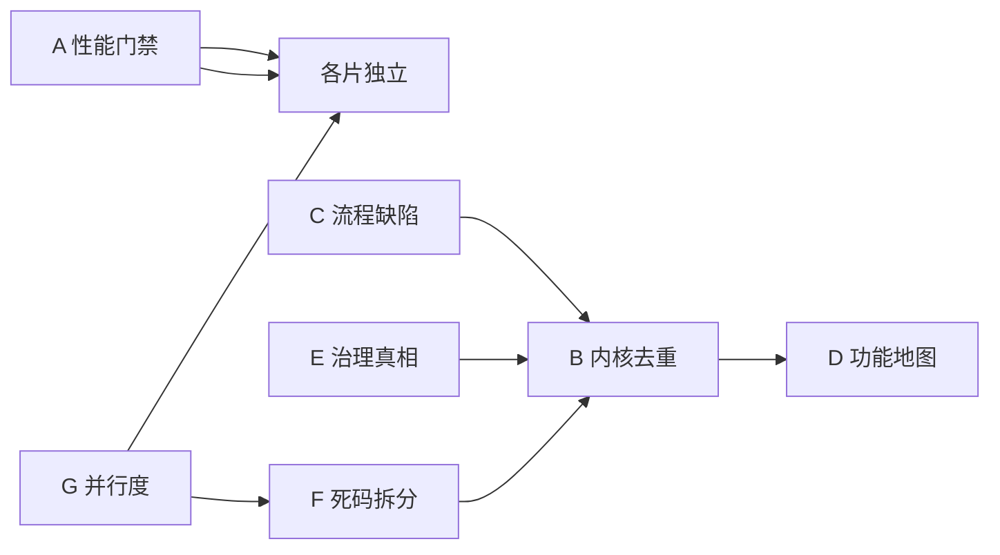

# Wave 2.5 收口总控 PRD

> 下辖实施切片 Issue：`#114`、`#115`、`#116`、`#117`、`#118`、`#119`、`#120`
>
> **基线**：`a0fe4df`（已含 #102 / #111 与 #101 / #112）。

## 一、背景、问题与设计底线

<!-- section: goal -->
### 1.1 为什么立项

四路只读扫描（边界压测、功能地图、机制盘点、治理体检）在基线上找到的问题，横跨五类：十二条边界缺陷、六项功能地图结构性漏洞、性能门禁失效与五组共享内核漂移、三项治理输出失真、三项并行度机制缺口。

这些问题放在一起看只有**四个病根**，其余全是同一个病根的不同表现：

1. **判据不看事实**：门禁与检查拿一句关于配置的声明当事实（属性文件里有没有那条规则、地图里有没有那个字段、预算里有没有那个倍数），而不去看真实文件、真实执行、真实读数。
2. **同一份真相写多处**：同一个判定在仓里存在两份以上，改一处忘一处，最后两处对同一输入给出相反结论。
3. **「没做」被当成「没问题」**：没查到、不认识、没执行、没基线，全部静默变成「通过」或「零问题」。
4. **没人用的东西留着**：零消费者导出、永远走不到的代码、已经拆完却仍在重复的建议。它们不会让测试变红，只会让下一个人读错。

### 1.2 为什么切成七片而不是一片

判据是结构问题，不是大小问题：**一片之内只改一个病根，一片能被一个实施者独立做完**。

一份九百行的 SPEC 里，验收清单会有六十条以上，冻结它的人和实现它的人都会失去准星；而其中任何一条被误读，整份都会被打回重审。切成七片之后，每片五到六条判据，每片有独占的写域与显式依赖，可以真并行。

拆片同时也把「哪一片先做」变成可计算的事：`depends_on` 显式声明，波次由拓扑推出，同波次写域零交叉。

### 1.3 切片与认领

| 判据 | 切片 | Issue | 病根 |
| --- | --- | --- | --- |
| `C1` | 性能门禁 | `#114` | 判据不看事实（属性规则命中、合并提交前缀） |
| `C2` | 共享内核去重 | `#115` | 同一真相写多处，已漂 |
| `C3` | 流程缺陷 | `#116` | 「没做」被当成「没问题」 |
| `C4` | 功能地图与验证工具 | `#117` | 校对对象不进指纹，验证器恒真 |
| `C5` | 治理与文档漂移 | `#118` | 输出的「事实」不是从事实算出来的 |
| `C6` | 死代码与热点拆分 | `#119` | 没人用的东西留着，一个文件扛四件事 |
| `C7` | 并行度机制 | `#120` | 「依赖已满足」两处口径不一致 |

### 1.4 设计底线

- 治本手法只用四类：**删自由度**、**从事实推导**、**单一真相源 + 机械对拍**、**收紧契约**。不用「加个判断挡住它」、不用「加个参数关掉它」、不用「重试一次」。
- 不新增第九个技能，不引入第三方运行时依赖。
- 不写死托管平台名、账号、路径与版本号。
- 不碰 `docs/archive/`。
- 单文件 `.mjs` 不超 800 行。
<!-- section: goal-end -->

## 二、切片编排与依赖

<!-- section: design -->

### 2.1 波次与并行度

| 波次 | 切片 | 说明 |
| --- | --- | --- |
| 第 1 波 | A、C、E、G | 四片写域两两零交叉，可同时派发 |
| 第 2 波 | F | 需要 G 先把策略模块的行为定下来，才能安全拆分 |
| 第 3 波 | B | 需要 C/E/G 先落地流程入口、治理输出与依赖判定，再收敛共享实现 |
| 第 4 波 | D | 需要 B 的合并后内核，否则新验证工具第二天就要重采基线 |

### 2.2 写域相邻的三处，已显式归属

同一份文件被两片碰到，只有三种情况，都靠顺序而不是靠约定解决：

1. `kit/skills/lib/workflow-policy.mjs`：G 先改行为，F 再拆文件，B 最后改其中一段。三者顺序由 `depends_on` 保证。
2. `kit/skills/dev-govern/scripts/govern-checks.mjs`：E 先修处置指令，B 再收口产物目录名单。
3. `scripts/lib/review-helpers.mjs` 与 `kit/skills/dev-flow/scripts/flow-intake.mjs`：C 先定形状，B 后收敛同名工具。

### 2.3 为什么不做成一片或两片

- **做成一片**：一份 SPEC 装六十条判据，冻结它的人和实现它的人都会失准；任一条被误读就整份打回，返工成本被放大七倍。
- **做成两片（机械类 / 治理类）**：两片各三十条，写域各含二十多个文件，等于把「一次改一类」换成「一次改一半仓库」；而且两片的判据会互相引用（例如功能地图的校验要读内核里的路径归一），拆开反而制造循环依赖。
- **做成九片以上**：会把同一个病根拆散。例如把六组漂移拆成六片，每片都要碰同一批文件，波次退回串行，等于没拆。
<!-- section: design-end -->

## 三、门型评估与验收标准

<!-- section: gates -->
- **门型**：`one-way`。不是代码量决定的，而是这些判定本身会改变「什么算通过」：预算来源、验证工具的指纹口径、治理复盘的失效判据、依赖是否满足的口径，任何一处变动，历史上所有「通过了」的结论都要按新口径重算。
- **风险等级**：`high`（命中 `kit/`、`scripts/dev/`、`AGENTS.md` 三条高风险路径）。
- **故障注入**：各片各自登记注入项，号段接在现有最大号之后，避免与并行切片碰撞。
- **整体验收**：七片全部合入且 `doc-plan.mjs audit . --json` 为 `ok: true`，本 PRD 的七条判据全部有子切片认领并勾选。
<!-- section: gates-end -->

<!-- section: acceptance -->
### 验收标准（正例 / 反例双向可判定）

<!-- criteria:start -->
- [x] C1: 性能门禁按事实判定——属性规则只看「已跟踪文件是否命中」，预算由同轮校准推导且两条环境给出完全相同的阈值数值；连跑五次全绿且留 20% 以上余量。反例：把按环境放大预算的分支保留、只改默认倍数，环境一变仍是两个结论。
- [x] C2: 六组已漂移的共享工具收敛为单一实现，其余处为重导出；五组未漂移的收敛后全套夹具逐字节一致；同名导出一处定义由机械检查守住；行数口径单点且 800 行边界结论一致。反例：只收敛其中三组，另三组留「下次再说」——同名对拍检查第一次跑就红。
- [x] C3: 引用成为贯穿全链的一等对象，跨仓单据不再坍缩为本地同号；全部「不认识 / 没查到 / 没执行」显式报出并给修法；零文档与无参数场景报「未适用」而非通过。反例：只修跨仓链接一处，另外十条静默降级照旧——反例用例会红。
- [x] C4: 功能地图的脚本路径进指纹并参与校验，命令里的路径逐条核对；零执行非零退出；过期不自动吸收，刷新基线必须显式；盲区检查覆盖源码与模板全量。反例：保留「跑通过即重写基线」，过时证据第二天就被抹掉，审计报零过期。
- [x] C5: 发版证据的条目数与该提交真实导出包条目数相等；生成物不进信号归属；复盘建议带失效判据；陈旧命令先拆条再比对，对「流水线是唯一命令来源」的仓库零误报。反例：改契约文档去迁就逐字比对——那是让文档为错误规则让路。
- [x] C6: 二十个零消费者导出全仓零命中；死参数为零且由门禁守住；策略模块拆分后每个子模块不超 300 行、导入方零改动。反例：留一个「以后可能有用」的导出并加注释说明——注释正是本切片要清的东西。
- [x] C7: 「依赖已满足」只有一处判定，已归档前置不再阻塞就绪；并行度与波次在全部阶段可见；串行必须带理由，无理由即阻断。反例：把「建议」改成「强制并行」，于是真实的串行需求被逼着编造理由。
<!-- criteria:end -->
<!-- section: acceptance-end -->

## 四、可复用基础设施与备选方案

<!-- section: reuse -->
- `kit/skills/lib/doc-slice-graph.mjs`：已有的切片图四项检查（认领覆盖、元数据必填、依赖无环、同波次写域不撞）。本 PRD 与七份 SPEC 直接复用它的判据，不另立一套元数据：所有字段都是文档里本来就有的。
- `kit/skills/lib/git-core.mjs`：共享基础层。共享工具的单一实现全部落在这里，因为 `kit/` 不能 import `scripts/lib/`（`arch-rules` 会红），而 `scripts/lib/` 可以 import `kit/skills/lib/`——这个方向已被 `protocol.mjs` 等七个模块在实际使用，是既有先例，不是新设计。
- `scripts/dev/fixtures.mjs` 按 `scripts/dev/fixtures-*.mjs` 自动发现功能域，七片各自新增夹具无需登记。
- `scripts/dev/verify-injections.mjs` 按 `scripts/dev/injections-data-*.mjs` 自动发现注入项，号段接续即可。
<!-- section: reuse-end -->

<!-- section: alternatives -->
- **为什么不用一份大 SPEC（否决）**：判据数量和写域都会到一个没人能审的规模；冻结验收标准这件事本身会变成走过场。
- **为什么不按「扫描来源」切（否决）**：四路扫描是四个视角，不是四个改点。按来源切会让同一个文件出现在三片里，波次退回串行。
- **为什么不按「风险等级」切（否决）**：风险等级与写域正交。高风险的六组漂移和低风险的死导出会落进同一片，而它们要同时改的文件反而更少。
- **为什么七片而不是更细（否决）**：把六组漂移拆成六片，每片都碰同一批文件，`depends_on` 会退化成一条链，并行度归零。
<!-- section: alternatives-end -->

## 五、待拍板问题

<!-- section: pending -->
- 已定：切成七片，一片一个病根；同波次写域零交叉，跨波次相邻写域靠 `depends_on` 排序。
- 已定：波次为 A/C/E/G → F → B → D；不并为两片，也不细于九片。
- 已定：共享工具单一实现落在 `kit/skills/lib/`，`scripts/lib/` 反向重导出；依据是 `arch-rules` 的单向依赖与既有七个模块的先例。
- 已定：本 PRD 不算入任何已存在的总控 PRD；它有独立的七条判据，每个子切片认领其中一条。
- 已定：故障注入号段各片自行接续，不共用号段以避免碰撞。
- 已定：本波不新增技能、不加第三方依赖、不碰 `docs/archive/`、不改托管平台名。
- 已定：B 与 D 之间必须串行——D 的验证工具校对的对象正是 B 合并后的内核；先建工具再改内核，等于让工具第二天就过期。
<!-- section: pending-end -->
