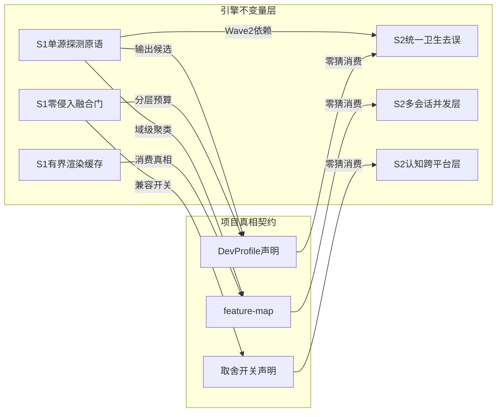

# 通用化降熵与第一性原理架构重构 — 产品需求说明（PRD）

## 文档信息

| 项目 | 内容 |
| --- | --- |
| 当前状态 | `active`（枚举：`draft \| active \| in_review \| done \| superseded \| dropped`） |
| 创建 / 更新 | `2026-11-28` / `2026-11-28` |
| 关联 Issue / PR | 未关联 / 未关联 |
| 提出方 / 负责人 | `planner-arch-redesign` |
| 规划态 | `interactive`（本总控 PRD 拆分为 2 个顺序波次切片 `SPEC + Todo`，覆盖 `C1..C20`） |
| 关联设计 / 任务单 | Slice 1 `s1-onboard-probes-visual`（Wave 1，认领 `C1..C9`）；Slice 2 `s2-harness-multisession-cognitive`（Wave 2，认领 `C10..C20`） |

- **目标读者**：切片 `SPEC` 作者、独立 Critique 审稿人、切片实施者、独立审查者与后续维护者。

## 一、要解决的问题

### 现状与痛点

基于 3 个真实异构外部仓库的端到端逆向法医审计与 2 份全仓源码第一性原理架构重审，暴露出一组同源结构性退化——引擎用大量「按框架名、英文单词或目录名猜世界」的脆弱启发式替代项目自有事实，同时在 `scripts/lib/` 与 `kit/skills/lib/` 间残留 6 处双/三轨实现，且门禁边界混淆导致高频误杀与流程自缚：

1. **大型 TS/React/Sequelize 存量仓法医实证（2,810 文件）**：
   - `scripts/lib/agents-sections.mjs` 用宽泛英文子串（`collaboration`、`guidelines`）匹配标题，将业务章节误判为已有研发流，静默吞掉 `日常协作与风险分流` 与 `修改守则`，而 `scripts/compose-agents.mjs --check` 与 `scripts/review.mjs` 全绿放行。
   - `kit/skills/dev-explore/scripts/repo-map.mjs` 未过滤隐藏代理目录并按字母 `.slice(0, 35)` 硬截断，叠加 `kit/skills/dev-explore/scripts/repo-map-helpers.mjs` 与 `kit/skills/lib/feature-map.mjs` 的无作用域命令回退，将 2,561 代码文件截成 19 个单文件碎片且 18/19 错绑窄单测、`testRefs` 与 `flows` 为空；`kit/skills/lib/static-evidence-erd.mjs` 仅认内联 FK 与局部 ORM，扫出 37 表却 0 条关系。
   - `kit/skills/lib/suite-inventory.mjs` 硬编码集中测试目录，无视 471 个同目录测试；`kit/skills/dev-iterate/scripts/iterate-plan.mjs` 在 `--focus` 多模块模式下共用同一 `topic` 作为 `stem`，导致 8 个模块碰撞到同一输出路径互相覆盖。
   - `kit/skills/lib/profile-sniffer.mjs` 与 `scripts/lib/review-helpers.mjs` 静态扫描第三方工具配置文本并建议改写，却未校验脚本作用域；`scripts/lib/claims.mjs` 将用户既有正文中的通用占位路径判为阻断 `[缺]`，倒逼篡改手写原文；`scripts/lib/survey-ecosystem.mjs` 跨 workflow 拼接命令产出非法 `jq` 片段，`scripts/lib/survey-docs.mjs` 在大小写不敏感 FS 上重复上报同一设计文档。
   - 成熟仓既有长手写 `AGENTS.md`（15.8 KB）叠加受管区直接逼近 30,720 B 硬上限；`kit/skills/lib/profile.mjs` 未兼容误写在 `## 取舍` 的 `evergreen-docs`；无子代理宿主在 `tier === 'parallel-subagents'` 时缺乏合法分片串行降级协议。
2. **超大型多语言 Monorepo 无远端仓法医实证（16,847 文件，Python/Next.js/Go/Docker）**：
   - `scripts/lib/claims.mjs` 围栏代码块仅按空白拆词，与 `extractProfileDirs` 的逗号分隔割裂，误杀无空格 YAML 列表触发假阻断。
   - `scripts/lib/survey-docs.mjs` 仅靠工具白名单识别 Git Hooks，漏检现代 `.*hooks*` 目录，致使 `scripts/lib/render.mjs` 误推 `--with-hooks` 险覆写原仓钩子。
   - `scripts/review.mjs` 与 `scripts/lib/survey-workspace.mjs` 对上游历史已追踪的忽略文件及 Windows 大小写碰撞硬报 `[缺]`，倒逼修改上游 `.gitignore`；`.gitignore` 遮蔽检测仅静态硬编码 6 条路径，并危险地建议把全局规则改为根锚定。
   - `kit/skills/lib/profile.mjs` 强制要求冒号分隔，拒认 `scripts/review.mjs` 自有文案引导的裸取舍开关（如 `no-git-hooks`、`no-architecture-html`）；`scripts/lib/review-helpers.mjs` 遗漏 RFC 2606 保留无效域与 `test-*` 占位署名。
   - `kit/skills/lib/profile-sniffer.mjs` 与 `kit/skills/dev-explore/scripts/repo-map-helpers.mjs` 将 51,346 字符多行 CI bash 串及非源码/storybook 文件灌入 `docs/feature-map.json`，引发 `kit/skills/dev-verify-tools/scripts/verify-tools-audit.mjs` 自产自爆；`kit/skills/lib/static-analyzer.mjs` 与几何布局在 1.6 万文件规模下耗时超 948 s 并超时。
3. **可运行前端 UI 仓多子代理闭环实证（7 子代理 + 真 CDP 截图 + 61 分钟耗时解剖）**：
   - 41 分钟（约 67%）耗时源自引擎流程自我打架：`kit/skills/dev-flow/scripts/flow-sandbox.mjs` 仅因命中 `high-risk` 路径即强制 `sandbox-needs-spec`，且 `promote` 永不识别已批准 SPEC 放行原地晋升；`kit/skills/dev-plan/scripts/doc-plan-ops.mjs` 与 `kit/skills/lib/plan-index.mjs` 在已有同 slug Todo 时以 `BLOCKED_DUPLICATE_PLAN_DOC` 阻断 `init --kind pair`，且 `safeSlug` 未剥离尾部重复类型后缀拼出双后缀文件名，最终导致双 `taskId` 与孤儿沙箱。
   - `scripts/lib/agents-sections.mjs` 与 `kit/skills/lib/feature-map.mjs` 未在治理期校验 `Dev Profile` 与 `feature-map` 命令可执行形态，自然语言句式拖延 48 分钟至 `submit` 阶段才超时引爆。
   - `kit/skills/lib/workflow-policy.mjs` 对 `full-test` 与 `merge-gate` 同命令仍报 `BLOCKED_INSUFFICIENT_VERIFICATION_TIER` 逼重跑；`kit/skills/dev-plan/scripts/doc-plan.mjs` 硬编码 `--round 1` 与相对 `--spec` 路径；`kit/skills/dev-explore/scripts/repo-map.mjs` 将 `.agents/skills/` 计入 `codeFileCount` 致 5 文件微仓误判大型仓；`scripts/lib/agents-defaults.mjs` 的 `COMMIT_STYLE_HINT` 随提交数跨越 5 跳变导致 `--check` 自破；`kit/skills/dev-flow/scripts/flow-merge-claim.mjs` 借用 `HEAD^{tree}` 造孤儿整树提交且合并后未回收。
4. **全 8 技能 Harness 减熵、多会话并发与跨平台审计**：
   - 存在 11 项超越静态词法可证边界的硬阻断误杀（如 `billing-b2b.ts`、`user-rest.ts`、`text-overflow.css`、`Promise.race`、`vi.fn()` 回调 spy、跨 hunk 拼接误报、存量超 800 行硬阻断、单 hunk 删断言、摘要孤词升 `one-way`、自报当前活跃沙盒过期、应用内路由判死链），且 `dev-edit`/`dev-govern`/`dev-review` 各自维护重复静态卫生扫描。
   - `kit/skills/lib/session-state.mjs` 采用全局无锁单文件 + 全局单例 `activeTopic`/`triage` + 5 主题静默淘汰，多独立会话并行必串台；主仓脏检查过度串行化隔离 worktree 创建，且缺乏多会话写域重叠与主干漂移雷达。
   - `kit/skills/lib/doc-comments.mjs` 在无远端或通用 Git 仓写出 `PR #null`、重复 `#N` 抑制裸 URL 富展开、返工漏传 `prUrl`；`kit/skills/lib/pr-template-hydrate.mjs` 将本仓专有措辞泄露到任意目标仓 PR；`kit/skills/lib/session-orient.mjs` 与 `kit/skills/dev-govern/scripts/govern-state.mjs` 在纯本地模式仍输出远端或特定 CLI 指引。
   - 入口与技能文档残留特定宿主工具名硬编码（`webfetch`、`websearch`）与宿主绑定表述，缺失「高维业务锚定、前提质疑与 Deletion Test、工具无关 Deep Research、无子代理显式分片串行降级」统一认知契约。

### 目标用户与使用场景

- **外部存量仓库接入维护者**：在数百至数万文件的单仓/多语言 Monorepo、有远端或无远端环境下，执行 `scripts/survey.mjs`、`scripts/equip.mjs`、`scripts/compose-agents.mjs`、`scripts/review.mjs` 与 `verify-tools.mjs` 完成零侵入治理。
- **多会话并行研发团队与 AI 代理**：在同一仓库下通过多个独立会话并发执行探索、规划、沙箱试错、隔离实施与独立审查，依赖 `dev-explore`、`dev-plan`、`dev-edit`、`dev-flow`、`dev-review`、`dev-verify-tools`、`dev-govern`、`dev-iterate` 协同落地。
- **多平台与异构宿主使用者**：在 5 大托管方言（`github`、`gitlab`、`gitcode`、`gitee`、`gitea`）、`generic-git` 或 `local-only` 环境，以及支持或不支持独立子代理的任意 AI 宿主中使用同一套自包含技能。

### 产品目标

- **单源减熵（净复杂度下降）**：分两波彻底消除 `scripts/lib/` 与 `kit/skills/lib/`、`kit/skills/dev-explore/scripts/repo-map-helpers.mjs` 间 6 处双/三轨解析与 3 套重复静态卫生扫描，净删脆弱启发式与重复实现 `>= 400` 行；`kit/skills/lib/suite-inventory.mjs` 与 `kit/skills/lib/session-state.mjs` 拆分后全仓 `.mjs` 均 `< 800` 行。
- **零侵入存量保真**：成熟仓接入后既有 `AGENTS.md` 原文前缀 100% 字节完整、核心受管节 0 静默丢失、受管预算实行 `AGENTS_MANAGED_MAX_BYTES = 24576`（`24 KB`，对齐 `kit/skills/lib/tool-owned.mjs` 的 `AGENTS_WARN_BYTES`）硬控且 `customBytes` 超出总预算降级 `notice`、历史 `ignoredButTracked` 与第三方工具链配置 0 强制篡改。
- **有界规模与零误杀**：1.6 万文件级仓库静态分析缓存受限于 `128 MB`、多图布局受严格节点上限约束、`visual-geometry-check.mjs` 降至 $O(N \log N)$；11 项实证硬阻断误杀全部清零，硬阻断严格收口至 6 类词法/Git/契约客观不变量。
- **多会话零串台与零自缚**：多独立会话并发调用 `note`/`triage`/`init`/`start` 零丢写、零跨会话覆盖；`sandbox-needs-spec` 死胡同与同命令层级重跑彻底消除；5 远端与纯本地仓输出 0 处 `PR #null`、0 处 `project-forge` 私货措辞与 0 处特定宿主工具名硬编码（同时保留运行态通用协议枚举 `mcp-delegate`）。

## 二、范围与非目标

### 本次要做（In Scope）

本期按 1:N 总控 PRD 拆分为 2 个边界清晰、顺序依赖的交付切片（均在 `project-forge` 产品层与仓内常青资产同步落地，并同步 `scripts/equip.mjs .` 与正反双向 `scripts/dev/fixtures.mjs` / `scripts/dev/verify-injections.mjs` 验证）：

1. **Slice 1（`s1-onboard-probes-visual`｜Wave 1，无前置依赖）——接入探测单源收敛、零侵入融合与有界规模渲染**：
   - 在 `kit/skills/lib/` 沉淀探测单源原语（`extractStructuredCiSteps`、`scanDeclaredTaskRunners`、`discoverWorkspacePackages`、`discoverDesignDocs`），完成 `scripts/lib/` 侧全部重复实现去重（`scripts/lib/survey-ecosystem.mjs`、`scripts/lib/survey-docs.mjs`）；保留 `kit/skills/lib/profile-sniffer.mjs` 中 `detectOptionalNativeCheckers` 的 `{ configured, hasNativeConfig }` 返回契约（供 `edit-gate.mjs --with-native`、`govern-retro.mjs`、`survey.mjs` 继续复用），仅删除其中的 `.agents/` 配置文本扫描（`mentionsAgents`/`addAdvice`/`agentIgnoreAdvice`）及 `scripts/equip.mjs`、`scripts/lib/render.mjs` 消费点，并彻底删除 `scripts/lib/review-helpers.mjs` 的 `TOOLING_AGENTS_IGNORE_RULES`/`detectToolingAgentsIgnoreGaps`/`checkEslintAgentsIgnore` 及 `scripts/review.mjs` 调用点，同步迁移对应 4 份夹具（`kit/skills/dev-explore/scripts/repo-map-helpers.mjs` 的 3 处重复解析在 Wave 2 Slice 2 `C10` 统一迁入单源原语）。
   - 落地零侵入存量融合：核心受管节禁按单词跳过并输出 `skippedByHeading` 诊断；复用升级 `scripts/compose-agents.mjs`、`scripts/lib/compose-agents-helpers.mjs`、`scripts/lib/survey-gap-rules.mjs` 与 `scripts/review.mjs` 的 `managedBytes`/`customBytes` 分解逻辑，实行 `AGENTS_MANAGED_MAX_BYTES = 24576`（`24 KB`，对齐 `kit/skills/lib/tool-owned.mjs` 的 `AGENTS_WARN_BYTES`）硬控 + `customBytes` 超限降级软提示 `notice`（含分解报告与可选紧凑指针模式，**绝不删减既有详尽条款**，并同步迁移 `scripts/dev/injections-data-core.mjs` 的 `I24`）；通用 `core.hooksPath` + `.*hooks*` 钩子探测；动态 `git check-ignore -v -z` 与精确 `!.agents/skills/` + `!.agents/skills/**` 回纳；历史 `ignoredButTracked` 降级 `notice`；`claims.mjs` `/[\s,]+/` 拆词、通用占位前缀过滤与非受管正文降级 `notice`；`profile.mjs` 兼容无冒号裸取舍开关与 `evergreen-docs` 跨区兼容读；RFC 2606 与 `test-*` 占位身份检测；在 `kit/skills/lib/command-lex.mjs` 抽出共享可执行命令形态校验纯函数并接入 `Dev Profile` 与 `feature-map.json`；稳定 `COMMIT_STYLE_HINT` 消除 5 提交自破。
   - 落地有界规模渲染与缓存：`tree <= 120`、`erd <= 48`、`class <= 60`、`dataflow <= 60` 并输出 `meta.truncated`；`kit/skills/lib/visual-geometry-check.mjs` 改为 $O(N \log N)$ 扫描线；`kit/skills/lib/static-analyzer.mjs` 精简缓存并设 `128 MB` 上限；`kit/skills/lib/static-evidence-erd.mjs` 收口通用 SQL `ALTER TABLE ... FOREIGN KEY`、SQLAlchemy 2.0 `mapped_column` 与通用 `@Table`/`@Entity` 最小核并停止逐框架正则扩展。
2. **Slice 2（`s2-harness-multisession-cognitive`｜Wave 2，依赖 Slice 1 的 `profile-sniffer`/`profile.mjs` 单源原语）——八技能减熵去误杀、多会话零冲突与通用跨 Agent 认知契约**：
   - 完成 `kit/skills/dev-explore/scripts/repo-map-helpers.mjs` 3 处重复解析去重（`extractCiRunSteps` -> `extractStructuredCiSteps`、`extractTaskRunners` -> `scanDeclaredTaskRunners`、`resolveTopoImport` -> `kit/skills/lib/import-graph.mjs`）；修复 `kit/skills/dev-explore/scripts/repo-map.mjs` 的 `projectCodeFiles.length` 统计、统一过滤全部隐藏目录与非源码/storybook 文件、实现域级聚类与 `kit/skills/lib/feature-map.mjs` 作用域匹配绑定 `verificationTools`；拆分 `kit/skills/lib/suite-inventory.mjs` 与 `kit/skills/lib/suite-runner.mjs` (new)（均 `< 800` 行），按仓内既有测试分布统计推导 `colocated` vs `centralized` 布局与命名，`kit/skills/dev-iterate/scripts/iterate-plan.mjs` 强制 `--focus` 多模块输出路径唯一。
   - 将 `dev-edit`/`dev-govern`/`dev-review` 重复静态扫描统一收口至单一 `evaluateFileHygiene`（核心实现下沉至 `kit/skills/lib/static-gates-comment-hygiene.mjs` 或原位替换并经 `kit/skills/lib/static-gates.mjs` 重导出，严格守 `<= 800` 行），清扫全部 11 项硬阻断误杀与自相矛盾门禁；`kit/skills/dev-govern/scripts/govern-docs.mjs` 同步对齐 `AGENTS_MANAGED_MAX_BYTES = 24576` 分层预算判据（仅 `managedBytes` 超限报 `critical`，仅因 `customBytes` 超 30 KB 降级 `notice`/`info`）；存量 `> 800` 行默认一律 `warning`，仅当 `Dev Profile` 显式声明 `max-file-lines` 时启用超限/净增 `> 80` 行硬阻断并保留 `line-squash-cheat` 硬阻断（同步迁移 `scripts/dev/injections-data-w5-blind-fixes.mjs` `I418`/`I419`）；`kit/skills/dev-review/scripts/review-gates.mjs`（现 776 行）通过删除重复扫描实现净减行守恒。
   - 消除工作流自缚摩擦：解耦 `high-risk` 与强制 L3 SPEC（同步迁移 `scripts/dev/injections-data-sandbox-flow.mjs` `I985` 与 `scripts/dev/fixtures-sandbox-dual-loop.mjs`）；`flow promote` 识别已批准 SPEC（或 `--spec`）原地晋升；`doc-plan init --kind pair` 遇已有 Todo 幂等补建 SPEC 并双向互链、`safeSlug` 去重尾部 `-${k}` 同步收口 `kit/skills/lib/docs.mjs`（`buildDocFilename`）与 `doc-plan-ops.mjs`；`kit/skills/lib/workflow-policy.mjs`（现 779 行，保持净行守恒 `< 800` 行）支持 `full-test === merge-gate` 同命令等价；`doc-plan audit` 动态计算下一轮次并将 `--spec` 归一为仓根路径；`refs/pf/claims/*` 改用 `git mktree`（空 stdin，兼容 SHA-256 Git 仓并回退 SHA-1 空树常量）并在 `merge`/`cleanup` 自动回收。
   - 实现多独立会话并发零冲突：从 `kit/skills/lib/session-state.mjs`（现 775 行）拆出 `kit/skills/lib/session-topics.mjs` (new)（两文件均 `< 800` 行），按安全文件名 `<safeSlug>-<sha8>.json`（JSON 内保留原 `topicId`）持久化 Per-Topic 讨论缓冲（删除全局 `activeTopic`/`triage` 单例与 5 主题静默淘汰，保留 `steps`/`explored`/`triageByTask` 于加锁 `session-state.json`，保留 `readSessionState()` 兼容聚合投影 `.topics` 并重导出 `setTopicBriefKey` 保障 `visual-brief.mjs`/`visual-brief-store.mjs` 零破坏，同步迁移 `scripts/dev/injections-data-conv-s2.mjs` `I921`；明确多活跃主题省略 `--topic` 时的确定性非猜测回退）；新增唯一只读模块 `kit/skills/lib/concurrency-radar.mjs` (new) 导出 `projectConcurrencyRadar`，接入 `flow-inspect.mjs`/`flow-start-helpers.mjs`/`flow-next.mjs`/`flow-lifecycle.mjs`（雷达辅助下沉 `kit/skills/dev-flow/scripts/flow-lifecycle-helpers.mjs` 保障 `flow-lifecycle.mjs` 778 行与 `flow-inspect.mjs` 762 行稳守 `< 800` 行）/`doc-plan.mjs`（`triage`）/`doc-plan-brief.mjs`/`session-orient.mjs` 并覆盖 5 类退化边界；在 `kit/skills/lib/harness-context.mjs` 与 `flow-start-helpers.mjs` 精确划分 `BLOCKED_DIRTY_MAIN` 契约（从干净 `HEAD` 新开隔离 worktree 降级预警，原地改与合入主干维持硬阻断，并同步迁移 `scripts/dev/injections-data-w4-harness.mjs` 与 `scripts/dev/fixtures-w4-harness.mjs`）。
   - 对齐 5 远端与纯本地一致性：`kit/skills/lib/doc-comments.mjs` 根治 `PR #null`、采用单次裸 `prUrl` 富展开、通过 provider/backend 透传 `prRefPrefix`（默认 `#`，GitLab `!`，严禁在 `doc-comments.mjs` 写平台名或改 10 键 `CAPABILITY_KEYS`）、返工传 `prUrl`；`kit/skills/lib/pr-template-hydrate.mjs` 清零本仓专有措辞改为通用可证事实；修正 `kit/skills/lib/session-orient.mjs` 与 `kit/skills/dev-govern/scripts/govern-state.mjs` 纯本地远端泄露。
   - 落地通用跨 Agent 认知契约与常青文档同步：在 `SKILL.md`、`references/`、`templates/agents-project.md`、`kit/skills/*/SKILL.md` 严守 `SKILL_MAX_BYTES` 与 `KIT_SKILL_WARN_BYTES` 预算前提下精炼嵌入高维业务锚定、前提质疑与 Deletion Test、工具无关 Deep Research（清零 `webfetch`/`websearch` 等特定宿主工具名与宿主绑定措辞，明确保留运行态通用协议枚举 `mcp-delegate`）及无子代理宿主显式分片串行降级；同步更新本仓 `docs/TDD.md`、`docs/feature-map.json`、`docs/architecture-map.html`、`README.md`、`README.en.md` 与 `assets/readme/*.svg`（按变更同步对应中英文 SVG）。

### 显式删除清单（Deletion Test：先删后建）

| 待删脆弱设计 / 重复实现 | 当前位置 | 删除理由与通用替代 |
| --- | --- | --- |
| 双套 Linter/Formatter `.agents/` 配置文本白名单扫描 | `kit/skills/lib/profile-sniffer.mjs`（仅删 `mentionsAgents`/`addAdvice`/`agentIgnoreAdvice`，**保留 `detectOptionalNativeCheckers` 的 `{ configured, hasNativeConfig }` 返回契约**）及 `scripts/equip.mjs`、`scripts/lib/render.mjs` 消费点；彻底删除 `scripts/lib/review-helpers.mjs` 的 `TOOLING_AGENTS_IGNORE_RULES` / `detectToolingAgentsIgnoreGaps` / `checkEslintAgentsIgnore` 及 `scripts/review.mjs` 调用点 | 无法静态理解脚本作用域且永远穷举不完工具；删除配置文本扫描后改为接入期实跑项目真实 lint/typecheck，仅当真实报错命中 `.agents/` 时处置，同时不破坏 `edit-gate.mjs`/`govern-retro.mjs`/`survey.mjs` 既有原生检查器探测契约（Slice 1） |
| 6 处双/三轨探测与解析重复代码 | Wave 1（Slice 1）：`scripts/lib/survey-ecosystem.mjs`（重复 CI 与生态命令）、`scripts/lib/survey-docs.mjs`（第二套设计文档枚举）；Wave 2（Slice 2）：`kit/skills/dev-explore/scripts/repo-map-helpers.mjs`（第三套 CI、第二套 Task Runner、第二套 import 解析） | 跨仓分叉致一端修完另一端继续产脏数据；Wave 1 先在 `kit/skills/lib/` 建单源并清 `scripts/lib/`，Wave 2 清 `repo-map-helpers.mjs` 3 处重复 |
| 跨全部 Workflow 强拼 CI bash 伪命令 | `scripts/lib/survey-ecosystem.mjs` 与 `kit/skills/lib/profile-sniffer.mjs` 的 `&&` 拼接 | 产出含 `${{`、`jq` 片段与 51 KB 多行 bash 的非法伪命令；删除拼接，改输出结构化单步候选 |
| Git Hooks 工具硬编码白名单 | `scripts/lib/survey-docs.mjs`（逐工具枚举 `.husky`/`.lefthook` 等） | 漏检 `.vite-hooks` 等新工具险覆写原仓钩子；删除白名单，改用 `core.hooksPath` + `.*hooks*` 标准钩子名不变量 |
| 单文件字母 `.slice(0, 35)` 截断与无作用域命令回退 | `kit/skills/dev-explore/scripts/repo-map.mjs`、`kit/skills/dev-explore/scripts/repo-map-helpers.mjs`、`kit/skills/lib/feature-map.mjs` | 中大型仓被截成碎片单文件并错绑窄测试；删除字母截断与盲回退，改用目录/Workspace 域聚类与作用域匹配 |
| 逐框架 ORM 正则军备竞赛 | `kit/skills/lib/static-evidence-erd.mjs`（停止按具体框架名继续堆砌正则） | 永远落后于新 ORM 版本；保留通用 SQL/Prisma/最小通用装饰器核，复杂模型归 `docs/feature-map.json` 声明 |
| 3 套重复静态卫生扫描路径 | `kit/skills/dev-edit/scripts/edit-gate.mjs`、`kit/skills/dev-govern/scripts/govern-checks.mjs`、`kit/skills/dev-govern/scripts/govern-tests.mjs`、`kit/skills/dev-review/scripts/review-gates.mjs` 各自拼装 | 同一误杀规则三端分叉；删除重复拼装，收敛至单一 `evaluateFileHygiene` |
| 全局单例 `activeTopic`/`triage` 与 5 主题静默淘汰 | `kit/skills/lib/session-state.mjs` | 多独立会话并发必互相覆盖或误阻塞；删除全局单例与 5 主题淘汰，拆出 `kit/skills/lib/session-topics.mjs` (new) 按安全文件名独立加锁 |
| `project-forge` 私货 PR 自查措辞与宿主工具名硬编码 | `kit/skills/lib/pr-template-hydrate.mjs`（`SURVEY_OR_GATE_FILE_RE` 等）、`kit/skills/dev-plan/SKILL.md`、`kit/skills/dev-review/SKILL.md`、`references/survey.md`、`references/collaboration.md`、`references/remote-github.md` | 污染目标仓 PR 并违背宿主中立红线；删除全部私货措辞及 `webfetch`/`websearch` 等特定宿主工具名与宿主绑定表述（保留运行态通用协议枚举 `mcp-delegate`） |

### 明确不做（Non-Goals）

- **严禁人为阉割或删短既有受保护文档条款**：绝不删减 `SKILL.md`、`AGENTS.md` 或 `templates/agents-project.md` 中既有详尽工程规范与协作条款；成熟仓 `AGENTS.md` 的 30 KB 预算压力严格通过 `AGENTS_MANAGED_MAX_BYTES = 24576`（`24 KB`）硬门禁 + `customBytes` 超限降级 `notice`（含分解报告与可选紧凑指针模式）化解。
- **不破坏运行态通用协议枚举 `mcp-delegate`**：仅清除文档与技能提示词中的特定宿主工具名（`webfetch`/`websearch`）及宿主绑定表述；保留 `kit/skills/lib/github-client.mjs`、`kit/skills/lib/platform-probe.mjs` 与 `scripts/lib/platform/index.mjs` 中的 `apiChannel.tier = 'mcp-delegate'` 协议契约与既有 7 份断言夹具。
- **不引入任何第三方运行时依赖**：`scripts/` 与 `kit/` 严格保持 Node 18+ `node:*` 内置模块零外部依赖，不引入外部 AST 解析器、数据库或常驻守护进程/外部锁服务。
- **不新增第 9 个内置技能，不破坏 `kit/` 目录自包含性与单向依赖**：继续保持 8 个内置技能边界；`kit/**` 严禁反向引用 `scripts/lib/**` 或 `scripts/dev/**`。
- **不做按具体业务框架名扩张的启发式规则**：不在 `profile-sniffer.mjs`、`static-evidence-erd.mjs` 或 `suite-inventory.mjs` 中为特定框架堆砌专有规则表，只沉淀跨生态通用不变量。
- **不改动历史归档目录与发布说明**：不触碰 `docs/archive/` 与 `docs/release-notes/`（遵守 `do-not-edit` 边界）。
- **不执行发版、打标签或推送远端**：本 PRD 仅覆盖工程架构重构与仓内验证交付，发版由人类另行下令。

## 三、系统边界、双层架构与切片拓扑

### Layer A（引擎确定性不变量）vs Layer B（项目自有事实契约）

所有重构严格遵循「引擎只做栈无关确定性计算，语义判断归还项目真相源」的两层解耦边界，并通过 Wave 1 -> Wave 2 两切片递进落地：

| 层级 | 载体位置 | 确定性职责边界（绝不越界） |
| --- | --- | --- |
| **Layer A：栈无关确定性引擎** | `kit/skills/lib/`（唯一真源）、`kit/skills/*/scripts/`、`scripts/`、`scripts/lib/` | 仅依赖真实文件系统与 Git 事实（`ls-files`/`check-ignore`/`worktree`/`config`/磁盘真大小写）、显式标记与 Schema/DAG 校验、纯统计与图论（测试布局分布、目录/Workspace 聚类、导入图 SCC）、低熵单步候选提取（只呈候选不替项目拍板）、有界渲染与 $O(N \log N)$ 几何校验、6 类硬阻断词法门禁、按 Topic 隔离的文件锁与只读并发雷达 |
| **Layer B：项目自有事实契约** | 目标仓 `AGENTS.md`（`Dev Profile` + `## 取舍`）与 `docs/feature-map.json` | 接入期由 AI 结合业务实证写入并经校验锁定的唯一真相：`quick-test`/`full-test`/`smoke-verify`/`merge-gate`/`arch-rules`/`high-risk`/`do-not-edit`/`evergreen-docs`、显式布尔/键值取舍开关、域级 `domains[]`/`features[]`/`flows[]`（及可选数据模型声明）；后续全部 8 技能直接消费，零重复猜测 |

### 1:N 双切片交付矩阵与波次编排

| 切片 ID | 波次与依赖 | 认领标准 | 核心改动文件边界（已核实路径） |
| --- | --- | --- | --- |
| `s1-onboard-probes-visual` | **Wave 1**（无前置依赖） | `C1..C9` | `kit/skills/lib/profile-sniffer.mjs`、`kit/skills/lib/profile-sniffer-packages.mjs`、`kit/skills/lib/profile.mjs`、`kit/skills/lib/tool-owned.mjs`、`kit/skills/lib/command-lex.mjs`、`kit/skills/lib/feature-map.mjs`、`kit/skills/lib/static-analyzer.mjs`、`kit/skills/lib/static-evidence-erd.mjs`、`kit/skills/lib/visual-layout-diagrams.mjs`、`kit/skills/lib/visual-layout-charts.mjs`、`kit/skills/lib/visual-geometry-check.mjs`、`scripts/lib/agents-sections.mjs`、`scripts/lib/agents-defaults.mjs`、`scripts/lib/compose-agents-helpers.mjs`、`scripts/lib/claims.mjs`、`scripts/lib/survey-ecosystem.mjs`、`scripts/lib/survey-docs.mjs`、`scripts/lib/survey-workspace.mjs`、`scripts/lib/survey-gap-rules.mjs`、`scripts/lib/review-helpers.mjs`、`scripts/lib/render.mjs`、`scripts/lib/protocol.mjs`、`scripts/review.mjs`、`scripts/equip.mjs`、`scripts/compose-agents.mjs`、`scripts/survey.mjs`、`scripts/dev/injections-data-core.mjs`、`scripts/dev/fixtures-r7-rootfix.mjs`、`scripts/dev/fixtures-r8-bugfixes.mjs`、`scripts/dev/fixtures-w6a-survey-handoff.mjs`、`scripts/dev/fixtures-r5-onboarding.mjs` |
| `s2-harness-multisession-cognitive` | **Wave 2**（依赖 Slice 1 的 `profile-sniffer.mjs`/`profile.mjs` 单源原语） | `C10..C20` | `kit/skills/dev-explore/scripts/repo-map.mjs`、`kit/skills/dev-explore/scripts/repo-map-helpers.mjs`、`kit/skills/lib/feature-map.mjs`、`kit/skills/lib/import-graph.mjs`、`kit/skills/lib/suite-inventory.mjs`、`kit/skills/lib/suite-runner.mjs` (new)、`kit/skills/dev-iterate/scripts/iterate-plan.mjs`、`kit/skills/lib/static-gates.mjs`、`kit/skills/lib/static-gates-lexer.mjs`、`kit/skills/lib/static-gates-comment-hygiene.mjs`、`kit/skills/dev-edit/scripts/edit-gate.mjs`、`kit/skills/dev-govern/scripts/govern-checks.mjs`、`kit/skills/dev-govern/scripts/govern-checks-hygiene.mjs`、`kit/skills/dev-govern/scripts/govern-docs.mjs`、`kit/skills/dev-govern/scripts/govern-evergreen.mjs`、`kit/skills/dev-govern/scripts/govern-tests.mjs`、`kit/skills/dev-govern/scripts/govern-state.mjs`、`kit/skills/dev-review/scripts/review-gates.mjs`、`kit/skills/dev-flow/scripts/flow-inspect.mjs`、`kit/skills/dev-flow/scripts/flow-next.mjs`、`kit/skills/dev-flow/scripts/flow-sandbox.mjs`、`kit/skills/dev-flow/scripts/flow-start-helpers.mjs`、`kit/skills/dev-flow/scripts/flow-merge-claim.mjs`、`kit/skills/dev-flow/scripts/flow-merge.mjs`、`kit/skills/dev-flow/scripts/flow-lifecycle.mjs`、`kit/skills/dev-flow/scripts/flow-lifecycle-helpers.mjs`、`kit/skills/dev-flow/scripts/flow-batch.mjs`、`kit/skills/dev-plan/scripts/doc-plan.mjs`、`kit/skills/dev-plan/scripts/doc-plan-ops.mjs`、`kit/skills/dev-plan/scripts/doc-plan-brief.mjs`、`kit/skills/lib/docs.mjs`、`kit/skills/lib/plan-index.mjs`、`kit/skills/lib/plan-next.mjs`、`kit/skills/lib/harness-context.mjs`、`kit/skills/lib/workflow-policy.mjs`、`kit/skills/lib/session-state.mjs`、`kit/skills/lib/session-topics.mjs` (new)、`kit/skills/lib/concurrency-radar.mjs` (new)、`kit/skills/lib/sandbox-scope.mjs`、`kit/skills/lib/session-orient.mjs`、`kit/skills/lib/visual-brief.mjs`、`kit/skills/lib/visual-brief-store.mjs`、`kit/skills/lib/doc-comments.mjs`、`kit/skills/lib/pr-template-hydrate.mjs`、`kit/skills/lib/handoff-package.mjs`、`scripts/dev/injections-data-w4-harness.mjs`、`scripts/dev/injections-data-w5-blind-fixes.mjs`、`scripts/dev/injections-data-sandbox-flow.mjs`、`scripts/dev/injections-data-conv-s2.mjs`、`scripts/dev/fixtures-sandbox-dual-loop.mjs`、`scripts/dev/fixtures-w4-harness.mjs`、`SKILL.md`、`templates/agents-project.md`、`references/survey.md`、`references/collaboration.md`、`references/remote-github.md`、`kit/skills/*/SKILL.md`、`docs/TDD.md`、`docs/feature-map.json`、`docs/architecture-map.html`、`README.md`、`README.en.md`、`assets/readme/` |

### 统一硬阻断边界（仅 6 类客观可证不变量保持退出码 3/4 硬阻断）

凡依赖命名猜测、默认行数启发式（未在 `Dev Profile` 显式声明 `max-file-lines` 时）、跨语句控制流或自然语言关键词的规则，一律降级为 `warning` / `advisory`；全 8 技能仅对以下 6 类词法/Git/契约客观不变量保留硬阻断：

1. `do-not-edit` 路径越界写入；
2. `arch-rules` 静态越界导入与新增双向循环导入；
3. 确定性门禁禁用与反作弊（如测试跳过/聚焦、删测试文件、CI 屏蔽错误、`|| true`、`--no-verify`、恒真断言、零断言、`line-squash-cheat` 及项目在 `Dev Profile` 显式声明 `max-file-lines` 时的超限/净增 `> 80` 行）；
4. 无正当锚点（`JUSTIFICATION_ANCHOR_RE` 双端统一放行）的静态压制注释；
5. 明文凭据/密钥泄露；
6. `evidence.json` 的 `HEAD` 失配或外环混入内环 `inner: true` 实证。

## 四、关键业务流程

### 流程 1：存量外部仓库零侵入接入与校验闭环（Slice 1）

1. **只读勘察（`scripts/survey.mjs`）**：调用 `kit/skills/lib/profile-sniffer.mjs` 唯一原语 `extractStructuredCiSteps`、`scanDeclaredTaskRunners` 与 `kit/skills/lib/profile-sniffer-packages.mjs` 提取结构化单步命令候选（过滤 `${{`、多行控制流与超长片段，绝不跨 workflow 拼接）；调用 `kit/skills/lib/profile.mjs` 唯一原语 `discoverDesignDocs`（`readdirSync` + `toLowerCase()` 去重 + 通用后缀词根）识别既有设计文档；按 `core.hooksPath` 与顶层 `.*hooks*`/`.git/hooks/` 探测钩子冲突；按历史追踪态分层标记 `ignoredButTracked`。
2. **装配与契约融合（`scripts/equip.mjs` + `scripts/compose-agents.mjs` + `scripts/lib/compose-agents-helpers.mjs`）**：写前打仓外 `.zip` 快照；动态对实际写入受管目录与 `.pf-manifest.json` 执行 `git check-ignore -v -z`，若被遮蔽则优先建议末尾追加零副作用精确回纳 `!.agents/skills/` 与 `!.agents/skills/**`；`compose-agents.mjs` 保留原文字节前缀，对核心受管节禁止按标题单词跳过并显式输出 `skippedByHeading` 诊断；复用既有 `managedBytes`/`customBytes` 分解逻辑实行 `AGENTS_MANAGED_MAX_BYTES = 24576`（`24 KB`）硬控，当 `totalBytes > 30720` 且超限源于 `customBytes` 时输出 `managed`/`custom` 分解与软提示 `notice`（含可选紧凑指针模式），绝不强砍手写正文。
3. **契约与地图治理期即错即改（`scripts/review.mjs` + `verify-tools.mjs`）**：共享可执行命令形态校验拦截 `Dev Profile` 与 `docs/feature-map.json` 中的中文自然语言句式；`scripts/lib/claims.mjs` 按 `/[\s,]+/` 拆词、过滤通用占位前缀（如 `path/to/*`、`foo/bar/*`、`example/*`、`your-*`）并将非受管正文旧路径降为 `notice`；`profile.mjs` 兼容无冒号裸取舍开关并跨区回读 `evergreen-docs`；`review-helpers.mjs` 拦 RFC 2606 保留无效域与 `test-*` 占位署名；`verify-tools.mjs render` 在有界节点预算、128 MB 精简缓存与 $O(N \log N)$ 扫描线校验下稳定产出 `docs/architecture-map.html`。

### 流程 2：多独立会话并行流转与无死胡同沙箱晋升（Slice 2）

1. **只读探索与多会话并发感知（`repo-map.mjs` + `kit/skills/lib/concurrency-radar.mjs`）**：`repo-map.mjs` 按 `projectCodeFiles.length` 计算仓体规模、过滤隐藏目录与非源码/storybook 文件、按域聚类并按作用域绑定 `verificationTools`；宿主不支持独立子代理时，显式降级为按同一 `shards` 清单串行只读勘察并标注 `hostCapability: serial-fallback`；`flow-inspect.mjs`/`flow-start-helpers.mjs`/`flow-next.mjs`/`flow-lifecycle.mjs`/`doc-plan.mjs`/`doc-plan-brief.mjs`/`session-orient.mjs` 调用只读 `projectConcurrencyRadar` 扫描活跃兄弟 worktree/账本与主干前进面（优雅降级 unborn HEAD、无远端、空仓、detached HEAD 与 Windows `canonicalPath` 大小写），0 重叠静默并行、有重叠给出非阻断精准预警（提供 `--base` 堆叠或错开 `--write-scope` 指引）。
2. **Per-Topic 隔离规划与无死胡同沙箱晋升（`session-state.mjs` + `session-topics.mjs` + `flow-sandbox.mjs` + `doc-plan-ops.mjs`）**：`doc-plan.mjs note`/`triage` 经 `kit/skills/lib/session-topics.mjs` 将草稿按 `<safeSlug>-<sha8>.json` 写入独立加锁文件（无全局 `activeTopic` 单例，保留 `steps`/`explored`/`triageByTask` 于加锁 `session-state.json`），省略 `--topic` 且存在多活跃主题时仅按当前 `worktree`/`branch`/`slug` 精确匹配、未命中则列清单不误阻断也不跨会话吸收；`kit/skills/lib/harness-context.mjs` 与 `flow-start-helpers.mjs` 仅在从干净 `HEAD` 创建新隔离 worktree 时将主仓脏改动降级为预警（原地主仓改码与合入主干维持硬阻断 `BLOCKED_DIRTY_MAIN`）；`flow.mjs promote` 仅在跨多域契约变更或显式 `Case 4` 时要求补 SPEC（单纯命中 `high-risk` 路径原地晋升为 `Case 3` 且 `riskTier=high`），且当检测到同任务/同 slug 已批准 SPEC 或传入 `--spec` 时原地把原沙箱晋升为 Case 4 实施态；`doc-plan init --kind pair` 遇已有 Todo 幂等补建 SPEC 并自动互链、`safeSlug` 自动去重尾部后缀；`doc-plan audit` 动态计算下一 Critique 轮次并输出仓根 `--spec` 路径。
3. **统一卫生门禁、实证等价与跨平台提审收尾（`static-gates.mjs` + `workflow-policy.mjs` + `doc-comments.mjs` + `flow-merge-claim.mjs`）**：`edit-gate`/`govern-audit`/`review-pack` 单源调用 `evaluateFileHygiene`，11 类误杀清零；`full-test` 与 `merge-gate` 规范化后同命令时，当前 `HEAD` 已过 `full` 即视同满足 `gate`；提交/返工/合并评论经 `doc-comments.mjs` 统一渲染（无 `prNumber` 回退分支名绝不输出 `PR #null`，有 `prUrl` 正文单次裸输出供平台原生富展开，无 `prUrl` 按平台方言输出 `!N`/`#N`）；`pr-template-hydrate.mjs` 仅勾选通用可证事实；`refs/pf/claims/*` 优先通过 `git mktree` 空树（兼容 SHA-256 Git 仓并回退 SHA-1 空树常量）写租约并在 `merge`/`cleanup` 自动回收。

## 五、状态与业务规则

| 对象 | 状态 / 条件 | 允许的迁移或处置 | 触发条件与不变量 |
| --- | --- | --- | --- |
| `AGENTS.md` 预算评估 | `managedBytes <= 24576 B` 且 `totalBytes <= 30720 B` | 直接通过（退出码 `0`） | 受管区配对完整、无未填占位、无核心受管节静默丢失（`AGENTS_MANAGED_MAX_BYTES = 24576` 对齐 `AGENTS_WARN_BYTES`） |
| `AGENTS.md` 预算评估 | `managedBytes <= 24576 B` 且 `totalBytes > 30720 B` | 降级为软提示 `notice`（退出码 `0`） | 超限完全来自用户既有 `customBytes`；输出 `managedBytes` vs `customBytes` 字节分解与可选紧凑指针模式建议，不阻断且不删手写原文 |
| `AGENTS.md` 预算评估 | `managedBytes > 24576 B` | 硬阻断（退出码 `3`） | 防止工具自身受管模板膨胀失控 |
| 沙箱任务晋升 | `sandbox` -> `implementing`（`Case 3, riskTier=high`） | 原地晋升（同 `taskId` / worktree） | 真实 diff 仅命中 `high-risk` 路径但不涉及跨多域契约变更或显式 `Case 4` |
| 沙箱任务晋升 | `sandbox-needs-spec` -> `implementing`（`Case 4`） | 原地晋升（同 `taskId` / worktree） | 检测到同 slug/taskId 存在 `status: approved` 的 SPEC 或显式传入 `--spec` |
| Pre-init 讨论缓冲与会话态 | `<gitCommonDir>/project-forge-flow/topics/<safeSlug>-<sha8>.json` 与 `session-state.json` | 按安全文件名独立加锁读写，全局态仅存 `steps`/`explored`/`triageByTask` | 使用 `withFileLockSync` 原子读写；JSON 内保留原 `topicId`；无全局 `activeTopic` 单例与 5 主题静默淘汰；省略 `--topic` 仅精确匹配当前 `worktree`/`branch`/`slug` |
| 主仓脏工作区检查 | 新建隔离 worktree vs 原地改/合入主干 | 新开隔离 worktree 降级预警；原地主仓改码或 `merge` 保持 `BLOCKED_DIRTY_MAIN` 硬阻断 | 隔离 worktree 从干净 `HEAD` 创建不碰 `mainRoot` 工作区文件，消除无谓串行阻塞 |
| 静态卫生规则 | 6 类硬阻断不变量 vs 启发式规则 | 硬阻断（退出码 `3`/`4`）或非阻断 `warning`/`advisory` | 11 类启发式误杀一律按上下文排除或降为非阻断；`JUSTIFICATION_ANCHOR_RE` 在 `edit-gate` 与门禁弱化检测双端一致 |
| 托管评论与本地工单 | 5 远端有 `prUrl` / 无 `prUrl` / 纯本地无 `prNumber` | 单次裸 `prUrl` / 方言前缀 `!N` 或 `#N` / `分支` 回退 | 永不输出 `PR #null`；返工与 HEAD 更新必透传 `ledger.prUrl` |
| 1:N 总控 PRD 生命周期 | `draft` -> `active` -> `done`（统一归档） | Slice 1 合入更新关联进度；Slice 2 合入且 `C1..C20` 全勾 `[x]` 时同分支原子归档 | `evaluateMasterPrdClosureState` 校验 `C1..C20` 100% 被两份 SPEC 认领且全部完成 |

## 六、复用既有模块

本次重构坚持「先删冗余、收单源、复用既有基础设施」，所有拟复用与新建模块路径均已核实：

- **预算分解与命令词法原语**：复用并升级 `scripts/compose-agents.mjs`、`scripts/lib/compose-agents-helpers.mjs`、`scripts/lib/survey-gap-rules.mjs`、`kit/skills/dev-govern/scripts/govern-docs.mjs` 与 `kit/skills/lib/tool-owned.mjs`（`AGENTS_WARN_BYTES`、`SKILL_MAX_BYTES`、`KIT_SKILL_WARN_BYTES`）实现全链路一致的 `AGENTS.md` 分层预算与技能字节守恒；在 `kit/skills/lib/command-lex.mjs` 沉淀共享可执行命令形态校验纯函数（0 依赖、`arch-rules` 合规）；复用 `kit/skills/lib/git.mjs`（`withFileLockSync`、`canonicalPath`、`COMMON_SKIP_DIRS`、`posixPath`、`readTextSafe`）实现 Per-Topic 并发文件锁与跨平台路径归一。
- **单源探测与画像原语**：复用并巩固 `kit/skills/lib/profile-sniffer.mjs`（保留 `detectOptionalNativeCheckers` 的 `{ configured, hasNativeConfig }` 返回契约）、`kit/skills/lib/profile-sniffer-packages.mjs` 与 `kit/skills/lib/profile.mjs`，作为 `scripts/lib/survey-ecosystem.mjs`、`scripts/lib/survey-docs.mjs`（Slice 1）与 `kit/skills/dev-explore/scripts/repo-map-helpers.mjs`（Slice 2）的唯一上游真源；复用 `kit/skills/lib/import-graph.mjs`（`extractImportsForArch`、`resolveLocalImportTarget`）在 Slice 2 替代重复的本地导入解析。
- **范围重叠、并发雷达与统一卫生原语**：复用 `kit/skills/lib/sandbox-scope.mjs`（`checkScopeListsOverlap`）与 `kit/skills/lib/ledger.mjs`（`listTaskLedgers`），在独立模块 `kit/skills/lib/concurrency-radar.mjs` (new) 中构建唯一只读 `projectConcurrencyRadar`，并将流程侧雷达辅助下沉至 `kit/skills/dev-flow/scripts/flow-lifecycle-helpers.mjs` 以保护 `flow-lifecycle.mjs`（778 行）与 `flow-inspect.mjs`（762 行）`< 800` 行；复用 `kit/skills/lib/static-gates.mjs`、`kit/skills/lib/static-gates-lexer.mjs` 与 `kit/skills/lib/static-gates-comment-hygiene.mjs` 收敛统一 `evaluateFileHygiene`（核心实现下沉或原位替换并由 `static-gates.mjs` 重导出，严格守 `<= 800` 行）。
- **贴线超长模块按职责拆分**：将 `kit/skills/lib/suite-inventory.mjs`（797 行）拆分为 `kit/skills/lib/suite-inventory.mjs` 与 `kit/skills/lib/suite-runner.mjs` (new)；将 `kit/skills/lib/session-state.mjs`（775 行）拆分为 `kit/skills/lib/session-state.mjs`（保留 `readSessionState()` 兼容聚合投影 `.topics` 并重导出 `setTopicBriefKey` 保护 `visual-brief.mjs`/`visual-brief-store.mjs`）与 `kit/skills/lib/session-topics.mjs` (new)，同时保持 `kit/skills/lib/workflow-policy.mjs`（779 行）、`kit/skills/dev-review/scripts/review-gates.mjs`（776 行）、`kit/skills/dev-flow/scripts/flow-lifecycle.mjs`（778 行）与 `kit/skills/dev-flow/scripts/flow-inspect.mjs`（762 行）净行守恒 `< 800` 行。
- **验证与门禁夹具体系**：复用并同步迁移 `scripts/dev/preflight.mjs`、`scripts/dev/gap-coverage.mjs`、`scripts/dev/fixtures.mjs`、`scripts/dev/verify-injections.mjs`、`scripts/dev/injections-data-core.mjs`（`I24`）、`scripts/dev/injections-data-w4-harness.mjs`、`scripts/dev/injections-data-w5-blind-fixes.mjs`（`I418`/`I419`）、`scripts/dev/injections-data-sandbox-flow.mjs`（`I985`）、`scripts/dev/injections-data-conv-s2.mjs`（`I921`）、`scripts/dev/bench.mjs`、`scripts/dev/e2e-zip-harness.mjs`、`scripts/dev/merge-gate.mjs` 与 `scripts/sync-toc.mjs` 完成正反双向断言与故障注入验收。

## 七、非功能要求

| 维度 | 可验证要求 | 验证方式 |
| --- | --- | --- |
| 性能与容量 | `static-analyzer.mjs` 精简缓存严格上限 `128 MB`；多图布局上限 `tree <= 120`、`erd <= 48`、`class <= 60`、`dataflow <= 60` 并标记 `meta.truncated`；`visual-geometry-check.mjs` 扫描线复杂度 $O(N \log N)$；`scripts/dev/bench.mjs` 维持预算内 0 超时 | 运行 `node scripts/dev/bench.mjs` 与大规模合成图几何/缓存正反夹具测试 |
| 兼容性与零破坏 | `scripts/` 与 `kit/` 严格 0 第三方依赖（仅 `node:*`）；`AGENTS.md` 原文前缀字节级不变（`next.startsWith(orig)`）；`SKILL.md`、`AGENTS.md`、`templates/agents-project.md` 既有详尽条款零阉割且严守 `AGENTS_MANAGED_MAX_BYTES = 24576`、`SKILL_MAX_BYTES` 与 `KIT_SKILL_WARN_BYTES`；保留运行态 `mcp-delegate` 协议枚举；兼容历史 `session-state.json` 迁移与 5 托管方言 + `generic-git` + `local-only` | 运行 `node scripts/dev/preflight.mjs`、`node scripts/compose-agents.mjs . --check`、`node scripts/equip.mjs . --check` 与 `node scripts/dev/e2e-zip-harness.mjs` |
| 安全与红线 | `kit/**` 0 反向依赖 `scripts/lib/**` 或 `scripts/dev/**`；产品层 0 emoji、0 特定宿主名及 `webfetch`/`websearch` 工具名硬编码；Per-Topic 文件名 `<safeSlug>-<sha8>.json` 防路径穿越与 Windows 保留名冲突；6 类硬阻断不变量零弱化；`refs/pf/claims/*` 使用 `git mktree` 空树（兼容 SHA-256 仓并回退 SHA-1 常量）零泄露工作树 | 运行 `node scripts/dev/preflight.mjs`、`node scripts/dev/verify-injections.mjs --jobs 4` 与 `node .agents/skills/dev-govern/scripts/govern-audit.mjs audit .` |
| 可维护性与减熵 | `kit/skills/` 与 `scripts/lib/` 全部 `.mjs` 文件均 `< 800` 行（含 `suite-inventory.mjs`/`suite-runner.mjs`、`session-state.mjs`/`session-topics.mjs`、`workflow-policy.mjs`、`review-gates.mjs`、`flow-lifecycle.mjs`、`flow-inspect.mjs`、`static-gates.mjs`）；6 处双/三轨解析与 3 套重复静态扫描彻底单源化，净代码行数下降 | `node scripts/dev/preflight.mjs` 行数门禁 + `git diff --stat` 与正反双向 `fixtures.mjs` 全绿 |

## 八、验收标准

### Slice 1（`s1-onboard-probes-visual`｜Wave 1）验收标准（`C1..C9`）

- [ ] C1: 在 `kit/skills/lib/` 确立探测单源原语（`profile-sniffer.mjs` 的 `extractStructuredCiSteps` 与 `scanDeclaredTaskRunners`、`profile-sniffer-packages.mjs` 的 `discoverWorkspacePackages`、`profile.mjs` 的 `discoverDesignDocs`），完成 `scripts/lib/` 侧全部重复实现去重（`scripts/lib/survey-ecosystem.mjs` 与 `scripts/lib/survey-docs.mjs`）；保留 `profile-sniffer.mjs` 中 `detectOptionalNativeCheckers` 的 `{ configured, hasNativeConfig }` 返回契约（保证 `edit-gate.mjs --with-native`、`govern-retro.mjs`、`survey.mjs` 零断链），仅删除其 `.agents/` 配置文本扫描（`mentionsAgents`/`addAdvice`/`agentIgnoreAdvice`）及 `scripts/equip.mjs`、`scripts/lib/render.mjs` 消费点，并彻底删除 `scripts/lib/review-helpers.mjs` 的 `TOOLING_AGENTS_IGNORE_RULES`/`detectToolingAgentsIgnoreGaps`/`checkEslintAgentsIgnore` 及 `scripts/review.mjs` 调用点，同步迁移 `scripts/dev/fixtures-r7-rootfix.mjs`、`fixtures-r8-bugfixes.mjs`、`fixtures-w6a-survey-handoff.mjs`、`fixtures-r5-onboarding.mjs`，`node scripts/dev/preflight.mjs` 与 `node scripts/dev/gap-coverage.mjs` 退出码均为 `0`。
- [ ] C2: `extractStructuredCiSteps` 永不跨 workflow 使用 `&&` 拼接命令，自动过滤含 `${{`、多行控制流与长度 `> 256` 字节的片段；在模拟含多 workflow 与 `jq` 续行的夹具仓上运行 `node scripts/survey.mjs <fixture> --json` 与 `verify-tools.mjs sync`，输出零非法伪命令且 `verify-tools-audit.mjs` 报告 `0` 个 `missing-script` zombie。
- [ ] C3: `scripts/lib/agents-sections.mjs` 禁止按宽泛英文单词跳过核心受管节（`意图路由`、`Dev Profile`、`修改守则`、`日常协作与风险分流`、`取舍`），且 `scripts/compose-agents.mjs` 与 `scripts/review.mjs` 对任意标题去重跳过均输出 `skippedByHeading` 诊断；在含业务章节标题（如 `Real-time Collaboration`、`General Guidelines`）的既有 `AGENTS.md` 夹具上运行 `compose-agents.mjs`，原文前缀字节级保留且全部核心受管节 `100%` 注入。
- [ ] C4: `scripts/compose-agents.mjs`、`scripts/lib/compose-agents-helpers.mjs`、`scripts/lib/survey-gap-rules.mjs` 与 `scripts/review.mjs` 严格保护 `SKILL.md`、`AGENTS.md` 与 `templates/agents-project.md` 既有详尽条款不阉割，复用升级既有 `managedBytes`/`customBytes` 分解逻辑并实行预算分层：`AGENTS_MANAGED_MAX_BYTES = 24576`（`24 KB`，对齐 `kit/skills/lib/tool-owned.mjs` 的 `AGENTS_WARN_BYTES`）硬门禁，当 `totalBytes > 30720` 且超限源于 `customBytes` 时在 `compose-agents`/`review`/`survey-gap-rules` 统一降级为软提示 `notice`（退出码 `0`）并输出 `managedBytes`、`customBytes` 分解与可选紧凑指针模式指引；当 `managedBytes > 24576` 时仍硬阻断（非 `0` 退出码）；同步迁移 `scripts/dev/injections-data-core.mjs` 的 `I24` 守护 `managedBytes > AGENTS_MANAGED_MAX_BYTES`，且本仓 `node scripts/compose-agents.mjs . --check` 退出码为 `0`（`govern-docs.mjs` 侧同源判据在 Slice 2 `C12` 对齐）。
- [ ] C5: `scripts/lib/survey-docs.mjs` 删除钩子工具白名单，改用 `core.hooksPath` 与顶层 `.*hooks*`/`.git/hooks/` 标准钩子文件通用探测（命中即 `preserve`，`scripts/lib/render.mjs` 不再附带 `--with-hooks`）；`scripts/lib/survey-workspace.mjs` 与 `scripts/equip.mjs` 对实际写入受管路径执行动态 `git check-ignore -v -z`，遮蔽时优先输出零副作用精确回纳 `!.agents/skills/` 与 `!.agents/skills/**`；上游历史 `ignoredButTracked` 降级为 `notice`（支持取舍豁免），仅本次新引入忽略冲突硬阻断。
- [ ] C6: `scripts/lib/claims.mjs` 围栏代码块拆词统一改为 `/[\s,]+/`、拒绝含逗号 token 与国际通用占位前缀（`path/to/*`、`foo/bar/*`、`example/*`、`your-*`），并将非受管正文中的可疑旧路径降级为 `notice`；`kit/skills/lib/profile.mjs` 的 `readDecisionMap` 兼容无冒号裸取舍开关（如 `- no-git-hooks`）并兼容读取误写在 `## 取舍` 的 `evergreen-docs`；`scripts/lib/review-helpers.mjs` 的 `placeholderIdentity` 准确拦下 RFC 2606 保留无效域（`.invalid`、`example.*`、`.test`）与 `test-*` 占位名。
- [ ] C7: 在 `kit/skills/lib/command-lex.mjs`（零依赖、`arch-rules` 合规）抽出共享可执行命令形态校验纯函数（拒绝含中文自然语言句式的非 CLI 文本，仅放行合法可执行命令或显式 `none`），同时接入 `scripts/lib/agents-sections.mjs`（`validateDevProfileRegion`）与 `kit/skills/lib/feature-map.mjs`（不合法时回退合法命令或 `null`）；`scripts/lib/agents-defaults.mjs` 的 `COMMIT_STYLE_HINT` 消除随提交数跨越 `5` 跳变的自破问题，在 1 次与 6 次提交间重复运行 `compose-agents.mjs --check` 均返回退出码 `0`。
- [ ] C8: `kit/skills/lib/profile.mjs` 的 `discoverDesignDocs` 通过 `readdirSync` + `toLowerCase()` 去重并按通用后缀词根识别多份设计文档（在大小写不敏感 FS 上 0 重复条目）；`kit/skills/lib/static-evidence-erd.mjs` 支持通用 SQL `ALTER TABLE ... FOREIGN KEY`、SQLAlchemy 2.0 `mapped_column` 与通用 `@Table`/`@Entity` 最小核并停止逐框架正则堆砌，正反双向夹具断言全部通过。
- [ ] C9: `kit/skills/lib/visual-layout-diagrams.mjs` 与 `kit/skills/lib/visual-layout-charts.mjs` 严格执行有界节点上限（`tree <= 120`、`erd <= 48`、`class <= 60`、`dataflow <= 60`）并输出 `meta.truncated`；`kit/skills/lib/visual-geometry-check.mjs` 采用 $O(N \log N)$ 扫描线校验；`kit/skills/lib/static-analyzer.mjs` 精简缓存并受 `128 MB` 上限约束；`node scripts/dev/bench.mjs` 与大规模渲染夹具测试全部通过且无超时。

### Slice 2（`s2-harness-multisession-cognitive`｜Wave 2）验收标准（`C10..C20`）

- [ ] C10: 完成 `kit/skills/dev-explore/scripts/repo-map-helpers.mjs` 全部 3 处重复解析收口（复用 Slice 1 的 `extractStructuredCiSteps`、`scanDeclaredTaskRunners` 与 `kit/skills/lib/import-graph.mjs`，至此 6 处双/三轨解析全量清零）；`kit/skills/dev-explore/scripts/repo-map.mjs` 改用 `projectCodeFiles.length` 输出代码文件数（5 文件微仓不再因 `.agents/skills/` 误升 `parallel-subagents`），统一过滤全部隐藏目录与非源码/storybook 文件，按 Workspace 包或二级架构子目录聚类生成域级 `features` 并汇总同域 `testRefs`；`kit/skills/lib/feature-map.mjs` 仅在命令作用域覆盖目标模块时绑定 `verificationTools`（否则留 `[]`）。
- [ ] C11: `kit/skills/lib/suite-inventory.mjs` 拆分为 `kit/skills/lib/suite-inventory.mjs` 与 `kit/skills/lib/suite-runner.mjs` (new)，两文件均 `< 800` 行；按仓内既有 `testFiles` 统计自动推导 `colocated` vs `centralized` 测试布局与命名；`kit/skills/dev-iterate/scripts/iterate-plan.mjs` 在 `--focus` 多模块模式下用 `targetModule` 相对路径参与 `stem` 生成并强保证 `plannedTestFile` 集合 100% 唯一（8 模块聚焦产出 8 条互异路径）。
- [ ] C12: `dev-edit`/`dev-govern`/`dev-review` 重复静态扫描收敛至单一 `evaluateFileHygiene`（核心实现下沉至 `kit/skills/lib/static-gates-comment-hygiene.mjs` 或原位替换并经 `kit/skills/lib/static-gates.mjs` 重导出，保证 `static-gates.mjs`、`static-gates-comment-hygiene.mjs` 与净减行后的 `kit/skills/dev-review/scripts/review-gates.mjs` 均 `< 800` 行）；`kit/skills/dev-govern/scripts/govern-docs.mjs` 同步对齐 `C4` 分层预算判据（`docs.agents-over-30kb` 仅当 `managedBytes > AGENTS_MANAGED_MAX_BYTES` 报 `critical`，仅因 `customBytes` 超 30 KB 时降级 `notice`/`info`）；全部 11 项硬阻断误杀与自相矛盾门禁清零（涵盖 `billing-b2b.ts`/`user-rest.ts`/`text-overflow.css`、`JUSTIFICATION_ANCHOR_RE` 双端一致、按 hunk 保留原行号独立扫描、存量 `> 800` 行默认一律 `warning` 且仅当目标仓 `Dev Profile` 显式声明 `max-file-lines` 时启用超限/净增 `> 80` 行硬阻断并保留 `line-squash-cheat` 硬阻断、`classifyDoorType` 不因孤词升 `one-way`、文件级 `deleted-assertion`、`Promise.race`/abort 排除、`vi.fn()` 回调 spy 排除、活跃 `workRoot`/沙箱账本排除、无扩展名 `/route` 与构建目录及第三方代理目录排除），同步迁移 `scripts/dev/injections-data-w5-blind-fixes.mjs`（`I418`/`I419` 在显式 `max-file-lines` 场景下继续看守），且 6 类客观硬阻断不变量在 `scripts/dev/verify-injections.mjs` 中 100% 检出。
- [ ] C13: 工作流自缚摩擦全部消除：`kit/skills/dev-flow/scripts/flow-sandbox.mjs` 仅在跨多域契约变更或显式 `Case 4` 时要求 `needsSpec`（单纯命中 `high-risk` 原地晋升 `Case 3, riskTier=high`，同步迁移 `scripts/dev/injections-data-sandbox-flow.mjs` 的 `I985` 与 `scripts/dev/fixtures-sandbox-dual-loop.mjs`），且 `promote` 检测到已批准 SPEC 或 `--spec` 时原地晋升原沙箱不产生双 `taskId`；`kit/skills/dev-plan/scripts/doc-plan-ops.mjs` 在已有同 slug Todo 时 `init --kind pair` 幂等补建 SPEC 并自动双向互链，且 `safeSlug` 剥离尾部重复 `-${k}` 后缀同步收口至 `kit/skills/lib/docs.mjs`（`buildDocFilename`）与 `doc-plan-ops.mjs`。
- [ ] C14: `kit/skills/lib/workflow-policy.mjs`（保持净行守恒 `< 800` 行）在当前 `HEAD` 已通过 `full` 且规范化后 `full-test === merge-gate` 时直接视同满足 `gate`（不再报 `BLOCKED_INSUFFICIENT_VERIFICATION_TIER`）；`kit/skills/dev-plan/scripts/doc-plan.mjs` 的 `audit` 动态按 `priorRounds` 计算下一轮次并将 `--spec` 归一为仓根路径；`kit/skills/dev-flow/scripts/flow-merge-claim.mjs` 改用 `git mktree`（空 stdin，兼容 SHA-256 Git 仓并在异常时回退 SHA-1 空树常量 `4b825dc642cb6eb9a060e54bf8d69288fbee4904`）创建认领提交，并在 `merge` 与 `cleanup` 时自动回收对应 `refs/pf/claims/*`。
- [ ] C15: 从 `kit/skills/lib/session-state.mjs` 拆出 `kit/skills/lib/session-topics.mjs` (new)（两文件均 `< 800` 行），将 pre-init 讨论缓冲按安全文件名 `<safeSlug>-<sha8>.json`（防 `/ \ : ..` 路径穿越、Windows 保留名、大小写碰撞与中文主题问题，JSON 内保留原 `topicId`）持久化于 `<gitCommonDir>/project-forge-flow/topics/` 并全程 `withFileLockSync` 加锁；彻底删除全局单例 `activeTopic`/`triage` 与 5 主题静默淘汰，保留 `steps`（S1-S4）、`explored` 与 `triageByTask` 于加锁 `session-state.json` 并兼容迁移旧单文件；保留 `readSessionState()` 兼容聚合投影 `.topics` 并重导出 `setTopicBriefKey`（保证 `kit/skills/lib/visual-brief.mjs` 与 `kit/skills/lib/visual-brief-store.mjs` 零破坏），同步迁移 `scripts/dev/injections-data-conv-s2.mjs`（`I921`）；省略 `--topic` 且存在多个活跃主题时按当前 `worktree`/`branch`/`slug` 精确匹配、未命中则列清单不误阻断/不误吸收（同步适配 `flow-next.mjs`、`doc-plan-brief.mjs`、`plan-next.mjs`），并发 `>= 6` 主题夹具 0 丢写、0 串台。
- [ ] C16: 新增独立只读模块 `kit/skills/lib/concurrency-radar.mjs` (new) 导出唯一原语 `projectConcurrencyRadar`（复用 `kit/skills/lib/sandbox-scope.mjs` 的 `checkScopeListsOverlap`），将流程侧雷达辅助下沉至 `kit/skills/dev-flow/scripts/flow-lifecycle-helpers.mjs` 保障 `flow-lifecycle.mjs`（778 行）与 `flow-inspect.mjs`（762 行）稳守 `< 800` 行，接入 `kit/skills/dev-flow/scripts/flow-inspect.mjs`、`flow-start-helpers.mjs`、`flow-next.mjs`、`flow-lifecycle.mjs`（`verify`/`submit` 主干漂移交集）、`kit/skills/dev-plan/scripts/doc-plan.mjs`（`triage`）、`doc-plan-brief.mjs` 与 `kit/skills/lib/session-orient.mjs`，在 5 类退化边界（unborn HEAD、无远端、空仓、detached HEAD、Windows `canonicalPath` 大小写）下均 0 异常退化（0 重叠静默并行、有重叠非阻断精准预警）；在 `kit/skills/lib/harness-context.mjs` 与 `flow-start-helpers.mjs` 中将「从干净 `HEAD` 新开隔离 worktree」时的主仓未提交改动降级为预警，同时保持原地主仓改码与合入主干的 `BLOCKED_DIRTY_MAIN` 硬阻断并同步迁移 `scripts/dev/injections-data-w4-harness.mjs` 与 `scripts/dev/fixtures-w4-harness.mjs`。
- [ ] C17: `kit/skills/lib/doc-comments.mjs` 在 `prNumber` 为空时回退显示分支名（5 远端与纯本地全链路 0 处 `PR #null`），有 `prUrl` 时正文仅出现一次裸 `prUrl` 供原生富展开且标题不重复 `#N`，无 `prUrl` 时经 provider/backend 透传 `prRefPrefix`（默认 `#`、GitLab `!`，严禁在 `doc-comments.mjs` 硬编码平台名或修改锁死的 10 键 `CAPABILITY_KEYS`）；`kit/skills/dev-flow/scripts/flow-lifecycle.mjs`（配合 `flow-lifecycle-helpers.mjs` 稳守 `< 800` 行）返工/HEAD 更新正确透传 `prUrl`。
- [ ] C18: `kit/skills/lib/pr-template-hydrate.mjs` 清零 `project-forge` 专有措辞（删除 `SURVEY_OR_GATE_FILE_RE` 等本仓私货），`## 自查` 仅基于通用可证事实勾选并扩展 `DOC_SYNC_FILE_RE`；`kit/skills/lib/session-orient.mjs` 与 `kit/skills/dev-govern/scripts/govern-state.mjs` 在 `local-only` 模式下零泄露远端 PR 或特定平台 CLI 指引。
- [ ] C19: 在 `SKILL.md`、`references/`、`templates/agents-project.md` 与 `kit/skills/*/SKILL.md` 中，在不阉割任何既有详尽条款且严格守住 `SKILL_MAX_BYTES`（`16,384 B`）与 `KIT_SKILL_WARN_BYTES`（`14,336 B`）预算的前提下，精炼嵌入高维业务锚定、前提质疑与 Deletion Test、工具无关 Deep Research（全产品层扫描特定宿主工具名 `webfetch`/`websearch` 及宿主绑定表述为 `0` 命中；明确保留 `kit/skills/lib/github-client.mjs`、`kit/skills/lib/platform-probe.mjs` 与 `scripts/lib/platform/index.mjs` 的运行态通用协议枚举 `mcp-delegate`）及无子代理宿主显式分片串行降级（`hostCapability: serial-fallback`），并通过 `node scripts/equip.mjs . --check` 与 `node scripts/compose-agents.mjs . --check`。
- [ ] C20: 同步更新本仓 `docs/TDD.md`、`docs/feature-map.json`、`docs/architecture-map.html`、`README.md`、`README.en.md` 与对应 `assets/readme/*.svg`（按变更保持中英文成对），全仓验证矩阵全部退出码 `0`：`node scripts/dev/preflight.mjs`、`node scripts/dev/gap-coverage.mjs`、`node scripts/dev/fixtures.mjs`、`node scripts/dev/bench.mjs`、`node scripts/dev/e2e-zip-harness.mjs`、`node scripts/dev/verify-injections.mjs --jobs 4`、`node scripts/review.mjs .`、`node scripts/sync-toc.mjs README.md README.en.md --check`、`node .agents/skills/dev-govern/scripts/govern-audit.mjs audit .` 与 `node scripts/dev/merge-gate.mjs`。

## 九、待拍板问题

- 待确认：无

## 十、成功度量

| 度量 | 现状基线 | 目标 | 采集与验证方式 | 验收时机 |
| --- | --- | --- | --- | --- |
| `scripts/lib/` 与 `kit/skills/lib/` 探测重复轨数 | 6 处双/三轨解析 + 3 套静态卫生扫描 | `0` 处重复轨（全部单源收敛） | `scripts/dev/preflight.mjs` + 源码静态审计与导出校验 | Slice 1 / Slice 2 各自合入前 |
| 实证硬阻断误杀数（11 类典型场景） | `11 / 11` 触发硬阻断或高噪误报 | `0 / 11` 误杀，且 6 类真违规 `100%` 阻断 | `node scripts/dev/fixtures.mjs` + `node scripts/dev/verify-injections.mjs --jobs 4` | Slice 2 合入前 |
| 多独立会话并发串台/丢写率（6+ 主题） | 并发必覆写全局 `activeTopic` 且 `> 5` 静默淘汰 | `0` 丢写、`0` 跨会话污染 | `scripts/dev/fixtures.mjs` 多会话并发回归夹具 | Slice 2 合入前 |
| 1.6 万文件级规模渲染与几何校验表现 | 4 次 `render` 耗时 `> 948 s` 且多次 600 s 超时 | 有界节点输出 `meta.truncated`、缓存 `<= 128 MB`、`bench.mjs` 0 超时 | `node scripts/dev/bench.mjs` + 大规模合成仓渲染夹具 | Slice 1 合入前 |
| 跨平台评论与模板私货泄露 | `PR #null` + 本仓私货措辞 + 特定宿主工具名硬编码 | `0` 处 `PR #null`、`0` 处私货措辞、`0` 处 `webfetch`/`websearch` 等宿主工具名硬编码（保留 `mcp-delegate` 协议枚举） | `scripts/dev/fixtures.mjs`（5 方言 + `generic-git` + `local-only`）+ `preflight.mjs` | Slice 2 合入前 |

- **如果目标没达到**：任一切片在对应验收标准或故障注入矩阵中出现退化时，禁止合入主干，退回该切片隔离 worktree 补齐根因修复与双向夹具后再复审。

## 十一、门型与回滚路径

- **门型判定**：`two-way`（产品层行为、探测原语、门禁判定与仓外状态文件格式均支持版本兼容读取，且不修改外部仓库不可逆数据或发布制品）。
- **回滚路径**：
  1. 两切片按独立特性分支与独立 PR 顺序合入；任一切片合入后若发现回归，直接对对应合并提交执行 `git revert -m 1 <mergeCommitSha>` 生成反向提交（严禁强推或改写历史），并同步重跑 `node scripts/equip.mjs .` 与 `node scripts/compose-agents.mjs .` 还原 `.agents/skills/` 与 `AGENTS.md`。
  2. `session-state.mjs` 在读取时保持对历史单文件 `session-state.json` 的只读兼容降级，回滚后既有仓外状态目录无需手工重建。

## 十二、依赖、风险与开放问题

### 切片依赖与前置条件

| 依赖 | 类型 | 就绪状态 | 没有它会怎样 |
| --- | --- | --- | --- |
| Slice 1 单源 `profile-sniffer.mjs` / `profile.mjs` 原语 | 技术依赖（Wave 1 -> Wave 2） | 待 Slice 1 合入 | Slice 2 的 `repo-map-helpers.mjs` 去重与命令校验将失去上游唯一真源，必须严格按 Wave 1 -> Wave 2 顺序落地 |
| 现有全仓门禁矩阵与故障注入台（`scripts/dev/`） | 验证基础设施依赖 | 已就绪 | 缺正向与故障注入校验无法证明去误杀同时未弱化 6 类硬阻断不变量 |
| 本 PRD 经独立 Critique 并由维护者 `approve` | 流程审批依赖 | 进行中（`draft`） | `plan-exit-gate.mjs` 会在 `flow.mjs start` 前阻断进入实施 |

### 风险与缓解办法

| 风险 | 可能性 | 影响 | 缓解办法 |
| --- | --- | --- | --- |
| 放宽 11 项启发式误杀时意外松动 6 类客观硬阻断 | 中 | 真实门禁弱化或凭据泄露漏检 | 为全部 6 类硬阻断补齐/维持 `scripts/dev/verify-injections.mjs` 故障注入与正反双向 `fixtures.mjs` 断言，确保任一门禁被松动即变红 |
| `AGENTS.md` 分层预算与 `templates/agents-project.md` / `SKILL.md` 认知条款增补触碰字节上限 | 中 | 触发 `AGENTS_MANAGED_MAX_BYTES = 24576`、`SKILL_MAX_BYTES` 或 `KIT_SKILL_WARN_BYTES` 门禁 | 认知契约采用高密度精炼条款（3 项短准则），绝不删减既有条款且严格受 `compose-agents.mjs --check` 与 `preflight.mjs` 字节计量门禁看守 |
| 删除双套 Linter `.agents/` 静态扫描后，部分既有夹具或 `gap-coverage.mjs` 报错 | 高 | `preflight`/`gap-coverage`/`fixtures` 失败 | 同提交同步更新 `scripts/dev/gap-coverage.mjs` 配对规则、对应 `references/` 说明与双向夹具，确保契约与测试同步收敛 |
| 贴线模块拆分或增量修改触发 800 行红线或破坏既有导入符号 | 中 | `preflight.mjs` 报错或 `dev-iterate`/`dev-plan`/`dev-flow` 运行期导入失败 | 明确拆分 `suite-runner.mjs` (new)、`session-topics.mjs` (new)、`concurrency-radar.mjs` (new)，并将流程雷达辅助下沉 `flow-lifecycle-helpers.mjs`，对 `workflow-policy.mjs`（779 行）、`review-gates.mjs`（776 行）、`flow-lifecycle.mjs`（778 行）与 `flow-inspect.mjs`（762 行）严守净删/净行守恒并保持导出签名兼容重导出（含 `readSessionState().topics` 与 `setTopicBriefKey`），经 `preflight.mjs` 与 `e2e-zip-harness.mjs` 真包验真 |

## 澄清与补充记录

- 已确认（2026-11-28，总控架构边界拍板）：严格保留 `SKILL.md`、`AGENTS.md` 与 `templates/agents-project.md` 既有详尽条款，严禁人为阉割或删短；成熟仓 30 KB 预算压力通过 `AGENTS_MANAGED_MAX_BYTES = 24576`（`24 KB`，对齐 `tool-owned.mjs` 的 `AGENTS_WARN_BYTES`）硬门禁 + `customBytes` 超限降级 `notice`（含 `managedBytes`/`customBytes` 分解与可选紧凑指针模式）解决。
- 已确认（2026-11-28，切片编排拍板）：按 2 切片（Wave 1 `s1-onboard-probes-visual` 认领 `C1..C9`，Wave 2 `s2-harness-multisession-cognitive` 认领 `C10..C20`）顺序落地，每片配独立 `SPEC + Todo` 并受总控 PRD `C1..C20` 覆盖率审计约束。
- 已确认（2026-11-28，吸收 Round 1 Critique 全部 5 项 Major 与 2 项 Should-Fix）：① 受管硬上限调整为 `24576 B` 并复用 `compose-agents-helpers.mjs`；② `C19` 0 命中收口为具体宿主工具名（`webfetch`/`websearch`）与宿主绑定表述、明确保留运行态 `mcp-delegate` 协议枚举并严守 `SKILL_MAX_BYTES`/`KIT_SKILL_WARN_BYTES`；③ `C15` 拆出 `session-topics.mjs` (new) 采用 `<safeSlug>-<sha8>.json`、明确全局态兼容归属与省略 `--topic` 确定性非猜测回退；④ `C16`/`C12` 明确 `concurrency-radar.mjs` (new) 全部接入点与 5 类退化边界、补齐 `harness-context.mjs` 的 `BLOCKED_DIRTY_MAIN` 契约划分及贴线模块 800 行守恒策略；⑤ 对齐 `C1` 与 `C10` 切片边界（`repo-map-helpers.mjs` 3 处去重明确归入 Wave 2 `C10`）；⑥ `C14` 改用 `git mktree` 空树兼容 SHA-256 Git 仓。
- 已确认（2026-11-28，吸收 Round 2 Critique 全部 3 项 Major 与 2 项 Should-Fix）：① 保留 `profile-sniffer.mjs` 中 `detectOptionalNativeCheckers` 的 `{ configured, hasNativeConfig }` 返回契约，仅删其 `.agents/` 配置文本扫描与 `equip.mjs`/`render.mjs` 消费点，并彻底删除 `review-helpers.mjs` 重复规则且补齐 4 份 Slice 1 夹具迁移；② `C4` 全链路对齐 `survey-gap-rules.mjs`、`injections-data-core.mjs`（`I24`）及 Slice 2 `govern-docs.mjs`；③ `C12` 拍板存量 `> 800` 行默认 `warning`、仅显式声明 `max-file-lines` 时硬阻断超限/净增 `> 80` 行并保留 `line-squash-cheat`（同步迁移 `I418`/`I419`），`C13`/`C16` 同步迁移 `I985`/`fixtures-sandbox-dual-loop.mjs`/`fixtures-w4-harness.mjs`，`C15` 保留 `readSessionState().topics` 聚合投影与 `setTopicBriefKey` 重导出并迁移 `I921`；④ `C7` 共享命令校验定位 `kit/skills/lib/command-lex.mjs`，`C13` `safeSlug` 去重同步收口 `kit/skills/lib/docs.mjs`（`buildDocFilename`），`C16`/`C17` 雷达辅助下沉 `flow-lifecycle-helpers.mjs` 稳守 `< 800` 行，`C17` 经 provider/backend 透传 `prRefPrefix` 不改 10 键 `CAPABILITY_KEYS`。

> 确认需调整系统模块或对外契约时，以此 PRD 为依据补充 `docs/specs/` 后再进入实现；需求全部交付后随同关联 `SPEC`/`Todo` 成对归档至 `docs/archive/prd/`；`1:N` 总控 PRD 走四态闭环（子切片合入时仅追加关联进度，全部分支交付完成后统一归档总控 PRD）。
