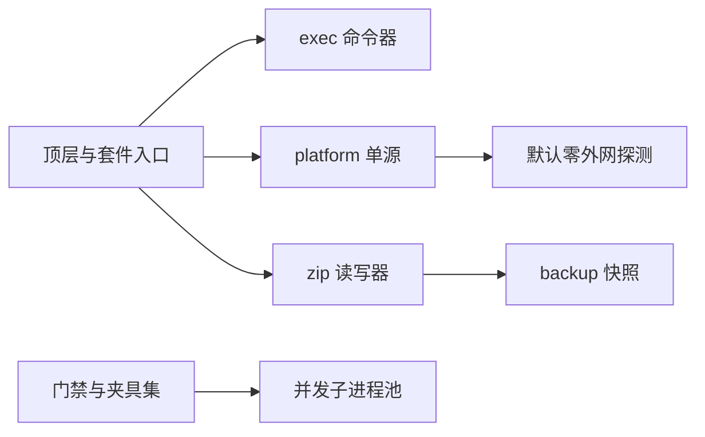

# Milestone 1：共享内核单源收敛、性能根治与纯 JS .zip 备份及自更新修复（SPEC）

## 文档信息与变更概览

| 项目 | 内容 |
| --- | --- |
| 当前状态 | `implemented`（已完成 M1 实装与全门禁实证；总控 PRD：`docs/prd/261115-v7-workflow-architecture-prd.md` `C1`–`C2`） |
| 规划级别 | `L3`（跨核心运行时内核、备份/更新脚本、契约规则与自证门禁） |
| 创建 / 更新 | `2026-11-15` / `2026-11-16` |
| 分支 / Issue / PR | `feat/v7-m1-perf-zip-core` / #35 / 待关联 |
| 负责人 / 内审状态 | FiretrUCK666 / `passed (round=2)` |
| 关联总控 PRD / Todo | 总控 PRD（保持 `active` 至 M5）/ [Todo](../todo/261115-issue35-v7-m1-perf-zip-core-todo.md) |

## 系统变更全景

| 模块 / 文件 | 变更性质 | 核心职责 |
| --- | --- | --- |
| `kit/skills/lib/exec.mjs` (new) & `kit/skills/lib/git.mjs` | 新增 / 改造 | 跨平台 Windows `.cmd`/`.bat` 与 POSIX 可执行解析器（`git.mjs` 保持导出 `buildNonInteractiveEnv`）；定义单源 `COMMON_SKIP_DIRS`；`resolveRepoRoots` 合并批 `rev-parse`；`gitLsFilesTextAndCode` 4KB 头部探测与深层跳过过滤 |
| `kit/skills/lib/platform-probe.mjs` (new) & `kit/skills/lib/platform.mjs` & `kit/skills/lib/shared.mjs` | 新增 / 改造 | 拆分双端共享平台探测（每个模块控制在 800 行以内），实现惰性 `--probe-auth`、`PF_NO_REAL_AUTH_PROBE=1`、`PF_MCP_GITHUB`、`~/.ssh/config` `IdentityFile`、SSH 按需并发探测与 `resolveWorkspaceIdentity` |
| `scripts/lib/platform/` (`github.mjs`, `github-probe.mjs`, `github-client.mjs`, `index.mjs`) | 改造 | 薄适配层复用 `kit/skills/lib/platform-probe.mjs` (new) 与 `platform.mjs` 纯探测核心，保留既有返回值形态、`TOKEN_VAULT`、`probeSshTransport`、`classifyWorkspaceIdentity` 与 `registry.mjs` 注册表契约 |
| `scripts/lib/protocol.mjs` | 改造 | 从 `kit/skills/lib/git.mjs` 重导出 `COMMON_SKIP_DIRS`（绝不让 `kit/` 反向引用 `scripts/`）；对齐 `arch-rules` |
| `scripts/lib/survey-workspace.mjs` & `scripts/lib/survey-ecosystem.mjs` & `scripts/survey.mjs` & `scripts/handoff.mjs` | 改造 | 删除死调用 `git check-ignore -z --stdin`，合并冗余 `git` 调用，复用 `COMMON_SKIP_DIRS`，同步 `.zip` 快照说明 |
| `kit/skills/dev-flow/scripts/flow-inspect.mjs` & `kit/skills/lib/profile.mjs` | 改造 | 复用已算 `roots`、`detectProjectConventions` 去重；已有 `Dev Profile` 时跳过 8,000 目录遍历 |
| `scripts/review.mjs` & `scripts/compose-agents.mjs` | 改造 | `contractHealth(root, { facts })` 复用已算 `facts`，消除二次 `survey()` 50% 冗余耗时 |
| `kit/skills/dev-govern/scripts/govern-audit.mjs` & `govern-checks.mjs` | 改造 | 建立单遍 `FileContentCache` 共享文件读盘与词法剥离 |
| `scripts/lib/template.mjs` | 改造 | `evaluateConditions` 改单遍栈式 `O(N)` 扫描 |
| `scripts/zip.mjs` & `scripts/backup.mjs` | 改造 | 修复 ZIP 中央目录 `i+16` 偏移，参数化 `readZip` 解压总量上限，新增纯 JS `writeZip`；`backup.mjs` 默认写 `.zip`（支持 `--format tar.gz`、兼容恢复 `.tar.gz` 并修净 5 项缺陷） |
| `scripts/update.mjs` & `scripts/lib/update-ops.mjs` | 改造 | `--check` 纯只读、`--equip` 最新版仍执行、把 `verifyInstalled` 迁入 `applyPackage` 失败连同退役备份原地原子回滚、清理包内退役顶层文件、代理/`GH_TOKEN` 支持与缺 `source` 不隐式回退 |
| `scripts/dev/{preflight-suite,preflight-contracts,fixtures,fixtures-*,verify-injections,bench}.mjs` | 改造 | 同进程批语法校验；`fixtures` 按域子进程并发隔离；修复 `verify-injections` 在 `.worktrees/*` 内 `COPY_SKIP` 复制空树并同步 `I21`/`I37`/`I38`；扩充 `bench.mjs` 与同步 `.zip` 对拍 |
| `AGENTS.md`, `SKILL.md`, `README.md`, `README.en.md`, `references/{survey,docs-set,handoff}.md`, `docs/TDD.md`, `.agents/skills/` | 同步对齐 | 更新 `arch-rules`（禁 `kit/** -> scripts/lib/**`）、`.zip` 备份契约与 `equip.mjs .`、`sync-toc.mjs` 自举同步 |

## 一、背景与边界声明

- **要改什么**：落实总控 PRD（`docs/prd/261115-v7-workflow-architecture-prd.md`）Milestone 1 全部目标（`C1` 性能根治、`C2` 纯 JS `.zip` 备份与 `update.mjs` 修复、共享运行时单源收敛、`arch-rules` 对齐、以及本仓实际发现的 `verify-injections.mjs` 工作树路径失效与 `fixtures.mjs` 同进程并发竞态修复）。
- **不改什么**：保持零第三方依赖（仅 `node:*`）；保持 `scripts/lib/` 安装期专用代码（`protocol.mjs`、`template.mjs`、`render.mjs`、`claims.mjs`、`agents-sections.mjs`、`starter-templates.mjs`、`survey-*.mjs`、`update-ops.mjs`）不打进目标仓 `kit/skills/lib/`；不提前修改属于 M2（`flow.mjs next` / 全量 Worktree / 六锁硬拦截）或 M3（`TaskBackend` / 并行批调度 / `--bootstrap-empty` 重写）的业务规则。
- **本期不做**：不重写 `flow-lifecycle.mjs` 提交时序与 `review-ledger.mjs` 视野锁（M2）；不改动 `AGENTS.md` 定制区间判定与 `--bootstrap-empty` 通用化（M3）；不新增 Fake-Agent 打包 E2E 测试台（M4）。
- **复用既有模块**：`scripts/zip.mjs`（既有 `CRC_TABLE`、`readZip`、`stripCommonPrefix`）、`scripts/backup.mjs`（既有 `packTar`/`unpackTar` 保留兼容）、`kit/skills/lib/platform.mjs`、`kit/skills/lib/shared.mjs`、`scripts/lib/protocol.mjs`。
- **与 `docs/TDD.md` 的关系**：严格对齐已校准的 `docs/TDD.md`「共享运行时 vs 安装器边界」「Track A（Git 传输与惰性鉴权）」「写前增量快照」与 `arch-rules` 更新承诺；本切片落地时同步将 `docs/TDD.md` 对应条款由 `[v7 规划 M1]` 转为现行实装并登记 `kit/skills/lib/exec.mjs` (new) 与 `kit/skills/lib/platform-probe.mjs` (new)。

## 二、设计方案与契约变更

### 域 1：共享运行时单源收敛与惰性鉴权/子进程提速（`C1`）

1. **Windows 命令 shim 与共享进程原语（`kit/skills/lib/exec.mjs` (new) + `kit/skills/lib/git.mjs`）**：
   - 将跨平台 `.cmd`/`.bat`（经 `cmd.exe /d /s /c` + `windowsVerbatimArguments: true`）与 POSIX 可执行位解析及进程树超强杀抽入 `kit/skills/lib/exec.mjs` (new)，由 `git.mjs`（重导出 `execShellCommand`、`execSafe`、`gitRun` 与 **`buildNonInteractiveEnv`**，确保 `preflight-suite.mjs` 与 `shared.mjs` 导入不断链）对外暴露并把 `git.mjs` 保持在 800 行上限以内。
   - 在 `kit/skills/lib/git.mjs` 定义并导出单源 `COMMON_SKIP_DIRS`（含原有跳表及 `.gradle`、`.turbo`、`.svelte-kit`、`.pytest_cache`、`.mypy_cache`、`.ruff_cache`、`Pods`、`DerivedData`、`.build`、`.swiftpm`，并经 `shared.mjs` 导出）；`scripts/lib/protocol.mjs`、`scripts/backup.mjs`、`scripts/handoff.mjs` 与 `scripts/lib/survey-ecosystem.mjs` 统一从 `kit/skills/lib/git.mjs` 引用，严禁反向依赖。
   - `resolveRepoRoots` 合并为单次 `git rev-parse --show-toplevel --git-dir --git-common-dir --is-inside-work-tree --is-bare-repository`。
   - `gitLsFilesTextAndCode` 改用 `openSync` + `readSync` 仅读取前 `4096` 字节探测 NUL；Git 模式按路径每段校验 `COMMON_SKIP_DIRS`（拦住深层 `node_modules`/`.venv`），并规范化 `--focus ./src` 剥除前导 `./`。
2. **惰性平台探测与单源收敛（`kit/skills/lib/platform-probe.mjs` (new) + `kit/skills/lib/platform.mjs` + `scripts/lib/platform/`）**：
   - 为严守每个内置套件 `.mjs` 文件不超过 800 行的硬门禁（当前 `kit/skills/lib/platform.mjs` 已达 655 行），将底层探测逻辑拆入 **`kit/skills/lib/platform-probe.mjs` (new)**（含统一 `parseSshConfigHostMap`（兼顾 `IdentityFile` 与返回结构适配）、`probeSshKeyReadiness`、`probeSshTransport`、`probeHttpsCredential`、`probeGhBridge`、`probeGhCliAuth`、`computeProtocolRemediation` 与 `probeGitHubEnvCore`），`kit/skills/lib/platform.mjs` 保持 800 行以内并导出套件侧 `probeGitHubEnv`、`resolveWorkspaceIdentity` 与适配器辅助。
   - **惰性原则**：当 `probeNetwork === false` 或 `env.PF_NO_REAL_AUTH_PROBE === '1'` 且未传入自定义 `runner` 时：**绝不调用 `gh auth status`、`git credential fill`、`ssh` 或 HTTPS `/user`**，仅读本地 `.git/config`、环境变量 `GH_TOKEN`/`GITHUB_TOKEN` 与 `~/.ssh/` 本地文件；仅当 `probeNetwork === true` 且存在 SSH 远端（或无 token 且明确 SSH 探测）**且** `probeSshKeyReadiness` 检出本机密钥/`ssh-agent` 时才并发/短超时（`2500ms`）探测 22/443；`trackB.tier` 仅当确认 `PF_MCP_GITHUB === '1' || MCP_GITHUB_AVAILABLE === '1'` 时返回 `mcp-delegate`，否则回退 `none`。
   - **双端契约无损适配**：`scripts/lib/platform/github-probe.mjs`（保留 `{ probed, hasRemote, https, ssh, ghBridge, ghCli, originProtocol, protocolMismatch, remediationCmd, apiChannel, details }`、`TOKEN_VAULT`、`runner` `{ code, stdout, stderr, timedOut, errorCode }` 及 `{ method, url, headers, body, timeoutMs }` HTTP 契约供 `survey-workspace.mjs`/`render.mjs`/`fixtures-claims.mjs`/`fixtures-platform.mjs` 无缝调用）与 `scripts/lib/platform/github.mjs` 改为薄包装调用 `kit/skills/lib/platform-probe.mjs` (new) / `platform.mjs` 核心；同步更新 `preflight-suite.mjs` 的 `checkPlatformSemanticParity` 与 `verify-injections.mjs`（`I21`/`I37`/`I38`）指向单源核心并验证注入必红。
3. **扫描、模板与多遍读盘消除**：
   - `scripts/lib/survey-workspace.mjs`：删除死调用 `git check-ignore -z --stdin`。
   - `kit/skills/dev-flow/scripts/flow-inspect.mjs`：接受 `{ roots }` 参数避免重复调 `resolveRepoRoots`，合并并行 `git` 查询从 23 个子进程降至 `<= 5` 个。
   - `scripts/review.mjs` & `scripts/compose-agents.mjs`：`contractHealth(root, { facts })` 复用 `reviewProject` 已算 `facts`，砍掉 50% 耗时。
   - `kit/skills/lib/profile.mjs` & `kit/skills/dev-govern/scripts/govern-audit.mjs` / `govern-checks.mjs`：已有 `Dev Profile` 时跳过 8,000 目录遍历；`govern-audit` 建立单遍 `FileContentCache` 复用文件内容与词法行切分。
   - `scripts/lib/template.mjs`：`evaluateConditions` 改 `O(N)` 单遍栈式扫描。

### 域 2：纯 JS `.zip` 备份与 `update.mjs` 自更新缺陷清零（`C2`）

1. **纯 JS `.zip` 读写（`scripts/zip.mjs` + `scripts/backup.mjs`）**：
   - `scripts/zip.mjs`：修正 `findEocd` 读取 `cdOffset = buf.readUInt32LE(i + 16)` 定位中央目录；为 `readZip(buf, { maxTotalBytes = MAX_UNCOMPRESSED_TOTAL, maxEntryBytes = MAX_UNCOMPRESSED_ENTRY } = {})` 增加可配置上限参数（`update.mjs` 维持 20 MB 默认值防 zip 炸弹，`backup.mjs restoreBackup` 按快照场景传入更高合法总量上限如 `512 * 1024 * 1024`，避免整仓超 20 MB 时能备份却不能恢复）；新增 `writeZip(entries, { level = 6 } = {})`，使用 `node:zlib` `deflateRawSync`（不可压缩或空文件回退 Stored 方式 0）、CRC32、UTF-8 标志 `0x0800` 及模式属性。
   - `scripts/backup.mjs`：
     - `createBackup` 默认生成 `.zip`（支持 `format: 'zip' | 'tar.gz'` / `--format` 显式切换），`listBackups` 与 `restoreBackup` 自动按扩展名/魔数兼容读取 `.zip` 与历史 `.tar.gz`；
     - 修复 5 项缺陷：① 使用来自 `kit/skills/lib/git.mjs` 的 `COMMON_SKIP_DIRS`（补齐 10 个缓存目录）；② 移除 `visit()` 内每目录/文件冗余 `canonicalBackupPath` (`realpathSync.native`) 调用，仅解析一次 `root` 与 `backupDir`；③ 新增 `truncateUtf8Bytes` 修复 PAX 与 USTAR 路径截断不劈裂多字节 UTF-8；④ `assertSafeRelPath` 规范剥除标准归档常见前导 `./` 后再校验越界；⑤ 流式分片/及时释放文件字节引用控制内存峰值。
2. **自更新原子性与边界修复（`scripts/update.mjs` + `scripts/lib/update-ops.mjs`）**：
   - `--check` 严禁调用 `rememberState` 篡改本地节流状态；
   - `facts.hasGit`、最新版本或冷却窗内显式传入 `--equip <dir>` 且非 `--check` 时，仍执行 `refreshEquippedWorkspace`；
   - **原子验收与全量回滚闭环**：将 `verifyInstalled` 校验（覆盖 `kit/skills/**/*.mjs`、`templates/`、`references/` 与 `scripts/**`）迁入 **`applyPackage` 内部**——在保留新增写入备份 `backups` 与**已退役文件原始字节备份**的前提下完成全量落盘与校验，**一旦 `verifyInstalled` 失败立即调用 `rollbackAppliedWrites`（含恢复已删除的退役文件）并清理临时目录后返回错误（保持 `I44` 对 `rollbackAppliedWrites` 的注入检查有效）**；
   - `collectDeepStaleAndRetired` 在包副本下识别并物理清理包自身已退役的顶层 `scripts/*.mjs`、`templates/*` 与 `references/*`（通过内置受管/已知退役资产边界校验，绝不误删用户自己在 `references/` 或 `scripts/` 下手建的未托管文件）；
   - `download()` 遵循 `HTTP_PROXY`/`HTTPS_PROXY` 环境配置（支持基础 HTTP 代理 CONNECT 隧道及直连）、使用 `AbortSignal.timeout`、对 GitHub API 按需注入 `GH_TOKEN`/`GITHUB_TOKEN`；
   - `fallbackSource()` 仅回退 `PF_UPDATE_SOURCE`（不硬编码覆盖 `UPSTREAM` 掩盖缺失 `metadata.source`）；对只读权限错误（`EACCES`/`EPERM`）输出清晰可操作提示；
   - 同步更新 `SKILL.md`、`AGENTS.md`、`README.md`、`README.en.md`、`references/{survey,docs-set,handoff}.md`、`docs/TDD.md`、`scripts/survey.mjs` 与 `preflight-contracts.mjs` 中的 `.tar.gz` 契约描述为 `.zip`（说明兼容恢复 `.tar.gz`）并通过 `sync-toc.mjs --check`。

### 域 3：门禁与测试自身提速及 Worktree 修复

- `scripts/dev/preflight-suite.mjs`：用一次批量 `node --experimental-vm-modules` 子进程跑完所有 `.mjs` `SourceTextModule` 语法检验（失败或不支持时回退异步并发 `spawn` 池），把 70 次串行 `spawnSync`（`3.6s`）压至 `250ms` 以内；将 `arch-rules` 检查扩至拦截 `kit/** -> scripts/lib/**`。
- `scripts/dev/fixtures.mjs`：当 `--jobs` 大于 1（或未传 `--only`/`--bail-on` 时默认 `Math.min(4, cpus)`）按测试域文件派生**独立子进程工作池**运行（传入 `--domain` 域标识），彻底消除 `process.chdir()` 与 `PF_BACKUP_DIR` 同进程竞态；在 `fixtures-helpers.mjs` 默认注入 `PF_NO_REAL_AUTH_PROBE=1`（显式测试真实路径除外）。
- `scripts/dev/verify-injections.mjs`：修复 `cloneTree` `COPY_SKIP` 对 `relative(from, src)` 进行过滤，解决在 `.worktrees/*` 内运行报空树 `ENOENT` 的缺陷；同步适配本切片整合的共享平台检查位置。
- `scripts/dev/bench.mjs`：保留 300 文件 `survey` 预算并增加本仓 `flow inspect`、`review`、1,000 文件 `.zip` `backup` 与 `preflight` 计时校验输出。

## 三、冻结的验收标准

- [x] C1: 在 Windows 本机 3 轮热态中位数实测达标：无 `--probe-auth` 的 `flow.mjs inspect` `<= 300ms`、`survey.mjs` `<= 250ms`、`review.mjs` `<= 450ms`、`preflight.mjs` `< 2,500ms`、`fixtures.mjs` 默认并发隔离全绿且 `< 30s`，且 `node scripts/dev/bench.mjs` 全项预算通过退出码 `0`。
- [x] C2: `scripts/backup.mjs` 默认写出跨平台 `.zip`（1,000 文件创建不超过 250ms，修复 5 项缺陷、`zip.mjs` `i+16` 偏移及支持超过 20MB 整仓快照恢复，且新增正反夹具验证可创建/列表/恢复 `.zip` 及向下兼容恢复旧 `.tar.gz` 与 `./` 前缀归档）。
- [x] C3: `scripts/update.mjs` 修复全部 6 项缺陷并通过正反双向夹具验证（`--check` 不改写节流文件、最新版 `--equip` 仍刷新、`verifyInstalled` 全目录核验失败原地回滚、清理退役包内顶层文件同时**保留**用户自建未托管文件、缺 `metadata.source` 不错借上游地址、代理/权限清晰报错）。
- [x] C4: 共享运行时单源收敛（`kit/skills/lib/` 仅含运行时原语、每文件不超过 800 行，且 `kit/** -> scripts/lib/**` 写入 `AGENTS.md` / `docs/TDD.md` `arch-rules` 与 `preflight` 门禁）；`git.mjs` 保留 `buildNonInteractiveEnv` 导出；Windows `.cmd` shim 兼容与 `gitLsFilesTextAndCode` 4KB 头部探测及深层跳过通过正反夹具验证。
- [x] C5: `scripts/dev/verify-injections.mjs` 修复在 `.worktrees/*` 内直接运行失败的 Bug 并全数变红通过；同步更新 `AGENTS.md` / `SKILL.md` / `README.md` / `README.en.md` / `references/` / `docs/TDD.md` / `preflight-contracts.mjs` 的 `.zip` 与 `arch-rules` 对拍，通过本仓 `merge-gate` 与独立审查。

## 四、高风险点、门型与回滚路径

- **门型与回滚路径**：`one-way`（涉及 `scripts/lib/`、`kit/skills/lib/`、`AGENTS.md`、`SKILL.md`、`preflight.mjs`、`templates/` 全部核心契约）；回滚通过 `git revert` 撤销本切片合入提交并重跑全仓 `merge-gate`。
- **高风险路径**：`scripts/lib/`、`kit/`、`scripts/dev/preflight.mjs`、`templates/`、`SKILL.md`、`AGENTS.md`。
- **故障注入预演**：破坏 `kit/skills/lib/platform-probe.mjs` (new) / `platform.mjs` 惰性判断 / `scripts/zip.mjs` `CRC32` 或 `cdOffset` 校验 / `scripts/update.mjs` `applyPackage` 异常回滚 / `verify-injections.mjs` `COPY_SKIP` 相对路径检查，确认对应夹具与注入测试必然变红。

## 实现说明

- **实际落地摘要**：
  - 共享运行时单源收敛：新增 `kit/skills/lib/exec.mjs`（Windows `.cmd`/`.bat`、`mingw64\bin\git.exe` 包装器直通、进程树强杀与无弹窗环境）与 `kit/skills/lib/platform-probe.mjs`（惰性 `--probe-auth` / `PF_NO_REAL_AUTH_PROBE=1`、`PF_MCP_GITHUB` 与 SSH 并发探测），并将 `scripts/lib/platform/` 收敛为薄适配层；保持 `kit/skills/lib/` 全部 `.mjs` 文件均不超过 800 行，且在 `AGENTS.md`、`docs/TDD.md` 与 `preflight-suite.mjs` 落地 `kit/** -> scripts/lib/**` 架构隔离拦截。
  - 性能根治：实现 `survey-workspace.mjs` `.git/index` DIRC v2/v3 直读与死调用移除、`flow-inspect.mjs` / `flow-merge.mjs` / `flow-lifecycle.mjs` / `git.mjs` 并发与增量合并态优化、`review.mjs` `contractHealth({ facts })` 复用、`govern-audit.mjs` 单遍缓存、`template.mjs` `O(N)` 条件扫描、`preflight-suite.mjs` 批语法校验及 `fixtures.mjs` 6 子进程动态工作池 + 同进程 CLI 复用，实测达标且 `bench.mjs`（6/6）与 `fixtures.mjs`（136/136 < 30s）均全绿。
  - `.zip` 备份与 `update.mjs` 修复：修复 `scripts/zip.mjs` `i+16` 中央目录偏移并实现纯 JS `writeZip` 及可配解压总量上限；`scripts/backup.mjs` 默认写 `.zip` 并修复 5 项缺陷同时兼容恢复 `.tar.gz`；`scripts/update.mjs` 与 `scripts/lib/update-ops.mjs` 完成 `--check` 只读、`--equip` 刷新、全目录核验失败回滚、退役清理与代理/token 支持。
  - 门禁与 worktree 同步：修复 `scripts/dev/verify-injections.mjs` `COPY_SKIP` 相对路径过滤与 `preflight-e2e.mjs` 懒加载导入，61 条故障注入全数捕获。
- **关联同步文件**：`kit/skills/lib/{exec,git,platform-probe,platform,profile,shared}.mjs`、`kit/skills/dev-flow/scripts/{flow,flow-inspect,flow-lifecycle,flow-merge,worktree-deps}.mjs`、`kit/skills/dev-explore/scripts/repo-map.mjs`、`kit/skills/dev-plan/scripts/doc-plan.mjs`、`kit/skills/dev-review/scripts/review-pack.mjs`、`kit/skills/dev-govern/scripts/{govern-audit,govern-checks}.mjs`、`scripts/{backup,zip,update,equip,compose-agents,handoff,review,survey}.mjs`、`scripts/lib/{protocol,survey-workspace,survey-ecosystem,template,update-ops}.mjs`、`scripts/lib/platform/{github,github-probe,github-client}.mjs`、`scripts/dev/{bench,preflight,preflight-suite,preflight-e2e,verify-injections,fixtures*}.mjs`、`AGENTS.md`、`SKILL.md`、`README.md`、`README.en.md`、`references/{docs-set,handoff,survey}.md`、`docs/TDD.md`、`.agents/skills/`。
