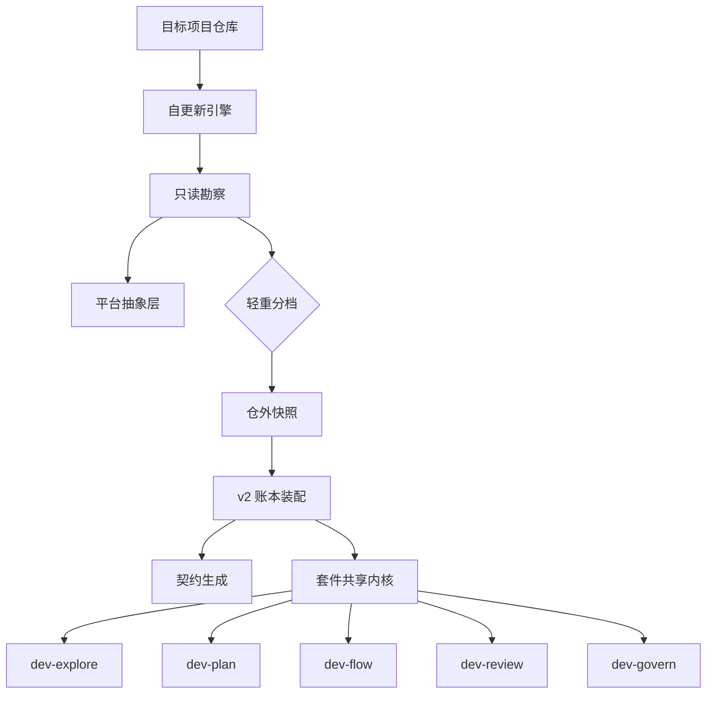

# v6 全域稳健性、渐进装配与平台抽象架构升级规范

## 文档信息与变更概览

| 项目 | 内容 |
| --- | --- |
| 目标版本 | `v6.0.0`（架构升级实施阶段） |
| 当前状态 | `approved`（已通过 Round 2 审查并获人类拍板，进入实施） |
| 规划级别 | `L3`（跨核心引擎、五套技能套件、文档模板与发布链路升级） |
| 门型判定 | `two-way`（版本库分支隔离、仓外快照备份与 manifest 双轨可逆） |
| 创建 / 更新日期 | `2026-11-15` / `2026-11-15` |
| 配套任务单 | [261115-v6-adaptive-governance-upgrade-todo.md](../todo/261115-v6-adaptive-governance-upgrade-todo.md) |
| 目标分支 | `feat/v6-adaptive-governance` |
| 后续实施模型要求 | Swarm 全部子 Agent 与独立审查员统一使用 `gemini-4-hydrogen-xhigh`（Gemini 4 Hydrogen XHigh） |

### 十大问题域根因与改造对照表

| 问题域 | 当前根因与缺口 | v6 架构级解决思路 | 主要落点文件 |
| --- | --- | --- | --- |
| 1. 四层文档与归档 | 3 套模板源分裂；缺 `.gitkeep`；仅归档 Todo 导致 `docs/specs/` 堆积；`do-not-edit` 与 `finalize` 冲突 | 常驻 `.gitkeep`；统一 Frontmatter + 顶部元信息表；`PRD/SPEC/Todo` 成对归档；收敛单一 Profile 解析器 | `templates/`、`kit/skills/dev-plan/scripts/doc-plan.mjs`、`kit/skills/dev-flow/scripts/flow.mjs` |
| 2. TDD 图表与同步 | TDD 缺顶部元信息表；Mermaid 节点长文本易截断；源码改边界缺 TDD 日期联动 | 新增顶部元信息表与技术栈基线表；短标签零截断重绘 + `preflight` 静态门禁；`finalize` 联动校验 | `templates/docs-tdd.md`、`docs/TDD.md`、`scripts/dev/preflight.mjs` |
| 3. README 与 SVG 卡片 | 缺最新包一键下载链接；解压带版本号；未写明自更新节流；SVG 含过时/本仓私有指令 | 安装区加一键 zip 链接与对照表；固定解压前缀 `project-forge/`；写清 1h/24h 机制；同步 6 张 SVG | `README.md`、`README.en.md`、`.github/workflows/release.yml`、`assets/readme/` |
| 4. 工具自更新原子性 | 按 zip 顺序先覆盖 `SKILL.md`，中断即卡死版本；仅扫 1 层退役文件；离线每次等 20s | 同盘 staging 校验、先旧备份再写业务文件、最后原子换 `SKILL.md`；全深度清退役；加 15m 失败冷却 | `scripts/update.mjs` |
| 5. 两档装配与定制墓碑 | 无轻重分档；删掉的技能下次强行恢复；改过的文件致 `equip --check` 永远失败 | `lightweight` / `full` 无损升档；manifest v2 记删除墓碑与定制豁免；修复基线收敛死锁 | `scripts/equip.mjs`、`scripts/compose-agents.mjs`、`scripts/backup.mjs` |
| 6. 远端与多协议向导 | 无远端不探本机凭据；无 SSH/PAT 分步指引；SSH 别名判成非 GitHub；`accept-new` 写盘 | 无远端只读探 CLI/凭据；解析 `~/.ssh/config` 别名；补 3 路建仓与 SSH/HTTPS/gh 实操向导 | `scripts/survey.mjs`、`scripts/lib/platform/github.mjs`、`references/remote-github.md` |
| 7. 发版菜单与工作流 | `has-release` 恒真；无策略选择器；Keep a Changelog 不带 `v` 必红；模板缺版本门禁 | 5 选 1 发版策略；兼容带/不带 `v` 标题；默认零额外 Secret、按需指引最小 `RELEASE_TOKEN` | `scripts/compose-agents.mjs`、`templates/ci-release.yml`、`references/publish.md` |
| 8. 平台抽象与多远端 | 平台词锁死 `github.com`；`kit` 另写一套分叉实现；不支持多远端拓扑 | 新增 `HostingProvider` 注册契约与多远端拓扑（产品层仅注 `github`），未识别主机退化 `generic-git` | `scripts/lib/platform/registry.mjs` (new)、`scripts/lib/platform/index.mjs`、`kit/skills/lib/` |
| 9. 五套技能通用优化 | `maxDepth=4` 漏深层包；4 套解析器分裂；`review-{taskId}` 空 diff；强迫手传 `--task` | Git `-z` + NUL 嗅探；`Dev Profile` 尊重 `none`；正交内核拆分；自动推断上下文与流转同步 | `kit/skills/lib/`、`kit/skills/dev-explore/`、`dev-plan`、`dev-flow`、`dev-review`、`dev-govern` |
| 10. 存量融合与交棒 | 双轨文档；`adr` 目录误判；`handoff` 误报 Junction 与 manifest 痕迹；缺 Java 起步 | 登记既有架构文档；修复 `handoff` 跳过 `.worktrees`/manifest；去除宿主私有目录名；补 Java 起步 | `scripts/survey.mjs`、`scripts/handoff.mjs`、`scripts/review.mjs`、`scripts/equip.mjs` |

## 一、背景与边界声明

- **优化定位**：v6 不是推倒重来，而是在完整保留 v5 五态身份、三档隔离、可撤回边界、双门独立审查、六锁停损、外部 PR 投毒拦截、门禁弱化退出码 `4`、园艺信号满 2 次下沉形式规则与跨版本 `release-prep` 等核心机制的前提下，消除脆弱假设、跨模块分叉与人工堆补丁。
- **复用既有模块**：
  - `scripts/lib/protocol.mjs`（标记语法、预算与包边界单一真相源）
  - `scripts/lib/template.mjs`（模板条件与占位变量求值）
  - `scripts/lib/render.mjs`（勘察报告与行动导航渲染）
  - `scripts/lib/claims.mjs`（生成契约真实性回查）
  - `scripts/backup.mjs`（纯 `node:zlib` 仓外 `.tar.gz` 增量快照引擎）
  - `kit/skills/lib/shared.mjs`（内置套件共享工具出口）

## 本期不做

- 保持纯 Node 18+ 内置模块（`node:*`）零第三方运行时依赖，不引入编译构建流程。
- 当前产品层不接入具体非 GitHub 托管平台的 REST/GraphQL 实现代码，严格保持包层零平台越界词；仅完成抽象接口、多远端数据模型与 `generic-git` 安全降级，为后续增量挂接新平台适配器留好扩展槽。
- 不由 AI 擅自替用户选定开源许可证、仓库可见性、跨版本升级号、发版触发或历史强推。

## 二、设计方案与契约变更

### 域 1：四层工程文档单一模板源与成对归档流程

1. **常驻活跃目录结构**：在仓库根目录与目标项目初始化时，为 `docs/prd/.gitkeep`、`docs/specs/.gitkeep`、`docs/todo/.gitkeep` 与归档目录 `docs/archive/prd/`（按需创建）建立结构约定，确保空目录下仓库目录树可见。
2. **单一模板源与双层结构统一**：
   - `templates/docs-prd.md`、`templates/docs-spec.md`、`templates/docs-todo.md` 作为权威模板，统一包含「YAML Frontmatter + 一级标题下可见元信息概览表 + 核心内容节」；`templates/docs-spec.md` 额外包含「系统变更全景（Mermaid 短标签图）与模块改造对照表」。
   - 让 `kit/skills/dev-plan/scripts/doc-plan.mjs` 与 `kit/skills/dev-govern/scripts/govern-audit.mjs`（`--write-todo` 中的 `buildPlan`）共用统一文档模板生成器，消除当前 `templates/docs-*.md`、`doc-plan.mjs`（`renderSingleDocContent`）与 `govern-audit.mjs`（`buildPlan`）三套内容互不相认的分裂，并由 `scripts/dev/preflight.mjs` 校验字段与标题一致。
3. **成对归档与生命周期联动**：
   - 调整 `kit/skills/dev-flow/scripts/flow.mjs`（`handleFinalize`）、`kit/skills/lib/shared.mjs`（`syncDocsLifecycle`）与 `kit/skills/dev-plan/scripts/doc-plan.mjs`：功能通过验证且常青设计已同步写入 `docs/TDD.md` 后，关联的 `PRD`（`done`）、`SPEC`（`implemented`）与 `Todo`（`done` / `archived`）一并由 `git mv` 成对归档至对应 `docs/archive/prd/`、`docs/archive/specs/` 与 `docs/archive/todo/` 归档子目录，并自动重算三者 Frontmatter 中的 `related_*` 相对路径与正文链接。
   - `doc-plan.mjs` 增加 `archive {slug-or-path}` 与 `supersede {oldSpec} --by {newSpec}` 命令；`scanActiveContracts` 排除已移入归档的文档，只以未归档活跃契约与 `docs/TDD.md` 作为冲突基准。
   - 修复当前 `doc-plan.mjs` 的四项阻塞缺陷：① `approveSpec` 不再向 Todo Frontmatter 写入不在枚举中的 `status: approved`（改用布尔字段 `approved: true` 并保持 `status: active`）；② `stripCritiqueMeta` 同步剔除 `issue`、`pr`、`status`、`related_*`、`updated`，使 `link --issue` 不再误触发 `BLOCKED_CRITIQUE_STALE`；③ `auditDoc` 先做两遍路径收集（收集全篇 `(new)` 声明后再校验路径引用）且不提前删掉注释致使 `fill` 检查变死代码，同时放过中文 slug 与泛型语法；④ 修复 `syncDocsLifecycle` 在 `newBase` 包含 `oldBase` 时的嵌套重复替换损坏。
   - 修复 `do-not-edit: docs/archive/` 与 `flow.mjs finalize` 的自相冲突（区分人工禁改静态产物与工具自动归档入口），并修复 `kit/skills/dev-review/scripts/review-pack.mjs` 拼接 `docs/archive//` 双斜杠导致前缀匹配永远落空的漏洞。

### 域 2：`docs/TDD.md` 顶部元信息表、防截断图表与持续校准

1. **顶部元信息表格与技术基线**：在 `templates/docs-tdd.md`、`docs/TDD.md` 与 `scripts/equip.mjs`（`starterTdd` 起步模板）一级标题下方统一新增 `## 文档信息` 表格（包含：文档版本、编制日期、最近更新日期、基线依据、运行环境与生态栈、托管平台适配范围、关联工程契约）及精简的技术选型/运行时约束表格，使人与 AI 打开即见核心边界。
2. **Mermaid 防截断与可读性规范（实证硬阈值 + 随包双端门禁）**：
   - 依据真实渲染器盒宽实测，确立统一规范：**图只画拓扑短名，表写路径与职责**——重绘 `docs/TDD.md`、`templates/docs-tdd.md` 与 `docs/specs/` 内所有 Mermaid 图，禁止在节点中使用 HTML 换行标签或在转换箭头上写长句；
   - **纯字符显示宽度硬上限**（全角/汉字计 `2` 单位、半角 ASCII 计 `1` 单位）：普通矩形节点与分组标题单行不超过 `16` 单位（即不超过 8 个汉字或 16 个英文字符），菱形判断节点单行不超过 `12` 单位（不超过 6 个汉字），边标签不超过 `12` 单位；
   - **双端静态门禁下沉**：在 `kit/skills/lib/docs.mjs` (new) 实现统一的 Mermaid 节点与边标签宽度检测函数，接入 `doc-plan.mjs audit`、`review-pack.mjs` 与 `govern-audit.mjs`（随包分发至所有被治理项目的 `.agents/skills/`），同时在 `scripts/dev/preflight.mjs` 强制校验，确保本仓与外部被治理项目日常写文档同样永久不触发截断。
3. **随迭代持续保鲜**：`flow.mjs finalize` 在改动涉及顶层源码模块目录边界、对外 CLI 或共享契约时，核对 `docs/TDD.md` 是否在本次分支同步更新了最近更新日期与对应模块表。

### 域 3：双语 `README` 一键下载、自更新说明与 6 张 SVG 卡片同步

1. **固定解压目录名**：修改 `.github/workflows/release.yml` 中 `git archive` 参数，将 `--prefix="project-forge-${VERSION}/"` 改为固定 `--prefix="project-forge/"`，确保用户下载解压后目录名天然与 `SKILL.md` 的 `name: project-forge` 一致，不因版本号后缀被宿主静默忽略。
2. **重构双语 `README.md` 与 `README.en.md`（精简、`oil-tone`、无 AI 味）**：
   - 在「安装与上手」节首部提供直接点击下载最新正式版链接 `https://github.com/FiretrUCK666/project-forge/releases/latest/download/project-forge.zip` 与 Releases 页面链接，并给出放置到宿主全局技能目录的明确说明（保持目录名 `project-forge`，无需注册重启）。
   - 用一张紧凑对照表对比「下载 Release 压缩包（无 `.git`，自动检查更新）」与「`git clone` 仓库（带 `.git`，工具只读、手动 `git pull`）」的区别。
   - 紧接安装方式写清自更新机制：`update.mjs --quiet` 每次前置检查，内置 1 小时联网节流与 24 小时替换冷却；断网自动静默跳过；`node scripts/update.mjs --check` 立即核对；`PF_NO_UPDATE=1` 彻底禁用；`PF_UPDATE_SOURCE` 指定镜像或分支源。
   - 补充「两档装配（`lightweight` / `full`）」简介，同步 6 项或精简后的目录锚点并通过 `scripts/sync-toc.mjs` 校验，保持整体篇幅紧凑不堆砌空话。
3. **同步 6 张双语 SVG 门面图**：更新 `assets/readme/hero.svg`、`assets/readme/hero-en.svg`、`assets/readme/workflow.svg`、`assets/readme/workflow-en.svg`、`assets/readme/architecture.svg`、`assets/readme/architecture-en.svg`：
   - 修正页脚文档目录标记：由 `docs/{prd,spec,todo}` 改为 `docs/TDD.md  ·  docs/{prd,specs,todo}`；
   - 修正 `architecture.svg` 与 `architecture-en.svg` 右侧 `TEST` 证据栏中对目标项目无效的本仓内部脚本名（`preflight.mjs · fixtures.mjs`），改为目标项目通用的实证契约名（`flow.mjs verify  ·  quick-test`）；
   - 若涉及工作流或档位示意微调，严格保留浅深色安全卡片（`#F5F3EE`/`#172033`）、字号不少于 `16`、无截断溢出、无禁词并通过 `preflight.mjs` SVG 安全门禁。

### 域 4：`scripts/update.mjs` 整包原子更新与断网降噪

1. **先备后落、先数据后版本标**：重设计 `applyPackage`（位于 `scripts/update.mjs`）：
   - 下载并校验 `project-forge.zip` 后，先在同盘临时 staging 目录解包，逐项核验 `SKILL.md`、`references/`、`templates/`、`scripts/`、`kit/` 完整性及 `SKILL.md` 版本号一致性；
   - 通过后先写入业务脚本、模板、参考文档与 `kit/`（写前记录旧版备份用于失败原地恢复），**将 `SKILL.md` 作为最后一个写入的文件**；确保即使中途遇到 Windows 文件锁（`EPERM`/`EBUSY`）或进程中断，只要其余文件未完成替换，`SKILL.md` 仍保留旧版本号，下次启动仍会继续完成更新，杜绝半新半旧死锁。
2. **全深度退役清理与环境隔离**：
   - 将退役清理扫描从顶层目录扩展至 `kit/skills/` 与 `scripts/lib/` 全部子路径（严格比对新旧包清单），彻底清除旧版下沉进目标项目 `.agents/skills/` 的幽灵路径。
   - 新增离线失败短冷却 `FAILURE_COOLDOWN_MS`（15 分钟）记录至状态文件 `lastFailAt`，防止离线用户每次触发卡死 20 秒超时；`readState` 校验时间戳不超过当前墙钟时间，若出现未来异常时间戳自动重置该字段；在 POSIX 与 Windows 下将状态文件放入用户专属缓存目录（如受限再回退 `os.tmpdir()`），降低共享临时目录冲突风险。
   - 明确移除更新成功后对 `process.cwd()` 隐式调用旧内存版 `equip` 的越界副作用（遵守 S1 勘察前零写入原则；更新完成后由 S3 统一用磁盘新版 `equip.mjs` 执行）。

### 域 5：两档渐进装配（`lightweight` / `full`）与 `.pf-manifest.json` 墓碑/定制豁免

1. **两档渐进装配与无损升档**：
   - 在 `scripts/survey.mjs`、`scripts/equip.mjs` 与 `scripts/compose-agents.mjs` 中引入 `--tier lightweight|full` 机制（由 `survey` 按仓库规模、是否有协作/CI 需求给出推荐档位并由用户确认，未指定时存量或个人小仓推荐 `lightweight` 减少侵入，大型或团队协作仓推荐 `full`）：
     - `lightweight` 档：Git 基线（`.gitattributes`/`.gitignore`）、紧凑版 `AGENTS.md`（控制目标字节在 14KB 以内，只含核心工程红线、7 键 `Dev Profile` 与已装配技能路由）、代码仓 `docs/TDD.md`、精简 `dev-flow` + 核心规划流转技能；
     - `full` 档：全套 5 个内置研发技能、完整协作/审校/发版模板与 CI 骨架。
   - 以后随时重跑 `equip.mjs --tier full` 或完整治理时，自动读取现有 `.pf-manifest.json` 档位无损补齐缺项，保留已有的手改规则与自定义技能。
2. **`.pf-manifest.json` `schemaVersion: 2`（删除墓碑 + 定制豁免）**：
   - 向下兼容读取 `schemaVersion: 1`，升级写入 `schemaVersion: 2`（本格式作为跨脚本冻结契约），结构新增：`tier`（`'lightweight' | 'full'`）、`disabledSkills`（用户主动删除整套技能目录名数组）、`removedFiles`（用户手动删掉的单个受管文件对象映射）、`customizedFiles`（用户定制修改并经确认豁免的托管文件，含 `adoptedAt`、`baseSha256`、`upstreamSha256`）、`removedAgentsRegions`（用户有意从 `AGENTS.md` 删除的区间 id）；同时在 `scripts/lib/protocol.mjs` `TEMPLATE_CONDITIONS` 冻结 `is-lightweight` 与 `is-full` 条件标记供模板求值。
   - **永不擅自恢复用户已删资产**：当此前已记录在 `files` 中的某个技能目录或文件在磁盘上消失时，判定为用户主动删减并移入 `disabledSkills` / `removedFiles` 墓碑（若要找回，必须显式传入 `--restore [skillOrFile]`）；同时 `compose-agents.mjs` 依据 `disabledSkills` 与 `removedAgentsRegions` 从意图路由表剔除已禁用技能、且不强行插回被用户删除的区间。
   - **定制文件 `--check` 绿灯与升级提示**：用户在 `.agents/skills/` 内修改托管脚本或文档时，不再让 `equip.mjs --check` 永久报错阻断交付；提供 `equip.mjs --adopt-custom`（或配置交互确认）将定制哈希登记至 `customizedFiles`，此后 `--check` 退出码返回 `0` 并以提示信息标出「该定制文件在上游新版中是否有变化（可供参考合并）」。
   - **修复基线死锁与初始快照保护**：`equip.mjs` 在已追踪文件满足 `diskHash === src.sha256` 时直接收养最新哈希（消除中断/合并造成的永久冲突）；`compose-agents.mjs` 在缺少 `agentsRegions` 基线时对既有段落默认采取 `protect` 而非覆盖；`scripts/backup.mjs` 在滚动淘汰 `DEFAULT_MAX_KEEP = 5` 时永久钉住最新一份标签为 `pre-forge` 的基线快照不被挤出。

### 域 6：远端拓扑、多协议鉴权探测与分步向导

1. **无远端探测与防写盘修复（`scripts/lib/platform/github.mjs` & `scripts/survey.mjs`）**：
   - 去掉 `survey.mjs` 仅在有远端时才调用 `probeGitHubEnv` 的限制：只要传 `--probe-auth`（含空仓/新建仓未挂远端），同样只读探测本机 `gh auth status`、SSH 密钥就绪度、以及 `git credential` / 环境变量 Token 是否可用，用于引导建仓与首推。
   - 消除 SSH 探测的 `StrictHostKeyChecking=accept-new` 写 `~/.ssh/known_hosts` 副作用，改为先检查私钥/ssh-agent（`ssh-add -l` 与 `~/.ssh/id_*`）并显式使用 `StrictHostKeyChecking=yes` 探测（未收录主机指纹则只报指纹提示命令而不擅自写盘）。
   - 补充可配置轻量 Token 验活（并发 GET 用户元信息只取 status 与 login，令牌仍严格锁在 `WeakMap` 内存），淘汰已过期 Token 冒充可用的假绿；只有确认宿主具备对应能力时才给出 `mcp-delegate`。
   - **SSH 多账号别名映射**：只读解析 `~/.ssh/config` 中的 `Host` -> `HostName` 块，将 `git@github-work:owner/repo.git` 准确识别为主机地址（与 `github.com` 同等进入 `maintainer`/`contributor-fork` 判定），解决文档推荐多账号别名却被代码误判为 `undetermined` 的自相矛盾。
2. **远端决策与缺凭据分步向导（`references/remote-github.md` & `scripts/lib/render.mjs`）**：
   - 将远端建仓与认证缺失纳入 `survey` 交互决策树（询问：暂不配远端写 `.git/pf-local-mode` / 使用已有远端 / 创建新仓库并选择默认 `private` 或 `public` 与个人/组织归属）。
   - 当探测到缺少凭据（`no-key` 且无 `gh` 登录且无 PAT）时，按用户偏好协议输出分步可复制指令：① `gh CLI` 路线（安装后 `gh auth login` -> `gh auth setup-git` -> `gh repo create`）；② `SSH Ed25519` 路线（`ssh-keygen -t ed25519 -C "..."` -> 复制公钥写入 GitHub SSH Keys -> `ssh -T git@github.com` 校验 -> `git remote add origin`）；③ `HTTPS + Fine-grained PAT + GCM` 路线（勾选最小权限 `Contents` / `Pull requests` -> 配置凭据管理器，严禁将令牌写入 `.git/config` URL）。
   - 覆盖 GitHub 仓库治理解读：自动检测 `delete_branch_on_merge` 与人工 7 步删分支的冲突提示；说明 Rulesets / Branch Protection 中 Required Check 名字与 `ci-check.yml` `jobs.{jobId}.name` 逐字对齐的做法；按项目人数/协作形态提示可选 `CODEOWNERS`、Dependabot 与基础标签清单。

### 域 7：发版流水线 5 选 1 策略与 `RELEASE_TOKEN` / `CHANGELOG` 修复

1. **修复误注入与拆分探测口径**：
   - 修复 `scripts/compose-agents.mjs` 中 `has-release` 因 `conventions.releaseNotesMode !== undefined` 永远为真的缺陷：纯本地个人工具或不发版仓不再被强制注入发版章程。
   - 在 `scripts/survey.mjs` 中将 `ci-workflows` 拆分为检查流（`ci-check`）与发布流（`ci-release`）两项独立判断，扩展 `hasRelease` 识别 `softprops/action-gh-release`、`goreleaser`、`release-please-action`、`changesets/action`、`semantic-release`。
2. **五选一发版策略菜单与按需 Token 向导（`references/publish.md` & `references/remote-github.md`）**：
   - 建制或重入询问用户发版策略：
     1. **不配置发版流水线**（纯内部/实验项目）；
     2. **沿用已有工具**（识别到 `.changeset/`、`release-please-config.json`、`.releaserc*`、`goreleaser` 时直接 `preserve`，并在 `AGENTS.md` 对齐该工具实际流转）；
     3. **纯手动发版**（按需人工执行 `gh release create`）；
     4. **Tag 触发自动发布页（零额外 Secret 默认路线）**：由 `templates/ci-release.yml` 监听标签并读取默认分支 `docs/release-notes/` 或 `CHANGELOG.md`，默认直接使用工作流内置 `GITHUB_TOKEN` + `permissions: contents: write`，无需用户额外创建个人密钥；
     5. **联动下游或推送包仓库（按需增强路线）**：仅当需要发版后连锁触发其他 CI 工作流、向受保护分支回写或发布至 npm/PyPI 等制品库时，才分步引导配置最小权限 Fine-grained PAT（存入仓库 Settings 的 Secrets 中作为 `RELEASE_TOKEN`）或各生态官方 Trusted Publishing（OIDC，免长期静态 Secret）。
3. **修复 `templates/ci-release.yml` 与 `.github/workflows/release.yml`**：
   - `CHANGELOG.md` 截取逻辑兼容 `## [v1.2.3]` 与 Keep a Changelog 常见 `## [1.2.3]` 两种标题格式；
   - `templates/ci-release.yml` 补齐与生态清单一致的单源版本号对齐门禁，并对 `workflow_dispatch` 空输入 `tag` 给出明确报错而非拼接出默认分支名导致假报错；
   - 在工作流发布页写入步骤中显式检查若 `secrets.RELEASE_TOKEN` 存在但认证过期（401），直接给出刷新 Secret 的报错指引；对齐 `references/remote-github.md` 中关于模板是否附带上传附件步骤的表述。

### 域 8：面向多平台的 `HostingProvider` 抽象架构与多远端拓扑

1. **中性平台注册契约**：新建 `scripts/lib/platform/registry.mjs` (new)，并在 `scripts/lib/platform/index.mjs` 定义与平台解耦的标准契约：
   - `HostingProvider` 接口声明：`id`、`matchRemote(remoteUrl, sshHostMap)`、`normalizeRepo(remoteUrl)`、`probeTransport(ctx)`、`probeAuth(ctx)`、`classifyIdentity(facts)`、`createClient(authCtx)` 与能力集标记 `capabilities: { api, pr, issues, releases, labels }`。
   - 通用多远端拓扑模型：支持 `remotes[]` 列表（`name`、`fetchUrl`、`pushUrl`、`providerId`、`repoSlug`、`isUpstream`），兼容 `0` 远端（`local-only`）、单远端、Fork（`origin` + `upstream`）以及多远端镜像推送场景，不再把远端名称写死为 `'origin'`。
2. **本期产品层平台边界与安全降级**：
   - 本期在产品层注册表中**仅注册 `github` 适配器**（确保 `scripts/lib/protocol.mjs` 中的 `FORBIDDEN_PLATFORM_RE` 门禁继续全绿），同时消除 `kit/skills/lib/` 与 `scripts/lib/platform/github.mjs` 两份实现分叉（通过单源共享或 `preflight.mjs` 强一致校验对齐两端的 `ssh.login`、协议探测、`--hostname` 与本地标志模式）。
   - 对于任何未匹配已注册 Provider 的其他远端地址或自建 Git 服务器，自动退化为内置 `generic-git` 基础能力：本地分支、三档 Worktree 隔离、测试门禁、双门独立审查、`push` 与本地合流指令完整可用（仅跳过对应平台的远端 REST API 自动化），不再误判为 `undetermined` 后卡死整个研发流转。

### 域 9：五套内置技能（`kit/skills/`）通用化与互调流转优化

在完整保留五套技能原有全部设计精华与红线规则的基础上，通过通用第一性原理重构彻底根治脆弱点、跨语言盲区与互调断层（避免按语言叠补丁）：

1. **共享正交内核拆分与消除重复实现（`kit/skills/lib/` 与子模块拆分）**：
   - 保留 `kit/skills/lib/shared.mjs` 作为统一对外兼容出口，内部拆分为高内聚、零循环依赖的小模块（均保持纯 `node:*`、每个 `.mjs` 文件控制在 800 行以内、零 `>1500` 行神文件高危告警）；同时按 `release-prep-lib.mjs` 模式将 `dev-flow`（`1939` 行）、`dev-review`（`1896` 行）与 `dev-govern`（`3081` 行）的内部逻辑拆分为各自 `scripts/` 目录下的同级职责子模块（如命令处理、双门评估与各维审计器）：
     - `kit/skills/lib/cli.mjs` (new)：统一标准 CLI 解析器与错误帮助 formatter；
     - `kit/skills/lib/git.mjs` (new)：基于 `-z`（NUL 分隔）与 `git worktree list --porcelain` 的跨平台安全 Git 封装、`samePath()`（Win32 大小写归一）、`MERGE_HEAD`/`REBASE_HEAD`/`CHERRY_PICK_HEAD` 冲突态检测、unborn `HEAD` 与浅克隆检测、`execShellCommand` 进程树超时强杀（Windows `taskkill /T /F`，POSIX 进程组 `-pid`）；
     - `kit/skills/lib/profile.mjs` (new)：唯一权威的 `AGENTS.md` 解析器（支持 YAML 单行/多行、`[a, b]`、`## 高风险路径` 表格、`readDecisions`、「取舍」读出与**严格把显式填写的 `none` 视作合法禁用态绝不回退覆盖**）及动态多模块清单发现（替代 4 套重复实现的 `parseDevProfile` / `parseAgentsProfile`）；
     - `kit/skills/lib/static-gates.mjs` (new)：统一 `detectGateWeakening`、`evaluateArchRules`、`classifyDoorType`、`UI_VISUAL_EXT_RE` 与结构卫生扫描，修复 `flow` 与 `review-pack` 两套判据口径不一的问题；
     - `kit/skills/lib/ledger.mjs` (new)：统一 `.worktrees/.state/tasks/{taskId}.json` 原子读写、并发序号防碰撞 `writeAtomic` 与零记忆上下文自动推断 `resolveTaskId`；
     - `kit/skills/lib/docs.mjs` (new)：统一 Frontmatter、中文与 ASCII 一致的 `slugify`/`DOC_STANDARD_NAME_RE`（修复中文 slug 被重复拼接日期前缀损坏文件名的问题）、`parseCoupledSyncRules`/`evaluateCoupledSync`、时区一致日期与互链同步；
     - `kit/skills/lib/platform.mjs` (new)：与主引擎 `scripts/lib/platform/` 判定语义 100% 对齐的远端能力与五态判定客户端。
2. **跨语言通用拓扑与命令发现（无需针对具体语言硬打补丁）**：
   - `kit/skills/dev-explore/scripts/repo-map.mjs` 废除 `maxDepth = 4` 与写死的语言扩展名过滤：Git 仓库改用 `git ls-files -z --cached --others --exclude-standard` 扫描（天然遵守各级 `.gitignore`、任意包嵌套深度一次扫全、零编码截断），非 Git 目录才回退深度流式遍历，并用文件前 4KB NUL 字节探测区分文本源码与二进制文件——由此无需硬编码后缀即可自动覆盖 Java/Kotlin 深层包目录、C#、C++、Swift、Monorepo 以及前后端分离布局。
   - 多生态与多模块自动发现优先从包清单文件位置（根与子目录清单）、通用任务入口（`Makefile`、`justfile`、`Taskfile.yml`、`package.json`、`mvnw`/`gradlew` 等包装脚本）和 CI 工作流提取命令（保留 `working-directory:` 与多行 `run: |` 控制流语义，不拿 `&&` 强拼 `if/for`），在运行期统一以 `AGENTS.md`（及子目录 `AGENTS.md`）`Dev Profile` 为唯一执行权威；纯文档仓配为 `none` 时正常通过门禁不再卡死。
3. **打通五套技能数据契约与 Worktree/审查流转**：
   - **修复 Tier 2 审查槽空 Diff 断链**：取消 `flow start` 在 `baseSha` 预检出一个永远停留在旧提交且无依赖的空壳 `.worktrees/review-{taskId}`；改为 `flow submit` 与 `review-pack` 在隔离审查时自动将干净的 `review-{taskId}` 同步检出至待审分支最新 `HEAD`（若脏则阻断报错并提示），并按需安全挂载共享依赖，彻底消灭 `baseSha...baseSha` 空 Diff 假审。
   - **消除 `doc-plan` 与 `flow start` 互踩**：`doc-plan init --task` 若识别到任务已有 `worktreePath` 直接写进实施工作树；`flow start` 在 Tier 2 分支保留既有账本中的 `prdFile` / `specFile` / `todoFile` 不覆写为 `null`，并将主仓中未提交的匹配规划文档同步迁入实施 worktree，同时兼容 `contributor-fork` 私有文档在账本中的路径读取。
   - **状态机完备与停损解锁**：`flow merge` 强制校验 `reviewPassed === true && reviewPassedHead === currentHead && lastReview?.headSha === currentHead && !lastReview?.stopLossTriggered` 且工作区干净（修复改代码后仅跑 `verify` 即合入未审提交的漏洞）；`review-pack` 在 `verdict: 'changes'` 时重置 `reviewPassedHead: null` 并新增人类裁决解锁入口（或配合 `flow merge --human-approved --reason`）在触发 `STOP_LOSS_ESCALATE` 后允许人类明确拍板继续合并；`review-pack record` 显式追踪条目状态为 `rebutted`/`resolved` 并支持记录 `--visual-checked`；`flow.mjs` 新增 `status`（零参数汇报当前唯一合法下一步）与 `abort`（安全放弃并可清理未合并分支），`cleanup` 复用 `git cherry` + `git patch-id` 四态判定完美兼容 Squash/Rebase 合并后的分支删除；修复 `findMatchingDoc` 短 slug 子串误匹配历史文档的问题。
   - **Workspace 安全共享依赖（`kit/skills/dev-flow/scripts/worktree-deps.mjs`）**：由全局一刀切比对升级为按子包/包管理器根独立比对；解析 `pnpm-workspace.yaml`、`package.json` `workspaces` 与子目录包布局；当探测到 Workspace 本地包软链指向主仓或 Python 可编辑安装（`.venv` 内含指回主仓的路径或 `.pth`）时，自动拒绝共享该路径并切换为局部隔离兼给出原因说明，绝不静默跑主仓旧代码；加入 `samePath(mainAbs, wtAbs)` 自保护与失败回滚。
4. **静态门禁准确性与存量零噪音治理（`dev-review` & `dev-govern`）**：
   - 修复 `review-pack.mjs` `cli-options` vs `cli-surface` 类型笔误与 `scanUntrustedDiff` 中 `continue` 导致工作流弱化门禁规则成死代码的漏洞；重构词法剥离器识别多语言字符串、docstring、Rust 生命周期与 C 宏指令，彻底修复 `#define TEMP` / Rust `'a` / `it.skip` 统计误报；将硬阻断门禁收敛为跨语言 100% 确定性不变量（删测试文件、CI 放宽权限或 `continue-on-error`、`|| true`、篡改 `Dev Profile`、`HEAD` 失配、未解决冲突标记），对非完整解析语言的断言删除改为高置信提示，避免参数化测试重构误触发退出码 `3`。
   - `review-pack --json` 默认返回 diff 元数据与 hunk 索引摘要（仅传 `--include-diff` 时内嵌全文），防止大补丁撑爆上下文。
   - `govern-audit` 增加基线快照（`govern-baseline.json`，存于 `.worktrees/.state/`）与 `--changed` 增量审计模式，老项目接管只拦截新增或恶化项（传 `--all` 可看全量）；去除测试文件名正则中对本仓自用文件名（如 `preflight`/`fixtures`）的误判；补全无 CI 时的非 GitHub CI（如 `.gitlab-ci.yml`、Jenkins、CircleCI 等构建配置存在性）中性识别；修复 `govern-audit` 在 worktree 内运行把状态写进子工作树的问题。
5. **弱模型友好的一致性 CLI 与动态技能感知**：
   - 五套脚本全部通过 `kit/skills/lib/cli.mjs` (new) 统一参数约定：同时兼容位置目标目录、`--dir`、`--repo` 与 `--key=value`，未知选项立刻报错并给出正确示例而不吞噬后续参数；所有子命令均支持自动从当前工作树、分支名或唯一活跃账本推断 `--task` 与下一 `--round`（存在多个活跃任务时列出可选指令列表）。
   - `[NEXT STEP]` 与引导提示在输出前现场探测目标项目中实际存在哪些 `.agents/skills/` 技能（兼容 `lightweight` 档与用户删减场景），缺失兄弟技能时降级输出纯 Git/人工可执行指引，绝不指路到不存在的脚本。

### 域 10：存量异构仓库融合与交棒加固

1. **异构设计文档映射识别（`scripts/survey.mjs` & `scripts/review.mjs` & `kit/skills/dev-govern/`）**：
   - 探测已有架构与设计文档（如根级或 `docs/` 下的 `ARCHITECTURE.md`、`*-TDD.md`、`docs/{design,architecture,adr}/`），支持通过已有规范映射融合（`preserve` 或在 `AGENTS.md` `## 取舍` 记录权威入口），避免强行生成双轨重复设计文档。
   - 三处统一复用 `readDecisions`（移除 `adr` 架构决策目录作为 Todo 默认 `WORK_DIR` 候选并禁止将其免扫路径泄露）；其中 `kit/skills/dev-govern/` 受 `checkKitSuite` 自包含边界限制不引入主引擎，通过共享 `kit/skills/lib/profile.mjs` (new) 导出与 `scripts/review.mjs` 保持同一解析语义。
2. **修复 `scripts/handoff.mjs` 与宿主中性化**：
   - 保留 `.agents/skills/` 时将 `.agents/skills/.pf-manifest.json` 归类为保留套件清单而非未清痕迹（解决交棒要求保留技能却因 manifest 退出码为 `1` 的矛盾）；
   - 遍历工作区时跳过 `.worktrees/` 且不对合法 `worktree-deps` 依赖链接判定为 `truncated`（解决使用 worktree 共享依赖后交棒必报退出码 `3` 的缺陷）；修正 `references/handoff.md` 对退出码 `4` 的文档说明使其与源码行为完全对齐。
   - 清除 `scripts/survey.mjs` 与 `scripts/compose-agents.mjs` 中残留的特定宿主私有目录名硬编码，改用通用隐藏/项目技能目录结构探测（扫描 `skills/*/SKILL.md` 模式），确保 `scripts/dev/fixtures.mjs` 既有存量自有技能正反用例继续成立。
3. **补齐空目录 Java 起步能力**：在 `scripts/equip.mjs` `BOOTSTRAP_LANGS` 增补 `java` 零第三方依赖起步骨架（标准 Java 源码目录、`javac` 编译与无外部 jar 依赖的 `-ea` 断言冒烟测试、`docs/TDD.md` `Feature Map`），对齐 `SKILL.md` 语言支持声明。
4. **精准区分首次接入与跨月重入**：`scripts/survey.mjs` `detectReentry` 改以「存在 `.pf-manifest.json`、受管标记或既定四层契约」判定重入而非误把存量手写 `AGENTS.md` 当成重入；跨生态检测脚本命令失效时按 `commandsByEcosystem` 逐栈核对而非只查 npm 脚本。

## 三、冻结的验收标准

### 一组：文档、TDD、README 与视觉资产（C1–C8）

- [x] C1: `docs/prd/.gitkeep`、`docs/specs/.gitkeep`、`docs/todo/.gitkeep` 常驻存在；`kit/skills/dev-plan/scripts/doc-plan.mjs` 与 `kit/skills/dev-govern/scripts/govern-audit.mjs` (`--write-todo`) 均输出包含 YAML Frontmatter 与顶部可见元信息概览表的标准格式，经 `node scripts/dev/preflight.mjs` 模板结构对拍退出码为 `0`。
- [x] C2: `kit/skills/dev-flow/scripts/flow.mjs finalize`（及 `doc-plan.mjs archive`）完成关联 `PRD`/`SPEC`/`Todo` 成对 `git mv` 归档至 `docs/archive/` 对应子目录并重算 `related_*` 相对路径；`doc-plan.mjs audit .` 校验零断链，且 `review-pack.mjs` 与 `flow.mjs` 对 `do-not-edit: docs/archive/` 不再自相冲突或漏匹配双斜杠。
- [x] C3: 修复 `doc-plan.mjs` 四项前置缺陷：`approveSpec` 不向 Todo 写非法 `status: approved`；`link --issue` 后不误触发 `BLOCKED_CRITIQUE_STALE`；`auditDoc` 捕获真实占位且对泛型/后置 `(new)` 声明零误报；中文 slug 经 `syncDocsLifecycle` 重命名后文件名格式合法无嵌套重复。
- [x] C4: `templates/docs-tdd.md`、`docs/TDD.md` 与 `scripts/equip.mjs`（`starterTdd`）H1 下均包含 `## 文档信息` 元信息表格；`kit/skills/lib/docs.mjs` (new) 落地 Mermaid 节点与边标签显示宽度校验（矩形节点与标题单行不超过 `16` 单位、菱形节点与边标签不超过 `12` 单位、禁用节点内 HTML 标签），且同时接入 `scripts/dev/preflight.mjs` 与 `doc-plan.mjs audit`（均退出码 `0`）；`flow.mjs finalize` 在改动模块边界时检查 `docs/TDD.md` 更新日期。
- [x] C5: `.github/workflows/release.yml` 产物前缀改为 `project-forge/`；`README.md` 与 `README.en.md` 安装节包含 `https://github.com/FiretrUCK666/project-forge/releases/latest/download/project-forge.zip` 一键链接、解压 vs `git clone` 对照表及 1 小时/24 小时自更新、`PF_NO_UPDATE=1` 说明，通过 `node scripts/sync-toc.mjs README.md README.en.md --check` 退出码 `0`，且正文中不含模板套话、推广黑话或过期引用。
- [x] C6: 6 张双语门面图（`assets/readme/hero.svg`、`hero-en.svg`、`workflow.svg`、`workflow-en.svg`、`architecture.svg`、`architecture-en.svg`）均同步 `docs/TDD.md` 路径与通用目标项目实证命令，通过 `node scripts/dev/preflight.mjs` SVG 安全、字号不少于 `16` 与禁用术语检查。

### 二组：自更新、渐进装配、远端、发版与平台抽象（C7–C15）

- [x] C7: `scripts/update.mjs` 实现同盘 staging 校验、先备后写业务文件、最后原子写入 `SKILL.md`（故障注入验证：当写入 `kit/` 模拟 `EPERM` 中断时，`SKILL.md` 版本号保持旧版且旧文件回滚不损坏）；递归清理 `kit/skills/` 与 `scripts/lib/` 退役文件；离线连续触发受 15 分钟冷却限制不卡死；移除隐式 `cwd` `equip` 副作用。
- [x] C8: `scripts/equip.mjs`、`scripts/survey.mjs` 与 `scripts/compose-agents.mjs` 支持 `--tier lightweight|full` 与无损升档；正向用例验证 `lightweight` 生成紧凑 `AGENTS.md`（低于 `16384` 字节），重跑 `--tier full` 无损补齐并保留用户自定义修改。
- [x] C9: `.pf-manifest.json` 升级 `schemaVersion: 2`（向下兼容 v1）：删除已装技能或文件记入 `disabledSkills`/`removedFiles` 后重跑 `equip.mjs` 绝不写回，仅 `--restore` 恢复；`compose-agents.mjs` 跳过已删区间且不路由已禁用技能；`--adopt-custom` 登记修改后 `equip.mjs --check` 退出码为 `0`；`diskHash === src.sha256` 自动收敛且对文本文件兼容跨系统换行（LF 写入防 macOS 解释器报错，CRLF/LF 归一等价不误报漂移）；`scripts/backup.mjs` 滚动清理保留初始 `pre-forge` 快照。
- [x] C10: `scripts/lib/platform/github.mjs` 与 `scripts/survey.mjs` 在无远端目录传 `--probe-auth` 时正常探测本机 `gh`/SSH/凭据，探测过程中不修改 `~/.ssh/known_hosts`；注入完整跨平台无交互变量与 `git credential fill` 硬超时（防止 macOS 钥匙串弹出挂死）；解析 `~/.ssh/config` Host 别名映射使 `git@github-work:owner/repo` 准确识别不退化为 `undetermined`；Token 验活过滤失效凭据（含 `references/remote-github.md` 补充 `--apple-use-keychain` 指引）。
- [x] C11: `references/remote-github.md`、`scripts/survey.mjs` 与 `scripts/lib/render.mjs` 对缺远端或零凭据场景给出 `local-only` / 已有 / 新建三路决策与 `gh CLI` / `SSH Ed25519` / `HTTPS PAT + GCM` 分步指令，并纳入 `delete_branch_on_merge` 冲突与 Rulesets 对齐检查。
- [x] C12: 修复 `scripts/compose-agents.mjs` `has-release` 恒真缺陷；`scripts/survey.mjs` 拆出 `ci-check` 与 `ci-release` 并扩展识别主流发布工作流；支持 5 选 1 发版策略且仅在下游联动或 OIDC/制品发布时引导 `RELEASE_TOKEN` 创建。
- [x] C13: `templates/ci-release.yml` 与 `.github/workflows/release.yml` 兼容 `## [v1.2.3]` 与 `## [1.2.3]` 两种 CHANGELOG 标题格式；`templates/ci-release.yml` 补齐版本号对齐门禁与空 `workflow_dispatch` tag 拦截，401/403 提示明确刷新 Secret 指引。
- [x] C14: 新增 `scripts/lib/platform/registry.mjs` (new) 定义 `HostingProvider` 接口、多远端 `remotes[]` 模型并对齐 `scripts/lib/platform/index.mjs`（产品层仅注册 `github`，`preflight.mjs` 平台锁定保持 `0` 失败）；未匹配主机的远端退化为 `generic-git` 放行本地全流程，不误判 `undetermined` 阻断 `flow merge`。
- [x] C15: `scripts/survey.mjs` 识别 `ARCHITECTURE.md` / `*-TDD.md` / `docs/{design,adr}/` 存量设计体系；修复 `adr` 目录误当 Todo 目录与免扫漏洞；精确区分首次接入与重入（`detectReentry` 不再误判存量手写 `AGENTS.md`，并按 `commandsByEcosystem` 逐栈校验 `staleAgentScripts`）；全仓（`survey`、`equip`、`backup`、`handoff`、`repo-map`）忽略 macOS 元数据（`._*`、`__MACOSX`、`.Spotlight-V100` 等）并识别 Apple 生态（`Package.swift` / `*.xcodeproj`）；清除 `scripts/survey.mjs` 与 `scripts/compose-agents.mjs` 中的特定宿主目录硬编码并兼容通用技能容器探测；`scripts/equip.mjs --bootstrap-empty --lang java` 可生成并跑通零依赖 Java 冒烟测试。

### 三组：五套内置技能与交棒全面加固（C16–C24）

- [x] C16: 重构并拆分 `kit/skills/lib/` 正交模块（`cli.mjs` (new)、`git.mjs` (new)、`profile.mjs` (new)、`static-gates.mjs` (new)、`ledger.mjs` (new)、`docs.mjs` (new)、`platform.mjs` (new)，保留 `shared.mjs` 汇总导出，明确纳入 `classifyDoorType`、`UI_VISUAL_EXT_RE`、`parseCoupledSyncRules`/`evaluateCoupledSync` 与 `readDecisions`），并把 `dev-flow`、`dev-review`、`dev-govern` 内部逻辑拆分为各自 `scripts/` 同级子模块，使 `kit/skills/` 下全部 `.mjs` 单文件控制在 `800` 行以内（零 `>1500` 神文件高危告警），彻底消除 4 套 `Dev Profile` 解析器与重复 `arch-rules`/`resolveRepoRoots`/`detectGateWeakening` 分叉，且 `scripts/dev/preflight.mjs` `checkKitSuite()` 自包含检验退出码为 `0`。
- [x] C17: `kit/skills/dev-explore/scripts/repo-map.mjs` 改用 `git ls-files -z` + 4KB NUL 探测与动态包清单扫描（无深度限制）：在模拟 8 层深层 Java Maven + React 前后端分离仓库夹具中，源码与测试发现数完整非零，提取正确的 `working-directory` 验证步骤，并保留多行 CI 脚本控制流。
- [x] C18: `kit/skills/lib/profile.mjs` (new) 严格尊重 `Dev Profile` 中的显式 `none` 配置不回退猜测命令；纯文档仓配 `quick-test: none` 可正常走通 `flow verify` 与 `submit` 流程不报 `NO_VERIFY_COMMAND`。
- [x] C19: `kit/skills/lib/git.mjs` (new) 与 `scripts/lib/text.mjs` 统一 `canonicalPath` / `samePath()`（兼容 macOS `/var` 与 `/private/var` 祖先真实路径、APFS Unicode NFC 与 Linux 大小写敏感），Git 调用带 `-z`、C 引号反转义与 `core.precomposeunicode=true`；正确处理 submodule、unborn HEAD、`MERGE_HEAD`/`REBASE_HEAD` 冲突态（冲突中自动拦截 `finalize`/`verify`/`review-pack`）；`execShellCommand` 在 POSIX/macOS 使用 `detached: true` + 进程组清理、在 Windows 使用 `taskkill` 可靠终止整棵进程树；工作流与脚本模板兼容 macOS BSD 工具链。
- [x] C20: 五套脚本统一使用 `kit/skills/lib/cli.mjs` (new) 参数解析（位置目录 + `--dir` + `--k=v` + 未知 flag 报错）与自动上下文推断（`flow` 与 `review-pack` 从 worktree、当前分支或唯一活跃账本自动推断 `--task` 与下一 `--round`）；新增 `flow status` 与 `flow abort`；`[NEXT STEP]` 按目标仓现存 `.agents/skills/` 动态裁剪指令。
- [x] C21: 修复 Tier 2 审查工作树空 Diff 断链：`flow submit` 与 `review-pack --task` 自动将干净 `.worktrees/review-{taskId}` 同步推进至待审分支最新 `HEAD` 并挂载依赖（再运行 `git diff` 确认产出非空且 `review-{taskId}` 可本地跑通测试）；`flow start` 保留已有账本规划文档路径并迁入未提交文档；修复 Fork 私有文档供 `review-pack` 读取。
- [x] C22: 修复 `flow merge` 必须核对 `reviewPassed === true && reviewPassedHead === currentHead && lastReview?.headSha === currentHead && !lastReview?.stopLossTriggered` 且 `implRoot` 干净（`verdict: 'changes'` 重置 `reviewPassedHead: null`）；补齐触发 `STOP_LOSS_ESCALATE` 后经人类明确批准放行解锁路径与 `review-pack record` `--visual-checked`；`flow cleanup` 复用 `git cherry` + `patch-id` 四态判定成功清理 Squash/Rebase 合入分支。
- [x] C23: `kit/skills/dev-flow/scripts/worktree-deps.mjs` 实现按子包独立锁文件比对、Workspace 软链与 Python editable `.venv` 毒化探测降级隔离、`samePath(main, wt)` 保护与异常回滚清理，主仓库依赖 100% 完好。
- [x] C24: 修复 `review-pack.mjs`（`cli-surface` 笔误、`scanUntrustedDiff` 死代码、多语言词法剥离器误报、`--json` 默认摘要防撑爆）与 `govern-audit.mjs`（`govern-baseline.json` 基线增量、`--changed`、worktree 状态根写回 `mainRoot`、`it.skip` 统计、消除本仓测试名污染、非 GitHub CI 识别与 `--write-todo` 标准格式对齐），且两者共同接入 `kit/skills/lib/docs.mjs` (new) 的 Mermaid `16`/`12` 显示宽度静态截断检查。

### 四组：交棒验证与全仓门禁回归（C25–C28）

- [x] C25: 修复 `scripts/handoff.mjs`：保留 `.agents/skills/` 时不把 `.pf-manifest.json` 算作残留痕迹，遍历跳过 `.worktrees/` 且不为合法依赖链接误报退出码 `3`，对齐 `references/handoff.md` 退出码 `4` 说明；在挂载了 `worktree-deps` 的干净目标仓跑 `node scripts/handoff.mjs {dir} --verify` 返回退出码 `0`。
- [x] C26: 同步升级 `scripts/dev/preflight.mjs`（使 `checkDevProfileParity` 指向 `kit/skills/lib/profile.mjs` (new)、补齐 Mermaid 节点宽度与模板/SVG 检查）、`scripts/dev/gap-coverage.mjs`、`scripts/dev/fixtures.mjs` 与 `scripts/dev/verify-injections.mjs`（含同步受影响注入用例 `I9b`），为 `C1..C25` 全部判据补齐正反双向夹具与故障注入断言且无任何既有门禁被删减或放宽。
- [x] C27: 全仓自举与静态/打包门禁全绿：运行 `node scripts/equip.mjs .`、`node scripts/compose-agents.mjs .`、`node scripts/sync-toc.mjs README.md README.en.md` 后，执行 `node scripts/dev/preflight.mjs`、`node scripts/dev/gap-coverage.mjs`、`node scripts/dev/fixtures.mjs`、`node scripts/dev/verify-injections.mjs`、`node scripts/review.mjs .`、`node .agents/skills/dev-govern/scripts/govern-audit.mjs audit .` 与导出包 `--package` 核验全部退出码为 `0`。
- [x] C28: 本文档随实现完成补齐 `## 实现说明`（真实落地摘要、同步文件列表与实测命令结果），按成对归档规范与 `docs/todo/` 关联任务单在合入 PR 前一并更新并完成归档准备。

## 四、高风险点、门型与回滚路径

- **门型与回滚路径**：`two-way`（独立特性分支 `feat/v6-adaptive-governance` 隔离开发，所有脚本、模板与 manifest 变更均受 Git 历史与 `scripts/backup.mjs` 仓外快照双轨保护）；回滚方式为丢弃未提交工作区改动、`node scripts/backup.mjs restore` 回退目标现场或 `git revert` 反向提交，绝不改写已推送历史。
- **高风险路径**：`scripts/lib/`、`scripts/dev/preflight.mjs`、`templates/`、`kit/`、`SKILL.md`、`AGENTS.md`、`.github/workflows/`、`.gitattributes`。触碰上述路径实施完成后必须经独立上下文审查并补齐双向证伪夹具与故障注入校验。
- **故障注入预演**：删去 `update.mjs` 延迟写入 `SKILL.md` 顺序、关闭 `equip.mjs` v2 墓碑跳过、削弱 `review-pack.mjs` 空 Diff 检测或移除 `flow merge` `reviewPassedHead === HEAD` 校验，对应的 `fixtures.mjs` / `verify-injections.mjs` 断言必须变红报错。

## 实现说明

- **实际落地摘要**：Wave A–C 已在特性合流分支落地十大改造域全部变更并完成 Trust Gateway 实时 Issue/PR 全流程协同（`kit/skills/lib/github-client.mjs` 新增 `createIssue`/`listComments`/`removeLabel`/`parseIssueNumbers`/`parsePrNumber`；`dev-flow` 落地 `start --create-issue`、`claim` 互斥与 `--takeover` 双写、`release` 释放，并支持五套技能全链路直传粘贴 Issue/PR URL 自动分流外部 PR 隔离或同仓 PR 分支复用；`dev-review` `record` 实现 PR 与关联 Issue 评论四字段实时双写及标签同步；`dev-govern` 打通 `dev-explore`/`dev-plan`/`dev-flow`/`dev-review` 联动且 `--write-todo` 产出通过 `doc-plan audit` 的标准 Todo），同步根除四处异构项目误报（`resolveAuthoritativeTddPath`、Dev Profile/CI 测试入口计入 `testInventory`、TDD CLI 命令串路径抽样以及 `.exec()`/规则定义零误报），并将 `scripts/dev/preflight.mjs` 与 `scripts/dev/fixtures.mjs` 模块化拆分为 `<= 800` 行同级子模块，补全 `I44..I48` v6 故障注入与 127 项行为断言。
- **关联同步文件**：`scripts/`、`scripts/lib/`、`scripts/lib/platform/`、`kit/skills/`、`.agents/skills/`、`templates/`、`references/`、`SKILL.md`、`AGENTS.md`（24,428 B <= 24,576 B）、`docs/TDD.md`、`README.md`、`README.en.md`、`CONTRIBUTING.md`、`RELEASING.md`、`.github/`、`assets/readme/` 及 `scripts/dev/`（各入口与子模块全部保持 `<= 800` 行、零第三方依赖）。
- **门禁与交付准备**：已在合流工作树完成全套 12 项门禁自检及 `--package` 导出包验证；随 Wave D 独立审查通过后由 `flow.mjs finalize` 完成 `SPEC` 与 `Todo` 成对归档并随 PR 合入。
