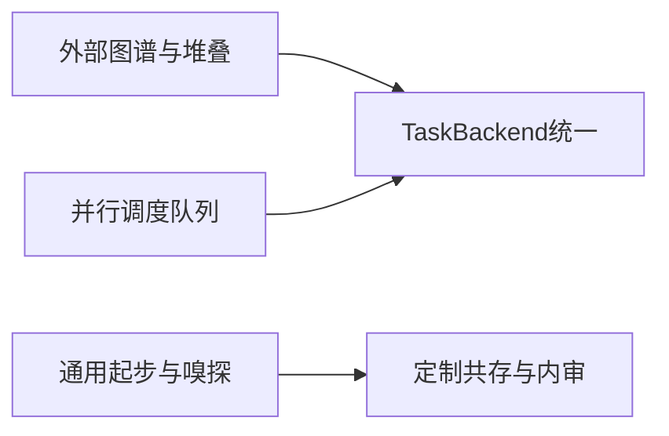

# SPEC: v7 M3 并行调度、TaskBackend、外部图谱/堆叠 PR 与通用初始化

## 文档信息与变更概览

| 项目 | 内容 |
| --- | --- |
| 当前状态 | `implemented`（`draft \| approved \| implementing \| in_review \| implemented \| superseded`） |
| 规划级别 | `L3` |
| 创建 / 更新 | `2026-11-16` / `2026-11-16` |
| 分支 / Issue | `main` / #39（归属于总控 PRD `docs/prd/261115-v7-workflow-architecture-prd.md` `C1/C6/C7/C8/C9`） |
| 负责人 | `FiretrUCK666` |

## 系统变更全景

| 模块 / 文件 | 变更性质 | 核心职责与行数预算（全部 `<= 800` 行） |
| --- | --- | --- |
| `kit/skills/lib/task-backend.mjs` (new) | 新增 | 统一 `GitHubBackend` / `GenericRemoteBackend` / `LocalOnlyBackend` 接口（含 PR/Issue/标签/Checks） |
| `kit/skills/lib/task-graph.mjs` (new) | 新增 | 外部单 Issue / 单 PR（含扫描审批前阻断）/ Issue+PR 互链防重 / 未解外部阻塞依赖与堆叠图谱 |
| `kit/skills/lib/profile-sniffer.mjs` (new) | 新增 | 三层优先级嗅探核心（2/4 空格 YAML 中性 CI、`Taskfile`/`Makefile`/`justfile`、递归非 vendor 子包与 `detectionEvidence`） |
| `kit/skills/lib/git-fast.mjs` (new) | 新增 | 从 `flow-inspect.mjs` 抽离零进程 `.git` 快速配置与 ref 解析，压低 `flow-inspect.mjs` 行数 |
| `kit/skills/dev-flow/scripts/flow-sync.mjs` (new) | 新增 | 堆叠子分支 `rebase --onto`、工作树依赖解绑重挂载、`updatePrBase`、`roundBaseSha` 与 `syncCount` 维护 |
| `kit/skills/dev-flow/scripts/flow-batch.mjs` (new) | 新增 | 宿主无关并行多 Worktree 波次规划、不重叠校验、FIFO 串行合并队列（复用 merge 前置门禁）与会话句柄轮换 |
| `kit/skills/dev-flow/scripts/flow-cleanup.mjs` (new) | 新增 | 从 `flow-merge.mjs` 迁出 `cleanup`/`status`/`abort`，使 `flow-merge.mjs` 降至 ~540 行 |
| `kit/skills/lib/exec.mjs` / `kit/skills/lib/git.mjs` | 改造 | `withFileLock`（`O_EXCL`）、`computeWorktreeEnv`、`.git/*.lock` 指数退避重试及去重提速 |
| `kit/skills/lib/github-client.mjs` / `kit/skills/lib/workflow-policy.mjs` / `kit/skills/lib/shared.mjs` | 改造 | `updatePrBase`；`evaluateNextState` 识别合并队列退回与未解阻塞态；统一导出新 L1/L2 符号 |
| `kit/skills/dev-flow/scripts/flow.mjs` / `flow-inspect.mjs` / `flow-lifecycle.mjs` / `flow-merge.mjs` | 改造 | 接入 `TaskBackend`/`task-graph`、`--after` 起枝、`sync`/`batch` 入口，保留 `I46/I48/I59/I63` 注入锚点并控制在 `<= 680` 行 |
| `kit/skills/dev-review/scripts/review-locks.mjs` / `review-pack.mjs` | 改造 | 同步 `review-pack.mjs` 与 `review-locks.mjs` 变基祖先判定与 `range-diff` 转变更提交 hunk 解析 |
| `kit/skills/dev-govern/scripts/govern-tests.mjs` | 改造 | 纯本地无远端且无 `origin` 仓或显式 `no-ci` 豁免 `tests.no-ci-config` 误报 |
| `kit/skills/dev-plan/scripts/doc-plan.mjs` / `kit/skills/lib/doc-templates.mjs` / `docs.mjs` | 改造 | `SELF_CRITIQUE_REJECTED` 禁自审、`prd`/`TDD`/非平凡 `todo` 审计提示、向 `buildStandardDocContent` 透传 `repoRoot` 识别仓库自定模板 |
| `scripts/lib/equip-bootstrap.mjs` (new) / `scripts/lib/starter-templates.mjs` / `scripts/equip.mjs` | 新增 / 改造 | 下沉 `equip` 通用初始化与清点辅助，使 `equip.mjs <= 650` 行；废除 6 栈 `greet` 玩具码并支持 `--stack`/`--lang` 与初装即过 `--check` |
| `templates/agents-project.md` / `scripts/lib/agents-sections.mjs` / `scripts/compose-agents.mjs` | 改造 | 全区间 `no-remote` 清净与 `{{CONVENTIONS_HINT}}` 移出注释；词边界 `maskVolatile`、`--adopt-custom`、`managedBytes`/`customBytes` 拆分与 `I9/I24` 兼容 |
| `scripts/lib/survey-ecosystem.mjs` / `scripts/survey.mjs` / `SKILL.md` / `references/{survey,docs-set}.md` | 改造 | 复用 `profile-sniffer.mjs`（排除 `vendor/` 等第三方目录）；跨切片同步 `--bootstrap-empty` 文档对拍 |
| `scripts/dev/preflight-contracts.mjs` / `injections-data.mjs` / `fixtures-m3.mjs` (new) / `fixtures*.mjs` | 新增 / 改造 | 更新 `checkStarterLanguageCoverage` 与 `I51` 并补 `I64..I69`；更新 `fixtures-equip`/`claims`/`platform`/`govern` 并拆分重夹具将 `fixtures.mjs` 恢复 `< 30s` |

## 一、背景与边界声明

- **要改什么**：落地总控 PRD `docs/prd/261115-v7-workflow-architecture-prd.md` 规定的 **M3 全部交付**：统一 `TaskBackend` 与 `no-remote` 零泄漏；外部协作图谱与堆叠 PR（`--after`、`sync`、`range-diff`）；宿主无关并行调度 `batch` 与 FIFO 合并队列；通用 `--bootstrap-empty` 与单源三层嗅探；`AGENTS.md` 定制共存、`equip.mjs` 降档修复、`doc-plan` 防自审；以及同步对拍夹具/门禁并将 `fixtures.mjs` 压回 `< 30s`。
- **不改什么**：严格零第三方 npm 依赖（仅 `node:*`）；严格守住 `kit/** -> scripts/{dev,lib}/**` 单向边界与 `FORBIDDEN_PLATFORM_RE` 平台中立（`.gitlab` 等禁用词绝不进入产品层）；不提前改写 M4 死检查/Fake-Agent 真 `.zip` 测试台或 M5 全盘精简；所有 `.mjs` 文件均 `<= 800` 行。
- **本期不做**：不提前实现 M4 三平台 CI 矩阵与 `signals.jsonl`/`retro`；不执行发版打标签。
- **复用既有模块**：复用 `kit/skills/lib/exec.mjs`、`git.mjs`、`github-client.mjs`、`platform.mjs`、`ledger.mjs`、`docs.mjs`、`workflow-policy.mjs`、`flow-trial-merge.mjs`、`worktree-deps.mjs`、`review-locks.mjs`、`protocol.mjs` 与 `backup.mjs`。
- **架构基线关系**：严格遵循 `docs/TDD.md` L1–L4 正交架构；所有新增运行内核放于 `kit/skills/lib/` 并经 `shared.mjs` 导出。

## 二、设计方案与契约变更

### 1. 统一 `TaskBackend` 与 `no-remote` 零泄漏（C8/C9）

- **模块 `kit/skills/lib/task-backend.mjs` (new)**：定义工厂 `createTaskBackend({ role, providerId, targetRepo, client, pushRemote, mainRoot, gitDir })`，对外暴露**完全一致的 13 个方法名**：
  `claimTask`、`releaseTask`、`postComment`、`addLabels`、`removeLabel`、`createIssue`、`findOpenPrForBranch`、`createPr`、`updatePrBase`、`getPr`、`listComments`、`getCommitChecks`、`mergePr`（严格禁止不一致命名）：
  - `GitHubBackend`：委托 `github-client.mjs` 四级降级客户端，保留 403/absent 标签降级，自动附加 `pf-state` 标签与 UTF-8 临时文件写回。
  - `GenericRemoteBackend`：推送分支后将认领、释放与评审事件写入 `<gitDir>/project-forge-flow/events/<taskId>.jsonl`；调用 `mergePr` 时若未明确传入 `remoteMerged: true` 或 `humanApproved: true`，一律返回 `{ ok: false, blocked: true, code: 'BLOCKED_GENERIC_REMOTE_MR_REQUIRED', exitCode: 3 }`。
  - `LocalOnlyBackend`：全部事件留痕于本地 `.jsonl` 与任务账本；`createOrReuse` 语义置 `local-ready`；`mergePr` 转交 `flow-trial-merge.mjs` `--detach` 试合后以 `--ff-only` / CAS `update-ref` 推进本地主干。
- **`templates/agents-project.md` `no-remote` 全清空且保留 `I9`/`fixtures-contracts.mjs` 契约**：
  - 在 `意图路由` 中将「提交/推分支/开PR」与「合并PR」两行按 `<!-- project-forge: if has-remote -->` / `<!-- project-forge: if no-remote -->` 成对分流（`no-remote` 写「验证并提交至特性分支」「本地试合并入主干与清理」）。
  - 在 `版本与发布` 中：第 160 行「已推送远端」与第 161–181 行 `has-release` 块内的 `推送`/`PR` 同样套用 `if has-remote` / `if no-remote` 互斥分支，并确保两分支**均完整保留** `fixtures-contracts.mjs:85-92` 断言关键词（`日常`、`不打标签`、`发版`、`明确说`、`不自己判断`）。
  - 在 `日常协作与风险分流` 中：`<!-- project-forge: if is-full -->` 下的「第六步：合并收尾与平台防乱码」完整 7 步段落**保持原样不动**（从 `- **第六步：合并收尾` 到 `- **日常到此为止**` 之间**绝不插入**任何 `<!-- project-forge: ... -->` 注释，确保 `preflight-contracts.mjs:193` `finishSectionRange` 与 `I9/I9b/I9e/I9e2` 零冲突！），而是在 `<!-- project-forge: if has-remote -->` 外层完整包裹第四步至`- **同步不变量**`，紧接着在 `<!-- project-forge: if no-remote -->` 编写纯本地 4 步协作（含 `- **日常到此为止**` 与 `- **同步不变量**`），且 `is-lightweight` 的 `no-remote` 也同步改写为「合并前 finalize + 本地试合」。
  - 最终保障：任何无远端仓库渲染的 `AGENTS.md` 全文不含任何 `\bPR\b`、`origin`、`push` 或 `pull_request` 矛盾词。
- **`govern-tests.mjs` `no-remote` 豁免与双向验证**：在 `govern-tests.mjs` 识别远端存在性（读 `.git/config` 远端节与 `.git/pf-local-mode`）以及 `no-ci` 取舍：当确认仓无远端（纯本地）或已登记 `no-ci` 时不误报 `tests.no-ci-config`；同步更新 `scripts/dev/fixtures-govern.mjs` `c31-pos` 配置有远端 `origin` 的场景测试缺失 CI 工作流正例，并在 `fixtures-m3.mjs` (new) 验证纯本地仓库零误报。

### 2. 外部协作图谱与堆叠 PR（C6）

- **模块 `kit/skills/lib/task-graph.mjs` (new)**：所有外部测试注入通过函数参数（如 `client` / `dependencyStates`）传递，**绝不使用 `process.env` 夹具后门**：
  - **四态统一输入解析（`resolveExternalCollaborationGraph`）**：
    1. 单 Issue -> 提取正文 `Depends on #K` / `Blocks #K`；
    2. 单外部/Fork PR -> 进入 `.worktrees/review-pr-<M>` 隔离位（`untrustedScanRequired: true`、`untrustedApproved: false`）；在未运行 `review-pack.mjs --pr <M> --untrusted-scan` 且经人类授权标记（`ledger.untrustedApproved === true` 或显式审批标记）前，阻止 `worktree-deps.mjs` 挂载与 `flow verify` 执行任意命令（`BLOCKED_UNTRUSTED_PR_UNSCANNED` / `EXIT_POLICY_BLOCK`）；
    3. Issue + PR 互链合一 -> 当输入同时给出 Issue 与 PR、或 PR 正文 `Fixes/Refs #N` 关联、或分支已有 OPEN PR 时，合并为单一任务上下文并锁定 `reuseExistingPr`，在 `flow submit` 与 `start` 拦截重复开第二条 PR（`BLOCKED_DUPLICATE_PR_FOR_LINKED_ISSUE`）且双端同步评论/标签；
    4. **未传入外部阻塞依赖拦截**：收集 `dependsOn` 中未直接传入输入集的编号；通过 `TaskBackend` / `knownIssueStates` 查询状态（非 `CLOSED` 记入 `unresolvedBlockers`；离线无法查询时记入 `unverifiedDependencies` 并在开启严格模式 `--strict-deps` 时阻断）。`flow start`（无 `--after` 且无 `--force`）与 `flow merge` 在 `unresolvedBlockers.length > 0` 时返回 `BLOCKED_UNRESOLVED_DEPENDENCY`（`exit 3`）。
- **堆叠 PR（`--after`、`sync`、`range-diff`）**：
  - `flow.mjs start --after parentTaskOrBranch`：解析父任务/分支 `HEAD`，设置子账本 `baseBranch = parentBranch`、`baseSha = parentHead`、`parentTaskId`、`parentPrNumber`，基于父分支起点创建子 worktree；`flow merge` 在合并前强制调用 `checkStackedParentMerged`——只要父任务/父分支尚未并入上游目标分支且父 PR 非 `MERGED`，硬阻断 `BLOCKED_STACK_PARENT_UNMERGED`（`exit 3`）。
  - `kit/skills/lib/github-client.mjs` 新增 `updatePrBase({ repo, number, base })`（`gh pr edit --base` / HTTPS `PATCH` / `mcp-delegate`）。
  - `kit/skills/dev-flow/scripts/flow-sync.mjs` (new) 实现 `flow.mjs sync`（可选 `--task` 与 `--onto`）：
    1. 同步前调用 `unmountSharedDeps` 解绑旧依赖链接，防变基触及共享目录；
    2. 探测父分支是否已合并入默认主干（自动将目标基线切换为默认分支并更新 `updatePrBase`）或父分支推进；
    3. 执行 `git rebase --onto newBase oldBaseSha branch`；冲突时保留清晰上下文并返回 `BLOCKED_SYNC_REBASE_CONFLICT`；
    4. 变基成功后重挂 `mountSharedDeps`，在账本保存变基前后范围 `roundBaseSha = { prevBaseSha, prevHeadSha, newBaseSha, newHeadSha }`、递增 `ledger.syncCount`（与停损计数 `rounds.length` 完全隔离）、更新 `ledger.baseBranch`/`baseSha`，清理陈旧 `verifiedHead` 与同步 `review` 槽。
  - **跨文件协同更新 `review-pack.mjs` 与 `review-locks.mjs`**：
    - 在 Round 2+ 时先检查 `git merge-base --is-ancestor prevHead headRef`：
      - 若仍是祖先 -> 走常规 `prevHead..headRef`；
      - 若已被 `flow sync` 重写历史（非祖先）且账本有 `lastSync` / `roundBaseSha` -> 运行 `git range-diff --no-color prevRange newRange` 解析出状态为 `!`（修改）或 `>`（新增）的**新侧提交 SHA 列表**，对这些实际变化的新提交联合计算 `git show --unified=0` 统一 diff 与新侧行区间（`fileRanges`），彻底避免把未变动的上游提交纳入 Round 2 diff 与视野锁定范围（同时免受 `## file ##` diff-of-diffs 无法被 `splitDiffByFile` 解析的坑）！

### 3. 宿主无关并行调度与串行 FIFO 合并队列（C7）

- **L1 并发原语（`kit/skills/lib/exec.mjs` / `git.mjs`）**：
  - `withFileLock(lockPath, fn, { timeoutMs, staleMs, pollMs })`（置于 `exec.mjs`，由 `git.mjs` & `shared.mjs` 导出）：基于 `openSync(lockPath, 'wx')` 在 `<gitCommonDir>/project-forge-flow/locks/` 抢占排他锁，超时或陈旧死锁回收，并用锁保护 `.git/info/exclude` 写入、任务账本更新及合并队列。
  - `gitRun` `.git/*.lock` 指数退避重试（`50ms -> 100ms -> 200ms -> 400ms -> 800ms`，仅在命中 lock error 时重试）。
  - `computeWorktreeEnv({ mainRoot, gitDir, taskId, slotIndex, basePort = 18000 })`（置于 `exec.mjs`）：产出 `{ PF_SLOT, PF_PORT_OFFSET, PF_PORT, PF_CACHE_DIR }` 并自动建目录，在 `flow verify` 执行命令时并入环境变量，彻底隔离并行测试端口与缓存目录。
- **并行与队列入口 `kit/skills/dev-flow/scripts/flow-batch.mjs` (new)**：
  - 注册 `flow.mjs batch` 子命令（`plan`、`check-disjoint`、`merge-queue`、`resume-session`）：
    - `batch plan`：按 `dependsOn` / `--after` 与声明 `files` 拓扑生成有序波次（`Wave 1, Wave 2...`），同波内若存在文件冲突自动顺延拆波。
    - `batch check-disjoint`：对比多个并发任务的声明范围或实际 diff，有重叠路径即以 `EXIT_POLICY_BLOCK (3)` 返回 `BLOCKED_OVERLAPPING_SLICE_FILES`。
    - `batch merge-queue --tasks a,b`（支持逐项 `--enqueue`）：持全局 `merge-queue.lock`，严格 FIFO 逐个出队：先复用统一 `assertPreMergeGates` 校验 `verifiedHead` / `reviewPassedHead` / `detectGateWeakening` / `unresolvedBlockers` / `parentMerged`，检测 `baseBranch` 基线是否相对任务 `baseSha` 发生漂移，再经 `runTrialMerge` 在临时 `--detach` worktree 中与最新 `baseBranch` 试合复测 -> 成功则推进主干并标记 `merged`；若试合冲突或复测失败则清理临时 worktree，将账本记录 `queueConflict` 与 `status = 'rework'` 并交回实施者。
    - `batch resume-session --task taskId`：轮换 `sessionHandle`（`epoch`, `handoffToken`, `lastPhase`, `headSha`, `resumedAt`），写入账本。
  - 同步升级 `kit/skills/lib/workflow-policy.mjs` `evaluateNextState`：除原有 `lastRound.verdict === 'changes'` 外，同时识别 `t.status === 'rework'` 且存在 `t.queueConflict` 的状态，准确路由为 `phase = 'needs-rework'`、`ownerRole = 'implementer'`。

### 4. 通用 `--bootstrap-empty` 与单源三层嗅探（C8）

- **通用初始化（`scripts/lib/starter-templates.mjs`、`scripts/lib/equip-bootstrap.mjs` (new)、`scripts/equip.mjs`）**：
  - 废除 6 栈 `greet` 玩具源码生成器，`BOOTSTRAP_STACKS` / `--stack`（别名 `--lang`）默认 `'universal'`（可选常见栈名仅用于定制 `.gitignore` 规则段与 `docs/TDD.md` 运行说明），**零产出示例业务源码与假单测**。
  - `isNearlyEmptyDir` 放行已存在托管平台常规起始文件（`README*`, `LICENSE*`, `.gitignore`, `.gitattributes`, `.github/`, `.agents/`），原样保留已有 `README.md` 与 `LICENSE`，仅在存在业务源码文件或生态工程清单时拒绝。
  - `--bootstrap-empty` 按序自动落盘：`.gitattributes`、`.gitignore`（含 `.worktrees/`）、仅缺失时生成 `README.md`、零占位 `docs/TDD.md`、`docs/{prd,specs,todo}/.gitkeep`，初始化 Git（若未建），装配 `.agents/skills/`（调用 `equip`），并生成**无未填受管填充标记的初始自洽 `AGENTS.md`**（Dev Profile 显式填合法 `none`、路径表仅指向实际生成的 `AGENTS.md`/`docs/TDD.md`/`README.md`），确保 `--bootstrap-empty` 完毕即通过 `compose-agents.mjs --check` 与 `scripts/review.mjs`！普通存量仓库跑 `compose-agents.mjs` 仍保留待补标记供后续补齐（保证 `preflight-e2e.mjs` `smoke()` 全绿）。
  - 同切片跨文件对拍更新：`scripts/dev/preflight-contracts.mjs` `checkStarterLanguageCoverage`、`scripts/dev/injections-data.mjs` `I51`、`SKILL.md`、`references/survey.md`、`references/docs-set.md`，以及 `fixtures-equip.mjs` / `fixtures-claims.mjs` / `fixtures-platform.mjs`。
- **单源三层嗅探器 `kit/skills/lib/profile-sniffer.mjs` (new)**：
  - 实现 `sniffLayeredCommands(repoRoot, options)` 与 `discoverWorkspacePackages`：
    - Layer 1：`AGENTS.md` `## Dev Profile` 键值（尊重显式 `none`）；
    - Layer 2：中立 CI 配置（与 `govern-tests.mjs` 同一平台中立清单：`.github/workflows/*.yml|yaml`、`.circleci/`、`azure-pipelines`、`Jenkinsfile`、`.travis.yml`、`.drone.yml`、`.buildkite/`、`.woodpecker/` — **绝不写入任何 `FORBIDDEN_PLATFORM_RE` 禁用平台名**！）以及 `Makefile`/`justfile`/`Taskfile`；完整支持 **2 空格与 4 空格混合缩进** 的多行 `run:` / `script:` YAML 提取；
    - Layer 3：全深度递归包清单扫描，**移除「根有清单即停止扫子目录」的屏蔽**，同时显式跳过 `COMMON_SKIP_DIRS` 与第三方参考目录（`vendor`, `third_party`, `examples`, `samples`, `fixtures`, `testdata`, `__mocks__`），兼顾多后端子包发现与 `fixtures-contracts.mjs` `vendor/package.json` 隔离；修复 Java/Maven 子包标准测试目录检测与 Windows/POSIX Gradle wrapper；用原生目录参数或跨平台形式避免 PowerShell `(cd dir && ...)` 报错；输出 `detectionEvidence`（`layer`, `file`, `line`, `command`）。

### 5. `AGENTS.md` 共存、`equip`、`doc-plan` 内审与 `< 30s` 性能恢复（C1/C9）

- **`compose-agents.mjs` / `agents-sections.mjs` / `templates/agents-project.md`**：
  - 将 `{{CONVENTIONS_HINT}}` 移出受管填充注释行外（放在注释行下一段），避免多行提示劈断标记；
  - `maskVolatile` 改为词边界敏感替换（`(?<![A-Za-z0-9_./-])value(?![A-Za-z0-9_./-])`）；收敛 `SECTION_KEYWORDS` 过于宽泛单字匹配；
  - 新增 `compose-agents.mjs --adopt-custom [regionId,...]` 将受手工编辑或保护的受管区头自动写为 `customized` 并刷入 manifest 基线，彻底解除与 `--check` 的死结；
  - 超 `30KB`（`AGENTS_MAX_BYTES`）时计算并报告 `managedBytes` vs `customBytes`：默认与 `--check` 仍保持严格 `exit 1`（保住 `I24` 与 `fixtures-claims.mjs:403`），同时打印精确拆分指引（引导将超长项目规范迁移至 `<subdir>/AGENTS.md` 或 `docs/`）并支持显式 `--allow-custom-oversize` 放行纯项目手写长文仓库的受管区升级。
- **`equip.mjs`**：
  - `--tier lightweight` 降档保留已装配但完好的高阶技能目录，不物理误删用户现有文件；`checkEquip` 当 manifest `tier === 'lightweight'` 时放行已登记在 `files` 且完好校验的高阶技能文件；
  - 支持对已入 `customizedFiles` 但发生二次手改的文件直接经 `--adopt-custom` 刷新 `baseSha256`，否则提示 `re-edited-custom` 并指导重采用。
- **`doc-plan.mjs` 与 `doc-templates.mjs`**：
  - `critiquePassDoc` 比对 Frontmatter `owner` 与 `--reviewer`（规范化），相同时抛出 `SELF_CRITIQUE_REJECTED` 硬阻断自审；
  - `audit` 非 JSON `[NEXT STEP]` 对 `prd`（`draft`）、`docs/TDD.md` 与多文件非平凡 `todo` 均给出独立 Plan Critique 指引；
  - `renderStandardDocTemplate` / `buildStandardDocContent` 接收 `repoRoot`，自动识别目标仓自有模板路径（不含 `templates/docs-*.md` 与任何宿主目录名）并将定制小节结构提示注入生成模板（缺失时回退统一通用模板）。
- **性能优化 `< 30s`**：
  - `detectInProgressGitOp` 接收预计算 `gitDir` 与 `statusEntries`、`ensureWorktreesIgnored` 本地快速查忽略规则，砍掉 `flow-*` 中的重复 `git` 子进程；
  - 将 `fixtures-flow.mjs` 与 `fixtures-m2.mjs` 中的长尾大用例（如 `#2`、`#4`、`#5`、`#7`、`#8`）拆分为并行的中等粒度用例并在 `fixtures.mjs` 优先调度长用例，实测默认并发全量跑通 `< 30,000 ms`。

## 三、冻结的验收标准

- [x] C1: 外部图谱与堆叠 PR 完整可用——`scripts/dev/fixtures-m3.mjs` (new) 验证单 Issue、单 PR 未扫/未审批阻断挂载及 verify、Issue+PR 互链防重复开 PR（`BLOCKED_DUPLICATE_PR_FOR_LINKED_ISSUE`）、未传入外部阻塞 `Depends on` 依赖拦截（`BLOCKED_UNRESOLVED_DEPENDENCY`）、`flow start --after` 与父 PR 未合禁合（`BLOCKED_STACK_PARENT_UNMERGED`）、`flow sync`（`rebase --onto`、`updatePrBase`、`syncCount` 不消耗停损轮次、`review-pack.mjs` 与 `review-locks.mjs` 基于 `range-diff` 新侧提交精准锁定 Round 2 视野）。
- [x] C2: 宿主无关并行调度与 FIFO 队列完整可用——`withFileLock`、`gitRun` `.git/*.lock` 退避重试、`computeWorktreeEnv`、`flow batch plan`/`check-disjoint`（冲突返回 `BLOCKED_OVERLAPPING_SLICE_FILES`）、`batch merge-queue`（基线漂移试合推进与冲突置 `queueConflict`/`rework` 经 `flow next` 精准路由 `needs-rework`）及 `batch resume-session` 通过验证且产品层零宿主词、零禁用平台词。
- [x] C3: 统一 `TaskBackend` 与 `no-remote` 零泄漏——`GitHubBackend`/`GenericRemoteBackend`/`LocalOnlyBackend` 13 项统一契约一致；无远端项目渲染 `AGENTS.md`（`lightweight` 与 `full`）零出现 `PR`/`origin`/`push` 且保留 `日常`/`不打标签`/`发版`/`明确说`/`不自己判断`/`日常到此为止`；`govern-audit.mjs` 不对纯本地仓误报 `tests.no-ci-config`；`generic-git` 仍拦截本地强合并（`exit 3`）。
- [x] C4: 通用 `--bootstrap-empty` 与三层命令嗅探——废除 6 栈 `greet` 玩具码，`--bootstrap-empty`（`--stack`/`--lang`）兼容已有 `README.md`/`LICENSE` 并使新仓当场通过 `compose-agents.mjs --check` 与 `scripts/review.mjs`；`profile-sniffer.mjs` (new) 覆盖 `Dev Profile -> 4空格CI/Taskfile -> 深层多语言子包`（含根有 `package.json` 下跨目录 Java Maven 子包且跳过 `vendor/`）、Windows 安全并输出 `detectionEvidence`。
- [x] C5: `AGENTS.md`、`equip` 与 `doc-plan` 内审加固——多行 `{{CONVENTIONS_HINT}}` 不劈断注释、`maskVolatile` 不误伤 `main.mjs`/`domain`/`maintainer`、`compose-agents --adopt-custom` 解除 `--check` 死结并精准输出 `managedBytes`/`customBytes`（兼容 `I24`）、`equip --tier lightweight` 降档保留完好高阶技能且支持二次定制、`doc-plan critique-pass` 拦截 `SELF_CRITIQUE_REJECTED`、`prd`/`TDD`/非平凡 `todo` 输出内审提示并识别仓库自定模板。
- [x] C6: 性能与故障注入双绿——`node scripts/dev/fixtures.mjs` 默认并发跑通实测 `< 30,000 ms`（含 `fixtures-m3.mjs` (new) 及同步更新后的 `fixtures-equip`/`claims`/`platform`/`govern`），`node scripts/dev/bench.mjs` 6/6 全过，`node scripts/dev/verify-injections.mjs`（含 `I64..I69`）全部拦截生效。
- [x] C7: 全仓库契约与结构门禁全绿——`SKILL.md` / `references/{survey,docs-set}.md` / `AGENTS.md` / `docs/TDD.md` / `.agents/skills/` / `preflight-contracts.mjs` 同切片同步更新；全部 `.mjs` `<= 800` 行，完整 `merge-gate` 全部退出码为 0。

## 四、高风险点、门型与回滚路径

- **门型与回滚路径**：`one-way`（涉及多模块契约、工作流状态机、初始化行为与门禁同步更新；于独立分支与隔离工作树实施，合入前可随时丢弃工作树，合入后可通过标准 `git revert` 反向提交安全回退并重跑全门禁）。
- **故障注入预演**：将在 `scripts/dev/injections-data.mjs` 新增 6 条 M3 级故障注入（`I64..I69`：关闭 `SELF_CRITIQUE_REJECTED` 自审拦截、破坏 `maskVolatile` 词边界、关闭 `BLOCKED_UNRESOLVED_DEPENDENCY`、关闭 `BLOCKED_STACK_PARENT_UNMERGED`、关闭 `BLOCKED_OVERLAPPING_SLICE_FILES`、重现 `equip --tier lightweight` 降档误删高阶技能），独立审查时再手工补充现场注入 RED -> GREEN 验证。

## 实现说明

- **统一后端与图谱/堆叠**：新增 `kit/skills/lib/task-backend.mjs`（13 方法统一 `GitHubBackend`/`GenericRemoteBackend`/`LocalOnlyBackend`）、`kit/skills/lib/task-graph.mjs`、`kit/skills/dev-flow/scripts/flow-sync.mjs` 与 `kit/skills/dev-flow/scripts/flow-cleanup.mjs`，打通 `--after` 堆叠分支、父未合阻断、无 `process.env` 后门图谱解析、外部 PR 未扫未批禁挂/禁 verify、`sync` 变基与 `review-pack`/`review-locks` 的 `range-diff` 新侧精确视野锁定。
- **并行原语、队列与性能**：在 `kit/skills/lib/exec.mjs` / `git.mjs` / `git-fast.mjs` 落地 `withFileLock`、`.git/*.lock` 指数退避、`computeWorktreeEnv`、零子进程 ref/HEAD 解析与 `diff --name-status` 去重；新增 `kit/skills/dev-flow/scripts/flow-batch.mjs` 并升级 `workflow-policy.mjs` 处理 `merge-queue` 冲突回退路由；重构 `fixtures.mjs` LPT 调度并拆分重型用例。
- **通用初始化、嗅探、契约与文档对拍**：新增 `kit/skills/lib/profile-sniffer.mjs` 与 `scripts/lib/equip-bootstrap.mjs`，支持零玩具源码 `--bootstrap-empty` 与三层命令嗅探；升级 `templates/agents-project.md`、`agents-sections.mjs`、`compose-agents.mjs`、`equip.mjs`、`govern-tests.mjs`、`doc-plan.mjs`/`doc-templates.mjs`/`docs.mjs`，并同步 `README.md`/`README.en.md`、`SKILL.md`、`references/`、`docs/TDD.md`、`.agents/skills/` 与 `preflight-contracts.mjs`。
- **实测证据**：在最终提交基线上完成全量 `merge-gate`、`bench.mjs`（6/6）、`verify-injections.mjs`（76/76）与 `fixtures.mjs` 默认并发（157/157，`< 30,000 ms`）及打包导出清单检查。
