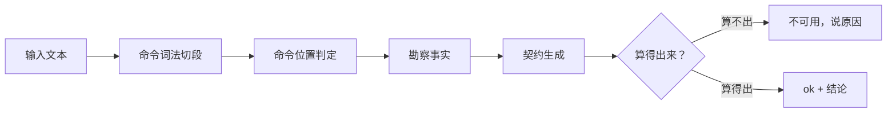

# SPEC: 勘察与体检的诚实性

## 文档信息与变更概览

| 项目 | 内容 |
| --- | --- |
| 当前状态 | `draft`（`draft \| approved \| implementing \| in_review \| implemented \| superseded`） |
| 规划级别 | `L3` |
| 创建 / 更新 | `2026-11-17` / `2026-11-17` |
| 分支 / Issue | `fix/v8-criteria-trust` / #49 |
| 认领的验收标准 | C4、C5、C6、C7、C8、C9、C10、C11、C12、C22、C23、C27 |

## 系统变更全景



| 模块 / 文件 | 变更性质 | 现状 | 还要做什么 |
| --- | --- | --- | --- |
| `scripts/lib/template.mjs` | 已落地 | 宿主语法 `${{ }}` 在所有检查前豁免；三类错仍抛 | — |
| `kit/skills/lib/command-lex.mjs` | 已落地 | 按命令位置分类；截断按字节 | `truncateCommandForDisplay` 只有 1 处调用，`render` 与 `compose` 都没接 |
| `kit/skills/lib/tool-owned.mjs` | 已落地 | 工具产物目录声明制 | — |
| `scripts/lib/survey-workspace.mjs` | 已落地 | 规模四维阈值与探索策略 | — |
| `scripts/review.mjs` | 已落地 | `inspectContract` 三态，`catch` 不返回 ok | 手写 AGENTS.md 时 `missing` 直接设成 `[]`，分不出「结构完好」与「压根没验」 |
| `kit/skills/dev-explore/scripts/repo-map.mjs` | **改造（主要缺口）** | `reusableModules` / `entrypoints` 由它产出 | 现在仍把 `.agents/skills/lib/*` 当可复用模块；本 SPEC 已把它纳入改造范围 |
| `kit/skills/dev-govern/scripts/govern-docs.mjs` | **改造** | 有 `docs.missing-tdd` / `docs.tdd-module-drift` | **没有 `docs.tdd-shell`**——空壳/4 行/模板原样三种判红要新增 |
| `kit/skills/lib/tdd-parity.mjs` | 已落地 | 返回 `missingModulesInTdd` / `staleModulesInTdd` / `tddSyncWarning` | 判据里写的 `missing` 字段不存在，要按真实键名写 |
| `kit/skills/lib/symbol-index.mjs` | **新增** | 不存在 | 符号抽取（PowerShell / Bash / Go 三种写法）与 `unsupported` 三态 |
| `scripts/lib/render.mjs` | **改造** | 不做命令截断 | 「构建与验证」代码块要按字节截断并给出处 |
| `scripts/compose-agents.mjs` | **改造** | 生成路径不截断 | 同上；并补 `handWritten` 时的「没验过」表达 |
## 一、背景与边界声明

- **要改什么**：勘察与体检在多处把「没算出来」显示成「算出来没问题」。五个具体形状：①宿主模板语法被当成未填占位符，让生成直接崩；②家目录与环境变量的根被当成仓库相对路径，报出假缺失；③命令探测被 `--format=` 值与 `.属性名` 误命中，或反过来因为「已识别生态」整条跳过；④工具产物目录（`.agents/`）被算进项目规模，装完套件规模自己涨；⑤`compose` 崩了，`review` 仍盖「结构也完整」。
- **不改什么**：不改勘察的只读性质，不改 `review` 的结论 id 命名空间，不改 `equip` 的备份策略。
- **本期不做**：不引入第三方解析器（零依赖是不变量）；不做 LSP 级语义分析。
- **复用既有模块**：`kit/skills/lib/verdict.mjs`（三态）、`kit/skills/lib/tool-owned.mjs`（工具产物归属）与 `scripts/lib/protocol.mjs` 的 `isToolOwnedPath`（真实调用入口）、`kit/skills/lib/profile-sniffer.mjs`（清单嗅探）、`kit/skills/lib/profile.mjs`（取舍解析单一真相源）、`kit/skills/lib/static-gates-lexer.mjs`（多语言注释剥离，用于「注释里的符号不算已定义」）。
- **架构基线关系**：对齐「单一真相源」与「入口不复述判据」两条不变量；`render.mjs` 仍是排版单一真相源。

## 二、与总控 PRD 的认领映射

本 SPEC 的验收标准**按本文档自己的顺序编号 C1..Cn**（一份文档里的编号必须自洽，C1 永远是它的第一条）；
下表说明它认领了总控 PRD 的哪几条。总控 PRD C4、C5、C6、C7、C8、C9、C10、C11、C12、C22、C23、C27 由本文档负责。

| 本 SPEC | 总控 PRD | 一句话 |
| --- | --- | --- |
| C1 | C4 | 占位符先校验形状再替换，宿主语法豁免 |
| C2 | C5 | 家目录与环境变量根不当仓库相对路径 |
| C3 | C6 | 动作词只在命令位置匹配 |
| C4 | C7 | 工具产物不计入项目规模 |
| C5 | C8 | 规模单调不降，六格矩阵 |
| C6 | C9 | 算不出来不等于算出来没问题 |
| C7 | C10 | 空壳 TDD 判红，符号锚点 |
| C8 | C11 | 工具产物条目为 0 且项目模块必须被认出 |
| C9 | C12 | 取舍节出厂为空 |
| C10 | C22 | 多行 run 逐条展开，无超长单行 |
| C11 | C23 | 命令探测不被 kinds 跳过 |
| C12 | C27 | 命令多时改说「去哪看」 |
## 三、设计方案与契约变更

### 接口 / 数据结构变更

**占位符（`template.mjs`）**

`renderVars` 改为**先扫形状、再替换**，只扫模板正文；`${{ ... }}` 是宿主语法，整段跳过。

**命令词法（新模块）**

```js
splitCommandSegments(cmd) -> string[]   // 按 && || ; | 切段，尊重引号
commandHeadOf(seg)        -> string     // 段首命令名
commandVerbOf(seg)        -> string     // 头之后第一个非选项词
classifyCommandText(text, kinds) -> string | null
```

**规模（`survey-workspace.mjs` / `survey-plan.mjs`）**

`tool-owned.mjs` 的 `TOOL_OWNED_PREFIXES` 决定哪些路径不计入 `codeFiles` / `codeLines`；`EXPLORATION_THRESHOLDS` 四维（`codeFiles` 80、`codeLines` 4000、`modules` 8、`languages` 2）任一超限即 `parallel-subagents`，返回值带 `evidence`。

**三态（`review.mjs`）**

```js
inspectContract() -> { state: 'ok' | 'unavailable', health, error }
```

`state === 'unavailable'` 时产出 `agents.unavailable`（level `missing`），**不得**产出 `agents.ready`。

**失败时如何降级**：`catch` 一律返回 `unavailable` 并带原因；空数组不再被当作「全部通过」的同形值。

### 影响范围

- 预计涉及文件：`scripts/lib/template.mjs`、`scripts/lib/claims.mjs`、`scripts/lib/survey-ecosystem.mjs`、`scripts/lib/survey-workspace.mjs`、`scripts/lib/survey-plan.mjs`、`scripts/lib/render.mjs`、`kit/skills/lib/command-lex.mjs`、`kit/skills/lib/symbol-index.mjs`(new)、`kit/skills/lib/tdd-parity.mjs`、`kit/skills/lib/profile-sniffer.mjs`、`kit/skills/dev-explore/scripts/repo-map.mjs`、`kit/skills/dev-govern/scripts/govern-docs.mjs`、`scripts/review.mjs`、`scripts/compose-agents.mjs`、`scripts/survey.mjs`、`kit/skills/dev-flow/scripts/flow-inspect.mjs`、`kit/skills/dev-flow/scripts/flow-next.mjs`、`templates/agents-project.md`
- **还要跟着走的地方**：改 `kit/**` 之后必须跑 `node scripts/equip.mjs .` 让 `.agents/skills/` 与源码字节一致，否则 `equip --check` 与 `preflight` 都会红；改 `scripts/review.mjs` 的结论形态要同步 `docs/TDD.md` 的体检段。
## 四、冻结的验收标准

- [ ] C1: 变量值含宿主模板语法时 `renderVars` 正常返回；宿主语法出现在模板正文里时也放过——**包括名字是全大写的那种**（`${{GITHUB_SHA}}` 与 `${{ github.sha }}` 都必须放过：豁免要在所有检查之前，只加在形状检查那一处仍会被「未登记」拦住）；模板正文里未登记的全大写占位符、缺取值的占位符、形状不对的占位符三类**仍必须抛错**；含宿主模板语法的仓上 `compose-agents.mjs --check` 退出码不得为 2。
- [ ] C2: 家目录根（`~/`、`~user/`）与环境变量根（`$HOME/`、`${HOME}/`、`%VAR%\`）、盘符与绝对路径**一律不作为仓库相对路径**报缺失；**剥掉点斜杠前缀后的仓内真路径必须仍被认出**（`./docs/TDD.md` 要认成 `docs/TDD.md`）；以父目录相对写法起头、或剥完仍带上级跳转的路径不当作承诺；反向：真实的仓库相对路径照常校验，缺失时仍报。
- [ ] C3: 命令按 shell 运算符切段（尊重引号），动作词**只在命令位置**匹配；`--format=` 的取值与 `.属性名` 不得被误判成动作；**文件名里的 `test` 不得让整段脚本变成测试命令**——但这条有边界：`bash 某路径/test-mac-pure.sh` 与 `./某路径/test-mac-pure.sh` 当前都判成 `test`，因为脚本路径本身就在命令位置。判据要写成「**只排除路径中间分量里的关键词，保留脚本名的判断**」：文件名本身就叫 test 的那种（唯一测试入口）必须仍被认出来，否则等于让一类项目永远探测不到测试命令。
- [ ] C4: 装套件前后 `codeFiles` 与 `tier` **完全相同**；只加空的 `docs/prd/.gitkeep` 之类骨架文件时 `isReentry` 仍为 `false`；**加了真实内容才变成 `true`**；`codeLines` 不随工具产物变化；**静态断言的范围要指明**：只扫规模判据相关的那几个函数（`survey-workspace.mjs` 的 `computeScale` 与 `survey-plan.mjs` 的阈值判断），不扫全文件——`survey.mjs` 与 `survey-reentry.mjs` 里本来就有 `.agents/skills` 字面量，用途不同，扫全文件必假红。
- [ ] C5: `tier` 随真实规模单调不降——**用 6 格矩阵验「任意两格对比都成立」**（500/2000/3950/4050/30000/28000 行）；28000 行 / 40 文件的仓判 `parallel-subagents`；同一份仓连跑两次 `survey`，`explorationStrategy` 逐字相同；改一个模块的行数使规模跨档后，`survey` 要**报出策略变化及其依据**（各维取值）；策略写入 `AGENTS.md` 受管区，重入时比对而不是默默重算。**证明命令**：`node scripts/dev/fixtures.mjs --only "tier 随真实规模"`。
- [ ] C6: **三态要覆盖两条失败路径，不只是 `catch`**。①`compose` 退出码非 0 时 `review` 的 agents 段不得出现「结构也完整」，必须出现 `agents.unavailable` 并带原因；**静态断言：`inspectContract` 的 `catch` 分支不得返回 `state` 为 `ok`**。②**手写 AGENTS.md（无任何受管标记）时**，`compose-agents --check` 判「还不算一份契约」（退出码 1），而 `review` 现在会说「已就绪、结构也完整」——根因是 `contractHealth` 在 `regions.length === 0` 时把 `missing` 直接设成 `[]`，`review` 分不出「结构完好」与「这一面压根没验」。这一条也要判红：手写仓上 `review` 必须报 `agents.unverified` 而不是「结构完整」。反向：受管区齐全且无漂移时结论仍为「结构完整」。
- [ ] C7: **判红的形态要与真实输出对得上**。空壳 TDD（只列模块名）、4 行 TDD、模板原样（含占位符）、文件完全不存在但有代码——四种全部判红。判红的具体形式按实测写：①`govern-audit.mjs audit` **加 `--strict` 时**退出码非 0（不加 `--strict` 时本仓 10 条 finding 也是 0，按「退出码非 0」写会永远绿）；②`--json` 顶层字段是 **`findings`**（不是 `results`），档位字段是 **`severity`**（不是 `level`）；③finding id 为 `docs.tdd-shell`，需在 `govern-docs.mjs` 新增（现有只有 `docs.missing-tdd` 与 `docs.tdd-module-drift`）；④`checkTddSyncParity` 的字段名是 **`missingModulesInTdd`**（不是 `missing`），判据按真实键名写。**不做版本宽限**：全仓没有版本宽限机制，写「下一个次版本转阻断」无从判断，改为首次上线即按 `severity: high` 阻断，存量仓用 `--changed` 增量模式过渡。**反向：只在注释里出现的符号名不得被当成「已定义」**。
- [ ] C8: **执行者在 `repo-map.mjs`，不在 `survey`**。`reusableModules` 与 `entrypoints` 只由 `kit/skills/dev-explore/scripts/repo-map.mjs` 产出（`survey --json` 里没有这两个键），所以判据要落在这个文件上。①`reusableModules` 与 `entrypoints` 里属于工具产物目录的条目数**必须为 0**——实测现在前三名全是 `.agents/skills/lib/*`；②**反向：项目自己的模块必须被认出来**——只有项目源码的仓，`reusableModules` 不得为空；③PowerShell 的 `function Foo {`、Bash 的 `foo() {`、Go 的 `func bar()` 三种写法符号抽取分别命中（落点 `symbol-index.mjs`）；④遇到没有符号规则的语言返回 `unsupported` 而**不是空数组**；⑤`survey` 能报出「本仓 N 种语言，其中 M 种缺少符号规则」。**证明命令**：`node kit/skills/dev-explore/scripts/repo-map.mjs . --json`。
- [ ] C9: 模板的「取舍」节**出厂为空**，不含预填的 `license` / `no-ci`；**0 业务文件、完全由工具生成的仓，`review` 不得输出「没有会出事的缺口」**（那正是自洽的假绿：什么都没有，所以什么都没缺）；该报的项落到「待定」档而不是被压掉；**反向**：有业务文件的真实缺项照常按「缺」报。
- [ ] C10: 默认 CI 形状下 `compose-agents` 的生成路径**退出码 0**；「构建与验证」代码块里没有单行超过 500 字节的命令；**上限的落点要写清**：`COMMAND_DISPLAY_MAX_BYTES = 500` 定义在 `kit/skills/lib/command-lex.mjs`，`truncateCommandForDisplay` 现在只有 `scripts/review.mjs` 一处调用，`scripts/lib/render.mjs` 与 `scripts/compose-agents.mjs` 都没接——这条要在这两个生成路径上接上，不是再说一遍常量。截断必须**按字节**（按字符砍中文会砍出 504 字节，函数自己先超了上限）。
- [ ] C11: 任何 `kinds` 下 `survey` 都必须读 CI / Makefile / Taskfile 里被真实执行过的命令，不得因「已识别生态」而整条跳过；主 Agent 在主工作区直接改文件时，`flow next` 或 `inspect` 要能报出固定标记 `WARN_WORKING_IN_MAIN_CHECKOUT`（它是警告不是拦截，退出码仍为 0）。
- [ ] C12: 当真实命令多到逼近 30KB 上限时，契约**改为「去哪看」而不是「全抄一遍」**：命令按生态分组、每类只展示前 `ECO_COMMANDS_SHOWN_PER_KIND` 条、其余指向 CI 文件与 Makefile 的路径；**反向**：分组之后「构建与验证」仍必须包含**每类至少一条真实命令**，不得退化成空节或纯指针。
## 五、高风险点、门型与回滚路径

- **门型与回滚路径**：`one-way`。门禁语义变更，判松了不会当场失败。回退方式：`template.mjs` / `claims.mjs` / `review.mjs` 的改动可逐文件反向提交；本次唯一新增模块是 `symbol-index.mjs`，删除即可（调用点同批回退）；`command-lex.mjs` 已存在且被 `survey-ecosystem.mjs` 调用，只做校准不改形状。
- **故障注入预演**：I22c（catch 返回与成功同形的值）、I80（折叠退化成空节）、I100（宿主语法豁免只加在一处）、I101（截断退回按字符砍）四条都必须变红。I81/I82 属 C28/C17，由 issue50 的 SPEC 认领，不在本 SPEC 范围内。
## 实现说明

<!-- 在合并之前补齐真实实现摘要与验证结果 -->
