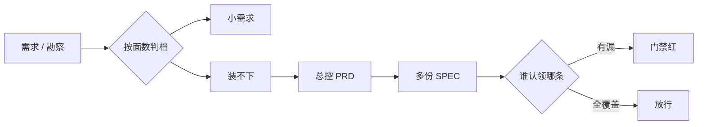

# SPEC: 平台事实、文档通用性与演进

## 文档信息与变更概览

| 项目 | 内容 |
| --- | --- |
| 当前状态 | `draft`（`draft \| approved \| implementing \| in_review \| implemented \| superseded`） |
| 规划级别 | `L3` |
| 创建 / 更新 | `2026-11-17` / `2026-11-17` |
| 分支 / Issue | `fix/v8-criteria-trust` / #50 |
| 认领的验收标准 | C13、C14、C15、C16、C17、C18、C24、C25、C26、C28 |

## 与总控 PRD 的认领映射

| 本 SPEC | 总控 PRD | 一句话 |
| --- | --- | --- |
| C1 | C13 | 取舍解析单一真相源，问答可复现 |
| C2 | C14 | 如实报出托管平台与能力 |
| C3 | C15 | 产物计划每一项都有执行入口 |
| C4 | C16 | 探索技能只读那条不再自相矛盾 |
| C5 | C17 | 治理类输入按面数判档，治理 PRD 覆盖产物计划 |
| C6 | C18 | 探索证据与波次计划 |
| C7 | C24 | 规划审核 Round 2 起换人 |
| C8 | C25 | 文档兄弟集按 slug 认亲 |
| C9 | C26 | 文档模板「通用主干 + 可扩展章节」 |
| C10 | C28 | 需求分级按装不装得进一份 SPEC |

## 系统变更全景

| 模块 / 文件 | 变更性质 | 核心职责 |
| --- | --- | --- |
| `kit/skills/lib/profile.mjs` | 改造 | 取舍解析唯一实现（`review.mjs` 复用） |
| `scripts/survey.mjs` | 改造 | `questions` 可复现、平台能力、产物计划 |
| `kit/skills/lib/docs.mjs` | 改造 | 兄弟集按 slug 认亲，不依赖同日 |
| `kit/skills/lib/doc-requirements.mjs` | 新增 | 「必须有什么」的唯一真相源：只锁与形态无关的三节 |
| `kit/skills/lib/critique-rounds.mjs` | 新增 | 规划审核的增量范围：上轮意见留痕 |
| `kit/skills/lib/doc-templates.mjs` | 改造 | 自定义章节与标准章节共存 |
| `kit/skills/dev-plan/scripts/doc-audit.mjs` | 改造 | 面数判档、`prdRequired`、覆盖率与无主切片 |
| `kit/skills/dev-plan/scripts/doc-plan.mjs` | 改造 | `critique-pass` 拒绝同人连审 |
| `kit/skills/dev-explore/SKILL.md` | 改造 | 只读与写 TDD 的矛盾收敛 |
| `scripts/equip-ci.mjs` | 新增 | 产物计划里 `create` 项的执行入口 |
| `scripts/lib/platform/registry.mjs` | 改造 | 非 GitHub 的能力与出口 |

## 一、背景与边界声明

- **要改什么**：这一组是「通用性」问题——同一份工具要给形态完全不同的项目用，而它现在假设了太多。①取舍解析有两份逐字相同的实现，改一处就有一条路径静默失效；②平台事实只认 GitHub，别的托管上仍给 GitHub 专用命令；③产物计划说「该建 CI」，但没有任何执行入口；④一个叫「只读」的技能拥有写权限；⑤治理类任务的判档看措辞；⑥探索证据缺失时只在合并那一步拦；⑦规划审核 Round 2 可以复用同一个上下文；⑧兄弟集靠「同一天创建」认亲；⑨文档模板是七节固定表单，装不下论文、数据管道、硬件这类项目；⑩需求分级没有最上面那一格。
- **不改什么**：不新增平台适配器（只把「能力」与「出口」如实报出来）；不改 30KB 上限；不改六锁收敛算法。
- **本期不做**：不做能力目录的语义检索；不为每个平台写一套专用命令。
- **复用既有模块**：`kit/skills/lib/verdict.mjs`（三态）、`kit/skills/lib/tool-owned.mjs`、`kit/skills/lib/workflow-policy.mjs` 的阶段判定、`scripts/lib/protocol.mjs`。
- **架构基线关系**：对齐「单一真相源」（取舍解析只留一份）与「不写死取值」（平台能力现场探测）。

## 二、设计方案与契约变更

### 接口 / 数据结构变更

**取舍解析**：只有 `profile.mjs` 的 `readDecisionMap` / `readDecisions`；`review.mjs` 改为重导出。`questions` 的生成依赖它，因此同一份仓两次 `survey` 的 `questions` 逐字相同**当且仅当**取舍节没变。

**平台能力**：`survey --json` 与 `review --json` 都带 `{ providerId, capabilities: { issues, pullRequests, releases, checks } }`；非 GitHub 时产物计划里的发版出口改成「先问人」而不是给 GitHub 专用命令。

**产物计划**：`artifactPlan` 里每个 `action: 'create'` 必须有对应执行入口（`scripts/equip-ci.mjs` 或 `equip` 的初始化路径）；没有入口即门禁红。

**需求分级**：`triage` 输出 `prdRequired` / `prdReasons` / `prdAdvice`；三条机械信号（四面以上、说了要分批、声明动 12 个以上文件）任一成立即必写 PRD。兜底由 `checkOrphanSlices` 负责。

**失败时如何降级**：全部走「算不出来就说算不出来」——缺执行入口报红而不是跳过，平台未知报 `unknown` 而不是默认 GitHub，兄弟集认不出时报「没认出」而不是静默归零。

### 影响范围

- 预计涉及文件：`kit/skills/lib/profile.mjs`、`kit/skills/lib/doc-requirements.mjs`(new)、`kit/skills/lib/critique-rounds.mjs`(new)、`kit/skills/lib/docs.mjs`、`kit/skills/lib/doc-templates.mjs`、`kit/skills/dev-plan/scripts/doc-audit.mjs`、`kit/skills/dev-plan/scripts/doc-plan.mjs`、`kit/skills/dev-flow/scripts/flow-next.mjs`、`kit/skills/dev-flow/scripts/flow-lifecycle.mjs`、`kit/skills/dev-flow/scripts/flow-merge.mjs`、`kit/skills/dev-review/scripts/review-gates.mjs`、`kit/skills/dev-explore/SKILL.md`、`SKILL.md`、`scripts/review.mjs`、`scripts/lib/artifact-executors.mjs`(new)、`scripts/equip-ci.mjs`(new)、`scripts/survey.mjs`、`scripts/lib/platform/registry.mjs`、`templates/docs-prd.md`、`templates/docs-spec.md`、`templates/docs-todo.md`

## 三、冻结的验收标准

- [ ] C1: `survey` 与 `review` 共用**同一个**「取舍」解析函数（`review.mjs` 里那份逐字相同的副本必须删掉，不留双轨）；写上具体表态后对应项不再是 `ask-human`，具体实例：表态不自动发布后 `ci-release` 不再是 `ask-human`；同一份仓连跑两次 `survey`，`questions` 逐字相同**当且仅当**取舍节没变；`questions` 非空时输出机器可读的 `NEEDS_HUMAN` 标记，不能只是一行 Markdown。
- [ ] C2: `survey --json` 的 `git.capabilities` 与 `review --json` 都报出当前远端 `providerId` 与结构化能力（`known` / `issues` / `pullRequests` / `releases` / `checks` 五键）；认不出来时 `known: false` 且各能力为 `null`，**未知不许被当成能**；已有远端但非 GitHub 时 `questions` 出现 `q.remote-setup`（问平台是哪个、要不要配 API 通道）；没有 GitHub 远端时 `q.release-strategy` 的文案里**不得出现** `RELEASE_TOKEN` / `gh release`，改为「先在托管界面确认发版方式」；**反向**：GitHub 上的现有输出（5 选 1 文案）不变。
- [ ] C3: `artifactPlan` 里每个 `action: create` 都**在 `ARTIFACT_EXECUTORS` 里有执行者**，否则 `review` 报 `ARTIFACT_WITHOUT_EXECUTOR`（门禁红）；连 `id` 都没有的项报 `ARTIFACT_WITHOUT_ID`；标为人工执行的项必须写清「从哪儿开始」；落盘之后重跑 `survey`，该项要从 `create` 变成 `preserve`；反向：`calibrate` / `preserve` / `ask-human` / `skip` / `snapshot` / `equip` 六种动作不查执行者，不得误报。
- [ ] C4: `dev-explore` 的「严格只读」与「写入或校准 TDD」二者**只保留一个**；当前选择：彻底只读；**主流程也不许再让这个只读技能承担写入职责**——`SKILL.md` 的 S3 落盘步骤必须写明「只读取证，由本步落笔」，而不是「调 dev-explore 编写或校准 `docs/TDD.md`」；反向：`equip --bootstrap-empty` 仍能生成初始 TDD，`dev-govern` 仍能报出该补哪些模块。
- [ ] C5: 治理类输入判 **Case 4**：判据是「这件事会同时碰到几个面」（文档 / CI / 契约 / 目录结构 / 源码 / 工具链），**三面以上即跨模块**；可判形式：同一件事的三种同义改写、以及**完全不含「治理 / 规范化」字样**但跨三面的输入，都必须判 Case 4；写任何治理文件之前先建治理 PRD；**这份 PRD 的 `C1..Cn` 必须覆盖 `artifactPlan` 的每一项**（缺一项即门禁红）；**另一条**：每个 C 项还必须被某份 SPEC 认领；治理 PRD 在重入时可继续追加而非每次重开。
- [ ] C6: 账本存在 `explored` 字段（含时间、档位、索引符号数）；缺失时 **`flow next` 只给探索这一步**（不能一路做到合并才被拦）、且 `flow merge` 拦截（退出码 4）；`tddSyncWarning` 非空时 `finalize` 退出码非 0；两个以上未闭环任务时 `flow next` 输出**波次计划**（哪些可并行、哪些有依赖）而非「请显式传入 --task」；空 diff 时 `structuralGate.status` 为 `nothing-to-review`，不得是 `clean`。
- [ ] C7: 规划文档（PRD / SPEC / Todo）的 Critique **Round 2 及以后必须由新建的独立子代理执行**，与代码审查同一条规矩；`doc-plan critique-pass` 必须能识别「这一轮的复核人就是上一轮的复核人」并拒绝，而不是只比较「复核人是否等于文档负责人」；反向：换一个真正新建的复核人时流程不受影响。
- [ ] C8: 同一件事的 PRD / SPEC / Todo 必须被认作一个兄弟集，**且判定不能依赖「同一天创建」**：今天建 PRD、明天建 SPEC 时，`issue` / `branch` / `owner` / `status` 仍要双向同步；写在其中一份上的 Issue 编号要能被其余几份读到；反向：确实属于两件事的同名 slug 不得被误合并。
- [ ] C9: 四层规划文档的模板必须是「通用主干 + 可扩展章节」，而不是七节固定表单：任何项目（App、数据管道、论文、硬件、SaaS、纯文档站）都能在**不改工具代码**的前提下写出合身的 PRD/SPEC/Todo；项目自定义章节与工具生成的章节共存且不互相覆盖；`audit` 只强制**与项目形态无关的最小核心**（做什么、不做什么、怎么判定完成），其余章节的存在性由项目自己的模板声明，而不是工具写死；反向：自定义模板不能变成「什么都不用写」的免检通道。
- [ ] C10: 规划分流必须能判出「这件事大到一份 SPEC 装不下」：同时碰四面以上、需求自己说了要分批、声明要动 12 个以上文件，三条任一条成立就必须先写总控 PRD 再拆 SPEC + Todo；`triage` 输出 `prdRequired` 与判定依据；**反向**：只碰一两面的小需求不得被判进来；**事后兜底**：`docs/specs/` 里有两份以上生效 SPEC、却没有任何 PRD 被两份以上 SPEC 共同认领时，`audit` 必须报 `ORPHAN_SLICES_NO_MASTER_PRD`。

## 四、高风险点、门型与回滚路径

- **门型与回滚路径**：`one-way`。文档模板与判档规则一旦写死，用户项目的文档形态就被绑死；门禁放宽则「无主切片」静默通过。回退方式：模板改动可逐份回退，`profile.mjs` 的取舍解析可暂时保留 `review.mjs` 的副本（但需在 TDD 里记明是临时状态）；`prdRequired` 与 `checkOrphanSlices` 独立，可分别关闭。
- **故障注入预演**：I78（Round 2 复用同一复核人）、I81（拆多份 SPEC 也不用 PRD）、I82（无主切片不报）、I83（远端能力认不出来被当成能）、I84（产物计划没执行者）、I85（作者与实施者同一人）、I87（规划审核不带上一轮意见）、I88（主工作区直改不提醒）。

## 实现说明

<!-- 在合并之前补齐真实实现摘要与验证结果 -->
