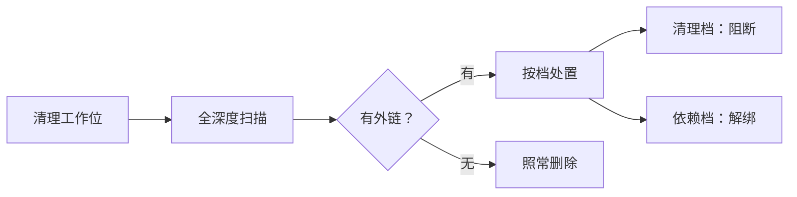

# SPEC: worktree 通配清理的删穿保护

## 文档信息与变更概览

| 项目 | 内容 |
| --- | --- |
| 当前状态 | `draft`（`draft \| approved \| implementing \| in_review \| implemented \| superseded`） |
| 规划级别 | `L3` |
| 创建 / 更新 | `2026-11-17` / `2026-11-17` |
| 分支 / Issue | `fix/v8-criteria-trust` / #51 |
| 认领的验收标准 | C1、C2、C3 |

## 系统变更全景



| 模块 / 文件 | 变更性质 | 核心职责 |
| --- | --- | --- |
| `kit/skills/dev-flow/scripts/worktree-deps.mjs` | 改造 | `scanOutboundLinks` 全深度扫描；`unmountSharedDeps` 分 `cleanup` / `deps` 两档；**深度上限的失败方向** |
| `kit/skills/dev-flow/scripts/flow-cleanup.mjs` | 改造 | 删目录**之前**先解绑；**认得自己挂的依赖**（见下）；`abort` 走同一条路径 |
| `kit/skills/dev-flow/scripts/flow-trial-merge.mjs` | **改造（必改）** | 两处 `unmountSharedDeps` 要传 `{ mode: 'deps' }`——默认档翻转后漏改这一处会静默删穿主仓 |
| `kit/skills/dev-flow/scripts/flow.mjs` | 改造 | `--allow-outbound` 多值参数与帮助文本 |
| `kit/skills/dev-flow/scripts/flow-sync.mjs` | 改造 | 调用点补 `{ mode: 'deps' }` |
| `kit/skills/dev-flow/scripts/flow-lifecycle.mjs` | 改造 | 同上 |
| `kit/skills/dev-flow/SKILL.md` | 改造 | `cleanup` 用法补 `--allow-outbound` |
| `scripts/dev/fixtures-flow.mjs` | 改造 | 六类正反用例（见 C1..C6） |
| `scripts/dev/injections-data.mjs` | 改造 | I22 / I22b 之外的删穿注入 |
| `docs/TDD.md` | 改造 | worktree 三档与卸前解绑的现状描述 |
## 一、背景与边界声明

- **要改什么**：`cleanup` 删 worktree 目录时，若目录里存在**指向 worktree 之外**的符号链接，删目录动作会顺着链接删穿到主仓或宿主目录。加一层「先扫描、再判、再删」的保护，并把「解绑」与「阻断」两种处置分开——因为 `sync`/`submit` 推进审查工作位时本来就该解绑，阻断在那里会把正常流程堵死。
- **不改什么**：不改 `git worktree remove` 本身的语义，不改三档隔离策略，不改 `unmountSharedDeps` 对「正常挂载」的判定口径。
- **本期不做**：不做跨平台文件系统层的 delete-guard（那是操作系统的事）；不处理硬链接（硬链接删一个不减数据，不构成删穿）。
- **复用既有模块**：`lstatSafe`（`worktree-deps.mjs` 已有）、`EXIT_POLICY_BLOCK`（定义在 `kit/skills/dev-flow/scripts/flow-inspect.mjs`，`flow-cleanup.mjs` 直接 import）、`printNextStep`（`kit/skills/lib/cli.mjs`）、夹具助手 `tmpProject` / `gitInit` / `gitCommitFast`（`scripts/dev/fixtures-helpers.mjs`）。
- **架构基线关系**：对齐「卸 worktree 前先仅对链接 `unlinkSync` 解绑，严禁直接递归删目录」这条不变量；与 `docs/TDD.md` 的 worktree 三档描述不冲突。

## 二、设计方案与契约变更

### 接口 / 数据结构变更

**扫描（新增导出）**

```js
scanOutboundLinks(wtRoot) -> { outbound: OutLink[], internal: PlainLink[], broken: PlainLink[] }
// OutLink   = { path: posix 相对路径, target: readlink 原文|null, kind: 'outside'|'unresolved', resolved: posix 绝对路径|null }
// PlainLink = { path: posix 相对路径, target: readlink 原文|null }
// kind 是分支判据本身：unresolved（悬空）在 cleanup 档同样阻断——解不出来就更不能删。
```

判据是**全深度 `lstat().isSymbolicLink()` 遍历**，不看目录名。任何名字、任何深度都算。

**解绑（签名扩展）**

```js
unmountSharedDeps(mainRoot, wtRoot, { allowOutbound = [], mode = 'cleanup' })
// mode: 'cleanup' —— 有外链就抛 BLOCKED_OUTBOUND_LINKS，一个都不解绑
// mode: 'deps'    —— 有外链照常解绑（sync/submit 推进审查位时的正常路径）
```

`allowOutbound` 是**逐个链接的相对路径**，不是目录名——放行单元是具体的一条链接。

**CLI**

- `worktree-deps.mjs unmount` 加工作位路径、可重复传入 `--allow-outbound`（值为链接相对路径）与 `--strict`，默认 `mode: 'deps'`。
- `worktree-deps.mjs scan` 需要工作位路径与 `--main` 两个参数，只读输出三类清单。
- `flow.mjs cleanup` 支持可重复传入的 `--allow-outbound`（值为链接相对路径），命中外链返回 `EXIT_POLICY_BLOCK`。

**失败时如何阻断**：`cleanup` 在**调用 `rm -rf` 之前**先跑解绑；解绑报错（注意：是**返回值** `{ ok: false }`，不是抛异常）则整个 cleanup 以 `EXIT_POLICY_BLOCK` 退出，并列出每条外链的路径与目标。

**默认档翻转的连带风险（必读）**

`unmountSharedDeps` 的 `mode` 默认值从「无保护」翻成 `cleanup` 之后，
**每一个没传 `mode` 的调用点行为都变了**。而失败在返回值里、不抛异常——
漏改的调用点不会报错，只会「什么都没解绑」，紧接着 `git worktree remove --force`
就顺着 junction 删穿主仓。`flow-trial-merge.mjs` 现在正是这个样子（它自己挂的 `node_modules`
在默认档下被当成外链、拒绝解绑，然后被 `git worktree remove --force` 删除时连主仓一起删）。

所以这件事必须**逐个调用点核一遍**，并配一条端到端用例：主仓真有 `node_modules` 时跑
`runTrialMerge`，断言主仓哨兵仍在。只测「cleanup 会拦住」不够——要测「不该拦的地方没被拦坏」。

**深度上限的失败方向**

扫描现在有 `depth > 24` 就静默返回的上限。**越界必须失败在「不删」那一侧**：
宁可拒绝清理，也不能因为「没扫到」就当成「没有外链」往下删。
实现上要么把上限改成「越界即报 `scan-truncated`，cleanup 档直接阻断」，
要么去掉上限并加环路防护（用已访问 inode 集合防环）。
**不能保留「超出就当作没看见」这种形态**——那是唯一会丢数据的失败方向。

**工具自己挂的依赖怎么算**

本工具在 Tier-2 任务里会主动把主仓的 `node_modules` 挂进 worktree。
对 `cleanup` 档来说它确实是「指向 worktree 之外」的链接，于是**每一次正常清理都会被拦**，
保护退化成橡皮章（人只会习惯性地加 `--allow-outbound`，那天真出问题也照加）。

改法：`flow-cleanup.mjs` 读账本里记录的挂载清单（`depsMode` / 已挂载单元），
**工具自己挂的自动放行并在回执里标明「工具挂载，自动解绑」**；
只有账本里没有的链接才按外链处理。这既保住保护的针对性，也让正常路径走得通。

**内部链接也要先解绑**

目标在 worktree **内部**的链接不算外链，但 `git worktree remove --force` 删不掉含 junction 的目录
（实测退出 255，`Directory not empty`），结果是 worktree 与分支都留着、账本不更新。
所以解绑要覆盖**所有**符号链接：内部的先 `unlinkSync`（内容留在即将删除的 worktree 里，无副作用），
再删目录。判据相应写成「不阻断**且**删除能成功完成」。

**并发 / 状态保护**：卸载前先校验 `git worktree list` 里该路径仍是注册的工作位，避免与别的进程竞争删同一个目录。

### 影响范围

- 预计涉及文件：`kit/skills/dev-flow/scripts/worktree-deps.mjs`、`kit/skills/dev-flow/scripts/flow-cleanup.mjs`、`kit/skills/dev-flow/scripts/flow-trial-merge.mjs`、`kit/skills/dev-flow/scripts/flow.mjs`、`kit/skills/dev-flow/scripts/flow-sync.mjs`、`kit/skills/dev-flow/scripts/flow-lifecycle.mjs`、`kit/skills/dev-flow/SKILL.md`、`scripts/dev/fixtures-flow.mjs`、`scripts/dev/injections-data.mjs`、`docs/TDD.md`
- **还要跟着走的地方**：改 `kit/**` 之后必须跑 `node scripts/equip.mjs .` 让 `.agents/skills/` 与源码字节一致，否则 `equip --check` 与 `preflight` 都会红；`docs/TDD.md` 的 worktree 三档描述要同步（`finalize` 会查 `tdd-parity`）。
## 三、冻结的验收标准

- [ ] C1: worktree 里存在**任意名字**、目标在 worktree 之外的符号链接时，`cleanup` 在删目录**之前**以 `EXIT_POLICY_BLOCK` 终止，并逐个列出链接路径与目标；**主仓哨兵文件在 `cleanup` 之后必须仍存在**（根目录与外链目标两处都查）；悬空链接（`kind: unresolved`）同样阻断——用 `symlinkSync` 指向一个不存在的目标构造，断言 `blocked[].reason` 是 `unresolved-target`；同一条链接若出现在 `sync` / `submit` / **`trial-merge`** 的依赖解绑路径上，**不阻断**，只解绑。
- [ ] C2: **不该拦的地方不能拦坏**。①没有任何外链的普通 worktree 照常退出 0；②**工具自己挂的依赖不阻断**——账本里记着挂载清单时，`cleanup` 走完不要求人加 `--allow-outbound`，回执里标明「工具挂载，自动解绑」；③保护只对准「账本里没有的来源」：真的外部链接仍然阻断；④外链在仓库之外但已被显式逐个列出（相对路径归一后**完全**匹配）时删除正常完成且目标内容完好；⑤`--force` 只跳过「脏 / 有未跟踪文件」，**不跳过外链检查**；⑥回执里**逐条列出**解绑了哪条路径、指向哪里——断言 `unmountedLinks` 里存在 `path` 与 `target` 都非空的那一项，只报个数不算过。
- [ ] C3: **目标在 worktree 内部的链接不阻断，且删除要真的成功**。内部 junction 先 `unlinkSync` 再删目录：`cleanup` 退出 0、worktree 目录已消失、本地分支已删、账本已更新；反向：只 `unlink` 不删目录时 `git worktree remove --force` 会以 `Directory not empty` 失败——这条要作为对照写进用例注释，说明为什么必须两步都做。
- [ ] C4: **越界要失败在「不删」那一侧**。构造一个深度 25 的外链：`scanOutboundLinks` 要么检出来，要么报 `scan-truncated`；两种情况下 `cleanup` 都**不得**继续删目录（退出码非 0），且主仓哨兵仍在。**禁止**的形态是「超出上限就当没看见、照常删除」——用故障注入把上限改小即可复现，必须变红。
- [ ] C5: **调用点逐个核过**。`unmountSharedDeps` 的 `mode` 默认档翻转后，`flow-sync.mjs`、`flow-lifecycle.mjs`、`flow-trial-merge.mjs` 三处都必须显式传 `{ mode: 'deps' }`；端到端断言：主仓真有 `node_modules`（含哨兵文件）时跑一次 `runTrialMerge`，返回 `ok: true` **且哨兵仍在**；反向：把某一处漏改（故障注入），该用例必须变红——这条是本次改动最容易静默丢数据的地方。
- [ ] C6: **判据不靠目录名**。行为断言：把判据换成「先按 `node_modules` / `.venv` 名字筛再判断是不是链接」时，`I22b` 注入必须变红（已有，保留）；**不再要求**源码级形状断言（`isSymbolicLink()` 不得在按名过滤的循环里）——那个写法会误伤 `collectCandidatePackageDirs` 里用途完全不同的同名调用。`mainDepsIntact` 这类写死为 `true` 的字段不得作为「采集范围一致」的证据；真正的一致性由「被拦下的目标事后也复核」这条行为断言证明。
## 四、高风险点、门型与回滚路径

- **门型与回滚路径**：`one-way`。删数据不可恢复，保护本身写错会让正常清理被永久堵住。回退方式：移除 `flow-cleanup.mjs` 里新增的解绑调用与 `BLOCKED_OUTBOUND_LINKS` 分支，`worktree-deps.mjs` 的 `scan`/`mode` 参数可保留（只读、无副作用）。
- **回滚路径**：`one-way`。删数据不可恢复，保护本身写错会让正常清理被永久堵住。
  回退方式：移除 `flow-cleanup.mjs` 里新增的「读账本挂载清单自动放行」与 `BLOCKED_OUTBOUND_LINKS` 分支；
  `worktree-deps.mjs` 的 `scan` / `mode` 参数可保留（只读、无副作用），
  但**必须同时把 `flow-trial-merge.mjs` 的 `{ mode: 'deps' }` 一起回退**——
  只回退一半会让默认档下的试合路径重新变成删穿入口。

- **故障注入预演**：I22（跳过 `unlinkSync`）、I22b（判据退回按目录名白名单筛）打 C1/C6；
  另有两条这次新增：**跳过 `flow-trial-merge.mjs` 的 `mode` 传参**打 C5、
  **把扫描深度上限改成「超出即当没看见」**打 C4。四条都必须变红——
  C4/C5 是本次改动里唯一会静默丢数据的两处。

## 实现说明

<!-- 在合并之前补齐真实实现摘要与验证结果 -->
