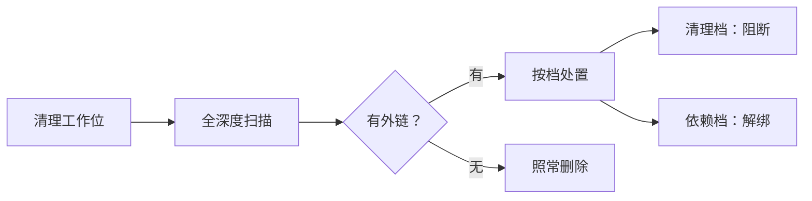

# SPEC: worktree 通配清理的删穿保护

## 文档信息与变更概览

| 项目 | 内容 |
| --- | --- |
| 当前状态 | `draft`（`draft \| approved \| implementing \| in_review \| implemented \| superseded`） |
| 规划级别 | `L3` |
| 创建 / 更新 | `2026-11-17` / `2026-11-17` |
| 分支 / Issue | `fix/v8-criteria-trust` / #51 |
| 认领的验收标准 | C1、C2、C3 |

## 系统变更全景



| 模块 / 文件 | 变更性质 | 核心职责 |
| --- | --- | --- |
| `kit/skills/dev-flow/scripts/worktree-deps.mjs` | 改造 | 新增全深度外链扫描 `scanOutboundLinks`；`unmountSharedDeps` 分 `cleanup` / `deps` 两档 |
| `kit/skills/dev-flow/scripts/flow-cleanup.mjs` | 改造 | 删目录**之前**先解绑外链，检出外链按策略阻断 |
| `kit/skills/dev-flow/scripts/flow.mjs` | 改造 | `--allow-outbound` 多值参数与帮助文本 |
| `kit/skills/dev-flow/scripts/flow-sync.mjs` | 改造 | 调用点补 `{ mode: 'deps' }` |
| `kit/skills/dev-flow/scripts/flow-lifecycle.mjs` | 改造 | 同上 |
| `scripts/dev/fixtures-flow.mjs` | 改造 | 正反双向用例与真实 `handleCleanup` 阻断 |

## 一、背景与边界声明

- **要改什么**：`cleanup` 删 worktree 目录时，若目录里存在**指向 worktree 之外**的符号链接，删目录动作会顺着链接删穿到主仓或宿主目录。加一层「先扫描、再判、再删」的保护，并把「解绑」与「阻断」两种处置分开——因为 `sync`/`submit` 推进审查工作位时本来就该解绑，阻断在那里会把正常流程堵死。
- **不改什么**：不改 `git worktree remove` 本身的语义，不改三档隔离策略，不改 `unmountSharedDeps` 对「正常挂载」的判定口径。
- **本期不做**：不做跨平台文件系统层的 delete-guard（那是操作系统的事）；不处理硬链接（硬链接删一个不减数据，不构成删穿）。
- **复用既有模块**：`lstatSafe`（`worktree-deps.mjs` 已有）、`EXIT_POLICY_BLOCK`（`scripts/lib/protocol.mjs`）、`printNextStep`（`kit/skills/lib/cli.mjs`）、夹具助手 `gitInitBare` / `gitSync`（`scripts/dev/fixtures-helpers.mjs`）。
- **架构基线关系**：对齐「卸 worktree 前先仅对链接 `unlinkSync` 解绑，严禁直接递归删目录」这条不变量；与 `docs/TDD.md` 的 worktree 三档描述不冲突。

## 二、设计方案与契约变更

### 接口 / 数据结构变更

**扫描（新增导出）**

```js
scanOutboundLinks(wtRoot) -> { outbound: Link[], internal: Link[], broken: Link[] }
// Link = { path: <相对 wtRoot 的 posix 路径>, target: <readlink 原文>, resolved: <绝对路径> }
```

判据是**全深度 `lstat().isSymbolicLink()` 遍历**，不看目录名。任何名字、任何深度都算。

**解绑（签名扩展）**

```js
unmountSharedDeps(mainRoot, wtRoot, { allowOutbound = [], mode = 'cleanup' })
// mode: 'cleanup' —— 有外链就抛 BLOCKED_OUTBOUND_LINKS，一个都不解绑
// mode: 'deps'    —— 有外链照常解绑（sync/submit 推进审查位时的正常路径）
```

`allowOutbound` 是**逐个链接的相对路径**，不是目录名——放行单元是具体的一条链接。

**CLI**

- `worktree-deps.mjs unmount` 加工作位路径、可重复传入 `--allow-outbound`（值为链接相对路径）与 `--strict`，默认 `mode: 'deps'`。
- `worktree-deps.mjs scan` 加工作位路径，只读输出三类清单。
- `flow.mjs cleanup` 支持可重复传入的 `--allow-outbound`（值为链接相对路径），命中外链返回 `EXIT_POLICY_BLOCK`。

**失败时如何阻断**：`cleanup` 在**调用 `rm -rf` 之前**先跑解绑；解绑抛错则整个 cleanup 以 `EXIT_POLICY_BLOCK` 退出，并列出每条外链的路径与目标。

**并发 / 状态保护**：卸载前先校验 `git worktree list` 里该路径仍是注册的工作位，避免与别的进程竞争删同一个目录。

### 影响范围

- 预计涉及文件：`kit/skills/dev-flow/scripts/worktree-deps.mjs`、`kit/skills/dev-flow/scripts/flow-cleanup.mjs`、`kit/skills/dev-flow/scripts/flow.mjs`、`kit/skills/dev-flow/scripts/flow-sync.mjs`、`kit/skills/dev-flow/scripts/flow-lifecycle.mjs`、`scripts/dev/fixtures-flow.mjs`

## 三、冻结的验收标准

- [ ] C1: worktree 里存在**任意名字、任意深度**、指向 worktree 之外的符号链接时，`cleanup` 在删目录**之前**以 `EXIT_POLICY_BLOCK` 终止，并逐个列出链接路径与目标；同一条链接若出现在 `sync`/`submit` 的依赖解绑路径上，**不阻断**，只解绑。
- [ ] C2: 没有任何外链的普通 worktree 照常成功退出 0；外链目标在 worktree 之外但在主仓之内（即正常的共享依赖挂载）不得被误判成删穿风险；`--allow-outbound` 逐条点名放行后能正常完成，且回执里逐条列出解绑了什么。
- [ ] C3: 外链检测**不使用目录名白名单**作为前置条件：实现里不得出现「先按 `node_modules`/`.venv` 之类的名字过滤，再判是不是外链」的形状——判据必须是「这条路径是不是符号链接、指向是否在 worktree 之外」，与它叫什么无关；`cleanup` 与 `deps` 两个 mode 共用同一次扫描结果，不得各扫一遍。

## 四、高风险点、门型与回滚路径

- **门型与回滚路径**：`one-way`。删数据不可恢复，保护本身写错会让正常清理被永久堵住。回退方式：移除 `flow-cleanup.mjs` 里新增的解绑调用与 `BLOCKED_OUTBOUND_LINKS` 分支，`worktree-deps.mjs` 的 `scan`/`mode` 参数可保留（只读、无副作用）。
- **故障注入预演**：I22（跳过 `unlinkSync`）、I22b（判据退回按目录名白名单筛）。两条都必须让对应用例变红。

## 实现说明

<!-- 在合并之前补齐真实实现摘要与验证结果 -->
