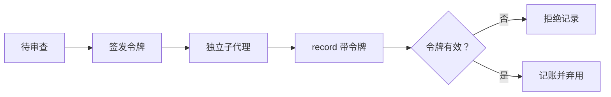

# SPEC: 独立审查与 Issue 语境

## 文档信息与变更概览

| 项目 | 内容 |
| --- | --- |
| 当前状态 | `draft`（`draft \| approved \| implementing \| in_review \| implemented \| superseded`） |
| 规划级别 | `L3` |
| 创建 / 更新 | `2026-11-17` / `2026-11-17` |
| 分支 / Issue | `fix/v8-criteria-trust` / #52 |
| 认领的验收标准 | C19、C20、C21 |

## 与总控 PRD 的认领映射

| 本 SPEC | 总控 PRD | 一句话 |
| --- | --- | --- |
| C1 | C19 | 独立审查凭一次性令牌，编个名字不再能过 |
| C2 | C20 | 贴了 Issue 就要把正文取回来 |
| C3 | C20 | PR 模式的基线只能来自真实 PR，换入口也绕不过去 |
| C4 | C21 | 意图路由点名的技能路径必须真实存在 |

## 系统变更全景



| 模块 / 文件 | 变更性质 | 现状 | 还要做什么 |
| --- | --- | --- | --- |
| `kit/skills/lib/ledger.mjs` | 改造 | 令牌字段与三个函数已落地 | 轮次派生式统一（见下） |
| `kit/skills/dev-review/scripts/review-ledger.mjs` | 改造 | 令牌校验、实施者缺失、自审三条拒绝已落地 | 轮次改用账本里的唯一派生式 |
| `kit/skills/dev-review/scripts/review-pack.mjs` | **改造（主要工作量）** | `--review-token` 值参数已在；PR 未识别时返回 `BLOCKED_PR_UNRESOLVED` | **PR 模式仍用分支名做 diff 基线**；`--task` 可绕过整段 PR 门禁 |
| `kit/skills/dev-review/scripts/review-diff.mjs` | **改造** | `EXIT` 常量在此 | 按 SHA 取 diff 的入口 |
| `kit/skills/lib/github-client.mjs` | **改造** | `getPr` 只返回 `headBranch` / `baseBranch` | **补 `baseRefOid` / `headRefOid`**——没有 SHA 就编不出「真实 PR 的基线」 |
| `kit/skills/dev-flow/scripts/flow-next.mjs` | 改造 | 待审查阶段签发令牌已在 | 轮次派生式与 `record` 对齐 |
| `kit/skills/dev-flow/scripts/flow-inspect.mjs` | 改造 | `start --issue` 已写 `issueContext` | 无通道时只存编号的路径要留痕；`--pr` 走同一条尝试链路 |
| `kit/skills/lib/workflow-policy.mjs` | 改造 | `needs-issue-context` 阶段已在 | `compactContext` 里带上已取到的正文 |

## 一、背景与边界声明

- **要改什么**：三件事都指向同一个病——**流程里的「独立」与「语境」只写在文档里，没有东西核验**。①`--reviewer-id` 是个自由字符串，编一个不一样的名字立刻通过，而 `implementerId` 为空时自审检查整条跳过；②`--issue 42` 只记编号，正文一个字没读，AI 拿到的只有一个数字；③意图路由表点名的 `SKILL.md` 路径没人核对是否真实存在。
- **不改什么**：不改六锁收敛算法本身（轮次上限、停损阈值、增量视野规则），不改 PR 评论与标签的双写格式。
- **本期不做**：不做密码学意义上的身份认证（令牌的作用是把「随便编个名」抬高成「伪造一件显眼的事」，不是不可伪造）。
- **复用既有模块**：`kit/skills/lib/ledger.mjs` 的账本读写、`kit/skills/lib/platform.mjs` 的 API 通道探测、`kit/skills/dev-review/scripts/review-diff.mjs` 的 `EXIT` 常量（`USAGE_OR_POLICY: 2`、`UNTRUSTED_HAZARD: 3`；`scripts/lib/protocol.mjs` 里没有退出码定义，且 `kit/**` 禁引 `scripts/lib/**`）。
- **架构基线关系**：与 `AGENTS.md`「Round 2+ 永远新建独立 review 子代理」同一条规矩的两个落点（代码审查与规划审核），实现上复用同一套令牌机制。

## 二、设计方案与契约变更

### 接口 / 数据结构变更

**令牌（`ledger.mjs`）**

```js
issueReviewToken(round)              -> { token: 'pf-rv-<hex>', round, issuedAt, consumedAt: null }
ensureReviewToken(mainRoot, ledger, round) -> { token, entry, issued }   // 有未消费的复用，没有才新发
consumeReviewToken(ledger, token, round)   -> { ok } | { ok: false, reason }
// reason: MISSING_REVIEW_TOKEN | UNKNOWN_REVIEW_TOKEN | REVIEW_TOKEN_ALREADY_CONSUMED | REVIEW_TOKEN_ROUND_MISMATCH
```

**签发点唯一**：只有 `flow-next.mjs` 在 `phase === 'needs-review'` 时调用 `ensureReviewToken`；`--json` 输出里也带 `reviewToken`，否则只看 JSON 的调用方永远记不了审查。

**拒绝条件（`review-ledger.mjs`）**

1. `implementerId` 为空 → `BLOCKED_MISSING_IMPLEMENTER`（空值不再是一条免检通道）
2. `reviewerId === implementerId` → `SELF_REVIEW_REJECTED`
3. 令牌无效 → `BLOCKED_REVIEW_TOKEN`

**Issue 语境（`flow-inspect.mjs`）**

```js
issueContext: [{ number, fetched, title, url, state, summary, reason }]
issueContextUnavailable: number[]   // 拿不到正文的编号
```

拿不到时记 `fetched: false` 与原因，**不静默降级成「凭编号猜」**；`workflow-policy.mjs` 新增 `needs-issue-context` 阶段给出取正文的具体命令。

**PR 模式的 diff 从哪里来（`review-pack.mjs` + `review-diff.mjs` + `github-client.mjs`）**

只把「PR 没识别就拒」加上去是不够的——现在拒的是「账本里没这个号」，不是「真的拉到了这个 PR」。
而且 `--task` 走 `mode='task'` 会整段跳过 PR 判据，用账本里的 `baseSha…HEAD` 生成 diff：
**审的仍是本地分支，从来没看过那个 PR，却可能照样报 `PACK_READY`。**

所以这一块要分三步补齐：

1. **拿得到 SHA**：`github-client.mjs` 的 `getPr` 现在只返回分支名，要补 `baseRefOid` 与 `headRefOid`
   （GitHub API 的 `pull_request.base.sha` / `head.sha`）。没有 SHA 就编不出「真实 PR 的基线」。
2. **只认 SHA 做基线**：`mode === 'pr'` 时 `diffScope` 必须写成 `<baseRefOid>...<headRefOid>`。
   拿不到 SHA 就返回 `BLOCKED_PR_UNRESOLVED` 并退出非 0，**不许回退成分支名**——
   分支名的 diff 会随主线前进而漂移，那不是「那个 PR 改了什么」。
3. **堵住旁路**：任务一旦被标记为外部 PR（`externalPr` 存在），
   `mode='task'` 也必须走同一段 PR 判据；`--task` 不再是绕过口。

**轮次只有一个派生式（`ledger.mjs`）**

现在有两套：`flow-next.mjs` 用 `rounds.length + 1`，`review-ledger.mjs` 默认用 `maxPrev + 1`。
轮次出现空档（如 `rounds = [1, 3]`）时，前者会为「已存在的那一轮」签发令牌，
后者要的是下一轮，令牌永远对不上，而且没有出口。

改法：派生式收进 `ledger.mjs` 一个函数 `nextReviewRound(ledger)`（取 `max(rounds) + 1`），
两处都调它。`rounds` 为空时返回 1。

**Issue 正文取不到（`flow-inspect.mjs` + `workflow-policy.mjs`）**

有 API 通道：取标题与正文摘要写进 `issueContext` 与 `compactContext`。
无通道：记 `fetched: false` 与具体原因（`no-api-channel` / `not-found` / `forbidden`），
`workflow-policy` 的 `needs-issue-context` 阶段给出取正文的具体命令。

**`--issue` 与 `--pr` 的一致性指向哪一边**

「一致」在这里只有一个方向是对的：**两者都「尝试去取」，取不到都「留痕并给下一步」**。
理由：没有 API 通道是常态（本地仓、私有部署），此时硬失败会让流程根本走不动；
但**静默只存编号**正是本 Issue 要治的病。所以统一为「尝试 + 留痕 + 给命令」，
而不是「一个硬失败、一个软放过」。

`review` 侧不同：审查是对着真实 PR 下结论，**拿不到真实 PR 就不许报通过**——
那是 `BLOCKED_PR_UNRESOLVED` 硬失败。两处不矛盾，因为它们的职责不同：取证可以缺，
下结论不行。

**失败时如何阻断**：三条都走 `EXIT.USAGE_OR_POLICY`（令牌 / 实施者）或 `EXIT.UNTRUSTED_HAZARD`（PR 未解析），并在 stderr 说清下一步。

### 影响范围

- 预计涉及文件：`kit/skills/lib/ledger.mjs`、`kit/skills/lib/github-client.mjs`、`kit/skills/lib/workflow-policy.mjs`、`kit/skills/dev-review/scripts/review-ledger.mjs`、`kit/skills/dev-review/scripts/review-pack.mjs`、`kit/skills/dev-review/scripts/review-diff.mjs`、`kit/skills/dev-flow/scripts/flow-next.mjs`、`kit/skills/dev-flow/scripts/flow-inspect.mjs`、`scripts/compose-agents.mjs`、`scripts/lib/agents-sections.mjs`、`kit/skills/dev-review/SKILL.md`、`scripts/dev/fixtures-*.mjs`、`scripts/dev/injections-data.mjs`

## 三、冻结的验收标准

- [ ] C1: `record` 必须校验由 `flow next` 在待审查阶段生成的**一次性令牌**，同一令牌只能消费一次；Round 不匹配、令牌不存在、令牌为空三种全部拒绝；`implementerId` 缺失时拒绝记录（不再跳过自审检查）；**反向**：正常签发的令牌一次消费成功，且 `flow next` 连跑两次拿到的还是同一枚（不会把调用方手里的作废）；**轮次唯一派生式**：`flow next` 签发的 `round` 与 `record` 期望的 `round` 必须由同一个函数算出——构造 `rounds = [1, 3]` 的账本，走完 `next` → `record` 必须成功，不得出现「令牌对不上且无出口」。
- [ ] C2: **Issue 语境**。`flow start --issue N` 在有 API 通道时把标题与正文摘要写进账本与 `compactContext`；**拿不到正文时必须留痕**——记下编号与原因（`no-api-channel` / `not-found` / `forbidden`），`flow next` 据此给出取正文的具体命令；**`--pr` 与 `--issue` 走同一条「尝试 → 留痕 → 给命令」链路**（无通道时不硬失败，因为多数本地仓没有通道；但静默只存编号也不算通过）；反向：重跑 `start` 且这次取到了正文，必须清掉「拿不到」的标记。
- [ ] C3: **PR 模式的基线只能来自真实 PR**。`mode === 'pr'` 时 `diffScope` 必须形如 `<baseRefOid>...<headRefOid>`（两个都是 GitHub 返回的 SHA），**不得出现分支名**；拿不到 SHA 时返回 `BLOCKED_PR_UNRESOLVED` 且退出码非 0；**行为断言**：构造一个账本里记了 PR 号、但远端拉不到该 PR 的仓，跑 `review-pack --pr` 带上那个 PR 号，`status` 不得是 `PACK_READY`；**行为断言（旁路）**：账本标记了 `externalPr` 的任务，跑 `review-pack --task` 带上那个任务号，必须同样走 PR 判据，不得因为换了入口就放行；反向：真实拉到 PR 时 `diffScope` 里两个 SHA 与账本记录一致。
- [ ] C4: `compose-agents` 生成后，意图路由表里点名的每个 `SKILL.md` 路径**都真实存在**，不存在的必须报出来；装配档位与生成档位**不一致时**任一方必须拒绝或警告；删掉某个技能目录后（未跑 `equip`），`compose-agents` 要能发现并指出死链；**反向**：装齐且档位一致的仓不得误报——一个没有死链、档位一致的仓跑 `compose-agents --check` 必须退出 0 且不出现任何死链或档位告警。

## 四、高风险点、门型与回滚路径

- **门型与回滚路径**：`one-way`。独立审查是最后一道门，令牌机制写错会让所有记录被拒（堵死）或全部放行（失效）。回退方式：`review-ledger.mjs` 的三条拒绝按需逐条移除（每条独立），`flow-next.mjs` 的签发调用回退后账本里的令牌字段成为死数据、不影响读取。
- **故障注入预演**：I78（规划审核 Round 2 复用同一复核人）、I79（令牌可重复消费）打 C1；
  I97（PR 模式退回分支到分支）、I98（无通道时静默只存编号）打 C2/C3。
  四条都必须变红——C2/C3 改的是 `kit/`（高风险路径），没有注入等于门禁被改松也不会有人知道。

## 实现说明

<!-- 在合并之前补齐真实实现摘要与验证结果 -->
