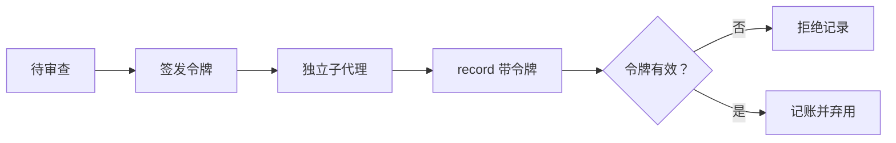

# SPEC: 独立审查与 Issue 语境

## 文档信息与变更概览

| 项目 | 内容 |
| --- | --- |
| 当前状态 | `draft`（`draft \| approved \| implementing \| in_review \| implemented \| superseded`） |
| 规划级别 | `L3` |
| 创建 / 更新 | `2026-11-17` / `2026-11-17` |
| 分支 / Issue | `fix/v8-criteria-trust` / #52 |
| 认领的验收标准 | C19、C20、C21 |

## 与总控 PRD 的认领映射

| 本 SPEC | 总控 PRD | 一句话 |
| --- | --- | --- |
| C1 | C19 | 独立审查凭一次性令牌，编个名字不再能过 |
| C2 | C20 | 贴了 Issue 就要把正文取回来 |
| C3 | C21 | 意图路由点名的技能路径必须真实存在 |

## 系统变更全景



| 模块 / 文件 | 变更性质 | 核心职责 |
| --- | --- | --- |
| `kit/skills/lib/ledger.mjs` | 改造 | `reviewTokens` 字段；`issueReviewToken` / `ensureReviewToken` / `consumeReviewToken`；`explored`、`issueContext` |
| `kit/skills/dev-review/scripts/review-ledger.mjs` | 改造 | 记录前校验令牌与实施者标识 |
| `kit/skills/dev-review/scripts/review-pack.mjs` | 改造 | `--review-token` 值参数；PR 拉不到时硬失败 |
| `kit/skills/dev-flow/scripts/flow-next.mjs` | 改造 | 待审查阶段签发令牌并写回命令 |
| `kit/skills/dev-flow/scripts/flow-inspect.mjs` | 改造 | `start --issue` 拉取正文摘要 |
| `kit/skills/lib/workflow-policy.mjs` | 改造 | Issue 正文缺失时的提示阶段 |

## 一、背景与边界声明

- **要改什么**：三件事都指向同一个病——**流程里的「独立」与「语境」只写在文档里，没有东西核验**。①`--reviewer-id` 是个自由字符串，编一个不一样的名字立刻通过，而 `implementerId` 为空时自审检查整条跳过；②`--issue 42` 只记编号，正文一个字没读，AI 拿到的只有一个数字；③意图路由表点名的 `SKILL.md` 路径没人核对是否真实存在。
- **不改什么**：不改六锁收敛算法本身（轮次上限、停损阈值、增量视野规则），不改 PR 评论与标签的双写格式。
- **本期不做**：不做密码学意义上的身份认证（令牌的作用是把「随便编个名」抬高成「伪造一件显眼的事」，不是不可伪造）。
- **复用既有模块**：`kit/skills/lib/ledger.mjs` 的账本读写、`kit/skills/lib/platform.mjs` 的 API 通道探测、`scripts/lib/protocol.mjs` 的退出码常量。
- **架构基线关系**：与 `AGENTS.md`「Round 2+ 永远新建独立 review 子代理」同一条规矩的两个落点（代码审查与规划审核），实现上复用同一套令牌机制。

## 二、设计方案与契约变更

### 接口 / 数据结构变更

**令牌（`ledger.mjs`）**

```js
issueReviewToken(round)              -> { token: 'pf-rv-<hex>', round, issuedAt, consumedAt: null }
ensureReviewToken(mainRoot, ledger, round) -> { token, entry, issued }   // 有未消费的复用，没有才新发
consumeReviewToken(ledger, token, round)   -> { ok } | { ok: false, reason }
// reason: MISSING_REVIEW_TOKEN | UNKNOWN_REVIEW_TOKEN | REVIEW_TOKEN_ALREADY_CONSUMED | REVIEW_TOKEN_ROUND_MISMATCH
```

**签发点唯一**：只有 `flow-next.mjs` 在 `phase === 'needs-review'` 时调用 `ensureReviewToken`；`--json` 输出里也带 `reviewToken`，否则只看 JSON 的调用方永远记不了审查。

**拒绝条件（`review-ledger.mjs`）**

1. `implementerId` 为空 → `BLOCKED_MISSING_IMPLEMENTER`（空值不再是一条免检通道）
2. `reviewerId === implementerId` → `SELF_REVIEW_REJECTED`
3. 令牌无效 → `BLOCKED_REVIEW_TOKEN`

**Issue 语境（`flow-inspect.mjs`）**

```js
issueContext: [{ number, fetched, title, url, state, summary, reason }]
issueContextUnavailable: number[]   // 拿不到正文的编号
```

拿不到时记 `fetched: false` 与原因，**不静默降级成「凭编号猜」**；`workflow-policy.mjs` 新增 `needs-issue-context` 阶段给出取正文的具体命令。

**PR 拉不到（`review-pack.mjs`）**

`mode === 'pr'` 且该 PR 未被识别时返回 `BLOCKED_PR_UNRESOLVED` 并退出非 0。早先它会静默回退成 `master...HEAD`，**审的是本地分支，从来没看过那个 PR，却报 `PACK_READY`**。

**失败时如何阻断**：三条都走 `EXIT.USAGE_OR_POLICY`（令牌 / 实施者）或 `EXIT.UNTRUSTED_HAZARD`（PR 未解析），并在 stderr 说清下一步。

### 影响范围

- 预计涉及文件：`kit/skills/lib/ledger.mjs`、`kit/skills/dev-review/scripts/review-ledger.mjs`、`kit/skills/dev-review/scripts/review-pack.mjs`、`kit/skills/dev-flow/scripts/flow-next.mjs`、`kit/skills/dev-flow/scripts/flow-inspect.mjs`、`kit/skills/lib/workflow-policy.mjs`、`scripts/dev/fixtures-*.mjs`（六处夹具补令牌）

## 三、冻结的验收标准

- [ ] C1: `record` 必须校验由 `flow next` 在待审查阶段生成的**一次性令牌**，同一令牌只能消费一次；Round 不匹配、令牌不存在、令牌为空三种全部拒绝；`implementerId` 缺失时拒绝记录（不再跳过自审检查）；**反向**：正常签发的令牌一次消费成功，且 `flow next` 连跑两次拿到的还是同一枚（不会把调用方手里的作废）。
- [ ] C2: `flow start --issue N` 在有 API 通道时把标题与正文摘要写进账本与紧凑上下文；**拿不到正文时明确记下**（编号 + 原因）而不是静默只存编号，`flow next` 据此给出取正文的具体命令；反向：正文取到之后不再提示。
- [ ] C3: `compose-agents` 生成后，意图路由表里点名的每个 `SKILL.md` 路径**都真实存在**；不存在的必须报出来，而不是生成一份指向空地址的路由表。

## 四、高风险点、门型与回滚路径

- **门型与回滚路径**：`one-way`。独立审查是最后一道门，令牌机制写错会让所有记录被拒（堵死）或全部放行（失效）。回退方式：`review-ledger.mjs` 的三条拒绝按需逐条移除（每条独立），`flow-next.mjs` 的签发调用回退后账本里的令牌字段成为死数据、不影响读取。
- **故障注入预演**：I78（规划审核 Round 2 复用同一复核人）、I79（令牌可重复消费）。两条都必须变红。

## 实现说明

<!-- 在合并之前补齐真实实现摘要与验证结果 -->
