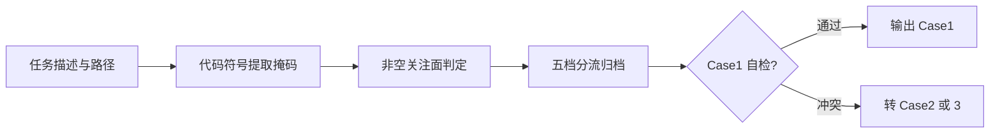

# 修复 triage 误判工具名与空面集并补全纯文档自检 — 功能设计规范（SPEC）

## 文档信息与变更概览

| 项目 | 内容 |
| --- | --- |
| 当前状态 | `draft`（`draft \| approved \| implementing \| in_review \| implemented \| superseded`） |
| 规划级别 | `L3`（修改需求分流核心判据与 `kit/` 高风险脚本，未 `approved` 前不编码） |
| 创建 / 更新 | `2026-11-18` / `2026-11-18` |
| 分支 / Issue / PR | `feat/triage-fix` / #55 / 未关联 |
| 负责人 / 内审状态 | planner-55 / `pending` |
| 关联 PRD / Todo | `docs/prd/261117-v8-criteria-trust-prd.md` / `docs/todo/261118-issue55-triage-fix-todo.md` |

- **与总控 PRD 的关系**：挂载于 `docs/prd/261117-v8-criteria-trust-prd.md`（V8 收口增补单），承接 Issue #55 的独立验收标准 `C1..C4`，不修改已冻结的既有 PRD 条目编号。
- **变更一句话**：把 `triageTask` 从「裸正则匹配 `doc` 且放任空面集空真通过」改为「代码符号先行提取与掩码 + 显式非空纯文档证据 + Case 1 强制自检不变式」，杜绝代码改动与缺陷任务被静默放水为 `NO_DOC_DIRECT`。

## 系统变更全景



| 模块 / 文件 | 变更性质 | 核心职责 |
| --- | --- | --- |
| `kit/skills/dev-plan/scripts/triage-rules.mjs` (new) | 新增 | 抽离标识符/路径掩码、`CONCERN_FACES` 修正、缺陷/增改词表、`paths` 文档白名单与 `evaluatePureDocCheck` 自检器，保证 `doc-audit.mjs` 远低于 800 行 |
| `kit/skills/dev-plan/scripts/doc-audit.mjs` | 改造 | `triageTask`、`facesOf` 接入 `triage-rules.mjs`，落盘 `pureDocCheck` 不变式与安全退避路径（仅改分流相关片段） |
| `scripts/dev/fixtures-doc-triage.mjs` (new) | 新增 | #55 双向正反夹具用例（工具名一致性、空面集反例、Case 1 自检正向与 `--files` 拒斥） |
| `scripts/dev/fixtures.mjs` | 改造 | 引入 `fixtures-doc-triage.mjs` (new) 并在 `DOMAIN_REGISTRY` 注册 `doc-triage` 域 |
| `scripts/dev/injections-data.mjs` | 改造 | 预留并追加 `I128..I130` 故障注入（接续 `main` 当前末尾 `I127`，验证撤防掩码/空真防护/自检后门禁变红） |

## 一、背景与边界声明

- **要改什么**：重构 `kit/skills/dev-plan/scripts/doc-audit.mjs` 中 `CONCERN_FACES`、`facesOf` 与 `triageTask` 的文本/路径分流判定，将核心纯文档判定、代码标识符提取与自检逻辑抽入 `kit/skills/dev-plan/scripts/triage-rules.mjs` (new)。
- **不改什么**：不改动 `auditDoc` 章节/占位符校验规则（留给 #56），不改动 `dev-review` 包（留给 #57），不修改 `assessPrdNeed` 的四面/多批/12 文件阈值，不改动 `classifyDoorType` 门型逻辑，也不破坏 `doc-plan.mjs` 现有 CLI 参数签名。
- **本期不做**：不引入任何第三方分词库或 NLP 依赖（严格保持 Node 18+ `node:*` 零依赖）；不修改 `docs/archive/` 历史归档文件。
- **复用既有模块**：复用 `kit/skills/dev-plan/scripts/doc-audit.mjs` 既有 `scanActiveContracts`、`computeCoupledSyncWarnings`、`assessPrdNeed`、`classifyDoorType` 及其返回结构契约。
- **架构基线关系**：遵循 `docs/TDD.md` 单一真相源与 `kit/` 单文件不超过 `800` 行红线（`doc-audit.mjs` 当前已达 `749` 行，必须拆出 `kit/skills/dev-plan/scripts/triage-rules.mjs` (new)）；遵循 `AGENTS.md`「治本不治标、写原则不写死」及双向证伪铁律。
- **替代方案与否决理由**：否决「仅把 `docRe` 中的 `\bdocs?\b` 改为负向后瞻 `(?<!doc-)` 或把 `doc-plan` 写死成例外词」——该方案属于写死特例，遇到 `planx`、`docs.mjs`、`doc-template-render.mjs`、`--no-prune`、`"comment out retry timer"`、`"explain why auth fails"` 等同构问题立即复发。必须从「先掩码代码符号 + 禁止空面集空真 + Case 1 强制反向自检」三层根因治理。

## 二、设计方案与契约变更

### 1. 代码符号先于文档匹配（掩码与特征提取）

在 `kit/skills/dev-plan/scripts/triage-rules.mjs` (new) 中提供纯函数 `extractTriageSignals(text, paths)`：

1. **代码标识符与工具名提取（在跑 `CONCERN_FACES` 与 `docRe` 前先脱敏替换为占位标记 `__CODE_TOKEN__`）**：
   - 带扩展名的文件/模块路径：匹配 `[\w./-]+\.(?:mjs|cjs|js|ts|tsx|jsx|go|py|rs|java|rb|php|cs|c|cpp|h|sh|ps1|yml|yaml|json|toml)`（如 `docs.mjs`、`doc-audit.mjs`、`doc-plan.mjs`、`doc-template-render.mjs`），识别为 `codePathsInText`。
   - 连字符工具/命令与 CLI 子命令：`doc-[a-z0-9-]+`、`review-[a-z0-9-]+`、`govern-[a-z0-9-]+`、`(?:doc-plan|flow|review-pack|govern-audit|repo-map)\s+(?:init|triage|audit|link|archive|start|verify|submit|merge|record)\b`，以及行内反引号包裹标识符，提取进 `toolTokens`。
   - CLI 参数标志：`(?:^|\s)(--[a-z0-9-]+)`（如 `--no-prune`、`--include-diff`），提取进 `flagTokens`。
   - 注释代码操作短语：`\bcomment\s+out\b`（把代码注释掉属于代码改动，不属于文档注释），提取并从文档关键词视野中掩码。
   - 正则/解析器实现词：`正则`、`regex`、`regexp`、`parser`、`false\s+positive`、`误判`、`误报`、`剪光`、`裁剪`，标记为逻辑/代码领域信号。
2. **显式文档对象隔离（防止误伤纯文档修改）**：
   - 仅当真实文档目标（`README*`、`CONTRIBUTING*`、`CHANGELOG*`、`.md` 文件或显式「文档/说明/指南/文案/错别字/拼写/翻译」）存在、且全文与 `paths` 不含任何代码产物或行为改动能指时，对其中附带的业务领域词汇（如 `CONTRIBUTING.md 的发版说明` 中的「发版」、`README` 中的「CI 示例说明」）不归类为 `ci` 代码实施面。
   - 仅当存在 `.github/workflows`、CI 脚本配置、发版流水线实现/发布动作（非单纯文档说明书）时才命中 `ci` 面。
3. **缺陷与功能扩展识别强化**：
   - `runtimeBugRe` 扩充：`\bfails?\b`、`\bfailed\b`、`false\s+positive`、`误报`、`误判`、`剪光`、`漏掉`、`丢失`、`覆盖了`、`坏了`、`不生效`、`异常`、`崩溃`。
   - `explicitFeatureRe` 扩充：中文增补动作（`加一个`、`增加`、`添加`、`新增`、`支持`）与 CLI 参数/子命令增量词联合触发；当 `fixVerbRe`（`fix`/`修复`/`修一下`/`修正`）搭配代码标识符或缺陷信号时优先导向 Case 2（`NO_DOC_RED_GREEN`），绝不因 `doc-*` 名字被压制。
   - `paths` 白名单检查：若传入 `paths`（`--files`），逐项检查是否全部属于纯文档白名单（`*.md`/`*.txt`/`*.rst`/`LICENSE*` 等非 `.github/` 非代码资产）；只要存在任意代码/脚本/工作流/配置路径，`pathsVerifiedDocOnly = false`，强制拦截 Case 1。

### 2. 消除空面集空真与 Case 1 自检不变式

1. **禁止 `faces.every(...)` 空真**：
   - 原 `faces.every((f) => f === 'docs')` 在 `faces.length === 0` 时返回 `true`。新规则要求进入纯文档分支必须满足：
     - 要么存在非空明确文档证明：`faces.length > 0 && faces.every((f) => f === 'docs') && docTargetsFound`，
     - 要么显式传入 `docOnly: true`（同时仍不可含未声明代码路径冲突），
     - 要么满足严格「纯粹概念问答（`pure-qa`）」：文本为解释/询问语法结构（如「解释一下 dev-plan 的五档分流规则」），且 **零**代码修改动词（`fix`/`update`/`comment out`/`加一个`）、**零**运行时失败/故障现象（`fails`/`剪光`/`误报`/`crash`）、**零**待改文件目标（`codePathsInText`、`flagTokens` 为空）。
2. **Case 1 强制自检输出（`pureDocCheck`）**：
   - 在返回 `caseType: 1` 前统一调用 `evaluatePureDocCheck(...)`，构造：

```js
pureDocCheck: {
  passed: true, // 或 false（触发安全退回）
  kind: 'doc-edit' | 'pure-qa' | 'explicit-doc-only',
  whyPureDocs: '明确指向纯文档/概念说明，且未检测到代码符号、缺陷信号或非文档改动路径',
  matchedDocTargets: ['README.md'], // 或 []
  rejectedCodeSignals: [], // 命中时非空并强制 passed=false
  pathsVerifiedDocOnly: true,
}
```

   - **后置不变式（fail-safe）**：`caseType === 1` 返回前若 `!pureDocCheck.passed`（例如 `rejectedCodeSignals.length > 0` 或 `!pathsVerifiedDocOnly`），强制拒绝停留在 Case 1：有缺陷/修复词则降入 Case 2（`NO_DOC_RED_GREEN`），否则进入 Case 3（`TODO_ONLY`）。`triageTask` 同时返回 `faces` 数组便于外部断言与排障。

### 3. 数据流与接口约定

- `triageTask(opts)` 保持所有原有参数与字段（`caseType`, `tier`, `blocked`, `action`, `doorType`, `doorDetails`, `critiqueTier`, `reason`, `docsRequired`, `redGreenRequired`, `needsReview`, `specApprovalRequired`, `prdRequired`, `prdReasons`, `prdAdvice`, `activeContracts`, `coupledSyncWarnings`），新增输出 `faces` 与 `pureDocCheck`（仅 Case 1 或当被自检拒出时附带诊断信息）。
- `kit/skills/dev-plan/scripts/doc-audit.mjs` 导入 `kit/skills/dev-plan/scripts/triage-rules.mjs` (new)，保证不触发 `checkOrphanScripts` 且不触碰 `scripts/lib/**` / `scripts/dev/**`（满足 `arch-rules`）。

## 三、备选方案与否决理由

| 方案 | 怎么做的 | 为什么没选 | 什么情况下该改回它 |
| --- | --- | --- | --- |
| 规则与掩码抽入 `triage-rules.mjs` (new) | 掩码代码符号 + 禁止空面集空真 + Case 1 结构自检 | （已选）根治词边界、空真与缺自检三处根因，且控制 `doc-audit.mjs` < 800 行 | 若未来分流升级为 AST 级调用，可直接替换掩码层 |
| 仅微调 `docRe` 排除 `doc-plan` | 把 `\bdocs?\b` 改为负向后瞻排除 `-` 后面字符 | `docs.mjs`（点号）、`--no-prune`、`comment out`、`explain why auth fails` 与空 `faces` 仍全部穿透 | 不考虑改回（治标不治本） |
| 取消基于关键词的 Case 1 判定 | 全部改成只看 `--doc-only` 开关 | 破坏日常「修改 README 错别字」免打扰体验，触发「只碰文档也要写 Todo」反面问题 | 仅当产品决定彻底废除自然语言自动判 Case 1 时 |

## 四、改动清单与影响面

> 与并行任务 #57 保持 100% 写域隔离；`scripts/dev/fixtures.mjs` 与 `scripts/dev/injections-data.mjs` 若同仓推进，按 Wave 顺序合入或在 #55 合入后再合入 #57，避免合并冲突。

| 文件 / 目录 | 改动性质 | 改什么 | 谁会被影响 |
| --- | --- | --- | --- |
| `kit/skills/dev-plan/scripts/triage-rules.mjs` (new) | 新增 | 实现代码/工具符号提取掩码、非空面集校验、`paths` 文档白名单与 `evaluatePureDocCheck` | `doc-audit.mjs`（内部调用） |
| `kit/skills/dev-plan/scripts/doc-audit.mjs` | 修改 | 更新 `CONCERN_FACES`/`facesOf`/`triageTask` 接入 `triage-rules.mjs`，输出 `faces` 与 `pureDocCheck` 阻断不变式 | `doc-plan.mjs triage` 与 `fixtures-*` |
| `scripts/dev/fixtures-doc-triage.mjs` (new) | 新增 | 覆盖 C1–C3 全部正反双向用例（工具名一致性、空面集、`--files` 代码拒斥、Case 1 自检正向保留） | `scripts/dev/fixtures.mjs` |
| `scripts/dev/fixtures.mjs` | 修改 | 引入 `fixtures-doc-triage.mjs` (new) 并在 `DOMAIN_REGISTRY` 注册 `doc-triage` 域 | 全量 `fixtures.mjs` 测试套件 |
| `scripts/dev/injections-data.mjs` | 修改 | 在 `main` 当前末尾 `I127` 之后依次追加 `I128..I130`（`I128` 关闭代码掩码、`I129` 恢复 `faces.every` 空真、`I130` 跳过 `pureDocCheck` 自检拦截） | `scripts/dev/verify-injections.mjs` |

- **对外可见的变化**：`doc-plan.mjs triage --json` 输出新增 `faces` 与 `pureDocCheck`（含 `passed`、`kind`、`whyPureDocs`、`matchedDocTargets`、`rejectedCodeSignals`）；原先误进 Case 1 的代码/工具名任务改落入 Case 2/Case 3。
- **需要同步改的地方**：在完成代码波次后执行 equip 同步命令（node scripts/equip.mjs .）刷新 `.agents/skills/`，再通过 `node scripts/equip.mjs . --check` 与 `repo-map` 校验。

## 五、冻结的验收标准

> 动手改代码前冻结；实现期间不顺手删减或放宽标准。每条必须能由一条命令或断言实证。

- [ ] C1: （工具名等价性与去特例）运行 `node kit/skills/dev-plan/scripts/doc-plan.mjs triage --summary "doc-plan init 会把可选章节剪光" --json` 以及等价调用（`"planx init 会把可选章节剪光"`、`"survey 会把可选章节剪光"`，含直接调用 `triageTask`），三者的分流档位与动作完全一致（均为非 Case 1，且均不返回 `NO_DOC_DIRECT`）。
- [ ] C2: （消除空真与代码符号误触发）实装 `kit/skills/dev-plan/scripts/triage-rules.mjs` (new) 代码/工具掩码与空面集拦截后，`"comment out retry timer"`、`"explain why auth fails"`、`"把 docs.mjs 里的路径正则修一下"`、`"fix doc-audit false positive"`、`"update doc-plan.mjs usage help"`、`"fix typo in doc-audit.mjs"`、`"doc-audit false positive on headings"`、`"doc-template-render.mjs strips optional sections"`、`"给 doc-plan init 加一个 --no-prune 参数"`、`"为什么 doc-plan init 会把可选章节剪光"`，以及传入 `--files kit/skills/lib/docs.mjs` 的 `"fix typo"`，全部不得返回 `caseType: 1`；对缺陷类提示词（如 `"fix doc-audit false positive"`、`"把 docs.mjs 里的路径正则修一下"`、`"explain why auth fails"`）返回 `caseType: 2`（`NO_DOC_RED_GREEN`）。
- [ ] C3: （Case 1 正向不误伤与自检不变式）运行 `doc-plan.mjs triage`（输入 `"fix typo in README.md"`、`"补充 CONTRIBUTING.md 的发版说明"`、`"解释一下 dev-plan 的五档分流规则"` 与传入 `--files README.md` 的 `"fix broken phrasing"`），全部返回 `caseType: 1`（`NO_DOC_DIRECT`），且 JSON 输出携带 `pureDocCheck.passed === true` 与非空 `whyPureDocs`、`rejectedCodeSignals.length === 0`；反向验证 `pureDocCheck` 不变式在检测到任意代码/缺陷信号时阻止返回 Case 1。
- [ ] C4: （双向夹具、故障注入与全量门禁）`node scripts/dev/fixtures.mjs` 全量通过（支持 `--domain doc-triage` 单独跑 `scripts/dev/fixtures-doc-triage.mjs` (new) 的正反双向断言）；`node scripts/dev/verify-injections.mjs` 验证预留故障注入 `I128..I130`（`I128` 关闭符号掩码、`I129` 恢复 `faces.every` 空真、`I130` 绕过 `pureDocCheck`）全部精准变红且退出码非 `0`；`kit/skills/dev-plan/scripts/doc-audit.mjs` 与 `kit/skills/dev-plan/scripts/triage-rules.mjs` (new) 均不超过 `800` 行；`node scripts/equip.mjs . --check` 与 `merge-gate` 全绿。

## 六、高风险点、门型与回滚路径

- **门型判定**：`one-way`（触及高风险路径 `kit/skills/dev-plan/scripts/doc-audit.mjs` 且改变需求分流入口判定契约；高/低风险路径均须独立审查与故障注入实证）。
- **高风险路径**：`kit/skills/dev-plan/scripts/doc-audit.mjs`、`kit/skills/dev-plan/scripts/triage-rules.mjs` (new)。
- **回滚路径**：仅改分支工作区内两个源码文件及对应夹具；合前可直接丢弃分支或执行 git revert；若需临时降级，`doc-audit.mjs` 中的调用入口可独立反向提交恢复，不影响历史归档文档与既有 `auditDoc` 逻辑。
- **故障注入预演**：在 `scripts/dev/injections-data.mjs` 末尾 `I127` 之后依次预留追加 `I128..I130`：① `I128` 在 `kit/skills/dev-plan/scripts/triage-rules.mjs` (new) 关闭代码标识符掩码（验证 `"doc-plan init 会把可选章节剪光"` 错误落回 Case 1 并被 `fixtures-doc-triage.mjs` (new) 拦截）；② `I129` 在 `doc-audit.mjs` 恢复无非空保护的 `faces.every((f) => f === 'docs')`（验证 `"comment out retry timer"` 被夹具拦下）；③ `I130` 在 `doc-audit.mjs` 绕过 `pureDocCheck.passed` 安全退回检查（验证自检门禁失效测试失败）。

## 七、待拍板问题

无

## 实现说明

<!-- 在合并之前补齐真实实现摘要与验证结果 -->
