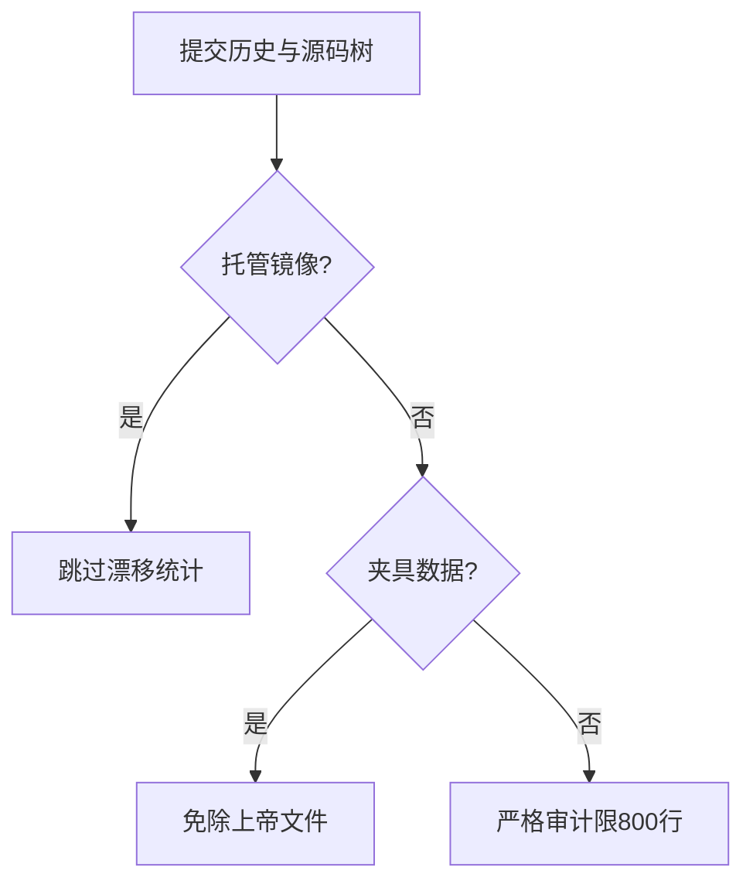

# 补全 docs/TDD.md 模块清单、修正 docs.stale-vs-churn 与夹具误报并按域拆分超长模块 — 功能设计规范（SPEC）

## 文档信息与变更概览

| 项目 | 内容 |
| --- | --- |
| 当前状态 | `draft`（`draft \| approved \| implementing \| in_review \| implemented \| superseded`） |
| 规划级别 | `L3`（跨模块治理契约调整、测试/夹具分类收口与多模块高内聚拆分；未 `approved` 前不编码） |
| 创建 / 更新 | `2026-11-18` / `2026-11-18` |
| 分支 / Issue / PR | `feat/govern-tdd-and-split` / #59 / 未关联 |
| 负责人 / 内审状态 | plan-59 / `pending` |
| 关联 PRD / Todo | `null`（独立治理任务，非 `docs/prd/261117-v8-criteria-trust-prd.md` 切片） / [Todo](../todo/261118-issue59-govern-tdd-and-split-todo.md) |

- **变更一句话**：补齐 `docs/TDD.md` 全量 `.mjs` 完整相对路径清单，在 `kit/skills/lib/static-gates.mjs` 与 `kit/skills/dev-govern/scripts/govern-docs.mjs` 中把 `.pf-manifest.json` 托管技能镜像与测试夹具/注入数据从生产漂移及上帝文件检查中剥离（零副作用于 `TEST_FILE_RE` 测试质量审计），并按单一职责拆分全仓全部超过 800 行的 `.mjs` 模块至 800 行以内。

## 系统变更全景



| 模块 / 文件 | 变更性质 | 核心职责 |
| --- | --- | --- |
| `docs/TDD.md` | 改造 | 补齐全仓 155 个既有及本次新增 `.mjs` 的完整相对路径清单（满足 `tdd-parity.mjs` 完整路径校验）并更新 `最近更新日期` |
| `kit/skills/lib/static-gates.mjs` | 改造 | 保持 `TEST_FILE_RE` 原语义，新增 `FIXTURE_FILE_RE` 与 `isTestOrFixtureFile(rel)` 并接入 `scanStructuralHygiene` |
| `kit/skills/lib/shared.mjs` | 改造 | 重导出 `FIXTURE_FILE_RE` 与 `isTestOrFixtureFile` |
| `kit/skills/dev-govern/scripts/govern-docs.mjs` | 改造 | `checkDocChurnStaleness` 跳过有效 `.pf-manifest.json` 托管的 `.agents/skills/` 镜像（未指定 `--scope` 时）及 `isTestOrFixtureFile` |
| `kit/skills/dev-govern/scripts/govern-checks.mjs` | 改造 | `auditHygiene` `hygiene.god-file` 判定改为 `!isTestOrFixtureFile(f.rel)` |
| `kit/skills/dev-review/scripts/review-gates.mjs` | 改造 | `assessStructuralGate` 使用 `!isTestOrFixtureFile(f)` 决定是否读取全文做 `godFile` 体检 |
| `kit/skills/dev-explore/scripts/repo-map.mjs` | 改造 | `extractReusableModules` 使用 `isTestOrFixtureFile(f.rel)` 排除夹具/测试数据模块 |
| `scripts/lib/survey-git-fast.mjs` (new) | 新增 | 承接 `.git` 配置、索引二进制与松散引用快读逻辑（约 400 行） |
| `scripts/lib/survey-docs.mjs` (new) | 新增 | 承接 `detectDocs`、`detectConventions` 与工作流工具链探测（约 260 行） |
| `scripts/lib/survey-workspace.mjs` | 改造 | 精简至约 580 行（保留 `detectGit`、`scanWorkspaceRaw`、`finalizeWalkWorkspace` 与重导出兼容出口） |
| `scripts/lib/update-net.mjs` (new) | 新增 | 承接代理解析、HTTP/HTTPS CONNECT 下载与 GitHub Release 探针（约 280 行） |
| `scripts/update.mjs` | 改造 | 精简至约 700 行（保留 CLI、`applyPackage` 与重导出 `apiEndpoint`/`routesFor`/`download`/`resolveProxyFor`） |
| `scripts/lib/tar.mjs` (new) | 新增 | 承接 POSIX USTAR `packTar`/`unpackTar`/`truncateUtf8Bytes` 编解码（约 265 行） |
| `scripts/backup.mjs` | 改造 | 精简至约 590 行（保留快照创建/列表/恢复、CLI 与 `packTar`/`unpackTar`/`truncateUtf8Bytes` 重导出） |
| `scripts/dev/fixtures-review-contracts.mjs` (new) | 新增 | 承接 `scripts/dev/fixtures-review.mjs` 中的审查栏、验收 ID 与收尾七步契约夹具（约 390 行） |
| `scripts/dev/fixtures-review.mjs` | 改造 | 精简至约 480 行；新模块注册进 `scripts/dev/fixtures.mjs` |
| `scripts/dev/fixtures-flow-state.mjs` / `scripts/dev/fixtures-flow.mjs` | 改造 | 将 `fixtures-flow.mjs` 末尾 3 条状态机用例迁至 `fixtures-flow-state.mjs`，使两者均保持在 690 行以内 |
| `scripts/dev/injections-data-core.mjs` (new) / `scripts/dev/injections-data-workflow.mjs` (new) / `scripts/dev/injections-data-gates.mjs` (new) | 新增 | 将 `scripts/dev/injections-data.mjs` 按域拆为 3 份数据模块（各 <= 600 行），`injections-data.mjs` 聚合导出 `INJECTIONS` 并新增 `I157`–`I159` |
| `scripts/dev/fixtures-govern.mjs` / `scripts/dev/fixtures.mjs` / `.agents/skills/**` | 改造 | 补齐 C2/C3 正反双向夹具；运行 `node scripts/equip.mjs .` 同步内置技能与 `.pf-manifest.json` |

## 一、背景与边界声明

- **要改什么**：修正 `docs/TDD.md` 模块清单、`kit/skills/lib/static-gates.mjs` / `govern-docs.mjs` / `govern-checks.mjs` 镜像与夹具误报、按域拆分 5 处超 800 行 `.mjs`（及接近上限的 `scripts/dev/fixtures-flow.mjs`），并在仓内可复现门禁中保持 `0` 漂移、`0` 上帝文件与 `0` 新增工作树告警。
  1. **实测基线校准（`main` @ `930aea1`）**：当前 `node .agents/skills/dev-govern/scripts/govern-audit.mjs audit . --json` 报告 6 条 `medium` 告警——5 条 `hygiene.god-file`（`scripts/dev/injections-data.mjs` 1394 行、`scripts/lib/survey-workspace.mjs` 1232 行、`scripts/update.mjs` 979 行、`scripts/dev/fixtures-review.mjs` 859 行、`scripts/backup.mjs` 857 行）与 1 条主仓带外遗留空目录告警 `hygiene.stale-worktree..worktrees/impl-issue-49`；`scripts/compose-agents.mjs`（706 行）与 `scripts/dev/fixtures-flow.mjs`（797 行）在前期 PR 已降至 800 行内（本次把 `fixtures-flow.mjs` 进一步降至 690 行内留出安全余量）。
  2. **`docs/TDD.md` 完整路径对齐**：对盘点出的 `kit/` 与 `scripts/` 下全部 155 个既有 `.mjs` 文件中缺失完整相对路径的 71 个条目（含 13 个连短名也缺失的模块：`kit/skills/lib/doc-facts.mjs`、`kit/skills/lib/doc-renumber.mjs`、`kit/skills/lib/doc-toc.mjs`、`kit/skills/lib/no-changelog-voice.mjs`、`kit/skills/lib/pending-decisions.mjs`、`kit/skills/lib/session-orient.mjs`、`kit/skills/lib/verdict.mjs` 及 6 个 `scripts/dev/fixtures-*.mjs`）以及本次新增模块全部补入完整相对路径。
  3. **消除镜像与夹具误报的根因修复**：在不扩大 `TEST_FILE_RE` 对单测断言/孤儿/跳过检查作用面的前提下，新增独立 `FIXTURE_FILE_RE` 与 `isTestOrFixtureFile(rel)`，并让 `checkDocChurnStaleness` 识别有效 `.pf-manifest.json` 托管的 `.agents/skills/` 镜像目录。
  4. **按域拆小全部 `> 800` 行 `.mjs` 模块**：拆分后全仓每一个 `.mjs` 文件（含扩充测试后的 `scripts/dev/fixtures-govern.mjs`）均 `<= 800` 行，且严格遵守 `AGENTS.md` `arch-rules` 与已有注入锚点。
  5. **带外宿主机运维备忘（非阻塞、不进冻结门禁）**：主仓上的 `.worktrees/impl-issue-49` 属于已合并清理完毕的 sibling 任务 #49（`git worktree list` 未注册、`.git/worktrees/impl-issue-49` 不存在、内部条目数为 `0`、任务账本已标为 `cleaned`），在当前工作站上被外部独立挂起的 `git rebase --continue -> vim` 进程持有了工作目录句柄而未能自动移除。该宿主机目录清理不属于 Issue #59 PR/CI 可复现范围，不纳入冻结验收门禁、亦不在规格或任务文档中硬编码任何易变宿主机 PID；若日后维护者在宿主机上执行带外清理，须先现场重新检查目录为空与当前占用进程命令行，经人类显式确认后再手工处理。
- **不改什么**：保持 `TEST_FILE_RE`、`govern-tests.mjs`、`tdd-parity.mjs`、`docs/prd/261117-v8-criteria-trust-prd.md`、`GOD_FILE_WARN_LINES = 800` 阈值与宿主机外部进程不变。
  - 不修改 `TEST_FILE_RE` 的匹配规则与 `kit/skills/dev-govern/scripts/govern-tests.mjs`、`kit/skills/lib/tdd-parity.mjs`、`kit/skills/lib/static-gates.mjs` `detectGateWeakeningInEntry` 对单元测试文件的判定边界。
  - 不修改或归档 `docs/prd/261117-v8-criteria-trust-prd.md`（其关联的 `#49..#52` 与 `#55..#58`、`#62` 均已合入归档，不属于 Issue #59 范围）。
  - 不修改 `GOD_FILE_WARN_LINES = 800`、`GOD_FILE_HIGH_LINES = 1500` 及 `docs.stale-vs-churn` 的 `>= 8` 提交阈值。
  - 不在 Issue #59 代码、测试或 PR 流程中自动终止宿主机外部 OS 进程或强行删除未在 `git worktree` 注册的主仓外部目录 `.worktrees/impl-issue-49`。
- **本期不做**：不合入无关的 Stage B 新特性；不重构已低于 750 行的 `scripts/compose-agents.mjs`；不改写 `scripts/dev/verify-injections.mjs` 的运行器并发策略。
- **复用既有模块**：`kit/skills/lib/static-gates.mjs`（静态规则单一真相源）、`kit/skills/lib/git.mjs`（`posixPath` / `readJsonSafe`）、`kit/skills/lib/shared.mjs`（套件统一兼容重导出）、`scripts/lib/protocol.mjs`（`COMMON_SKIP_DIRS` / `apiTarget`）、`scripts/lib/text.mjs`（`posixPath` / `readTextSafe` / `skillVersion`）。
- **架构基线关系**：严格遵循 `docs/TDD.md` 四层单向依赖与 `AGENTS.md` `arch-rules`（`kit/** -> scripts/dev/**`、`kit/** -> scripts/lib/**`、`scripts/*.mjs -> scripts/dev/**`、`scripts/lib/** -> scripts/dev/**` 四条禁引全为 0 违规）及零第三方依赖不变量。
- **替代方案与否决理由**：已否决「直接扩写 `TEST_FILE_RE` 纳入 `fixtures-*` 与 `injections-data`」的方案——实测 `scripts/dev/` 下 `fixtures-claims.mjs` 等 9 个夹具含 `TEST_CASE_RE` 命中但采用返回错误字符串而非 `assert`/`expect` 风格，若直接扩写 `TEST_FILE_RE` 会立即在 `govern-tests.mjs` 触发 `tests.zero-assertion` / `tests.orphan-suite` 误报，并在 `detectGateWeakeningInEntry` 误触发测试断言/跳过拦截。

## 二、设计方案与契约变更

### 接口 / 数据结构变更

1. **夹具与数据文件分类器（`kit/skills/lib/static-gates.mjs` + `kit/skills/lib/shared.mjs`）**

```js
export const FIXTURE_FILE_RE =
  /(?:^|\/)(?:fixtures?|__fixtures__|testdata|__mocks__)\/|(?:\.(?:fixtures?|mocks?|testdata)\.[^/]+$)|(?:^|\/)fixtures(?:-[^/]+)?\.[^/]+$|(?:^|\/)injections-data(?:-[^/]+)?\.[^/]+$/i

export function isTestOrFixtureFile(rel) {
  const p = posixPath(rel)
  return TEST_FILE_RE.test(p) || FIXTURE_FILE_RE.test(p)
}
```

- **调用边界清单（7 处 `TEST_FILE_RE` 引用点逐一核定）**：
  - `kit/skills/lib/static-gates.mjs` `scanStructuralHygiene`（`godFile` 判断）：改用 `!isTestOrFixtureFile(fileRel)`。
  - `kit/skills/lib/static-gates.mjs` `detectGateWeakeningInEntry`：保留 `TEST_FILE_RE.test(rel)`，避免夹具里的模拟测试字符串触发 `test-skip-or-only`/`deleted-assertion`。
  - `kit/skills/dev-govern/scripts/govern-checks.mjs` `auditHygiene`（`hygiene.god-file`）：改用 `!isTestOrFixtureFile(f.rel)`；`auditSecurity` 与 `auditPerf` 保持 `!TEST_FILE_RE.test(f.rel)`，不放松脚本安全/超时检查。
  - `kit/skills/dev-review/scripts/review-gates.mjs` `assessStructuralGate`（第 338 行读取全文传给 `scanStructuralHygiene`）：改用 `!isTestOrFixtureFile(f)`；第 44/48/229 行保留 `TEST_FILE_RE`。
  - `kit/skills/dev-explore/scripts/repo-map.mjs` `extractReusableModules`（第 276 行）：改用 `isTestOrFixtureFile(f.rel)` 防止通用夹具目录进入可复用模块推荐；第 419 行保持原逻辑。
  - `kit/skills/dev-govern/scripts/govern-docs.mjs` `checkDocChurnStaleness`：改用 `isTestOrFixtureFile(rel)` 跳过测试与夹具数据文件。
  - `kit/skills/dev-govern/scripts/govern-tests.mjs` 与 `kit/skills/lib/tdd-parity.mjs`：保持 `TEST_FILE_RE`，确保 0 新增 `tests.zero-assertion` / `tests.orphan-suite` 误报且 `I73` 不退化。

2. **镜像与夹具漂移剔除（`kit/skills/dev-govern/scripts/govern-docs.mjs`）**
- 在 `checkDocChurnStaleness` 中读取 `join(repoRoot, '.agents', 'skills', '.pf-manifest.json')`：仅当解析结果为非空普通对象、`typeof manifest.files === 'object' && manifest.files !== null && !Array.isArray(manifest.files)`，且未传入局部 `--scope`（`!scopeRel`）时，允许跳过托管技能镜像路径。
- 在 `checkDocChurnStaleness` 内部抽取同一共享判定辅助函数 `shouldSkipChurnFile(rel)`（同时覆及第 237 行目录收集循环与第 249 行逐目录 `sinceDoc` 计数循环，确保两处循环条件完全一致）：满足 `!CODE_EXT_RE.test(rel) || isTestOrFixtureFile(rel) || (hasManagedSkillsMirror && rel.startsWith('.agents/skills/'))` 时跳过（含历史已退役旧路径，彻底消除 `docs.stale-vs-churn..agents/skills` 重复告警）。
- 若 `.pf-manifest.json` 不存在或格式损坏，或用户显式传入 `--scope .agents/skills`，则不跳过；真实源码目录（如 `kit/skills/`、`scripts/lib/`）达 `>= 8` 次非测试非夹具提交未同步文档时仍精确报 `docs.stale-vs-churn.<dir>`。

3. **超长模块拆分与向后兼容重导出**
- `scripts/lib/survey-workspace.mjs`（1232 -> 约 580 行）：拆出 `scripts/lib/survey-git-fast.mjs` (new) 与 `scripts/lib/survey-docs.mjs` (new)；`survey-workspace.mjs` 重导出 `detectDocs`、`detectConventions` 供 `scripts/survey.mjs` 与现有测试零改动使用，并保留 `let codeFiles = 0` / `protocol.isToolOwnedPath` 计数段（兼容 `scripts/dev/fixtures-survey.mjs` 与 `I126`）。
- `scripts/update.mjs`（979 -> 约 700 行）：拆出 `scripts/lib/update-net.mjs` (new)；`scripts/update.mjs` 重导出 `apiEndpoint`、`routesFor`、`download`、`resolveProxyFor` 供 `scripts/dev/fixtures-contracts.mjs` 与 `scripts/dev/fixtures-equip.mjs` 兼容调用，并保留 `applyPackage`（兼容 `I44`、`I54` 与 `fixtures-review.mjs`）。
- `scripts/backup.mjs`（857 -> 约 590 行）：拆出 `scripts/lib/tar.mjs` (new)；`scripts/backup.mjs` 重导出 `packTar`、`unpackTar`、`truncateUtf8Bytes`（兼容 `fixtures-equip.mjs`），并保留 `createBackup`/`restoreBackup`（兼容 `I25`、`I29`）。
- `scripts/dev/fixtures-review.mjs`（859 -> 约 480 行）：拆出 `scripts/dev/fixtures-review-contracts.mjs` (new) 并在 `scripts/dev/fixtures.mjs` 注册 `review-contracts` 域。
- `scripts/dev/fixtures-flow.mjs`（797 -> 约 680 行）：将末尾 3 条流转状态用例迁至 `scripts/dev/fixtures-flow-state.mjs`（509 -> 约 625 行）。
- `scripts/dev/injections-data.mjs`（1394 -> 约 25 行）：拆为 `scripts/dev/injections-data-core.mjs` (new)、`scripts/dev/injections-data-workflow.mjs` (new)、`scripts/dev/injections-data-gates.mjs` (new)，主文件仅聚合导出 `INJECTIONS`。

### 数据与状态变更

- 本次不涉及持久化数据格式、任务账本 Schema 或 `.pf-manifest.json` 结构版本变更；运行 `node scripts/equip.mjs .` 会刷新 `.agents/skills/` 同步文件与 `.pf-manifest.json` 文件哈希。

### 异常、回退与安全边界

- `.pf-manifest.json` 缺失或损坏时，`checkDocChurnStaleness` 保守不跳过 `.agents/skills/`，防止恶意或失效清单掩盖未文档化源码漂移。
- `FIXTURE_FILE_RE` 严禁宽泛匹配普通业务脚本（如 `scripts/dev/preflight*.mjs`、`scripts/dev/verify-injections.mjs`、`scripts/lib/*`），确保普通超长脚本仍触发 `hygiene.god-file`。
- 仓内任何治理或清理流程绝不自动终止外部宿主机 OS 进程或跳过确认删除未在 `git worktree` 注册的目录；宿主机带外维护始终保持只读报告与人类显式确认边界。

### 实现顺序

1. 在 `kit/skills/lib/static-gates.mjs` 与 `kit/skills/lib/shared.mjs` 新增并导出 `FIXTURE_FILE_RE` 与 `isTestOrFixtureFile`，同步更新 `govern-docs.mjs`（两处提交扫描循环共用同一跳过判定）、`govern-checks.mjs`、`review-gates.mjs`、`repo-map.mjs` 并运行 `node scripts/equip.mjs .`。
2. 在 `scripts/dev/fixtures-govern.mjs`（当前 675 行，增量用例须精简可控以保持 `<= 800` 行）补齐 C2、C3 正反双向夹具并运行定向夹具验证 Red-Green。
3. 按域拆分 `survey-workspace.mjs`、`update.mjs`、`backup.mjs`、`fixtures-review.mjs`、`fixtures-flow.mjs` 与 `injections-data.mjs`（并在 `injections-data-gates.mjs` (new) 新增对称带 `alsoDropIn` 的故障注入 `I157`–`I159`），校验全部 `.mjs` 文件均 `<= 800` 行且 `arch-rules` 零违规。
4. 全面核对 `docs/TDD.md` 全仓 `.mjs` 完整相对路径清单与最近更新日期，确保零缺漏、零死路径。
5. 在隔离工作树内全量跑通 `merge-gate` 与 `govern-audit.mjs audit . --json`、`reconcile --json`，确认 `0` `docs.stale-vs-churn`、`0` `hygiene.god-file` 与 `0` 由 Issue #59 新引入的 `hygiene.stale-worktree`。

## 三、备选方案与否决理由

| 方案 | 怎么做的 | 为什么没选 | 什么情况下该改回它 |
| --- | --- | --- | --- |
| 独立分类函数 `isTestOrFixtureFile` + 清单校验镜像 | 保留 `TEST_FILE_RE` 专用于测试套件，新增 `FIXTURE_FILE_RE` 专用于夹具与注入数据，并在 `govern-docs.mjs` 校验 `.pf-manifest.json` 后跳过镜像 | 不改动 `govern-tests.mjs` 作用面，零 `tests.zero-assertion` 误报，也不放松普通 `scripts/` 检查 | 若未来所有夹具均改造为标准 `node:test` + `assert` 断言结构 |
| 直接将 `scripts/dev/` 与 `fixtures-*` 并入 `TEST_FILE_RE` | 修改 `static-gates.mjs` 的 `TEST_FILE_RE` 正则 | 会把 9 个无 `assert` 关键字的夹具卷入 `govern-tests.mjs` 触发 `tests.zero-assertion` 与 `tests.orphan-suite` 误报，并破坏 `detectGateWeakeningInEntry` | 永不建议直接混并纯夹具与正式测试套件正则 |
| 仅靠规则豁免超长夹具而不拆分 | 放行 > 800 行的 `fixtures-review.mjs` 与 `injections-data.mjs` | 虽然 `hygiene.god-file` 消除，但上千行数据表与测试堆砌仍会加剧上下文膨胀与并行冲突 | 无；拆分后兼得高内聚与规则兜底 |

## 四、改动清单与影响面

| 文件 / 目录 | 改动性质 | 改什么 | 谁会被影响 |
| --- | --- | --- | --- |
| `kit/skills/lib/static-gates.mjs` | 修改 | 新增 `FIXTURE_FILE_RE`、`isTestOrFixtureFile`，更新 `scanStructuralHygiene` | `govern-checks.mjs`、`govern-docs.mjs`、`review-gates.mjs`、`repo-map.mjs` |
| `kit/skills/lib/shared.mjs` | 修改 | 导出 `FIXTURE_FILE_RE`、`isTestOrFixtureFile` | 外部与套件调用方 |
| `kit/skills/dev-govern/scripts/govern-docs.mjs` | 修改 | `checkDocChurnStaleness` 跳过托管镜像与 `isTestOrFixtureFile` | `govern-audit.mjs` |
| `kit/skills/dev-govern/scripts/govern-checks.mjs` | 修改 | `hygiene.god-file` 改用 `!isTestOrFixtureFile(f.rel)` | `govern-audit.mjs` |
| `kit/skills/dev-review/scripts/review-gates.mjs` | 修改 | `assessStructuralGate` 使用 `!isTestOrFixtureFile(f)` | `review-pack.mjs` |
| `kit/skills/dev-explore/scripts/repo-map.mjs` | 修改 | `extractReusableModules` 使用 `isTestOrFixtureFile(f.rel)` | `repo-map.mjs` |
| `.agents/skills/**` | 修改 | 运行 `node scripts/equip.mjs .` 同步哈希与文件 | 本地技能运行时与 `preflight` |
| `scripts/lib/survey-git-fast.mjs` (new) | 新增 | 承接 `.git` 配置/索引/引用快读函数 | `scripts/lib/survey-workspace.mjs` |
| `scripts/lib/survey-docs.mjs` (new) | 新增 | 承接 `detectDocs`、`detectConventions` 与工作流工具链探测 | `scripts/lib/survey-workspace.mjs`、`scripts/survey.mjs` |
| `scripts/lib/survey-workspace.mjs` | 修改 | 删减已迁出实现至约 580 行并重导出兼容符号 | `scripts/survey.mjs`、`scripts/dev/fixtures-survey.mjs` |
| `scripts/lib/update-net.mjs` (new) | 新增 | 承接代理、HTTP/HTTPS CONNECT 下载与 Release 探针 | `scripts/update.mjs` |
| `scripts/update.mjs` | 修改 | 精简至约 700 行并重导出网络接口 | `scripts/dev/fixtures-contracts.mjs`、`scripts/dev/fixtures-equip.mjs` |
| `scripts/lib/tar.mjs` (new) | 新增 | 承接 POSIX USTAR `packTar`/`unpackTar`/`truncateUtf8Bytes` | `scripts/backup.mjs` |
| `scripts/backup.mjs` | 修改 | 精简至约 590 行并重导出 tar 接口 | `scripts/dev/fixtures-equip.mjs`、`scripts/equip.mjs` |
| `scripts/dev/fixtures-review-contracts.mjs` (new) | 新增 | 承接审查栏/验收 ID/收尾七步契约夹具 | `scripts/dev/fixtures.mjs` |
| `scripts/dev/fixtures-review.mjs` | 修改 | 迁出契约夹具至约 480 行 | `scripts/dev/fixtures.mjs` |
| `scripts/dev/fixtures-flow.mjs` / `scripts/dev/fixtures-flow-state.mjs` | 修改 | 将末尾 3 条状态机用例迁至 `fixtures-flow-state.mjs` | `scripts/dev/fixtures.mjs` |
| `scripts/dev/injections-data.mjs` / `scripts/dev/injections-data-core.mjs` (new) / `scripts/dev/injections-data-workflow.mjs` (new) / `scripts/dev/injections-data-gates.mjs` (new) | 新增/修改 | 按域拆分故障注入数据表至 <= 600 行/文件并新增 `I157`–`I159` | `scripts/dev/verify-injections.mjs` |
| `scripts/dev/fixtures-govern.mjs` / `scripts/dev/fixtures.mjs` | 修改 | 新增 C2、C3 正反双向断言并注册 `review-contracts` 域 | `merge-gate` |
| `docs/TDD.md` | 修改 | 补齐全仓 100% `.mjs` 完整相对路径清单与最近更新日期 | `review.mjs`、`tdd-parity.mjs`、`govern-audit.mjs` |

- **对外可见的变化**：`kit/skills/lib/static-gates.mjs` 与 `kit/skills/lib/shared.mjs` 新增导出 `FIXTURE_FILE_RE` 与 `isTestOrFixtureFile`；`govern-audit.mjs audit` 消除镜像与夹具误报；其余顶层脚本导出签名与 CLI 行为完全兼容。
- **需要同步改的地方**：`.agents/skills/**`（`node scripts/equip.mjs .`）、`docs/TDD.md`（全量模块路径与 `最近更新日期`）、`scripts/dev/fixtures.mjs`（注册新增夹具域）、`scripts/dev/injections-data-gates.mjs` (new)（新增 `I157`–`I159`）。

## 五、冻结的验收标准

> 动手改代码前冻结；实现期间不顺手删减或放宽标准。每条必须能由一条命令或断言实证。

- [ ] C1: `docs/TDD.md` 包含 `kit/skills/**` 与 `scripts/**` 下全部 100% 既有及本次新增 `.mjs` 模块的完整相对路径（无一缺失），更新 `最近更新日期` 且 0 失效引用；运行 `node scripts/review.mjs .` 返回 0 个 `missing`，`node scripts/dev/preflight.mjs` 全绿退出 0。
- [ ] C2: `kit/skills/dev-govern/scripts/govern-docs.mjs` 的 `checkDocChurnStaleness` 在第 237 行与第 249 行两处循环中一致跳过受有效 `.pf-manifest.json`（`!Array.isArray(manifest.files)` 非空普通对象且 `!scopeRel`）托管的 `.agents/skills/` 镜像目录以及 `isTestOrFixtureFile(rel)` 测试/夹具文件；反向：当真实源码目录（如 `kit/skills/` 或 `scripts/lib/`）在最近提交中达 `>= 8` 次非测试非夹具提交且未同步 `docs/TDD.md` / `AGENTS.md` / `docs/*.md` 时仍触发 `docs.stale-vs-churn.<dir>`（由 `scripts/dev/fixtures-govern.mjs` 正反夹具 + `I157` 验证）。
- [ ] C3: `kit/skills/lib/static-gates.mjs`（`FIXTURE_FILE_RE` / `isTestOrFixtureFile`）与 `kit/skills/dev-govern/scripts/govern-checks.mjs` 正确豁免 `scripts/dev/fixtures-*.mjs` 与 `scripts/dev/injections-data*.mjs` 不报 `hygiene.god-file` 且不触发 `govern-tests.mjs` `tests.zero-assertion` 误报；反向：非测试/非夹具脚本（含 `scripts/dev/` 下普通非夹具脚本或 `scripts/lib/` 模块）超过 800 行仍必须触发 `hygiene.god-file`（由 `scripts/dev/fixtures-govern.mjs` 正反夹具 + `I158`、`I159` 验证）。
- [ ] C4: `scripts/lib/survey-workspace.mjs`（拆出 `scripts/lib/survey-git-fast.mjs` 与 `scripts/lib/survey-docs.mjs`）、`scripts/update.mjs`（拆出 `scripts/lib/update-net.mjs`）、`scripts/backup.mjs`（拆出 `scripts/lib/tar.mjs`）、`scripts/dev/fixtures-review.mjs`（拆出 `scripts/dev/fixtures-review-contracts.mjs`）、`scripts/dev/fixtures-flow.mjs` 与 `scripts/dev/injections-data.mjs`（拆出 `scripts/dev/injections-data-core.mjs`、`scripts/dev/injections-data-workflow.mjs`、`scripts/dev/injections-data-gates.mjs`）拆分后，含新增用例后的 `scripts/dev/fixtures-govern.mjs`（675 行起）在内全仓所有 `.mjs` 文件均 `<= 800` 行，原模块导出签名与行为 100% 兼容，且 `arch-rules` 四条禁引 0 违规。
- [ ] C5: 在仓内可执行且可复现的检查下，执行 `node .agents/skills/dev-govern/scripts/govern-audit.mjs audit . --json` 与 `reconcile --json` 均达到 `0` 条 `docs.stale-vs-churn`、`0` 条 `hygiene.god-file` 与 `0` 条由 Issue #59 新引入的 `hygiene.stale-worktree`（外部宿主机既有孤儿目录 `.worktrees/impl-issue-49` 仅作为非阻塞带外运维备忘，不计入 PR/CI 阻断判据），且完整 `merge-gate`（含 `preflight.mjs`、`gap-coverage.mjs`、`fixtures.mjs`、`compose-agents.mjs . --check`、`equip.mjs . --check`、`review.mjs .`、`sync-toc.mjs --check`、`verify-injections.mjs`）全绿通过（退出码 0）。

## 六、高风险点、门型与回滚路径

- **门型与回滚路径**：`one-way`（触及 `kit/`、`AGENTS.md` `high-risk` 路径并调整门禁分类语义）；回滚做法：合入前可直接废弃分支或 `flow.mjs abort --confirm`，已合入远端一律通过 `git revert` 反向提交并重跑全量 `merge-gate` 校验，严禁强推改写历史。
- **高风险路径**：`kit/skills/lib/static-gates.mjs`、`kit/skills/lib/shared.mjs`、`kit/skills/dev-govern/scripts/govern-docs.mjs`、`kit/skills/dev-govern/scripts/govern-checks.mjs`、`kit/skills/dev-review/scripts/review-gates.mjs`、`kit/skills/dev-explore/scripts/repo-map.mjs`、`scripts/lib/survey-workspace.mjs`、`scripts/lib/survey-git-fast.mjs` (new)、`scripts/lib/survey-docs.mjs` (new)、`scripts/lib/tar.mjs` (new)、`scripts/lib/update-net.mjs` (new)。
- **故障注入预演**：除既有 `I24`、`I25`、`I28`、`I29`、`I44`、`I54`、`I70`、`I72`、`I118`、`I123`、`I126`、`I133` 全部维持必红并通过 `verify-injections.mjs` 校验外，在 `scripts/dev/injections-data-gates.mjs` (new) 新增 `I157`（破坏 `checkDocChurnStaleness` 镜像/夹具跳过）、`I158`（回退 `govern-checks.mjs` 夹具 `god-file` 豁免）、`I159`（放宽 `FIXTURE_FILE_RE` 覆及普通 `scripts/dev/` 非夹具脚本，验证反向 `hygiene.god-file` 断言必红）；凡目标为 `kit/` 文件的 `I157`–`I159` 条目均须同步设置 `alsoDropIn: ['.agents/skills/...']`（对齐 `I152`–`I154`），保证镜像 `.agents/skills/` 调用与源目录对称必红。

## 澄清与补充记录

- （本轮无额外澄清补充；用户拍板确认的新增要求可通过 `doc-plan.mjs clarify` 写入「已确认：…」）

## 实现说明

> 代码合入前补齐，随功能 PR 一同提交并标记 `implemented`；若常青架构已同步进 `docs/TDD.md`，随关联 `PRD`/`Todo` 成对归档至 `docs/archive/specs/`。

- **实际落地摘要**：
- **与草案的差异**：
- **关联同步文件**：
