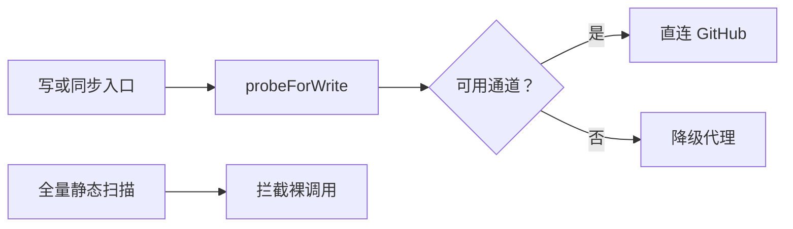

# 写操作路径改用 probeForWrite 与静态门禁全覆盖 — 功能设计规范（SPEC）

## 文档信息与变更概览

| 项目 | 内容 |
| --- | --- |
| 当前状态 | `draft`（`draft \| approved \| implementing \| in_review \| implemented \| superseded`） |
| 规划级别 | `L3`（跨 `dev-review`、`dev-flow`、`dev-govern` 与自用门禁层，未 `approved` 前不编码） |
| 创建 / 更新 | `2026-11-18` / `2026-11-18` |
| 分支 / Issue / PR | `feat/probe-for-write` / #62 / 未关联 |
| 负责人 / 内审状态 | plan-62 / `pending` |
| 关联 PRD / Todo | 独立缺陷修复与门禁加固（`related_prd: null`） / [261118-issue62-probe-for-write-todo.md](../todo/261118-issue62-probe-for-write-todo.md) |

- **变更一句话**：将 `kit/` 中所有 GitHub 写操作与远端同步入口统一接入联网探测 `probeForWrite`，并以全仓 AST/词法静态扫描阻断任何裸 `probeGitHubEnv` 写路径回流。

## 系统变更全景

| 模块 / 文件 | 变更性质 | 现状行数与问题 | 核心改动 |
| --- | --- | --- | --- |
| `kit/skills/dev-review/scripts/review-ledger.mjs` | 改造 | 713 行；`syncReviewToGitHub` 调裸 `probeGitHubEnv` | 改用 `probeForWrite`，保留 `<= 800` 行 |
| `kit/skills/dev-flow/scripts/flow-batch.mjs` | 改造 | 373 行；`handleMergeQueue` 调裸 `probeGitHubEnv` | 改用 `probeForWrite`，保留 `<= 800` 行 |
| `kit/skills/dev-flow/scripts/flow-inspect.mjs` | 改造 | 773 行；`handleStart --create-issue` 调裸 `probeGitHubEnv` | 仅该写路径改用 `probeForWrite`，只读 `inspectWorkspace` 维持 `--probe-auth` 门控，严守 `<= 800` 行 |
| `kit/skills/dev-flow/scripts/flow-sync.mjs` | 改造 | 195 行；仅传 `--probe-auth` 时才探测 | 存在 `ledger.prNumber` 或 `ledger.parentPrNumber` 时触发 `probeForWrite` |
| `kit/skills/dev-govern/scripts/govern-state.mjs` | 改造 | 691 行；`applyGitHubIssues` 调裸 `probeGitHubEnv` | 改用 `probeForWrite` 并支持可选 `_ghProbe`/`_ghClient` 参数 |
| `kit/skills/dev-govern/scripts/govern-audit.mjs` | 改造 | 412 行；调用 `applyGitHubIssues` 未透传探针注入 | 透传 `{ _ghProbe: opts._ghProbe, _ghClient: opts._ghClient }` |
| `kit/skills/lib/shared.mjs` | 改造 | 274 行；仅重导出 `probeGitHubEnv` | 同步导出 `probeForWrite` |
| `scripts/dev/write-probe-audit.mjs`(new) | 新增 | 无共享静态写路径扫描器 | 复用 `stripCodeCommentsLines` 扫描 `kit/skills/` 写入口与裸 `probeGitHubEnv` |
| `scripts/dev/preflight-suite.mjs` | 改造 | 768 行；缺写路径门禁校验 | 接入 `checkKitWriteProbes` 调用共享扫描器，严守 `<= 800` 行 |
| `scripts/dev/fixtures-handoff-review.mjs` | 改造 | 531 行；仅硬编码 4 文件 + 单行 `cwd:` 正则 | 复用共享扫描器并补齐 4 处写路径真实子进程正反夹具，严守 `<= 800` 行 |
| `scripts/dev/injections-data.mjs` | 改造 | 1249 行；`I143..I144` 已占用、`I139..I142` 预留 #56 | 登记故障注入 `I145` 覆盖新修复的写路径 |

## 一、背景与边界声明

- **要改什么**：
  1. `kit/skills/lib/platform.mjs` 的 `probeGitHubEnv` 默认 `probeNetwork = false`，仅当未设 `GH_TOKEN`/`GITHUB_TOKEN` 时在 `kit/skills/lib/platform-probe.mjs` 跳过 `gh auth status` 并返回 `tier: "none"`。`kit/skills/dev-review/scripts/review-ledger.mjs`（`syncReviewToGitHub`）、`kit/skills/dev-flow/scripts/flow-batch.mjs`（`handleMergeQueue`）、`kit/skills/dev-flow/scripts/flow-inspect.mjs`（`handleStart --create-issue`）与 `kit/skills/dev-govern/scripts/govern-state.mjs`（`applyGitHubIssues`）四处写路径误用裸 `probeGitHubEnv`，导致仅凭 `gh auth` 登录时静默退化为 `tier=none`/`delegated` 或报错失败；同时 `kit/skills/dev-flow/scripts/flow-sync.mjs` 在未显式传 `--probe-auth` 时跳过 `probeForWrite`，使 `updatePrBase` 退化为代理载荷。
  2. `scripts/dev/fixtures-handoff-review.mjs` 仅扫描 4 个 `dev-flow` 文件且正则依赖单行 `cwd:` 首字段，而 `scripts/dev/preflight-suite.mjs` 与 `scripts/dev/preflight-contracts.mjs` 缺少写路径静态校验。本次将全量静态扫描沉淀到共享模块并双端接入。
- **不改什么**：
  - 保持 `probeGitHubEnv` 默认 `probeNetwork = false` 惰性只读语义不变，不拖慢 `flow inspect`、`flow next`（无 `--probe-auth`）的本地响应预算。
  - 保持 `flow-inspect.mjs` 中只读 `inspectWorkspace`（`probeNetwork: Boolean(opts.probeAuth)`）与已显式设 `probeNetwork: true` 的 `getIssue`/`hydrateRemotePfState` 语义不变。
  - 不修改 `scripts/lib/platform/`、`task-backend.mjs` 13 方法契约与六锁算法，不修改 `docs/prd/261117-v8-criteria-trust-prd.md`。
- **本期不做**：不新增 GitHub 以外托管平台适配器；不改变无凭据时的 `delegatedPayloads` 结构或 `BLOCKED_*` 错误码命名。
- **复用既有模块**：
  - `kit/skills/lib/platform.mjs` 的 `probeForWrite` 与 `probeGitHubEnv`；
  - `kit/skills/lib/static-gates-lexer.mjs` 的 `stripCodeCommentsLines`（先剥除注释与字符串外噪声再做词法扫描）；
  - `scripts/dev/fixtures-helpers.mjs` 的 `tmpProject`、`gitInit`、`gitCommitFast`、`runAbsAsync`、`rmTree`。
- **架构基线关系**：严格遵守 `arch-rules`（`kit/** -> scripts/dev/**`、`kit/** -> scripts/lib/**` 禁引）。新增扫描器置于 `scripts/dev/` 供 `preflight-suite.mjs` 与 `fixtures-handoff-review.mjs` 共同导入；同时确保 `kit/skills/` 下所有脚本维持 `<= 800` 行且执行 `node scripts/equip.mjs .` 与 `.agents/skills/` 字节级一致。
- **替代方案与否决理由**：
  - 方案 A（已否决）：把 `probeGitHubEnv` 默认 `probeNetwork` 改为 `true`。否决理由：会破坏 `M1` 惰性平台探测不变量，导致只读 `survey` / `flow inspect` / `flow next` 在无 `--probe-auth` 时派生外网子进程。
  - 方案 B（已否决）：直接把 40 行扫描逻辑写进 `scripts/dev/preflight-suite.mjs` 并在 `fixtures-handoff-review.mjs` 再写一份校验。否决理由：`preflight-suite.mjs` 已达 768 行接近 800 行上限，且双份逻辑违背单一真相源原则。

## 二、设计方案与契约变更

### 接口与扫描规则设计

1. **写路径接入 `probeForWrite`**：
   - `review-ledger.mjs`、`flow-batch.mjs`、`flow-inspect.mjs`（`--create-issue` 分支）、`govern-state.mjs`（`applyGitHubIssues`）全部统一调用 `await probeForWrite({ cwd, remoteUrls })`。
   - `applyGitHubIssues(repoRoot, issues, opts = {})` 增加可选第三参 `opts = {}`（兼容既有两参调用），优先消费 `opts._ghProbe ?? (opts._ghClient ? { env: { providerId: 'github', trackB: { tier: opts._ghClient.tier ?? 'gh-cli' } }, client: opts._ghClient } : await probeForWrite({ cwd: repoRoot, remoteUrls }))`；`govern-audit.mjs` 透传 `{ _ghProbe: opts._ghProbe, _ghClient: opts._ghClient }`。
   - `flow-sync.mjs` 将探测前提由 `(opts._ghProbe || opts._ghClient || opts['probe-auth'])` 扩展为 `(opts._ghProbe || opts._ghClient || opts['probe-auth'] || ledger.prNumber || ledger.parentPrNumber)`，使有 PR/父 PR 的 `sync` 无需额外加 `--probe-auth` 也能联网更新基线；在测试环境 `PF_NO_REAL_AUTH_PROBE=1` 下 `probeForWrite` 仍保持零外部派生开销。
   - `kit/skills/lib/shared.mjs` 补齐导出 `probeForWrite`。

2. **共享全量静态写路径扫描器（`scripts/dev/write-probe-audit.mjs`(new)）**：
   - 导出 `scanKitWriteProbeViolations(entries)` 与 `collectKitWriteProbeTargets(rootDir)`，由 `preflight-suite.mjs` 的 `checkKitWriteProbes`（受 `runSuiteChecks` 调度）与 `fixtures-handoff-review.mjs` 共同调用，避免重复逻辑且使 `preflight-suite.mjs` 保持 `<= 780` 行。
   - **扫描对象**：`kit/skills/` 下全部 `.mjs` 文件，跳过底层定义与重导出模块（`kit/skills/lib/platform.mjs`、`kit/skills/lib/platform-probe.mjs`、`kit/skills/lib/github-client.mjs`、`kit/skills/lib/task-backend.mjs`、`kit/skills/lib/shared.mjs`）。
   - **预处理与括号平衡解析**：先调用 `stripCodeCommentsLines(src, '.mjs')` 剥离单行/块级注释，再对真实代码执行括号深度匹配提取 `probeGitHubEnv(...)` 完整实参串（兼容任意键序、多行换行与嵌套对象字面量）。
   - **两条硬门禁规则**：
     - 规则 A（写入口必走 `probeForWrite`）：若文件中存在真实调用 `.(createIssue|postComment|addLabels|removeLabel|createPr|mergePr|updatePrBase|claimTask|releaseTask|getCommitChecks|findOpenPrForBranch|listOpenPrsByBase)(` 或直接调用导入的 `createIssue(` / `removeLabel(`，则同一文件代码正文中必须真实调用 `probeForWrite(`。
     - 规则 B（禁用裸 `probeGitHubEnv`）：任意文件中出现的每次 `probeGitHubEnv(` 调用（排除 `import`/`export` 声明），其参数列表必须显式包含 `probeNetwork:` 属性且不得为字面量 `false`（允许只读路径 `probeNetwork: true` 或 `probeNetwork: Boolean(opts.probeAuth)`；写路径若误留 `probeGitHubEnv({ cwd, remoteUrls })` 或 `{ remoteUrls, cwd }` 或 `{ ..., probeNetwork: false }` 一律报错）。

3. **运行时与静态双向测试设计**：
   - **真实探针路径（不传 `_ghProbe`/`_ghClient`）**：在临时目录生成可执行假 `gh` 脚本（Windows 生成 `gh.cmd`，POSIX 生成 `+x` shell 脚本），子进程环境变量清空 `GH_TOKEN`/`GITHUB_TOKEN` 并设 `PF_NO_REAL_AUTH_PROBE=0`、`PATH=<fakeBin>;...`，分两种场景验证 `review-ledger`（`record`）、`flow-batch`（`merge-queue`）、`flow-inspect`（`start --create-issue`）与 `govern-state`（`applyGitHubIssues`）：
     - 正向（假 `gh auth status --hostname github.com` 返回 0 + logged in）：4 处均成功进入 `tier === 'gh-cli'` 并真实触发对应 `gh` 写/查询子命令，不落入 `tier=none` 静默降级。
     - 反向（假 `gh auth status` 返回非 0 未登录，或仓为 `local-only`/`generic-git`）：`syncReviewToGitHub` 安全降级 `offlineOrNoCreds: true` 且保留 `delegatedPayloads`；`flow start --create-issue` 返回 `EXIT_ACTION_REQUIRED`（`ACTION_REQUIRED_CREATE_ISSUE_DELEGATED`）；`applyGitHubIssues` 返回错误且不抛异常；`flow-batch` 不虚报 PR 已合并。
   - **静态扫描器双向测试**：对实际 `kit/skills/` 返回 0 条违规；对 5 类合成违规样本（键序倒置 `{ remoteUrls, cwd }`、多行参数、显式 `probeNetwork: false`、调用 `createIssue`/`postComment` 缺少 `probeForWrite`、仅在注释出现 `probeForWrite`）全部拦截报错，对合法只读 `probeNetwork: Boolean(opts.probeAuth)` 放行。
   - **故障注入 `I145`**：在 `scripts/dev/injections-data.mjs` 登记 `I145`（避开 #56 预留 `I139..I142` 与 #51 `I143..I144`），将 `kit/skills/dev-review/scripts/review-ledger.mjs` 的 `probeForWrite` 退回裸 `probeGitHubEnv`，确认 `fixtures`（「写操作必须联网探通道」）与 `preflight` 均能红字拦截。

### 影响范围

- `kit/skills/dev-review/scripts/review-ledger.mjs`
- `kit/skills/dev-flow/scripts/flow-batch.mjs`
- `kit/skills/dev-flow/scripts/flow-inspect.mjs`
- `kit/skills/dev-flow/scripts/flow-sync.mjs`
- `kit/skills/dev-govern/scripts/govern-state.mjs`
- `kit/skills/dev-govern/scripts/govern-audit.mjs`
- `kit/skills/lib/shared.mjs`
- `.agents/skills/`（通过 `node scripts/equip.mjs .` 同步，含 `.agents/skills/.pf-manifest.json`）
- `scripts/dev/write-probe-audit.mjs`(new)
- `scripts/dev/preflight-suite.mjs`
- `scripts/dev/fixtures-handoff-review.mjs`
- `scripts/dev/injections-data.mjs`

## 三、冻结的验收标准

- [ ] C1: 写与同步调用点全部切至 `probeForWrite` 且文件行数合规。`kit/skills/dev-review/scripts/review-ledger.mjs`（`syncReviewToGitHub`）、`kit/skills/dev-flow/scripts/flow-batch.mjs`（`handleMergeQueue`）、`kit/skills/dev-flow/scripts/flow-inspect.mjs`（`handleStart --create-issue` 分支）与 `kit/skills/dev-govern/scripts/govern-state.mjs`（`applyGitHubIssues`）全部改为调用 `probeForWrite(...)`；`kit/skills/dev-govern/scripts/govern-audit.mjs` 透传 `_ghProbe`/`_ghClient`；`kit/skills/lib/shared.mjs` 导出 `probeForWrite`；`kit/skills/dev-flow/scripts/flow-sync.mjs` 在 `canQueryGh && (opts._ghProbe || opts._ghClient || opts['probe-auth'] || ledger.prNumber || ledger.parentPrNumber)` 时触发 `probeForWrite`；`flow-inspect.mjs` 只读 `inspectWorkspace` 维持 `probeNetwork: Boolean(opts.probeAuth)`；所有改动文件均保持 `<= 800` 行，且 `node scripts/equip.mjs . --check` 退出 `0`。
- [ ] C2: 真实联网探测运行时正反双向夹具实证（不传 `_ghProbe`/`_ghClient`）。在 `scripts/dev/fixtures-handoff-review.mjs` 中以 `PF_NO_REAL_AUTH_PROBE=0`、清空 `GH_TOKEN`/`GITHUB_TOKEN` 与临时 `PATH` 假 `gh` 验证四处入口：正向（`gh auth status` 返回已登录）四者均进入 `tier === 'gh-cli'` 并实际执行写/查子命令；反向（`gh auth status` 失败或无凭据）`review-ledger` 返回 `offlineOrNoCreds: true` 与完整 `delegatedPayloads`、`flow start --create-issue` 返回 `ACTION_REQUIRED_CREATE_ISSUE_DELEGATED`（退出码 `4`）、`govern-state` 返回 `gh CLI / GitHub token` 错误、`flow-batch` 不虚报 PR 合并成功；`node scripts/dev/fixtures.mjs --only 写操作必须联网探通道` 退出 `0`。
- [ ] C3: 全量 `kit/skills/` 静态门禁与 `preflight` + `fixtures` 双端阻断。`scripts/dev/write-probe-audit.mjs`(new) 复用 `stripCodeCommentsLines` 导出 `scanKitWriteProbeViolations` 与 `collectKitWriteProbeTargets`，在 `scripts/dev/preflight-suite.mjs`（`checkKitWriteProbes`）与 `scripts/dev/fixtures-handoff-review.mjs` 双端运行；对真实 `kit/skills/` 扫出 `0` 违规，对键序倒置/多行 `probeGitHubEnv`、`probeNetwork: false`、缺 `probeForWrite` 或仅注释出现 `probeForWrite` 的合成反面样本全部精准拦截，且不误报只读 `probeNetwork: Boolean(opts.probeAuth)`；`node scripts/dev/preflight.mjs` 退出 `0`。
- [ ] C4: 故障注入自证与合前全量门禁通过。在 `scripts/dev/injections-data.mjs` 新增 `I145`（不占用 `I139..I144`），验证退回裸 `probeGitHubEnv` 后运行 `scripts/dev/verify-injections.mjs`（`--only I145`）退出 `0`；`node scripts/dev/preflight.mjs`、全量 `scripts/dev/fixtures.mjs`、`node scripts/equip.mjs . --check` 与 `node .agents/skills/dev-govern/scripts/govern-audit.mjs audit . --changed --strict` 均退出 `0`。

## 四、高风险点、门型与回滚路径

- **门型与回滚路径**：`one-way`（触及高风险路径 `kit/`、`.agents/skills/`、门禁脚本 `scripts/dev/` 与 `injections-data.mjs`）。回退做法：直接回退对应分支提交，或对单个 `kit/` 文件将 `probeForWrite` 还原并重跑 `node scripts/equip.mjs .` 同步 `.agents/skills/`。
- **高风险路径**：`kit/skills/dev-review/scripts/review-ledger.mjs`、`kit/skills/dev-flow/scripts/flow-batch.mjs`、`kit/skills/dev-flow/scripts/flow-inspect.mjs`、`kit/skills/dev-flow/scripts/flow-sync.mjs`、`kit/skills/dev-govern/scripts/govern-state.mjs`、`kit/skills/dev-govern/scripts/govern-audit.mjs`、`kit/skills/lib/shared.mjs`。
- **行数安全护栏**：`flow-inspect.mjs`（773 行）、`review-ledger.mjs`（713 行）与 `preflight-suite.mjs`（768 行）均接近 `800` 行红线。禁止向这三份文件塞入大段逻辑——新增扫描逻辑全部独立落入 `scripts/dev/write-probe-audit.mjs`(new)，`preflight-suite.mjs` 仅增 `<= 12` 行调用胶水，改动后复核各文件行数 `<= 800`。
- **故障注入预演**：新增 `I145` 针对 `kit/skills/dev-review/scripts/review-ledger.mjs` 写路径退回裸 `probeGitHubEnv`，必须被 `fixtures`（「写操作必须联网探通道」）与 `preflight` 捕获变红。

## 实现说明

> 代码合入前补齐，随功能 PR 一同提交并标记 `implemented`。

- **实际落地摘要**：
- **与草案的差异**：
- **关联同步文件**：
