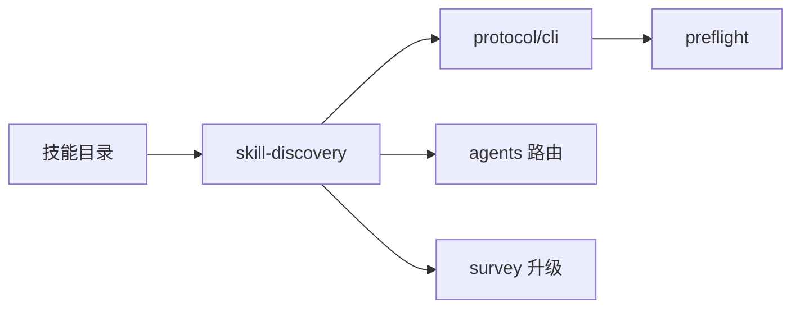

# v9 B1：动态 Skill 发现、自有技能路由保留与升级补齐 — 功能设计规范（SPEC）

## 文档信息与变更概览

| 项目 | 内容 |
| --- | --- |
| 当前状态 | `draft`（`draft \| approved \| implementing \| in_review \| implemented \| superseded`） |
| 规划级别 | `L3`（跨模块契约重构 + 高风险路径 `kit/`/`scripts/lib/`/`templates/`/`AGENTS.md`；未 `approved` 前不编码） |
| 创建 / 更新 | `2026-11-18` / `2026-11-18` |
| 分支 / Issue / PR | 待启动 Wave 1 认领 / `#71` / 未关联 |
| 负责人 / 内审状态 | `plan-stage-b` / `pending` |
| 关联 PRD / Todo | [v9 总控 PRD](../prd/261118-v9-stageb-adaptive-architecture-prd.md) / [B1 Todo](../todo/261118-issue71-b1-skill-discovery-todo.md) |
| 认领的验收标准 | `C1`、`C2`、`C3` |

- **变更一句话**：建立零外部依赖的单源动态 Skill 扫描引擎 `kit/skills/lib/skill-discovery.mjs` (new)，彻底清除分散在全仓的 5 技能硬编码枚举与模板写死路由，补全隐藏及非隐藏目录项目自有技能抽取与 `S1–S4` 新增内置技能无损 `upgrade` 识别。

## 系统变更全景

| 模块 / 文件 | 变更性质 | 核心职责 |
| --- | --- | --- |
| `kit/skills/lib/skill-discovery.mjs` (new) | 新增 | 单源动态扫描内置 `kit/skills/`（YAML `metadata`）及 `.agents/skills/*`、隐藏容器、非隐藏 `skills/*` 非托管技能 frontmatter |
| `kit/skills/lib/cli.mjs`、`scripts/lib/protocol.mjs` | 改造 | 清除 `KNOWN_KIT_SKILLS` / `KIT_SKILLS` / `LIGHTWEIGHT_KIT_SKILLS` 硬编码数组，改由 `skill-discovery.mjs` (new) 动态派生 |
| `kit/skills/dev-explore/SKILL.md`、`kit/skills/dev-plan/SKILL.md`、`kit/skills/dev-flow/SKILL.md`、`kit/skills/dev-review/SKILL.md`、`kit/skills/dev-govern/SKILL.md` | 改造 | 补齐 frontmatter `metadata`（`tier`、`intent`、`script`、`order`、`fallback`），驱动动态路由渲染 |
| `scripts/lib/agents-defaults.mjs`、`scripts/compose-agents.mjs` | 改造 | 渲染动态 `{{KIT_ROUTING_ROWS}}`，融合非隐藏/隐藏容器项目自有技能 `name`/`description` 至 `意图路由` |
| `scripts/lib/survey-reentry.mjs`、`scripts/equip.mjs`、`scripts/handoff.mjs` | 改造 | 修复 `detectKit` 自有技能提取，旧仓缺新版内置技能（未入墓碑）触发 `uninstalledKitSkills` 与 `upgrade` 无损补齐 |
| `templates/agents-project.md`、`AGENTS.md` | 改造 | 将静态 5 行意图路由替换为 `{{KIT_ROUTING_ROWS}}` 并重生成 `AGENTS.md` |
| `scripts/dev/preflight-suite-checks.mjs` (new)、`scripts/dev/preflight-suite.mjs` | 改造 | 先拆出辅助检查把 `preflight-suite.mjs` 压至 `<= 680` 行，并让 `checkKitSuite` 依据动态列表校验 |
| `scripts/dev/fixtures-equip.mjs`、`scripts/dev/fixtures-stageb-onboarding.mjs` (new)、`fixtures-stageb-loop.mjs` (new)、`scripts/dev/fixtures.mjs` | 改造 / 新增 | 消除旧 5 技能硬编码断言；预注册 Stage B 两个新夹具模块，隔离后续波次并补齐 `C1–C3` 正反断言 |

## 一、背景与边界声明

- **要改什么**：动态技能元数据解析、动态路由模板渲染、非隐藏/隐藏自有技能发现、旧仓缺新内置技能升级触发，以及 `preflight-suite`、`fixtures-equip` 的硬编码清零；同步预建 Stage B 夹具注册位避免后续并行波次冲突 `fixtures.mjs`。
- **不改什么**：不改变 `v2` `.pf-manifest.json` 既有 `disabledSkills`、`removedFiles`、`customizedFiles` 语义；不覆盖非托管自有技能目录内容；不引入任何第三方 YAML 解析器。
- **本期不做**：不在产品层代码或规则中硬编码任何具体外部项目自有 Skill 名称；不新增实际第 6 个产品内置技能文件（仅提供动态发现机制并用临时测试夹具实证第 6 技能自动装配）。
- **复用既有模块**：复用 `kit/skills/lib/doc-frontmatter.mjs`（轻量 YAML frontmatter 解析基础）与 `scripts/lib/protocol.mjs`（`TEMPLATE_VARS` 单源契约）、`scripts/equip.mjs` 三态合并逻辑。
- **架构基线关系**：`kit/skills/lib/skill-discovery.mjs` (new) 落在 `kit/skills/lib/`（只用 `node:*` 与 `kit/skills/lib/`），供 `kit/skills/lib/cli.mjs` 与 `scripts/lib/protocol.mjs` 共同引用，严守 `arch-rules`（禁 `kit/** -> scripts/lib/**`）。
- **替代方案与否决理由**：若在 `scripts/lib/` 新建扫描器再由 `kit/skills/` 复制一份会导致双源漂移且违反 `arch-rules`；放在 `kit/skills/lib/` 既随包分发给 `cli.mjs`，又可合法被 `scripts/lib/protocol.mjs` 导入。

## 二、设计方案与契约变更

### 接口 / 数据结构变更

1. **`kit/skills/lib/skill-discovery.mjs` (new)**：
   - 导出 `discoverKitSkills(kitSkillsRoot)`：扫描目录下含有效 `SKILL.md` 的子目录（排除 `lib`/`templates`），解析 frontmatter 与嵌套 `metadata` 块（`tier`: `'both' | 'full'`、`intent`、`script`、`order` 数字排序、`fallback`），返回按 `order` 升序排列的标准化描述符列表。
   - 导出 `discoverCustomSkills(repoRoot, managedSet, manifest)`：同时扫描 `.agents/skills/*`、通用点前缀隐藏目录（`.*` 子目录下的 `skills/*`，跳过 `.git`/`.worktrees`/`.github`/`.agents`，仅只读探测、绝不写入）以及非隐藏 `skills/*` 目录下的 `SKILL.md`，跳过 `managedSet` 托管项，提取 `name`、`description`、`path`、`container`。
2. **`scripts/lib/protocol.mjs` 与 `kit/skills/lib/cli.mjs`**：
   - `KIT_SKILLS`、`LIGHTWEIGHT_KIT_SKILLS`、`KNOWN_KIT_SKILLS` 由 `discoverKitSkills` 动态计算冻结（并支持传入自定义 `kitDir` 供单元测试注入临时第 6 技能目录）。
3. **`scripts/lib/agents-defaults.mjs` 与 `templates/agents-project.md`**：
   - 新增 `renderKitRoutingRows({ tier, customSkills, discoveredSkills })`，替换 `templates/agents-project.md` 静态 5 行并注册 `KIT_ROUTING_ROWS` 至 `TEMPLATE_VARS`。
4. **`scripts/lib/survey-reentry.mjs`**：
   - 修复 `detectKit`：用 `discoverCustomSkills` 填充 `kit.customSkills`；计算 `kit.uninstalledKitSkills`（当前 `KIT_SKILLS` 中未安装在 `.agents/skills/` 且未列入 `.pf-manifest.json` `disabledSkills`/`removedFiles` 的技能），并在非空时将 `survey.mjs` `artifactPlan` `kit-skills` 判为 `upgrade`。

### 数据与状态变更

- 不变更 `.pf-manifest.json`（v2）存储结构；`kit/skills/*/SKILL.md` YAML frontmatter 新增可选标准 `metadata` 字段供静态扫描使用。

### 异常、回退与安全边界

- 扫描 `SKILL.md` 遇到畸形 frontmatter 或缺 `name` 时单条跳过并产出清晰诊断提示，不崩溃主流程。
- 扫描过程中绝不向任何第三方宿主隐藏配置目录执行写操作；已有 `disabledSkills` 与 `removedFiles` 墓碑及 `customizedFiles` 在 `upgrade` 时保持原样，不回滚或覆写。
- `preflight-suite.mjs` 提前拆出 `scripts/dev/preflight-suite-checks.mjs` (new)（约 `200` 行）确保改动后维持 `<= 680` 行（远低于 `800` 行红线）。

### 实现顺序

1. 在 `scripts/dev/preflight-suite.mjs` 抽出 `scripts/dev/preflight-suite-checks.mjs` (new)，并预建注册 `scripts/dev/fixtures-stageb-onboarding.mjs` (new) 与 `scripts/dev/fixtures-stageb-loop.mjs` (new) 到 `scripts/dev/fixtures.mjs`。
2. 为 `kit/skills/dev-explore/SKILL.md`、`kit/skills/dev-plan/SKILL.md`、`kit/skills/dev-flow/SKILL.md`、`kit/skills/dev-review/SKILL.md` 与 `kit/skills/dev-govern/SKILL.md` 补全 `metadata` 字段并新增 `kit/skills/lib/skill-discovery.mjs` (new)。
3. 将 `scripts/lib/protocol.mjs`、`kit/skills/lib/cli.mjs`、`kit/skills/lib/shared.mjs`、`scripts/equip.mjs`、`scripts/compose-agents.mjs`、`scripts/handoff.mjs`、`scripts/lib/agents-defaults.mjs`、`scripts/lib/agents-sections.mjs` 与 `scripts/lib/survey-reentry.mjs` 切换至动态发现，清除硬编码 5 技能枚举。
4. 更新 `templates/agents-project.md` 为 `{{KIT_ROUTING_ROWS}}`，运行 `node scripts/compose-agents.mjs .` 与 `node scripts/equip.mjs .` 同步 `AGENTS.md` 与 `.agents/skills/`，补齐 `fixtures-equip.mjs` 与 `fixtures-stageb-onboarding.mjs` (new) 双向断言。

## 三、备选方案与否决理由

| 方案 | 怎么做的 | 为什么没选 | 什么情况下该改回它 |
| --- | --- | --- | --- |
| `kit/skills/lib/skill-discovery.mjs` (new) 单源扫描 `metadata` + 兼容 `doc-frontmatter` | 仅用 Node 内置字符串解析读 `SKILL.md` frontmatter，零外部依赖供两端共享 | 首选：兼顾 `arch-rules` 单向引用与包分发自包含 | 若将来引入复杂多态 YAML Schema 且突破零依赖前提才改 |
| 保留两处硬编码数组并靠 `preflight` 对比一致 | 继续在 `protocol.mjs` 与 `cli.mjs` 维护常量清单 | 每次增删内置技能仍须改多处源码、模板与测试，无法满足「放进第 6 技能零改源码识别」 | 若永远固定 5 个技能且放弃动态扩展能力 |

## 四、改动清单与影响面

| 文件 / 目录 | 改动性质 | 改什么 | 谁会被影响 |
| --- | --- | --- | --- |
| `kit/skills/lib/skill-discovery.mjs` (new) | 新增 | 零依赖内置/自有技能目录与 YAML `metadata` 扫描器 | `protocol.mjs`、`cli.mjs`、`survey-reentry.mjs` |
| `kit/skills/lib/cli.mjs`、`kit/skills/lib/shared.mjs` | 修改 | 移除硬编码 `KNOWN_KIT_SKILLS`，重导出动态技能发现 | 全套 `dev-*` 脚本 |
| `kit/skills/dev-explore/SKILL.md`、`kit/skills/dev-plan/SKILL.md`、`kit/skills/dev-flow/SKILL.md`、`kit/skills/dev-review/SKILL.md`、`kit/skills/dev-govern/SKILL.md` | 修改 | 添加 `metadata.{tier,intent,script,order,fallback}` | `skill-discovery` 与动态路由 |
| `scripts/lib/protocol.mjs`、`scripts/lib/agents-defaults.mjs`、`scripts/lib/agents-sections.mjs` | 修改 | 动态 `KIT_SKILLS`/`LIGHTWEIGHT_KIT_SKILLS`、`{{KIT_ROUTING_ROWS}}`、提取非隐藏/隐藏自有技能 | `compose-agents`、`equip`、`handoff` |
| `scripts/lib/survey-reentry.mjs`、`scripts/equip.mjs`、`scripts/compose-agents.mjs`、`scripts/handoff.mjs` | 修改 | `uninstalledKitSkills` 触发 `upgrade`、修复 `customSkills` 并存保留 | 目标仓 `S1–S4` 升级与接入 |
| `templates/agents-project.md`、`AGENTS.md` | 修改 | 替换为 `{{KIT_ROUTING_ROWS}}` 并重算 `AGENTS.md`（验证体积净缩） | 所有新建与升级目标仓 |
| `scripts/dev/preflight-suite-checks.mjs` (new)、`scripts/dev/preflight-suite.mjs`、`scripts/dev/fixtures-equip.mjs`、`scripts/dev/fixtures-stageb-onboarding.mjs` (new)、`scripts/dev/fixtures-stageb-loop.mjs` (new)、`scripts/dev/fixtures.mjs` | 新增 / 修改 | 拆分紧文件、动态校验技能列表、预建并跑通 `C1–C3` 正反断言 | `merge-gate` 与后续波次 |

- **对外可见的变化**：`survey.mjs --json` `kit` 切面新增 `uninstalledKitSkills` 列表，且 `kit.customSkills` 包含 `.agents/skills/*` 与 `skills/*` 中自有技能的 `name`/`description`；`AGENTS.md` 路由表动态包含自有技能入口。
- **需要同步改的地方**：`.agents/skills/` 同步副本与 `.pf-manifest.json`（运行 `node scripts/equip.mjs .`）。

## 五、冻结的验收标准

- [ ] C1: `kit/skills/lib/skill-discovery.mjs` (new) 动态扫描技能目录及 YAML `metadata` 字段（`tier`、`intent`、`script`、`order`、`fallback`），`scripts/lib/protocol.mjs`、`kit/skills/lib/cli.mjs`、`scripts/equip.mjs`、`scripts/compose-agents.mjs`、`scripts/lib/agents-defaults.mjs`、`scripts/lib/survey-reentry.mjs` 与 `scripts/handoff.mjs` 全量清除硬编码 5 技能数组（`KNOWN_KIT_SKILLS` 等静态断言不存在）；向临时 `kit/skills/` 放入第 6 个合规范内置技能后，`KIT_SKILLS`、`equip.mjs`、`compose-agents.mjs` 渲染 `{{KIT_ROUTING_ROWS}}` 与 `preflight-suite.mjs` 均零修改源码自动识别并退出 `0`。
- [ ] C2: 修复 `survey-reentry.mjs` 与 `agents-defaults.mjs` 的 `customSkillsOf` 漏读非隐藏技能容器缺陷，同时提取 `.agents/skills/*`、其他隐藏技能容器与非隐藏 `skills/*` 下全部非托管自有 `SKILL.md` 的 YAML frontmatter `name` 与 `description`，完整进入 `survey.mjs --json` `kit.customSkills` 与 `AGENTS.md` `意图路由`；`S1–S4` 升级完整保留且不覆写同名/异名自有技能；静态断言 `kit/` 与 `scripts/` 产品层代码不含任何具体业务项目自有 Skill 名称硬编码。
- [ ] C3: 旧版已规范仓在缺少新版新增内置技能且该技能未进入 `.pf-manifest.json` `disabledSkills`/`removedFiles` 墓碑时，`survey.mjs` 在 `kit.uninstalledKitSkills` 报出并把 `artifactPlan` `kit-skills` 设为 `upgrade`；重跑 `S1–S4`（`equip.mjs` + `compose-agents.mjs`）自动补齐新技能并完整保留既有 `disabledSkills`、`removedFiles`、`customizedFiles` 与自有技能，`equip.mjs --check` 与 `compose-agents.mjs --check` 退出 `0`。

## 六、高风险点、门型与回滚路径

- **门型与回滚路径**：`one-way`（涉及受管模板与分发契约单源）；回滚做法：合入前在 `.worktrees/impl-b1` 直接重置；合入后单次反向提交并重跑 `equip.mjs .` 与 `merge-gate`。
- **高风险路径**：`kit/`、`scripts/lib/`、`templates/`、`AGENTS.md`（须走独立审查与故障注入闭环）。
- **故障注入预演**：后续在 `B5` 纳入 `I160`（恢复 5 技能硬编码列表）与 `I161`（漏扫非隐藏 `skills/` 自有技能）；本片先行在 `fixtures-stageb-onboarding.mjs` (new) 写入全量正反双向断言验证。

## 七、上线与兼容策略

- **向后兼容**：当 `SKILL.md` 缺少 `metadata` 时提供安全的默认回退字段；`.pf-manifest.json` v1/v2 旧仓完全兼容且自动识别 `uninstalledKitSkills` 触发无损补齐。

## 澄清与补充记录

- （Wave 1 基座切片；已纳入维护者对非隐藏 `skills/*` 与 `.agents/skills/*` frontmatter `name`/`description` 抽取及升级保留的要求）

## 实现说明

- **实际落地摘要**：
- **与草案的差异**：
- **关联同步文件**：
