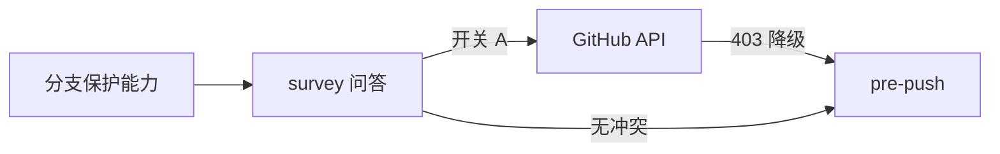

# v9 B2：平台分支保护能力（开关 A）与跨宿主 .githooks/pre-push — 功能设计规范（SPEC）

## 文档信息与变更概览

| 项目 | 内容 |
| --- | --- |
| 当前状态 | `draft`（`draft \| approved \| implementing \| in_review \| implemented \| superseded`） |
| 规划级别 | `L3`（涉平台能力契约、`templates/`、`kit/` 与跨宿主本地 Git Hook；未 `approved` 前不编码） |
| 创建 / 更新 | `2026-11-18` / `2026-11-18` |
| 分支 / Issue / PR | 待启动 Wave 2 认领 / `#72` / 未关联 |
| 负责人 / 内审状态 | `plan-stage-b` / `pending` |
| 关联 PRD / Todo | [v9 总控 PRD](../prd/261118-v9-stageb-adaptive-architecture-prd.md) / [B2 Todo](../todo/261118-issue72-b2-branch-protection-hooks-todo.md) |
| 认领的验收标准 | `C4`、`C5`、`C6` |

- **变更一句话**：为托管平台能力契约对齐 `branchProtection` 开关 A（禁直推/强推/删默认分支、要求 PR 与状态检查，绝不默认要求他人审批），并在 `equip.mjs --with-hooks` 与 `S3` 推荐流程落地跨 AI 宿主的标准 `.githooks/pre-push` 防偏航护栏。

## 系统变更全景

| 模块 / 文件 | 变更性质 | 核心职责 |
| --- | --- | --- |
| `scripts/lib/platform/registry.mjs`、`scripts/lib/platform/github.mjs`、`kit/skills/lib/platform.mjs` | 改造 | 三端对齐新增 `branchProtection` 能力位（`github: true`、`generic-git: false`） |
| `scripts/lib/platform/github-client.mjs` | 改造 | 新增 `getBranchProtection` 与 `applyBranchProtectionSwitchA`（只推开关 A，遇 `403` 返回 `fallbackToHooks: true`） |
| `scripts/lib/survey-questions.mjs`、`scripts/lib/survey-gap-rules.mjs`、`scripts/lib/render.mjs` | 改造 | 新增 `q.branch-protection`、接入 `## 取舍` 防重问、无钩子冲突且未豁免 `no-git-hooks` 时在 `S3` 推荐命令带上 `--with-hooks` |
| `scripts/lib/artifact-executors.mjs`、`scripts/lib/equip-bootstrap.mjs`、`scripts/lib/survey-docs.mjs` | 改造 | 识别 `.githooks/` 与 `.husky/`/`lefthook` 冲突，注册 `branch-protection` / `git-hooks` 产物动作 |
| `scripts/equip-ci.mjs`、`scripts/equip.mjs`、`scripts/survey.mjs` | 改造 | 实现 `equip-ci.mjs --protect-branch` 与 `equip.mjs --with-hooks`（写入 `.githooks/pre-push` 并配局部 `core.hooksPath`） |
| `scripts/review.mjs`、`scripts/lib/review-helpers.mjs` | 改造 | 拆出非 `GAP` 辅助判断压降 `review.mjs <= 660` 行，补全 `gap-coverage` 配对结论 |
| `templates/githooks-pre-push.sh` (new) | 新增 | 跨宿主 POSIX `pre-push` 模板：拦默认分支直推并打印 `[NEXT STEP]`，放行全零删分支与 `PF_ALLOW_DIRECT_PUSH=1` |
| `references/remote-github.md`、`references/version-control.md` | 改造 | 固化开关 A 策略（禁默认审批人）与本地 `.githooks/` 无损共存规则 |
| `scripts/dev/fixtures-stageb-onboarding.mjs` (new) | 修改 | 新增 `C4–C6` 正反双向用例（开关 A payload、403 降级、删分支全零放行、`preserve` 现有钩子等） |

## 一、背景与边界声明

- **要改什么**：平台 `branchProtection` 能力探针与 GitHub 开关 A 配置通道、勘察问答/产物计划/体检闭环、本地跨宿主 `.githooks/pre-push` 模板与无损安装逻辑，以及 `scripts/review.mjs` 行数重构。
- **不改什么**：不修改除 GitHub 以外的新第三方托管平台适配器，保持 `checkPlatformLock` 干净；不动 `.claude/`/`.cursor/` 等任何 AI 宿主私有配置目录。
- **本期不做**：不默认请求或推荐 `required_approving_review_count >= 1`（会阻断单人/AI 自动合流）；不在存在 `.husky/`、`lefthook`、自定义 `core.hooksPath` 或非本工具 `.githooks/pre-push` 时强制覆写。
- **复用既有模块**：复用 `scripts/lib/platform/github-client.mjs` HTTP 客户端、`scripts/lib/survey-gap-rules.mjs` + `scripts/dev/gap-coverage.mjs`、`kit/skills/lib/profile.mjs` 的 `readDecisions`（`## 取舍` 解析）。
- **架构基线关系**：严格遵循 `preflight` 的 `checkPlatformSemanticParity`（`registry.mjs` 与 `kit/skills/lib/platform.mjs` 能力键位一致）及 `gap-coverage.mjs`（`GAP_RULES` 在 `scripts/review.mjs` 配对 `finding(...)`）。
- **替代方案与否决理由**：仅靠 AI 宿主私有 Hook 会绑定特定工具且易被绕过；选用标准 Git `core.hooksPath .githooks` + `opt-in` 自动推荐 `--with-hooks`，实现所有宿主与人工终端统一拦截。

## 二、设计方案与契约变更

### 接口 / 数据结构变更

1. **能力位扩展**：`HostingProvider.capabilities` 在 `scripts/lib/platform/registry.mjs`、`scripts/lib/platform/github.mjs` 与 `kit/skills/lib/platform.mjs` 同步补充 `branchProtection: boolean`（`github` 为 `true`，`generic-git` 为 `false`）。
2. **`scripts/lib/platform/github-client.mjs`**：
   - `getBranchProtection(repo, branch)`：只读查询分支保护状态。
   - `applyBranchProtectionSwitchA(repo, branch, { requiredChecks })`：仅设置 `required_pull_request_reviews` 中 `required_approving_review_count: 0`（或不强制他人审批）、`required_status_checks`、`enforce_admins` / 禁强推与删默认分支，**载荷严格禁止出现 `required_approving_review_count >= 1`**；遇 HTTP `403`/权限不足返回 `{ ok: false, fallbackToHooks: true, reason }`。
3. **CLI 扩展**：
   - `node scripts/equip-ci.mjs <dir> --protect-branch [--branch {branch}]`：在 GitHub 仓执行开关 A 配置或降级引导，非 GitHub 仓安全退出 `0` 并提示平台无关指引。
   - `node scripts/equip.mjs <dir> --with-hooks`：若无外部钩子冲突则复制 `templates/githooks-pre-push.sh` (new) 至 `.githooks/pre-push`（设 POSIX 可执行位 `+x`）并执行局部 `git config --local core.hooksPath .githooks`。

### 数据与状态变更

- `AGENTS.md` `## 取舍` 支持 `branch-protection` / `no-branch-protection` 与 `no-git-hooks` 决策键防重问；仓库局部 `.git/config` 在用户允许或 `--with-hooks` 时设置 `core.hooksPath .githooks`。

### 异常、回退与安全边界

- 若检测存在 `.husky/`、`lefthook.yml`/`.lefthook*`、自定义非 `.githooks` 的 `core.hooksPath` 或已有非本工具标识的 `.githooks/pre-push`，`equip.mjs --with-hooks` 一律 `preserve` 并输出安全共存提示，`survey.mjs` 在 `S3` 推荐命令中亦不注入 `--with-hooks`。
- `.githooks/pre-push` 读取标准输入 `<local_ref> <local_sha> <remote_ref> <remote_sha>`：当 `local_sha` 为全 40 个 `0`（删除远端分支，兼容 `flow.mjs cleanup` 第 7 步）或设置 `PF_ALLOW_DIRECT_PUSH=1` 时立即 `exit 0`；直推默认分支则 `exit 1` 并打印 `[NEXT STEP]` 指向 `flow.mjs start` / `submit`。
- `scripts/review.mjs` 保持所有 `GAP_RULES` 配对 `finding(...)` 调用不变，只将 `render`、`inspectContract` 与非 `GAP` 辅助迁移进 `scripts/lib/review-helpers.mjs`，把 `review.mjs` 压缩至 `<= 660` 行。

### 实现顺序

1. 先拆分 `scripts/review.mjs` 非 `GAP` 逻辑至 `scripts/lib/review-helpers.mjs` 压降行数至 `<= 660` 行并验证 `gap-coverage.mjs` 绿灯。
2. 三端对齐 `branchProtection` 能力位并在 `github-client.mjs` 与 `equip-ci.mjs` 实现开关 A 与 403 降级。
3. 编写 `templates/githooks-pre-push.sh` (new)、`equip.mjs --with-hooks`、`survey-questions.mjs`、`survey-gap-rules.mjs` 与 `render.mjs` 的无冲突自动推荐逻辑。
4. 更新两份 `references/` 文档并在 `scripts/dev/fixtures-stageb-onboarding.mjs` 补齐 `C4–C6` 正反双向断言。

## 三、备选方案与否决理由

| 方案 | 怎么做的 | 为什么没选 | 什么情况下该改回它 |
| --- | --- | --- | --- |
| `equip.mjs` 默认保留 `--with-hooks` 为显式 opt-in，并由 `S3` 无冲突推荐自动附带 | 兼顾安全不破坏 Husky/Lefthook 与低提示词防漏装 | 满足维护者已定选项 A 兼得无损与自动护栏 | 若未来提供多 Hook 链式代理器再统一接管 |
| 开关 A + 403 降级，不开启他人审批 | 保护主干同时允许维护者与独立子代理闭环推进 | 默认开 Approve >= 1 会卡死单人仓与自动化流程 | 仅团队仓自行在 GitHub 网页或 `## 取舍` 手动开启 |

## 四、改动清单与影响面

| 文件 / 目录 | 改动性质 | 改什么 | 谁会被影响 |
| --- | --- | --- | --- |
| `scripts/lib/platform/registry.mjs`、`scripts/lib/platform/github.mjs`、`kit/skills/lib/platform.mjs` | 修改 | 新增 `branchProtection` 布尔能力位 | `survey`、`review`、双端校验 |
| `scripts/lib/platform/github-client.mjs`、`scripts/equip-ci.mjs` | 修改 | 开关 A API（禁设审批人数 `>= 1`）与 `--protect-branch` | GitHub 仓保护配置 |
| `scripts/lib/survey-questions.mjs`、`scripts/lib/survey-gap-rules.mjs`、`scripts/lib/artifact-executors.mjs`、`scripts/lib/render.mjs`、`scripts/lib/equip-bootstrap.mjs`、`scripts/lib/survey-docs.mjs`、`scripts/survey.mjs` | 修改 | `q.branch-protection`、钩子冲突检测、`S3` 自动推荐 `--with-hooks` | `survey` 与 `bootstrap` 用户流 |
| `scripts/equip.mjs`、`templates/githooks-pre-push.sh` (new) | 新增 / 修改 | `--with-hooks` 无损安装本地 `.githooks/pre-push` | 跨宿主 Git 推送防护 |
| `scripts/review.mjs`、`scripts/lib/review-helpers.mjs` | 修改 | 拆降行数并对齐 `gap-coverage` 分支保护体检 | `review`、`merge-gate` |
| `references/remote-github.md`、`references/version-control.md`、`scripts/dev/fixtures-stageb-onboarding.mjs` | 修改 | 规范正文对齐与 `C4–C6` 双向测试 | 维护者参照与回归套件 |

- **对外可见的变化**：`survey --json` 新增 `git.capabilities.branchProtection` 与 `q.branch-protection`；新增 `equip-ci.mjs --protect-branch` 与 `equip.mjs --with-hooks` 开关。
- **需要同步改的地方**：`.agents/skills/` 中 `kit/skills/lib/platform.mjs` 副本（执行 `node scripts/equip.mjs .`）。

## 五、冻结的验收标准

- [ ] C4: `HostingProvider.capabilities`（`scripts/lib/platform/registry.mjs`、`scripts/lib/platform/github.mjs` 与 `kit/skills/lib/platform.mjs`）三端对齐新增 `branchProtection` 能力位并在 `survey.mjs` 输出三态取值；`scripts/lib/platform/github-client.mjs` 新增 `getBranchProtection` 与 `applyBranchProtectionSwitchA`，仅请求开关 A（禁直推、禁强推、禁删默认分支、要求 PR 与状态检查通过）且**请求载荷禁止包含 `required_approving_review_count >= 1`**，遇 HTTP `403`/权限受限返回 `{ ok: false, fallbackToHooks: true }` 优雅降级。
- [ ] C5: `scripts/lib/survey-questions.mjs` 新增 `q.branch-protection` 并接入 `scripts/lib/render.mjs` 远端指引与 `--bootstrap-empty`：`capabilities.branchProtection === true` 时输出 `equip-ci.mjs --protect-branch` 可执行指引，`generic-git` 输出平台无关开关 A 原则指引且通过 `checkPlatformLock`；在 `AGENTS.md` `## 取舍` 写下 `branch-protection` 或 `no-branch-protection` 后重跑 `survey.mjs` 不再重复提问；`equip-ci.mjs --protect-branch` 在非 GitHub 仓安全退出 `0`。
- [ ] C6: `equip.mjs --with-hooks` 为 opt-in 开关：从 `templates/githooks-pre-push.sh` (new) 安装跨宿主 POSIX `.githooks/pre-push` 并配置局部 `git config --local core.hooksPath .githooks`（不触碰任何 AI 宿主私有目录及全局 Git 配置；若检测到 `.husky/`、`lefthook`、自定义 `core.hooksPath` 或非本工具 `.githooks/pre-push` 则 `preserve` 不覆盖）；当无钩子冲突且 `AGENTS.md` `## 取舍` 未写 `no-git-hooks` 时，`survey.mjs`/`render.mjs` 在 `S3` 推荐 `[NEXT STEP]` 自动附带 `--with-hooks` 防止弱模型漏装；直推默认分支时 Hook 拦截退出非 `0` 并输出 `[NEXT STEP]`（指引 `flow.mjs start` / `submit`），而删远端分支（全零 `local_sha`，兼容 `flow.mjs cleanup` 第 7 步）或 `PF_ALLOW_DIRECT_PUSH=1` 放行退出 `0`；`node scripts/dev/gap-coverage.mjs` 对全部 `GAP_RULES` 退出 `0`。

## 六、高风险点、门型与回滚路径

- **门型与回滚路径**：`one-way`（涉及平台契约、分发模板与 `.git/config` 局部 Hook 写入）；回滚做法：合入前丢弃隔离工作树；合入后单提交 `git revert` 并验证非阻断删分支用例。
- **高风险路径**：`scripts/lib/`、`kit/`、`templates/`（须独立审查与故障注入）。
- **故障注入预演**：后续在 `B5` 纳入 `I162`（开关 A 误写 `required_approving_review_count: 1`）与 `I163`（`.githooks/pre-push` 误拦删分支）；本片先在 `fixtures-stageb-onboarding.mjs` 落盘完整双向断言。

## 七、上线与兼容策略

- **向后兼容**：旧仓重跑 `survey.mjs` 自动识别既有 `.husky/`/`lefthook` 并 `preserve`，不影响已存在 Hook 流水线；`no-branch-protection` 与 `no-git-hooks` 写入 `## 取舍` 即永久静默。

## 澄清与补充记录

- （已合入维护者批复：`equip.mjs --with-hooks` 为 opt-in 并与现有 Hook 冲突时 `preserve`，无冲突且未豁免 `no-git-hooks` 时由 `S3` 推荐 `[NEXT STEP]` 自动附带 `--with-hooks`）

## 实现说明

- **实际落地摘要**：
- **与草案的差异**：
- **关联同步文件**：
