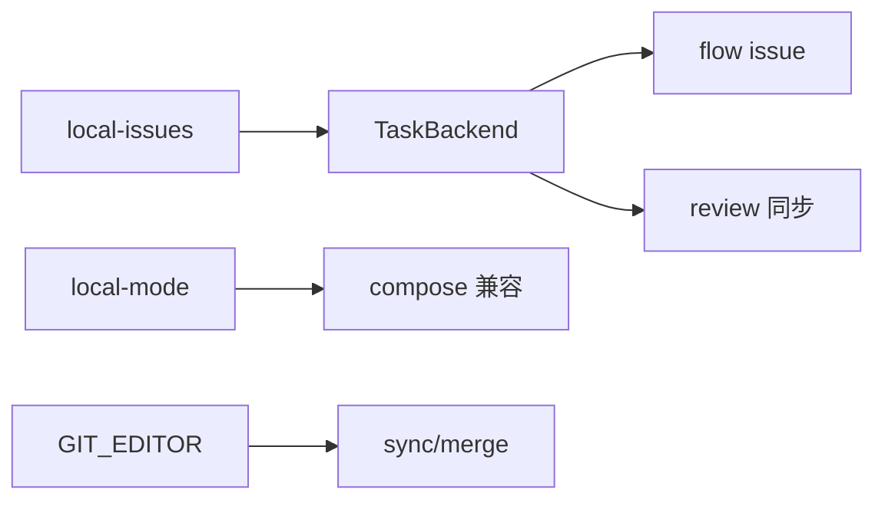

# v9 B3：无远端本地工单全生命周期闭环与非交互 Git 防护 — 功能设计规范（SPEC）

## 文档信息与变更概览

| 项目 | 内容 |
| --- | --- |
| 当前状态 | `draft`（`draft \| approved \| implementing \| in_review \| implemented \| superseded`） |
| 规划级别 | `L3`（扩展 `TaskBackend` 至 16 方法、`local-only` 工单持久层、本地切回远端平滑过渡、子进程非交互防护及紧文件拆解；未 `approved` 前不编码） |
| 创建 / 更新 | `2026-11-18` / `2026-11-18` |
| 分支 / Issue / PR | 待启动 Wave 3 认领 / `#73` / 未关联 |
| 负责人 / 内审状态 | `plan-stage-b` / `pending` |
| 关联 PRD / Todo | [v9 总控 PRD](../prd/261118-v9-stageb-adaptive-architecture-prd.md) / [B3 Todo](../todo/261118-issue73-b3-local-issue-backend-todo.md) |
| 认领的验收标准 | `C7`、`C8` |

- **变更一句话**：落地原子持久化本地工单 `local-issues.mjs` (new) 与 16 方法对称 `TaskBackend` 跑通 `local-only` 全生命周期闭环，解决 `.git/pf-local-mode` 粘滞锁定与远端迁单漂移并补齐 `GIT_EDITOR=true` 非交互 Git 保护，同步压降 `flow-inspect.mjs` 至 `<= 680` 行。

## 系统变更全景

| 模块 / 文件 | 变更性质 | 核心职责 |
| --- | --- | --- |
| `kit/skills/lib/local-issues.mjs` (new) | 新增 | 基于 `resolveGitDirFast(mainRoot)` 在 `<effectiveGitDir>/project-forge-flow/issues/` 原子读写工单、评论、标签与关单态 |
| `kit/skills/lib/task-backend.mjs`、`kit/skills/lib/github-client.mjs` | 改造 | `TASK_BACKEND_METHODS` 扩至 16 方法（`getIssue`/`listIssues`/`closeIssue`）；`LocalOnlyBackend` 声明 `issues: true`/`labels: true` 并修复 `postComment`/`listComments` |
| `kit/skills/lib/platform.mjs`、`scripts/lib/render.mjs`、`scripts/lib/survey-questions.mjs`、`scripts/compose-agents.mjs`、`scripts/equip.mjs` | 改造 | 纯无远端不写裸 `.git/pf-local-mode`，区分 `{ mode: "no-remote" }` 与 `{ mode: "readonly-override" }`；绑远端后清理陈旧 `no-remote` 标记并对齐 `compose-agents` `hasRemote` |
| `kit/skills/dev-flow/scripts/flow-issues.mjs` (new)、`flow.mjs`、`flow-context.mjs`、`flow-inspect.mjs` | 新增 / 改造 | 拆出 `flow.mjs issue create\|list\|view\|comment\|close\|migrate` 与 `--create-issue`（`flow-inspect.mjs <= 680` 行）；在 `flow-context.mjs` `findMatchingDocStrict` 补入 frontmatter `issue` 兜底绑定；支持迁单与运行态远端漂移提醒 |
| `kit/skills/dev-flow/scripts/flow-merge.mjs`、`flow-lifecycle.mjs`、`flow-next.mjs`、`kit/skills/lib/session-orient.mjs` | 改造 | `claim`/`release` 冲突锁、`merge` 自动关单、冷启动展示未闭环本地单与切回远端后残余待办提醒 |
| `kit/skills/dev-review/scripts/review-sync.mjs` (new)、`review-ledger.mjs`、`kit/skills/dev-govern/scripts/govern-state.mjs`、`govern-tests.mjs`、`scripts/dev/injections-data-gates.mjs` | 新增 / 改造 | 抽离评审结果双写至 `review-sync.mjs` (new)（`review-ledger.mjs <= 600` 行）并同步更新 `I145`（`probeForWrite`），治理 `applyIssuesToBackend` 打通无远端建单，过 `write-probe-audit.mjs` |
| `kit/skills/lib/exec.mjs`、`flow-sync.mjs`、`flow-trial-merge.mjs`、`scripts/dev/preflight-suite.mjs` | 改造 | `buildNonInteractiveEnv` 补 `GIT_EDITOR: 'true'` 与 `GIT_SEQUENCE_EDITOR: 'true'`（`preflight-suite` 对拍），防止 Windows 拉起交互编辑器 |
| `scripts/dev/fixtures-stageb-loop.mjs` (new) | 修改 | 覆盖 `C7`、`C8` 正反双向用例（本地工单生命周期、并发认领、迁回远端过渡、`GIT_EDITOR=true`） |

## 一、背景与边界声明

- **要改什么**：本地工单持久化层、`TaskBackend` 16 方法对称接口、`flow.mjs issue`（含 `migrate`）、`pf-local-mode` 结构化区分（消除 `no-remote -> has-remote` 死锁）、非交互 Git 环境变量以及 `flow-inspect.mjs` / `review-ledger.mjs` / `govern-state.mjs` 行数拆减。
- **不改什么**：不新增第二套 Skill；不向目标仓受跟踪工作区写入任何工单 JSON（始终存于 `effectiveGitDir` 内，保证 `git status` 零污染）；不破坏 `fixtures-claims` 对「带远端且存在 `.git/pf-local-mode` 强制降级只读克隆」的既有断言。
- **本期不做**：不新增跨仓库工单联邦同步；不改动分支保护开关 A 或 `escalation.mjs` 多轮分级模型（分级模型与 `STOP_LOSS_ESCALATE` 在 `B4b` 收口）。
- **复用既有模块**：复用 `kit/skills/lib/git.mjs`（`withFileLock`、`writeAtomic`、`readJsonSafe`）、`kit/skills/lib/git-fast.mjs`（`resolveGitDirFast`）、`kit/skills/lib/platform-probe.mjs`（`probeForWrite`）与 `scripts/dev/write-probe-audit.mjs`。
- **架构基线关系**：所有新模块均在 `kit/skills/` 内使用 `node:*` 与 `kit/skills/lib/`；凡 `kit/skills/` 新增调用 `.createIssue`/`.postComment`/`.addLabels`/`.removeLabel`/`.claimTask`/`.releaseTask` 的文件均在远端路径调用 `probeForWrite`。
- **替代方案与否决理由**：若在工作区写 `.project-forge/issues/` 会污染 `git diff` 并与业务 PR 冲突；放入 `<effectiveGitDir>/project-forge-flow/issues/` 让主仓与所有 `.worktrees/*` 天然共享且隔离于工作树之外。

## 二、设计方案与契约变更

### 接口 / 数据结构变更

1. **`kit/skills/lib/local-issues.mjs` (new)**：
   - 存储位置：`join(effectiveGitDir, 'project-forge-flow', 'issues')`，含 `index.json`（自增 `nextId`、索引摘要）与 `items/{id}.json`（`number`、`title`、`body`、`state`: `'OPEN' | 'CLOSED'`、`labels: string[]`、`comments: []`、`assignees: string[]`、`createdAt`、`updatedAt`、`closedAt`）。
   - 导出原子方法（复用 `withFileLock`）：`createLocalIssue`、`getLocalIssue`、`listLocalIssues`、`updateLocalIssue`、`closeLocalIssue`、`addLocalIssueComment`、`addLocalIssueLabels`、`removeLocalIssueLabel`、`claimLocalIssue`、`releaseLocalIssue`。
2. **`kit/skills/lib/task-backend.mjs`（16 方法）**：
   - `TASK_BACKEND_METHODS` 在原 13 方法基础上新增 `getIssue`、`listIssues`、`closeIssue`。
   - `GitHubBackend`、`GenericRemoteBackend`、`LocalOnlyBackend` 同步补齐 `getIssue`、`listIssues`、`closeIssue`；`github-client.mjs` 新增 `listIssues` 与 `closeIssue`（约 45 行）。
   - `LocalOnlyBackend` `capabilities` 设为 `{ issues: true, labels: true, pr: false, releases: false }`，修复原 `postComment`/`listComments` 参数错配，落盘 `local-issues.mjs` (new)。
3. **无远端起步平滑切回远端机制**：
   - `render.mjs` 与 `survey-questions.mjs` 不再指引纯无远端仓写裸 `.git/pf-local-mode`（`platform.mjs` 无远端已自动判 `local-only`）。
   - `kit/skills/lib/platform.mjs`（`detectGitModeMarkers`）：读取 `pf-local-mode` 内容，仅当 JSON 明确标记 `mode === 'no-remote'` 且仓库已绑定远端时返回 `{ localMode: false, staleNoRemote: true }`；空文件或 `{ mode: "readonly-override" }`（由 `flow-inspect.mjs --clone-choice local` 写入）在有远端时继续锁定 `localMode: true`（兼容 `fixtures-claims`）。
   - `flow-inspect.mjs` 与 `scripts/equip.mjs` 在检测到 `staleNoRemote` 时自动清除陈旧 `.git/pf-local-mode`；`compose-agents.mjs` 中 `hasRemote` 校验 `!facts.git?.localMode`。
   - `flow-issues.mjs` (new) 新增 `flow.mjs issue create|list|view|comment|close|migrate`：`migrate` 在当前仓切回远端后枚举开放本地工单，通过远端 `TaskBackend.createIssue` 建单、同步备注后调用 `closeLocalIssue`。
   - `flow-inspect.mjs` 与 `flow-next.mjs` 在 `role !== 'local-only'` 且检测到 `AGENTS.md` 仍处于 `no-remote` 状态或 `.github/` 缺失时打印非阻塞漂移提醒，引导重跑 `S1–S4`。
4. **非交互 Git 子进程防护**：
   - `kit/skills/lib/exec.mjs` `buildNonInteractiveEnv` 增加 `GIT_EDITOR: 'true'` 与 `GIT_SEQUENCE_EDITOR: 'true'`，并在 `scripts/dev/preflight-suite.mjs` 加入双端键对拍断言；`flow-sync.mjs`、`flow-merge.mjs`、`flow-trial-merge.mjs` 在所有 `merge` / `rebase` 调用确保传入 `--no-edit` 与非交互环境。

### 数据与状态变更

- 新增 `<effectiveGitDir>/project-forge-flow/issues/index.json` 与 `items/*.json` 本地工单状态存储。
- `.git/pf-local-mode` 兼容旧空文件与新结构化 JSON（`no-remote` vs `readonly-override`）。

### 异常、回退与安全边界

- 并发认领已分配给他人的工单返回 `BLOCKED_ISSUE_ALREADY_CLAIMED`（须显式传 `--takeover --reason "..."`）。
- 凡 `flow-issues.mjs` (new)、`review-sync.mjs` (new)、`flow-merge.mjs`、`govern-state.mjs` 在远端分支调用 `TaskBackend` 写接口前必须执行 `probeForWrite` 校验，确保 `write-probe-audit.mjs` 检查 0 违规。
- `flow-inspect.mjs` 拆出 `flow-issues.mjs` (new) 并将 `migrateUncommittedPlanDocs`/`findMatchingDocStrict` 移入 `flow-context.mjs`，控制在 `<= 680` 行（同时在 `flow-context.mjs` `findMatchingDocStrict` 中新增按文档 YAML frontmatter `issue: {N}` 兜底匹配，使裸跑 `flow.mjs start --issue <N>` 不传 `--task` 也能直接绑上预建 `SPEC`/`Todo`）；`review-ledger.mjs` 拆出 `review-sync.mjs` (new) 压至 `<= 600` 行并同步更新 `scripts/dev/injections-data-gates.mjs` 中 `I145`（`probeForWrite`）。

### 实现顺序

1. 先拆分 `flow-inspect.mjs`（互链辅助迁入 `flow-context.mjs` 并补齐 `issue` 兜底绑定）与 `review-ledger.mjs`（抽离 `review-sync.mjs` (new) 并同步更新 `I145`），扩展 `kit/skills/lib/exec.mjs` + `preflight-suite.mjs` 非交互环境变量对拍。
2. 实现 `kit/skills/lib/local-issues.mjs` (new)、`github-client.mjs` (`listIssues`/`closeIssue`) 与 `task-backend.mjs` 16 方法对称接口。
3. 落地 `flow-issues.mjs` (new)（含 `migrate`）、`flow-merge.mjs`/`flow-lifecycle.mjs`/`session-orient.mjs`/`govern-state.mjs`/`govern-tests.mjs` 对接，以及 `platform.mjs`/`render.mjs`/`survey-questions.mjs`/`compose-agents.mjs`/`equip.mjs` 的无粘滞远端切换逻辑。
4. 在 `scripts/dev/fixtures-stageb-loop.mjs` (new) 写入 `C7`、`C8` 全部正反双向断言（含「本地起步 -> 建单 -> 新增 `origin` -> 迁移切回远端闭环」、裸 `--issue` 匹配与 `write-probe-audit.mjs` 检验）。

## 三、备选方案与否决理由

| 方案 | 怎么做的 | 为什么没选 | 什么情况下该改回它 |
| --- | --- | --- | --- |
| `<effectiveGitDir>/project-forge-flow/issues/` + `detectGitModeMarkers` 区分 `no-remote` 与 `readonly-override` | 主仓与 worktree 共用且不污染工作区；无远端升级远端无缝切回，不破只读克隆降级 | 兼顾零污染、跨 worktree 一致性与向后兼容 | 若未来需要跨设备导出本地工单，可另加显式 export 命令 |
| 保留裸 `.git/pf-local-mode` 靠文档说明用户手动删 | 文档提示新增远端后自己删标记文件 | 弱模型和自动化流程极易漏删，导致 `AGENTS.md` 与 `TaskBackend` 长期状态撕裂 | 无，已由实测确认为粘滞缺陷 |

## 四、改动清单与影响面

| 文件 / 目录 | 改动性质 | 改什么 | 谁会被影响 |
| --- | --- | --- | --- |
| `kit/skills/lib/local-issues.mjs` (new) | 新增 | 原子本地工单/评论/标签/认领存储引擎 | `LocalOnlyBackend`、`session-orient` |
| `kit/skills/lib/task-backend.mjs`、`kit/skills/lib/github-client.mjs` | 修改 | 扩展 16 方法与本地能力修复 | `flow`、`review`、`govern` |
| `kit/skills/lib/platform.mjs`、`scripts/lib/render.mjs`、`scripts/lib/survey-questions.mjs`、`scripts/compose-agents.mjs`、`scripts/equip.mjs` | 修改 | 解决 `pf-local-mode` 粘滞与 `hasRemote` 对齐 | 本地切远端项目与只读克隆 |
| `kit/skills/dev-flow/scripts/flow-issues.mjs` (new)、`flow.mjs`、`flow-context.mjs`、`flow-inspect.mjs`、`flow-next.mjs`、`flow-merge.mjs`、`flow-lifecycle.mjs`、`flow-sync.mjs`、`flow-trial-merge.mjs` | 新增 / 修改 | `flow.mjs issue` 含 `migrate`、漂移提醒、非交互防护、拆降行数 | 全研发流转命令行 |
| `kit/skills/dev-review/scripts/review-sync.mjs` (new)、`review-ledger.mjs`、`kit/skills/dev-govern/scripts/govern-state.mjs`、`govern-tests.mjs`、`kit/skills/lib/session-orient.mjs`、`scripts/dev/injections-data-gates.mjs` | 新增 / 修改 | 评审同步拆解并更新 `I145`、治理想单直写、冷启动工单展示 | 评审、治理、`verify-injections` 与跨会话唤醒 |
| `kit/skills/lib/exec.mjs`、`scripts/dev/preflight-suite.mjs`、`scripts/dev/fixtures-stageb-loop.mjs` (new) | 修改 | `GIT_EDITOR=true` 对拍与 `C7–C8` 双向测试 | 跨平台子进程与门禁 |

- **对外可见的变化**：新增 `flow.mjs issue create|list|view|comment|close|migrate` 与 `flow start --create-issue`；`LocalOnlyBackend` 全面支持建单、评论、标签、关单并在绑定远端后平滑迁出。
- **需要同步改的地方**：运行 `node scripts/equip.mjs .` 同步 `.agents/skills/`（与同波次 `B4a` 串行合入后重跑）。

## 五、冻结的验收标准

- [ ] C7: 新增 `kit/skills/lib/local-issues.mjs` (new)，经 `resolveGitDirFast(mainRoot)` 将本地工单原子写入 `<effectiveGitDir>/project-forge-flow/issues/`（`index.json` + `items/*.json`，主仓与所有 worktree 共享且 `git status` 零污染）；`kit/skills/lib/task-backend.mjs` 的 `TASK_BACKEND_METHODS` 扩展至 16 方法（新增 `getIssue`、`listIssues`、`closeIssue`）并由 `GitHubBackend`/`GenericRemoteBackend`/`LocalOnlyBackend` 共同实现；`LocalOnlyBackend` 声明 `issues: true`、`labels: true`，修复 `postComment`/`listComments` 错配并持久化标签与关单态；消除 `.git/pf-local-mode` 粘滞死锁——纯无远端不写裸 `.git/pf-local-mode`（`render.mjs`/`survey-questions.mjs`），`detectGitModeMarkers` 与 `flow-inspect.mjs` 区分 `{ mode: "no-remote" }` 与只读克隆 `{ mode: "readonly-override" }`（兼容 `fixtures-claims`），绑定 `origin` 后 `no-remote` 标记自动失效并清理，且 `compose-agents.mjs` `hasRemote` 尊重有效 `localMode`。
- [ ] C8: `flow-inspect.mjs`（`start --create-issue`、`--issue` 依赖图水合与运行态远端漂移提醒）、`kit/skills/dev-flow/scripts/flow-context.mjs`（`findMatchingDocStrict` 支持按 frontmatter `issue` 兜底绑定预建 `SPEC`/`Todo`）、`kit/skills/dev-flow/scripts/flow-issues.mjs` (new)（`flow.mjs issue create|list|view|comment|close|migrate`，支持将残余本地未闭环工单一键迁移至远端并关停本地单）、`flow-merge.mjs`（`claim`/`release` 拦截 `BLOCKED_ISSUE_ALREADY_CLAIMED` 与 `--takeover`、`merge` 双写并自动调用 `closeIssue`）、`flow-lifecycle.mjs`、`flow-next.mjs`、`kit/skills/dev-review/scripts/review-sync.mjs` (new)/`review-ledger.mjs`、`session-orient.mjs`（冷启动展示本地未闭环工单及切回远端后的残余本地单提示）与 `govern-state.mjs`/`govern-tests.mjs`（`applyIssuesToBackend`）在 `local-only` 及「本地起步 -> 新增 `origin` -> 无痛切回远端」均通过 `TaskBackend` 跑通完整自迭代闭环，零第二套 Skill，且 `write-probe-audit.mjs` 检查 0 违规；`kit/skills/lib/exec.mjs`（`buildNonInteractiveEnv` 补全 `GIT_EDITOR: 'true'`、`GIT_SEQUENCE_EDITOR: 'true'` 并纳入 `preflight-suite.mjs` 双端对拍）与 `flow-sync.mjs`/`flow-merge.mjs`/`flow-trial-merge.mjs` 确保所有子进程 `git merge` 与 `rebase` 均带非交互编辑器保护，Windows 下不拉起 `vim.exe`。

## 六、高风险点、门型与回滚路径

- **门型与回滚路径**：`one-way`（涉及 `TaskBackend` 接口扩展、状态存储路径与写路径网络探测契约）；回滚做法：合入前丢弃分支；合入后单次反向提交并验证 `write-probe-audit.mjs` 与 `fixtures.mjs` 全绿。
- **高风险路径**：`kit/`、`scripts/lib/`、`templates/`（须走独立审查与故障注入）。
- **故障注入预演**：后续在 `B5` 纳入 `I164`（`LocalOnlyBackend` 退回 `skipped: true`）与 `I165`（`merge` 未自动关本地工单或 `pf-local-mode` 死锁切回远端）；本片在 `fixtures-stageb-loop.mjs` 落盘完整正反双向测试。

## 七、上线与兼容策略

- **向后兼容**：保留对既有一切空 `.git/pf-local-mode` 文件的只读降级兼容，同时兼容历史无本地工单目录的空库状态；旧版 13 方法调用方无须改动即可平滑运行。

## 澄清与补充记录

- （已合入维护者补充：解决本地起步后新增 `origin` 的 `.git/pf-local-mode` 粘滞冲突、残余本地工单迁单与运行态远端漂移提醒，并补齐子进程非交互 `GIT_EDITOR=true` 保护）

## 实现说明

- **实际落地摘要**：
- **与草案的差异**：
- **关联同步文件**：
